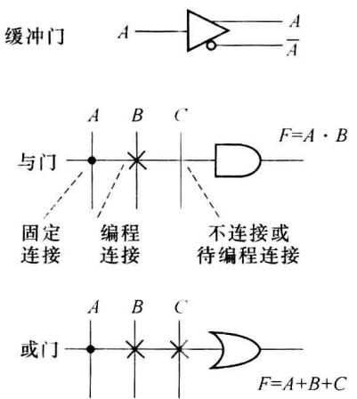
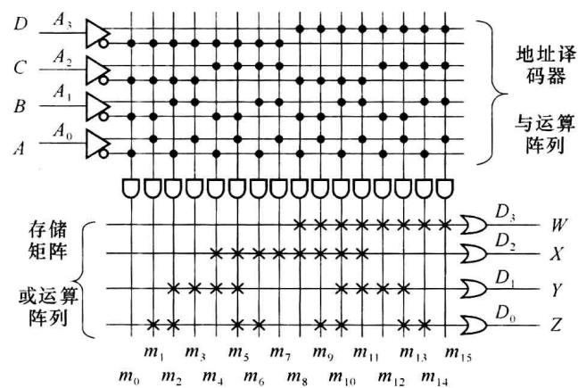
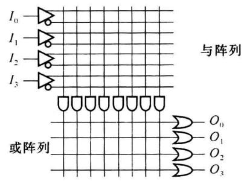
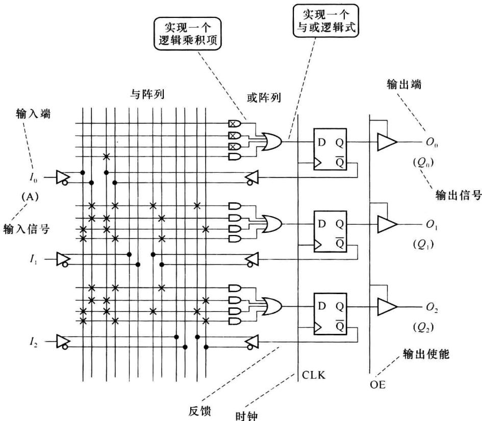
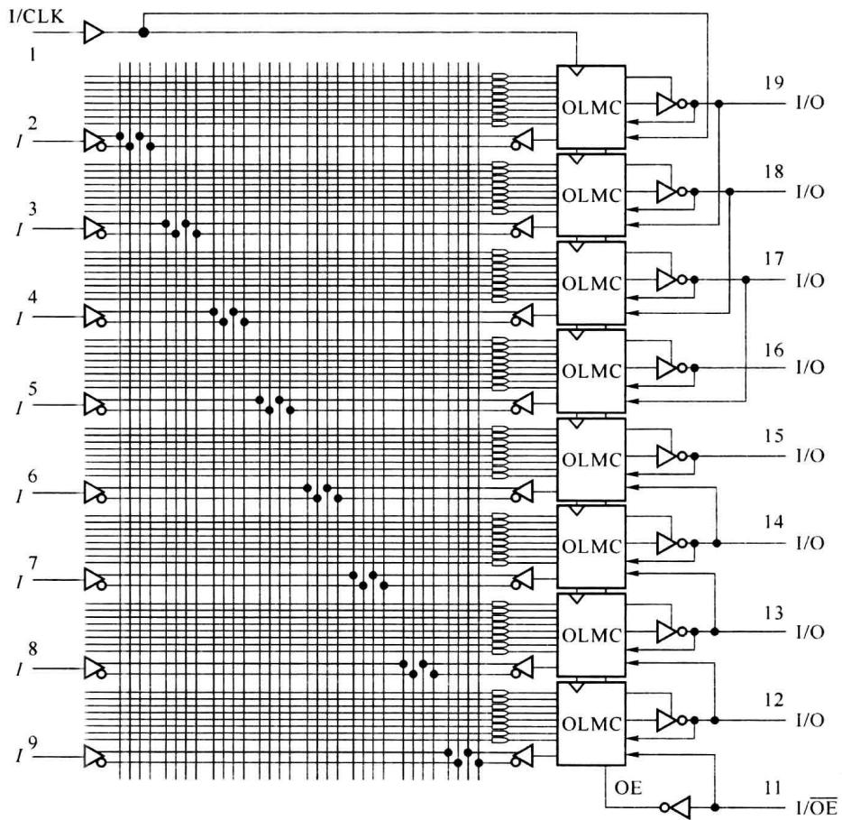
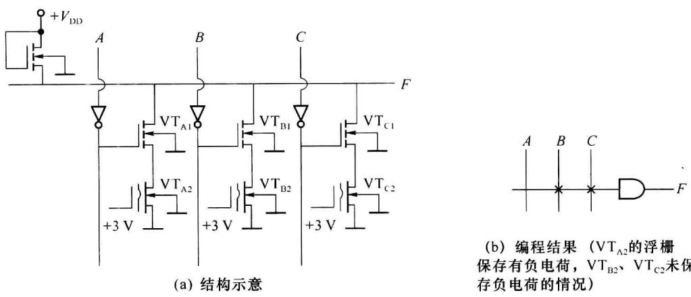
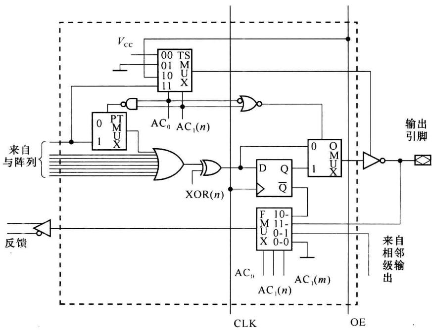
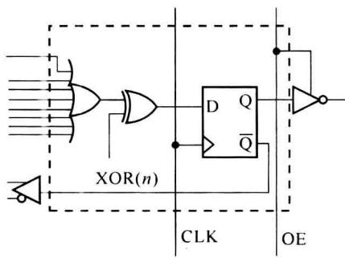
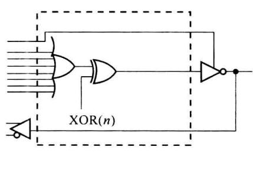

import Guide from '@/components/Guide.astro';
import Knowledge from '@/components/Knowledge.astro';
import Example from '@/components/Example.astro';
import Analysis from '@/components/Analysis.astro';
import Solution from '@/components/Solution.astro';
import Variant from '@/components/Variant.astro';
import Note from '@/components/Note.astro';
import Block from '@/components/Block.astro';
import Method from '@/components/Method.astro';
import Exercise from '@/components/Exercise.astro';

PLA、PAL、GAL 是可编程逻辑器件(PLD)发展过程中的阶段性产品。了解、比较它们的逻辑结构可认识编程器件的特点和发展。

为简便描述 PLD 的逻辑结构和编程信息,通常用阵列图作为表达形式。图 7.2.1 为阵列图中逻辑门和连接关系的画法。图 7.2.2 为例 7.1.1 中实现 4 位二进制码与循环码转换功能的 ROM 的阵列图。

图7.2.1 PLD阵列图中的

图7.2.2 实现4位二进制码与循环码转换的ROM的阵列图

## 7.2.1 PLA

可编程逻辑阵列(Programmable Logic Array, PLA)中的与阵列、或阵列均可被编程。

图 7.2.3 为 $4 \times 8 \times 4$ PLA 中组合逻辑部分的阵列图，有 4 条变量输入线、4 条输出线，每条输出线可实现一个与或逻辑式，其中最多可有 8 个乘积项。与阵列和或阵列中每条线的交点均可由编程决定连接或不连接。由于 PLA 的与阵列并不固定产生输入变量的全部最小项，其芯片面积使用效率高于存储器。

在用 PLA 实现组合逻辑函数时,需根据 PLA 中能提供乘积项的数目化简函数表达式。多输出函数情况时,也要考虑公共乘积项的利用。

图7.2.3 $4\times 8\times 4\mathrm{PLA}$

## 7.2.2 PAL

可编程阵列逻辑(Programmable Array Logic, PAL)是20世纪70年代末发展出的PLD,采用的是双极型工艺、熔断丝的编程方式。PAL的组合逻辑部分具有与阵列可编程,或阵列固定的特点。根据输出电路结构的不同,PAL有着多种类型。图7.2.4为有输出寄存器类型PAL中某型号的逻辑结构图(部分电路)。

图 7.2.4 有输出寄存器类型 PAL 的某型号的逻辑结构图(部分电路)

在图 7.2.4 中, 连接每个与门的横线可实现一个逻辑乘积项, 每个乘积项的变量可编程选自输入信号及反馈信号(现图中的各编程连接符“×”是例 7.2.1 的结果)。每个或门输出可实现一个与或逻辑式,其中固定包括有4个乘积项,因而说PAL的或阵列固定、与阵列可编程。图7.2.4的PAL中,每个或门的输出作为触发器的输入,各触发器的时钟连接专用时钟输入线CLK,因而可以实现同步时序逻辑。各输出缓冲门的使能也由专用线OE控制。

<Example title="例 7.2.1">
基于图 7.2.4 结构的 PAL 实现可控加减法模 6 计数器(自然二进制码规律)。

<Solution title="解">
第5章中给出了可控加减计数器电路的分析的例子，也介绍了计数器的一般设计方法。在本例中可设一输入控制信号 $A, A$ 为逻辑0时进行加计数， $A$ 为1时进行减计数。状态转移表如表7.2.1所示。

表 7.2.1 可控加减模 6 计数器的状态转移表

<table><tr><td>A</td><td> ${Q}_{2}^{n}$ </td><td> ${Q}_{1}^{n}$ </td><td> ${Q}_{0}^{n}$ </td><td> ${Q}_{2}^{n + 1}$ </td><td> ${Q}_{1}^{n + 1}$ </td><td> ${Q}_{0}^{n + 1}$ </td></tr><tr><td>0</td><td>0</td><td>0</td><td>0</td><td>0</td><td>0</td><td>1</td></tr><tr><td>0</td><td>0</td><td>0</td><td>1</td><td>0</td><td>1</td><td>0</td></tr><tr><td>0</td><td>0</td><td>1</td><td>0</td><td>0</td><td>1</td><td>1</td></tr><tr><td>0</td><td>0</td><td>1</td><td>1</td><td>1</td><td>0</td><td>0</td></tr><tr><td>0</td><td>1</td><td>0</td><td>0</td><td>1</td><td>0</td><td>1</td></tr><tr><td>0</td><td>1</td><td>0</td><td>1</td><td>0</td><td>0</td><td>0</td></tr><tr><td>0</td><td>1</td><td>1</td><td>0</td><td> $\phi$ </td><td> $\phi$ </td><td> $\phi$ </td></tr><tr><td>0</td><td>1</td><td>1</td><td>1</td><td> $\phi$ </td><td> $\phi$ </td><td> $\phi$ </td></tr><tr><td>1</td><td>0</td><td>0</td><td>0</td><td>1</td><td>0</td><td>1</td></tr><tr><td>1</td><td>0</td><td>0</td><td>1</td><td>0</td><td>0</td><td>0</td></tr><tr><td>1</td><td>0</td><td>1</td><td>0</td><td>0</td><td>0</td><td>1</td></tr><tr><td>1</td><td>0</td><td>1</td><td>1</td><td>0</td><td>1</td><td>0</td></tr><tr><td>1</td><td>1</td><td>0</td><td>0</td><td>0</td><td>1</td><td>1</td></tr><tr><td>1</td><td>1</td><td>0</td><td>1</td><td>1</td><td>0</td><td>0</td></tr><tr><td>1</td><td>1</td><td>1</td><td>0</td><td> $\phi$ </td><td> $\phi$ </td><td> $\phi$ </td></tr><tr><td>1</td><td>1</td><td>1</td><td>1</td><td> $\phi$ </td><td> $\phi$ </td><td> $\phi$ </td></tr></table>

根据表 7.2.1 可得出 $Q_{2}^{n+1}$ 、 $Q_{1}^{n+1}$ 、 $Q_{0}^{n+1}$ 的卡诺图。化简各卡诺图（过程略）得到各 D 触发器输入信号的表达式如式(7.2.1)。

$$

\left. \begin{array}{l} Q _ {2} ^ {n + 1} = D _ {2} ^ {n} = \overline {{A}} Q _ {1} ^ {n} Q _ {0} ^ {n} + \overline {{A}} Q _ {2} ^ {n} \overline {{Q _ {0} ^ {n}}} + A \overline {{Q _ {2} ^ {n}}} \overline {{Q _ {1} ^ {n}}} \overline {{Q _ {0} ^ {n}}} + A Q _ {2} ^ {n} Q _ {0} ^ {n} \\ Q _ {1} ^ {n + 1} = D _ {1} ^ {n} = \overline {{A}} \cdot \overline {{Q _ {2} ^ {n}}} \overline {{Q _ {1} ^ {n}}} Q _ {0} ^ {n} + \overline {{A}} Q _ {1} ^ {n} \overline {{Q _ {0} ^ {n}}} + A Q _ {2} ^ {n} \overline {{Q _ {0} ^ {n}}} + A Q _ {1} ^ {n} Q _ {0} ^ {n} \\ Q _ {0} ^ {n + 1} = D _ {0} ^ {n} = \overline {{Q _ {0} ^ {n}}} \end{array} \right\}\tag{7.2.1}

$$

以编程连接符号“×”将式(7.2.1)表达在与阵列、或阵列中就得到了用PAL实现本例的逻辑电路图，如图7.2.4所示。

熔断丝编程的 PAL 在出厂时各熔断丝呈连通状态,相当于结构图与阵列中的各交差点均存在编程连接。编程时将不需要的连接位置处的熔断丝熔断而保留需要的熔断丝。与阵列未使用到的与门(线)的各编程点呈连接状态,与门输出信号恒为 0 ,但为简化表达,未使用到的与门对应的各编程点均不标画符号“×”或将“×”标在与门中,如图 7.2.4 所示。
</Solution>
</Example>

## 7.2.3 GAL

20 世纪 80 年代在 PAL 基础上发展的通用阵列逻辑 (Generic Array Logic, GAL) 有着

以下主要特点：

① 首次在 PLD 采用了 EEPROM 工艺,使得 PLD 具有了电擦除可重复编程的性能。

② 沿用了 PAL 的“与阵列可编程，或阵列固定”的结构，在输出部分用逻辑宏单元 (OLMC) 取代了通用寄存器，增进了器件的功能。

图 7.2.5 为 GAL 典型器件 GAL16V8 的结构图。

### (1) 逻辑阵列

在图 7.2.5 所示的 GAL16V8 的与阵列中, 连接每个与门的横线可实现一个乘积项。送入每个 OLMC 内的或门各有 8 个乘积项(8 条横线)。每个乘积项中的变量可选自 32 个信号(来自输入端的 8 个原变量、8 个反变量, 来自反馈的 8 个原变量、8 个反变量)。

图7.2.5 GAL16V8的结构图

由图 7.2.5 可见, 每个 OLMC 向与阵列反馈回一个信号, 这个反馈可选自 3 个信号: 本 OLMC 的输出信号、相邻 OLMC 的输出信号、I/O 引脚来的外输入信号。反馈信号可以增加一个 OLMC 实现的组合逻辑函数中的乘积项的个数, 也可以增加一个乘积项中变量的个数。在 OLMC 构成时序逻辑电路时反馈也是必要的。

图 7.2.5 中的引脚 I/CLK、I/OE 经编程可以作为一般输入端引脚(I)，也可为各 OLMC 提供专用全局时钟(CLK)和输出使能(OE)信号。

图 7.2.6 给出基于 EEPROM 的可编程与门的结构示意。当浮栅保存有负电荷使浮栅管(如 $VT_{A2}$ ) 总处于截止状态时, 该路输出总为高电平, 该路对应的变量(如 A) 对线与输出 F 的电平没有影响, 相当于该变量没有被编程连接到与门。反之, 若某路的浮栅管内的负电荷被释放掉, 则相当于该路变量被编程连接到与门。

图7.2.6 基于EEPROM的可编程与门的结构示意

(2) OLMC

图 7.2.7 为 GAL16V8 中的输出逻辑宏单元 (Output Logic Macro Cell, OLMC) 的逻辑图。其中，8 输入或门完成或运算，异或门起着可编程控非门的作用。D 触发器使 GAL 有了时序逻辑功能，其时钟用全局时钟 (CLK)。

图7.2.7 GAL16V8的OLMC的逻辑图

对 OLMC 的编程配置主要是通过 4 个选择器进行的。其中,选择器 TSMUX 为输出缓冲门选取控制信号;PTMUX 决定由与阵列来的第 8 个乘积项是否可作为输出缓冲器的控制信号；OMUX决定是否使用 $D$ 触发器，当选择组合逻辑电路的结果直送输出时不使用 $D$ 触发器，但 $D$ 触发器也不能另作它用。这一缺点在后发展的EPLD、CPLD、FPGA中有了改进。选择器FMUX选取反馈信号，反馈信号可来自本OLMC(序号为 $n$ )，也可来自相邻OLMC(序号 $m$ 、 $m = n + 1$ 或 $n - 1$ ，如图7.2.7所示)的输出，也可来自I/O引脚的输入信号。也可选择无反馈。 $\mathrm{AC}_0, \mathrm{AC}_1(n), \mathrm{AC}_1(m)$ 决定着各选择器的选通连向。

$AC_{0}$ 、 $AC_{1}(n)$ 、 $AC_{1}(m)$ 为GAL控制字中的信息位。使用者通过编译工具将编程信息写入GAL的控制字。

OLMC 有 5 种工作模式。图 7.2.8(a)、图 7.2.8(b) 分别为其中的时序输出模式和组合 I/O 模式。

(a) 时序输出工作模式

(b) 组合I/O工作模式

图7.2.8 OLMC的工作模式
