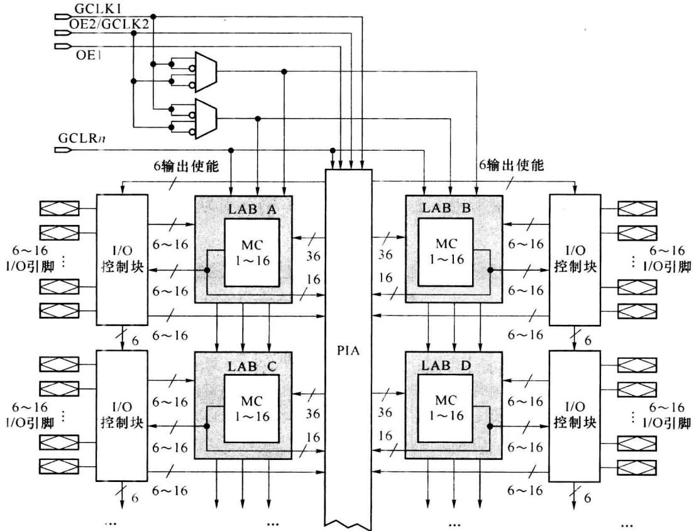
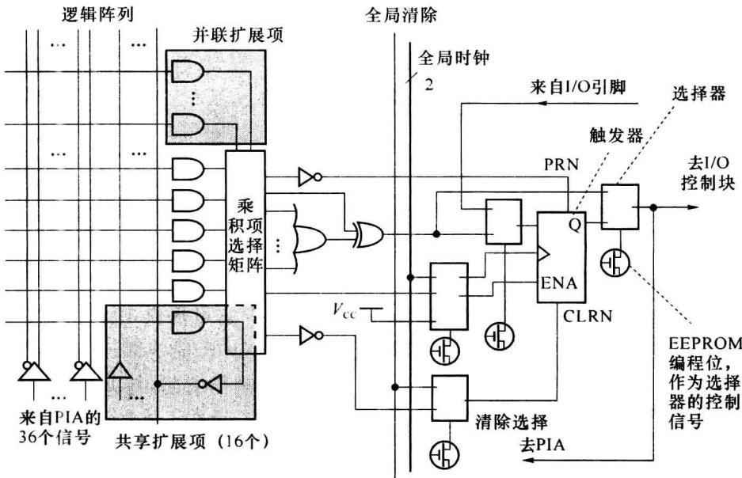

import Guide from '@/components/Guide.astro';
import Knowledge from '@/components/Knowledge.astro';
import Example from '@/components/Example.astro';
import Analysis from '@/components/Analysis.astro';
import Solution from '@/components/Solution.astro';
import Variant from '@/components/Variant.astro';
import Note from '@/components/Note.astro';
import Block from '@/components/Block.astro';
import Method from '@/components/Method.astro';
import Exercise from '@/components/Exercise.astro';

PLA、PAL、GAL 是 PLD 早期发展进程中的代表性产品, 可将它们统称为简单 PLD (SPLD)。随着信息数字处理技术的发展, SPLD 在资源规模、配置灵活度等方面都难以满足构建大规模数字系统的要求。EPLD、CPLD、FPGA 是继 SPLD 后发展起、现仍在发展中的 PLD 器件。本节以 MAX7000 系列为例介绍可擦除的可编程逻辑器件 (Erasable PLD, EPLD) 器件的主要特点。

## 7.3.1 MAX7000 系列的系统结构

MAX7000 系列 PLD 采用 $0.8 \mu m$ CMOS EEPROM 技术制造，有 600～5000 个可用门。引脚到引脚的信号延时为 6 ns，计数器最高工作频率为 151.5 MHz。图 7.3.1 为 MAX7000E/S 器件的结构框图。

MAX7000 系列器件由以下几个基本部分组成: 逻辑阵列块(LAB)、宏单元(MC)、输入/输出控制块(I/O 控制块)、可编程连线阵列(PIA)、扩展乘积项、专用输入线(4 个)。

图 7.3.1 MAX7000 的结构框图

4 个专用输入端可作为全局时钟(CLK)、清除(CLR)、输出使能(OE)信号, 它们是为 MC 和 I/O 控制块提供的高速控制信号。

各 LAB 之间通过 PIA(Programmable Interconnection Array)互连。信号经 PIA 传输后增加一个传输延时 $t_{PIA}$ 。对一确定型号的 EPLD, $t_{PIA}$ 是一个固定值，不因信号在 PIA 中的路径不同而改变。这是 EPLD/CPLD 类 PLD 器件的特点。

MAX7000 系列的 EPLD 的编程技术基于 EEPROM, 其编程内容不会因器件掉电而丢失。这给应用系统带来了方便。

本节主要介绍 MAX7000 系列中 LAB 和 MC。对其他部件的介绍可见相关资料。

## 7.3.2 MAX7000 系列的 LAB 和 MC

依系列中型号的不同，MAX7000 可分别提供 2～16 个逻辑阵列块(LAB)，每个 LAB 中有 16 个宏单元(MC)并分为两组，每组 8 个。MC 主要由逻辑阵列、乘积项选择矩阵和可编程触发器组成。图 7.3.2 为 MC 的结构图。

### 1. 逻辑阵列和乘积项选择矩阵

逻辑阵列实现与运算, 图 7.3.2 中每个与门实现一个乘积项, 每个乘积项的变量可选自从 PIA 来的 36 个信号以及从本 LAB 来的 16 个共享扩展项信号。由逻辑阵列本身可实现 5 个乘积项, 但使用扩展乘积项后可使一个 MC 实现多至 20 个的乘积项。

乘积项选择矩阵选取乘积项送入或门及异或门以构成组合逻辑函数。后接的可编程触发器的置位(PRN)、清除(CLRN)、时钟(CLK)、时钟使能(ENA)信号也可由乘积项选择矩阵从乘积项中选取。

图 7.3.2 MAX7000 系列中宏单元 (MC) 的结构框图

### 2. 可编程触发器

可编程触发器可被设置实现 D、JK、T、RS 触发器的功能。

触发器的时钟工作方式可有 3 种: ①时钟选自全局时钟(GCLK1、GCLK2), 这种方式的工作速度最快; ②带有时钟使能控制的全局时钟, 时钟使能信号来自乘积项; ③时钟来自某一乘积项。

触发器的置位(PRN)、清除(CLRN)均为异步方式。它们可选自乘积项，清除信号也可选自全局清除信号。

触发器的输入信号可来自组合逻辑部分(由乘积项选择矩阵决定),也可直接来自 I/O 引脚。来自 I/O 引脚时,器件所要求的输入建立时间很短(3 ns),此时的可编程触发器可作为寄存器快速捕获输入信号。

触发器也可根据需要被旁路掉,将组合逻辑部分的结果直送 MC 的输出。

### 3. 扩展乘积项

使用扩展乘积项可增加 MC 的逻辑功能,有两种扩展乘积项。

### (1) 共享扩展项

由每个 MC 提供一个未使用的乘积项反馈回本 LAB 的逻辑阵列(如图 7.3.2 所示)。这个乘积项称为共享扩展项。这样,一个 LAB 的逻辑阵列中可有 16 个共享扩展项,它们可被本 LAB 中的任何 MC 使用。使用共享扩展项后,信号的传输延时会增加一个 $t_{\text{sexp}}$ 量。共享扩展项可增加乘积项中逻辑变量的个数。

### (2) 并联扩展项

一个 MC 未使用的乘积项可通过并联扩展项的方式提供给相邻的 MC 使用。一个 LAB 中的 MC 分为两组，每组 8 个。在每组 MC 中，排序号高的可向序号低的借用并联扩展项。一个 MC 可最多实现 20 个乘积项，其中的 5 个来自本 MC 的逻辑阵列，另 15 个来自相邻的 MC。每使用一个并联扩展项，信号的传输延时会增加一个 $t_{pexp}$ 量。
