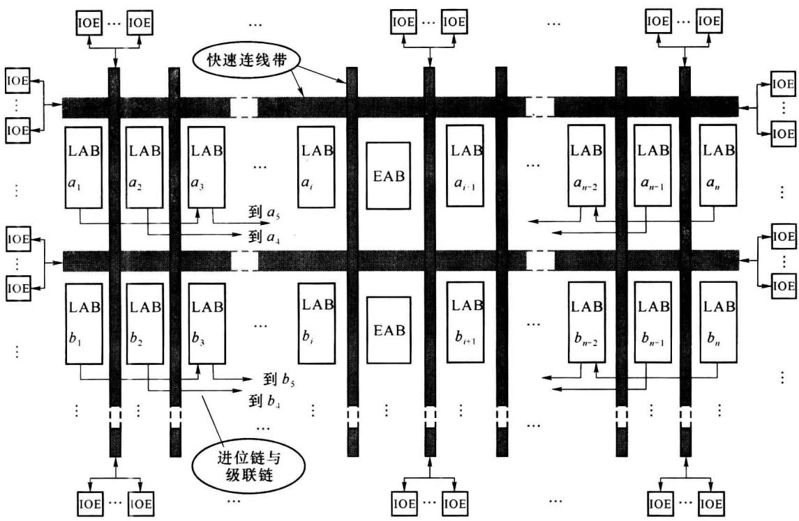
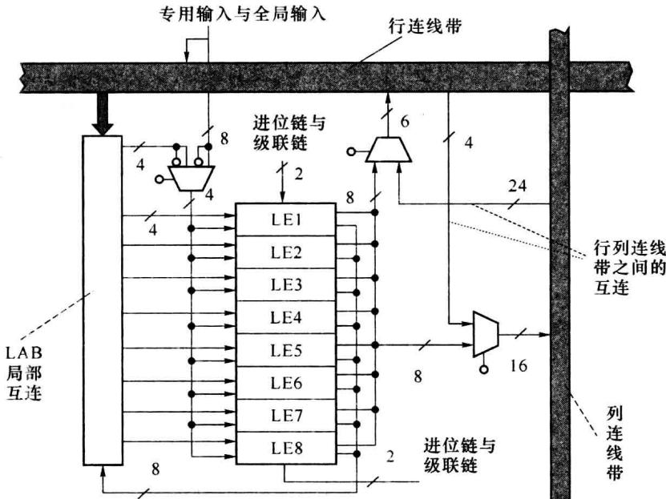
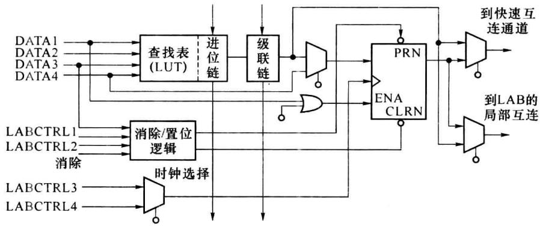
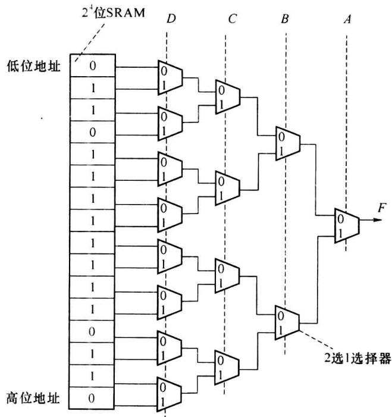
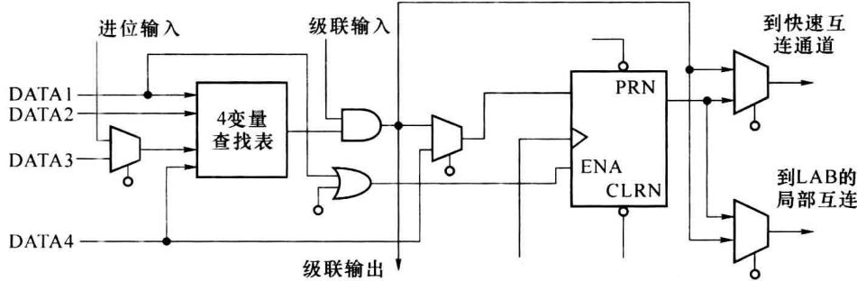
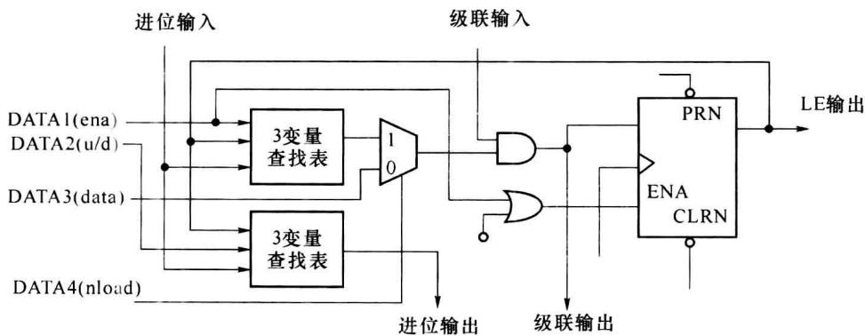
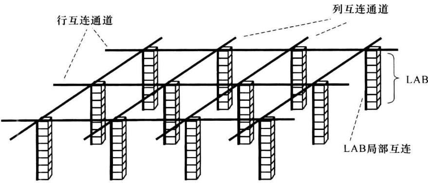
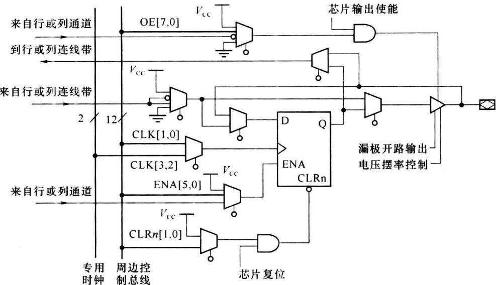

import Guide from '@/components/Guide.astro';
import Knowledge from '@/components/Knowledge.astro';
import Example from '@/components/Example.astro';
import Analysis from '@/components/Analysis.astro';
import Solution from '@/components/Solution.astro';
import Variant from '@/components/Variant.astro';
import Note from '@/components/Note.astro';
import Block from '@/components/Block.astro';
import Method from '@/components/Method.astro';
import Exercise from '@/components/Exercise.astro';

复杂的可编程逻辑器件(Complex PLD, CPLD)是一类大规模 PLD 的总称, 其集成规模度大于或远大于 EPLD。

本节以 FLEX10K 系列芯片为例介绍 CPLD 类可编程器件的主要特点。

FLEX10K 系列是一种高密度、高性能的可编程器件。它可提供 10 000～25 0000 个等效门。内带的嵌入式阵列增强了其运算处理能力。FLEX10K 的内部连接具有高速、延时固定并可预测的特点。FLEX10K 采用 CMOS-SRAM 的制作工艺，与 EEPROM 工艺的器件不同，基于 CMOS-SRAM 的 PLD 的编程内容在芯片断电后并不能自己保存数据，需另设 ROM 类器件为其保存编程数据，在系统上电时也需有一个将编程数据自动下载到芯片的配置过程。

基于SRAM技术被认为是FPGA(现场可编程门阵列)类PLD的特征之一,因而也有将FLEX10K系列归入FPGA类的。

## 7.4.1 FLEX10K 的系统结构

FLEX10K 主要由嵌入式阵列块(EAB)、逻辑阵列块(LAB)、快速连线带(FastTrack)和输入/输出单元(IOE)4个部分组成。图7.4.1给出了它们的结构关系。

FLEX10K 是业界最先将嵌入式阵列结合进 PLD 的。借助嵌入式阵列，PLD 可更有效地实现复杂的逻辑处理。嵌入式阵列由多个 EAB 组成，每个 EAB 基本为一个带有寄存器的 RAM(2048 位)。

LAB 呈行列构造, 每行嵌入一个 EAB。每个 LAB 内包含有局部连线和 8 个逻辑单元 (LE), 每个 LAB 自身可构成一个低密度 PLD。多个 LAB 互连结合可构成更大的逻辑块, 因而也将 LAB 称为构成 CPLD 的“粗颗粒 (coarse grain)”。

行、列快速连线带贯穿于整个器件的长、宽，分布于LAB的行列之间。连线带内有多条等长度的连续金属连接线，每条称为一个互连通道，统称为互连资源。LAB、EAB、IOE之间的互连主要是通过快速连线带连接的。

IOE 起着引脚接口的作用, 其内部主要有一个双向缓冲器和一个寄存器。每个 IOE 可经编程选择与多个互连通道连接。FLEX10K 还有 6 个专用输入引脚, 其连接线遍布整个器件, 经它们传送信号的延时较小。它们可用作全局时钟及清除、置位信号。

表 7.4.1 给出了 FLEX10K 系列两种型号器件中的主要模块的数目。

  

图 7.4.1 FLEX10K 的结构框图

表 7.4.1 FLEX10K 系列的两种型号器件中的主要模块数目

<table><tr><td>器件\数量\模块</td><td>提供的门数</td><td>EAB数</td><td>LAB数</td><td>LE数</td><td>总RAM位</td><td>快速连线带行/列数</td><td>每行内互连通道数</td><td>每列内互连通道数</td><td>最大I/O引脚数</td></tr><tr><td>EPF10K10EPF10K10A</td><td>10 000</td><td>3</td><td>72</td><td>576</td><td>6 144</td><td>3/24</td><td>144</td><td>24</td><td>134</td></tr><tr><td> $\vdots$ </td><td> $\vdots$ </td><td> $\vdots$ </td><td> $\vdots$ </td><td> $\vdots$ </td><td> $\vdots$ </td><td> $\vdots$ </td><td> $\vdots$ </td><td> $\vdots$ </td><td> $\vdots$ </td></tr><tr><td>EPF10K250AEPF10K250B</td><td>250 000</td><td>20</td><td>1 520</td><td>12 160</td><td>40 960</td><td>20/76</td><td>456</td><td>40</td><td>470</td></tr></table>

## 7.4.2 FLEX10K 的嵌入式阵列块

每个 FLEX10K 的嵌入式阵列块(EAB)为一个有 2048 位(bit)的 RAM 块, 其输入、输出带有寄存器。

利用 EAB 可直接构成规模不很大的存储器, 如 ROM、RAM、FIFO(First In First Out, 先入先出存储器)。实现存储器时, 可将一个 EAB 配置为 $256 \times 8$ (256 单元, 每个单元 8 位) 或 $512 \times 4$ 、 $1024 \times 2$ 、 $2048 \times 1$ 。较大规模的存储器可由多个 EAB 连接实现, 如两个 $512 \times 4$ 的 EAB 连接可得 $512 \times 8$ 的存储器。

EAB 中的 RAM 的入出端均带有寄存器, 输入/输出寄存器可用不同的时钟, 这给 EAB 实现 FIFO、双端 RAM 带来方便。

EAB 也可用于乘法器、数字滤波器等复杂逻辑的实现中。例如，将 EAB 配置为 $256 \times 8$ 只读存储器,其中存入两个4位无符号数相乘的积,将两个4位输入数据作为地址,这样用一个EAB就可实现 $4\times4$ 乘法器。这种查找表法实现的乘法器的工作速度快于由门电路构成的乘法器。

## 7.4.3 FLEX10K 的逻辑阵列块

一个 FLEX10K 的逻辑阵列块(LAB)中包括 8 个逻辑单元(LE)、进位链与级联链、控制信号以及 LAB 局部互连带, 结构关系如图 7.4.2 所示。

  

图 7.4.2 FLEX10X 的逻辑阵列块(LAB)

每个 LAB 中为 8 个 LE 提供 4 个控制信号, 其中的两个可作为时钟, 另两个作为置位/清除信号。这 4 个控制信号可选择来自器件的专用与全局输入信号或来自 LAB 的局部互连信号。专用与全局输入信号通过器件时的时延量很小, 适于作为同步控制信号。

进位链与级联链是各 LE 间的快速连接线,信号通过它们传输时的时延小于经行、列连线带的时延。进位链与级联链也在同一行的 LAB 间连接,由图 7.4.1 并结合图 7.4.2 可见,某一 LAB 中第 8 个 LE 输出的进位链、级联链送到同一 LAB 行间隔列 LAB 的第 1 个 LE 的进位链、级联链的输入。但进位链、级联链不穿过 LAB 行中间的 EAB。

各 LE 的输出可编程选择送入行、列快速连线带，也可反馈回本 LAB 的局部互连带。

## 7.4.4 FLEX10K 的逻辑单元

逻辑单元(LE)是 FLEX10K 结构中的基本处理单元。图 7.4.3 所示为 LE 的结构。每个 LE 包含一个 4 输入查找表(Look Up Table, LUT)，一个带有使能和异步清除、置位端的可编程触发器，一个进位链和一个级联链。LE 有 4 种工作模式。

### 1. 查找表

查找表(LUT)为一种存储结构,可作为编程实现组合逻辑函数的一种方法。与基于乘积项的组合逻辑函数实现方法(如 GAL、MAX7000 中)不同,LUT 只需改变存储器的内容即可实现给定变量的任何组合函数,因而也称 LUT 为函数发生器。图 7.4.4 为用 SRAM 和选择器构成的 4 变量 LUT 的框图。

  

图 7.4.3 FLEX10K 的逻辑单元(LE)

例如, 实现函数 $F = A \oplus B + C \oplus D$ 。基于乘积项方法的设计需 4 个与门、1 个或门。而 LUT 法根据函数 $F$ 的真值表(表 7.4.2)将 $F$ 的取值存入 SRAM。而将输入变量作为四组二选一选择器的控制信号。图 7.4.4 所示的结构可实现 4 变量的任一组合逻辑函数, 其复杂度和工作延时不随乘积项的多少而改变。

表 7.4.2 真值表

<table><tr><td>A</td><td>B</td><td>C</td><td>D</td><td> $F = A \oplus B + C \oplus D$ </td></tr><tr><td>0</td><td>0</td><td>0</td><td>0</td><td>0</td></tr><tr><td>0</td><td>0</td><td>0</td><td>1</td><td>1</td></tr><tr><td>0</td><td>0</td><td>1</td><td>0</td><td>1</td></tr><tr><td>0</td><td>0</td><td>1</td><td>1</td><td>0</td></tr><tr><td>0</td><td>1</td><td>0</td><td>0</td><td>1</td></tr><tr><td>0</td><td>1</td><td>0</td><td>1</td><td>1</td></tr><tr><td>0</td><td>1</td><td>1</td><td>0</td><td>1</td></tr><tr><td>0</td><td>1</td><td>1</td><td>1</td><td>1</td></tr><tr><td>1</td><td>0</td><td>0</td><td>0</td><td>1</td></tr><tr><td>1</td><td>0</td><td>0</td><td>1</td><td>1</td></tr><tr><td>1</td><td>0</td><td>1</td><td>0</td><td>1</td></tr><tr><td>1</td><td>0</td><td>1</td><td>1</td><td>1</td></tr><tr><td>1</td><td>1</td><td>0</td><td>0</td><td>0</td></tr><tr><td>1</td><td>1</td><td>0</td><td>1</td><td>1</td></tr><tr><td>1</td><td>1</td><td>1</td><td>0</td><td>1</td></tr><tr><td>1</td><td>1</td><td>1</td><td>1</td><td>0</td></tr></table>

  

图 7.4.4 4 变量查找表(LUT)的结构

### 2. 可编程触发器

可编程触发器可被设置成 D、T、JK 或 SR 触发器。触发器的时钟(CLK)、清除(CLR、异步)、置位(PRN、异步)及使能(ENA)可选自专用输入或通用 I/O 引脚的信号,也可由内部逻辑电路产生,如图 7.4.3 所示。可编程触发器和 LUT 的输出可以各自独立工作、分别输出,这提高了 LE 的利用率。

### 3. 进位链和级联链

进位链提供了 LE 之间的快速(0.2 ns)进位功能。低位 LE 的进位信号可经进位链送到高位 LE。这一特点有助 FLEX10K 实现多位的高速加法器、计数器和比较器。

利用级联链可使一个 LE 实现多变量(多于 4 个)的组合逻辑函数。

### 4. LE 的工作模式

根据对 LE 中的 LUT 和可编程触发器的设置的不同, 可把 LE 的工作模式分为 4 种。

图 7.4.5 所示称为正常工作模式。在这种工作模式中，LUT 被设置为 4 输入查找表，4 个输入来自 DATA1～DATA4 及进位链输入。可编程触发器的输入数据可以是查找表的输出，也可选择直接来自局部互连（DATA4）。触发器和查找表可各自独立工作、分别输出。这种工作模式可接收输入进位链、级联链，产生输出级联链，但没有输出进位链。

  

图 7.4.5 LE 的正常工作模式

图 7.4.6 所示称为加/减计数工作模式。LUT 被设置为两个 3 变量查找表。第 1 个查找表的输出可去作用触发器。第 2 个查找表的输出连接到进位链送下级 LE。本 LE 的输出 (Q) 被反馈回送到查找表的输入，DATA2 可作为加/减控制信号与 Q 及进位链来信号运算后再经进位链送到下级 LE。可编程触发器可以被同步加载数据，这是由 DATA3、DATA4 控制完成的。

另两种工作模式:运算工作模式、有(同步)清除功能的计数模式,见相关的参考资料。

  

图 7.4.6 LE 的加/减计数工作模式

## 7.4.5 FLEX10K 的快速连线带

行、列快速连线带(FastTrack)由横向、纵向遍布于器件的一系列连续连接线(互连通道)组成,这是 EPLD/CPLD 类器件的布线的特点。由图 7.4.1 和图 7.4.7 可见快速连线带和 LAB、EAB 在器件中的分布关系。由图 7.4.2 可见快速连线带与 LAB 的互连。在行、列连线带的交叉位置设置有选择器和驱动器以实现行、列信号的互连。

  

图 7.4.7 CPLD/EPLD 类器件中的快速连线带

为提高连接布线的效率,行连线带的互连通道分为全长和半长通道,全长通道横惯器件,可连 LAB 行上的各个 LAB。半长通道仅能连接 LAB 行的一半,距离较近的 LAB 可通过半长通道互连。

表 7.4.1 中列举了快速连线带的行/列数目及每行/列内的通道数。

连线带内采用连续连接线的布线方式称为连续式互连结构，这通常被认为是EPLD/CPLD类器件的互连布线的特点。采用这种布线结构的器件，芯片引脚-引脚的信号延时是可预测或固定的。这给一些高频、高速信号处理的应用带来方便。与之相比，FPGA类器件采用分段式互连结构，布线效率较高，但有着信号延时不固定的特点，即随着器件完成的逻辑功能的不同，引脚-引脚的信号延时可能也不同。

## 7.4.6 FLEX10K 的输入 / 输出单元

(输入/输出单元(IOE))主要包含一个输出缓冲器和一个寄存器,如图7.4.8所示。IOE使I/O引脚可输入、输出、双向传送信号,也可呈输出高阻状态。

当输入信号的存在时间较短时,可用 IOE 寄存器快速捕获输入数据。输出信号时,IOE 寄存器也可提供快速“时钟-输出”性能。

输出三态缓冲器可提供漏极开路输出的选择,这增加了输出引脚的驱动功能。输出电压摆动速率可被编程设置为高速或低速,高速输出时,输出电压信号的摆动速率大,但输出信号的边沿毛刺噪声也可能较大,器件的功耗也较大。低速输出时,输出噪声低、功耗也较小。

每个 IOE 的时钟可选自两个专用时钟线。IOE 的清除(CLR)、时钟使能(ENA)、输出使能(OE)及时钟(CLK)可选自周边控制总线。共有 12 条周边控制总线，其上复用分配的信号有 8 个输出使能、6 个时钟使能、2 个时钟、2 个清除和 4 个全局信号。每个周边控制总线的信号可由专用输入引脚驱动，也可由某一 LAB 特定行中的每个 LAB 的第一个 LE 驱动。

IOE 作为输入单元时可驱动两个行通道或两个列通道。作为输出单元时，IOE 可通过多路选择器从 m 个行通道或 k 个列通道中选择信号，m 和 k 的数值随器件型号而定，例如 EPF10K10 的 m=18, k=16。

  

图7.4.8 FLEX10K的IOE
