import Guide from '@/components/Guide.astro';
import Knowledge from '@/components/Knowledge.astro';
import Example from '@/components/Example.astro';
import Analysis from '@/components/Analysis.astro';
import Solution from '@/components/Solution.astro';
import Variant from '@/components/Variant.astro';
import Note from '@/components/Note.astro';
import Block from '@/components/Block.astro';
import Method from '@/components/Method.astro';
import Exercise from '@/components/Exercise.astro';

现场可编程门阵列(Field Programmable Gate Array, FPGA)是一类大规模 PLD 的总称。FPGA 在功能结构、入出接口等方面和 CPLD 类 PLD 的基本相同。但在以下几个方面，两类 PLD 有着各自的特点。

（1）FPGA 的编程配置基于 SRAM。在芯片掉电后，配置信息丢失，需另设非易失性存储器件保存配置信息并完成上电自动加载。而 CPLD（一部分）的编程配置基于闪存（Fast Flash）。配置不会因芯片掉电而丢失。两类芯片均有在系统编程（In System Programmable, ISP）的能力。

(2) FPGA 的基本逻辑模块(CLB)的集成规模度与 CPLD 类的 LAB 比较相对较小, 故称 FPGA 为“细颗粒结构”的 PLD。

（3）FPGA 组合逻辑部分基于 SRAM 查找表技术。而 CPLD 常基于逻辑乘积项技术。在解决以组合逻辑为主的问题时，CPLD 的使用效率较高。而在解决以时序逻辑为主的问题时，FPGA 的效率较高。

（4）FPGA 的内部互连布线采用分段式结构，布线效率较高，但信号的引脚-引脚延时常不是固定的，因逻辑功能的不同而不同。而 CPLD 采用连续布线方式。引脚-引脚的信号延时是固定的。

本节以Spartan-Ⅱ系列的器件为例介绍FPGA中的主要结构模块，这些模块的特点在后续开发的器件系列中得到了延续和发展。

Spartan-Ⅱ系列 FPGA 主要由 5 个模块单元构成: 可配置逻辑模块 (CLB)、输入/输出模块(IOB)、块状存储模块(Block RAM)、可编程互连资源、延迟锁相环模块(DLL)及边界扫描测试单元等。总体结构如图7.5.1所示。根据系列内型号的不同，Spartan-Ⅱ器件可提供96～1176个CLB,86～284个用户I/O,16～56 kbit的Block RAM,4个DLL。Spartan-Ⅱ系列的最高工作频率达200 MHz。

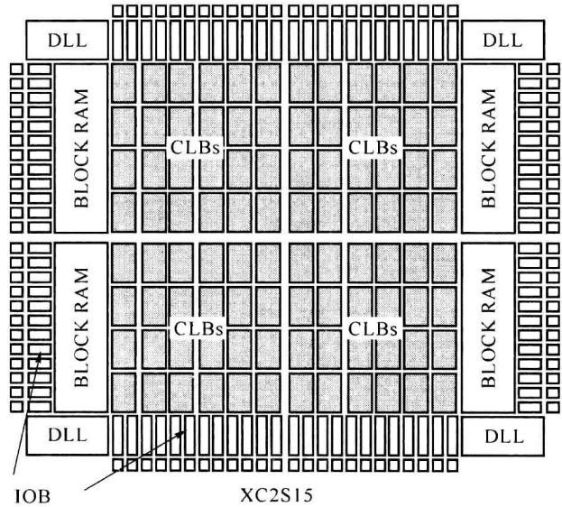  

图 7.5.1 Spartan-Ⅱ系列 FPGA 的模块结构

## 7.5.1 可配置逻辑模块

FPGA 的主要逻辑功能是由可配置逻辑模块 (Configurable Logic Block, CLB) 及其连接完成的。CLB 在器件中呈行、列排列，依型号的不同，行、列数目及 CLB 总数目也不同。Spartan-Ⅱ系列中的每个 CLB 分为两个切片 (Slice)，每个 Slice 中包含两个逻辑单元 (LC)，图 7.5.2 为 Slice 的简化结构。每个 LC 包含一个基于 SRAM 的 4 输入查找表 (LUT)、一个进位链及控制逻辑单元、一个触发器及片内互连驱动。

一个 4 输入 LUT 可以作为函数发生器实现 4 变量的任一组合逻辑函数, 通过控制逻辑, 同一 Slice 中的两个 LUT 可以被配置成为 5 变量函数发生器, 也可实现最多 9 个变量的某些组合逻辑或一个 4 选 1 选择器。同一 CLB 中四个 LUT 可以被配置成为 6 变量函数发生器, 也可实现最多达 19 个变量的某些组合逻辑或一个 8 选 1 选择器。

各 LUT 的 SRAM 也构成了 FPGA 器件中的分布式存储器。每个 LUT 可被设置为 $16 \times 1$ bit 的同步 RAM，一个 Slice 中的两个 LUT 可实现 $16 \times 2$ bit 或 $32 \times 1$ bit 的同步 RAM 或 $16 \times 1$ bit 的同步双口 RAM。

在 Spartan-Ⅱ及后续发展的 FPGA 中，LUT 可以被配置成为一个 16 位移位寄存器，适用于捕获高速数据或突发数据。

每个 Slice 配有一个进位链逻辑, 进位链增强了 CLB 完成加法、减法、累加、比较和计数等处理的能力, 也为相邻 CLB 间提供了快速连接通路。

Slice 中的触发器可被配置成边沿触发的 D 触发器或电平触发的锁存器。触发器的输入可来自 LUT 的输出或直接来自 Slice 的输入。CLK、CE 为触发器提供了时钟、时钟使能信号，SR、BY 为触发器提供了置位、复位信号，其工作方式可被设置为同步或异步。

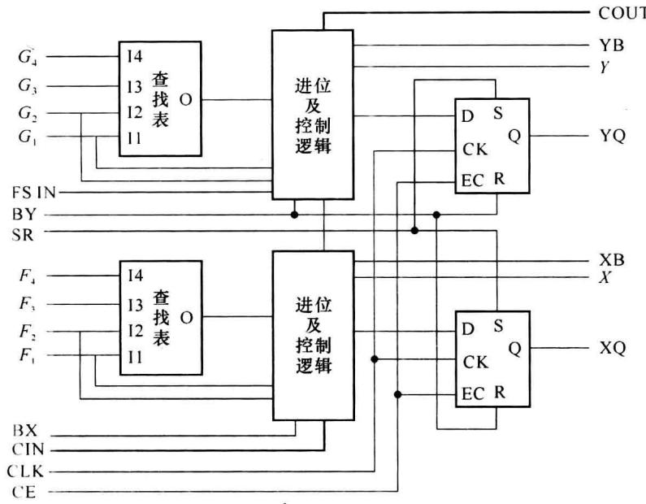  

图 7.5.2 Spartan-Ⅱ系列 FPGA 中 Slice 的简化结构  

每个 LC 的输出配有一条向本 CLB 的反馈连接, 它增强了 CLB 的处理灵活度。

## 7.5.2 输入/输出模块

输入输出模块(Input/Output Block, IOB)是 FPGA 的片内处理和外围引脚之间的接口，起着信号捕获、驱动保障、电平匹配、静电防护等作用。

图 7.5.3 为 Spartan-Ⅱ系列的 IOB 的结构框图。其中的触发器 IFF、OFF、TFF 可被设置为边沿 D 触发器或电平触发的锁存器。3 个触发器共用同一时钟 CLK，但独立拥有各自的时钟使能。SR 信号为 3 个触发器共用，SR 可被设置为同步、异步的置位或复位信号。

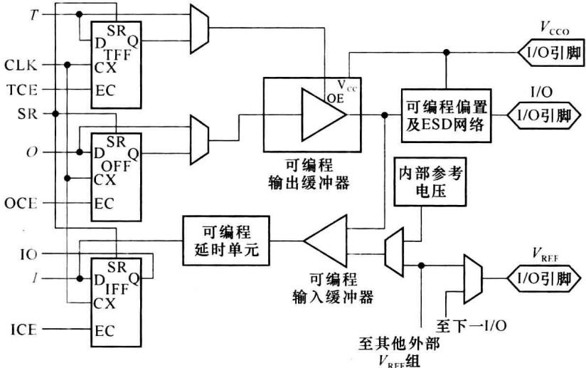  

图 7.5.3 Spartan-Ⅱ系列 FPGA 中 IOB 的结构

经片内互连资源来的信号 O 可经/不经 OFF 寄存再通过输出三态缓冲器送出 I/O 引脚。T 端信号经/不经 TFF 为输出缓冲器的提供使能控制。

经输入缓冲器来的输入信号可经 IFF 寄存(当从 IO 端位置连取信号时)或不经过寄存器而直接进入 CLB(当从 I 端位置连取信号时)。信号在送入 IFF 寄存器前可由延时单元编程增加其传输滞后的延时量,这是为了补偿时钟的延时偏移。系统时钟在传输到达 IOB 的输入时钟位置时,可能会出现一定的滞后延时,为保证 IFF 在时钟边沿的可靠触发,输入信号应有足够的持续保持时间。在高速信号工作情况,可能会要求输入信号增加与时钟偏移相应的保持时间。这通常难以被满足。在输入信号传输通路上设置的延时使信号到达触发器入端时有着与时钟滞后偏移相应的延时,这可降低对端口输入信号源增加保持时间的要求。因而,可编程延时单元起着匹配系统时钟和端口输入信号的作用,保证端口输入信号可以有零保持时间。当选择信号不经 IFF 寄存而直接连送入 CLB 时,信号会从可编程延时单元自动旁路。

随着 PLD 的快速发展,出现了多种低电压 I/O 接口标准,如 LVTTL、LVCOMS2、PCI 等。各种接口标准在信号电平、电源电压、端接电阻等方面都有着不同。对各种 I/O 接口标准的论述可参见有关参考资料。Spartan-Ⅱ系列 FPGA 可支持 16 种 I/O 接口标准。

对多种 I/O 接口标准的适配是通过 IOB 中的可编程输入缓冲器、输出缓冲器实现的。Spartan-Ⅱ的工作要求有两组外加直流辅助电源： $V_{REF}$ 和 $V_{CCO}$ ， $V_{REF}$ 的数值取决于输入信号的接口标准， $V_{CCO}$ 取决于输出信号的接口标准。Spartan-Ⅱ的技术资料中有着对 $V_{REF}$ 和 $V_{CCO}$ 的详细介绍。

每个 I/O 端口可被设置为输入、输出或双向的模式。输出信号的电压摆动速率、输出（电流）驱动能力也可被编程设置，这有助于减小输出信号的边沿毛刺噪声。

每个 I/O 引脚配置有起到静电放电(Electro Static Discharge, ESD)防护和过压保护作用的嵌位二极管。每个 I/O 引脚也可被编程配置上拉电阻和下拉电阻以及弱保持(Weak-Keeper)电路，它们起着减小引脚信号干扰、稳定器件工作的作用。

在两个 PLD 器件的引脚之间经电路板线或传输线进行高速信号传输时，引脚阻抗的匹配对信号的可靠传输有着重要的作用。在 Spartan-Ⅱ 系列后续发展的 FPGA 中，每个引脚内配置了可编程匹配电阻，通过对匹配电阻的设置可实现最佳信号传输。图 7.5.4 为引脚的防护、上(下)拉和匹配部件的示意。

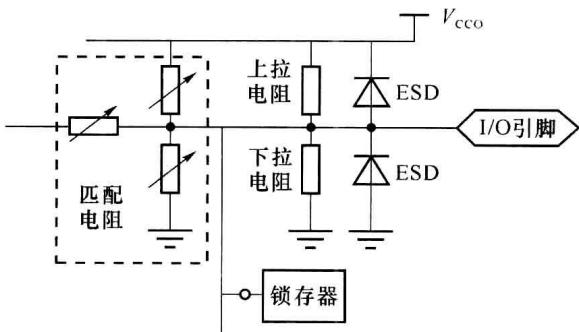  

图 7.5.4 引脚的防护、上(下)拉电阻和匹配电阻

## 7.5.3 块状RAM

RAM(随机存储器)可应用在数据管理(如FIFO、移位寄存器)及基于查找表的算法等多方面的处理中。RAM 的使用有着芯片利用率高、工作速度快的特点。在器件中嵌入块状 RAM(Block RAM) 是 PLD 的一个发展点。

在Spartan-Ⅱ系列的芯片中，每个RAM块有4096bit，块的数量依型号的不同而不同，最多可有14块、共56kbit的总容量。在后续发展的FPGA中，出现了有着更多RAM块和更大嵌入存储容量的器件。

每个 RAM 块有自己独立的地址总线、数据总线及控制位。RAM 块的数据位宽可被编程设置，例如，设置数据位宽为 1 位时，每块的存储深度为 4096，若位宽被设置为 8 位时，则存储深度为 512。地址总线的位宽随数据位宽的设置而自动调整。

每个 RAM 块可被设置成单端口 RAM[如图 7.5.5(a) 所示]或双端口 RAM[如图 7.5.5(b) 所示]。图 7.5.6 为单口 RAM 的读写时序说明图。当处于读状态 (WE=低电平) 时，在时钟 CLK 的上升沿(后)，RAM 将由地址总线(ADDR)指定的存储单元的内容送到数据输出总线(DOUT)上。当处于写状态 (WE=高电平) 时，在时钟 CLK 的上升沿(后)，数据输入总线(DIN)上的数据被写入由地址总线(ADDR)指定的存储单元，同时映射到 DOUT 上。

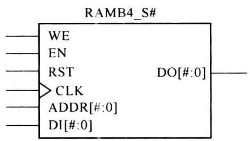  

(a) RAM块实现的单端口RAM

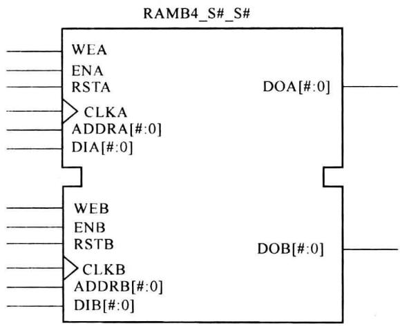  

(b) RAM块实现的双端口RAM

图 7.5.5 RAM 块实现的单端口、双端口 RAM  

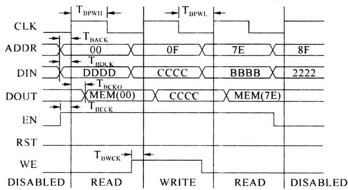  

图 7.5.6 单端口 RAM 的读/写时序

双端口 RAM 允许从两套地址、数据总线访问同一片存储区域。两套地址、数据总线及时钟、读/写控制可独立地工作。但当从一个端口向某一存储单元写数据时，从另一端口不可同时（两端口时钟有效沿过于接近、在参数 $T_{BCCS}$ 的时间范围内）读或写同一单元，否则执行结果无效。

## 7.5.4 可编程互连资源

PLD 的逻辑功能是由 CLB 及其互连实现的。逻辑功能强大的必要条件是高效而丰富的可编程片内互连资源。可编程互连资源是各 CLB 之间、CLB 和 IOB 之间连接线及其控制、驱动部件的总称，通常是一种多层布线通道的结构。

Spartan-Ⅱ的互连资源有局部互连布线、通用互连布线、I/O互连布线、专用布线、全局布线。

局部互连布线包括:①CLB 和通用布线矩阵 GRM 之间的互连;②CLB 内部的反馈连接;③水平相邻的 CLB 之间的直接连接。

通用互连布线位于与 CLB 行列连接的水平、垂直布线通道上，片内的互连多数是由通用互连布线实现的。通用互连布线资源包括：①通用布线矩阵（General Routing Matrix, GRM），GRM 是一个将水平布线和垂直布线互连的开关矩阵，也是 CLB 接入通用互连资源的途径，通过图 7.5.7 可间接认识通用布线矩阵的连接功能；②连接相邻 GRM 的单长线（24 条），通过图 7.5.8 可从单层角度间接认识 CLB、GRM 及单长线的关系；③跨越 6 个 GRM 的 16 进制连接线（96 条）；④横向、纵向贯通器件的长线（12 条）。

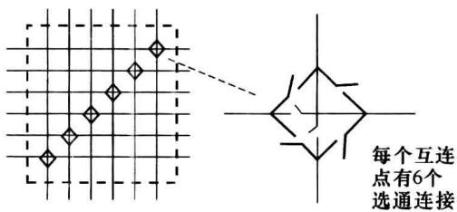  

图7.5.7 通用布线矩阵

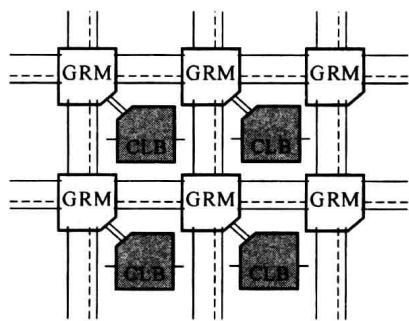  

图 7.5.8 通用布线矩阵和单长度线

I/O 互连布线是 CLB 和 IOB 间的接口连接, 器件外引脚位置的交换和锁定也是通过 I/O 互连布线实现的。

专用布线为互连提供了高性能的信号传输。Spartan-Ⅱ中有两种专用布线。为每个CLB行横向配有4条三态双向总线。为每个CLB配备有两根与纵向相邻CLB直接连接的连接线，它们为进位链信号的传递提供了快速连接。

全局布线资源可提供高扇出、低偏移的信号传输。全局布线资源分为主全局布线层和次全局布线层。①主全局布线资源通常用于全局时钟的传输与分配。主全局布线资源有4个布线网，每个布线网由专用缓冲器驱动，每个布线网可驱动所有的CLB、IOB和块状RAM的时钟。②次全局布线资源有24条脊骨状线，每柱脊线又分出12条长线。次全局布线可作为时钟分配网络，也可为非时钟信号提供传输路径。

## 7.5.5 延迟锁相环模块

分布于器件中各个位置处的 CLB、IOB 所使用的时钟信号是由时钟分配网络传输的。时钟分配网络由主全局布线资源实现。Spartan-Ⅱ器件有 4 个专用时钟输入引脚 GCLK-PAD，为每个 GCLKPAD 配置有缓冲驱动器 GCLKBUF，每个 GCLKBUF 可驱动一个布线网构成时钟分配网络。图 7.5.9 为时钟分配网络的一个示例。

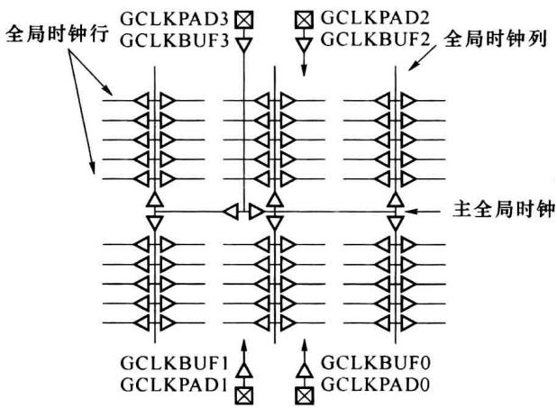  

图7.5.9 时钟分配网络

在大规模、高频率或高速信号处理的场合，对系统中各触发器时钟的同步性经常有很严格的要求，即要求各相关触发器的时钟有效边沿之间的时间偏差尽可能小。时钟分配网络在设计上有着最小（相对其他互连资源）的时延和抖动，但为了满足对时钟同步性的更严格的要求，在Spartan-Ⅱ及后续发展的FPGA中增设了数字延迟锁相环路（Delay-Locked Loop, DLL）。

DLL位于芯片中GCLKBUF后，GCLKBUF的输入信号可以来自专用时钟引脚，也可来自通用布线资源。DLL的作用可由图7.5.10说明。如果将时钟信号CLKIN直接送入时钟分配网络，由于传输路径中的惯性时延和传输时延，经时钟分配网路传输的时钟信号CLKFB较CLKIN会出现滞后延迟 $\tau_{\mathrm{pd}}$ 。在大规模、高频率或高速信号处理系统中， $\tau_{\mathrm{pd}}$ 就可能导致严重的不良后果。为减小 $\tau_{\mathrm{pd}}$ ，DLL中的控制逻辑部分抽样比较CLKFB和CLKIN，输出反映两者相位差的误差信号W，信号W控制可变延迟单元输出信号的延迟量。与传统的模拟锁相环相比，控制逻辑单元相当于鉴相器，可变延迟单元相当于压控振荡器。DLL使CLKFB和CLKIN间的相位差达到最小，使 $\tau_{\mathrm{pd}}$ 趋于零。加入DLL处理后，经时钟分配网络传输到各CLB、IOB位置处的系统时钟和时钟源可以达到足够理想的同步。

图 7.5.11 是 DLL 的模型。DLL 可提供时钟 CLK0(=CLKOUT) 的 $90^{\circ}$ 、 $180^{\circ}$ 、 $270^{\circ}$ 相移的信号，还可输出 CLK0 的 2 倍频以及 1.5、2、2.5、3、4、5、8、16 次分频的信号。

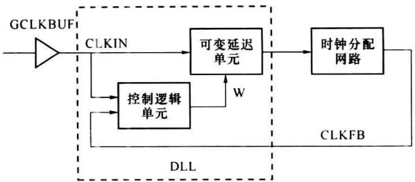  

图7.5.10 DLL的作用

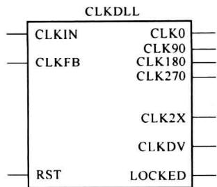  

图7.5.11 DLL的模型

## 7.5.6 边界扫描测试

当数字器件已在 PCB 电路板焊接完成后,通常需要对板级电路有一个物理测试的过程,如检测芯片之间的连接是否正确,验证板上芯片功能是否符合要求。传统的测试方法采用测针或夹具配合测量仪表来检测芯片的引脚。随着微电子技术的发展,电路板的层数增多,器件封装引脚也越来越密集。传统测试方法的难度越来越大,甚至难以得出完整的测量。

20 世纪 80 年代, 联合测试行动组 (Joint Test Action Group, JTAG) 开发制定了 IEEE1149.1 边界扫描测试技术规范 (也称为 JTAG 接口协议), 这一规范为计算机对板上芯片的测调建立了基础。

JTAG 规范要求芯片为边界扫描设置测试访问端口(Test Access Port, TAP)。TAP 有 5 条专用外信号线: TDI(测试数据输入)、TDO(测试数据输出)、TMS(测试方式选择)、TCK(测试时钟)、TRST(测试复位)。TAP 主要由 3 个部分组成: TAP 控制器、指令寄存器、数据寄存器。通常将 TAP、专用信号线及相应的控制软件统称为 JTAG 接口。

TAP 的数据寄存器中包含旁路寄存器、边界扫描寄存器(BSR)等多个移位寄存器,其中的边界扫描寄存器由各边界扫描单元(BSC)级联串接而成,图 7.5.12 描述了芯片中 TAP 的组成。在器件核心逻辑正常工作时,各 BSC 呈“透明”,即不影响核心逻辑的工作。在测量板上芯片之间的连接时,各 BSC 隔离核心逻辑对引脚连接的影响。在测试芯片的核心逻辑时,各 BSC 阻断板上芯片的外连接的作用。

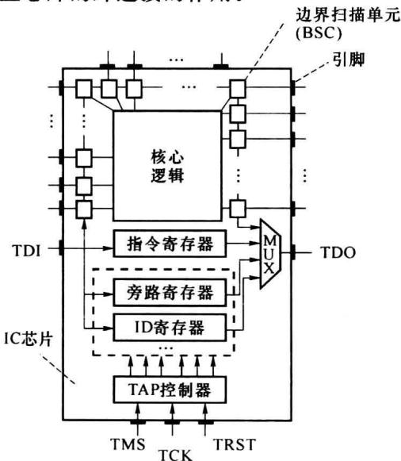  

图7.5.12 芯片中的TAP

图 7.5.13 示意了 JTAG 边界扫描测量两个芯片引脚的板上连接的情况。连接芯片 1 的 TDO 和芯片 2 的 TDI，测试数据从 $TDI_{1}$ 串行输入，在芯片内的 BSR 移位，经待测引脚连线的连接及 $TDO_{1}-TDI_{2}$ 的连接，数据进入芯片 2 并从 $TDO_{2}$ 移出。比较连线两端芯片 1 的输出和芯片 2 的输入可判断连线是处于连接或断开的状态。通过边界扫描测试，可以消除或大大减少对板上芯片的传统测试。

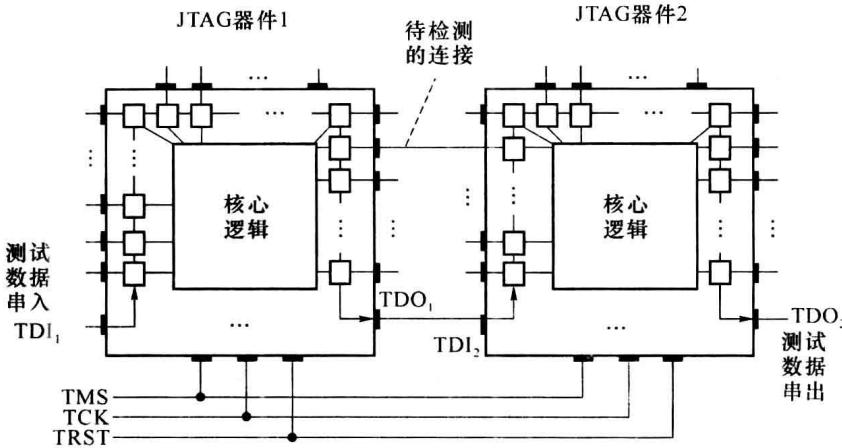  

图 7.5.13 边界扫描检测

由于 JTAG 电路使 TDI-TDO 的串行数据链与核心逻辑建立了联系路径, 利用 JTAG 接口也可完成对芯片配置数据的下载或读出, 这是 JTAG 接口的另一主要应用。

目前的 CPLD/FPGA 及数字系统级芯片(如 CPU、DSP)大多都设置了 JTAG 接口。

本章介绍了几类 PLD 器件的主要特点。PLD 是快速发展的半导体技术，在工作速率、集成规模、内在功能、低功耗等方面不断出现新的进展和创新。初学者应首先了解 PLD 的主要模块构成、认识 PLD 实现组合逻辑、时序逻辑的方法，了解 PLD 在集成规模、工作速度等指标方面的当前发展。

EDA(Electronic Design Automation)的学习基本包括3个方面,对PLD器件结构、性能的认识;对硬件描述语言(HDL)的掌握;对EDA工具软件的熟悉。完整地学习EDA,是一个课程和实验相结合的过程。
