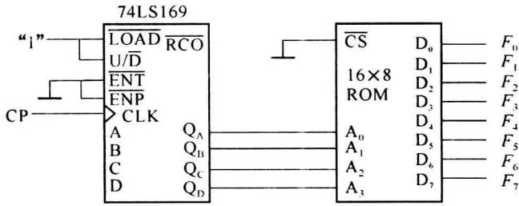
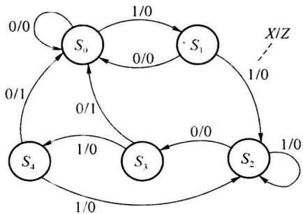
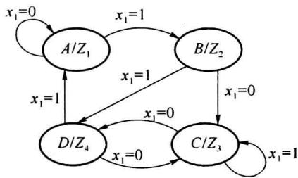
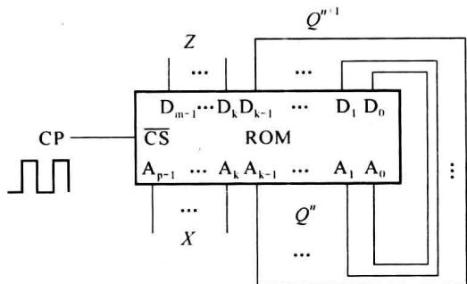
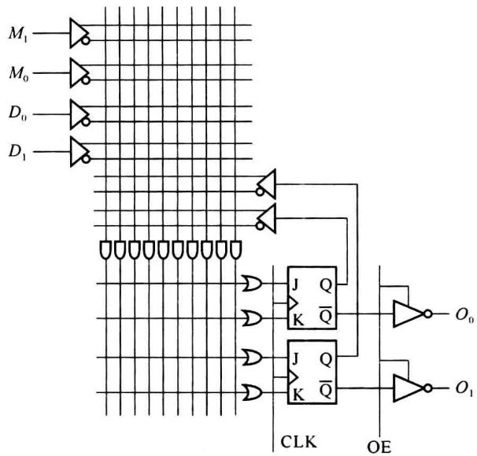
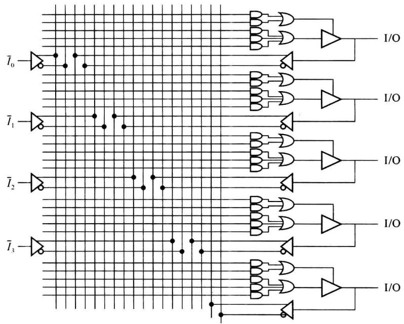
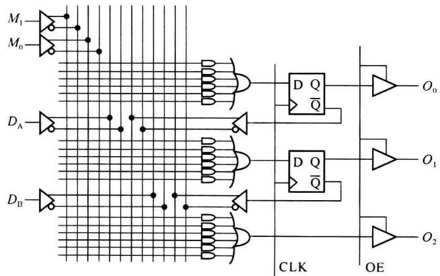

import Guide from '@/components/Guide.astro';
import Knowledge from '@/components/Knowledge.astro';
import Example from '@/components/Example.astro';
import Analysis from '@/components/Analysis.astro';
import Solution from '@/components/Solution.astro';
import Variant from '@/components/Variant.astro';
import Note from '@/components/Note.astro';
import Block from '@/components/Block.astro';
import Method from '@/components/Method.astro';
import Exercise from '@/components/Exercise.astro';

## 习题

<Exercise title="习题 7-1">
用 ROM 实现下列多输出函数。画出 ROM 的阵列图, 写出 ROM 中各存储单元应存储的信息码元。画出 ROM 电路图, 标出输入、输出信号。

$$

F _ {1} = A C D + A B \quad F _ {2} = B C D + \overline {{B}} \overline {{D}} + \overline {{B}} \overline {{C}} \quad F _ {3} = C \overline {{D}} + \overline {{C}} D \quad F _ {4} = \overline {{D}}

$$
</Exercise>

<Exercise title="习题 7-2">
用 ROM 实现下列运算。画出 ROM 的阵列图，写出 ROM 中各存储单元应存储的信息码元。画出 ROM 电路图，标出输入、输出信号。

(1) 两个两位二进制数相乘。

(2) 一个 3 位二进制数的平方。
</Exercise>

<Exercise title="习题 7-3">
欲用题图 7.1 电路实现 8 路输出 $(F_{0} \sim F_{7})$ 的脉冲分配器, 每路输出的正脉冲宽度为一个时钟 CP 的周期。每路输出的脉冲依次后沿一个时钟周期。试写出 ROM 中各存储单元应存储的数据内容（由低位地址单元到高位地址单元）。

  

题图7.1
</Exercise>

<Exercise title="习题 7-4">
试用 2 片 $256 \times 8$ 位的 ROM 组成一个 $256 \times 16$ 位的 ROM。
</Exercise>

<Exercise title="习题 7-5">
基于 ROM 实现计数器。当控制位 $x = 1$ 时完成模 7 二进制码的减法计数。当 $x = 0$ 时完成模 10 计数，码型为循环码（表 1.1.3）。两种计数均在全 0 状态时输出 $Z = 1$ ，其他状态时 $Z = 0$ 。画出实现电路图，说明所用 ROM 的数据位宽 $m$ ，地址位宽 $p$ ，存储单元数目。写出各存储单元的地址和存储数据的表格。
</Exercise>

<Exercise title="习题 7-6">
基于 ROM 同时产生两个序列信号: ①01101001; ②10100100。画出实现电路图, 说明所用 ROM 的数据位宽 $m$ , 地址位宽 $p$ , 存储单元数目。写出各存储单元的地址和存储数据的表格。
</Exercise>

<Exercise title="习题 7-7">
利用 ROM 实现题图 7.2 所示的状态图。X 为输入信号，Z 为输出信号。试说明所设计的状态编码。画出实现电路图，说明所用 ROM 的数据位宽 m，地址位宽 p，存储单元数目。写出各存储单元的地址和存储数据的表格。

  

题图7.2

  

题图7.3
</Exercise>

<Exercise title="习题 7-8">
利用 ROM 实现题图 7.3 所示的状态图。二位输入信号为 $x_{1}, x_{2}$ ，一位输出信号 $Z$ 。状态 $A$ 时， $Z = Z_{1} = x_{1} \cdot x_{2}$ ，状态 $B$ 时， $Z = Z_{2} = x_{1} + x_{2}$ ，状态 $C$ 时， $Z = Z_{3} = x_{1} \oplus x_{2}$ ，状态 $D$ 时， $Z = Z_{4} = \overline{x_{2}}$ 。试说明所设计的状态编码。画出实现电路图，说明所用 ROM 的数据位宽 $m$ ，地址位宽 $p$ ，存储单元数目。写出各存储单元的地址和存储数据的表格。
</Exercise>

<Exercise title="习题 7-9">
用 ROM 实现 8 路脉冲分配器。要求各路输出脉冲的宽度为 $1 \mu \mathrm{s}$ 。每路输出的脉冲依次后沿一个时钟周期。画出实现电路图，说明所用 ROM 的数据位宽 $m$ ，地址位宽 $p$ ，存储单元数目。写出各存储单元的地址和存储数据的表格。说明时钟 CP 的频率应为多少。
</Exercise>

<Exercise title="习题 7-10">
以题图 7.4 所示的 ROM 电路实现同步计数器或序列信号发生器。试说明电路的设计是否存在问题。电路工作时会有什么结果。

  

题图7.4
</Exercise>

<Exercise title="习题 7-11">
基于书图 7.2.3 的 PLA 分别实现题表 7-1、7-2 所示的 2 线 -4 线译码器电路。

题表 7.1 2 线-4 线译码(正逻辑输出)

<table><tr><td> $S_1$ </td><td> $\overline{S}_2$ </td><td> $A_1$ </td><td> $A_0$ </td><td> $Y_0$ </td><td> $Y_1$ </td><td> $Y_2$ </td><td> $Y_3$ </td></tr><tr><td>1</td><td>0</td><td>0</td><td>0</td><td>1</td><td>0</td><td>0</td><td>0</td></tr><tr><td>1</td><td>0</td><td>0</td><td>1</td><td>0</td><td>1</td><td>0</td><td>0</td></tr><tr><td>1</td><td>0</td><td>1</td><td>0</td><td>0</td><td>0</td><td>1</td><td>0</td></tr><tr><td>1</td><td>0</td><td>1</td><td>1</td><td>0</td><td>0</td><td>0</td><td>1</td></tr><tr><td>0</td><td> $\phi$ </td><td> $\phi$ </td><td> $\phi$ </td><td>0</td><td>0</td><td>0</td><td>0</td></tr><tr><td> $\phi$ </td><td>1</td><td> $\phi$ </td><td> $\phi$ </td><td>0</td><td>0</td><td>0</td><td>0</td></tr></table>

题表 7.2 2 线-4 线译码(负逻辑输出)

<table><tr><td> $S_1$ </td><td> $\overline{S}_2$ </td><td> $A_1$ </td><td> $A_0$ </td><td> $\overline{Y}_0$ </td><td> $\overline{Y}_1$ </td><td> $\overline{Y}_2$ </td><td> $\overline{Y}_3$ </td></tr><tr><td>1</td><td>0</td><td>0</td><td>0</td><td>0</td><td>1</td><td>1</td><td>1</td></tr><tr><td>1</td><td>0</td><td>0</td><td>1</td><td>1</td><td>0</td><td>1</td><td>1</td></tr><tr><td>1</td><td>0</td><td>1</td><td>0</td><td>1</td><td>1</td><td>0</td><td>1</td></tr><tr><td>1</td><td>0</td><td>1</td><td>1</td><td>1</td><td>1</td><td>1</td><td>0</td></tr><tr><td>0</td><td> $\phi$ </td><td> $\phi$ </td><td> $\phi$ </td><td>1</td><td>1</td><td>1</td><td>1</td></tr><tr><td> $\phi$ </td><td>1</td><td> $\phi$ </td><td> $\phi$ </td><td>1</td><td>1</td><td>1</td><td>1</td></tr></table>
</Exercise>

<Exercise title="习题 7-12">
用题图 7.5 所示 PLA 实现二进制模 4 计数器, 当控制位 $M_{1}M_{0}$ 为 00 时进行加计数、01 时进行减计数、10 时进行同步预置、11 时为保持状态。

  

题图7.5
</Exercise>

<Exercise title="习题 7-13">
基于题图 7.6 的 PAL 实现题表 7-3 所示的 4 线 -2 位的优先编码器。

题表7.3

<table><tr><td> $\overline{\mathrm{{ST}}}$ </td><td> ${\bar{I}}_{0}$ </td><td> ${\bar{I}}_{1}$ </td><td> ${\bar{I}}_{2}$ </td><td> ${\bar{I}}_{3}$ </td><td> ${\bar{Y}}_{1}$ </td><td> ${\bar{Y}}_{0}$ </td><td> ${\bar{Y}}_{\text{ES }}$ </td><td> ${Y}_{\mathrm{S}}$ </td></tr><tr><td>0</td><td>1</td><td>1</td><td>1</td><td>1</td><td>1</td><td>1</td><td>1</td><td>0</td></tr><tr><td>0</td><td> $\phi$ </td><td> $\phi$ </td><td> $\phi$ </td><td>0</td><td>0</td><td>0</td><td>0</td><td>1</td></tr><tr><td>0</td><td> $\phi$ </td><td> $\phi$ </td><td>0</td><td>1</td><td>0</td><td>1</td><td>0</td><td>1</td></tr><tr><td>0</td><td> $\phi$ </td><td>0</td><td>1</td><td>1</td><td>1</td><td>0</td><td>0</td><td>1</td></tr><tr><td>0</td><td>0</td><td>1</td><td>1</td><td>1</td><td>1</td><td>1</td><td>0</td><td>1</td></tr><tr><td>1</td><td> $\phi$ </td><td> $\phi$ </td><td> $\phi$ </td><td> $\phi$ </td><td>1</td><td>1</td><td>1</td><td>1</td></tr></table>

  

题图7.6
</Exercise>

<Exercise title="习题 7-14">
用题图 7.7 所示的 PAL 实现二进制模 4 计数器, 当控制位 $M_{1}M_{0}$ 为 00 时进行加计数、01 时进行减计数、10 时进行同步预置、11 时为保持状态。设进位(借位)输出端为 CO(BO)。

  

题图7.7
</Exercise>

<Exercise title="习题 7-15">
基于题图 7.6 所示的 PAL 实现移位寄存器, 当控制位 $M_{1}M_{0}$ 为 00 时进行左移位、移入数据为 $D_{A}$ ; 01 时进行右移位、移入数据为 $D_{B}$ ; 10 时进行同步置零; 11 时为保持状态。
</Exercise>

<Exercise title="习题 7-16">
画出控制位 $\mathrm{AC}_0 = 0, \mathrm{AC}_1(n) = 0$ 时 GAL16V8 的输出逻辑宏单元 OLMC 的结构。
</Exercise>

<Exercise title="习题 7-17">
在 GAL16V8 的 OLMC 中, 当选择组合逻辑电路的结果直送输出时不使用 D 触发器, 此时 D 触发器为什么不能别作它用? 试做出改动, 使此情况中 D 触发器也可为它方所用。
</Exercise>

<Exercise title="习题 7-18">
MAX7000 系列 PLD 器件中共享扩展项与并联扩展项各有什么作用？
</Exercise>

<Exercise title="习题 7-19">
MAX7000 系列器件和 FLEX10K 系列器件实现组合逻辑函数的方法各有什么特点？
</Exercise>

<Exercise title="习题 7-20">
FLEX10K 系列器件的进位链和级联链有什么作用？它们在 LAB 间是如何连接的？
</Exercise>

<Exercise title="习题 7-21">
试分别用查找表(LUT)方法(FLEX10K)和乘积项方法(MAX7000)实现逻辑函数 $F = \overline{B} \overline{C} + AB + \overline{A} \overline{D}$ 。
</Exercise>

<Exercise title="习题 7-22">
利用两个3变量查找表(LUT)实现一位全加器。画出查找表的结构。
</Exercise>

<Exercise title="习题 7-23">
输出缓冲门输出的信号的压摆率和附加毛刺噪声及器件功耗一般有什么样的关系？
</Exercise>

<Exercise title="习题 7-24">
FLEX10K 系列器件的输入/输出单元中, 输入信号可直接传送到行/列连线带, 也可经寄存器传送。什么情况下需使用后者?
</Exercise>

<Exercise title="习题 7-25">
与 EPLD/CPLD 类器件相比, FPGA 类可编程器件一般有哪些特点?
</Exercise>

<Exercise title="习题 7-26">
什么是双口 RAM, Spartan-Ⅱ系列的块状 RAM 实现的双口 RAM 有哪些特点?
</Exercise>

<Exercise title="习题 7-27">
在 FPGA 器件(Spartan-Ⅱ系列)的输入/输出单元(IOB)中, 输入信号通路上设置的可编程延时单元有什么作用?
</Exercise>

<Exercise title="习题 7-28">
Spartan-Ⅱ系列和 FLEX10K 系列器件内的互连资源结构有哪些不同？
</Exercise>

<Exercise title="习题 7-29">
延迟锁相环路 DLL 工作原理是什么？什么情况需使用 DLL?
</Exercise>

<Exercise title="习题 7-30">
什么是 JTAG 接口？JTAG 接口的硬件部分是如何构成的？JTAG 接口的主要作用有哪些？

## 第 8 章 硬件描述语言 VHDL

随着信息处理技术的进步和集成电路的快速发展,实现对信息的数字处理的硬件系统的规模和复杂度越来越高。相应地,电子设计自动化(Electronic Design Automation, EDA)技术也在快速地发展。本章重点介绍在 EDA 中起着基础作用的硬件描述语言。
</Exercise>
