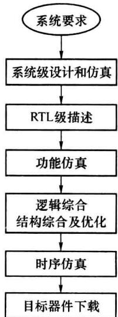

import Guide from '@/components/Guide.astro';
import Knowledge from '@/components/Knowledge.astro';
import Example from '@/components/Example.astro';
import Analysis from '@/components/Analysis.astro';
import Solution from '@/components/Solution.astro';
import Variant from '@/components/Variant.astro';
import Note from '@/components/Note.astro';
import Block from '@/components/Block.astro';
import Method from '@/components/Method.astro';
import Exercise from '@/components/Exercise.astro';

## 第8章 硬件描述语言VHDL

随着信息处理技术的进步和集成电路的快速发展,实现对信息的数字处理的硬件系统的规模和复杂度越来越高。相应地,电子设计自动化(Electronic Design Automation, EDA)技术也在快速地发展。本章重点介绍在 EDA 中起着基础作用的硬件描述语言。

## 8.1.1 电子设计自动化

在电子设计自动化(EDA)设计过程中,可以用硬件描述语言(Hardware Description Language,HDL)对数字电路系统给予程序性的描述,借助 EDA 工具软件对 HDL 程序进行仿真、综合、优化等处理,最后在可编程器件或 ASIC 器件中生成实现电路。

传统的数字系统设计方法有着“自底向上”的特点,一般是对根据系统的目标性能、指标的要求首先选定最底层的硬件单元、通常是已有的标准中小规模集成电路,然后设计电路模块并最后连成系统。对系统的性能测试一般要在各模块都完成并连成了系统之后。如果改变底层的硬件单元,通常就意味着必须再设计对应的模块乃至系统。如果

系统要求的性能、指标有了调整又可能使底层的标准单元不再适用。这些缺点使得“自底向上”设计方法不能完全适应大规模、高性能数字系统的要求。

EDA 的设计有着“自顶向下”的特点。设计时首先完成的是系统级模型的建立和仿真，随后进行各层子系统及电路模块的设计及仿真，最后由逻辑门构成最低层电路。在“自顶向下”的设计中，低一设计层的电路的改变一般不会严重影响上层的设计结果。在低层电路完成之前，可通过仿真的方式检验上层的设计、预测下层的结果。

实际的 EDA 设计常是“自顶向下”和“自底向上”过程的结合。

图 8.1.1 所示为 EDA 设计的一般过程

### (1) 系统级设计和仿真

根据对系统的功能要求或设计规范设计电路的系统构成,划分各子系统。用数学关系式或逻辑表达式描述各子系统的相互关系。描述可以仅是一种行为关系的表达,不过多考虑具体的实现电路。用高级语言或 HDL 仿真这种行为关系。这种行为级的描述和仿真的目的是使设计者在硬件电路建立之前了解、检验其功能或性能。这是“自顶向下”设计的优点。

  

图8.1.1 EDA设计的一般过程

### (2) 寄存器传输级描述

用 HDL 语句描述系统的行为、结构或信号间的逻辑关系，得出寄存器传输级(RegisterTransport Level, RTL)模型的描述程序。行为级描述一般是抽象的、整体的，而 RTL 级描述通常是具体的、分模块的。

### (3) 功能仿真

由 EDA 工具软件仿真 RTL 级模型的功能。与行为仿真相比，功能仿真可给出将要由硬件完成的逻辑结果。但功能仿真仍不是对实际硬件工作过程的仿真，例如不能仿真出工作器件的实际时延情况。对不太复杂的系统，行为级和 RTL 级的描述及仿真可合并为一。

### (4) 逻辑综合、结构综合及优化

在逻辑综合过程中由 EDA 工具软件将 RTL 描述或行为描述转换为由门级网表文件描述的门级电路结构。在结构综合过程中，EDA 工具软件根据门级网表文件完成目标器件的布局、布线和结构优化等工作并生成时序仿真文件。

### (5) 时序仿真

时序仿真文件中给出了目标器件在布局布线后工作的硬件信息。时序仿真中，EDA工具软件可给出目标器件工作时的动态过程，例如信号的延时、组合逻辑电路的冒险等。这是最接近硬件实际工作的仿真。

### (6) 目标器件下载

在仿真结果满足系统要求后,可在 EDA 工具软件环境中通过下载电缆将综合结果设置到目标器件中。然后即可对目标器件进行实际工作测试了。

由以上过程可见, HDL 是 EDA 设计的基础, 工具软件是 EDA 的工作平台。

## 8.1.2 硬件描述语言

（硬件描述语言(HDL))用类似自然语言的语句描述硬件的工作,描述的内容可以是信号间的逻辑关系,也可以是电路模块的功能行为或模块间的互联关系。与传统的电路图描述方法相比,HDL 描述更适合计算机处理。借助 EDA 工具软件和设计库,HDL 简化了硬件电路的设计、调整工作,提高了工作效率。

HDL 从 20 世纪 80 年代开始发展。目前有两种 HDL 应用得较为普遍: VHDL 和 Verilog-HDL。它们都已作为 IEEE(the Institute of Electrical and Electronics Engineers)的标准得到许多 EDA 公司的工具软件的支持。Verilog-HDL 在描述门级电路和 RTL 级电路方面有着特长, 而 VHDL(Very High Speed Integrated Circuit HDL)更见长于描述电路系统的行为及层次化关系。本章介绍的是 VHDL。

VHDL 中的许多语句和高级语言的类似,但高级语言面向的是计算机的软件处理,而 HDL 是一种面向硬件设计的语言。硬件处理的主要特征——并行处理在 HDL 中有着许多反映,这也是 HDL 与高级语言的主要不同。

HDL 追求对硬件工作的全面描述,而将 HDL 描述的设计在目标器件上实现的工作是由 EDA 工具软件中的综合器完成的。受限于目标器件，并不是所有 VHDL 语句均可被综合器支持，也就是说，并不是所有 VHDL 语句均可被硬件实现。例如 VHDL 的赋值延时语句目前还不能被综合实现出，它只能作为描述语句，描述、仿真硬件电路中的实际延时现象。在学习 VHDL 时，应注意语句及语句结构在功能仿真中的表现和被综合实现出的硬件表现，两者常是既有区别又有密切联系的。

EDA 的学习主要有 3 个方面的内容: 对可编程逻辑器件的了解、对硬件描述语言的掌握、对工具软件的熟悉。EDA 的学习是一个书本与实验紧密结合的过程。

本章简述 VHDL 中的主要内容,8.5 节是本章的重点。
