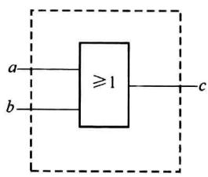
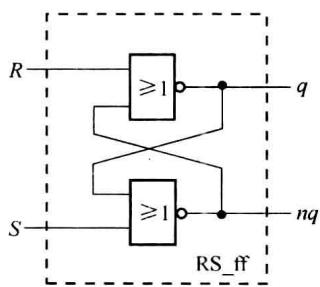
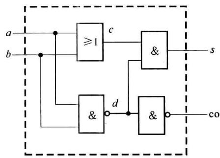
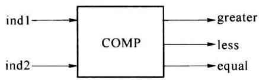
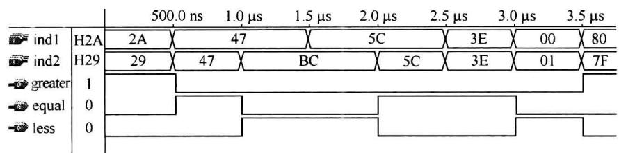

import Guide from '@/components/Guide.astro';
import Knowledge from '@/components/Knowledge.astro';
import Example from '@/components/Example.astro';
import Analysis from '@/components/Analysis.astro';
import Solution from '@/components/Solution.astro';
import Variant from '@/components/Variant.astro';
import Note from '@/components/Note.astro';
import Block from '@/components/Block.astro';
import Method from '@/components/Method.astro';
import Exercise from '@/components/Exercise.astro';

描述一个设计单元的 VHDL 程序必须包含实体 (Entity) 和构造体 (Architecture) 两个基本部分。根据需要还可能包含库 (Library)、程序包 (Package)、配置 (Configuration) 部分。下例是一段简单的 VHDL 程序。

<Example title="例 8.2.1">
描述图 8.2.1 所示的两输入或门。

```txt

LIBRARY IEEE; --声明使用 IEEE 库

USE IEEE.STD_LOGIC_1164.ALL; --声明使用 IEEE 库中 STD_LOGIC_1164 程序包

ENTITY or_gate IS --声明实体名:or_gate

PORT(a,b:IN STD_LOGIC; --声明 or_gate 的输入、输出端口

c:OUT STD_LOGIC); --

END or_gate; --

```


ARCHITECTUREdata\_fw OF or\_gate IS --声明 or\_gate 的结构体名:data\_fw

BEGIN -- 结构体

c &lt;= aOR b; -- 描述结构体中要完成的工作

END data\_fw; --


  

图8.2.1 两输入或门


在 VHDL 程序中, 由符号“--”引导注释。VHDL 中的每条语句须以“;”结尾。VHDL 中的标识符不区分英文字母的大小写。
</Example>

## 8.2.1 实体

由上例可见,实体(ENTITY)的作用是说明一个设计单元的对外引脚或端口。


```txt

实体的一般构成格式如下：

ENTITY 实体名 IS

[GENERIC(类属表);]

PORT(端口表);

END [ENTITY][实体名];

“[]”中为可选则性内容。

```

### 1. 由关键词 GENERIC 引导的类属说明语句

由类属表给出程序中用到的一些公共参量,如向量位宽,延时时长。这些参量在程序中作为常量使用。类属说明语句的一般格式如下:


GENERIC(参数名:数据类型[:=初始值]);


在层次化设计中,本设计单元的结果可被其他设计单元调用。将一些关键参数放入类属表后,在其他设计单元调用时可通过类属映射(GENERIC MAP)语句对类属表参数再赋值。这使得本单元的设计具有一般化意义。可参见后例。

### 2. 由关键词 PORT 引导的端口说明语句

端口说明语句说明了本设计单元的对外引脚端上信号的名称、流向及数据类型。一般格式如下：


PORT(端口名1:端口模式数据类型;……端口名n:端口模式数据类型);


（1）端口名为本设计单元对外连接的引脚的名称。在 VHDL 中，端口上流动的数据为信号形式，因而在实体和结构体中，端口名也作为信号名使用。


(2) 端口模式定义了该端口上信号的流向。有 4 种端口模式。


① IN(输入): 仅允许数据从该端口输入本设计单元。


② OUT(输出):仅允许数据从该端口输出本设计单元。


③ INOUT(双向): 数据可从该端口输入、输出。


④ BUFFER(缓冲):从该端口输出的数据可在本设计单元读得,因而缓冲端口带有内部反馈。从缓冲端口也可输入来自其他设计单元的缓冲端口的数据。


(3) 数据类型给定了该端口信号承载的数据的种类名称, 如 BIT(二进制位)、BIT\_VECTOR(二进制位向量)、INTEGER(整型)、BOOLEAN(布尔型)、STD\_LOGIC(标准逻辑位)等。数据类型将在 8.3 节中介绍。

<Example title="例 8.2.2">
n 位锁存器的 VHDL 描述。

```txt

entity n_latch is --实体

```


```txt

GENERIC(n:integer:=8); --类属表参数n的数据类型为整型,初值为8,可被再设定

port(control:in bit;idata:in bit_vector(n downto 1);odata:outbit_vector(n downto 1));

```


```txt

end n_latch;

architecture dfdo of n_latch is --结构体

BEGIN

process(control, idata) --进程

begin

```


```matlab

if(control="1")then odata &lt;= idata;--如果 control='1',则 idata 赋值给

    --odata 输出

end if;    --如果 control ≠ '1',则 odata 保持不

    --变,因而被

end process;    --实现为锁存器

end dfdo;

```
</Example>

<Example title="例 8.2.3">
描述图 8.2.2 的 RS 触发器。

```vhdl

library IEEE; --程序中将用到 std_logic 型数据,需先声

--明定义此数据类型的库和程序包

use ieee.std_logic_1164.all;

entity RS_ff is

generic(tpd:TIME:=5 ns); --类属说明语句

port(R,S:in std_logic;

q,nq:BUFFER std_logic);--由于输出信号 q,nq 要被读回,故将 q,nq

end RS_ff; --的端口模式定义为 BUFFER

architecture dafw of RS_ff is

begin

q &lt;= R NOR nq AFTER tpd;

nq &lt;= S NOR q AFTER tpd;

end dafw;

```


“&lt;=”为对信号赋值的标识符。信号赋值语句中的“AFTER tpd”表示延时 $t_{pd}$ 时间后再完成赋值，是为功能仿真设置的延时，见8.3.1小节。


  

图8.2.2 RS触发器
</Example>

## 8.2.2 结构体

由前面的例子可见,结构体(ARCHITECTURE)的作用是描述设计单元(名称为实体名)的行为功能或逻辑结构。结构体的一般格式如下:


ARCHITECTURE 结构体名 OF 实体名 IS


[说明语句；]


并行语句；


```txt

……

并行语句；

END[ARCHITECTURE][结构体名]；

```


(1) 说明语句部分中定义或说明本结构体用到的信号、常量、数据类型(自定义)、元件、子程序名等。它们只能用在本结构体中。


（2）结构体中只能使用并行语句，它们描述本设计单元的行为功能、逻辑结构或信号关系。结构体中各并行语句的执行结果和语句书写的前后顺序无关，也就是说，各语句是被并行处理的。这是硬件描述语言的特点。


在 VHDL 中, 结构体中的并行语句有以下几类:


\- 并行信号赋值语句


\- 进程语句(一个进程相当于一条并行语句)


\- 块语句(一个块相当于一条并行语句)


\- 元件例化语句、元件生成语句


\- 并行过程调用语句


将在 8.6.1 小节中介绍各并行语句。


  

图8.2.3 半加器


  

图8.2.4 数据比较器

<Example title="例 8.2.4">
半加器(图 8.2.3)的 VHDL 描述。

```vhdl

LIBRARY IEEE;

USE IEEE.STD_LOGIC_1164.ALL;

ENTITY half_adder IS

    PORT(a,b:IN STD_LOGIC;

    s,co:OUT STD_LOGIC);

END half_adder;

ARCHITECTURE daflow OF half_adder IS

    SIGNAL c,d:STD_LOGIC; --定义结构体内部的信号

BEGIN

    c &lt;= a OR b; --结构体中各并行赋值语句在书写上的前后顺序不影响

    s &lt;= c AND d; --对半加器的描述结果

    d &lt;= aNAND b;

    co &lt;= NOT d; --各并行语句描述了信号在半加器内部的流程关系

```


END daflow;
</Example>

<Example title="例 8.2.5">
数据比较器(图 8.2.4)的 VHDL 描述。

```vhdl

library ieee;

use ieee.std_logic_1164.all;

use ieee.std_logic_unsigned.all;

entity COMP is

    port(ind1, ind2: in std_logic_vector(7 downto 0); greater, less, equal: out bit);

end COMP;

architecture behav of COMP is

begin

    process(ind1, ind2)    --定义一个进程

    variable cd1, cd2: integer;    --定义变量，这些变量仅在进程内有效

    begin

    cd1 := CONV_INTEGER(ind1); --将 std_logic_vector 型数转换为整型数，转换

    cd2 := CONV_INTEGER(ind2); --函数 CONV_INTEGER 定义在 unsigned 程序包中

    if(cd1 &lt; cd2) then

    less &lt;= '1'; greater &lt;= '0'; equal &lt;= '0';

    elsif(cd1 > cd2) then

    less &lt;= '0'; greater &lt;= '1'; equal &lt;= '0';

    else

    less &lt;= '0'; greater &lt;= '0'; equal &lt;= '1';

    end if;

    end process;

end behav;

```


图 8.2.5 为比较器 COMP 的仿真结果。


  

图8.2.5 COMP的仿真结果


例 8.2.4 中用并行赋值语句描述了信号从输入到输出在设计单元(设计实体)内部的逻辑运算的流程关系。称这种描述为数据流描述方式。例 8.2.5 仅描述了输入、输出信号间的行为关系，并没有描述设计实体内部的结构或信号的逻辑流程，称这种描述为行为描述方式。


一个实体可以有多个结构体,代表着不同的实现方案。
</Example>

## 8.2.3 VHDL 的库与程序包

VHDL 库是系统为用户提供的资源。在库中存放着已设计好的设计实体、数据类型和处理函数,它们都组织在库中的各程序包中。在进行一个 VHDL 设计项目时,使用库资源可以使设计的功能更加完善,使设计中的处理更为可靠、全面,使设计的结构更为简捷、清晰。

### 1. 库

在 VHDL 设计中, 常用到的库(LIBRARY)有 IEEE 库、STD 库、WORK 库和 VITAL 库。

### (1) IEEE 库

其中主要有以下一些程序包。

## ① STD\_LOGIC\_1164 程序包

其中定义了一些数据类型、子类型和处理函数。例如 STD\_LOGIC(标准逻辑位)和 STD\_LOGIC\_VECTOR(标准逻辑位向量)及其这两种数据类型的逻辑运算处理函数(逻辑运算符重载函数)。

## ② STD\_LOGIC\_ARITH 程序包

其中定义了 UNSIGNED(无符号型)、SIGNED(有符号型)、SMALL\_INT(小整型)3 种数据类型及其逻辑运算符重载函数。

## ③ STD\_LOGIC\_UNSIGNED 程序包和 STD\_LOGIC\_SIGNED 程序包

其中定义了 STD\_LOGIC 型、STD\_LOGIC\_VECTOR 型和 INTEGER 型数据间的转换函数和混合运算处理函数。在 STD\_LOGIC\_SIGNED 程序包中的数据为有符号数。

## ④ NUMERIC\_STD 程序包和 NUMERIC\_BIT 程序包

其中定义了 UNSIGNED 向量和 SIGNED 向量两种数据类型及其运算符重载函数。向量中每个元素为 STD\_LOGIC 型(NUMERIC\_STD 程序包)或 BIT 型(NUMERIC\_BIT 程序包)。

### (2) STD 库

其中有以下两个标准程序包。


① STANDARD 程序包


其中定义了 BOOLEAN、BIT、CHARACTER、REAL、INTEGER、TIME 等数据类型。


② TEXTIO 程序包


其中定义了支持 ASCII 文本文件的输入/输出操作的数据类型及其子程序。

### (3) WORK 库

WORK 库是用户进行 VHDL 设计的当前工作库,实际上是用户的项目工程(PROJECT)所在的目录。在 VHDL 设计中,用户将已完成的和正在设计过程中的设计单元和程序包都放在 WORK 库中。其他设计单元可通过 WORK 库的调用共享设计结果。

### (4) VITAL 库

其中存放着用于 VHDL 门级时序仿真的有关参数。


在 VHDL 库中, IEEE 库和 VITAL 库属于资源库, 使用时需用 LIBRARY 语句进行显式声明。STD 库和 WORK 库属于设计库, 它们满足 VHDL 标准, 在进行 VHDL 设计时已为用户打开, 故使用中无须显式声明。


一些 EDA 厂商也提供自己的资源库,其中包含有多种参数可设置模块(LPM)。

### 2. 程序包(PACKAGE)

用户在一个实体和结构体中定义的数据类型、信号、常量及子程序等并不能直接被其他设计单元调用。为使不同的设计单元共用设计数据，可使用程序包这种程序组织机制。


程序包的一般格式如下：


```txt

PACKAGE 程序包名 IS

程序包首说明部分

END 程序包名；

```


```txt

PACKAGE BODY 程序包名 IS

程序包体说明部分

END 程序包名；

```


在程序包首部分中给出各设计单元所需的公共信息的定义,它们一般是:常量、信号、数据类型、子程序名、元件(COMPONENT)的定义说明。如果程序包首中有子程序名,则需在程序包体中给出子程序体。如果没有子程序,程序包中也可仅有程序包首,无程序包体。

<Example title="例 8.2.6">
```txt

PACKAGE iocode IS --声明程序包 iocode

TYPE icode IS INTEGER RANGE 0 TO 3; --定义数据类型 icode

SUBTYPE ocode IS BIT_VECTOR(0 TO 3); --定义子类型 ocode

END iocode;

```
</Example>

### 3. 库和程序包的使用

用户在 VHDL 程序中如果需要使用某一库中的某程序包, 必须在使用前声明。声明语句的格式如下:


```txt

LIBRARY 库名；

```


USE 库名．程序包名．项目名；


例如,由于 STD\_LOGIC 数据类型的定义包括在 IEEE 库的 STD\_LOGIC\_1164 程序包中,在将某一端口信号的数据类型设置为 STD\_LOGIC 型的 PORT 语句前,需加入下列声明语句:


```txt

LIBRARY IEEE;

USE IEEE.STD_LOGIC_1164.STD_LOGIC;

或：USE IEEE.STD_LOGIC_1164.ALL; --ALL 表示将使用程序包中的全部项目

```


如果要使用 WORK 库中用户自建的程序包时, 只需用 USE 语句, WORK 库在 VHDL 设计中已默认地为用户打开了。

<Example title="例 8.2.7">
```autohotkey

USE WORK.iocode.ALL ; --声明使用 WORK 库中 iocode 程序包

ENTITY penco IS

    PORT(ida:IN icode;oco:OUT ocode); --ida 的数据类型为 icode 型

END penco; --oco 的数据类型为 ocode 型

ARCHITECTURE wtodo OF penco IS

BEGIN

WITH ida SELECT --选择信号赋值语句(并行信号赋值语句中的一种)

oco &lt;= B"1100"WHEN 0,

B"0110"WHEN 1,

B"0011"WHEN 2,

B"1001"WHEN3,

```


```txt

B"0000" WHEN OTHERS;

END wtodo;

```
</Example>

## 8.2.4 配置

一个实体可以有多个结构体,如同一个有着标准对外引脚的器件可以有多种内部实现方案。可以用配置(CONFIGURATION)语句为实体选配不同的结构体。


在 8.5.4 小节介绍的元件例化语句结构中, 元件和已存在的实体(结构体)的对应关系也可用配置语句来指定(见例 8.5.6)。


在较大型的、可分出多个设计层 VHDL 设计工作中，配置可以起到管理和组织的作用。配置有多种语句格式，限于篇幅，本章中不对配置作更多的介绍。可参见有关的 VHDL 专著。
