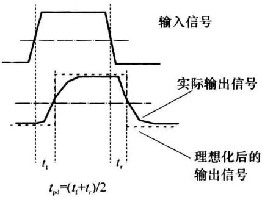
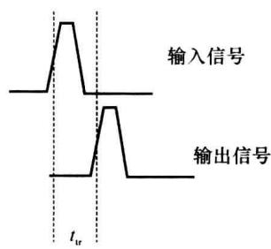

import Guide from '@/components/Guide.astro';
import Knowledge from '@/components/Knowledge.astro';
import Example from '@/components/Example.astro';
import Analysis from '@/components/Analysis.astro';
import Solution from '@/components/Solution.astro';
import Variant from '@/components/Variant.astro';
import Note from '@/components/Note.astro';
import Block from '@/components/Block.astro';
import Method from '@/components/Method.astro';
import Exercise from '@/components/Exercise.astro';

作为硬件描述语言, VHDL 对处理和传输的信息用数据类型 (DATA TYPES) 作出分类, 而用数据对象作为载体。数据对象一般被综合实现为可编程逻辑器件中的连线或暂存单元, 而数据类型总反映着数据对象的位宽。

## 8.3.1 VHDL 中的数据对象

在 VHDL 中,信息数据的载体称为数据对象(DATA OBJECTS)。数据对象有常量、变量、信号 3 种形式。

### 1. 常量

<Knowledge title="定义">
常量(CONSTANT)的格式如下:

CONSTANT 常量名: 数据类型: = 表达式;


例如：


```txt

CONSTANT Vcc:REAL:=5.0; --定义常量Vcc,其数据类型为实数型,数值为5.0

CONSTANT High1 :BIT:='1'; --定义常量High1,其数据类型为BIT,数值为1

CONSTANT gate_delay:TIME:=10 ns; --gate_delay的数据类型为TIME,数值为10 ns

```


常量通常反映了系统中的某一固定值,如电源电压、衬底电位。常量一经定义便不可更改,因而常量是一种全局量。
</Knowledge>

### 2. 变量

<Knowledge title="定义">
变量(VARIABLE)的格式如下:

VARIABLE 变量名: 数据类型[:=初始值];


例如：


```matlab

VARIABLE count: INTEGER:=255;    --定义变量 count,其数据类型为整数型,初值为 255

VARIABLE state,flag:std_logic;    --定义变量 state 和 flag,数据类型为 std_logic

```


一般情况下,变量反映了系统的局部模块中数据的传输及暂时存储。变量是一种局部量,只能用于定义它的进程(PROCESS)中或子程序(FUNCTION 或 PROCEDURE)中。变量被定义后,可在程序中被赋值及再赋值。


对变量的赋值格式如下：


变量名:=表达式;


```txt

【例 8.3.1】

.....

PROCESS

VARIABLE count:INTEGER RANGE 0 TO 15:=15; --在进程中定义变量,所定义的变量

VARIABLE enable:BOOLEAN; --名只可在本进程中使用

......

BEGIN

    enable:=FALSE;

    ......

    IF(enable = TRUE)THEN count:=count-1; --在进程中对变量的赋值

    ......

END PROCESS;

.....

```
</Knowledge>

<Knowledge title="定义">
变量时设置的初始值一般仅被 VHDL 功能仿真器支持, VHDL 综合器并不支持初始值, 即它们不会被综合实现出来。
</Knowledge>

### 3. 信号

信号(SIGNAL)反映的是电路系统中各模块之间的连接线及输入、输出端口的引脚。定义信号的格式如下：


SIGNAL 信号名: 数据类型 [ := 初始值];


初始值仅用于功能仿真,不被 VHDL 综合器支持。


例如：


```txt

SIGNAL datain:BIT_VECTOR(7 DOWNTO 0):="00001111";

SIGNAL clr :BIT:='1';

SIGNAL reg_1:Reg_Template; --Reg_Template 为一个已自定义的数据类型

SIGNAL dout :std_logic;

```


信号反映的是各模块间的连接,因而具有全局性特征。信号可在实体、结构体、程序包中定义和使用,在进程中不能定义信号,仅可使用信号。


表 8.3.1 给出了定义、使用信号以及变量、常量的场合。


表 8.3.1 定义、使用常量、变量及信号的场合


<table><tr><td>数据对象</td><td>定义的场合</td><td>作用范围</td></tr><tr><td>CONSTANT(常量)</td><td>实体、结构体、进程、子程序、程序包</td><td>全局</td></tr><tr><td>VARIABLE(变量)</td><td>进程、子程序(函数、过程)</td><td>局部</td></tr><tr><td>SIGNAL(信号)</td><td>实体、结构体、程序包</td><td>全局</td></tr></table>

### 4. 对信号的赋值与延时

在程序中,对信号赋值的格式如下:


信号名 $\Leftarrow$ 表达式；


其中的表达式可以是运算式,也可以是其他同数据类型的数据对象(信号、变量、常量)。


在 PORT 引导的端口说明语句中定义的各端口名也是信号。但应注意，不可对端口模式为 IN 的端口名赋值，也不可从 OUT 端口名引取数据。


在硬件系统中,电路对信号的处理和传递是有延时的,为反映这一特征,在 VHDL 的功能仿真中对信号赋值时可以设置延时量的描述。

### (1) 惯性延时

由于硬件系统存在着输入、输出分布电容，电路中的晶体管内部也存在着电容效应。当输入数字脉冲时，输出波形上升、下降边沿会出现时间滞后，如图8.3.1所示。平均滞后延时量为 $t_{pd}$ 。称这种滞后延时为惯性延时。如果输入给系统的脉冲的宽度小于系统的惯性延时量，系统不会对这样的输入脉冲产生正确的输出响应。


为描述惯性延时,在对信号赋值时可用关键词 AFTER 引导延时量。格式如下:


信号名 $\Leftarrow$ 表达式 AFTER 常量；


常量的数据类型为物理 TIME 型, 如表 8.3.2 所示。


例如语句: $z \Leftarrow x$ AND y AFTER 6 ns; 表示在 x、y 进行与运算后, 再经 6 ns 的延时才将运算结果赋值给 z。在功能仿真中, 如果 x、y 的持续时间小于 6 ns, 它们就不会对 z 有影响。


  

图8.3.1 惯性延时


  

图8.3.2 传输延时

### (2) 传输延时

信号通过传输系统的速率是有限的,速率主要受传输介质的影响。即使传输系统不存在惯性延时,信号经过传输后的波形也会出现时间上的滞后,如图8.3.2所示,滞后延时量为 $t_{tr}$ 。称这种滞后延时为传输延时。与惯性延时不同,传输延时不会改变信号的波形形状,输入的信号脉冲的宽度即使小于系统的传输延时量,也可通过系统传输到输出端。VHDL用以下格式描述传输延时:


信号名 $\Leftarrow$ TRANSPORT 表达式 AFTER 常量；


常量的数据类型为 TIME。例如语句: z &lt;= TRANSPORT x AFTER 4 ns; 表示 x 经 4 ns 的传输延时后再赋值给 z。


惯性延时和传输延时描述了硬件系统中信号被传输时的客观现象,它们可以被 VHDL.功能仿真器支持。但 VHDL 综合器不支持惯性延时和传输延时,也就是说它们都是不可实现的,不能通过在 VHDL 语句中使用赋值延时描述来实现或调整信号在可编程器件中的实际延时。


可编程逻辑器件在工作时存在着实际惯性延时和传输延时,其量的大小取决于器件的材料、制造工艺、负载情况等。这种实际的延时信息可用时序仿真给予预测。使信号延时尽可能小是可编程逻辑器件追求的指标之一。

### (3) 仿真延时

在论及 VHDL 在功能仿真中的表现时, 常提到 $\delta$ 延时量这一概念。 $\delta$ 延时是功能仿真器软件为处理并行语句而为语句加入的延时量。对用户应用程序而言, 可认为 $\delta$ 延时量是一个无穷小量, 有限个 $\delta$ 延时量相加不超过 VHDL 功能仿真器的最小分辨时间。 $\delta$ 延时在功能仿真中是用户不可见的, 也不会被综合实现出来。

## 8.3.2 VHDL 中的数据类型

如前所述,数据对象(信号、常量、变量)为数据信息的载体,数据类型(DATA TYPES)是数据信息的分类。数据对象一般被综合实现为器件中的连线或暂存单元,而数据类型总反映着数据对象的位宽。VHDL规定只有具有相同数据类型的数据对象之间才能相互作用和传送信息。


VHDL 数据类型可分为预定义类型和自定义类型两大类。

### 1. VHDL 预定义的数据类型

VHDL 对常用到的数据类型给出了标准预定义, 预定义体放在 STANDARD、STD\_LOGIC\_1164、STD\_LOGIC\_ARITH 等程序包中。


(1) 在 STANDARD 程序包预定义的数据类型如表 8.3.2 所示。


表 8.3.2 在 STANDARD 程序包预定义的数据类型


<table><tr><td>数据类型</td><td>取值及使用要点</td></tr><tr><td>BOOLEAN(布尔型)</td><td>TRUE,FALSE</td></tr><tr><td>BIT(二进制位型)</td><td>‘1’,‘0’(须加括单引号,不加单引号时,1,0表示整数)</td></tr><tr><td>BIT_VECTOR(二进制位向量型)</td><td>每个位的取值为(‘1’,‘0’)。定义时需用关键词TO或DOWNTO指明位宽,即位向量中元素的个数。例如: SIGNAL bv:BIT_VECTOR(0 TO 3); bv&lt;=B&#x27;1100&#x27;;--’位向量串需加双引号,可加前缀标识符B说明为二进制位串</td></tr><tr><td>CHARACTER(字符型)</td><td>用单引号括起的ASCII字符,如‘A’,‘a’,‘&amp;’,‘3’等字符有大小写之分,但VHDL标识符不区分英文字母的大小写</td></tr><tr><td>STRING(字符串型)</td><td>用双引号括起的字符序列。例如: VARIABLE st_var:STRING(1 TO 16);st_var := &quot;UX01ZWLH～&quot;;</td></tr><tr><td>INTEGER(整型)</td><td>32位有符号二进制数。范围为-2 147 483 647～+2 147 483 647。设置整型数据时,可指定数的范围。例如: SIGNAL idt:INTEGER RANGE 1 TO 32;</td></tr><tr><td>REAL(实型)</td><td>范围为-1.0E+38～+1.0E+38</td></tr><tr><td>TIME(时间类型,物理类型中的一种)</td><td>数值为整型,单位为hr,min,sec,ms,us,ns,ps,fs。例如:CONSTANT tpd:TIME:=10 ns;</td></tr></table>


VHDL 功能仿真器支持全部预定义的数据类型,但 VHDL 综合器一般不支持实型、负数、字符型、TIME 型及无范围指定的整型。


(2) 在 STD\_LOGIC\_ARITH 程序包中预定义的数据类型如表 8.3.3 所示。


表 8.3.3 在 STD\_LOGIC\_ARITH 程序包中预定义的数据类型


<table><tr><td>数据类型</td><td>取值及使用要点</td></tr><tr><td>UNSIGNED(无符号数型)</td><td>无符号整数。在VHDL综合器中被作为二进制数处理。例如: SIGNAL usig : UNSIGNED(0 TO 7);其中,usig被定义为信号,数据类型为UNSIGNED,它有8位二进制数,最高位为usig(0),最低位为usig(7)</td></tr><tr><td>SIGNED(有符号数型)</td><td>有符号整数。最高位为符号位。在综合器中SIGNED数据被处理为补码。例如: VARIABLE vsd:SIGNED(7 DOWNTO 0);其中,vsd被定义为变量,数据类型为SIGNED,表示-128～+127范围内的整数,最高位vsd(7)作为符号位</td></tr></table>


对 UNSIGNED、SIGNED 型数据可进行算术运算, 如加、减, 不可进行逻辑运算。

### (3) STD\_LOGIC(标准逻辑位)数据类型

在数字逻辑中只用 0、1 就可以表示数字信息了。但在数字电路中，逻辑 0 和逻辑 1 是用电平在一定范围内的电压或电流表示的。例如，在 TTL74 系列门电路中，高于 2.4V 的电压均被处理为逻辑 1。另外，数字电路中还有高阻状态。在电路连接不适当、如非法线与时还会出现状态不定的情况。为反映数字电路中的各种实际情况，VHDL 在 STD\_LOGIC\_1164 程序包中定义了 STD\_LOGIC 数据类型，其取值和意义如表 8.3.4 所示。


表 8.3.4 STD\_LOGIC 型数据类型


<table><tr><td>STD_LOGIC(标准逻辑位型)的取值</td><td colspan="2">意义</td></tr><tr><td>&#x27;U&#x27;</td><td>Uninitialized</td><td>(初始状态)</td></tr><tr><td>&#x27;X&#x27;</td><td>Forcing Unknown</td><td>(强强度不确定状态)</td></tr><tr><td>&#x27;0&#x27;</td><td>Forcing 0</td><td>(强强度0)</td></tr><tr><td>&#x27;i&#x27;</td><td>Forcing 1</td><td>(强强度1)</td></tr><tr><td>&#x27;Z&#x27;</td><td>High Impedance</td><td>(高阻状态)</td></tr><tr><td>&#x27;W&#x27;</td><td>Weak Unknown</td><td>(弱强度不确定状态)</td></tr><tr><td>&#x27;L&#x27;</td><td>Weak 0</td><td>(弱强度0)</td></tr><tr><td>&#x27;H&#x27;</td><td>Weak 1</td><td>(弱强度1)</td></tr><tr><td>&#x27;-&#x27;</td><td>Don&#x27;t Care</td><td>(无关,系统中不可能出现的情况)</td></tr></table>


VHDL 功能仿真器支持 STD\_LOGIC 型数据的全部取值,而综合器仅支持其中的‘0’、‘1’、‘Z’、‘—’。


VHDL 用 STD\_LOGIC\_VECTOR 定义一个标准逻辑位向量,如同一个一维数组,其中的每一位均为 STD\_LOGIC 型数据,定义时须指明位宽,可类比 BIT\_VECTOR。


对 STD\_LOGIC 型数据对象的赋值或取值引用须使用单引号, 如 '1'、'Z', 而对 STD\_LOGIC\_VECTOR 型数据对象则须用双引号。


VHDL 的其他预定义数据类型请见有关专著。

### 2. VHDL 的自定义数据类型

用户自定义的数据类型可有多种,以下简要介绍。


(1) 枚举类型(ENUMERATED TYPE)


将有关联的各项元素一一列举出构成的集合称为枚举。


枚举的定义格式如下：


TYPE 枚举名 IS(元素 1, 元素 2, ……);


其中，元素1，元素2，……为枚举名的各个取值。在同一时刻，枚举只有一个取值。各元素名用VHDL标识符表示。例如，TYPE Time\_Unit IS(hr, min, sec, ms, us, ns, p s, fs)；被自定义的数据类型可用于声明数据对象。例如：


```txt

TYPE BUSstate IS (idle,busy,write,read,backoff);--自定义一个枚举类型

SIGNAL pmodel :BUSstate; --pmodel 被定义为信号,其数据类型被声明为 BUSstate 型

pmodel &lt;= write ; --对信号 pmodel 用枚举元素赋值

```


可见,使用枚举方便了对 VHDL 程序的编制和阅读。


(2) 数组类型 (ARRAY TYPE)


数组是同一数据类型的数据的一个有序集合。


数组的定义格式为如下：


TYPE 数组名 IS ARRAY (数组元素下标的范围) OF 基类型;


其中,基类型是数组中每一元素的数据类型,必须是已经定义过的数据类型(预定义类型和自定义类型)。数组元素下标的范围说明数组元素的个数和排序方式。例如:


```txt

TYPE reger IS ARRAY (7 DOWNTO 0) OF BIT;

```

<Knowledge title="定义">
了数组 reger, 其中有 8 个元素, 排序方式为: reger(7), reger(6), ..., reger(0), 每个元素的数据类型为 BIT, 取值为 '0' 或 '1'。又如:

TYPE word IS ARRAY (0 TO 15)OF std\_logic;


数组可以是二维、多维的。例如：


TYPE ramy IS ARRAY (0 TO 9, 0 TO 15) OF std\_logic;
</Knowledge>

<Knowledge title="定义">
了一个 10 行 16 列的二维数组, 其中每个元素为 std\_logic 型数据。对这一数组也可这样定义:

TYPE ramy IS ARRAY (0 TO 9) OF word;


ramy 中的每一元素为一个 word 数组(先前定义的)。


VHDL 仿真器支持多维数组,但 VHDL 综合器一般只支持一维数组。


数组元素下标的范围也可以表示为一个已定义过的枚举。这样可以使用枚举元素名作为数组元素的下标，数组元素的总个数等于枚举元素的总个数。例如：


```sql

TYPE std_and_table IS ARRAY(std_logic, std_logic) OF std_logic;

```


将 std\_and\_table 定义为二维数组类型, 有 9 行 9 列, 每个数组元素为 std\_logic 型, 取值为 'U'、'X'、'0'、'1'、'Z'、'W'、'L'、'H'、'一'之一。数组元素的下标也可用 std\_logic 型数值表示, 例如下标为 ('Z'、'W') 的元素为 std\_and\_table 类型的二维数组中第 5 行 6 列的元素。


在定义数组类型时,可先不确定数组元素下标的范围,称为非限定性数组类型。在使用非限定性数组类型声明一个数据对象时再指定该数据对象数组的下标范围。例如在 STD\_LOGIC\_1164 程序包中对标准逻辑向量类型的定义如下:


TYPE STD\_LOGIC\_VECTOR IS ARRAY(NATURAL RANGE&lt;> )OF STD\_LOGIC;


在程序中可有如下的声明语句：


```txt

SIGNAL inbyte: STD_LOGIC_VECTOR(0 TO 15); --inbyte 为一个信号

CONSTANT p_rank: std_logic_vector(7 DOWNTO 0): = ("ZZZZ1100");

```


可见,在使用非限定性数组类型说明数据对象时,对象数组的下标范围可因具体需要而定。非限定性数组类型使一个数组的定义更具一般性。


其他自定义数据类型,如记录类型(RECORD)、存取类型(ACCESS)等可参见 VHDL 有关专著。
</Knowledge>

### (3) 子类型

将已定义过的数据类型(数组或枚举)在范围上加以限制就得到一个新数据类型,称为子类型。定义子类型的格式如下:


SUBTYPE 子类型名 IS 已定义类型名 [范围];


例如：


SUBTYPE NATURAL IS INTEGER RANGE 0 TO 2147483647;


```txt

又如：

SUBTYPE busstate IS BUSstate RANGE idle TO read;

SUBTYPE inbyte IS STD_LOGIC_VECTOR(0 TO 15); --inbyte 为一个数据类型

```


在使用自定义数据类型时应注意,不能直接对自定义的数据类型名去赋值或取值引用。只有在用自定义数据类型声明了某个数据对象名(信号或常量、变量)后,才可对数据对象名去赋值或取值引用。

### 3. 数据类型的转换

VHDL 为强类型语言,每一数据对象只能被赋予一种数据类型,不同类型的数据对象之间不能直接代入或赋值,需要有类型转换的处理。


如果两种数据类型关系较密切(如整型和实型),可直接引用数据类型名作为类型标记进行类型转换。例如,在 id 已被定义为整型变量、rd 已被定义为实型变量后,下面的语句可实现整型和实型之间的相互赋值。


$$

\begin{array}{l l} \mathrm{id} := \text { INTEGER(rd) }; & - \text { 将实型 } \mathrm{rd} \text { 转换为整型 } \\ \mathrm{rd} := \text { REAL(id) }; & - \text { 将整型 } \mathrm{id} \text { 转换为实型 } \end{array}

$$


在 VHDL 资源库的程序包中, 提供了一些类型转换函数, 如表 8.3.5 和表 8.3.6 所示。


表 8.3.5 STD\_LOGIC\_1164 程序包中提供的数据类型转换函数


<table><tr><td>转换函数名</td><td>功能</td></tr><tr><td>TO_STDLOGICVECTOR(A)</td><td>将 BIT_VECTOR(位向量)A 转换为 STD_LOGIC_VECTOR(标准逻辑位向量)</td></tr><tr><td>TO_BITVECTOR(A)</td><td>将 STD_LOGIC_VECTOR 型向量 A 转换为 BIT_VECTOR 型向量</td></tr><tr><td>TO_STDLOGIC(A)</td><td>将 BIT 类型的数据 A 转换为 STD_LOGIC 型</td></tr><tr><td>TO_BIT(A)</td><td>将 STD_LOGIC 类型的数据 A 转换为 BIT 型</td></tr></table>


表 8.3.6 STD\_LOGIC\_UNSIGNED 程序包中提供的数据类型转换函数


<table><tr><td>转换函数名</td><td>功能</td></tr><tr><td>CONV_INTEGER(A)</td><td>将 STD_LOGIC_VECTOR 型向量 A 转换为整型数</td></tr><tr><td>CONV_STD_LOGIC_VECTOR(A,size)</td><td>将整型数 A 转换为 size 位的 STD_LOGIC_VECTOR 型向量</td></tr></table>

<Example title="例 8.3.2">
完成 STD\_LOGIC 数据类型到 BIT 数据类型的转换函数。

```sql

FUNCTION stdtobit(istd :STD_LOGIC) RETURN BIT IS

TYPE conv_stob IS ARRAY(STD_LOGIC) OF BIT

CONSTANT result:conv_stob: =('0' | 'L' => '0', '1' | 'H' => '1', OTHERS => '0');

BEGIN

RETURN result(istd);

END stdtobit;

```


在函数体中定义了一个数组类型 conv\_stob，数组内有 9 个元素，每个元素为 BIT 型。数组元素的下标由枚举 STD\_LOGIC 的取值描述。然后用 conv\_stob 类型声明了一个常量数组 result，result 的初值这样确定：下标为‘0’或‘L’的元素设为 BIT 型的‘0’，下标为‘1’或‘H’的元素设为 BIT 型‘1’，其他下标对应的元素也设为 BIT 型‘0’。函数只有一条语句：将 result 数组中下标为输入参数 istd（取值必为‘U’、‘X’、‘0’、‘1’、‘Z’、‘W’、‘L’、‘H’、‘-’之一）的元素（取值必为‘0’或‘1’）RETURN 回调用方。由本例可了解数组及枚举的使用。
</Example>
