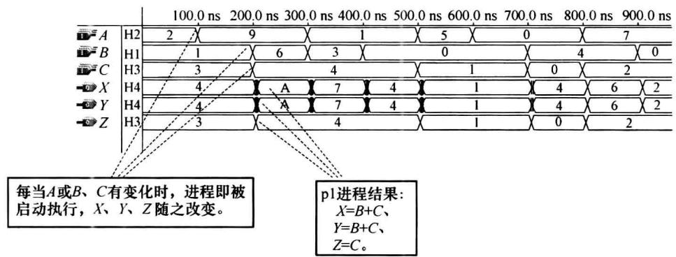
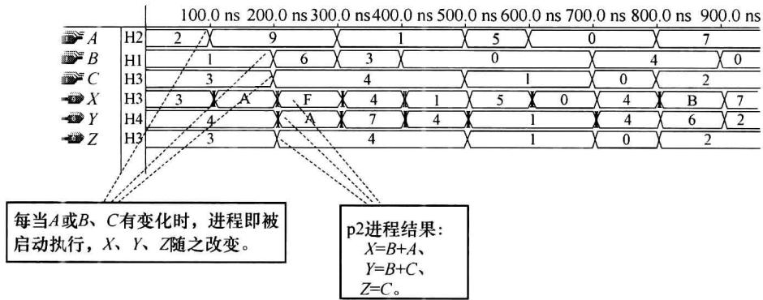
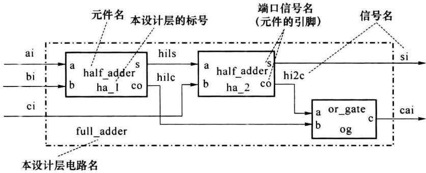
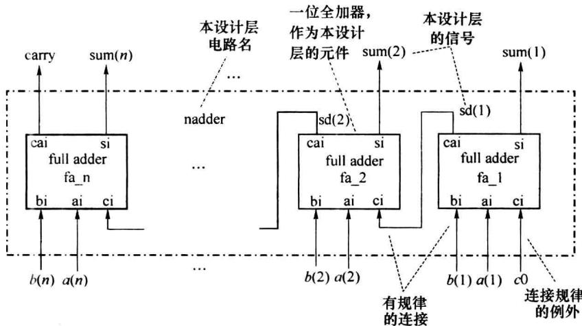

import Guide from '@/components/Guide.astro';
import Knowledge from '@/components/Knowledge.astro';
import Example from '@/components/Example.astro';
import Analysis from '@/components/Analysis.astro';
import Solution from '@/components/Solution.astro';
import Variant from '@/components/Variant.astro';
import Note from '@/components/Note.astro';
import Block from '@/components/Block.astro';
import Method from '@/components/Method.astro';
import Exercise from '@/components/Exercise.astro';

一个硬件系统在功能或结构上总是由若干子模块组成,较大型的系统又可分出上下层的层次关系。作为硬件描述语言,VHDL有多种形式的描述模块和系统层次的语句组织结构。

## 8.5.1 块语句结构

可以将对系统中处于同一模块的电路的功能或结构的描述语句组织在一个 BLOCK 块中。块语句结构的格式如下：


块标号: BLOCK[GUARD 表达式]


[块接口及说明语句；]


并行语句；


[GUARDED 语句；]


[并行语句；]


END BLOCK[块标号];


在块接口及说明语句部分中可以用 PORT 语句声明本 BLOCK 块用的端口。可以声明、定义本块用的程序包、子程序、数据类型、部件、常量和信号。在 BEGIN 后的各语句均为并行语句，各语句的书写顺序不影响执行结果。


“GUARD 表达式”为一逻辑表达式, 结果为 “TRUE” 或 “FALSE”。只有 “GUARD 表达式” 的结果为 “TRUE” 时, 块中的 “GUARDED 语句” 才能被完成。称 “GUARDED 语句” 为被保护块语句, 一般为信号赋值语句, 其格式如下:


信号名 $\Leftarrow$ GUARDED 信号赋值表达式或条件信号赋值语句；


“GUARD 表达式”和“GUARDED 语句”并不被 VHDL 综合器支持。

<Example title="例 8.5.1">
```txt

LIBRARY IEEE;

USE IEEE.STD_LOGIC_1164.ALL;

ENTITY bleg IS

PORT(s1,s2,s3,iu1:IN STD_LOGIC;

```


```txt

......

```


```vhdl

ou1,ou2:OUT STD_LOGIC);

END bleg;

ARCHITETURE dflow OF bleg IS

    SIGNAL m1,en:STD_LOGIC;    --定义本结构体内的信号

    BEGIN

    g1:BLOCK    --第一个块,标号为 g1

    BEGIN

    m1 &lt;= s2 XOR s3;

    en &lt;= (NOT s1)OR m1;

    END BLOCK;

    g2: BLOCK(en='1')    --第二个块,标号为 g2,en='1'为 GUARD 表达式

    BEGIN

    ou1 &lt;= GUARDED iu1;    --只在 en='1'为真(TRUE)的情况下,iu1才对 ou1赋值

    ou2 &lt;= s1 AND (NOT m1);

    END BLOCK g2;

END dflow;

```


用块语句结构可以使 VHDL 程序结构清楚、可读性强、便于交流和管理。但 BLOCK 语句结构并不直接影响 VHDL 综合器的结果，并不因使用了 BLOCK 语句结构，VHDL 综合器就必然对应产生一个电路模块。


块语句结构也可以形成 BLOCK 块的嵌套,适于描述较大型系统的分层结构。
</Example>

## 8.5.2 进程语句结构

结构体及块结构中的语句均为并行语句。在 VHDL 中，顺序语句比并行语句的描述功能更为全面。所有顺序描述语句均应放在进程或子程序的语句结构中。而进程(PROCESS)是最具 VHDL 特点的语句结构。


进程语句结构的一般格式如下：


[进程标号: ] PROCESS[(敏感信号表)]


[进程说明部分]


BEGIN


顺序语句；


顺序语句；


END PROCESS[进程标号];


（1）敏感信号表中列出的是各个敏感信号名，敏感信号表中不应有变量和常量。在功能仿真过程中，当任一个敏感信号出现变化时，进程被启动执行一次，因而，在功能仿真器中的进程为一个无限循环，每执行运转一次后即处于等待状态（挂起状态），等待敏感信号的再次变化。


（2）在进程说明部分中可定义本进程使用的局部量，可定义数据类型、常量、变量、子程序等。进程内不能定义信号。信号只能作为敏感信号将信息带入、带出进程。


（3）进程内 BEGIN 以后的描述语句均为顺序语句，按它们被书写的前后顺序依次执行。执行结果与书写顺序有关。顺序语句仅意味在功能仿真器中的执行顺序，并不意味着在可编程器件中也产生相应的顺序电路结构。8.6.2 小节中列出了各种顺序语句。

<Example title="例 8.5.2">
3 线 -8 线译码器。

```vhdl

LIBRARY IEEE;

USE IEEE.STD_LOGIC_1164.ALL;

ENTITY ls138 IS

    PORT(s1,s2,s3:IN STD_LOGIC;ai:IN STD_LOGIC_VECTOR(2 DOWNTO 0);

    yout:OUT STD_LOGIC_VECTOR(7 DOWNTO 0));

END ls138;

ARCHITECTURE func OF ls138 IS

BEGIN

    PROCESS(s1,s2,s3,ai) --在功能仿真器中 s1,s2,s3,ai 之中任一有变化时,进程即被启动

BEGIN

    IF(s1='1'AND s2='0'AND s3='0')THEN --用顺序语句 if 和 case 描述 LS138 的行为功能

    CASE ai IS

    WHEN'000"⇒youtLeft="11111110";

    WHEN'001"⇒youtLeft="11111101";

    WHEN'010"⇒youtLeft="11111011";

    WHEN'011"⇒youtLeft="11110111";

    WHEN'100"⇒youtLeft="11101111";

    WHEN'101"⇒youtLeft="11011111";

    WHEN'110"⇒youtLeft="10111111";

    WHEN'111"⇒youtLeft="01111111";

    WHEN OTHERS⇒youtLeft="ZZZZZZZZZ";

    END CASE;

    ELSE youtLeft="11111111";

    END IF;

END PROCESS;

END func;

```


（4）在一个结构体中，可有多个进程，各个进程是并行的关系，每个进程之间通过信号建立联系。事实上，结构体中每条并行赋值语句都可认为是一个简化的进程，因而将进程整体归属于并行语句。


（5）在功能仿真器中，VHDL处理进程中的信号赋值语句与变量赋值语句的方式是不同的。在运行变量赋值语句时立即完成对变量的赋值，在变量赋值语句的下一语句时，变量的数值已是新赋的值。而在运行信号赋值语句时并不立即完成对信号的赋值，新的数值要在进程的同步点才赋予信号。在进程中信号赋值语句的下一句，信号仍保持进入进程时的数值。如果在进程中对同一信号有多次赋值，则最接近同步点的赋值语句才是有效的赋值语句。VHDL的这一特点既表现在功能仿真器的运行处理中，也影响着综合器在可编程器


件中生成的硬件电路结果。


(6) 有敏感信号表的进程的同步点是 END PROCESS 语句。没有敏感信号表的进程的同步点是进程中的 WAIT 语句(见 8.6.2 小节)。在一个进程中, 如果对信号的赋值没有设置延时, VHDL 的功能仿真器运行同步点前的语句部分所用时间为一个 $\delta$ 延时, 无论其间有多少条顺序语句。这与运行一条并行语句的情况是一样的。
</Example>

<Example title="例 8.5.3">
p1、p2 进程分析比较了进程中对信号的赋值和对变量的赋值的不同。其中，设 X、Y、Z、A、B、C 均为 4 位二进制信号。

```txt

......

    SIGNAL D:std_logic_vector(3 downto 0);

    p1:PROCESS (A,B,C) --p1 进程

BEGIN

    D &lt;= A; --信号赋值

    X &lt;= B + D;--意图实现 X &lt;= B + A;

    Z &lt;= D;

    D &lt;= C;

    Y &lt;= B + D;--意图实现 X &lt;= B + C;

    Z &lt;= D;

END PROCESS;

......

由图 8.5.1 可见 p1 进程的结果。

```


在 p1 进程中, 对各信号的赋值是在进程结束时(同时)完成的。对同一信号 Z 有多次赋值, 只最后一次的赋值有效。p1 进程完成的是:


```txt

p2: PROCESS (A, B, C) --p2 进程

VARIABLE D: std_logic_vector (3 downto 0);

BEGIN

D := A; --变量赋值

X &lt;= B + D; --意图实现 X &lt;= B + A;

Z &lt;= D;

D := C;

Y &lt;= B + D; --意图实现 X &lt;= B + C;

Z &lt;= D;

END PROCESS;

……

由图 8.5.2 可见 p2 进程的结果。

在 p2 进程中，对变量的赋值是立即完成的。

p2 进程完成的是：

X &lt;= B + A

Y &lt;= B + C

Z &lt;= C

```


  

图8.5.1 p1进程的时序仿真结果


  

图8.5.2 p2进程的时序仿真结果
</Example>

## 8.5.3 子程序语句结构

子程序(SUBPROGRAM)是 VHDL 中的一种程序单元。子程序可用于对系统中那些相对独立、重复出现的电路模块进行描述，子程序也可作为 VHDL 的工作函数，例如运算符重载函数、决断函数等。


子程序中只能使用顺序语句,与进程不同的是:在子程序内不能直接读取、赋值本子程序外的信号。子程序只能通过入口参数、返回值、出口参数与调用方进行数据交互。


可以在结构体、进程中定义子程序，子程序的定义体应处于说明部分。这样定义的子程序仅能在它定义所处结构体、进程中被调用。若要使子程序被多个设计实体调用，应将其定义在程序包中。


描述电路功能的子程序,在 VHDL 综合后,在各调用子程序的相应位置均生成结构相同但入、出线的连向可能不同的电路模块。


子程序有函数和过程两种类型。

### 1. 函数(FUNCTION)

函数体的书写格式如下：


FUNCTION 函数名(参数表)RETURN 数据类型 IS


[说明部分]


BEGIN


顺序语句；


RETURN 表达式；


END[FUNCTION]函数名；


参数表中声明的各参数的数据对象可以是信号或常量,不加以声明时被默认为常量。它们的流向均为输入进本函数,其数值由调用方赋予。函数的输出数据只有一个,为RETURN语句中“表达式”的取值,其类型由FUNCTION语句中的“数据类型”说明。函数的输出数据返回给调用方。在一个函数中,应至少有一条RETURN语句。


如果是在程序包中定义函数,则应将函数体放入程序包体,在程序包首中还需声明函数首。函数首的格式如下:


FUNCTION 函数名(参数表)RETURN 数据类型;


在程序包中定义的函数可被引用该程序包的各设计实体所调用。

<Example title="例 8.5.4">
对 std\_logic 型数据的逻辑与运算符(AND)的重载(再定义)函数。

```txt

PACKAGE utilities IS

TYPE STD_LOGIC IS('U','X','0','1','Z','W','L','H','-');

FUNCTION "AND" (a,b:std_logic) RETURN std_logic;

......

END utilities;

PACKAGE BODY utilities IS

......

FUNCTION "AND" (a,b:std_logic) RETURN std_logic IS

TYPE std_tabula IS ARRAY( std_logic, std_logic ) OF std_logic;

CONSTANT and_table :std_tabula: = (

('U','U','0','U','U''U','0','U','U'),--std_logic 型数据和 'U' 进行与运算的结果

('U','X','0','X','X','X','0','X','X'),

('0','0','0','0','0','0','0','0','0'),

('U','X','0','1','X','X','0','1','X'),

('U','X','0','X','X','X','0','X','X'),

('U','X','0','X','X','0','X','X'),

('0','0','0','0','0','0','0','0','0'),

('U','X','0','1','X','X','0','1','X'),

('U','X','0','X','X','X','0','X','X'),

); --以枚举元素名作为常量数组 and_table 的元素下标

BEGIN

RETURN and_table(a,b); --返回根据 a、b 进行查表的结果

END "AND"; --为 std_logic 型数据

......

END utilities;

```


在 STD\_LOGIC\_1164 程序包中, 已定义了对 STD\_LOGIC 型数的 AND、OR 等逻辑运算符的标准重载函数。在 VHDL 程序中, 在声明使用 STD\_LOGIC\_1164 程序包后, 在处理两个 STD\_LOGIC 型数据的逻辑运算时, 系统将自动调用标准重载函数。
</Example>

### 2. 过程

```txt

过程(PROCEDURE)体的书写格式如下：

PROCEDURE 过程名(参数表)IS

[说明部分]

BEGIN

顺序语句；

……

END[PROCEDURE]过程名；

```


参数表中声明的各参数是本过程与调用方联系的数据。各参数的数据对象可以是信号、变量或常量，它们的流向可以是 IN、INOUT、OUT 本过程（默认值为 IN）。流向为 IN 时，参数的数据对象默认值（不加以数据对象声明时）为常量。流向为 OUT、INOUT 时，参数的数据对象默认值是变量。与函数相比较，过程的入出参数中可以有变量，可以有 INOUT 流向的参数，输出参数可有多个。过程无须用 RETURN 语句返回。


与函数相仿,如果是在程序包中定义过程,则应将过程体放入程序包体,在程序包首中还需声明过程首。过程首的格式如下:


PROCEDURE 过程名(参数表);


在程序包中定义的过程可被引用该程序包的各设计实体所调用。

<Example title="例 8.5.5">
本例描述了一个投票表决电路——根据表决多数的结果(同意 $[1']$ ，不同意、否决 $[0']$ )决定是否允许信号通过的电路。

```vhdl

LIBRARY IEEE;

USE IEEE.STD_LOGIC_1164.ALL;

ENTITY jvoter IS

PORT(dcd:IN STD_LOGIC_VECTOR(15 DOWNTO 0);

    din:IN STD_LOGIC;qget:OUT STD_LOGIC);

END jvoter;

ARCHITECTURE dojvoter OF jvoter IS

SUBTYPE inte16 IS INTEGER range 0 to 16; --定义一个子数据类型

PROCEDURE yorn (in1:IN std_logic_vector(15 downto 0); --在结构体的说明

    flag:OUT boolean;ou1:INOUT inte16) IS -部分里定义过程

BEGIN

flag := FALSE;

FOR i IN in1'RANGE LOOP

IF in1(i) = '1' THEN

    ou1 := ou1 + 1;

    next; --跳出此次LOOP循环

END IF;

IF (i = 0)or(i = 1) THEN

    IF in1(i) = '0' THEN

    flag := TRUE; --只有i = 0、1者有否决权

    exit; --结束LOOP循环

    END IF;

END IF;

END LOOP;

END PROCEDURE yorn;

BEGIN

PROCESS(dcd, din)

VARIABLE bjg :BOOLEAN;

```


```txt

VARIABLE ijg : inte16;

BEGIN

    ijg := 0;

    yorn (dcd, bjg, ijg); --过程的调用

    IF (bjg = FALSE) AND (ijg > (dcd'LENGTH/2)) THEN

    qget &lt;= din; --在同意者过半且无否决的情况下，允许信号通过

    ELSE qget &lt;= 'Z';

    END IF;

END PROCESS;

END dojvoter;

```


在结构体或进程中可用过程调用语句调用过程,而对函数的调用不是通过调用语句,而是要将函数写在表达式中,如同高级语言。


在 VHDL 中, 不同的子程序在参数表不同的情况下可以使用同一个名称, 这就是子程序的重载(RELOAD)。在调用同一名称的子程序时, 系统根据参数表的不同区分所调用的目标子程序。同高级语言一样, 子程序的重载给 VHDL 程序的设计、阅读带来了便利。
</Example>

## 8.5.4 元件例化语句结构

元件例化(COMPONENT\_INSTANT)语句结构特别适用于描述电路系统的层次关系。在这种语句结构中，首先用元件声明语句将已存在的设计单元(设计实体)声明为元件，然后用元件例化语句描述各元件的连接关系。各元件的连接是本层次的设计，声明为元件的那些已存在的设计单元作为相对低一层次的设计。


元件声明语句的格式如下：


COMPONENT 元件名


[ GENERIC(类属表);]


PORT( 端口信号名 1: 端口模式 数据类型;……;端口信号名 n: 端口模式 数据类型); END COMPONENT [元件名];


（1）元件名可以和已存在的设计实体(实体和结构体)的实体名同名，也可不同名。已存在的设计实体可以来自 WORK 库，也可以来自 EDA 厂家提供的元件库。元件名与库中的实体名的对应关系可由配置语句说明。


(2) 由 PORT 引导的端口表以及由 GENERIC 引导的类属表应和已存在的设计单元的实体中的一样。端口信号名相当于元件引脚的名称。


(3) 元件声明语句应放在结构体的说明部分。


元件例化语句的格式如下：


标号:元件名 PORT MAP(信号名 1,信号名 2,……,信号名 n);


其中,元件名是已由元件声明语句声明的元件名,标号为此元件在本设计层次电路中的标号,各信号名为本设计层电路中的信号,它们与元件的端口信号名以相同的次序位置对应连接。元件例化语句应放在结构体中。


元件例化语句的另一种格式如下：


标号: 元件名 PORT MAP(端口信号名 1 => 信号名 1, ……,


……，端口信号名 n => 信号名 n）；


如果元件声明语句中带有类属表,则在元件例化语句前应使用类属映射语句(GENERIC MAP)对类属表中参数为本次例化赋值。见例 8.5.6。

<Example title="例 8.5.6">
用 VHDL 描述如图 8.5.3 所示的一位全加器 full\_adder，其中半加器 half\_adder、或门 or\_gate 已由例 8.2.4 和例 8.2.1 描述，已设置于 ENTITYWORK 库中。




图8.5.3 一位全加器  

```txt

LIBRARY IEEE;

LIBRARY ENTITYWORK;

USE IEEE.STD_LOGIC_1164.ALL;

ENTITY full_adder IS --本设计层名为 full_adder

PORT( ai , bi , ci : IN STD_LOGIC ; si , cai : OUT STD_LOGIC );

END full_adder ;

```


```txt

ARCHITECTURE frame OF full_adder IS

COMPONENT half_adder --声明 half_adder 为 full_adder 中的一个元件

PORT(a, b:IN STD_LOGIC; s, co:OUT STD_LOGIC);

END half_adder;

COMPONENT or_gate --声明 or_gate 为 full_adder 中的一个元件

PORT(a, b:IN STD_LOGIC; c:OUT STD_LOGIC);

END or_gate;

SIGNAL hils, hilc, hi2c:STD_LOGIC; --声明本设计层内的连线信号

FOR ha_1,ha_2:half_adder USE ENTITYWORK.half_adder(daflow); --配置语句

FOR og :or_gate USE ENTITYWORK.or_gate(data_fw); --配置语句

BEGIN

ha_1: half_adder PORT MAP(ai, bi, hils, hilc); --元件例化语句

ha_2: half_adder PORT MAP(a => hils, b => ci, s => si, co => hi2c);

og: or_gate PORT MAP(b => hilc, a => hi2c, c => cai);

END frame;

```


由本例可见,元件例化语句结构描述的是本设计层的电路结构,先前完成的设计单元可作为本设计层的一个框图式的元件。因而也将这种语句结构称为结构描述方式。它与前面所述的行为描述、数据流描述一起作为 VHDL 的 3 种不同的描述风格。例中使用配置语句 “FOR…USE…” 为本设计层中的元件配置库中的已存在的实体(结构体)。配置语句有时也可不用。


在系统中经常有某一元件或构造有规律连接排列的现象,可以用重复元件生成(FOR\_GENERATE)语句配合元件例化语句来描述这种情况。重复元件生成语句的格式如下:


[标号：] FOR 循环变量 IN 取值范围 GENERATE


元件例化语句；


```txt

END GENERATE [标号];

```


其中,循环变量为整数类型,由取值范围给出循环变量的初值、循环次数和递变方向,每循环一次,各例化语句被执行一次,每循环一次,循环变量递增1或递减1,超出取值范围后循环结束。这样,经过由取值范围给出的循环次数后,可产生有规律连接的元件排列。如果在某一个排列位置,元件的连接规律有例外,可用条件生成(IF\_GENERATE)语句处理。条件生成语句的格式如下:


[标号:] IF 条件表达式 GENERATE


元件例化语句；


```txt

......

END GENERATE[标号];

```


当条件表达式(通常为循环变量的关系表达式)的结果为 TRUE 时,执行随后的元件例化语句。
</Example>

<Example title="例 8.5.7">
描述如图 8.5.4 所示的 n 位串行全加器 nadder。设一位全加器 full\_adder 已由例 8.5.6 设计完成，放置于 WORK 库中。

```txt

LIBRARY IEEE;

USE IEEE.STD_LOGIC_1164.ALL ;

USE WORK.full_adder ; --使产生默认配置

ENTITY nadder IS

    GENERIC(n:INTEGER:=8); --类属说明语句

    PORT(c0:IN STD_LOGIC;a,b:IN STD_LOGIC_VECTOR(1 TO n);

    carry:OUT STD_LOGIC;sum:OUT STD_LOGIC_VECTOR(1 TO n) );

END nadder;

```


```txt

ARCHITECTURE struct OF nadder IS

COMPONENT full_adder --声明 full_adder 为 nadder 中的一个元件

PORT(ai, bi, ci: IN STD_LOGIC; si, cai: OUT STD_LOGIC);

END full_adder;

SIGNAL sd: STD_LOGIC_VECTOR(1 TO n-1); --声明 nadder 内的连线信号

BEGIN

```


na: FOR i IN 1 TO n GENERATE --重复元件生成语句

nal: IF i = 1 GENERATE --条件生成语句


fa\_1: full\_adder PORT MAP(a(i), b(i), c0, sum(i), sd(i)); --元件例化语句 END GENERATE na1;


```txt

nai: IF(i>1)AND(i&lt;n)GENERATE

```


fa\_i: full\_adder PORT MAP(a(i), b(i), sd(i-1), sum(i), sd(i));


END GENERATE nai;


nan: IF i = n GENERATE


fa\_n: full\_adder PORT MAP(a(i), b(i), sd(i-1), sum(i), carry);


END GENERATE nan;


END GENERATE na;


END ARCHITECTURE struct;


  

图8.5.4 $n$ 位串行全加器


例 8.5.7 中 n 位全加器内的一位全加器的连接规律基本相同, 故采用重复元件生成语句 (FOR\_GENERATE) 描述。在最高位和最低位的连接方式略有不同, 用条件生成语句 (IF\_GENERATE) 处理。
</Example>

<Example title="例 8.5.7">
描述的是一个已存在的 n 位全加器的结构。目的是为了说明 FOR\_GENERATE 和 IF\_GENERATE 语句的使用。在基于 HDL 的 EDA 设计中，完成两个 n 位数的相加运算，通常不必用这样的方法：先设计全加器电路后再由全加器完成相加运算。可直接描述两个 n 位数相加的行为，这正是硬件描述语言的长处。见例 8.5.8。
</Example>

<Example title="例 8.5.8">
LIBRARY IEEE;


USE IEEE.STD\_LOGIC\_1164.ALL;


USE IEEE.STD\_LOGIC\_ARITH.ALL;


USE IEEE.STD\_LOGIC\_UNSIGED.ALL;


ENTITY adder\_n IS --两个n位数相加的通用性设计实体

GENERIC(n:INTEGER); --类属说明语句


```txt

PORT(a,b:IN STD_LOGIC_VECTOR(n DOWNTO 1);  

sum:OUT STD_LOGIC_VECTOR(n DOWNTO 1));  

END adder_n;  

ARCHITECTURE behav OF adder_n IS  

BEGIN  

sum &lt;= a + b; --调用程序包中的重载函数完成两个  

END behav; --STD_LOGIC_VECTOR型向量的相加运算

```


以下程序仍以元件例化语句结构的方式通过用 adder\_n 完成两个 16 位数的相加。目的是给出类属映射语句(GENERIC MAP)的用法。


```vhdl

LIBRARY IEEE;

USE IEEE.STD_LOGIC_1164.ALL;

USE IEEE.STD_LOGIC_ARITH.ALL;

USE IEEE.STD_LOGIC_UNSIGED.ALL;

ENTITY adder_16 IS

PORT( ai,bi:IN STD_LOGIC_VECTOR(15 DOWNTO 0);

sum:OUT STD_LOGIC_VECTOR(15 DOWNTO 0) );

END adder_16;

ARCHITECTURE behav OF adder_16 IS

COMPONENT adder_n --元件声明

GENERIC(n:INTEGER);

PORT(a,b:IN STD_LOGIC_VECTOR(n DOWNTO1);

sum:OUT STD_LOGIC_VECTOR(n DOWNTO 1) );

END COMPONENT;

BEGIN

adder16:adder_n GENERIC MAP (n => 16) --类属映射语句

PORT MAP (a => ai,b => bi,sum => sum); --元件例化

END ARCHITECTURE behav;

```
</Example>
