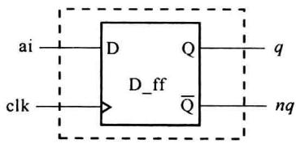
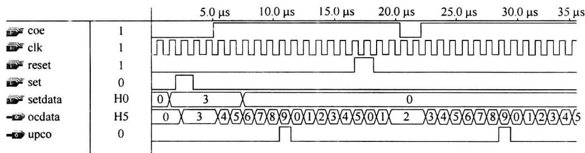

import Guide from '@/components/Guide.astro';
import Knowledge from '@/components/Knowledge.astro';
import Example from '@/components/Example.astro';
import Analysis from '@/components/Analysis.astro';
import Solution from '@/components/Solution.astro';
import Variant from '@/components/Variant.astro';
import Note from '@/components/Note.astro';
import Block from '@/components/Block.astro';
import Method from '@/components/Method.astro';
import Exercise from '@/components/Exercise.astro';

顺序描述语句和并行描述语句是 VHDL 的两类基本语句。数字逻辑电路和系统中的信号流程、硬件行为、结构关系都可用这两类语句以不同的方式给予描述。在前述各节中已见到了一些常用语句的应用，本节对 VHDL 的主要描述语句作一总结性介绍。

## 8.6.1 并行描述语句

各并行语句的执行结果和它们的书写的先后顺序无关。并行语句直接反映了硬件电路的并行工作的特征。结构体中的语句均应为并行语句。VHDL 的并行语句主要有以下几类：


\- 块语句


\- 进程语句(一个 process 相当于一条并行语句)


\- 并行信号赋值语句


\- 元件例化语句


\- 元件生成语句


\- 并行过程调用语句


其中，块语句、进程语句、元件例化与生成语句在前节已有了介绍。


1. 并行信号赋值语句


并行信号赋值语句有 3 个类型：


\- 简单信号赋值语句


\- 条件信号赋值语句


\- 选择信号赋值语句

### (1) 简单信号赋值语句

语句格式如下：


信号名 $\Leftarrow$ 表达式；


表达式的数据类型应和信号名的类型一致。在表达式中可设置惯性延时或传输延时。


(2) 条件信号赋值语句


语句格式如下：


<div class="mineru-algorithm" style="white-space: pre-wrap; font-family:monospace;">

信号名 $\Leftarrow$ 表达式1 WHEN布尔表达式1 ELSE  

表达式2 WHEN布尔表达式2 ELSE  

$\vdots$  

表达式n WHEN布尔表达式n ELSE  

表达式 $n+1$;

</div>


其中，布尔表达式为赋值的条件。在 VHDL 功能仿真过程中，对各布尔表达式按书写顺序依次测试，将第一个结果为 TRUE 的所对应的表达式的结果赋值给信号，若所有布尔表达式的结果均为 FALSE，则将表达式 $n+1$ 的结果赋值给信号。因而各布尔表达式表示的赋值条件可以有重叠。

<Example title="例 8.6.1">
4 选 1 逻辑电路。

```matlab

LIBRARY IEEE;

USE IEEE.STD_LOGIC_1164.ALL;

ENTITY mux4_to_1 IS

    PORT(d0,d1,d2,d3,a,b:IN std_logic;y:OUT std_logic);

END mux4_to_1;

ARCHITECTURE sample_1 OF mux4_to_1 IS

BEGIN

    y &lt;= d0 WHEN a = '0' AND b = '0' ELSE

    d1 WHEN a = '0' AND b = '1' ELSE

    d2 WHEN a = '1' AND b = '0' ELSE

    d3 WHEN a = '1' AND b = '1' ELSE

```


```txt

'Z'; --当 a,b 为 std_logic 型数据的 '0', '1'

END sample_1; --以外(如 'Z', 'X') 的取值组合的情况时

```
</Example>

### (3) 选择信号赋值语句

<div class="mineru-algorithm" style="white-space: pre-wrap; font-family:monospace;">

语句格式如下：

WITH 选择表达式 SELECT

信号名 $\Leftarrow$ 表达式 1 WHEN 值 1,

表达式 2 WHEN 值 2,

:

表达式 n WHEN 值 n,

表达式 n + 1 WHEN others;

</div>


其中，值1、值2、……、值n为选择表达式的取值，它们不应有相互重叠的情况。当选择表达式的结果值为值1～值n中的某一个时，将对应的表达式的结果赋值给信号，若选择表达式的结果值不是值1～值n中的任一个，则将表达式 $n+1$ 的结果对信号赋值。应用见前例。

### 2. 并行过程调用语句

例 8.5.5 中可见到位于进程(prosess)中的过程(procedure)调用语句,它属顺序过程调用语句。在结构体中对过程的调用语句即为并行过程调用语句。并行过程调用语句、顺序过程调用语句均如下格式:


```txt

过程名(参数1,参数2……);

```


其中的参数 1, 参数 2, ……将数据代入、带出过程, 它们是当前结构体(或进程)中的参数名, 被称为实参, 它们与过程定义中的参数表中的各参数(形参)同位置对应, 须具有相同的数据类型。过程调用语句的另一种格式如下:


过程名(形参 1 => 实参 1, 形参 2 => 实参 2……);

## 8.6.2 顺序描述语句

顺序语句在 VHDL 功能仿真器中是按照它们书写的前后次序依次执行的, 因而功能仿真的执行结果及综合器实现出的电路结果均与语句书写的前后顺序有关。顺序语句发挥了计算机处理的特长, 因而 VHDL 中顺序语句的描述表现力优于并行语句。顺序语句只能用在进程和子程序中。


顺序描述语句主要有以下几类：


\- 赋值语句


\- IF 语句


\- 流程控制语句(CASE、LOOP、NEXT、EXIT、RETURN、NULL)

## - WAIT 语句

应注意的是,顺序语句是指它们在功能仿真器中是顺序执行的,但综合器根据顺序语句实现出的电路仍然可具有并行处理的特征。

### 1. 赋值语句

(1) 信号赋值语句


语句格式如下：


信号名 $\Leftarrow$ 表达式；


表达式结果的数据类型应和信号名的一致。在表达式中可设置惯性延时或传输延时。

### (2) 变量赋值语句

语句格式如下：


变量名:=表达式；


表达式结果的数据类型应和变量名的一致。但表达式中不可设置惯性延时或传输延时。由于变量只能在进程或子程序中定义和使用，变量赋值语句也只能出现在进程或子程序中。与对信号赋值的处理不同，在 VHDL 功能仿真器中对变量的赋值是立即完成的。在 8.5.2 小节中介绍了在进程中对变量赋值和对信号赋值时 VHDL 的不同处理。

### 2. IF 语句

IF 语句是 VHDL 中最常用到的语句之一, 在组合逻辑、时序逻辑设计中都会用到 IF 语句。IF 语句的一般格式如下:


IF布尔表达式1 THEN


顺序语句；--布尔表达式1结果为TRUE时，执行此部分顺序语句


[ELSIF 布尔表达式 2 --布尔表达式 1 结果为 FALSE]


顺序语句；] --布尔表达式2结果为TRUE时，执行此部分顺序语句


```txt

[……]

```


```txt

[ELSE]

```


顺序语句；] --各布尔表达式结果均为 FALSE 时，执行此部分顺序语句 END IF;


其中，“[]”中为可选则性内容。


没有“ELSIF”和“ELSE”语句部分的 IF 语句称为不完整 IF 语句，通常用不完整 IF 语句描述具有记忆功能的时序电路，如触发器、寄存器、计数器等。

<Example title="例 8.6.2">
D 触发器(图 8.6.1)的 VHDL 描述。




```vhdl

LIBRARY IEEE;

USE IEEE.STD_LOGIC_1164.ALL;

ENTITY D_ff IS

    PORT(ai, clk: IN STD_LOGIC;

    q, nq: OUT STD_LOGIC);

END ENTITY D_ff;

ARCHITECTURE behav OF D_ff IS

BEGIN

    PROCESS(clk) --时钟 clk 为敏感信号

    VARIABLE bufq: STD_LOGIC; --声明一个变量 bufq 作为缓存单元

BEGIN

    IF(CLK'EVENT AND CLK = '1') --如果 clk 端出现上升沿,则将 ai 赋值给 bufq

    THEN bufq := ai; --如果 clk 出现的不是上升沿,则不作任何

    END IF; --处理,bufq 仍保持原值

    q &lt;= bufq; --缓存单元向输出端口输出

```


```vhdl

nq &lt;= NOT bufq;

END PROCESS;

END ARCHITECTURE behav;

```


例 8.6.2 的 IF 语句为不完整的 IF 语句。在不满足“IF 部分”给出的条件(遇时钟 clk 上升沿)时不作任何处理, IF 语句结束, 输出保持为原值, 这正是触发器具有的功能。因而, VHDL 综合器一般将不完整 IF 语句实现为触发器、寄存器、计数器等时序电路, 而完整的 IF 语句一般被实现为组合电路。
</Example>

<Example title="例 8.6.3">
具有同步复位、预置功能的十进制计数器。

```vhdl

USE IEEE.STD_LOGIC_1164.ALL;

USE IEEE.STD_LOGIC_ARITH.ALL;

USE IEEE.STD_LOGIC_UNSIGNED.ALL;

entity counter10 IS

PORT(clk, set, reset, coe: IN STD_LOGIC;setdata: IN STD_LOGIC_VECTOR(3 downto 0);

ocdata: OUT STD_LOGIC_VECTOR(3 downto 0); upco: OUT STD_LOGIC);

```


```vhdl

BEGIN

PROCESS(clk) --时钟 clk 为敏感信号

VARIABLE octemp:STD_LOGIC_VECTOR(3 downto 0);--声明一个进程内部

BEGIN --变量作为缓存单元

IF clk'EVENT AND clk = '1'THEN --如果遇 clk 端出现上升沿

IF reset = '1'THEN octemp:=(OTHERS =>'0'); --复位(清零)

ELSIF set = '1'THEN octemp:= setdata; --预置

ELSIF coe = '1'THEN --计数使能

IF octemp&lt;B"1001"THEN octemp:=octemp+1; --计数加一

ELSE octemp:=(OTHERS =>'0'); --十进制

END IF;

END IF; --不完整 IF 语句,如果复位、预置、使能均无效,则计数值保持原值

END IF; --不完整 IF 语句,如果未遇 clk 上升沿,则计数值保持原值

IF octemp = "1001"THEN upco &lt;='1'; --进位

ELSE upco &lt;='0';

END IF; --完整的 IF 语句

ocdata &lt;= octemp; --缓存单元向输出端口输出

END PROCESS;

END behav;

```


例 8.6.3 中使用了 UNSIGNED 程序包, 这是因为例中有 STD\_LOGIC 型数和整型数的 “+”运算 (octemp := octemp + 1);), UNSIGNED 程序包中重载了这种运算的 “+”运算符。例


8.6.3 中的第一个 IF 语句(IF clk'EVENT AND clk='1'…)为不完整 IF 语句,经 VHDL 综合器生成时序电路。而 IF octemp="1001"语句为完整 IF 语句,生成的是组合电路。


例 8.6.3 中的“OTHERS $\Rightarrow$ ”为一种省略赋值操作符，常在对数据向量整体赋值时使用。例如：


```txt

signal dv:std_logic_vector(15 downto 0);

......

dv &lt;= (15 => '0', 0 => '0', OTHERS => '1');

```


等价于: dv(15) &lt;= '0', dv(0) &lt;= '0', dv(14) \~ dv(1) 均被赋值为 '1'。可见用省略赋值操作符“OTHERS =>”可使书写简便。


例 8.6.3 中声明了进程内部变量 octemp, 计数及预置、清零都是针对 octemp 进行的。在进程的最后将 octemp 赋值给输出端口 ocdata。如果不声明 octemp, 就要直接对端口信号处理, ocdata 就要被声明为 BUFFER, 这将占用较多的硬件资源使问题复杂化。


图 8.6.2 为例 8.6.3 十进制计数器 counter10 的时序仿真波形, 其中可见计数过程及预置、清零、计数使能的处理。


  

图8.6.2 counter10的时序仿真波形
</Example>

### 3. CASE 语句

CASE 语句描述了这样一种行为或结构,根据某一参量取值的不同,处理的方式或结果也不同。CASE 的语句格式如下:


```txt

CASE 表达式 IS

WHEN 表达式的取值 1 => 顺序语句 1;

:

WHEN 表达式的取值 k => 顺序语句 k;

[WHEN OTHERS => 顺序语句 k + 1];

END CASE;

```


其中，WHEN引导的表达式的取值可以是一个，也可是多个（表示为：值1|值2|……），也可以是某一指定范围（表示为：值1TO值2）。仿真器在执行CASE语句时，首先计算表达式的值，确定它符合哪一WHEN语句中的取值情况，然后执行对应的顺序语句。若表达式值不符合任何一个WHEN语句中的取值情况，则执行WHENOTHERS后的顺序语句。从例8.5.2可见CASE语句在组合逻辑电路描述中的应用。例8.6.4中的CASE语句描述的是时序逻辑。

<Example title="例 8.6.4">
通用移位寄存器。

```txt

LIBRARY IEEE;

```


```vhdl

USE IEEE.STD_LOGIC_1164.ALL;

ENTITY shfreg IS

    GENERIC(n:INTEGER:=8);

    PORT(clk,dinr,dinl:INSTD_LOGIC;

    fd:INSTD_LOGIC_VECTOR(0TO2); --功能选控端

    dload:IN STD_LOGIC_VECTOR(n-1 DOWNTO 0); --加载数据端

    qd:OUTSTD_LOGIC_VECTOR(n-1 DOWNTO 0)); --输出数据端

END shfreg;

ARCHITECTURE whatodo OF shfreg IS

    SIGNAL itd STD_LOGIC_VECTOR(n-1 DOWNTO 0); --声明一个内部信号

BEGIN

    PROCESS(clk)

    BEGIN

    IF(clk'EVENTAND clk='1')THEN

    CASE fd IS

    WHEN"000"⇒itd⇐(OTHERS =>'0'); --清零

    WHEN"001"⇒itd⇐dload; --加载

    WHEN"010"⇒itd⇐itd(n-2 DOWNTO 0)&dinl; --逻辑左移一位

    WHEN"011"⇒itd⇐dinr&itd(n-1 DOWNTO 1); --逻辑右移一位

    WHEN"100"⇒itd⇐itd(n-2 DOWNTO 0)&'0'; --算术左移一位

    WHEN"101"⇒itd⇐itd(n-1)&itd(n-1 DOWNTO 1); --算术右移一位

    WHEN"110"⇒itd⇐itd(n-2 DOWNTO 0)&itd(n-1); --循环左移一位

    WHEN"111"⇒itd⇐itd(0)&itd(n-1 DOWNTO 1); --循环右移一位

    WHEN OTHERS =>NULL;

    END CASE;

    END IF;

    qd⇐itd;

    END PROCESS;

END whatodo;

```


例 8.6.4 中使用连接运算符“&”连接数据表示移位后的结果。例中“WHEN OTHERS”是必要的，因为 fd 为 STD\_LOGIC 型数据，除了“000～111”的取值外还会有其他取值如‘H’、‘L’、‘Z’等的组合情况。NULL 为空操作语句，表示不作任何处理，也可用“itd &lt;= itd”取代。通过例 8.6.4 也可认识各移位运算符的意义。


IF 语句和 CASE 语句都可用来描述多分支处理, 它们的不同之处在于: IF 语句中由各布尔表达式描述的条件有优先级之分, 书写在前的优先级高。而 CASE 语句中由于各 WHEN 句没有优先级, 它们呈并行关系。IF 语句中由各布尔表达式描述的条件可以有一定的相互覆盖, 而 CASE 语句中各 WHEN 句中表达式的取值不能有相互覆盖的情况。
</Example>

### 4. LOOP 语句

LOOP 语句将重复性的处理描述在一个循环体中。FOR-LOOP 是 LOOP 语句的主要


形式。FOR-LOOP 语句的格式如下：


```txt

[LOOP 标号:] FOR 变量名 IN 范围 LOOP

顺序语句；

:

顺序语句；

END LOOP[LOOP 标号];

```


其中，“变量名”为本 FOR-LOOP 循环中的局部变量，为整型或枚举型，无须对其事先声明。“变量名”在循环体内可以被引用，不可被赋值改变。“范围”给出“变量名”的初值、终值及每循环一次后的步进方式（加 1 或减 1）。FOR-LOOP 语句在执行每一次的循环时，首先检查变量名的数值是否在范围内，如在范围内则执行循环体中的各顺序语句，执行完后自动将变量名的数值步进改变，再进入下一次循环，直至变量名的数值超出给定的范围。

<Example title="例 8.6.5">
奇偶检测电路。

```vhdl

LIBRARY IEEE;

USE IEEE.STD_LOGIC_1164.ALL;

USE IEEE.STD_LOGIC_ARITH.ALL;

USE IEEE.STD_LOGIC_UNSIGNED.ALL;

ENTITY oe_check IS

    PORT(a:IN STD_LOGIC_VECTOR(7 downto 0);

    oe_out:OUT STD_LOGIC);

END oe_check;

ARCHITECTURE struc OF oe_check IS

BEGIN

    PROCESS(a)

    VARIABLE temp:STD_LOGIC;

BEGIN

    temp:='0';

    FOR j IN 0 TO 7 LOOP --每循环一次j加1,直到7,共循环8次

    temp:=temp XOR a(j);

    END LOOP;

    oe_out&lt;=temp;

    END PROCESS;

END struc;

LOOP语句还有 WHILE-LOOP的形式,可参见其他参考书。

5. NEXT和EXIT语句

NEXT和EXIT语句主要用于在LOOP循环体中控制循环的返回和退出。

NEXT语句的格式如下:

NEXT[LOOP标号][WHEN条件表达式];

如语句“NEXT;”表示无条件终止本次循环,返回到本LOOP循环体的起始次循环。又如语句“NEXT LOOP标号 WHEN条件表达式;”表示在条件表达

```


TRUE 的条件下, 终止本次循环, 返回到由 LOOP 标号指定的循环体的起始位置进行下次循环。若条件表达式的结果为 FALSE, 则不执行本 NEXT 语句。


EXIT 语句的格式如下：


```txt

EXIT [LOOP 标号] [WHEN 条件表达式];

```


可以与 NEXT 语句的类比, EXIT 语句表示无条件(或在满足 WHEN 引导的条件下)退出本 LOOP 循环体(或由 LOOP 标号指定的循环体)。


在例 8.5.5 中可见 NEXT、EXIT 语句的使用。
</Example>

### 6. WAIT 语句

在 8.5.2 小节中介绍到 WAIT 语句在进程中起着同步点的作用。在 VHDL 功能仿真器运行 WAIT 语句后，进程即被挂起，只在 WAIT 语句中给出的条件被满足后才结束挂起再次运行进程。如果在进程内使用 WAIT 语句，在进程的关键字 PROCESS 后不应再有敏感信号表。同样，若在“PROCESS”后列有敏感信号表，则在进程内也不应再有 WAIT 语句。


WAIT 语句有以下 4 种格式。

### (1) WAIT ON 敏感信号表；

执行该语句后,进程被挂起。当敏感信号表中任一信号出现变化时,结束挂起,进程被继续运行。如对例 8.5.2 可用 WAIT 语句作以下改动。


```txt

PROCESS --原为 PROCESS(s1,s2,s3,ai)

BEGIN

WAIT ON s1,s2,s3,ai;

IF(s1='1'AND s2='0'AND s3='0')THEN --与例 8.5.2 中的相同

......

END PROCESS;

......

(2) WAIT UNTIL 条件表达式;

```


执行该语句后,进程被挂起。当条件表达式中的信号发生变化并使条件表达式结果为TRUE时,结束挂起,进程被继续运行。

<Example title="例 8.6.6">
使用 WAIT 语句描述的 4 位串入并出电路。

```txt

LIBRARY IEEE;

USE IEEE.STD_LOGIC_1164.ALL;

ENTITY sipout IS

    PORT(clk, dsin: IN STD_LOGIC; outp: OUT STD_LOGIC_VECTOR(0 TO 3);

    oflag: OUT BIT); --oflag 的上升沿表示有新的数据并行输出

END sipout;

ARCHITECTURE struc OF sipout IS

SIGNAL inkp: STD_LOGIC_VECTOR(0 TO 3);

BEGIN

    PROCESS

    BEGIN

2

```


```txt

WAIT UNTIL clk'EVENT AND clk = '1'; --等待第1个clk上升沿

inkp(0) &lt;= dsin; --第1个clk上升沿后，将串入数据暂存

oflag &lt;= '0';

WAIT UNTIL clk'EVENT AND clk = '1'; --等待第2个clk上升沿

inkp(1) &lt;= dsin; --第2个clk上升沿后，将串入数据暂存

WAIT UNTIL clk'EVENT AND clk = '1'; --等待第3个clk上升沿

inkp(2) &lt;= dsin; --第3个clk上升沿后，将串入数据暂存

WAIT UNTIL clk'EVENT AND clk = '1'; --等待第4个clk上升沿

inkp(3) &lt;= dsin; --第4个clk上升沿后，将串入数据暂存

outp &lt;= inkp; --将暂存数据输出

oflag &lt;= '1'; --置并行输出有效

END PROCESS; --回到进程入口，等待下次clk上升沿

ND struc;

```


(3) WAIT FOR 时间表达式；


执行该语句后,进程被挂起。经时间表达式给定的时间长度后挂起结束,继续运行该语句后的语句。例如:


```sql

WAIT FOR 20 ns;

```


```javascript

(4) WAIT;

```


执行该语句后,进程会被永远挂起,仿真器相当于“死机”。正常情况下应避免这样应用。


VHDL 综合器一般只支持前两种 WAIT 语句。


WAIT 语句属于顺序语句,但只能应用在进程中。


顺序描述语句中还包括过程调用语句、断言(ASSERT)语句。可参考其他 VHDL 书籍。
</Example>
