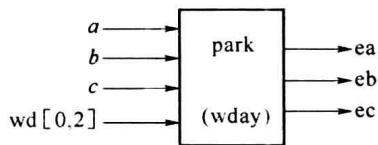
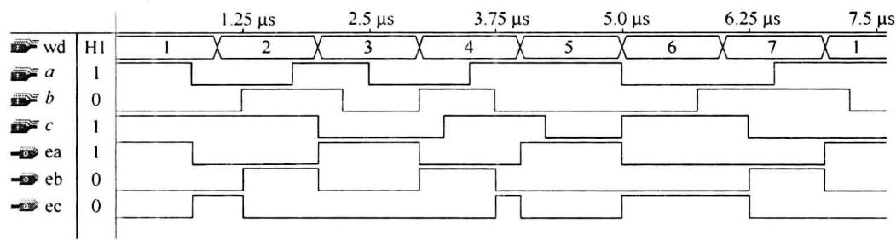
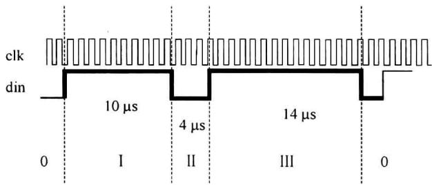
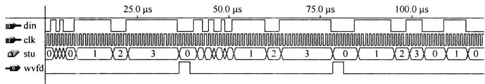

import Guide from '@/components/Guide.astro';
import Knowledge from '@/components/Knowledge.astro';
import Example from '@/components/Example.astro';
import Analysis from '@/components/Analysis.astro';
import Solution from '@/components/Solution.astro';
import Variant from '@/components/Variant.astro';
import Note from '@/components/Note.astro';
import Block from '@/components/Block.astro';
import Method from '@/components/Method.astro';
import Exercise from '@/components/Exercise.astro';

前文介绍了 VHDL 的语法规则、语句形式及程序的一般结构,其中的示例多为基本逻辑单元,如译码器、计数器等。本节从解决实际问题的角度介绍 VHDL 的应用。

## 8.7.1 用 VHDL 解决组合逻辑问题

在用自底向上的设计方式解决组合逻辑问题时,通常首先决定使用哪种标准逻辑单元电路,如与非门、选择器、译码器等,然后采用相应的设计方法得到逻辑函数,最后将标准逻辑单元连接成实现电路。这种设计方法要求设计者有足够的逻辑函数知识和技巧。


用 EDA 方法解决逻辑问题时通常并不首先确定采用哪种标准逻辑单元,而是直接用硬件描述语言(HDL)描述问题中逻辑量间的行为或逻辑关系,可利用 EDA 辅助工具软件对 HDL 程序进行功能仿真,然后通过综合器工具软件对 HDL 程序进行编译综合处理,生成对应某一可编程逻辑器件的网表文件,随后即可对目标器件进行编程下载并进行实际测试了。在编程下载前可在 EDA 工具软件的时序仿真环境中观察、仿真器件的工作波形和性能指标。这几个步骤基本上是一种“自顶向下”的设计过程。本节示例用 VHDL 解决组


合逻辑的应用问题。

<Example title="例 8.7.1">
某停车场中的一个停车位置由 A、B、C 3 个人共用。共用的规则是: 每周一、三、五 3 人使用的优先级别依次为 ACB, 每周二、四的使用优先级为 BCA, 每周六、日为 CBA。试确定当前每人是否可使用该停车位的逻辑变量。

<Solution title="解">
可设 3 个输出变量 ea、eb、ec(=1/0) 表示允许/不允许 A、B、C 3 人停车, 设输入变量 a、b、c(=1/0) 表示 3 人到场/不到场, 另设 3 变量数组 wd, 用其取值组合表示星期。可见, ea、eb、ec 分别是 a、b、c、wd 的函数。由于无须对日期时间连续计时, 函数均为组合逻辑函数。框图可由图 8.7.1 所示。如果用与非门或选择器实现 ea、eb、ec, 需对 3 个 6 变量卡诺图化简, 且化简方法也依选用器件的不同而不同。用 EDA 方法解决这一问题时, 首先可用 VHDL 对题中的变量关系作行为描述如下。




图8.7.1 park  

```txt

LIBRARY IEEE;

USE IEEE.STD_LOGIC_1164.ALL;

ENTITY park IS

    PORT(a,b,c:IN STD_LOGIC;wd:IN STD_LOGIC_VECTOR(0 TO 2);

    ea,eb,ec:OUT STD_LOGIC);

END park;

ARCHITECTURE behav OF park IS

TYPE weekday IS(mon,tue,wed,thu,fri,sat,sun); -定义一个枚举weekday表示

-星期日期

SIGNAL wday:weekday; -声明一个信号wday,数据类型为weekday

BEGIN

WITH wd SELECT -根据wd的输入为枚举信号wday赋值

wday &lt;= mon WHEN'001',

    tue WHEN'010',

    wed WHEN'011',

    thu WHEN'100',

    fri WHEN'101',

    sat WHEN'110',

    sun WHEN'111',

    mon WHEN OTHERS;

PROCESS(wday,a,b,c)

BEGIN

CASE wday IS

```


```txt

WHEN mon|wed|fri => IF a = '1' THEN ea &lt;= '1'; eb &lt;= '0'; ec &lt;= '0';

ELSIF a = '0' AND c = '1' THEN ea &lt;= '0'; eb &lt;= '0'; ec &lt;= '1';

ELSIF a = '0' AND c = '0' AND b = '1' THEN ea &lt;= '0'; eb &lt;= '1'; ec &lt;= '0';

ELSE ea &lt;= '1'; eb &lt;= '0'; ec &lt;= '0';

END IF;

WHEN tue|thu => IF b = '1' THEN ea &lt;= '0'; eb &lt;= '1'; ec &lt;= '0';

ELSIF b = '0' AND c = '1' THEN ea &lt;= '0'; eb &lt;= '0'; ec &lt;= '1';

ELSIF b = '0' AND c = '0' AND a = '1' THEN ea &lt;= '1'; eb &lt;= '0'; ec &lt;= '0';

ELSE ea &lt;= '0'; eb &lt;= '1'; ec &lt;= '0';

END IF;

WHEN sat|sun => IF c = '1' THEN ea &lt;= '0'; eb &lt;= '0'; ec &lt;= '1';

ELSIF c = '0' AND b = '1' THEN ea &lt;= '0'; eb &lt;= '1'; ec &lt;= '0';

ELSIF c = '0' AND b = '0' AND a = '1' THEN ea &lt;= '1'; eb &lt;= '0'; ec &lt;= '0';

ELSE ea &lt;= '0'; eb &lt;= '0'; ec &lt;= '1';

END IF;

END CASE;

END PROCESS;

D behav;

```


程序中定义的枚举 weekday 是为了阅读方便, 在程序不很复杂时可直接判别输入变量。图 8.7.2 给出了这一设计实体 park 的仿真波形, 可见 ea、eb、ec 是 wd 和 a、b、c 的函数, 其结果符合题目要求。


  

图8.7.2 park的仿真波形
</Solution>
</Example>

## 8.7.2 用 VHDL 解决时序逻辑问题

在前面章节的学习中我们可认识到，“状态”是时序电路中的重要概念。“状态”代表时序处理的步骤。状态也起着与输入信号一起确定输出信号的作用。因而有时也将时序电路称为“有限状态机(Finite State Machine, FSM)”，简称“状态机”。


根据前章节的介绍,状态机分为摩尔型(Moore)和米里型(Mealy)型两类。摩尔型状态机中的输出信号仅与当前状态有关,而米里型状态机的输出信号既与当前状态有关也与当前输入有关。在同步时序逻辑中,状态转变总是发生在时钟有效边沿到达后。因而,在输入信号发生变化时,米里机可立即作出响应输出,而摩尔机则要等到下一时钟沿到达时才可作出响应。故摩尔机对输入信号的响应有滞后性,但这一响应滞后也可使系统少受输入信号中的毛刺干扰的影响。在解决时序逻辑问题时,设计者可根据这一特点决定对它们的选取。将输入信号列入进程(PROCESS)的敏感信号表,可设计得米里型状态机。而敏感信号表中不包括输入信号时,设计得到的是摩尔型状态机。


状态在物理上是触发器组输出的0、1信号的组合。为了得到简单的电路，需要对状态进行优化编码，前面章节中已介绍了一些编码方法。在EDA设计中，状态编码一般由EDA工具软件辅助完成。常用的编码方法有二进制编码法和一位热码编码(One Hot Encoding)法。例如，对4个状态的二进制编码需用两个二进制位，编码分别为00、01、10、11，用两级触发器可表达这4个状态。而用一位热码法需用4个二进制位，编码分别为0001、0010、0100、1000，需用到4级触发器。相对二进制编码法，一位热码法用的触发器级数较多，但其实现电路中的组合电路部分相对简单。


本节主要介绍用 VHDL 设计状态机解决时序逻辑的应用问题。

<Example title="例 8.7.2">
某信号波形(din)如图 8.7.3 所示。由于干扰等原因,信号波形中的上升沿、下降沿有着约±1μs 的前后随机抖动。相邻的信号波形间至少相隔 3μs。试用可编程器件设计检测此波形信号的电路。

  

图8.7.3 信号波形

<Solution title="解">
由于系统并未提供同步时钟，可自设检测时钟信号 clk，用 clk 对波形中各时间区段进行计数。clk 频率越高，检测精度也越高。本题中设 clk 为 1MHz。可将 din 信号波形分为 4 个时段（0、Ⅰ、Ⅱ、Ⅲ），用状态机中的状态表示检测正处于的时段。波形检测电路为一个 4 状态的状态机（wvck）。其 VHDL 的描述设计如下。

LIBRARY IEEE;


USE IEEE.STD\_LOGIC\_1164.ALL;


USE IEEE.STD\_LOGIC\_ARITH.ALL;


USE IEEE.STD\_LOGIC\_UNSIGNED.ALL;


ENTITY wvck IS


PORT (din, clk: IN STD\_LOGIC; wvfd: OUT STD\_LOGIC);


END wvck ;


ARCHITECTURE behav OF wvck IS


TYPE states IS (st0, st1, st2, st3);


--定义表示状态的枚举 states


SUBTYPE counter IS INTEGER RANGE 0 TO 31;


--定义有限取值范围的整型


SIGNAL stu :states := st0;


--声明一个 states 类型的信号 stu


SIGNAL ladi : STD\_LOGIC := '1';


--ladi 用于暂存前 - clk 周期的 din


```vhdl

BEGIN

PROCESS(clk)

VARIABLE tter :counter: = 0 ; --声明内部计数变量

BEGIN

IF clk'EVENT AND clk = '1' THEN

CASE stu IS

WHEN st0 => IF ladi = '0' AND din = '1' THEN --检测到 din 的上升沿

stu &lt;= st1; tter: = 1 ; wvfd &lt;= '0'; --下一状态为 st1

ELSIF tter >= 2 THEN wvfd &lt;= '0'; tter := 0;

ELSE tter := tter + 1; --仍在 st0 状态中

END IF;

ladi &lt;= din;

WHEN st1 => IF din = '0' THEN

IF tter >= 8 AND tter &lt;= 10 THEN --I 时段长度符合要求

stu &lt;= st2; tter: = 1; --下一状态为 st2

ELSE stu &lt;= st0; tter: = 0; --I 时段长度不符合要求

END IF;

ladi &lt;= '0';

ELSIF tter >= 11 THEN stu &lt;= st0; tter: = 0; ladi &lt;= din;

--I 时段过长未结束

ELSE tter := tter + 1; ladi &lt;= din; --I 时段内计数

END IF;

WHEN st2 => IF din = '1' THEN

IF tter >= 2 AND tter &lt;= 4 THEN --I、II 时段长度符合要求

stu &lt;= st3; tter: = 1; --下一状态为 st3

ELSE stu &lt;= st1; tter: = 1; --II 时段长度不符合要求

END IF;

ladi &lt;= '1';

ELSIF tter >= 5 THEN stu &lt;= st0; tter: = 0; ladi &lt;= din;

--II 时段过长未结束

ELSE tter := tter + 1; ladi &lt;= din; --II 时段内计数

END IF;

WHEN st3 => IF din = '0' THEN --I、II、III 时段长度符合

IF tter >= 12 AND tter &lt;= 14 THEN --要求, wvfd 输出高电平

wvfd &lt;= '1'; stu &lt;= st0; tter: = 0; --下一状态为 st0

ELSE wvfd &lt;= '0'; stu &lt;= st0; tter: = 0; --III 时段长度不符合要求

END IF;

ladi &lt;= '0';

ELSIF tter >= 15 THEN stu &lt;= st0; tter: = 0; ladi &lt;= din;

```


```vhdl

--Ⅲ时段过长未结束

ELSE tter := tter + 1; ladi &lt;= din; --Ⅲ时段内计数

END IF;

END CASE;

END IF;

END PROCESS;

END behav;

```


程序中用枚举形式定义了4个状态(st0, st1, st2, st3)的信号stu, 4个状态分别对应输入信号波形中的4个时段(0、I、II、III)，在每个状态中用计数器tter对信号的电平长度计数，根据计数值是否符合该时段的时长要求决定下一状态的转向。程序未将输入信号din列入进程的敏感信号表，因而设计的是摩尔型状态机。当I、II、III时段的电平长度均符合信号波形的定义，wvfd在状态st3后输出高电平脉冲表示检测到指定信号。图8.7.4为wvck的时序仿真结果。


  

图8.7.4 wvck的时序仿真结果
</Solution>
</Example>
