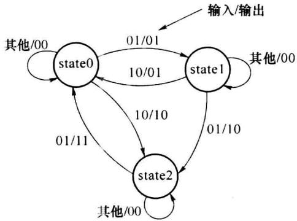

import Guide from '@/components/Guide.astro';
import Knowledge from '@/components/Knowledge.astro';
import Example from '@/components/Example.astro';
import Analysis from '@/components/Analysis.astro';
import Solution from '@/components/Solution.astro';
import Variant from '@/components/Variant.astro';
import Note from '@/components/Note.astro';
import Block from '@/components/Block.astro';
import Method from '@/components/Method.astro';
import Exercise from '@/components/Exercise.astro';

## 习题

<Exercise title="习题 8-1">
“自底向上”的设计方法与“自顶向下”的设计方法各有什么特点？
</Exercise>

<Exercise title="习题 8-2">
在 VHDL 中, 数据对象 (DATA OBJECTS) 和数据类型 (DATA TYPES) 是什么样的关系?
</Exercise>

<Exercise title="习题 8-3">
如果在程序中有 STD\_LOGIC 型 INTEGER 型数据间的混合运算,需声明使用哪一个程序包?
</Exercise>

<Exercise title="习题 8-4">
什么是惯性延时、传输延时、仿真 $\delta$ 延时？它们各反映了什么现象？在 VHDL 中它们是如何被表述的？这种表述和可编程器件工作时的实际物理延时是什么关系？
</Exercise>

<Exercise title="习题 8-5">
一般在什么情况下使用枚举？在定义数组时，枚举可有什么样的作用？
</Exercise>

<Exercise title="习题 8-6">
试分析比较非限定性数组和子类型各自的特点。
</Exercise>

<Exercise title="习题 8-7">
信号(SIGNAL)和变量(VARIABLE)各有什么特点？在进程中对它们的赋值处理有哪些不同？
</Exercise>

<Exercise title="习题 8-8">
能否说并行描述语句在可编程器件中生成的是并行处理的电路结构,而顺序描述语句生成的是串行处理的电路结构?为什么?
</Exercise>

<Exercise title="习题 8-9">
试分析比较过程(PROCEDURE)和函数(FUNCTION)的异同之处。
</Exercise>

<Exercise title="习题 8-10">
完整的 IF 语句一般会生成什么硬件电路？不完整的 IF 语句一般会生成什么硬


件电路？
</Exercise>

<Exercise title="习题 8-11">
试比较 CASE 语句和 IF 语句的异同之处。


```txt
</Exercise>

<Exercise title="习题 8-12">
元件例化语句结构适于描述设计什么形式的电路系统？
```
</Exercise>

<Exercise title="习题 8-13">
什么是状态机？它主要适于处理什么逻辑问题？摩尔型状态机和米里型状态机各有什么特点？


```txt
</Exercise>

<Exercise title="习题 8-14">
什么是一位热码编码(One Hot Encoding)法？它有什么优缺点？
```
</Exercise>

<Exercise title="习题 8-15">
写出描述 4 位数码比较器 74LS85(有级联入端 G、S、E) 功能的 VHDL 程序。


```txt
</Exercise>

<Exercise title="习题 8-16">
用并行信号赋值语句描述设计7段数码显示管的译码电路。
```
</Exercise>

<Exercise title="习题 8-17">
设计实体 slml 的 VHDL 程序意图实现 4 选 1 选择器。试指出其中的错误。


```vhdl

library ieee;

use ieee.std_logic_1164.all;

entity slm1 is

port(i0,i1,i2,i3,s1,s2 :in std_logic;qo :out std_logic);

end slm1;

architecture sldo of slm1 is

signal sel :integer;

begin

    process( s1,s2)

    begin

    sel &lt;= 0;

    if s1 = '1' and s2 = '0' then sel &lt;= 1; end if;

    if s1 = '0' and s2 = '1' then sel &lt;= 2; end if;

    if s1 = '1' and s2 = '1' then sel &lt;= 3; end if;

    case sel is

    when 0 => qo &lt;= i0;

    when 1 => qo &lt;= i1;

    when 2 => qo &lt;= i2;

    when 3 => qo &lt;= i3

    end case;

    end process;

end sldo;

```
</Exercise>

<Exercise title="习题 8-18">
设 WORK 库中已有 3 线 -8 线译码器的设计实体 LS138(见例 8.5.2)。试用 3 片 LS138 组成 5 线 -24 线译码器并用元件例化语句结构给予描述。
</Exercise>

<Exercise title="习题 8-19">
试用元件例化语句结构描述由6片LS85(结合8.15题)构成的24位比较器并用行为描述的方式得出完成同样功能的设计。
</Exercise>

<Exercise title="习题 8-20">
写出具有同步复位、置位功能的 JK 触发器的 VHDL 描述程序。
</Exercise>

<Exercise title="习题 8-21">
写出具有异步复位、置数功能的十六进制加法计数器的 VHDL 描述程序。
</Exercise>

<Exercise title="习题 8-22">
试用 VHDL 设计长度为 31 的 M 序列发生器(时钟 clk、使能 en、输出位 dm)。
</Exercise>

<Exercise title="习题 8-23">
设计一单稳触发器, 当遇输入触发信号(pul)的上升沿, 输出 8 个输入脉冲(clk)


周期宽度的低脉冲信号(dwp)。若在输出低脉冲期间又遇 pul 的上升沿,则输出低脉冲时宽继续顺延 8 个 clk 周期。
</Exercise>

<Exercise title="习题 8-24">
设输入数据序列为 $X(i)$ , 每个 $X(i)$ 数据是 8 位无符号二进制数 (并行码)。 $X(i)$ 为串行同步序列, 即每时钟 clk 的上升沿时输入一个数据。试用 VHDL 实现以下滤波运算, 得到滤波输出 yout 。运算中的乘、除可用移位直接实现。


$$

\operatorname{yout} (n) = X (n) + 2 * X (n - 1) + 0. 5 * X (n - 2) + 0. 2 5 * X (n - 3)

$$
</Exercise>

<Exercise title="习题 8-25">
试用 VHDL 实现下式的 IIR 滤波。 $X(n)$ 为串行同步输入序列，每个 $X(n)$ 为 16 位无符号数。运算中的乘、除可通过移位实现。


$$

Y (n) = 0. 6 2 5 * Y (n - 1) + 1. 7 5 * X (n)

$$
</Exercise>

<Exercise title="习题 8-26">
用 VHDL 实现题图 8.1 给出的状态图。
</Exercise>

<Exercise title="习题 8-27">
题表 8.1 为一个交通灯的状态变化顺序,有黄灯的状态的持续时间为半分钟,其他状态的时间为 2 分钟。各方向另有输入信号 apply,若在绿灯持续期间 apply 有效,则该状态持续时间顺延 1 分钟。试画出状态图并做出 VHDL 的实现程序。


  

题图8.1


题表8.1


<table><tr><td>东西方向</td><td>南北方向</td></tr><tr><td>红</td><td>绿</td></tr><tr><td>红</td><td>黄</td></tr><tr><td>绿</td><td>红</td></tr><tr><td>黄</td><td>红</td></tr></table>
</Exercise>

<Exercise title="习题 8-28">
设 $X(i)$ 为串行同步输入序列, 每时钟 $\mathrm{clk}$ 的上升沿时输入一个数据, 每个 $X(i)$ 数据是 1 位二进制数。检测电路将每连续 5 个 $X(i)$ 数据分为一组, 当其中有 3 个及 3 个以上的 '1' 时, 在第 5 个数据输入的 $\mathrm{clk}$ 周期内输出 '1', 否则输出 '0'。试用 VHDL 实现此检测电路。画出状态图。
</Exercise>

<Exercise title="习题 8-29">
某自动售货机售 A、B、C 3 种商品，它们的价格分别为 1 元、3 元、4 元。售货机仅接受 1 元硬币。售货机面板上设有投币孔和退钱键，每商品标识处有选择按键，上有指示灯表明当前投钱数是否已足够选买该商品。做出此售货机控制电路的状态表，用 VHDL 描述实现。
</Exercise>

<Exercise title="习题 8-30">
说明以下 VHDL 程序意图完成的工作,指出可能存在的问题。


```vhdl

use ieee.std_logic_1164.all;

entity avo4 is

port(reset, iclk : in std_logic ; idata : in std_logic_vector(7 downto 0);

    oclk : out std_logic ; odata : out std_logic_vector(7 downto 0));

end avo4;

architecture whtodo of avo4 is

```


```vhdl

type statetype is(st0,st1,st2,st3);

signal currentstate, nextstate : statetype;

begin

    process(currentstate)

    variable akdata : std_logic_vector(7 downto 0);

begin

    case currentstate is

    when st0 =>

    akdata &lt;= idata ; oclk &lt;= '0' ; nextstate &lt;= st1 ;

    when st1 =>

    akdata &lt;= idata + akdata ; nextstate &lt;= st2 ;

    when st2 =>

    akdata &lt;= idata + akdata ; nextstate &lt;= st3 ;

    when st3 =>

    akdata &lt;= idata + akdata ;

    akdata &lt;= "00" & akdata(7 downto 2) ;

    oclk &lt;= '1';

    odata &lt;= akdata ;

    nextstate &lt;= st0 ;

    end case;

end process;

process(reset, iclk)

begin

    if(reset = '1') then currentstate &lt;= st0;

    elsif(iclk'event and iclk = '1') then currentstate &lt;= nextstate;

    endif;

end process;

end whtodo;

```


## 第9章 数模和模数转换


随着数字电子技术的发展,特别是计算机技术的进步,使得数字技术在自动控制、自动检测、数字移动通信等领域获得广泛应用,数字系统是对数字量进行算术运算和逻辑运算的电路,它具有传统模拟系统无法比拟的高可靠性、高抗干扰能力和高度智能化等优点。


数字系统只能对数字量进行处理,而实际信号大多是连续变换的模拟量,如温度、压力、位移、声音、图像等。因此,需要把这些模拟量转化成数字量,才能送入数字系统进行处理,这种将模拟量转换成数字量的过程称为模数转换(A/D 转换),完成模数转换的电路称为模数转换器(Analog to Digital Converter, ADC)或 A/D 转换器。相反,经过数字系统处理的数字量,一般情况下需要再次转换成模拟量,才能驱动执行机构进行动作,这种转换称为数模转换(D/A 转换),完成数模转换的电路称为数模转换器(Digital to Analog Converter, DAC)或 D/A 转换器。模数转换和数模转换技术是数字电子技术的一个重要分支,ADC 和 DAC 是数字系统的重要接口部件。


为保证数据处理结果的准确性, ADC 和 DAC 必须要有足够的转换精度; 同时, 为适应快速信号处理与控制需求, ADC 和 DAC 还必须有足够的转换速度。转换精度和转换速度是衡量 ADC 和 DAC 性能优劣的重要技术指标。本章将介绍数模转换和模数转换的基本原理、电路结构及其应用。
</Exercise>
