import Guide from '@/components/Guide.astro';
import Knowledge from '@/components/Knowledge.astro';
import Example from '@/components/Example.astro';
import Analysis from '@/components/Analysis.astro';
import Solution from '@/components/Solution.astro';
import Variant from '@/components/Variant.astro';
import Note from '@/components/Note.astro';
import Block from '@/components/Block.astro';
import Method from '@/components/Method.astro';
import Exercise from '@/components/Exercise.astro';

## 第9章 数模和模数转换

随着数字电子技术的发展,特别是计算机技术的进步,使得数字技术在自动控制、自动检测、数字移动通信等领域获得广泛应用,数字系统是对数字量进行算术运算和逻辑运算的电路,它具有传统模拟系统无法比拟的高可靠性、高抗干扰能力和高度智能化等优点。

数字系统只能对数字量进行处理,而实际信号大多是连续变换的模拟量,如温度、压力、位移、声音、图像等。因此,需要把这些模拟量转化成数字量,才能送入数字系统进行处理,这种将模拟量转换成数字量的过程称为模数转换(A/D 转换),完成模数转换的电路称为模数转换器(Analog to Digital Converter, ADC)或 A/D 转换器。相反,经过数字系统处理的数字量,一般情况下需要再次转换成模拟量,才能驱动执行机构进行动作,这种转换称为数模转换(D/A 转换),完成数模转换的电路称为数模转换器(Digital to Analog Converter, DAC)或 D/A 转换器。模数转换和数模转换技术是数字电子技术的一个重要分支,ADC 和 DAC 是数字系统的重要接口部件。

为保证数据处理结果的准确性, ADC 和 DAC 必须要有足够的转换精度; 同时, 为适应快速信号处理与控制需求, ADC 和 DAC 还必须有足够的转换速度。转换精度和转换速度是衡量 ADC 和 DAC 性能优劣的重要技术指标。本章将介绍数模转换和模数转换的基本原理、电路结构及其应用。

图 9.1.1 是一个典型的数字控制系统方框图。传感器用于监测控制对象的状态，输出模拟量（如电压或电流）。这些代表控制对象状态的模拟量由 ADC 转换为相应的数字量，送入数字控制系统。数字控制系统对接收到的数字量进行分析，根据已知的控制策略发出控制指令。控制指令属于数字量，再由 DAC 转换为相应的模拟量，经过功率放大后驱动执行机构进行动作，实现对控制对象的闭环控制。

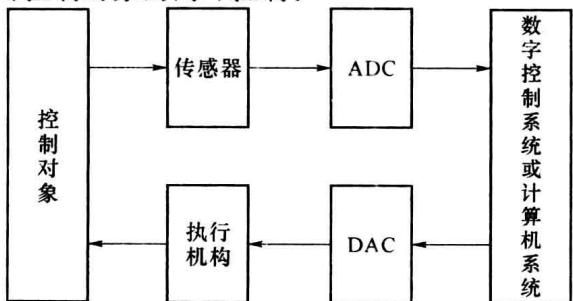  

图 9.1.1 数字控制系统框图

目前市场上有各种不同性能的 DAC 和 ADC 产品可供用户选用,有些型号的单片机内部已集成 ADC,如 STC51 单片机、PIC 单片机、MSP430 和 ARM 等。按照转换原理,D/A 转换器可分为权电阻网络 DAC、倒 T 形电阻网络 DAC、权电流型 DAC、权电容网络 DAC 以及开关树形 DAC 等。按数字量的输入方式,D/A 转换器可分为并行输入 DAC 和串行输入 DAC 两种类型。

A/D 转换器也有多种分类方式, 按照转换类型可分为直接转换型 ADC 和间接转换型 ADC 两大类。在直接转换型 ADC 中, 输入的模拟量直接被转换成相应的数字量; 在间接转换型 ADC 中, 模拟量首先被转换成某种中间量(如时间、频率等), 然后再将这个中间量转换为相应的数字量。按数字量的输出方式, A/D 转换器可分为并行输出 ADC 和串行输出 ADC 两种类型。

考虑到 D/A 转换的工作原理比 A/D 转换简单,而且在某些 A/D 转换器中需要用到 D/A 转换器,下面首先介绍 D/A 转换器。

## 9.1.1 数模转换的基本原理

在数字系统中, 数字量广泛采用二进制编码, 每一位数码都有固定的权值。例如, 若 $n$ 位二进制数用 $D_{n} = d_{n-1}d_{n-2}\cdots d_{1}d_{0}$ 表示, 则从最高位 (Most Significant Bit, MSB) 到最低位 (Least Significant Bit, LSB) 的权依次是 $2^{n-1}, 2^{n-2}, \cdots, 2^{1}, 2^{0}$ 。因此, 为了将数字量转换为模拟量, 必须把每一位数码按权转换为相应的模拟量, 然后再将这些模拟量相加, 便得到与数字量成正比的模拟量。

设 DAC 输入为 n 位二进制数 $D_{n}$ ，输出为模拟电压 $v_{0}$ ，则输出模拟量 $v_{0}$ 的值与输入数字量 $D_{n}$ 成正比，即

$$

v _ {0} = k \cdot \sum_ {i = 0} ^ {n - 1} (d _ {i} \times 2 ^ {i})\tag{9.1.1}

$$

其中， $k$ 为 $\mathrm{D / A}$ 转换的比例系数， $\sum_{i = 0}^{n - 1}(d_i\times 2^i)$ 为 $n$ 位二进制数 $D_{n}$ 对应的十进制数。

图 9.1.2 给出了 4 位二进制数字量 $D_{4}$ 与模拟量 $v_{0}$ 之间的对应关系。其中，二进制代码 0000 对应输出电压 0 V, 0001 对应输出电压 1 V, 0010 对应输出电压 2 V。4 位二进制代码对应 16 个模拟电压值，相邻的数字量对应的模拟量并不连续。显然，二进制代码 0001 所对应的输出电压是 DAC 能分辨出来的最小输出电压，用 1 LSB 表示；二进制代码 1111 所对应的输出电压是 DAC 能输出的最大电压，称为满度电压 (Full Scale Range, FSR)，用 1 FSR 表示。在本例中，1 LSB = 1 V, 1 FSR = 15 V。

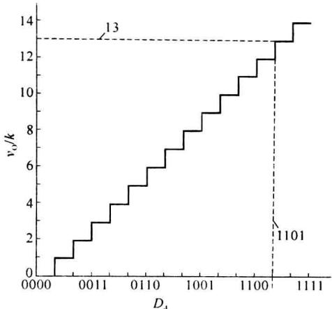  

图 9.1.2 D/A 转换中数字量与模拟量的对应关系

由图 9.1.2 还可以看出,4 位二进制数字量将模拟量分成了 $(2^{4}-1)$ 个阶梯,当满度电压确定后,输入数字量的位数越多,输出模拟量的阶梯间隔就越小,相邻两组二进制代码所对应的模拟量之差值也越小,表明 D/A 转换的分辨率越高。

D/A 转换器一般由数码寄存器、模拟开关电路、解码网络、求和电路以及基准电压源等几部分组成。n 位 D/A 转换器的方框图如图 9.1.3 所示，串行或并行输入的数字量首先保存在数码寄存器中，数码寄存器的输出驱动模拟开关，使数码为 1 的位在解码网络中产生与其权值成比例的电流并流入求和电路。求和电路将这些电流相加，获得与 n 位数字量输入成比例的模拟量输出。若需要输出的模拟量为电压信号，可通过运算放大器将电流转换成电压。

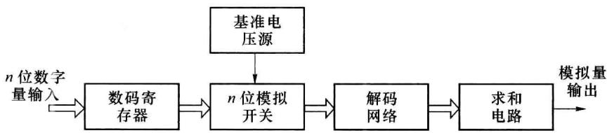  

图 9.1.3 D/A 转换器的原理框图

D/A 转换器有多种实现方式,按照解码网络的不同,可以分为权电阻解码网络 DAC、T 形电阻解码网络 DAC、倒 T 形电阻解码网络 DAC、权电流解码网络 DAC、权电容解码网络 DAC 等;按照模拟开关电路的不同,又可以分为 CMOS 开关 DAC 和双极型开关 DAC。开关网络对 D/A 转换速度的影响较大,在速度要求不高的情况下可以选用 CMOS 模拟开关 DAC,若对速度要求较高,可以选用双极型电流开关 DAC 或转换速度更高的 ECL 电流开关 DAC。

## 9.1.2 权电阻网络 DAC

图 9.1.4 所示为 4 位权电阻网络 DAC 的原理图, 它主要由 4 部分组成。

(1) 精密基准电压源 $V_{REF}$ ;

(2) 权电阻解码网络 R、2R、4R、8R；

(3) 与权电阻解码网络对应的模拟开关电路；

(4) 实现电流求和的集成运算放大器 A。

输入数字量 $d_{3} \sim d_{0}$ 是4位二进制数，通常来自于数码寄存器，以保证D/A转换期间 $d_{3} \sim d_{0}$ 稳定不变。 $\mathrm{S}_3\sim \mathrm{S}_0$ 是4个模拟开关，它们的状态分别受输入数字量 $d_{3}\sim d_{0}$ 的控制， $d_{i}$ 为1时开关 $\mathbf{S}_i$ 接到基准电压 $V_{\mathrm{REF}}$ 上， $d_{i}$ 为0时开关 $\mathbf{S}_i$ 接地。例如，当最高位 $d_{3} = 1$ 时，模拟开关 $\mathbf{S}_3$ 置向左边，与基准电压 $V_{\mathrm{REF}}$ 相连，有支路电流 $I_{3}$ 流向集成运放A的求和点 $\Sigma$ ；当 $d_{3} = 0$ 时，开关 $\mathbf{S}_3$ 置向右边，与地相连，支路电流 $I_{3} = 0$ 。

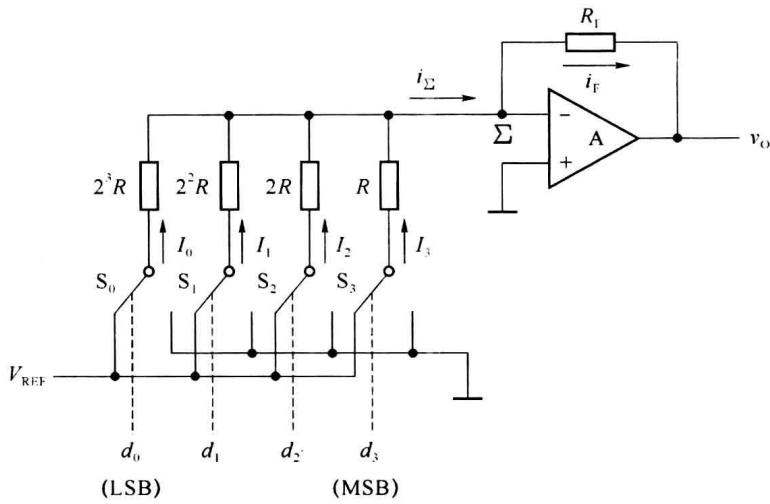  

图9.1.4 权电阻网络DAC

集成运放 A 接成负反馈的形式, 实现电流的求和运算以及电流转电压功能, 称为求和放大器, $R_{F}$ 为反馈电阻, $\Sigma$ 点为虚地。为简化分析, 通常把集成运放 A 看成理想的运算放大器, 其输入偏置电流近似为 0, 故由电阻网络流入 $\Sigma$ 点的电流之和 $i_{\Sigma}$ 等于流经反馈电阻 $R_{F}$ 的电流 $i_{F}$ , 即

$$

\begin{array}{r l} i _ {\Sigma} & = i _ {\mathrm{F}} \\ & = I _ {3} d _ {3} + I _ {2} d _ {2} + I _ {1} d _ {1} + I _ {0} d _ {0} \\ & = \frac {V _ {\mathrm{REF}}}{R} d _ {3} + \frac {V _ {\mathrm{REF}}}{2 R} d _ {2} + \frac {V _ {\mathrm{REF}}}{2 ^ {2} R} d _ {1} + \frac {V _ {\mathrm{REF}}}{2 ^ {3} R} d _ {0} \\ & = \frac {V _ {\mathrm{REF}}}{2 ^ {3} R} (d _ {3} \times 2 ^ {3} + d _ {2} \times 2 ^ {2} + d _ {1} \times 2 ^ {1} + d _ {0} \times 2 ^ {0}) \end{array}\tag{9.1.2}

$$

集成运放 A 实现电流到电压的变换, 输出模拟电压

$$

\begin{array}{r l} v _ {\mathrm{O}} & = - i _ {\mathrm{F}} R _ {\mathrm{F}} = - i _ {\sum} R _ {\mathrm{F}} \\ & = - \frac {V _ {\mathrm{REF}} R _ {\mathrm{F}}}{2 ^ {3} R} (d _ {3} \times 2 ^ {3} + d _ {2} \times 2 ^ {2} + d _ {1} \times 2 ^ {1} + d _ {0} \times 2 ^ {0}) \end{array}\tag{9.1.3}

$$

可见，输出模拟电压 $v_{0}$ 的值与输入二进制数字量 $d_{3}\sim d_{0}$ 成正比，比例系数为 $-\frac{V_{\mathrm{REF}}R_F}{2^3R}$ ，若令 $R_{\mathrm{F}} = R / 2$ ，则式(9.1.3)变为

$$

v _ {\mathrm{O}} = - \frac {V _ {\mathrm{REF}}}{2 ^ {4}} (d _ {3} \times 2 ^ {3} + d _ {2} \times 2 ^ {2} + d _ {1} \times 2 ^ {1} + d _ {0} \times 2 ^ {0})\tag{9.1.4}

$$

式(9.1.4)表明,输出模拟电压 $v_{0}$ 的值正比于输入数字量,图 9.1.4 所示的权电阻解码网络 DAC 电路实现了数字量到模拟量的转换。

类似地,对于 n 位权电阻网络 DAC,输出电压的计算公式可写成

$$

\begin{array}{r l} \nu_ {\mathrm{O}} & = - \frac {V _ {\mathrm{REF}} R _ {\mathrm{F}}}{2 ^ {n - 1} R} (d _ {n - 1} \times 2 ^ {n - 1} + d _ {n - 2} \times 2 ^ {n - 2} + \dots + d _ {1} \times 2 ^ {1} + d _ {0} \times 2 ^ {0}) \\ & = - \frac {V _ {\mathrm{REF}} R _ {\mathrm{F}}}{2 ^ {n - 1} R} \sum_ {i = 0} ^ {n - 1} (d _ {i} \times 2 ^ {i}) \end{array}\tag{9.1.5}

$$

当反馈电阻取 $R_{F}=R/2$ 时，式(9.1.5)可简化为

$$

v _ {0} = - \frac {V _ {\mathrm{REF}}}{2 ^ {n}} \sum_ {i = 0} ^ {n - 1} (d _ {i} \times 2 ^ {i})\tag{9.1.6}

$$

在式(9.1.6)中, 当输入数字量 $d_{n-1} d_{n-2} \cdots d_1 d_0 = 00 \cdots 00$ 时, 输出电压 $v_{\mathrm{O}} = 0$ , 当 $d_{n-1} d_{n-2} \cdots d_1 d_0 = 11 \cdots 11$ 时, $v_{\mathrm{O}} = -\frac{2^n - 1}{2^n} V_{\mathrm{REF}}$ , 故 $v_{\mathrm{O}}$ 的变化范围是 $-\frac{2^n - 1}{2^n} V_{\mathrm{REF}} \sim 0$ , 改变 $V_{\mathrm{REF}}$ 可以改变输出电压 $v_{\mathrm{O}}$ 的变化范围。从式(9.1.6)还可以看出, 在 $V_{\mathrm{REF}}$ 为正电压时输出电压 $v_{\mathrm{O}}$ 始终为负值, 要想得到正的输出电压, 可以将 $V_{\mathrm{REF}}$ 取为负值。

权电阻网络 DAC 的转换精度取决于基准电压 $V_{REF}$ 、模拟电子开关、求和放大器和各权电阻值的精度。其优点是结构简单，所用的电阻元件数量少。缺点是各权电阻的阻值都不相同，当输入数字量的位数较多时，权电阻解码网络所需的电阻种类较多，其阻值相差甚远，这给保证精度带来很大困难，尤其不利于集成电路的制作，因此在集成 DAC 中很少单独使用该类电路。

为了克服上述缺点，在输入数字量位数较多时可以采用图9.1.5所示的双级权电阻网络。在双级权电阻网络中，每一级仍然只有4个不同阻值的电阻，它们之间的阻值之比依然是 $1:2:4:8$ 。当 $d_{i} = 1$ 时，开关 $\mathbf{S}_i$ 置向左边；当 $d_{i} = 0$ 时，开关 $\mathbf{S}_i$ 置向右边。可以证明，只要两级之间的串联电阻 $R_{\mathrm{s}} = 8R$ ，即可得到

$$

v _ {\mathrm{O}} = - \frac {V _ {\mathrm{REF}}}{2 ^ {8}} \sum_ {i = 0} ^ {7} (d _ {i} \times 2 ^ {i})

$$

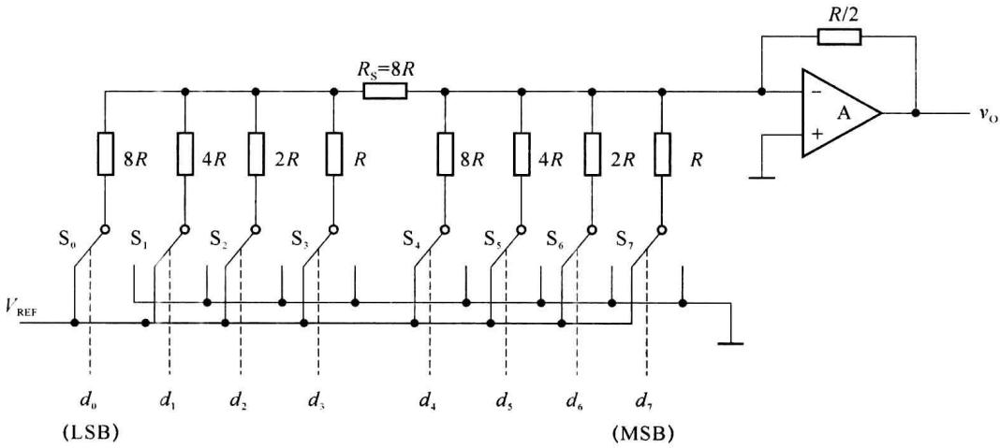  

图9.1.5 双级权电阻网络DAC

<Example title="例 9.1.1">
4 位权电阻网络 DAC 如图 9.1.4 所示，设基准电压 $V_{REF} = -8 \, V, R_{F} = R/2$ ，试求当输入二进制数 $d_{3}d_{2}d_{1}d_{0} = 1101$ 时输出的电压值，以及 LSB 和 FSR 的值。

<Solution title="解">
将 $d_{3}$ $d_{2}d_{1}d_{0}=1101$ 、 $V_{REF}=-8V$ 、 $R_{F}=R/2$ 代入式(9.1.3)，得

$$

\begin{array}{r l} v _ {\mathrm{O}} & = - \frac {V _ {\mathrm{REF}} R _ {\mathrm{F}}}{2 ^ {3} R} (d _ {3} 2 ^ {3} + d _ {2} 2 ^ {2} + d _ {1} 2 ^ {1} + d _ {0} 2 ^ {0}) \\ & = - \frac {- 8}{2 ^ {4}} \times (1 \times 2 ^ {3} + 1 \times 2 ^ {2} + 0 \times 2 ^ {1} + 1 \times 2 ^ {0}) \\ & = \frac {8}{2 ^ {4}} \times 1 3 = 6. 5 \mathrm{V} \end{array}

$$

类似地，将 $(0001)_2$ 代入式(9.1.3)，得

$$

1 \mathrm{LSB} = (8 \mathrm{V} / 1 6) \times 1 = 0. 5 \mathrm{V}

$$

将 $(1111)_2$ 代入式(9.1.3)，得

$$

1 \mathrm{FSR} = (8 \mathrm{V} / 1 6) \times 1 5 = 7. 5 \mathrm{V}

$$

显然,输出电压范围式 0\~7.5 V。
</Solution>
</Example>

## 9.1.3 T形电阻网络DAC

在 T 形电阻网络 DAC 中，R-2R T 形电阻网络 DAC 是最常见的一种，图 9.1.6 给出了 4 位 T 形电阻网络 DAC 的原理图，电路中的电阻只有 R 和 2R 两种阻值，且 R-2R 电阻解码网络呈 T 形。

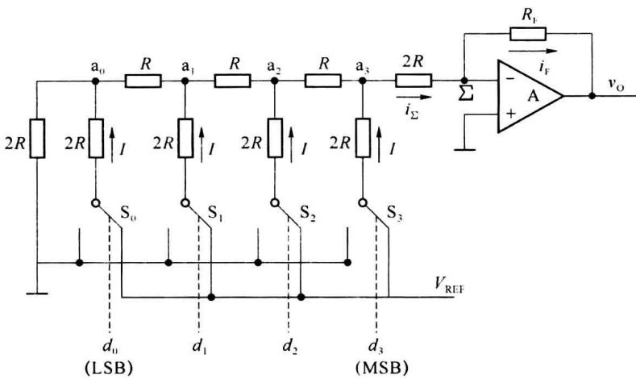  

图9.1.6 T形电阻网络DAC

T形电阻网络的特点是从网络中任何一个节点 $a_{i}$ 向3个支路方向看，对地的等效电阻均为 $2R$ 。例如节点 $a_0$ ，向左看对地的等效电阻是 $2R$ ，向下看对地的等效电阻也是 $2R$ ，向右看对地的等效电阻不能直观地看出来，但这是一个简单的电阻串并联问题，不难推出等效电阻还是 $2R$ 。利用T形电阻网络的这个特点，可以求出当任何一位数码 $d_{i} = 1$ 时流过相应支路的电流 $I$ 均为 $\frac{1}{3R} V_{\mathrm{REF}}$ ，而且由于各节点 $a_{i}$ 左右两个分支等效电阻相同，流向每个分支电流均为 $I / 2$ ，如图9.1.7(a)所示，该电流在向求和点 $\sum$ 传递的过程中，每经过一个节点就衰减一半，如图9.1.7(b)所示。

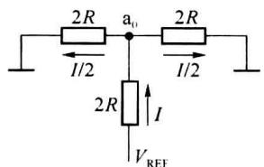  

(a) 节点 $a_{0}$ 的等效电路

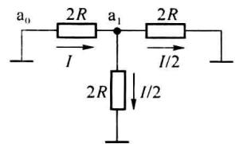  

(b) 节点电流传递的等效电路  

图 9.1.7 T 形电阻网络一个节点的等效电路

下面计算流向求和点 $\Sigma$ 的总电流，设输入数码只有 $d_0 = 1$ ，其余为0，即只有开关 $\mathbf{S}_0$ 接通 $V_{\mathrm{REF}}$ ，其余均接地。由图9.1.6可见，由节点 $\mathbf{a}_0$ 流向节点 $\mathbf{a}_1$ 的电流为 $I / 2$ ，由节点 $\mathbf{a}_1$ 再次分流，流向节点 $a_{2}$ 的电流为 I/4；依此类推，每经过一个节点分流一次，最后到达求和点 $\Sigma$ 处的电流为 $\frac{1}{2^{4}}I$ 。同理可推算出只有开关 $S_{1}$ 接通 $V_{REF}$ 时流向求和点 $\Sigma$ 的电流为 $\frac{1}{2^{3}}I$ ，只有开关 $S_{2}$ 接通 $V_{REF}$ 时流向求和点 $\Sigma$ 的电流为 $\frac{1}{2^{2}}I$ 。因此，数码 $d_{i}=1$ 的位将在 T 形电阻解码网络中产生与其权值成正比的电流值并流入求和点 $\Sigma$ ，根据叠加原理，流向 $\Sigma$ 处总电流

$$

\begin{array}{r l} I _ {\Sigma} & = I (d _ {3} \times \frac {1}{2} + d _ {2} \times \frac {1}{2 ^ {2}} + d _ {1} \times \frac {1}{2 ^ {3}} + d _ {0} \times \frac {1}{2 ^ {4}}) \\ & = \frac {V _ {\mathrm{REF}}}{3 R} (d _ {3} \times \frac {1}{2} + d _ {2} \times \frac {1}{2 ^ {2}} + d _ {1} \times \frac {1}{2 ^ {3}} + d _ {0} \times \frac {1}{2 ^ {4}}) \\ & = \frac {V _ {\mathrm{REF}}}{3 R} \times \frac {1}{2 ^ {4}} (d _ {3} \times 2 ^ {3} + d _ {2} \times 2 ^ {2} + d _ {1} \times 2 ^ {1} + d _ {0} \times 2 ^ {0}) \end{array}\tag{9.1.7}

$$

因输出电流 $I_{F}=I_{\Sigma}$ ，故输出电压

$$

\begin{array}{r l} v _ {\mathrm{O}} & = - I _ {\mathrm{F}} R _ {\mathrm{F}} = - I _ {\Sigma} R _ {\mathrm{F}} \\ & = - \frac {V _ {\mathrm{REF}} R _ {\mathrm{F}}}{3 R \times 2 ^ {4}} (d _ {3} \times 2 ^ {3} + d _ {2} \times 2 ^ {2} + d _ {1} \times 2 ^ {1} + d _ {0} \times 2 ^ {0}) \\ & = - \frac {V _ {\mathrm{REF}} R _ {\mathrm{F}}}{3 R \times 2 ^ {4}} \sum_ {i = 0} ^ {3} (d _ {i} \times 2 ^ {i}) \end{array}\tag{9.1.8}

$$

若 $R_{\mathrm{F}} = 3R$ ，得

$$

v _ {\mathrm{O}} = - \frac {V _ {\mathrm{REF}}}{2 ^ {4}} \sum_ {i = 0} ^ {3} (d _ {i} \times 2 ^ {i})\tag{9.1.9}

$$

由式(9.1.9)可见, 输出模拟电压 $v_{0}$ 与输入数字量成正比, 比例系数 $k = -\frac{V_{REF}}{2^{4}}$ 。当输入数字量(1111) $_{2}$ 时, 输出模拟电压的负向最大值 $v_{0max} = -\frac{2^{4}-1}{2^{4}} V_{REF}$ 。

T形电阻网络DAC的优点是电阻种类少，容易制作。缺点是各支路存在寄生电容，信息在解码网络中传输有延迟，支路电流到达求和点的传输时间不同，位数增多时影响转换速度。而且输入的数字量不同，各支路的电流也不同，在D/A转换过程中参考电压源 $V_{\mathrm{REF}}$ 的输出电流变化较大，容易产生尖峰电流。为了解决这一问题，可采用下面的倒T形电阻网络DAC。

## 9.1.4 倒T形电阻网络DAC

图 9.1.8 是 4 位 R-2R 倒 T 形电阻网络 DAC 的原理图，电路结构与 T 形电阻网络 DAC 基本相似，只是基准电压 $V_{REF}$ 的位置不同。 $S_{3} \sim S_{0}$ 依然为模拟开关，受输入数码 $d_{3} \sim d_{0}$ 的控制。当 $d_{i} = 1$ 时，开关 $S_{i}$ 置向右边，与求和点 $\Sigma$ 相连；当 $d_{i} = 0$ 时，开关 $S_{i}$ 置向左边，与地相连。R-2R 电阻解码网络呈倒 T 形，运算放大器 A 构成求和电路。

无论输入数字量 $d_{3} \sim d_{0}$ 为何值，模拟开关始终在求和点 $\Sigma$ （为虚地）与地之间切换，开关端点的电压几乎不变，各支路上的电流为恒流，不会产生因寄生电容充、放电而引起的传输延迟，提高了 D/A 转换速度，减少了参考电压源 $V_{REF}$ 和电路输出端的尖峰电流。

对于 R-2R 电阻网络来说, 各 2R 电阻的上端都相当于接地, 从节点 $a_{0}$ 、 $a_{1}$ 、 $a_{2}$ 、 $a_{3}$ 向地看去, 等效电阻都是 R。因此, 从参考电压源 $V_{REF}$ 流出的电流始终为 $I=\frac{V_{REF}}{R}$ 。

进一步分析可知,从电阻解码网络的各节点 $a_{i}$ 分别向左看和向上看,对地电阻都为 2R,因此在电阻解码网络中电流的分配关系如图 9.1.8 中的标注所示,流向电路求和点的总电流为

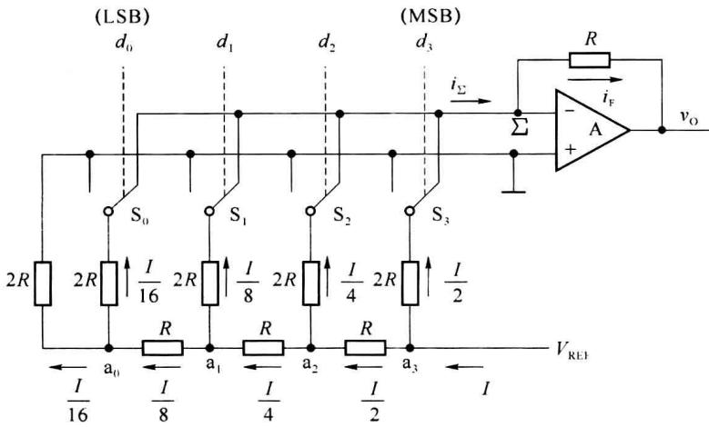  

图 9.1.8 倒 T 形电阻网络 DAC

$$

\begin{array}{r l} \mathrm{i} _ {\Sigma} & = I (d _ {3} \times \frac {1}{2} + d _ {2} \times \frac {1}{2 ^ {2}} + d _ {1} \times \frac {1}{2 ^ {3}} + d _ {0} \times \frac {1}{2 ^ {4}}) \\ & = \frac {V _ {\mathrm{REF}}}{2 ^ {4} R} (d _ {3} \times 2 ^ {3} + d _ {2} \times 2 ^ {2} + d _ {1} \times 2 ^ {1} + d _ {0} \times 2 ^ {0}) \\ & = \frac {V _ {\mathrm{REF}}}{2 ^ {4} R} \sum_ {i = 0} ^ {3} (d _ {i} \times 2 ^ {i}) \end{array}\tag{9.1.10}

$$

输出电压

$$

\begin{array}{r l} v _ {\mathrm{O}} & = - i _ {\mathrm{F}} R _ {\mathrm{F}} = - i _ {\Sigma} R _ {\mathrm{F}} \\ & = - \frac {V _ {\mathrm{REF}} R _ {\mathrm{F}}}{2 ^ {4} R} (d _ {3} \times 2 ^ {3} + d _ {2} \times 2 ^ {2} + d _ {1} \times 2 ^ {1} + d _ {0} \times 2 ^ {0}) \\ & = - \frac {V _ {\mathrm{REF}} R _ {\mathrm{F}}}{2 ^ {4} R} \sum_ {i = 0} ^ {3} (d _ {i} \times 2 ^ {i}) \end{array}\tag{9.1.11}

$$

图 9.1.8 中的各个支路电流始终存在,由数码 $d_{i}$ 控制是否流入求和点 $\Sigma$ ,不存在传输上的时间差,是目前广泛使用的 DAC 中速度较快的一种。对于这种 DAC 来说,如果希望获得比较高的转换精度,电路中的参数需满足:① 基准电压源的稳定性好;② 倒 T 形电阻网络中两种电阻比值的精度要高;③ 每个模拟开关的电压降要相等。

<Example title="例 9.1.2">
在图 9.1.8 所示的倒 T 形电阻网络 DAC 中，设 n=8, $V_{REF}=-10$ V, $R_{F}=R$ ，试求：

(1) 当输入数字量 $D_{8}=01011010$ 时的输出电压 $v_{0}$ 。

(2) 若 $R_{F}=2R$ ，输出电压 $v_{0}$ 又是多少？

<Solution title="解">
(1) 仿照式(9.1.11), 可得

$$

\begin{array}{r l} v _ {0} & = - \frac {V _ {\mathrm{REF}} R _ {\mathrm{F}}}{2 ^ {8} R} \sum_ {i = 0} ^ {7} (d _ {i} \times 2 ^ {i}) \\ & = \frac {1 0 R}{2 ^ {8} R} (1 \times 2 ^ {6} + 1 \times 2 ^ {4} + 1 \times 2 ^ {3} + 1 \times 2 ^ {1}) \\ & = \frac {1 0}{2 5 6} \times 9 0 \approx 3. 5 2 \mathrm{V} \end{array}

$$

(2) 当 $R_{F}=2R$ 时, 仿照上式, 得

$$

v _ {0} = \frac {1 0 \times 2}{2 5 6} \times 9 0 \approx 7. 0 3 \mathrm{V}

$$

图 9.1.9 是采用倒 T 形电阻网络的 10 位单片集成 D/A 转换器 AD7520(CB7520) 的电路原理图。AD7520 是一种应用广泛的 DAC，采用 CMOS 电路构成模拟开关，输入为 10 位二进制数，输出为求和电流。使用 AD7520 时需要外加运算放大器，运算放大器的反馈电阻可以使用其内部反馈电阻 R，也在 $v_{0}$ 到 $I_{out1}$ 之间外接反馈电阻，为保证转换的精度，外接参考电压 $V_{REF}$ 必须保证有足够的稳定度。

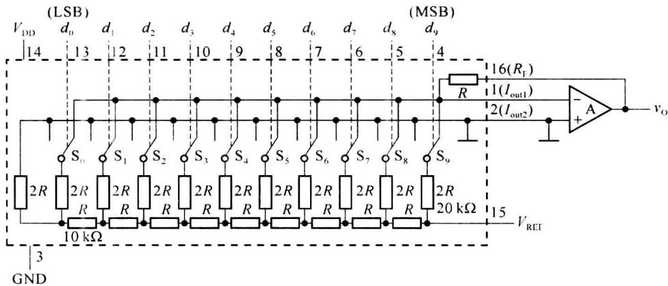  

图9.1.9 AD7520的电路原理图
</Solution>
</Example>

## 9.1.5 树形开关网络 DAC

树形开关网络 DAC 由电阻分压器和树形的开关网络构成。由于 MOS 管作为开关使用时，关断性能好且功耗低，因此，可用 MOS 管构成树形开关网络。图 9.1.10 是 3 位树形开关网络 DAC 的原理图。

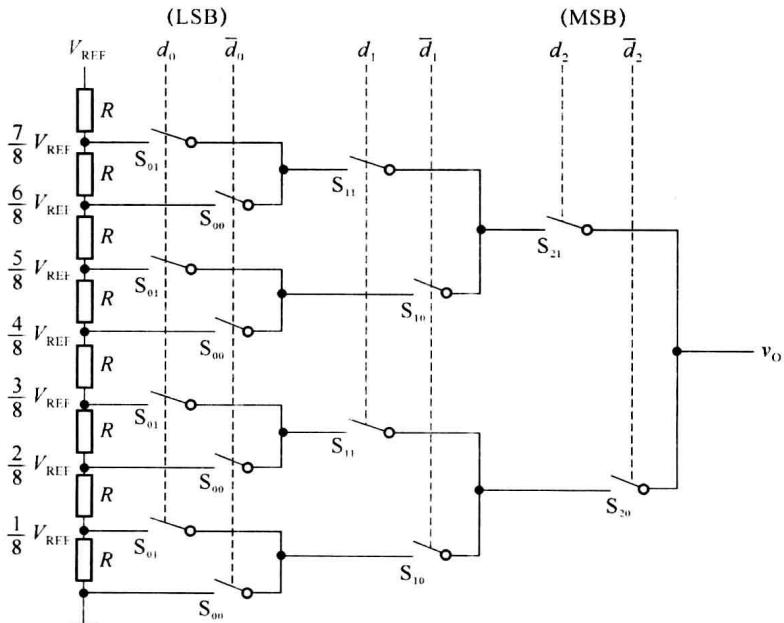  

图9.1.10 树形开关网络DAC

在图 9.1.10 中，树形开关的状态分别受 3 位输入代码 $d_{2}$ 、 $d_{1}$ 、 $d_{0}$ 的控制。当 $d_{2}=1$ 时， $S_{21}$ 接通， $S_{20}$ 断开；当 $d_{2}=0$ 时， $S_{20}$ 接通， $S_{21}$ 断开。同理， $S_{11}$ 和 $S_{10}$ 两组开关的状态由 $d_{1}$ 控制， $S_{01}$ 和 $S_{00}$ 两组开关的状态由 $d_{0}$ 控制。例如，当 $d_{2}d_{1}d_{0}=100$ 时，开关 $S_{21}$ 、 $S_{10}$ 、 $S_{00}$ 接通，输出电压 $v_{0}=\frac{V_{REF}}{2}$ 。电路出电压 $v_{0}$ 的表达式为

$$

\begin{array}{r l} v _ {\mathrm{O}} & = \frac {V _ {\mathrm{REF}}}{2} \times d _ {2} + \frac {V _ {\mathrm{REF}}}{2 ^ {2}} \times d _ {1} + \frac {V _ {\mathrm{REF}}}{2 ^ {3}} \times d _ {0} \\ & = \frac {V _ {\mathrm{REF}}}{2 ^ {3}} (d _ {2} \times 2 ^ {2} + d _ {1} \times 2 ^ {1} + d _ {0} \times 2 ^ {0}) \end{array}\tag{9.1.12}

$$

类似地,可以推广到 n 位树形开关网络 DAC, 可知其输出电压

$$

\begin{array}{r l} v _ {0} & = \frac {V _ {\mathrm{REF}}}{2 ^ {n}} (d _ {n - 1} \times 2 ^ {n - 1} + d _ {n - 2} \times 2 ^ {n - 2} + \dots + d _ {1} \times 2 ^ {1} + d _ {0} \times 2 ^ {0}) \\ & = \frac {V _ {\mathrm{REF}}}{2 ^ {n}} \sum_ {i = 0} ^ {n - 1} (d _ {i} \times 2 ^ {i}) \end{array}\tag{9.1.13}

$$

这种电路的特点是电阻种类单一,在输出端基本不取电流的情况下,对模拟开关的导通内阻要求不高,有利于集成电路的制作。

## \* 9.1.6 权电流型 DAC

在分析电阻网络 DAC 时,没有考虑模拟开关的导通电阻和导通压降,实际上这些开关不可能是理想的,它们的存在无疑将引起转换误差,影响转换精度。解决这个问题的一种方法就是采用权电流型 DAC,4 位权电流型 DAC 的原理电路如图 9.1.11 所示。

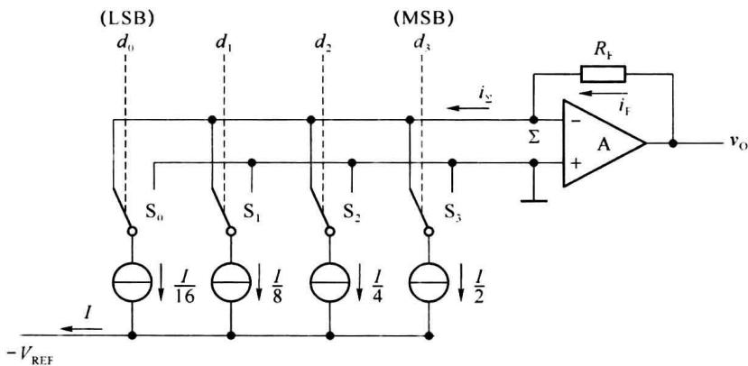  

图9.1.11 权电流型DAC

在图 9.1.11 所示的权电流型 DAC 中，用一组恒流源代替了图 9.1.8 中的倒 T 形电阻解码网络，这组恒流源从高位 $d_{3}$ 到低位 $d_{0}$ 电流的大小依次为 I/2、I/4、I/8、I/16。由于采用了恒流源，每个支路电流的值不再受开关内阻和压降的影响，降低了对开关电路的要求，提高了转换精度。

当输入数字量 $d_{3}=1$ 时，开关 $S_{3}$ 将恒流源接至运算放大器的反向输入端，相应的权电流 I/2 流入求和点 $\Sigma$ ；当 $d_{3}=0$ 时，开关 $S_{3}$ 接地，故输出电压

$$

\begin{array}{r l} v _ {\mathrm{O}} & = i _ {\Sigma} R _ {\mathrm{F}} \\ & = R _ {\mathrm{F}} (d _ {3} \times \frac {I}{2} + d _ {2} \times \frac {I}{2 ^ {2}} + d _ {1} \times \frac {I}{2 ^ {3}} + d _ {0} \times \frac {I}{2 ^ {4}}) \\ & = \frac {R _ {\mathrm{F}} I}{2 ^ {4}} (d _ {3} \times 2 ^ {3} + d _ {2} \times 2 ^ {2} + d _ {1} \times 2 ^ {1} + d _ {0} \times 2 ^ {0}) \end{array}\tag{9.1.14}

$$

可见,输出电压 $v_{0}$ 正比于输入的数字量 $d_{3}d_{2}d_{1}d_{0}$ 。

在实际的权电流型 DAC 中,为了减少电流源电路中电阻的种类,经常利用倒 T 形电阻网络的分流作用产生所需的恒流源,如图 9.1.12 所示,晶体管 $VT_{3} \sim VT_{0}$ 均采用了多发射极晶体管,其发射极个数从左至右分别是 8、4、2、1,即 $VT_{3} \sim VT_{0}$ 发射极面积之比为 8:4:2:1。这样,在 $VT_{3} \sim VT_{0}$ 发射极电流比值为 8:4:2:1 的情况下,各晶体管发射极电流密度相等,发射结电压 $V_{BE}$ 也相等,消除了因发射结电压 $V_{BE}$ 不一致对 D/A 转换精度的影响。

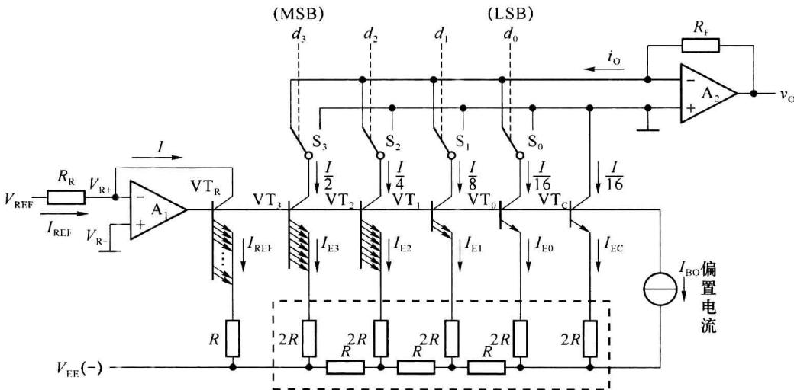  

图 9.1.12 采用倒 T 形电阻网络的权电流型 DAC

在图 9.1.12 中，晶体管 $VT_{3} \sim VT_{0}$ 的基极均连接在一起，基极电位相同，发射极电位也相同。在计算各支路的电流时，可以认为所有 2R 电阻的上端都接同一电位，因而电路的工作状态与图 9.1.8 中的倒 T 形电阻网络的工作状态一样，这时流过每个 2R 电阻的电流从左向右依次减少 1/2，各支路的电流分配比例满足 $I_{E3}: I_{E2}: I_{E1}: I_{E0}=8:4:2:1$ 的要求。恒流源 $I_{EO}$ 用来给 $VT_{R}, VT_{C}, VT_{3} \sim VT_{0}$ 提供必要的基极偏置电流。

运算放大器 $A_{1}$ 、晶体管 $VT_{R}$ 、电阻 $R_{R}$ 和 R 组成了基准电流发生电路，基准电流 $I_{REF}$ 由外加的基准电压 $V_{REF}$ 和电阻 $R_{R}$ 确定。由于运放 $A_{1}$ 处于深度负反馈，根据虚短的原理，基准电流

$$

I = I _ {\mathrm{REF}} = \frac {V _ {\mathrm{REF}}}{R _ {\mathrm{R}}}\tag{9.1.15}

$$

式(9.1.15)表明,基准电流 $I_{REF}$ 仅与基准电压 $V_{REF}$ 和电阻 $R_{R}$ 有关,而与晶体管和电阻网络无关,这使电路降低了对晶体管和 R、2R 取值的要求,对集成化十分有利。

由于 $VT_{3}$ 和 $VT_{R}$ 的发射极电压相同，发射结电压降 $V_{BE}$ 相同，而发射极电阻的阻值相差一倍，所以它们的发射极电流也相差一倍，即 $I_{E3}=I_{REF}/2=I/2$ 。

将式 $(9.1.15)$ 代入式 $(9.1.14)$ 中，可得输出电压

$$

v _ {\mathrm{O}} = \frac {R _ {\mathrm{F}} V _ {\mathrm{REF}}}{2 ^ {4} R _ {\mathrm{R}}} (d _ {3} \times 2 ^ {3} + d _ {2} \times 2 ^ {2} + d _ {1} \times 2 ^ {1} + d _ {0} \times 2 ^ {0})\tag{9.1.16}

$$

类似地,可推得 n 位倒 T 形权电流型 DAC 的输出电压

$$

\begin{array}{r l} v _ {0} & = \frac {R _ {\mathrm{F}} V _ {\mathrm{REF}}}{2 ^ {n} R _ {\mathrm{R}}} (d _ {n - 1} \times 2 ^ {n - 1} + d _ {n - 2} \times 2 ^ {n - 2} + \dots + d _ {1} \times 2 ^ {1} + d _ {0} \times 2 ^ {0}) \\ & = \frac {R _ {\mathrm{F}} V _ {\mathrm{REF}}}{2 ^ {n} R _ {\mathrm{R}}} \sum_ {i = 0} ^ {n - 1} (d _ {i} \times 2 ^ {i}) \end{array}\tag{9.1.17}

$$

目前,市场上有很多采用权电流型电路生产的单片集成 DAC,如 DAC0806、DAC0807、DAC0808 等,这些器件都采用双极型工艺制作,工作速度较高。

图 9.1.13 是 8 位权电流型 DAC0808 的内部结构框图， $d_{0} \sim d_{7}$ 为 8 位数字量输入端， $I_{0}$ 是求和电流输出端， $V_{R+}$ 和 $V_{R-}$ 是内部基准电流发生电路中运算放大器的同相输入端和反相输入端，COMP 供外接补偿电容之用， $V_{CC}$ 和 $V_{EE}$ 为正负电源输入端，GND 为接地端。

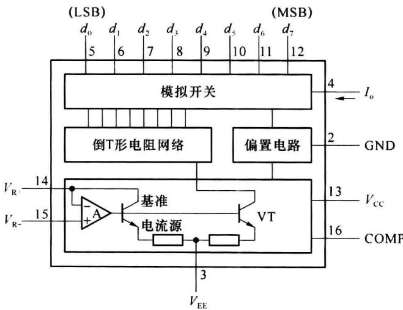  

图9.1.13 DAC0808的内部结构框图

用 DAC0808 构成 D/A 转换器时, 需要外接运算放大器和产生基准电流用的 $R_{R}$ , 图 9.1.14 为 DAC0808 的典型应用。

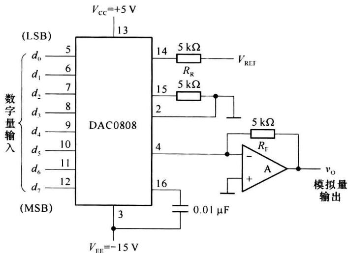  

图9.1.14 DAC0808的典型应用

若 $V_{REF}=10\ V, R_{R}=5\ k\Omega, R_{F}=5\ k\Omega$ ，根据式(9.1.17)可知输出电压为

$$

v _ {\mathrm{O}} = \frac {R _ {\mathrm{F}}}{2 ^ {8} R _ {R}} V _ {\mathrm{REF}} \sum_ {i = 0} ^ {7} (d _ {i} \times 2 ^ {i}) = \frac {1 0}{2 ^ {8}} \sum_ {i = 0} ^ {7} (d _ {i} \times 2 ^ {i})\tag{9.1.18}

$$

当输入的数字量在 00H 和 FFH 之间变化时, 输出模拟电压的变化范围为 0\~9.96 V。

## \* 9.1.7 权电容网络 DAC

权电容网络 DAC 由权电容网络和模拟开关网络构成，图 9.1.15 是 4 位权电容网络 DAC 的原理图，它是利用电容分压的原理工作的，其中 $C_{0}$ （和 $C_{0}^{\prime}$ ）、 $C_{1}$ 、 $C_{2}$ 、 $C_{3}$ 的电容值依次按 2 的倍数递增。模拟开关 $S_{0}$ 、 $S_{1}$ 、 $S_{2}$ 和 $S_{3}$ 的状态分别由输入数字信号 $d_{0}$ 、 $d_{1}$ 、 $d_{2}$ 和 $d_{3}$ 控制。当 $d_{i}=1$ 时，开关 $S_{i}$ 接参考电压 $V_{REF}$ ；当 $d_{i}=0$ 时，开关 $S_{i}$ 接地。

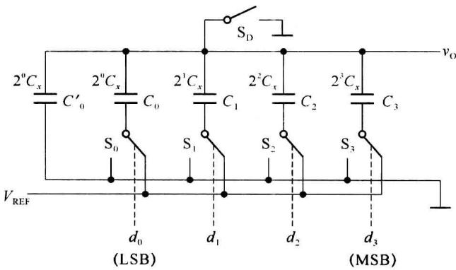  

图 9.1.15 权电容网络 DAC

转换开始前先让所有的模拟开关 $\left(\mathrm{S}_{0}\sim\mathrm{S}_{3},\mathrm{S}_{\mathrm{D}}\right)$ 接地，使全部电容完全放电，然后断开 $S_{D}$ ，输入数字量 $d_{0}\sim d_{3}$ 。假设输入的数字量为 $d_{3}d_{2}d_{1}d_{0}=1000$ ，则开关 $S_{3}$ 将电容 $C_{3}$ 接参考电压 $V_{REF}$ ，开关 $S_{2}$ 、 $S_{1}$ 、 $S_{0}$ 将电容 $C_{2}$ 、 $C_{1}$ 、 $C_{0}$ 接地，等效电路如图9.1.16所示。这时 $C_{3}$ 与 $(C_{2}+C_{1}+C_{0}+C_{0}^{\prime})$ 构成了一个电容分压器，输出电压

$$

v _ {\mathrm{O}} = \frac {d _ {3} C _ {3}}{C _ {3} + C _ {2} + C _ {1} + C _ {0} + C _ {0} ^ {\prime}} V _ {\mathrm{REF}} = \frac {d _ {3} C _ {3}}{C _ {\mathrm{t}}} V _ {\mathrm{REF}}\tag{9.1.19}

$$

其中， $C_{t}=C_{3}+C_{2}+C_{1}+C_{0}+C_{0}^{\prime}=2^{4}C_{x}$ 表示全部电容之和。

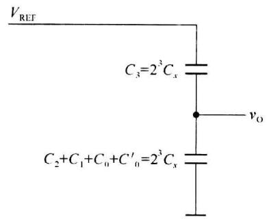  

图 9.1.16 输入为 $(1000)_{2}$ 时图 9.1.15 的等效电路

同理,可推得输入任意数字信号时输出电压的一般表达式

$$

\begin{array}{r l} v _ {0} & = \frac {d _ {3} C _ {3} + d _ {2} C _ {2} + d _ {1} C _ {1} + d _ {0} C _ {0}}{C _ {t}} V _ {\mathrm{REF}} \\ & = \frac {C _ {x} (d _ {3} 2 ^ {3} + d _ {2} 2 ^ {2} + d _ {1} 2 ^ {1} + d _ {0} 2 ^ {0})}{C _ {t}} V _ {\mathrm{REF}} \\ & = \frac {V _ {\mathrm{REF}}}{2 ^ {4}} (d _ {3} 2 ^ {3} + d _ {2} 2 ^ {2} + d _ {1} 2 ^ {1} + d _ {0} 2 ^ {0}) \end{array}\tag{9.1.20}

$$

式(9.1.20)表明,输出模拟电压与输入的数字量成正比,电路实现了D/A转换功能。在MOS集成电路中,电容比较容易制作,通过精确控制电容的面积可以严格保持各电容值之间的比例关系。因此,在采用MOS工艺制造DAC时,权电容网络DAC也是一种常用的方案。

权电容网络 DAC 的优点是输出电压的精度只与各个电容值的比例有关,而与其实际值无关;输出电压 $v_{0}$ 不受开关内阻及参考电压源内阻的影响,降低了对开关电路和参考电压源的要求;稳态情况下权电容网络不消耗电源功率。

权电容网络 DAC 的主要缺点是当输入数字量位数较多时各电容值相差较大, 这会占用较大的硅片面积, 不利于集成, 而且由于电容充放电时间的增加也降低了电路的转换速度。

## \* 9.1.8 具有双极性输出的 DAC

在前面介绍的 DAC 中, 输入的数字量均视为无符号数, 即二进制数的所有位都是数值位, 根据电路形式和参考电压极性的不同, 输出电压为 0 V 到正满度值或 0 V 到负满度值, DAC 工作于单极性输出方式。采用单极性输出时, 输入数字量采用自然二进制编码。

在实际应用中,经常遇到 DAC 输入的数字量有正负极性,这就要求 DAC 能将不同极性的数字量转换成对应的模拟电压,此时 DAC 应工作于双极性输出方式。

在数字系统中,有符号二进制数通常采用补码形式,所以 DAC 应该能够把以补码形式输入的二进制数转换成正、负极性的模拟电压。现以输入 3 位二进制补码为例,说明双极性 D/A 转换的原理。3 位二进制补码可以表示 $-4 \sim +3$ 之间的任何整数,它们与十进制数以及输出模拟电压的对应关系如表 9.1.1 所示。

表 9.1.1 输入为 3 位二进制补码时 DAC 的输出  

表 9.1.2 具有偏移的 DAC 的输出

<table><tr><td colspan="3">补码输入</td><td rowspan="2">对应的十进制数</td><td rowspan="2">对应的输出电压</td></tr><tr><td> $d_2$ </td><td> $d_1$ </td><td> $d_0$ </td></tr><tr><td>0</td><td>1</td><td>1</td><td>+3</td><td>+3V</td></tr><tr><td>0</td><td>1</td><td>0</td><td>+2</td><td>+2V</td></tr><tr><td>0</td><td>0</td><td>1</td><td>+1</td><td>+1V</td></tr><tr><td>0</td><td>0</td><td>0</td><td>0</td><td>0</td></tr><tr><td>1</td><td>1</td><td>1</td><td>-1</td><td>-1V</td></tr><tr><td>1</td><td>1</td><td>0</td><td>-2</td><td>-2V</td></tr><tr><td>1</td><td>0</td><td>1</td><td>-3</td><td>-3V</td></tr><tr><td>1</td><td>0</td><td>0</td><td>-4</td><td>-4V</td></tr></table>

<table><tr><td colspan="3">原码输入</td><td rowspan="2">无偏移时的输出</td><td rowspan="2">偏移-4V后的输出</td></tr><tr><td> $d_2$ </td><td> $d_1$ </td><td> $d_0$ </td></tr><tr><td>1</td><td>1</td><td>1</td><td>+7V</td><td>+3V</td></tr><tr><td>1</td><td>1</td><td>0</td><td>+6V</td><td>+2V</td></tr><tr><td>1</td><td>0</td><td>1</td><td>+5V</td><td>+1V</td></tr><tr><td>1</td><td>0</td><td>0</td><td>+4V</td><td>0</td></tr><tr><td>0</td><td>1</td><td>1</td><td>+3V</td><td>-1V</td></tr><tr><td>0</td><td>1</td><td>0</td><td>+2V</td><td>-2V</td></tr><tr><td>0</td><td>0</td><td>1</td><td>+1V</td><td>-3V</td></tr><tr><td>0</td><td>0</td><td>0</td><td>0V</td><td>-4V</td></tr></table>

图 9.1.17 是一个具有双极性输出的 DAC 原理图, 它是在普通 3 位倒 T 形网络 DAC 的基础上增加反相器 G 和偏移电阻 $R_{B}$ 构成的。

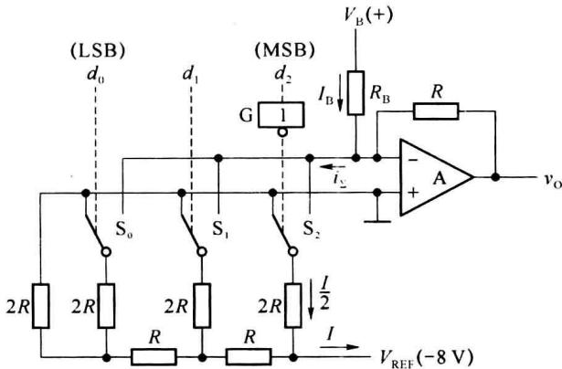  

图9.1.17 具有双极性输出电压的DAC

若去掉反相器 G 和偏移电阻 $R_{B}$ ，输入数字量为 3 位无符号二进制数，电路即为倒 T 形网络 DAC。取 $V_{REF} = -8 \, V$ ，当输入数字量为 111 时，输出电压 $v_{0} = 7 \, V$ ；输入数字量 000 时，输出电压 $v_{0} = 0 \, V$ ，如表 9.1.2 的第一列和第二列所示。

对照表 9.1.1 和表 9.1.2 便可发现, 如果把表 9.1.2 中间一列的输出电压偏移 -4 V, 则偏移后的输出电压恰好同表 9.1.1 所要得到的输出电压相等。为此, 在图 9.1.17 的倒 T 形网络 DAC 中增设由 $R_{B}$ 和 $V_{B}$ 组成的电压偏移电路, 将 DAC 的输出由单极性变成双极性。当输入代码 $d_{2}d_{1}d_{0}=100$ 时输出电压 $v_{0}$ 应该为零, 此时只要使 $I_{B}$ 与 $i_{\Sigma}$ 大小相等即可, 故电路应满足

$$

\frac {V _ {\mathrm{B}}}{R _ {\mathrm{B}}} = \frac {I}{2} = \frac {- V _ {\mathrm{REF}}}{2 R}\tag{9.1.21}

$$

对照表 9.1.1 和表 9.1.2 最左边一列代码还可发现, 只要把表 9.1.2 中原码的最高位取反(作为有符号数的符号位), 就可以得到表 9.1.1 所需要的输入与输出对应关系。为此, 在图 9.1.16 中将符号位 $d_{2}$ 经反相器 G 反相后再加到 DAC 电路上。

通过上面的例子,不难总结出构成双极性输出 DAC 的一般方法:只要在求和放大器的反向输入端接入一个电压偏移电路,并保证输入数字量只有最高位为 1 时输出 $v_{0}=0$ , 同时将输入数字量的最高位取反作为有符号数的符号位, 就得到了双极性输出的 DAC。

## \* 9.1.9 串行输入 DAC

上面所讲的几种 DAC 中, 数字量都是以并行方式输入的, 但在有些应用中, 为减少传输线的数目, 数字信号经常采用串行方式传输, 这时就要采用串行输入的 DAC。

串行输入 DAC 的电路原理如图 9.1.18 所示, 它由移位寄存器、DAC 寄存器和并行输入 DAC 三部分组成。其中, $\overline{\mathrm{CS}}$ 为转换控制信号, 当 $\overline{\mathrm{CS}}$ 为低电平时, 在时钟信号 SCLK 的作用下, 串行数据通过串行输入端 SDI 逐位移入移位寄存器。当串行数据全部进入移位寄存器后, $\overline{\mathrm{CS}}$ 回到高电平, 利用 $\overline{\mathrm{CS}}$ 的上升沿将移位寄存器输出的并行数据装入 DAC 寄存器, DAC 寄存器再将并行数据送给并行输入 DAC, 完成数字量到模拟量的转换。

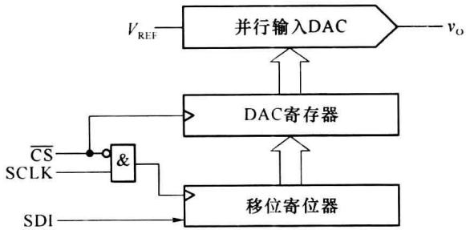  

图9.1.18 串行输入DAC的电路结构框图

MAX515 是 MAXIM 公司生产的串行输入 DAC 产品, 它可以对 10 位串行输入的数字量进行 D/A 转换。MAX515 的电路结构框如图 9.1.19 所示, 由 10 位倒 T 形电阻网络 DAC、10 位 DAC 寄存器、16 位移位寄存器、控制逻辑、上电复位电路和输出缓冲放大器等几部分组成。接通电源后, 上电复位电路负责初始化控制逻辑, 并将移位寄存器和 DAC 寄存器清零。

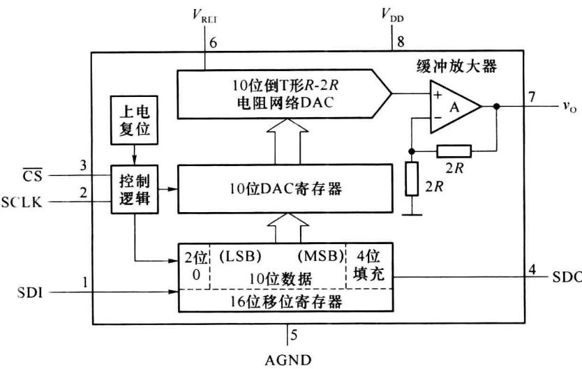  

图9.1.19 MAX515的电路结构框图

图 9.1.20 是 MAX515 的工作时序图。在每个转换周期中，MAX515 接收 16 位串行输入数据，由两个 8 位的字节给出。串行数据由 SDI 端输入， $\overline{CS}$ 变为低电平后，在串行时钟脉冲 SCLK 的驱动下，首先送入 4 位虚拟的填充位，然后送入 10 位有效输入数字量，最后送入两位 00。因此，在 $\overline{CS}$ 的低电平期间应当给 16 位移位寄存器加 16 个串行时钟脉冲。当 $\overline{CS}$ 回到高电平后，16 位移位寄存器中的数据被并行装入 10 位 DAC 寄存器中，并在 10 位倒 T 形 DAC 的输出端得到相应的模拟电压。

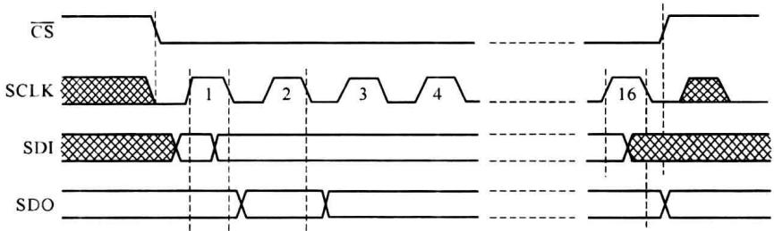  

图9.1.20 MAX515的工作时序图

此外，MAX515 还设置了串行数据输出端 SDO。在串行输入数据送入 16 位移位寄存器的同时，也可以通过 SDO 端将送入的数据读出，以供校验之用。MAX515 采用单一电源 $V_{DD}$ 供电，外接参考电压 $V_{REF}$ 不应超过 $V_{DD}-2V$ 。

有些串行输入 DAC 的芯片内部含有参考电压源电路, 可以工作在正、负电源 (例如 $\pm5\ V$ ) 之下, 这样的芯片在使用时无须外加参考电压, 而且很容易实现双极性输出。

## 9.1.10 DAC 的主要技术指标

### 1. 转换速度

转换速度通常用输出电压(或电流)的建立时间 $t_{set}$ 来衡量。建立时间 $t_{set}$ 是指从输入数字量发生变化到输出电压(或电流)达到与稳态值相差 $\pm\frac{1}{2}$ LSB 时所用的时间，如图 9.1.21 所示。输入数字量变化越大建立时间越长，因此一般在产品手册中给出的建立时间 $t_{set}$ 都是指输入数字量从全 0 跳变为全 1（或从全 1 跳变为全 0）时输出稳定所需的时间，它是 DAC 的最大响应时间，用来衡量 DAC 转换速度的快慢。在不包含集成运算放大器的单片集成 DAC 中，建立时间最短可达 $0.1 \mu s$ ；在包含运算放大器的 DAC 中，建立时间最短可达 $1.5 \mu s$ 。例如，10 位 D/A 转换器 AD7520 输出电流的建立时间为 $1.0 \mu s$ ，而 12 位高速 D/A 转换器 MAX5889 的建立时间仅为 $0.01 \mu s$ 。

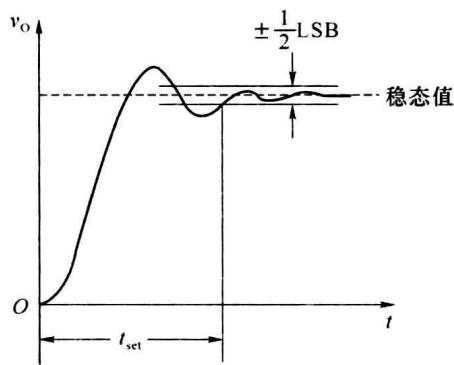  

图9.1.21 DAC的建立时间

### 2. 转换精度

在 DAC 中一般用分辨率和转换误差来描述转换精度。

### (1) 分辨率

分辨率表征 DAC 对输入量微小变化的敏感程度,一般用 DAC 的位数表示。在分辨率为 n 位的 DAC 中,当输入数字量从 00…00 变化到 11…11 时,输出电压应给出 $2^{n}$ 个不同的等级。DAC 的位数越多,输出电压的取值个数就越多,也就越能反映出输出电压的细微变化,分辨能力就越强。

此外,也可以用 DAC 能分辨出来的最小输出电压(输入数字量只有最低有效位为 1, 即 1 LSB)与最大输出电压(输入数字量所有的有效位全为 1, 即 1 FSR)之比定义分辨率, 即 n 位 DAC 的分辨率可表示为

$$

\mathrm{分辨率} = \frac {1}{2 ^ {n} - 1}

$$

它表示 DAC 在理论上可以达到的精度,该值越小,分辨率越高。例如,ADC0832 的分辨率是 8 位,也可以表示为

$$

\mathrm{分辨率} = \frac {1}{2 ^ {8} - 1} = \frac {1}{2 5 5} \approx 0. 0 0 4

$$

### (2) 转换误差

DAC 电路各部分的参数不可避免地存在误差,它必然影响转换精度。转换误差是指实际输出的模拟电压与理想值之间的最大偏差。常用这个最大偏差与 FSR 之比的百分数或若干 LSB 表示,它实际上是 3 种误差的综合指标。

## ① 非线性误差(非线性度)

非线性误差是一种没有固定变化规律的误差,一般用当输入数字量满刻度时,输出电压偏离理想转移特性的最大值来表示。图 9.1.22(a)给出了输入数字量与输出模拟量之间的对应关系,对于理想 DAC,各数字量与其相应的模拟量的交点,应落在图中的理想输出特性曲线上。但对于实际的 DAC,这些交点会偏离理想输出特性曲线,产生非线性误差,见图中的实际输出曲线。

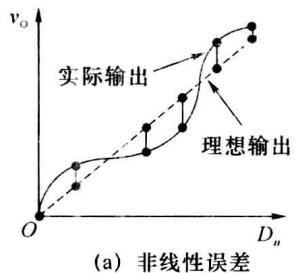

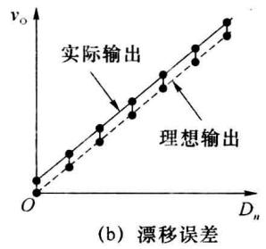

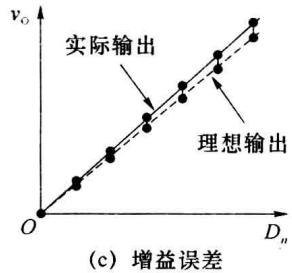  

图9.1.22 DAC的转换误差

产生非线性误差的原因很多,如电路中各模拟开关的导通电阻和导通压降可能存在偏差;每个开关处于不同位置(接地或接 $V_{REF}$ )时,其开关压降和电阻也不一定相等;在电阻网络中,每个支路上的电阻值也可能存在偏差。这些偏差是随机的,故以非线性误差的形式反映在输出电压上。

## ② 漂移误差(平移误差)

漂移误差是由运算放大器的零点漂移造成的,这种误差与数字量的大小无关,它只把图9.1.22(b)中的理想输出特性曲线向上或向下平移,使之不经过原点,并不改变其线性,因此也称它为平移误差。

漂移误差可用零点校准来消除,但不能在整个工作温度范围内都能校准。

## ③ 增益误差

增益误差是指实际输出特性曲线的斜率与理想输出特性曲线斜率的偏差,基准电压 $V_{REF}$ 和运算放大器增益不稳定都可以造成增益误差,其表现形式是实际输出特性曲线与理想输出特性曲线相比,斜率发生了变化,如图9.1.22(c)所示。

以上分析表明,为了获得较高精度的 D/A 转换器,单纯依靠选用高分辨率的 D/A 转换器件是不够的,还需要有稳定的参考电压源 $V_{REF}$ 、零点漂移低的集成运放等器件与之配合才能获得较高的转换精度。

目前常见的集成 DAC 有两大类,一类是器件内部只包含电阻网络(或恒流源电路)和模拟开关,如 DAC0832、AD7520 等;另一类器件内部还包含了运算放大器和参考电压源发生电路,如 AD574。使用前一类器件时必须外接参考电压源和运算放大器,这时应注意合理地选择器件,以提高参考电压的稳定性,降低运算放大器零点漂移。

### (3) 温度系数

温度系数是指输入数字量不变的情况下,输出模拟电压随环境温度变化而产生的波动。一般用输出满度电压条件下温度每升高 $1^{\circ}C$ , 输出电压变化的百分比作为温度系数。

## 9.1.11 集成 D/A 转换器及其应用

### 1. 集成 D/A 转换器 DAC 0832

DAC0832 是美国国家半导体公司(NSC)采用 CMOS 工艺生产的单片 8 位数模转换器,采用单电源供电,在 +5\~+15 V 间均可正常工作,电流建立时间为 $1.0 \mu s$ 。DAC0832 含有两级缓冲寄存器,可直接与多种微处理器相连接,图 9.1.23(a) 是它的逻辑框图,图 9.1.23(b) 是它的引脚排列图。

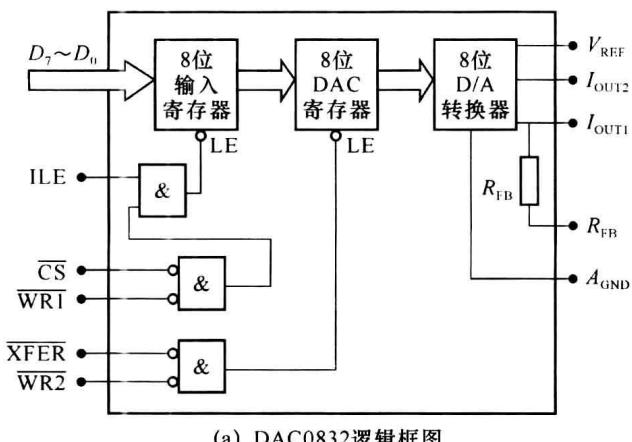  

(a) DAC0832逻辑框图

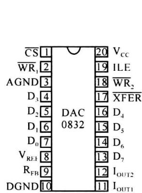  

(b) DAC0832引脚排列图  

图9.1.23 DAC0832框图

### (1) DAC0832 的引脚和功能说明

DAC0832 由一个 8 位输入寄存器、一个 8 位 DAC 寄存器和一个 8 位 D/A 转换器三大部分组成，其中 D/A 转换器采用倒 T 形 R-2R 电阻网络。DAC0832 有两个独立控制的数据寄存器，使用时有较大的灵活性，可根据需要接成不同的工作方式。DAC0832 芯片内部无运算放大器，且是电流输出，使用时需要外接运算放大器。芯片中已设置了反馈电阻 $R_{FB}$ ，只要将 9 脚接到运放输出端即可，若运放增益不够仍需要外接反馈电阻。DAC0832 各引脚的名称和功能如下。

$\overline{\mathrm{CS}}$ : 片选信号, 低电平有效。当此端的信号为低电平时, 允许将 8 位输入数字量锁存到 8 位输入寄存器中。

ILE:8位输入寄存器锁存信号,高电平有效。

$\overline{WR_{1}}$ :写使能信号,低电平有效,允许外部数字量装入8位输入寄存器。

$\overline{WR_{2}}$ :写使能信号,低电平有效,允许输入寄存器的内容装入8位DAC寄存器。

$D_{7}\sim D_{0}:8$ 位输入数字量。

信号 $\overline{\mathrm{CS}}$ 、ILE、和 $\overline{\mathrm{WR}_1}$ 共同控制8位输入寄存器的数据输入，当 $\overline{\mathrm{CS}}$ 和 $\overline{\mathrm{WR}_1}$ 同时有效时，若ILE为高电平，输入寄存器的输出端 $Q$ 跟随输入信号的变化；若ILE为低电平，输入数据被锁存，输入数字量的变化不再影响输入寄存器的 $Q$ 端。

$\overline{\mathrm{XFER}}$ : 数据传送控制信号, 低电平有效。该信号用来控制是否允许将输入寄存器中的内容传送给 DAC 寄存器进行转换, 若 $\overline{\mathrm{XFER}}$ 和 $\overline{\mathrm{WR}_2}$ 同时有效, 数据将被锁存到 DAC 寄存器中。

$I_{OUT1}$ : DAC 电流输出端, 此输出信号一般作为运算放大器一个差分输入信号。当 DAC 寄存器中各位全为“1”时, 电流值最大; 全为“0”时, 电流值为 0。

$I_{OUT2}$ : DAC 电流输端, 它是运算放大器的另一个差分输入信号。电路保证 $I_{OUT1} + I_{OUT2} =$ 常数。

$R_{FB}$ : 芯片内反馈电阻接线端。

$V_{REF}$ : 参考电压输入端, 一般与外部精确、稳定的电压源相连。 $V_{REF}$ 可在 $-10 \sim +10$ V 范围内选择。

$$

V _ {\mathrm{cc}}

$$

$$

D _ {\mathrm{GND}}

$$

$$

A _ {\mathrm{GND}}

$$

DAC0832 有双缓冲型、单缓冲型和直通型 3 种工作方式。

由于 0832 芯片中有两个数据寄存器, 可以通过控制信号将输入数字量先锁存到输入寄存器中, 当需要 D/A 转换时再将此数字量由输入寄存器装入 DAC 寄存器中锁存并进行转换, 从而实现两级缓冲方式工作。

如果使一个寄存器处于常通状态,只控制另一个寄存器的锁存,或者使两个寄存器同时选通和锁存,就实现单缓冲工作方式。

如果使两个寄存器都处于常通状态,当外部数字量发生变化时,两个寄存器将跟随数字量的变化,D/A转换器的输出也随之发生变化,这就是直通工作方式。这种情况通常用在连续反馈控制系统中,作数字增益控制器使用。

(2) 用 DAC0832 构成锯齿波信号发生器

锯齿波信号广泛应用于电视机、显示器和示波器的行、场扫描。可以利用阻容电路充、放电原理实现锯齿波信号发生器，但阻容充、放电过程是近似线性的，产生的波形并不十分理想，而且受器件参数和环境温度的影响较大。下面介绍一种利用 DAC0832 构成锯齿波信号发生器电路的方法，这种方法可以得到线性度较高的锯齿波信号。

利用 DAC0832 合成锯齿波信号的原理电路如图 9.1.24 所示, 它由模为 256 的计数器和 D/A 转换器两部分组成。两片中规模计数器 74LS169 级联组成的一个模为 256 的 8 位二进制计数器, 计数器的输出 $Q_{7} \sim Q_{0}$ 分别连接到 DAC0832 的数据输入端 $D_{7} \sim D_{0}$ , 作为 DAC 的输入数字量。这样, 计数器每输出一组数字量 $Q_{7} \sim Q_{0}$ , 经 DAC0832 转换后, 都会输出与该数字量对应的模拟电压值。

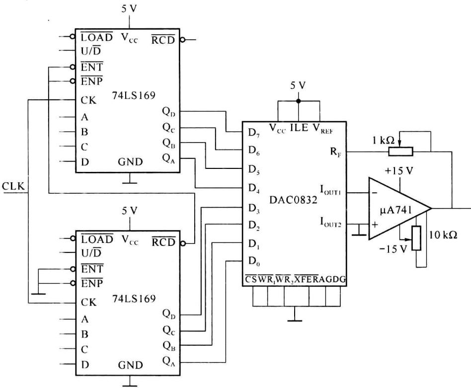  

图 9.1.24 锯齿波信号发生器电路图

设参考电压 $V_{REF} = +5 \, V$ ，在时钟脉冲 CP 的作用下，计数器循环计数，计数器的输出从 00H 到 FFH 周期性变化。相应地，输出端 $v_{0}$ 将随之输出 0～5 V 的梯形波，每一阶梯的电位差约为 0.02 V，精度很高，输出的梯形波近似为锯齿波形，如图 9.1.25 所示。通过调节时钟脉冲的频率可以改变每一阶梯波形的持续时间，从而改变锯齿波信号的周期。为进一步提高输出波形的线性度，可以在图 9.1.24 的计数器的基础上再级联一级 74LS169，构成模为 4096 的计数器，同时用 12 位 DAC 取代 ADC8032。

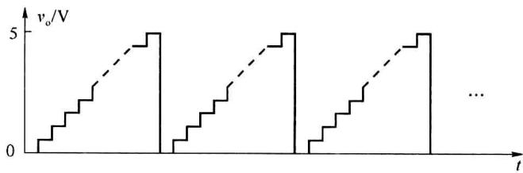  

图 9.1.25 利用 DAC0832 合成锯齿波的输出波形

### 2. 集成 D/A 转换器 AD7520

AD7520 是一种应用广泛的 10 位单片集成 DAC, 其内部结构如图 9.1.8 所示, 引脚排列如图 9.1.26 所示。AD7520 输入为 10 位二进制数, 输出为求和电流, 使用时需要外接运算放大器, 运算放大器的反馈电阻可以使用 AD7520 内部的反馈电阻 $R_{\mathrm{F}}$ , 也可以外接反馈电阻。

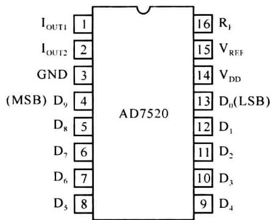  

图 9.1.26 AD7520 引脚排列图

### (1) 用 AD7520 构成锯齿波发生器

利用 AD7520 构成锯齿波信号发生器的原理电路如图 9.1.27 所示。它由计数器、D/A 转换器和集成运放等几部分组成，其功能与前述利用 DAC0832 构成锯齿波发生器相似。通过两片 74LS161 级联构成一个模为 256 的 8 位二进制计数器，其输出 $Q_{7} \sim Q_{0}$ 分别与 AD7520 的数据输入端 $D_{9} \sim D_{2}$ 相连，AD7520 的 $D_{1}$ 和 $D_{0}$ 管脚接地。

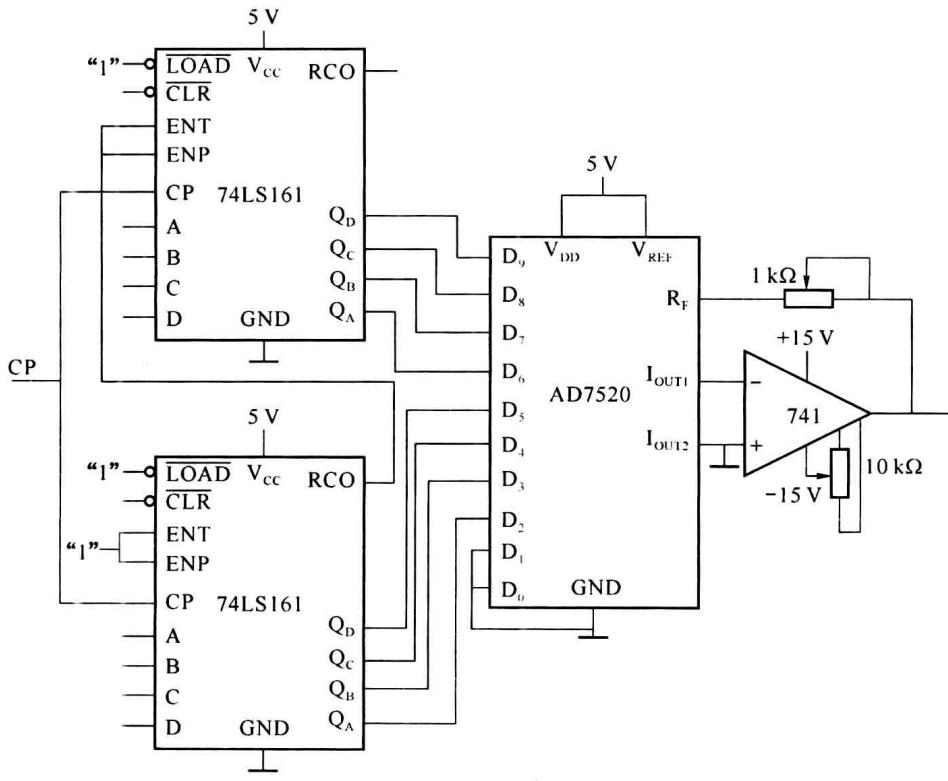  

图 9.1.27 锯齿波信号发生器电路图

在时钟脉冲 CP 的作用下, 计数器循环计数, 其输出从 00H 到 FFH 周期性变化, 使 AD7520 的输出电压曲线呈阶梯形循环变化, 输出信号波形近似为锯齿波型。

### (2) 用 AD7520 构成可编程增益放大器

利用 AD7520 构成的数字式可编程增益放大电路如图 9.1.28 所示。外部模拟信号接

AD7520 的 $R_{F}$ 端，输入电阻为 AD7520 内部反馈电阻 R，运算放大器 A 接成反相比例放大电路。D/A 转换器的输出电流 $I_{OUT1}$ 和 $I_{OUT2}$ 分别接运算放大器的反相输入端和同相输入端，输出电压 $v_{O}$ 由 $V_{REF}$ 端通过 AD7520 的内部倒 T 形电阻网络引回到运算放大器的反相输入端，构成电压并联负反馈电路。反相比例放大电路的反馈电阻为倒 T 形电阻网络的等效电阻，该阻值受输入数字量 $d_{9} \sim d_{0}$ 的控制。

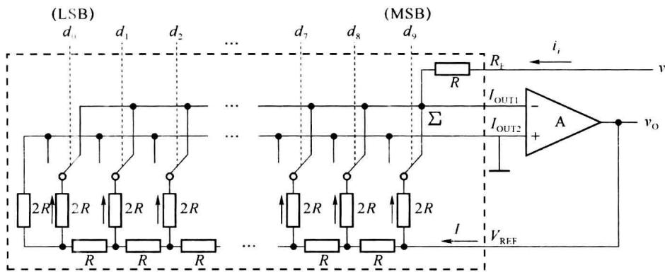  

图 9.1.28 用 AD7520 构成可编程增益放大器

由 9.1.4 小节的分析可知,从 $V_{REF}$ 端看进去对地的等效电阻为 R,因此从运算放大器的输出端流入 $V_{REF}$ 端的电流始终为 $I=\frac{v_{0}}{R}$ ,且该电流在电阻网络中从右至左沿各 2R 支路依次按 1/2 规律递减。流入求和点 $\Sigma$ 的总电流

$$

\begin{array}{r l} i _ {\Sigma} & = I (d _ {9} \times \frac {1}{2} + d _ {8} \times \frac {1}{2 ^ {2}} + \dots + d _ {1} \times \frac {1}{2 ^ {3}} + d _ {0} \times \frac {1}{2 ^ {1 0}}) \\ & = \frac {v _ {0}}{2 ^ {1 0} R} (d _ {9} \times 2 ^ {9} + d _ {8} \times 2 ^ {8} + \dots + d _ {1} \times 2 ^ {1} + d _ {0} \times 2 ^ {0}) \\ & = \frac {v _ {0}}{2 ^ {1 0} R} \sum_ {i = 0} ^ {9} (d _ {i} \times 2 ^ {i}) \end{array}

$$

由 $i_i = -i_\Sigma$ ，得

$$

\frac {v _ {\mathrm{I}}}{R} = - \frac {v _ {\mathrm{O}}}{2 ^ {1 0} R} (d _ {9} \times 2 ^ {9} + d _ {8} \times 2 ^ {8} + \dots + d _ {1} \times 2 ^ {1} + d _ {0} \times 2 ^ {0})

$$

则放大电路的增益为

$$

\begin{array}{r l} A _ {v} & = \frac {v _ {0}}{v _ {1}} = \frac {- 2 ^ {1 0}}{d _ {9} \times 2 ^ {9} + d _ {8} \times 2 ^ {8} + \cdots + d _ {1} \times 2 ^ {1} + d _ {0} \times 2 ^ {0}} \\ & = - \frac {2 ^ {1 0}}{\sum_ {i = 0} ^ {9} (d _ {i} \times 2 ^ {i})} \end{array}

$$
