import Guide from '@/components/Guide.astro';
import Knowledge from '@/components/Knowledge.astro';
import Example from '@/components/Example.astro';
import Analysis from '@/components/Analysis.astro';
import Solution from '@/components/Solution.astro';
import Variant from '@/components/Variant.astro';
import Note from '@/components/Note.astro';
import Block from '@/components/Block.astro';
import Method from '@/components/Method.astro';
import Exercise from '@/components/Exercise.astro';

前已述及,数字系统只能对数字量进行处理,而实际信号大多是连续变换的模拟量,经A/D转换后才能被人数字系统处理,这种完成模数转换的电路就是模数转换器。

## 9.2.1 模数转换器的基本原理

模数转换器是将模拟量转换成数字量的器件。模拟信号在时间上和幅值上是连续的，而数字信号在时间上和幅值上都是离散的，所以进行模数转换时，首先要在一系列规定的时刻对模拟信号进行采样，然后再把这些采样值转换为相应的数字量。因此，模数转换一般要经过采样、保持、量化、编码4个步骤。在实际电路中，这些步骤有些是合并进行的，例如，采样和保持、量化和编码往往都是在转换过程中同时完成。

### 1. 采样与保持

采样就是按照一定的时间间隔抽取模拟量的值，将连续变化的模拟量转换成时间上离散的模拟量。如图9.2.1所示， $v_{I}$ 是输入模拟电压信号， $S(t)$ 是采样脉冲， $T_{s}$ 是采样脉冲的周期， $t_{w}$ 是采样脉冲的持续时间。采样原理电路如图9.2.2(a)所示，用采样脉冲 $S(t)$ 控制模拟开关TG，在采样时间 $t_{w}$ 内， $S(t)$ 使开关TG接通，输出 $v_{s}=v_{I}$ ；在 $T_{s}-t_{w}$ 时间内， $S(t)$ 使开关断开， $v_{s}=0$ 。输入模拟信号 $v_{I}$ 经采样后，变为一系列窄脉冲 $v_{s}$ ，这一系列窄脉冲称为取样信号（或样值脉冲），如图9.2.1(c)所示。

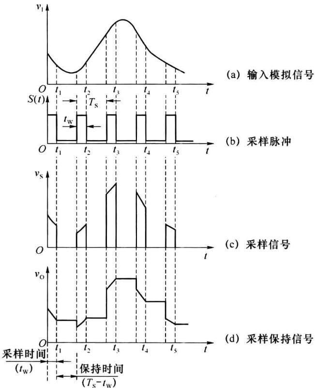  

图9.2.1 采样与保持过程

通过分析得出,采样脉冲 $S(t)$ 的频率越高,采样越密,采样信号的包络线也就越接近于输入信号的波形,越能真实再现输入信号。但采样频率越高,经 A/D 转换后的数据量越大,对后续数据存储和处理的要求也就越高。因此,选择合适的采样频率有利于数字系统的优化。合理的采样频率由采样定理确定。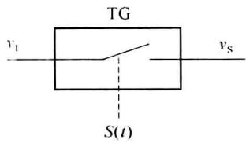  

(a) 采样电路原理图

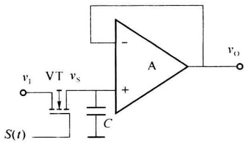  

(b) 采样-保持电路的基本形式  

图9.2.2 采样原理

采样定理:设采样频率为 $f_{s}$ ，输入模拟信号的最高频率分量为 $f_{imax}$ ，则 $f_{s}$ 和 $f_{imax}$ 之间必须满足下面的关系

$$

f _ {\mathrm{s}} \geqslant 2 f _ {\mathrm{imax}}\tag{9.2.1}

$$

采样定理说明,为了能不失真地恢复原来的输入信号,采样频率 $f_{s}$ 必须不小于输入模拟信号频谱中最高频率 $f_{imax}$ 的两倍,即当 $f_{s} \geqslant 2f_{imax}$ 时,采样信号才能正确地反映输入信号。或者说,在满足式(9.2.1)的条件下,将采样信号经过低通滤波器,才可以重建原输入信号。实际应用中,通常取 $f_{s} = (2.5 \sim 3)f_{\text{imax}}$ ,例如语音信号的 $f_{\text{imax}} \approx 3.4 \text{ kHz}$ ,一般取 $f_{s} = 8 \text{ kHz}$ 。

模拟信号 $v_{1}$ 经过采样后得到采样信号 $v_{s}$ ，采样信号是一系列窄脉冲，脉冲的持续时间很短，但模数转换需要一定的时间，为了保证转换精度，在转换期间要使脉冲的幅值保持不变。因此，在采样电路之后需加入保持电路。图9.2.2(b)是一种基本的采样-保持电路，场效应管VT为采样开关，电容C为保持电容，运算放大器A接成电压跟随器的形式，起缓冲隔离的作用。在采样时间 $t_{\mathrm{w}}$ 内，场效应管VT导通，电容C充电，由于电容C的充电时间常数远远小于 $t_{\mathrm{w}}$ ，因此电容C上的电压在采样时间内跟随输入信号 $v_{1}$ 的变化，即 $v_{\mathrm{s}} = v_{1}$ 。在保持时间 $T_{\mathrm{s}} - t_{\mathrm{w}}$ 内，场效应管VT关断，由于电压跟随器A的输入阻抗很高，存储在电容C中的电荷很难泄放掉，电容C上的电压基本保持不变，从而使 $v_{\mathrm{s}}$ 保持采样结束时 $v_{1}$ 的瞬时值，形成图9.2.1(d)所示的 $v_{0}$ 波形。

图 9.2.3(a) 为单片采样-保持电路 LF198 的电路结构。LF198 是采用双极与 MOS 混合工艺制成的集成采样-保持电路，其中 $A_{1}$ 、 $A_{2}$ 是运算放大器，S 是模拟开关、L 是控制 S 状态的逻辑单元。逻辑输入端 $v_{L}$ 和参考电压输入端 $V_{REF}$ 具有较高的输入电阻，可以直接用 TTL 或 CMOS 电路驱动。当 $v_{L} > V_{REF} + V_{th}$ 时 S 接通，否则 S 断开， $V_{th}$ 称为阈值电压，约为 1.4 V。为了提高电路的工作速度、降低输入失调电压，运算放大器 $A_{1}$ 的输入级采用双极型晶体管电路。为了提高运算放大器 $A_{2}$ 的输入阻抗，减小在保持时间内保持电容 $C_{H}$ 上的电荷损失，在其输入级使用了场效应管。电路中还接有二极管 $VD_{1}$ 、 $VD_{2}$ 组成保护电路，避免开关电路承受过高的电压。

图 9.2.3(b) 给出了 LF198 的一种典型接法, 其中 $C_{H}$ 为外接保持电容, $C_{H}$ 的值越大、漏电越小, 保持效果越好, 输出电压的下降率越低。但 $C_{H}$ 过大会使电容的充电时间变长, 影响电路的性能。当外接电容 $C_{H}=0.01\mu F$ 时, 输出电压的下降率小于 $10^{-3}mV/s$ 。图中 $V_{OS}$ 为失调调整输入端, 通过调整 $V_{OS}$ 可以实现零输入时零输出, 即 $v_{I}=0$ 时, $v_{O}=0$ 。参考电压 $V_{REF}=0V$ , 若 $v_{L}$ 为 TTL 逻辑电平, 当 $v_{L}=1$ 时 S 接通, $v_{L}=0$ 时 S 断开。

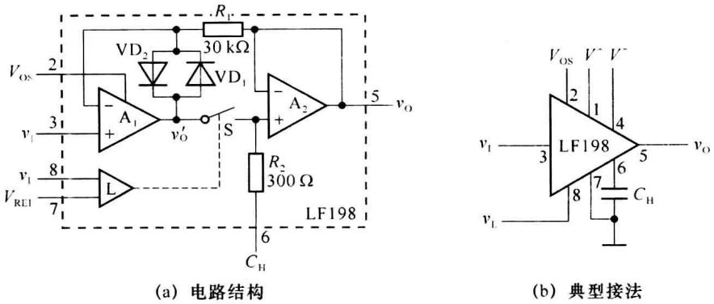  

图 9.2.3 集成采样保持电路 LF198

### 2. 量化与编码

输入的模拟信号经采样、保持后，得到的波形是阶梯波，如图9.2.1(d)所示。阶梯波的幅值是任意的，仍属模拟量范畴，而数字系统的字长是固定的，只能表示有限个数值，任何一个数字量的值只能是某个规定的最小数量单位的整数倍。因此，用数字量表示这种采样保持信号时，必须把它转换为该最小数量单位的整数倍，这一转换过程称为量化。把量化的结果再转化为相应的二进制代码的过程称为编码。例如，若输入模拟信号是正值，可以采用自然二进制码对量化结果进行编码；若输入模拟信号在正负值范围内变化，则可以采用二进制补码的形式对其编码。

量化过程中所取的最小数量单位称为量化单位，用 $\Delta$ 表示，它是数字量最低有效位为 1 时所对应的模拟量，即 $1\Delta = 1$ LSB。由于采样信号的电压不一定能被 $\Delta$ 整除，所以量化前后不可避免存在舍入误差，此误差称为量化误差，用 $\varepsilon$ 表示。量化误差属于原理误差，它只能减少，不能消除。ADC 的位数越多，各离散电平之间的差值越小，量化误差就越小。

假设输入模拟电压在 0～1 V 范围内变化, 现对其进行量化编码, 转换成 3 位二进制数。因 3 位二进制数有 8 个不同的数值, 所以应将 0～1 V 的模拟电压分成 8 个等级, 每级指定一个量化值, 并对该值进行二进制编码。最简单的量化方法是等分量化法, 取 $\Delta=1/8\ V$ , 并规定凡是数值在 0～1/8 V 之间的模拟电压都当做 $0\Delta$ 对待, 量化值为 0 V, 编码为 000; 凡是数值在 1/8～2/8 V 之间的模拟电压都当做 $1\Delta$ 对待, 量化值为 1/8 V, 编码为 001; ……, 如图 9.2.4(a) 所示。在这种量化方法中, 凡是落在某一量化级内的模拟电压都取整并归到该级量化值上, 例如, 若输入电压为 0.124 V 则量化到 0 V 上, 这是一种“只舍不入”的量化方法。不难看出, 这种量化方法可能带来的最大量化误差为 $\Delta$ , 即 1/8 V。

为减小量化误差,可以采用图 9.2.4(b) 所示的改进方法划分量化电平。在这种方法中,取量化单位 $\Delta = 2 / 15 \mathrm{~V}$ , 并规定凡是数值在 $0 \sim 1 / 15 \mathrm{~V}$ (即 $0 \sim 1 / 2 \Delta$ ) 之间的模拟电压都当做 $0 \Delta$ 对待, 量化值为 $0 \mathrm{~V}$ , 编码为 000; 凡是数值在 $1 / 15 \sim 3 / 15 \mathrm{~V}$ (即 $1 / 2 \Delta \sim 3 / 2 \Delta$ ) 之间的模拟电压都当做 $1 \Delta$ 对待, 量化值为 $2 / 15 \mathrm{~V}$ , 编码为 001; 依此类推, 凡是数值在 $13 / 15 \sim 1 \mathrm{~V}$ 之间的模拟电压都当做 $7 \Delta$ 对待, 量化值为 $14 / 15 \mathrm{~V}$ , 编码为 111。这是一种“有舍有人”的量化方法, 可以把量化误差减小到 $1 / 2 \Delta$ , 即 $1 / 15 \mathrm{~V}$ 。这个道理不难理解, 因为现在是将每个输出二进制代码所表示的模拟电压值规定为它所对应的模拟电压范围的中间值,所以最大量化误差自然不会超过 $1/2\Delta$ 。

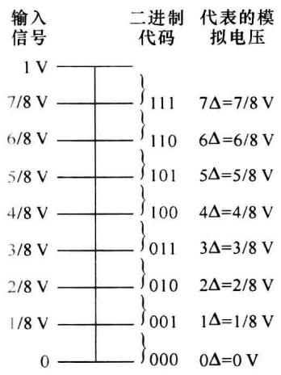  

(a) 只舍不入的量化方法

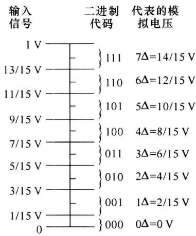  

(b) 有舍有入的量化方法  

图 9.2.4 划分量化电平的两种方法

ADC 是把模拟量转换成数字量的模数转换器件。ADC 的种类很多, 按工作原理的不同, 可分为直接转换型 ADC 和间接转换型 ADC。直接转换型 ADC 是将模拟量直接转换成数字量, 这种转换方法的特点是转换速度快, 如并行比较型 ADC、逐次渐近型 ADC。间接转换型 ADC 是先将输入模拟量转换成时间或频率等中间量, 然后再将这些中间量转换成数字量, 这种转换方法的特点是转换速度比较慢, 但抗干扰能力强, 常见的有双积分型 ADC。

## 9.2.3 并行比较型 ADC

并行比较型 ADC 是目前速度最快的一类 A/D 转换器。3 位并行比较型 ADC 的原理图如图 9.2.5 所示，电路由电阻分压器件、电压比较器、寄存器和编码器等几部分组成。其中， $V_{REF}$ 为参考电压输入端； $v_{I}$ 为模拟电压输入端， $v_{I}$ 必须在 $0 \sim V_{REF}$ 之间； $d_{2}d_{1}d_{0}$ 为数字量输出端，输出为 3 位二进制数码。为简单起见，假设输入模拟电压 $v_{I}$ 是经过采样-保持电路之后的电压。

为保证量化精度,电压比较器中量化电平的划分采用图9.2.4(b)所示的方法,8个电阻将参考电压 $V_{REF}$ 分成8个等级,其中7个等级的电压分别作为7个电压比较器( $C_{1}\sim C_{7}$ )的基准电压,数值分别为 $\frac{1}{15}V_{REF}$ 、 $\frac{3}{15}V_{REF}$ 、 $\cdots$ 、 $\frac{13}{15}V_{REF}$ 。输入电压 $v_{I}$ 同时加到每个电压比较器的另一个输入端,与这7个基准电压进行比较。

当 $0 \leqslant v_{\mathrm{I}} < \frac{1}{15} V_{\mathrm{REF}}$ 时，比较器 $\mathrm{C}_{1} \sim \mathrm{C}_{7}$ 均输出低电平，时钟脉冲CP的上升沿到来后，寄存器中所有的触发器 $(\mathrm{FF}_{1} \sim \mathrm{FF}_{7})$ 都被置成0状态。当 $\frac{1}{15} V_{\mathrm{REF}} \leqslant v_{\mathrm{I}} < \frac{3}{15} V_{\mathrm{REF}}$ 时，只有比较器

$C_{1}$ 输出高电平，CP 的上升沿到来后触发器 $FF_{1}$ 被置成 1，其余触发器均被置成 0。依此类推，便可列出输入模拟电压 $v_{1}$ 所对应的寄存器状态，如表 9.2.1 所示，其中寄存器的输出是一组 7 位的二进制代码，需经过编码后才能转换成所需的数字量 $d_{2}d_{1}d_{0}$ 。

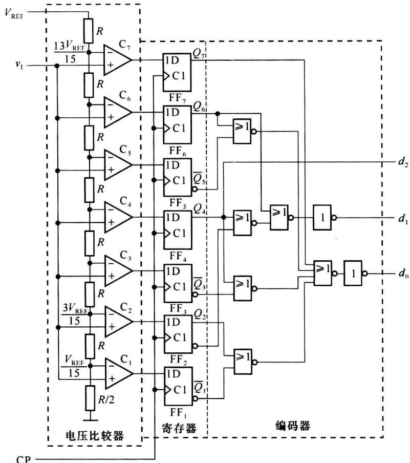  

图9.2.5 3位并行比较型ADC原理图

表 9.2.1 图 9.2.5 的代码转换表

<table><tr><td rowspan="2">输入模拟电压 ${v}_{1}$ </td><td colspan="7">寄存器的状态</td><td colspan="3">数字量输出</td></tr><tr><td> ${Q}_{7}$ </td><td> ${Q}_{6}$ </td><td> ${Q}_{5}$ </td><td> ${Q}_{4}$ </td><td> ${Q}_{3}$ </td><td> ${Q}_{2}$ </td><td> ${Q}_{1}$ </td><td> ${d}_{2}$ </td><td> ${d}_{1}$ </td><td> ${d}_{0}$ </td></tr><tr><td>(0～1/15) ${V}_{\text{REF }}$ </td><td>0</td><td>0</td><td>0</td><td>0</td><td>0</td><td>0</td><td>0</td><td>0</td><td>0</td><td>0</td></tr><tr><td>(1/15～3/15) ${V}_{\text{REF }}$ </td><td>0</td><td>0</td><td>0</td><td>0</td><td>0</td><td>0</td><td>1</td><td>0</td><td>0</td><td>1</td></tr><tr><td>(3/15～5/15) ${V}_{\text{REF }}$ </td><td>0</td><td>0</td><td>0</td><td>0</td><td>0</td><td>1</td><td>1</td><td>0</td><td>1</td><td>0</td></tr><tr><td>(5/15～7/15) ${V}_{\text{REF }}$ </td><td>0</td><td>0</td><td>0</td><td>0</td><td>1</td><td>1</td><td>1</td><td>0</td><td>1</td><td>1</td></tr><tr><td>(7/15～9/15) ${V}_{\text{REF }}$ </td><td>0</td><td>0</td><td>0</td><td>1</td><td>1</td><td>1</td><td>1</td><td>1</td><td>0</td><td>0</td></tr><tr><td>(9/15～11/15) ${V}_{\text{REF }}$ </td><td>0</td><td>0</td><td>1</td><td>1</td><td>1</td><td>1</td><td>1</td><td>1</td><td>0</td><td>1</td></tr><tr><td>(11/15～13/15) ${V}_{\text{REF }}$ </td><td>0</td><td>1</td><td>1</td><td>1</td><td>1</td><td>1</td><td>1</td><td>1</td><td>1</td><td>0</td></tr><tr><td>(13/15～1) ${V}_{\text{REF }}$ </td><td>1</td><td>1</td><td>1</td><td>1</td><td>1</td><td>1</td><td>1</td><td>1</td><td>1</td><td>1</td></tr></table>

编码电路是一个组合逻辑电路, 其输入为所有触发器 $\left(\mathrm{FF}_{1}\sim\mathrm{FF}_{7}\right)$ 的输出。根据表9.2.1可以写出编码电路的输入与输出之间的逻辑函数式

$$

\left\{ \begin{array}{l} d _ {2} = Q _ {4} \\ d _ {1} = Q _ {6} + \overline {{{Q _ {4}}}} Q _ {2} \\ d _ {0} = Q _ {7} + \overline {{{Q _ {6}}}} Q _ {5} + \overline {{{Q _ {4}}}} Q _ {3} + \overline {{{Q _ {2}}}} Q _ {1} \end{array} \right.\tag{9.2.2}

$$

按照式 $(9.2.2)$ 即可得到如图9.2.5所示的编码电路。

并行比较型 ADC 的最大优点就是速度快。由于转换是并行的，其转换时间只受比较器、触发器和编码器延迟时间的限制。电路完成一次 A/D 转换所需的时间仅包括比较器的比较时间、触发器的翻转时间和三级门电路的传输延迟时间。目前，8 位并行比较型 ADC 的转换时间可以达到 50ns 以下，这是其他类型的 ADC 都无法做到的。

并行比较型 ADC 的缺点是随着分辨率的提高, 电路所需电压比较器和触发器的数目按几何级数增加。一个 $n$ 位并行比较型 ADC, 就需要 $2^{n} - 1$ 个电压比较器和 $2^{n} - 1$ 个触发器, 例如, 8 位并行比较型 ADC 需要 255 个比较器和 255 个触发器, 10 位并行比较型 ADC 则需要 1023 个比较器和 1023 个触发器。ADC 的输出数字量位数越多, 电路越复杂。因此, 使用这种方案制作分辨率较高的集成 ADC 成本较高。

为了解决提高分辨率和增加元件数的矛盾,可以采用分级并行转换的方法。图 9.2.6 给出了 10 位分级并行 A/D 转换器的原理图,输入模拟信号 $v_{1}$ 经采样-保持电路后分成两路。一路信号先经过第一级 5 位并行比较 ADC 进行粗转换得到数字量的高 5 位。另一路送至减法器,与当前数字量(低 5 位定为 00000)经 D/A 转换得到的模拟量相减,为保证第二级的转换精度,将差值放大 $2^{5}=32$ 倍,经第二级 5 位并行比较 ADC 得到低 5 位输出。这种 ADC 也常称为并串型 ADC。

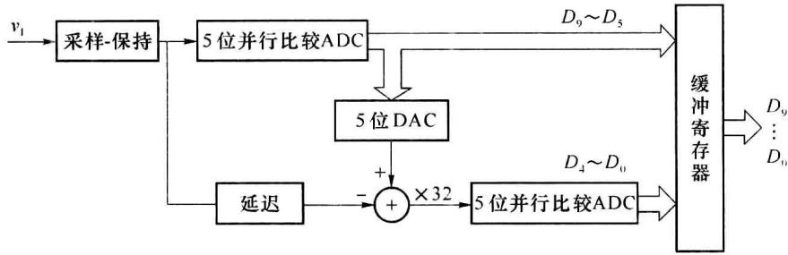  

图 9.2.6 10 位分级并行 A/D 转换器原理图

并串型 ADC 的主要优点是比同样位数的并行 ADC 所需的元件数少, 降低了器件成本。例如 10 位并行 ADC 需要 1023 个比较器, 而 10 位并串型 ADC 所需的比较器数量仅为 $(2^{5}-1)\times2=62$ 个, 这是一种兼顾了分辨率和转换速度的折中方法。

## 9.2.3 计数型 ADC

计数型 ADC 属于反馈比较型 A/D 转换器, 其工作原理图如图 9.2.7 所示。电路由时钟脉冲源、电压比较器 C、控制门 G、DAC、计数器及输出寄存器等几部分组成, 其中 $v_{1}$ 为输入模拟信号, $v_{C}$ 为转换控制信号。

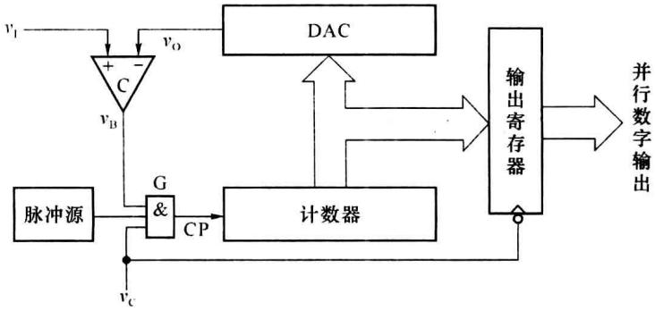  

图9.2.7 计数型ADC原理框图

在转换开始前,先将计数器清零,转换控制信号 $v_{C}=0$ , 此时门 G 被封锁, 计数器不工作。计数器的输出作为 DAC 的输入, DAC 输出模拟电压 $v_{0}=0\ V$ 。假设输入 $v_{I}$ 为正电压信号, 即 $v_{I}>0\ V$ , 则 $v_{I}>v_{0}$ , 比较器 C 输出电压高电平, $v_{B}=1$ 。

当转换控制信号 $v_{C}$ 变成高电平时启动转换，时钟脉冲源发出的脉冲信号经门 G 加至计数器的时钟输入端 CP，计数器从 0 开始按加法规律计数，DAC 输出的模拟电压 $v_{0}$ 不断升高。当 $v_{0}$ 增至 $v_{0}=v_{1}$ 时，比较器 C 的输出电压 $v_{B}$ 开始由高电平跳变为低电平， $v_{B}=0$ ，控制门 G 被封锁，计数器停止计数。此时计数器中的数值就是 A/D 转换后的数字量。

由于在转换过程中计数器按加法规律连续计数,不能将计数器的状态直接作为输出信号,需要在电路的输出端增设输出寄存器。每次转换结束后,用转换控制信号 $v_{c}$ 的下降沿将计数器的输出置入输出寄存器中,作为转换后的数字量输出。

计数型 ADC 的优点是电路简单, 成本低廉, 缺点是转换时间较长。当输出为 n 位二进制数时, 最长的转换时间是时钟周期的 $2^{n}-1$ 倍。因此, 计数型 ADC 只能用于对转换速度要求不高的场合。

## 9.2.4 逐次渐进型 ADC

为了提高转换速度,在计数型 ADC 的基础上又产生了逐次渐近型 ADC。这种 ADC 具

有电路简单、转换速度快等优点，它完成一次转换所需的时间与其数字量的位数和时钟频率有关，数字量的位数越少，时钟频率越高，转换所需时间越短。逐次渐近型 ADC 的工作原理框图如图 9.2.8 所示，电路由电压比较器 C、逐次渐进寄存器 SAR、DAC、控制逻辑和时钟脉冲源等几部分组成。

逐次渐近型 ADC 的工作原理是用一系列基准电压与待转

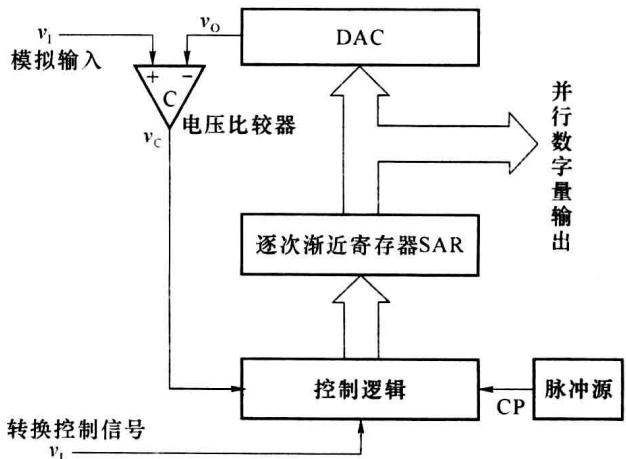  

图9.2.8 逐次渐进型ADC原理框图

换的电压 $v_{I}$ 作比较，基准电压由逐次渐进寄存器中的数字量经 DAC 转换产生。转换开始前先将逐次渐进寄存器 SAR 清零，开始转换后，在时钟信号的驱动下，首先将 SAR 的最高位置成 1，使其输出为 $100\cdots00$ ，这个数字量被 DAC 转换成相应的模拟电压 $v_{0}$ ，送到电压比较器 C 与输入信号 $v_{I}$ 进行比较。如果 $v_{0}>v_{I}$ ，说明输入信号还不够大，这时应将该位从 1 改为 0；如果 $v_{0}<v_{I}$ ，则保留该位 1 不变。然后再按同样的方法将 SAR 的次高位置成 1，并比较 $v_{0}$ 与 $v_{I}$ 的大小以确定这一位的 1 是否应保留。这一过程从高位到低位逐位进行，依次确定 SAR 中各位数码是 1 还是 0，直到最低位操作完为止，此时逐次渐进寄存器 SAR 中的数值就是所转换的数字量。

上述比较过程类似于用天平去称一个物体的质量。为了快速、精确地称得物体的质量，先放一个大约物体质量一半的砝码，然后根据指针的摆动情况决定是否保留该砝码，之后增减的砝码都是当前砝码质量的一半。

下面再结合图 9.2.9 所示的逻辑电路说明逐次渐进的比较过程。这是一个 3 位逐次渐近型 A/D 转换电路，触发器 $F_{A} \sim F_{C}$ 组成 3 位逐次渐进寄存器，触发器 $FF_{1} \sim FF_{5}$ 和门电路 $G_{1} \sim G_{6}$ 组成控制逻辑， $FF_{1} \sim FF_{5}$ 组成环形移位寄存器实现 5 节拍脉冲发生器，C 为电压比较器。

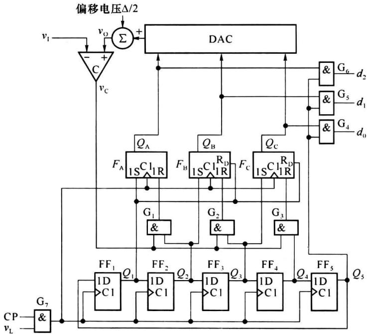  

图 9.2.9 3 位逐次渐进型 ADC 的电路原理图

转换开始前先复位逐次渐进寄存器 $Q_{A}Q_{B}Q_{C}=000$ 、环形移位寄存器 $Q_{1}Q_{2}Q_{3}Q_{4}Q_{5}=10000$ 。

启动转换, 转换控制信号 $v_{L}$ 变成高电平。第 1 个时钟脉冲 CP 到达后, $F_{A}F_{B}F_{C}$ 被置成 100, 这时加在 DAC 输入端的数码 $Q_{A}Q_{B}Q_{C}=100$ 。DAC 的输出电压 $v_{O}$ 与 $v_{I}$ 在电压比较器 C 中进行比较, 若 $v_{I}\geqslant v_{O}$ , 比较器输出 $v_{C}=0$ ; 若 $v_{I}<v_{O}$ , 则 $v_{C}=1$ , 同时移位寄存器右移一位, 使 $Q_{1}Q_{2}Q_{3}Q_{4}Q_{5}=01000$ 。

第 2 个时钟脉冲 CP 到来时， $Q_{2}=1$ ，控制门 $G_{1}$ 被打开。若原来比较器输出 $v_{C}=1$ ，则 $F_{A}$ 被置成 0；若原来的 $v_{C}=0$ ，则 $F_{A}$ 中的 1 状态保留，与此同时 $F_{B}$ 被置成 1，移位寄存器再次右移一位，使 $Q_{1}Q_{2}Q_{3}Q_{4}Q_{5}=00100$ 。

第 3 个时钟脉冲 CP 到来时, $Q_{3}=1$ , 它一方面将控制门 $G_{2}$ 打开, 并根据比较器 C 的输出决定 $F_{B}$ 的状态 1 是否保留; 另一方面将 $F_{C}$ 置 1, 同时移位寄存器右移一位, 使 $Q_{1}Q_{2}Q_{3}Q_{4}Q_{5}=00010$ 。

第 4 个时钟脉冲 CP 到来时，同样根据 $v_{C}$ 的状态决定 $F_{C}$ 的 1 是否保留，这时触发器 $F_{A} \sim F_{C}$ 的状态 $Q_{A}Q_{B}Q_{C}$ 就是所要的转换结果。同时移位寄存器右移一位， $Q_{1}Q_{2}Q_{3}Q_{4}Q_{5} = 00001$ 。由于 $Q_{5} = 1$ ，门 $G_{4} \sim G_{6}$ 被打开，于是转换结果 $Q_{A}Q_{B}Q_{C}$ 便通过门 $G_{4} \sim G_{6}$ 送到输出端，由 $d_{2}d_{1}d_{0}$ 输出。

第 5 个时钟脉冲 CP 到来后, 移位寄存器右移一位, 使 $Q_{1}Q_{2}Q_{3}Q_{4}Q_{5}=10000$ , 返回到初始状态。同时, 由于 $Q_{5}=0$ , 门 $G_{4}\sim G_{6}$ 被封锁。

为了减小量化误差, 令 DAC 输出的模拟量产生 $-\Delta / 2$ 的偏移。这里的 $\Delta$ 表示当 DAC 输入数字量只有最低位为 1 时所产生的模拟电压值, 即模拟电压的量化单位。由图 9.2.4(b) 可知, 为使量化误差不大于 $\Delta / 2$ , 在划分量化电平等级时应使第一个量化电平为 $\Delta / 2$ , 而不是 $\Delta$ 。电路中每次与 $v_{1}$ 比较的量化电平都是由 DAC 输出的, 所以只要将 DAC 输出的比较电平负向偏移 $\Delta / 2$ , 即可实现“有舍有人”的量化方法。

从这个例子可以看出,3位逐次渐进型 ADC 完成一次转换需要 5 个时钟周期的时间。如果是 n 位输出的 ADC,则完成一次转换所需的时间将为 $n+2$ 个时钟周期。因此,它的转换速度比并行比较型 ADC 低,但比计数型 ADC 要高很多。例如,10 位计数型 ADC 完成一次模数转换的最长时间可达时钟周期 $(2^{10}-1)$ 倍,而 10 位逐次渐近型 ADC 完成一次转换仅需要 12 个时钟周期。当输出数字量位数较多时,逐次渐近型 ADC 的电路规模要比并行比较型小得多。因此,逐次渐近型 ADC 是目前集成 ADC 产品中用得最多的一种电路。

## 9.2.5 双积分型 ADC

双积分 ADC 是一种间接转换型 ADC, 间接转换型 ADC 可分为电压-时间变换型(简称 V-T 变换型)和电压-频率变换型(简称 V-F 变换型)两类。

在 V-T 变换型 ADC 中用得最多的就是双积分型 ADC, 它的转换原理是先将输入模拟量转换成与之对应的时间间隔, 再在该时间内用固定频率的计数器计数, 计数器所计得的数字量正比于输入模拟量。

图 9.2.10 是双积分型 ADC 电路的原理图, 它由积分器 $A_{1}$ 、过零比较器 $A_{2}$ 、计数器、控制逻辑和时钟信号源等几部分组成。下面讨论这种 ADC 的工作过程和特点。

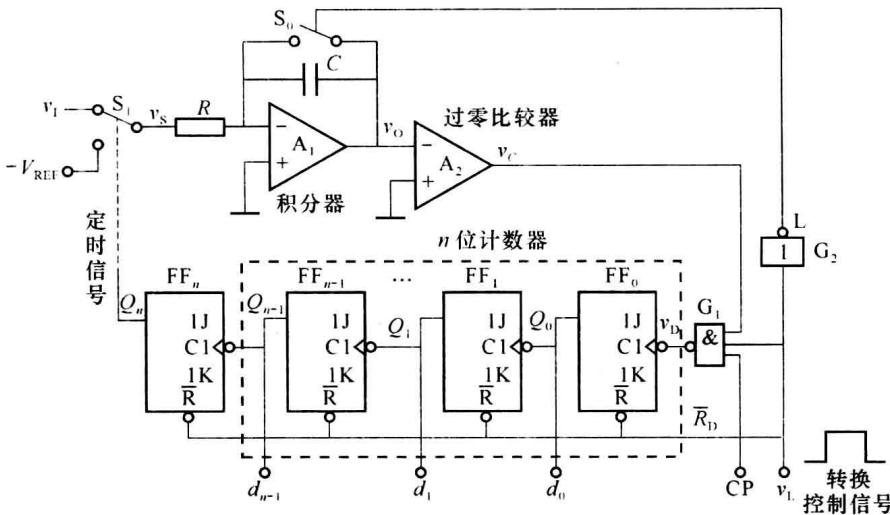  

图9.2.10 双积分型ADC原理图

积分器是电路的核心部分,开关 $S_{1}$ 由定时信号 $Q_{n}$ 控制,使极性相反的输入电压 $v_{I}$ 和参考电压 $-V_{REF}$ 分别加到积分器的输入端,进行两次方向相反的积分,积分时间常数为 RC。

过零比较器 $A_{2}$ 用来确定积分输出电压 $v_{0}$ 的过零时刻。当 $v_{0} \geqslant 0$ 时，比较器 $A_{2}$ 输出低电平；当 $v_{0} < 0$ 时，比较器 $A_{2}$ 输出高电平。比较器 $A_{2}$ 的输出接至时钟控制门 $G_{1}$ ，控制 n 位计数器的时钟信号 CP。

n 位计数器由触发器 $FF_{0} \sim FF_{n-1}$ 组成，用来对输入时钟脉冲 CP 进行计数，并负责把与输入电压平均值成正比的时间间隔转换成相应的数字量。启动转换后， $v_{I}$ 接入到积分器，计数器从 0 开始计数，计数到 $2^{n}$ 个时钟脉冲时，计数器回到 0 状态，使 $FF_{n}$ 翻转为 1 状态， $Q_{n}=1$ 将使开关 $S_{1}$ 从 $v_{I}$ 转接到 $-V_{REF}$ ，开始反向积分。

时钟控制门 $G_{1}$ 控制时钟脉冲 CP 的接入，时钟脉冲 CP 的周期为 $T_{C}$ 。当转换控制信号 $v_{L}=1$ 时，门 $G_{1}$ 打开，时钟脉冲通过门 $G_{1}$ 加到触发器 $FF_{0}$ 的输入端。

下面以输入正极性直流电压 $v_{i}$ 为例,说明双积分型 ADC 将模拟电压转换为数字量的基本原理,转换过程分为如下几个阶段。

### (1) 准备阶段

转换开始前,令转换控制信号 $v_{L}=0$ , 将 n 位计数器清零, 并接通开关 $S_{0}$ , 使积分电容 C 完全放电。

### (2) 第一次积分阶段

该阶段对输入信号 $v_{I}$ 进行固定时间的积分。在 t=0 时刻，控制信号 $v_{L}=1$ 启动转换，同时开关 $S_{0}$ 断开， $S_{1}$ 与输入信号 $v_{I}$ 相连，积分器从 0 开始对 $v_{I}$ 进行积分，输出电压 $v_{0}$ 直线下降，如图 9.2.11 所示。积分器的输出电压 $v_{0}$ 可由下式计算

$$

v _ {0} = - \frac {1}{R C} \int_ {0} ^ {t _ {1}} v _ {1} d t = - \frac {t _ {1}}{R C} v _ {1}\tag{9.2.3}

$$

其中， $t_{1}$ 是第一次积分的时间。

由于 $v_{0}<0$ ，过零比较器 $A_{2}$ 输出高电平，将门 $G_{1}$ 打开，计数器在时钟信号 CP 的作用下从 0 开始计数。当计数器计满 $2^{n}$ 个时钟脉冲后，自动返回到全 0 状态。此时 $Q_{n-1}$ 的下降沿使 $\mathrm{FF}_n$ 置1，即 $Q_{n} = 1$ ，开关 $\mathbf{S}_1$ 由 $v_{1}$ 转接到一 $V_{\mathrm{REF}}$ 点，第一次积分结束。第一次积分时间

$$

t _ {1} = T _ {1} = 2 ^ {n} T _ {\mathrm{C}}\tag{9.2.4}

$$

在 $T_{1}$ 时间内 $v_{1}$ 为常量，把式(9.2.4)代入式(9.2.3)可得第一次积分结束时积分器的输出电压

$$

v _ {0 1} = - \frac {T _ {1}}{R C} v _ {1} = - \frac {2 ^ {n} T _ {\mathrm{c}}}{R C} v _ {1}\tag{9.2.5}

$$

### (3) 第二次积分阶段

该阶段将 $v_{01}$ 转换成与之成正比的时间间隔 $T_{2}$ ，并用计数器累计在 $T_{2}$ 期间的时钟脉冲个数。在 $t=t_{1}$ 时刻，开关 $S_{1}$ 由 $v_{1}$ 转接到 $-V_{REF}$ ，积分器开始反向积分，到 $t=t_{2}$ 时刻，积分器的输出电压 $v_{0}$ 回到 0 V，比较器 $A_{2}$ 的输出变为低电平，将门 $G_{1}$ 关闭，计数停止。在此阶段结束时 $v_{0}$ 的表达式可写为

$$

v _ {0} = v _ {0 1} - \frac {1}{R C} \int_ {t _ {1}} ^ {t _ {2}} (- V _ {\mathrm{REF}}) \mathrm{d} t = 0\tag{9.2.6}

$$

设 $T_{2}=t_{2}-t_{1}$ ，把式(9.2.5)代入式(9.2.6)，可得

$$

\frac {2 ^ {n} T _ {\mathrm{c}}}{R C} v _ {1} = \frac {T _ {2}}{R C} V _ {\mathrm{REF}}

$$

即

$$

T _ {2} = \frac {2 ^ {n} T _ {\mathrm{C}}}{V _ {\mathrm{REF}}} v _ {\mathrm{I}}\tag{9.2.7}

$$

设在 $T_{2}$ 期间计数器所累计的时钟脉冲个数为 $\lambda$ ，则

$$

T _ {2} = \lambda T _ {\mathrm{c}} = \frac {2 ^ {n} T _ {\mathrm{c}}}{V _ {\mathrm{REF}}} v _ {\mathrm{I}}

$$

整理得

$$

\lambda = \frac {T _ {2}}{T _ {\mathrm{C}}} = \frac {2 ^ {n}}{V _ {\mathrm{REF}}} v _ {\mathrm{I}}\tag{9.2.8}

$$

式(9.2.8)表明,计数器中所计得的数 $\lambda$ 与输入电压值 $v_{1}$ 成正比,只要 $v_{1}<V_{REF}$ ,转换器就能正常将输入模拟电压转换为数字量,并能从计数器中读取转换结果。如果取 $V_{REF}=2^{n}V$ ,则 $\lambda=v_{1}$ ,计数器所计的数在数值上就等于被测电压。

从图 9.2.11 所示的电压波形图上还可以看出，当 $v_{I}$ 取两个不同的数值 $V_{II}$ 和 $V_{I2}$ 时，反向积分的时间 $T_{2}$ 和 $T_{2}^{\prime}$ 也不相同，而且时间的长短与 $v_{I}$ 的值成正比。由于 CP 是固定频率的时钟脉冲，所以在 $T_{2}$ 和 $T_{2}^{\prime}$ 期间送给计数器的计数脉冲数目 $\lambda$ 也必然与 $v_{I}$ 成正比。

双积分型 ADC 最突出的优点就是工作稳定性好。由式(9.2.7)可知，由于转换过程中先后进行了两次积分，抵消了时间常数 RC 的作用，转换结果与 RC 无关。因此参数 R、C 的缓慢变化不影响电路的转换精度，电路也不要求 R、C 的数值十分精确。此外，式(9.2.8)还说明，在取 $T_{2}=\lambda T_{c}$ 的情况下，转换结果与时钟信号周期无关。即使时钟信号随环境温度的改变而缓慢变化，只要保证每次转换过程中 $T_{c}$ 不变，那么时钟周期的缓慢变化也不会带来转换误差。因此，完全可以用精度比较低的元器件制成精度很高的双积分型 ADC。

双积分型 ADC 的另一个优点是抗干扰能力比较强。因为转换器的输入端使用了积分器，所以对平均值为零的各种噪声有很强的抑制能力。当积分时间等于交流电网电压周期的整数倍时，还能有效地抑制来自电网的工频干扰。

双积分型 ADC 的主要缺点是工作速度低。由图 9.2.11 可以看出，每完成一次转换的时间不小于 $T_{1} + T_{2}$ 。如果再加上转换前的准备时间（积分电容放电及计数器复位所需要的时间）和输出转换结果的时间，则完成一次转换所需的时间还要长一些。双积分型 ADC 的转换速度一般都在每秒几十次以内。尽管如此，在对转换速度要求不高的场合，如数字式电压表等，双积分型 ADC 的应用仍然非常广泛。

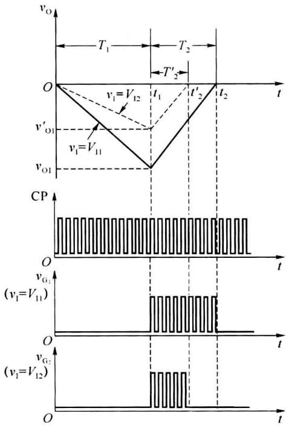  

图9.2.11 双积分型ADC的电压波形图

现在市场上有多种单片集成双积分型 ADC, 只需外接少量的电阻和电容元件, 就能很方便地接成各种 A/D 转换器, 并且可以直接驱动 LCD 或 LED 数码管。例如 CC14433、CB7106/7126 等都属于这类器件。为了能直接驱动数码管, 在这些集成电路的输出部分都设有数据锁存器和译码、驱动电路。为了便于驱动二-十进制译码器, 计数器都采用二-十进制接法。为了提高电路的输入阻抗, 在芯片的模拟信号输入端还都设置了输入缓冲器。同时, 集成电路内部还设有自动调零电路, 以消除比较器和放大器的零点漂移和失调电压, 保证零输入时零输出。

## \* 9.2.6 V-F 变换型 ADC

电压-频率变换型 ADC 也是一种间接转换型 ADC, 简称 V-F 变换型 ADC, 它先将输入模拟量转换为与之成比例的频率信号, 再在固定的时间内对该频率信号进行计数, 所得到的计数结果就是正比于输入模拟量的数字量。

V-F 变换型 ADC 的原理电路如图 9.2.12 所示, 由压控振荡器 VCO、计数器、寄存器及时钟控制门 G 等几部分组成。压控振荡器 VCO 输出的脉冲信号频率 $f_{\mathrm{out}}$ 受输入模拟电压 $v_{\mathrm{I}}$ 的控制, 且在一定的范围内 $f_{\mathrm{out}}$ 与 $v_{\mathrm{I}}$ 之间成线性关系。

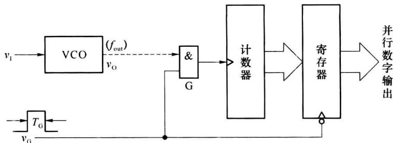  

图 9.2.12 V-F 变换型 ADC

转换过程由信号 $v_{G}$ 控制。当 $v_{G}$ 变成高电平后，时钟控制门 G 被打开，允许 VCO 的输出脉冲通过，驱动计数器从零开始计数。由于 $v_{G}$ 是宽度为 $T_{G}$ 的脉冲信号，所以在 $T_{G}$ 时间里通过门 G 的脉冲数与 $f_{out}$ 成正比，也与 $v_{I}$ 成正比。因此，每个 $v_{G}$ 周期结束时计数器里的数字量就是所需要的转换结果。

考虑到在转换过程中计数器实现加计数,其输出不断发生变化,通常在电路的输出端设有输出寄存器。当转换结束时,用 $v_{G}$ 的下降沿将计数器的状态置入输出寄存器中。

压控振荡器 VCO 的输出信号是一种调频信号,有较强的抗干扰能力,所以 V-F 变换型 ADC 非常适用于遥测、遥控系统中。当需要远距离传输模拟信号时,可以将 VCO 设置在信号的发送端,而将计数器及其时钟控制门、寄存器等设置在接收端。

V-F 变换型 ADC 的转换精度取决于 V-F 变换的精度和计数器的计数容量。V-F 变换的精度受 VCO 的线性度和稳定度的限制，除精密 V-F 变换电路以外，它们的线性误差都比较大，所以用普通的 VCO 很难构成高精度的 A/D 转换器。计数器的计数容量也影响转换精度，计数容量越大，转换误差越小。

V-F 变换型 ADC 的缺点是转换速度比较低。计数器要在 $T_{G}$ 时间内计数，计数脉冲的频率一般不是很高，为保证转换精度又要求计数器的容量足够大，所以计数时间势必较长，转换速度相对较慢。

## \* 9.2.7 串行输出 ADC

前面讲过的 ADC 都是采用并行输出方式,有时候为了减少信号线的数目,希望 ADC 输出的数字量能以串行方式输出,串行输出 ADC 就可以满足这种要求。

在并行输出 ADC 的基础上增加一个数据并-串转换电路, 就可以实现串行输出 ADC。图 9.2.13 给出了一种在逐次渐进型 ADC 的基础上稍加修改而成的串行输出 ADC 的原理图, 它将图 9.2.8 中的逐次渐近寄存器换成了可预置状态的逐次渐近移位寄存器。启动 A/D 转换后, EOC 变为低电平, 门 G 被封锁; 转换结束后, EOC 变成高电平, 逐次渐近移位寄存器中的数据在串行时钟 SCP 的作用下从 SDO1 端逐位输出。

为了提高工作速度,可以使 A/D 转换和数据输出同时进行。在控制逻辑决定逐次渐近寄存器中每位触发器状态的同时,也将输出端的触发器 $FF_{out}$ 置成同样的状态,这样就可以实现在 A/D 转换的同时,将数字量从 SDO2 端串行输出。

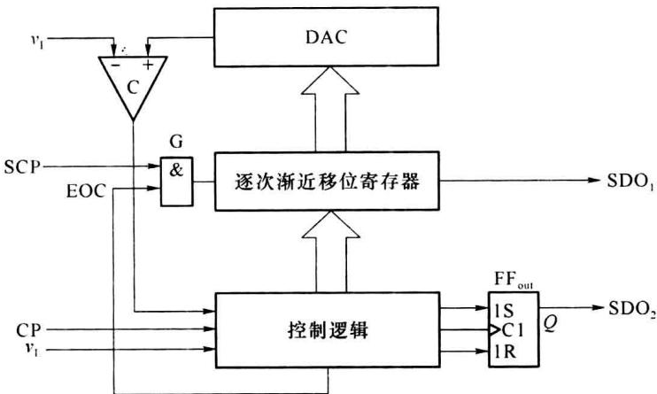  

图9.2.13 串行输出ADC原理图

## 9.2.8 ADC的主要技术指标

ADC 的主要技术指标有转换精度、转换速度等,选择 ADC 时除考虑这两项技术指标外,还应该注意输入电压的范围、输出数字的编码形式、工作温度范围和电压稳定度等方面的要求。

### 1. 转换精度

单片集成 ADC 用分辨率和转换误差来描述转换精度。

### (1) 分辨率

分辨率表示 ADC 对输入信号的分辨能力, 通常以输出二进制或十进制码的位数表示。ADC 的输出数字量位数越多, 量化单位越小, 对输入信号的分辨能力就越高。例如输入模拟电压满量程为 $10 \mathrm{~V}$ 时, 8 位 ADC 可以分辨的最小电压是 $10 / 2^{8} = 39.06 \mathrm{mV}$ , 而 10 位 ADC 可以分辨的最小电压是 $10 / 2^{10} = 9.76 \mathrm{mV}$ , 可见 ADC 的位数越多, 它的分辨率越高。

### (2) 转换误差

转换误差也称为相对误差或相对精度,表示 ADC 实际输出的数字量和理论输出的数字量之间的差值。这个差值不是一个常数,是在一个范围之内。转换误差通常指输出误差的最大值,常用最低有效位的倍数表示或满量程输出的百分数表示。例如,转换误差 $\leqslant\pm\frac{1}{2}$ LSB 表示实际输出数字量和理论输出数字量之间的误差小于最低有效位的一半。

需注意的是,手册上给出的转换误差都是在一定电源电压和环境温度下测得的数据,如果这些条件改变了,将引起附加的转换误差。例如10位A/D转换器AD571在室温和标准电源电压下转换误差 $\leqslant\pm\frac{1}{2}$ LSB,而当环境温度、电源电压变化时能产生 $\pm1$ LSB的附加误差。因此,为获得较高的转换精度,必须保证供电电源和参考电压有很好的稳定度,并保证环境温度基本恒定。

### 2. 转换速度

转换速度是转换时间的倒数,转换时间是指完成一次 A/D 转换所需要的时间,即 ADC 从转换开始到输出端得到稳定的数字量所经历的时间。

ADC 的转换速度主要取决于转换电路的类型,并行比较型 ADC 的转换速度最高(转换时间可小于 50ns)，逐次渐近型 ADC 次之（转换时间在 10～100 μs），双积分型 ADC 的转换速度较低（转换时间在几十毫秒至几百毫秒之间）。

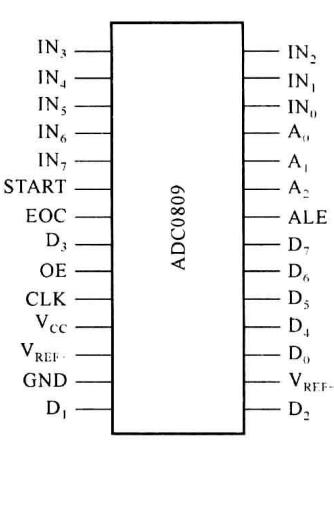  

(a) 逻辑框图

实际应用中,要从系统数据总线的位数、精度要求、输入模拟信号的范围和极性等方面综合考虑选择合适的 ADC。在需要实现高速 A/D 转换的电路中,还应该将采样-保持电路的获取时间(采样信号稳定所需要的时间)计入转换时间之内,一般单片集成采样-保持电路的获取时间在微秒数量级。

## 9.2.9 集成 ADC 及其应用

### 1. 集成A/D转换器ADC0809

ADC0809 是美国 NSC 公司生产的 8 位逐次渐进型 ADC, 采用 CMOS 工艺, 逻辑电平与 TTL 电平兼容。图 9.2.14(a) 是它的逻辑框图, 由 8 通道模拟开关、地址锁存译码器、D/A 转换器、三态输出锁存缓冲器 4 部分组成, 图 9.2.14(b) 是其管脚排列图。

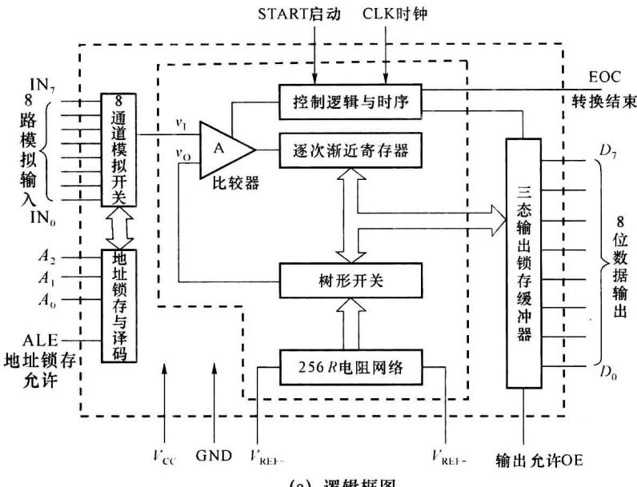  

图 9.2.14 ADC0809 逻辑框图与管脚排列图

ADC0809 的引脚名称和功能如下：

$IN_{7}\sim IN_{0}:8$ 通道模拟信号输入端，此端的信号一般来自外部设备或生产现场，通常取 $0\sim5V$ 。

$A_{2}\sim A_{0}$ : 通道地址选择输入端。当 $A_{2}\sim A_{0}$ 取不同的逻辑电平时，经内部译码电路从 $IN_{7}\sim IN_{0}$ 中选择一个通道，各通道的地址关系如表 9.2.2 所示。

表 9.2.2 ADC0809 地址线选中通道表

<table><tr><td> $A_{2}$ </td><td> $A_{1}$ </td><td> $A_{0}$ </td><td>模拟量输入通道</td></tr><tr><td>0</td><td>0</td><td>0</td><td> $IN_{0}$ </td></tr><tr><td>0</td><td>0</td><td>1</td><td> $IN_{1}$ </td></tr><tr><td>0</td><td>1</td><td>0</td><td> $IN_{2}$ </td></tr><tr><td>0</td><td>1</td><td>1</td><td> $IN_{3}$ </td></tr><tr><td>1</td><td>0</td><td>0</td><td> $IN_{4}$ </td></tr><tr><td>1</td><td>0</td><td>1</td><td> $IN_{5}$ </td></tr><tr><td>1</td><td>1</td><td>0</td><td> $IN_{6}$ </td></tr><tr><td>1</td><td>1</td><td>1</td><td> $IN_{7}$ </td></tr></table>

ALE: 地址锁存允许输入端, 高电平有效。只有当该输入端信号有效时, 才将地址信号 $A_{2}A_{1}A_{0}$ 锁存, 并经译码选中一个通道。

START: 启动脉冲信号输入端。输入信号的上升沿将逐次渐进寄存器清零, 下降沿启动模数转换。

$D_{7}\sim D_{0}$ : 三态缓冲器输出端, 其中 $D_{7}$ 为高位。

CLK: 时钟脉冲输入端, 驱动控制电路与时序电路工作。

EOC: 转换结束信号输出端, 高电平有效。在 START 上升沿之后, 经 1\~8 个时钟周期, EOC 信号变为低电平, 表示正在进行 A/D 转换。当转换结束后, EOC 变为高电平, 以此通知接收数据的设备, 读取转换后的数据。

OE: 输出允许控制端, 高电平有效。当输入为高电平时打开三态输出锁存缓冲器, 将转换结果送至数据线 $D_{7} \sim D_{0}$ 。

$V_{REF+}$ 、 $V_{REF-}$ ：参考电压源的正极和负极。

ADC0809 有 8 个模拟信号输入端 IN $_{7}$ ～IN $_{0}$ ，可以处理来自 8 个不同信号源的模拟信号，但某一时刻只能对某一路模拟信号进行 A/D 转换，这种功能是由 8 通道模拟开关和地址锁存译码器共同完成的。地址锁存器将通道地址锁存后经译码来控制 8 通道模拟开关，将选中通道的模拟信号送至 A/D 转换器进行模数转换。

ADC0809 的模数转换电路采用逐次渐近型的 A/D 转换电路，其 D/A 转换部分由树形开关和 256R 电阻网络构成。树形开关受逐次渐进寄存器 SAR 的控制，8 位 SAR 有 256 种输出状态，每一种输出状态控制树形开关选择一个与其对应的量化电平输出。这样，256R 电阻网络与树形开关相配合，就能产生与 SAR 中二进制数字量相应的反馈模拟电压 $v_{0}$ 。该反馈电压加至比较器 A 的输入端，与输入模拟电压 $v_{1}$ 进行比较。根据比较的结果改变 SAR 的状态，进而控制树形开关选择新的量化电平，并在比较器中与输入模拟电压 $v_{1}$ 再进行比较。如此继续下去，直到转换过程结束为止。现以 2 位数字量为例说明其工作过程，图 9.2.15 给出了相应的电阻网络与树形开关。

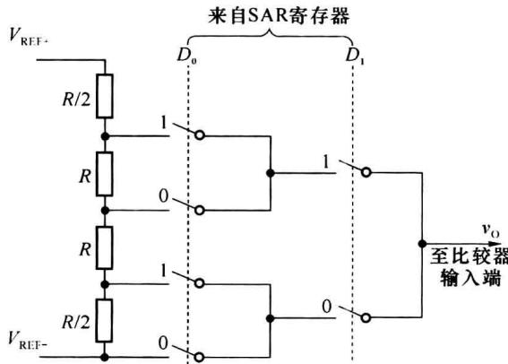  

图 9.2.15 电阻网络与树形开关示意图

在图 9.2.15 中，输出电压 $v_{0}$ 由参考电压 $(V_{\mathrm{REF}+}, V_{\mathrm{REF}-})$ 和树形开关中各开关的状态决定。开关的状态取决于 SAR 中 $D_{1}D_{0}$ 的状态。当 $D_{0}=1$ 时， $D_{0}$ 列所有标“1”的开关均闭合；当 $D_{0}=0$ 时，所有标“0”的开关均闭合，对 $D_{1}$ 也如此。设 $V_{REF+}=3V, V_{REF-}=0V$ ，数字量转换成模拟量的对应关系如表 9.2.3 所示。由此可见，电阻网络与树形开关相配合实现了一个 D/A 转换器。

表 9.2.3 数字量和模拟量对应关系

<table><tr><td> $D_1$ </td><td> $D_0$ </td><td> $v_{O}/V$ </td></tr><tr><td>0</td><td>0</td><td>0</td></tr><tr><td>0</td><td>1</td><td>0.5</td></tr><tr><td>1</td><td>0</td><td>1.5</td></tr><tr><td>1</td><td>1</td><td>2.5</td></tr></table>

A/D 转换结束后,转换结果送至三态输出锁存器。外部设备需要读取数据时,将器件的 OE 端拉高,选通输出缓冲器,即可将转换结果送出。因此 ADC0809 可以直接与 MCS51、PIC 等单片机相连,不需要另加接口逻辑。

## \* 2. 双积分型集成 A/D 转换器 CC14433

CC14433 是采用 CMOS 工艺制作的双积分型 ADC, 广泛应用于数字电压表、数字温度计和各种低速数据采集系统中。CC14433 将积分模拟电路和控制数字电路集成在同一芯片上, 使用简单灵活, 只需外接两个电阻和两个电容, 即可组成具有自动调零和自动极性转换功能的 $3 \frac{1}{2}$ 位 A/D 转换系统。

### (1) 逻辑框图

CC14433 的逻辑框图如图 9.2.16(a) 所示, 它主要由以下几部分组成。

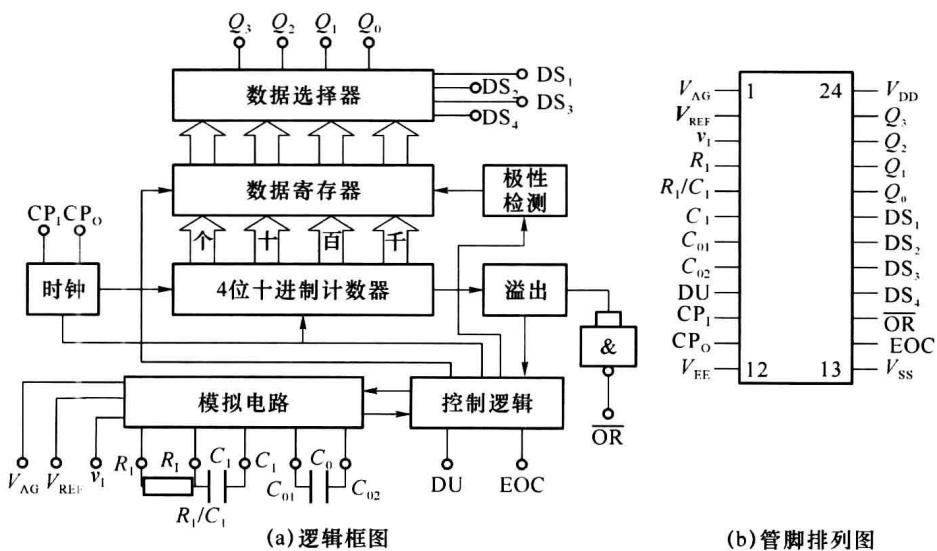  

图 9.2.16 CC14433 逻辑框图与管脚排列图  

模拟电路: 包括构成积分器的运算放大器和过零比较器。

4 位十进制计数器: 个位、十位、百位都为 8421BCD 码, 千位只能表示 0、1 两个数码, 所

以它的最大计数值为 1999。故称它为 $3\frac{1}{2}$ 位 ADC。

数据寄存器:存放由计数器输出的 A/D 转换结果。

数据选择器:在控制逻辑的作用下,逐位输出数据寄存器中存储的8421BCD码。

控制逻辑:产生控制信号,以协调各部分的工作,如极性判别控制、数据寄存控制等。

时钟电路: 产生计数脉冲。

### (2) 引出端说明

CC14433 为双列直插式封装, 共有 24 个引出端, 管脚排列如图 9.2.19(b) 所示, 管脚介绍如下。

$v_{1}$ 为模拟电压输入端； $V_{REF}$ 为基准电压输入端； $V_{AG}$ 为模拟地输入端，作为输入模拟电压和基准电压的接地参考点。 $V_{DD}$ 为正电源输入端， $V_{EE}$ 为负电源输入端， $V_{SS}$ 为电源公共端。

DU 为实时输出控制端, 若在 DU 端输入一个正脉冲, 则 A/D 转换结果将被送入数据寄存器; EOC 为 A/D 转换结束信号输出端, 转换结束后 EOC 端输出一个正脉冲, 宽度为时钟周期的一半。在使用中可以将 DU 和 EOC 端短接, 使转换结束后的结果直接存入数据寄存器。

$CP_{1}$ 和 $CP_{0}$ 为时钟信号的输入和输出端。可由 $CP_{1}$ 端接入外部时钟脉冲，也可在 $CP_{1}$ 和 $CP_{0}$ 之间接一电阻 $R_{C}$ ，利用片内电路产生时钟脉冲。

$DS_{4}\sim DS_{1}$ 为位选通脉冲输出端。 $DS_{1}$ 对应于千位， $DS_{2}$ 对应于百位， $DS_{3}$ 对应于十位， $DS_{4}$ 对应于个位。

$Q_{3}\sim Q_{0}$ 为数据选择器输出端。输出为 8421BCD 码， $Q_{3}$ 是最高位。在 $DS_{2}$ 、 $DS_{3}$ 、 $DS_{4}$ 选通脉冲期间，输出百位、十位、个位的十进制数；在 $DS_{1}$ 选通脉冲期间，输出千位的 0 或 1，以及过量程、欠量程和被测电压极性标志信号。

$\overline{OR}$ 为溢出信号输出端。当 $\left|v_{I}\right|>V_{REF}$ 时， $\overline{OR}$ 输出低电平。

引脚 $R_{1}$ 、 $R_{1}/C_{1}$ 和 $C_{1}$ 为积分电阻 $R_{1}$ 、电容 $C_{1}$ 的接线端； $C_{01}$ 、 $C_{02}$ 为失调电压补偿电容 $C_{0}$ 的接线端。

### (3) 应用举例

图 9.2.17 是 $3 \frac{1}{2}$ 位数字电压表的电路原理图，共用了 4 个集成电路芯片和 1 个由七段数码管组成的 LED 显示器。利用 CC14433 功耗低、抗干扰能力强、稳定度高、自动调零、自动极性转换等特点，可测量正负电压值。当 $CP_{1}$ 和 $CP_{0}$ 端接入 $470 \, k\Omega$ 电阻时，时钟频率约为 $66 \, kHz$ ，每秒钟可进行 4 次 A/D 转换，下面分析电路的工作原理。

A/D 转换需要外基准电压源, 基准电压源的精度应当高于 A/D 转换器的精度。本例采用 MC1403 集成精密稳压源作基准电压源电路, 为 A/D 转换提供稳定的基准电压。MC1403 的引脚排列如图 9.2.18 所示, 输出电压为 2.5 V, 输出最大电流为 10 mA。当输入电压在 4.5\~15 V 范围内变化时, 输出电压的变化一般只有 0.6 mV 左右。在图 9.2.17 中, 调节 1 kΩ 电阻, 可以获得所需的基准电压值, 本例设 $V_{REF} = 2 V$ , 则满量程显示 1.999 V。

CC4511 用做译码驱动器。它将数据选择器 $Q_{3}Q_{2}Q_{1}Q_{0}$ 输出的 8421BCD 码译码后，由 a、b、…、f、g 端输出，经限流电阻分别连接七段显示数码管的 7 个输入端。千位数码管只有 b、c 两根线与 CC4511 的 b、c 端相接，所以千位只能显示 1 或者不显示。千位数码管的 g 端与 CC14433 的 $Q_{2}$ 端相连，用于显示模拟量的负值（正值不显示）。

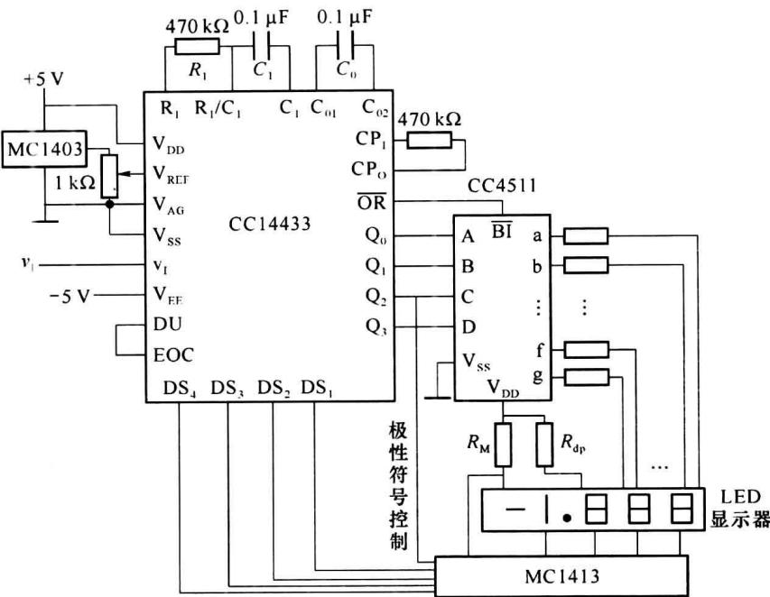  

图 9.2.17 由 CC14433 构成的数字电压表原理图

MC1413(或 UNL2003)为七路达林顿管驱动器,用做位选开关,分别驱动 4 个七段显示数码管的公共阴极。MC1413 采用 NPN 达林顿复合晶体管结构,可直接与 MOS 电路相连,有很高的电流增益和很高的输入阻抗,其引脚排列如图 9.2.19 所示。

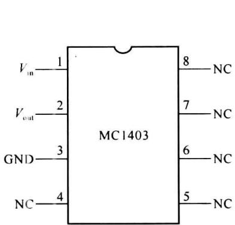  

图 9.2.18 MC1403 引脚排列

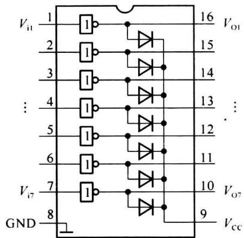  

图 9.2.19 MC1413 引脚排列

下面结合图9.2.16和图9.2.17说明该数字电压表的工作过程。当转换结束时，EOC端输出正脉冲，通过DU端将计数器的计数结果存入数据寄存器，并通过数据选择器的输出端 $Q_{3}Q_{2}Q_{1}Q_{0}$ 依次输出。首先输出千位数据，同时输出千位选通信号 $\mathrm{DS}_1$ ， $Q_{3} = 0$ 表示千位数为 $1;Q_{3} = 1$ 表示千位数为0。 $Q_{2}$ 代表被测电压的极性， $Q_{2} = 1$ 表示被测电压为正电压； $Q_{2} = 0$ 表示被测电压为负电压。 $Q_{3}Q_{2}Q_{1}Q_{0}$ 经CC4511译码后驱动各七段显示数码管，在千位选通信号 $\mathrm{DS}_1$ 的配合下，使千位七段显示数码管发亮，其他3个管都不亮，而且由 $Q_{2}$ 经MC1413驱动符号段，使 $Q_{2} = 0$ 时，符号“一”点亮； $Q_{2} = 1$ 时，“一”熄灭。然后，数据选择器输出百位 8421BCD 码, 同时输出百位选通信号 $\mathrm{DS}_{2}$ , 驱动百位七段显示数码管点亮, 接着是十位、个位分别点亮, 如此使 4 个数码管不断快速循环点亮。这样就把 A/D 转换的结果以扫描形式在 4 只数码管上依次显示出来, 由于重复频率较高, 利用人眼的视觉暂留效应, 即可看到完整的测量结果, 这种显示方法称为动态显示。

在基准电压 $V_{REF}=2V$ 时，测量范围是 $-1.999\sim1.999V$ ，输入电压超出这个范围时，由 $\overline{OR}$ 端的溢出信号控制 CC4511 的 $\overline{BI}$ 端，使所有的七段显示数码管都熄灭。另外，小数点使用 $V_{DD}$ 经电阻 $R_{dp}$ 提供的电流点亮。“一”号是 $V_{DD}$ 经 $R_{M}$ 提供的电流点亮。

本次转换结束、EOC 输出正脉冲后，CC14433 立即自动开始下一次 A/D 转换，首先是对运算放大器自动调零，然后进行两次积分和计数。
