import Guide from '@/components/Guide.astro';
import Knowledge from '@/components/Knowledge.astro';
import Example from '@/components/Example.astro';
import Analysis from '@/components/Analysis.astro';
import Solution from '@/components/Solution.astro';
import Variant from '@/components/Variant.astro';
import Note from '@/components/Note.astro';
import Block from '@/components/Block.astro';
import Method from '@/components/Method.astro';
import Exercise from '@/components/Exercise.astro';

## 习题

<Exercise title="习题 9-1">
设某 8 位 DAC 输出电压范围为 0～10 V, 当输入数字量为 $(10111010)_{2}$ 和 $(01011001)_{2}$ 时, 输出模拟量各为多少伏?
</Exercise>

<Exercise title="习题 9-2">
已知某 DAC 电路满刻度输出电压为 10 V, 要求能分辨的最小模拟电压为 4.9 mV, 试问其输入数字量的位数 n 至少是多少?
</Exercise>

<Exercise title="习题 9-3">
在题图 9.1 所示的权电阻网络 DAC 中, 若取 $R_{F}=R/2, V_{REF}=5\ V$ , 试求当输入数字量为 $(0100)_{2}$ 时输出电压的大小。

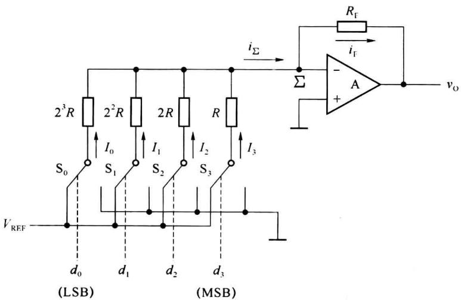  

题图9.1
</Exercise>

<Exercise title="习题 9-4">
某 n 位权电阻网络 DAC 如题图 9.2 所示。

(1) 试推导输出电压 $v_{0}$ 与输入数字量 $d_{n-1}\cdots d_{1}d_{0}$ 的关系。

(2) 若 $n=8, V_{REF}=-10\ V, R_{F}=R/20$ ，当输入数码为 $(26)_{16}$ 时，试求输出电压 $v_{0}$ 的值。

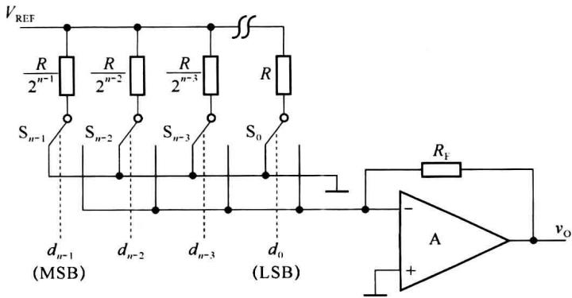  

题图9.2
</Exercise>

<Exercise title="习题 9-5">
某6位T型电阻网络DAC电路题图9.3所示，当 $R_{\mathrm{F}} = 3R, V_{\mathrm{REF}} = 6.3 \mathrm{~V}$ 时，试求：（1）输入数字量 $S = (100000)_2$ 时的输出模拟电压值。

(2) 若输入数字量 S 不变, 各位模拟开关接通时均产生 0.1 V 残余电压, 则输出模拟电压有何变化?

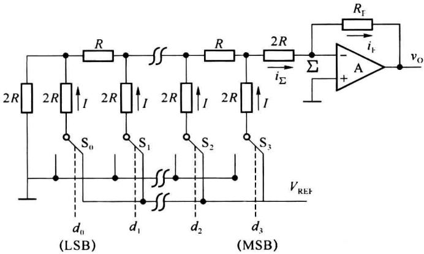  

题图9.3
</Exercise>

<Exercise title="习题 9-6">
在题图 9.4 给出的 4 位倒 T 形电阻网络 DAC 中，设 $V_{REF}=5\ V, R_{F}=R=10\ k\Omega$ ，试求当输入二进制数码分别为 0101、0110、1101 时，输出电压 $v_{0}$ 的大小。

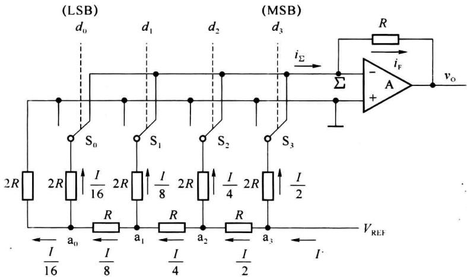  

题图9.4
</Exercise>

<Exercise title="习题 9-7">
题图 9.5 所示的电路为 10 位倒 T 型电阻网络 DAC, 当 $R = R_{F}$ 时, 试求:

(1) 输出电压 $v_{0}$ 的取值范围?

(2) 若输入数字量为 $(200)_{16}$ 时输出电压 $v_{0}=5\ V$ ，参考电压 $V_{REF}$ 应如何取值？

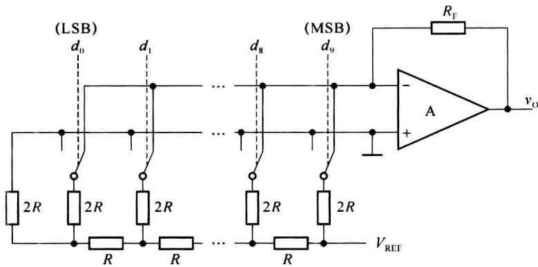  

题图9.5
</Exercise>

<Exercise title="习题 9-8">
题图 9.6 所示的电路是由 10 位 D/A 转换器 AD7520 和同步十六进制计数器 74LS161 组成的波形发生器电路。已知 AD7520 的 $V_{REF} = -10 \, V$ ，试画出输出电压 $v_{0}$ 的波形，并标出波形图上各点电压的幅值。

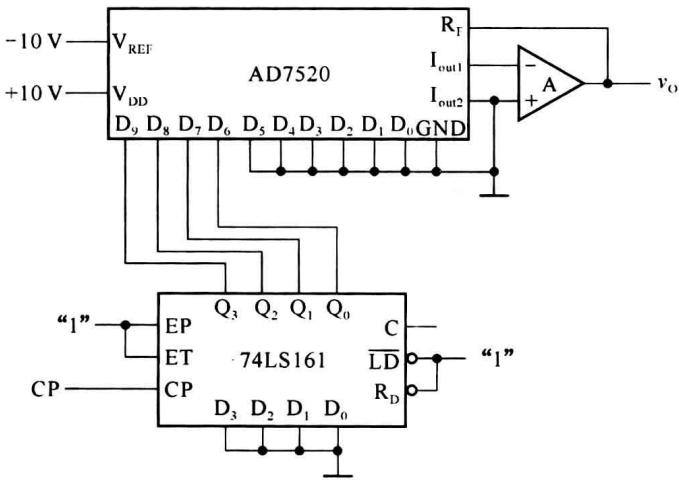  

题图9.6
</Exercise>

<Exercise title="习题 9-9">
在题图 9.7 所示的电路中, AD7520 为 10 位 D/A 转换器, 74LS160 为同步十进制计数器。ROM 存储的数据如题表 9.1 所示, 其中高 6 位地址 $A_{9} \sim A_{4}$ 始终为 0, 在表中没有列出。ROM 的输出数据只用了低 4 位, 作为 AD7520 的输入。试分析电路的功能, 并画出输出电压 $v_{0}$ 的波形图。

题表 9.1 ROM 中的数据

<table><tr><td> $A_3$ </td><td> $A_2$ </td><td> $A_1$ </td><td> $A_0$ </td><td> $D_3$ </td><td> $D_2$ </td><td> $D_1$ </td><td> $D_0$ </td></tr><tr><td>0</td><td>0</td><td>0</td><td>0</td><td>0</td><td>0</td><td>0</td><td>0</td></tr><tr><td>0</td><td>0</td><td>0</td><td>1</td><td>0</td><td>0</td><td>0</td><td>1</td></tr><tr><td>0</td><td>0</td><td>1</td><td>0</td><td>0</td><td>0</td><td>1</td><td>0</td></tr><tr><td>0</td><td>0</td><td>1</td><td>1</td><td>0</td><td>0</td><td>1</td><td>1</td></tr><tr><td>0</td><td>1</td><td>0</td><td>0</td><td>0</td><td>1</td><td>0</td><td>0</td></tr><tr><td>0</td><td>1</td><td>0</td><td>1</td><td>0</td><td>1</td><td>0</td><td>1</td></tr><tr><td>0</td><td>1</td><td>1</td><td>0</td><td>0</td><td>1</td><td>1</td><td>0</td></tr><tr><td>0</td><td>1</td><td>1</td><td>1</td><td>0</td><td>1</td><td>1</td><td>1</td></tr><tr><td>1</td><td>0</td><td>0</td><td>0</td><td>1</td><td>0</td><td>0</td><td>0</td></tr><tr><td>1</td><td>0</td><td>0</td><td>1</td><td>0</td><td>1</td><td>1</td><td>1</td></tr><tr><td>1</td><td>0</td><td>1</td><td>0</td><td>0</td><td>1</td><td>1</td><td>0</td></tr><tr><td>1</td><td>0</td><td>1</td><td>1</td><td>0</td><td>1</td><td>0</td><td>1</td></tr><tr><td>1</td><td>1</td><td>0</td><td>0</td><td>0</td><td>1</td><td>0</td><td>0</td></tr><tr><td>1</td><td>1</td><td>0</td><td>1</td><td>0</td><td>0</td><td>1</td><td>1</td></tr><tr><td>1</td><td>1</td><td>1</td><td>0</td><td>0</td><td>0</td><td>1</td><td>0</td></tr><tr><td>1</td><td>1</td><td>1</td><td>1</td><td>0</td><td>0</td><td>0</td><td>1</td></tr></table>

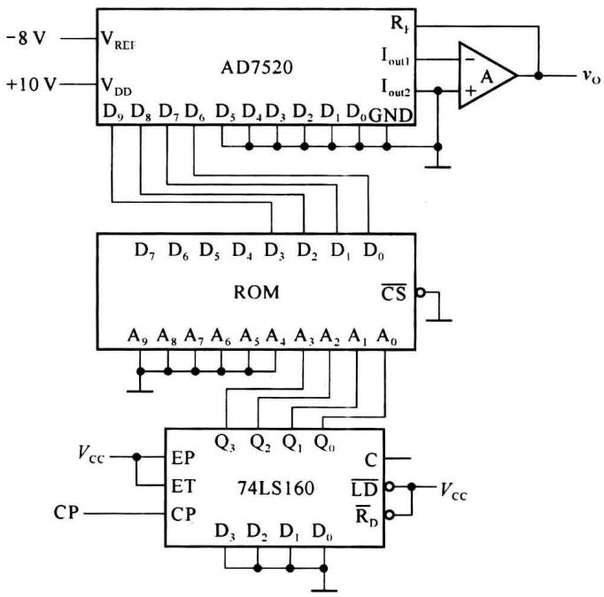  

题图9.7
</Exercise>

<Exercise title="习题 9-10">
题图 9.8 所示电路是用 AD7520 和运算放大器 A 构成的可编程增益放大电路，它的电压增益 $A_{v}=v_{0}/v_{1}$ 由输入数字量 $d_{9}\sim d_{0}$ 来设定，试推导 $A_{v}$ 的表达式，并说明 $A_{v}$ 的取值范围。

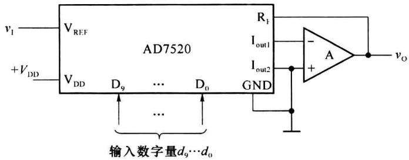  

题图9.8
</Exercise>

<Exercise title="习题 9-11">
实现模数转换一般要经过哪几个过程？按工作原理的不同来分类，A/D转换器可分为哪几类？
</Exercise>

<Exercise title="习题 9-12">
若 ADC(包括取样-保持电路)输入模拟电压信号的最高变化频率为 10 kHz, 试说明取样频率的下限是多少? 完成一次 A/D 转换所用时间的上限是多少?
</Exercise>

<Exercise title="习题 9-13">
什么是量化误差？它是怎样产生的？
</Exercise>

<Exercise title="习题 9-14">
在题图 9.9 所示的并行比较 A/D 转换电路中, 若输入电压 $v_{1}$ 为负电压, 试问电路能否正常进行 A/D 转换? 为什么? 如不能正常工作, 需要如何改进电路?

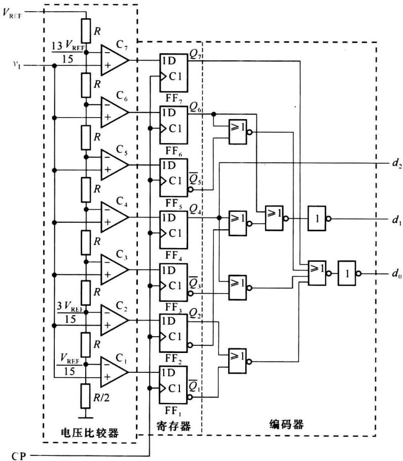  

题图9.9
</Exercise>

<Exercise title="习题 9-15">
在题图 9.9 所示的并行 A/D 转换器中, 若 $V_{REF}=10\ V, v_{1}=9\ V$ , 试求输出数字

量 $d_{2}d_{1}d_{0}$ 的值。
</Exercise>

<Exercise title="习题 9-16">
题图 9.10 所示的电路为并行比较型 ADC，由电阻分压器、比较器、寄存器和编码器组成，采用四舍五入量化方式，试分析电路的工作原理。假设参考电压 $V_{REF} = 7.5 \, V$ ，输入模拟电压 $v_{I}$ 在 $0 \sim 7.5 \, V$ 之间，当 $v_{I} = 4.87 \, V$ 时，其输出数字量为多少？

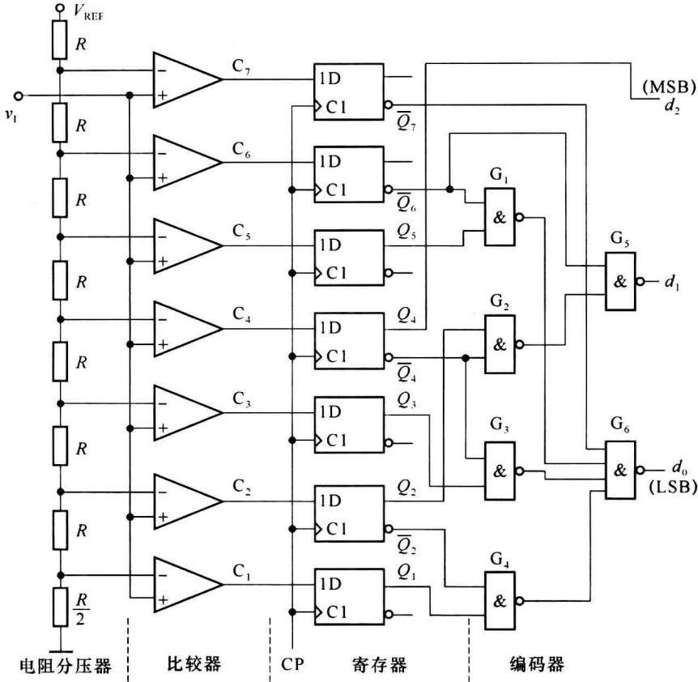  

题图9.10
</Exercise>

<Exercise title="习题 9-17">
某计数型 ADC 的原理图如题图 9.11 所示, 其中 C 为电压比较器, 当 $v_{\mathrm{I}} \geqslant v_{\mathrm{O}}'$ 时, $v_{\mathrm{C}} = 0$ , 试分析其工作原理。

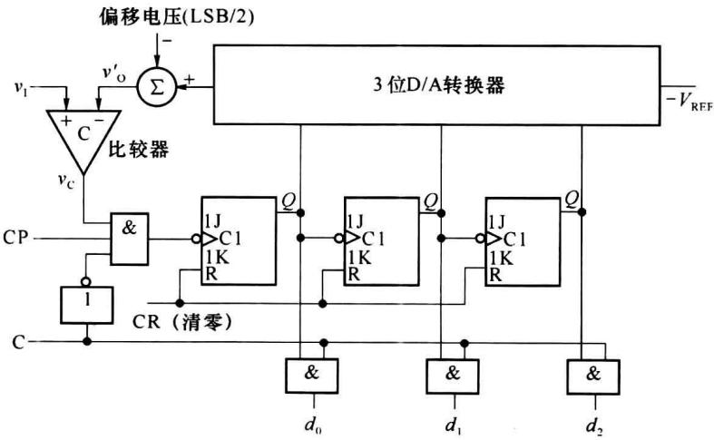  

题图9.11
</Exercise>

<Exercise title="习题 9-18">
在题图 9.12 所示的计数型 ADC 中, 若输出的数字量为 10 位二进制数, 时钟信号频率为 1 MHz, 完成一次转换的最长时间是多少? 如果要求转换时间不大于 $100 \mu s$ , 时钟信号频率应选多少?

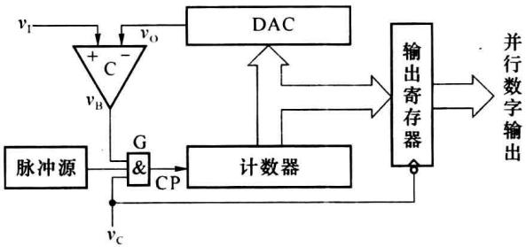  

题图9.12
</Exercise>

<Exercise title="习题 9-19">
题图 9.13 所示的电路为 3 位逐次渐近型 ADC 原理图, 如果将 ADC 的输出扩展至 10 位, 时钟信号频率为 1 MHz, 试计算完成一次转换操作所需要的时间。

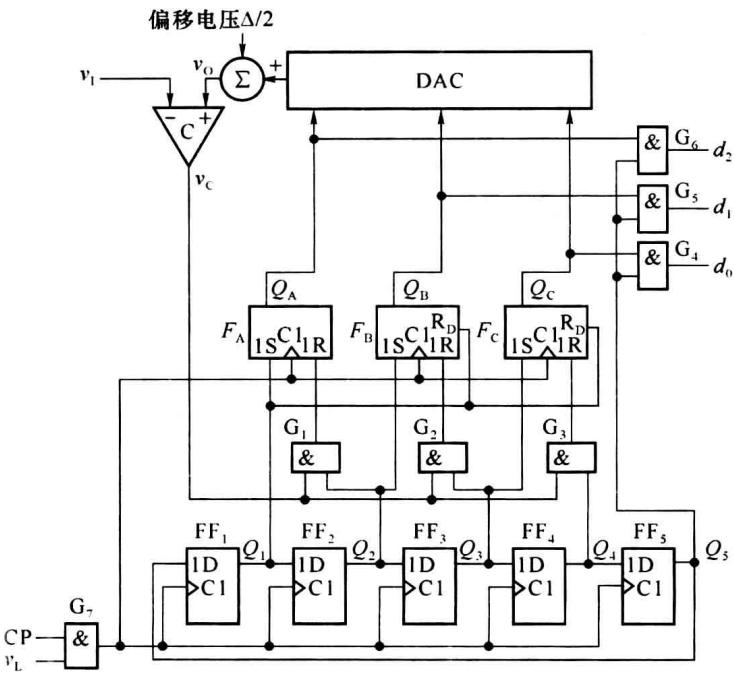  

题图9.13

## 第 10 章 脉冲波形的产生与变换

脉冲波形的产生与变换电路是电子技术中广泛使用的两类电路,波形产生电路是通过电路的自激,在无外加输入信号的作用下,能自动产生一定频率和幅度交流信号的电路;波形变换电路是能把输入信号波形变换成指定波形的电路。

本章从波形的基础知识开始,讨论施密特触发器、单稳态触发器和多谐振荡器及其应用。
</Exercise>
