import Guide from '@/components/Guide.astro';
import Knowledge from '@/components/Knowledge.astro';
import Example from '@/components/Example.astro';
import Analysis from '@/components/Analysis.astro';
import Solution from '@/components/Solution.astro';
import Variant from '@/components/Variant.astro';
import Note from '@/components/Note.astro';
import Block from '@/components/Block.astro';
import Method from '@/components/Method.astro';
import Exercise from '@/components/Exercise.astro';

自然界中的物质,按其导电的性能来划分,可以分为导体、绝缘体和半导体三类。其中,导电性能良好的物质称为导体,如金、银、铜、铝等金属物质;几乎不导电的物质称为绝缘体,如陶瓷、云母、塑料等;导电能力介于导体和绝缘体之间的一类物质称为半导体。自然界中属于半导体的物质很多,而用于制造半导体器件的材料主要有硅(Si)、锗(Ge)和砷化镓(GaAs)等,其中硅是目前最常用的半导体材料。导体、半导体和绝缘体的划分,严格来说是以物质的电阻率 $\rho$ 的大小来确定的。电阻率小于 $10^{-3}\ \Omega\cdot cm$ 的称为导体;电阻率大于 $10^{9}\ \Omega\cdot cm$ 的称为绝缘体;电阻率介于 $10^{-3}\ \Omega\cdot cm$ 与 $10^{9}\ \Omega\cdot cm$ 之间的称为半导体。

半导体之所以受到人们的高度重视,获得广泛的应用,并不是因为它的导电性能介于导体和绝缘体之间,而是由于它的电阻率可因某些外界因素的改变而明显变化,从而具有不同于导体和绝缘体的独特性质。主要表现为以下三个方面:

（1）掺杂特性：在半导体材料中掺入其他极微量的元素就会使其电阻率大大下降，从而改变和控制半导体的导电能力。如在纯锗中掺入 $10^{-8}\ cm^{-3}$ 杂质元素（例如磷元素），则其电阻率可以下降十多倍。正因为掺杂可以改变和控制半导体的导电特性，所以利用掺杂的方法可以制成各种半导体元器件。

（2）热敏特性:温度可以改变半导体的导电特性,半导体的电阻率随着温度的上升而急剧地下降。利用半导体的这一性质可以制成热敏电阻、热敏传感器等器件。

（3）光敏特性:光照可以使半导体产生光电效应,不仅半导体的电阻率随着光照的加强而显著地下降,而且还会产生电动势,这就是半导体的光电效应。利用这种效应,可以制成光敏电阻和光电池。

上述三种特性是制作各种半导体器件的物理基础。

物质导电性能的优劣,取决于它的原子内部结构和原子之间的结合方式。金属导体在常温下,其内部存在大量的自由电子,因而容易导电;绝缘体内部几乎不存在自由电子,所以几乎没有电流;而半导体的导电性能介于导体和绝缘体之间,这是由构成半导体的原子结构决定的。

## 1.1.1 本征半导体

原子排列整齐、晶格无缺陷、纯净的半导体，称为本征半导体。

## 一、共价键结构

半导体的导电方式与它的原子结构有关。任何元素的原子都是由原子核和围绕原子核运动的电子组成的。不同的原子，主要表现为原子核的质量和电子数量的不同。

由于电子带负电荷,原子核带正电荷,正、负电荷相互之间存在着吸引力。距离原子核较远的外层电子受原子核的吸引力较小,最外层的电子称为价电子。有几个价电子就称为几价元素。

硅原子有 14 个电子, 锗原子有 32 个电子, 它们的原子结构分别如图 1.1.1(a)、(b) 所示。由图可见, 硅和锗都属于四价元素。由于元素的许多物理、化学性质以及导电性能都与价电子有关, 为了简化, 常用惯性核简化模型来表示, 如图 1.1.1(c) 所示。

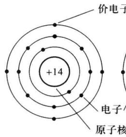  

(a)

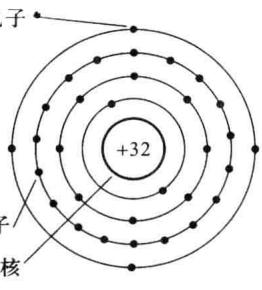  

(b)

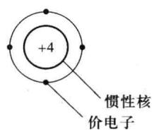  

(c)  

图 1.1.1 硅和锗原子结构模型

纯净的半导体经过一定的工艺提炼成单晶体后，即为本征半导体。它们的原子在空间排列成具有周期性和对称性的点阵，称为晶格。半导体一般都具有这种晶体结构，所以半导体器件又称为晶体管。

在晶格结构中,如图 1.1.2(a) 所示,由于原子间的距离很近,价电子不仅受到自己原子核的吸引,而且还受到相邻原子核的作用,这就产生了电子运动轨道的交叉重叠。相邻的两个原子的一对最外层电子(价电子)不但各自围绕自身所属的原子核运动,而且出现在相邻原子所属的轨道上,成为共用电子,这样的组合称为共价键结构,如图 1.1.2(b) 所示。

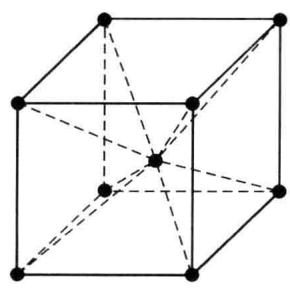  

(a)

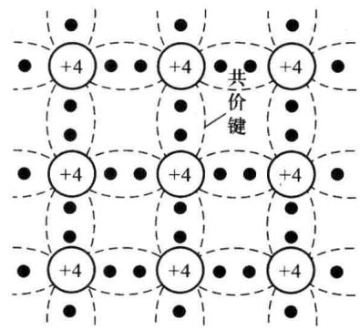  

(b)  

图 1.1.2 硅晶体结构和共价键结构示意图

在热力学温度零度(即 $T=0\ K$ , 相当于 $-273\ ^{\circ}C$ ) 时, 由于共价键的束缚, 价电子的能量无法挣脱共价键的这种束缚, 因此晶体中没有自由电子, 此时半导体相当于绝缘体。

## 二、本征激发产生两种载流子

当温度高于 $0 \, K$ 时, 共价键中的某些电子吸收到足够的能量, 挣脱共价键的束缚成为自

由电子,如图1.1.3所示。由于这些价电子离开了电中性区域,在原来的共价键中留下一个空位,称为空穴。自由电子带负电荷-q,空穴带正电荷+q( $q=1.6\times10^{-19}C$ )。

空穴一旦出现,则其他共价键上的电子不需要增加多少能量,就很容易来填补这个空位,这时空穴就转移到另一个位置,其他地方的电子又有可能来填补后一个空位。因此,在晶体中,由于价电子的移动而产生了带正电荷的空穴的移动。

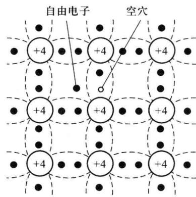

可见,在一定的温度下,由于热能的作用,半导体中总有一定数量的价电子要挣脱共价键的束缚,而产生自由电子和相等数量的空穴。自由电子和空穴总是成对产生的,称为电子-空穴对。这种由热能产生电子-空穴对的现象,

图1.1.3 本征半导体

中的自由电子和空穴

称为本征激发或热激发。此外，由于光照、辐射、场强等作用都会产生电子的激发现象。

另一方面，自由电子和空穴在运动中又可能释放能量，重新结合而同时消失，这种现象称为复合。在一定温度下，电子-空穴对的热激发和复合达到动态平衡。这时半导体中热激发和复合虽然在不断进行，但电子和空穴的数目却保持不变，这种状态就称为动态平衡。

运载电荷的粒子称为载流子。在本征半导体中，本征激发产生两种载流子——自由电子和空穴，并且成对出现。在一定温度下，本征半导体中载流子的浓度（单位体积内的自由电子或空穴数）是一定的，即自由电子和空穴的浓度相等。分别用 n 和 p 表示电子和空穴的浓度，并用 $n_{i}$ 和 $p_{i}$ 表示本征半导体中电子和空穴的浓度，则 $n_{i}=p_{i}$ 。

由以上分析可见,半导体中存在两种载流子,因此是双极性导电机构,而且随着温度升高,载流子浓度增加,其电阻率的温度系数是负的,这是半导体导电与金属导电的根本不同点。

图 1.1.4 所示为锗和硅晶体的本征载流子浓度与温度的关系曲线。由此看出，温度越高，价电子获得的能量越大，载流子浓度越大；在同一温度时，锗的载流子浓度比硅大。例如在室温 300 K 时，锗的本征载流子浓度为 $2.5 \times 10^{13} \, cm^{-3}$ ，硅的浓度为 $1.5 \times 10^{10} \, cm^{-3}$ ，这是由

于硅的原子核外有3层电子，锗的原子核外有4层电子，因此硅中价电子挣脱共价键的束缚所需要的能量比锗大得多，所以在相同的温度时，锗晶体中有更多的价电子能激发为自由电子。因此，锗的本征载流子的浓度比硅大。

可见,本征半导体中载流子的浓度除与半导体材料本身的性质有关以外,还与温度密切相关,而且随着温度的升高,基本上按照指数规律增加,因此本征半导体载流子的浓度对温度十分敏感。半导体中载流子的数量强烈地依赖于环境温度,这是半导体器件工作时热不稳定性的根本原因。

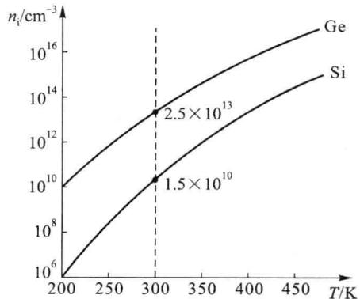  

图 1.1.4 本征载流子浓度与温度的关系曲线

应当指出,常温下,由热激发产生的电子-空穴数量与原子密度相比是很少的,所以本征半导体的导电能力很差。

## 1.1.2 掺杂产生的两种半导体

采用一定的工艺在本征半导体中掺入微量元素杂质后，可以大大改善半导体的导电性能。例如，在硅半导体中掺入三价的硼元素，室温下，其电阻率与本征半导体相比，将下降到五十万分之一。掺杂后的半导体称为杂质半导体，半导体器件都是采用杂质半导体制成的。因掺入的杂质不同，杂质半导体可以分为N型半导体和P型半导体两大类。

## 一、N型半导体

在本征半导体中，掺入少量的五价元素，例如，在纯度很高的硅单晶中掺入少量的磷(P)元素，即成为N型半导体。由于磷原子的数目比硅原子的数目少得多，所以整个晶体结构基本不变。掺入的磷原子取代了晶体中的某些硅原子，如图1.1.5所示。由于磷元素是五价元素，它有5个价电子，其中4个价电子与相邻的4个硅原子构成共价键，余下一个则不受共价键的束缚，因此当 $T > 50\mathrm{K}$ 时，这个价电子很容易激发而成为自由电子；而磷原子失去一个电子后，成为带正电荷的正离子，它在半导体中是不能移动的，这就是杂质的电离过程。在常温下，杂质原子一般都能电离，这样，每个磷原子都可能给出一个自由电子，使半导体中的电子载流子数目大大增加，导电能力大大增强。磷离子与其他的硅原子一样，被束缚在固定的晶格中。由于磷一类五价元素施放出一个电子，所以这类杂质称为施主杂质，电离后不可移动的正离子称为施主离子。

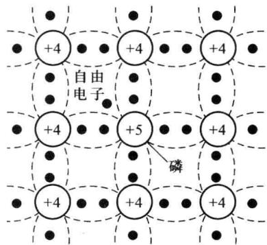  

图 1.1.5 N 型半导体原子结构示意图

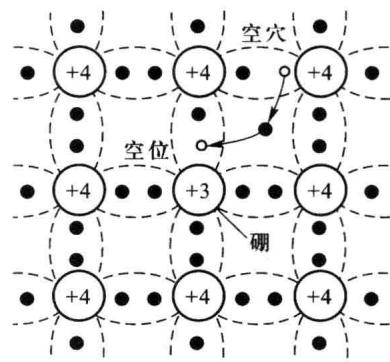  

图 1.1.6 P 型半导体原子结构示意图

在上述掺杂半导体中,除了杂质电离产生大量的自由电子外,还会由于热(或光等)激发产生少量电子-空穴对,而存在少量的空穴。需要指出的是,杂质电离与热激发不同,热激发使自由电子和空穴成对产生,而杂质电离只产生一种载流子,对于磷一类的施主杂质,它只产生自由电子。与本征半导体相比,掺杂半导体中的自由电子浓度大大增加,而空穴由于被复合的机会增多,其浓度反而减少。因此,掺杂半导体中自由电子的数量远大于空穴的数量,从而使自由电子成为多数载流子(简称多子),空穴则成为少数载流子(简称少子)。通过控制掺入杂质的多少,便可以控制多子的数量。将这种掺有施主杂质的、以电子导电为主的半导体,称为N型半导体。

## 二、P型半导体

在本征半导体中掺入少量的三价元素,例如,在硅晶体中掺入少量硼(B)元素后,可构成P型半导体。同样,掺入的硼原子取代了晶体中的某些硅原子,如图1.1.6所示。由于硼元素是三价元素,有3个价电子,它只能和3个相邻的硅原子构成共价键,而与第四个相邻的硅原子组成的共价键就不完整,在共价键中产生了一个空位,即形成了一个带正电荷的空穴。为了满足结成四对共价键形成稳定状态的需要,这个空位很容易接受一个外来电子的填补,而附近硅原子的价电子在热激发下,也很容易跃入到这个空位上来,使硼原子成为带负电荷的硼离子(杂质电离),而填补这个空位的价电子则在它原来的共价键中留下一个新的空位形成空穴。由于硼一类的三价元素起着接受电子的作用,故称为受主杂质,电离后不可移动的负离子则称为受主离子。掺有受主杂质的半导体中,空穴的浓度远大于自由电子的浓度,故空穴成为多子,而自由电子则成为少子,这种掺有受主杂质的半导体称为P型半导体。

综上所述，杂质半导体中存在自由电子、空穴和杂质离子三种带电粒子，其中，自由电子和空穴是载流子，杂质离子不能移动，不是载流子。多子浓度由杂质决定，少子浓度则由本征激发决定。由于多子浓度远大于少子浓度，故杂质半导体的导电性能主要取决于多子浓度。一般在 $T > 50\mathrm{K}$ 时，所有杂质元素就已经全部电离，其值较大并且稳定，因此杂质半导体的导电性能得到显著改善。少子浓度虽然很小，但其强烈地依赖于环境温度的变化而变化，从而导致半导体器件工作的不稳定性，在应用中要注意温度对半导体器件及其电路性能的影响。

实际上，在本征半导体中很可能同时掺进施主杂质和受主杂质，此时半导体的类型则取决于浓度较大的杂质。假如受主杂质多于施主杂质，空穴抵消一部分电子后仍为多子，则可得到P型半导体；反之，当施主杂质的浓度大于受主杂质的浓度时，则可得到N型半导体。

应该指出，N型和P型半导体对外都呈现电中性，这是因为在本征半导体中掺入的杂质都是电中性的，半导体中出现的大量的可以运动的电子或空穴，并未破坏整个半导体内正负电荷的平衡状态。

在掺杂半导体中,通过理论分析可以证明,当半导体处于平衡状态时,即当半导体不受外加电场或高能辐射等因素的影响时,其自由电子浓度 $n_{0}$ 和空穴浓度 $p_{0}$ (均称为平衡载流子浓度)满足以下关系式

$$

p _ {0} n _ {0} = n _ {\mathrm{i}} ^ {2}\tag{1.1.1}

$$

即,无论掺杂程度如何,在一定温度的平衡状态下,平衡载流子浓度的乘积保持一定,它等于该温度下本征载流子浓度 $n_{i}$ 的平方。

<Example title="例 1.1.1">
如果有一锗片，在 T=300 K 时， $n_{i}=2.5\times10^{13}\ cm^{-3}$ ，掺入的施主杂质浓度为 $N_{D}=1\times10^{17}\ cm^{-3}$ 。假设所有施主原子都电离，试求锗片中的自由电子和空穴浓度。

<Solution title="解">
自由电子浓度

$$

n _ {0} = N _ {\mathrm{D}} + p _ {0} \approx N _ {\mathrm{D}} = 1 \times 1 0 ^ {1 7} \mathrm{cm} ^ {- 3}

$$

由式 $(1.1.1)$ ，得空穴浓度为

$$

p _ {0} = \frac {n _ {\mathrm{i}} ^ {2}}{n _ {0}} = \frac {(2 . 5 \times 1 0 ^ {1 3}) ^ {2}}{1 \times 1 0 ^ {1 7}} \mathrm{cm} ^ {- 3} = 6. 2 5 \times 1 0 ^ {9} \mathrm{cm} ^ {- 3}

$$

必须指出,掺杂半导体中的少子是本征激发形成的,尽管其浓度很低,却对温度十分敏感。如果温度足够高,以致使半导体的本征载流子占主导地位,则半导体又将近似为本征型半导体,此时由掺杂半导体构成的半导体器件将不能正常工作。

在相同温度下,由于硅晶体的本征载流子浓度比锗小,所以半导体硅器件的稳定性比锗器件好,允许的最高工作温度也比锗器件高。一般硅管的最高工作温度为 $150^{\circ}C$ , 锗管的为 $75^{\circ}C$ 。
</Solution>
</Example>

## 1.1.3 半导体中载流子两种运动产生的两种电流

当半导体的温度大于0 K时，载流子就会在半导体内做不规则的热运动，温度越高，这种运动越剧烈。在平衡状态下，并且当载流子为均匀分布时，由于这种不规则运动向各个方向运动的几率都相等，因此半导体中不呈现电流。但是当半导体中的载流子受到外加电场的作用时，空穴将沿电场方向运动，自由电子将逆电场方向运动，这种运动称为载流子在外加电场作用下的漂移运动；而当半导体中载流子的浓度不均匀时，高浓度处的载流子将向低浓度处方向移动，这种载流子在浓度梯度作用下产生的定向运动称为扩散运动。扩散和漂移都使载流子产生定向运动，从而在半导体中产生电流。由载流子的扩散运动所形成的电流称为扩散电流，由载流子的漂移运动所形成的电流则称为漂移电流。

## 一、扩散电流

图 1.1.7 中, 一块载流子浓度在 x 方向不均匀的半导体材料, 设空穴浓度 $p(x)$ 随 x 增大的方向逐渐减小, 如图中曲线所示, 则空穴将由高浓度处向低浓度处扩散, 即空穴将沿 x 方向移动, 从而产生扩散电流, 扩散电流的大小与载流子的浓度梯度成比例。

## 二、漂移电流

图 1.1.8 所示为一截面均匀的半导体材料，在半导体两端加上直流电压 V 后，半导体内将产生电场，电场强度 E 的方向如图所示。在电场的作用下，半导体中的两种载流子将同时产生漂移运动，其中空穴将沿电场的方向漂移，而自由电子将逆电场的方向漂移。由于自由电子和空穴所带电荷极性相反，空穴和电子数量相等，所以流过外电路的总的电流等于空穴漂移电流与电子漂移电流之和。

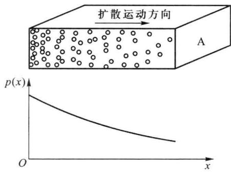  

图 1.1.7 载流子的扩散运动

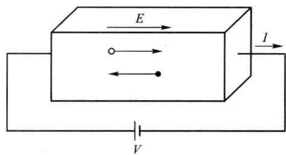  

图 1.1.8 载流子的漂移运动
