import Guide from '@/components/Guide.astro';
import Knowledge from '@/components/Knowledge.astro';
import Example from '@/components/Example.astro';
import Analysis from '@/components/Analysis.astro';
import Solution from '@/components/Solution.astro';
import Variant from '@/components/Variant.astro';
import Note from '@/components/Note.astro';
import Block from '@/components/Block.astro';
import Method from '@/components/Method.astro';
import Exercise from '@/components/Exercise.astro';

半导体二极管是利用杂质半导体制成的,构成它的核心器件是 PN 结。本节将介绍二极管的结构、特性、主要参数以及特殊二极管的功能。

## 1.2.1 PN 结及其单向导电性

把 P 型半导体和 N 型半导体通过一定的工艺处理结合在一起时, 在两种半导体的交界

面上,将会形成一个 PN 结。

## 一、PN 结的形成——动态平衡下的 PN 结

如图 1.2.1(a) 所示的两种不同类型的半导体，在交界面的左侧为 P 型半导体，右侧为 N 型半导体。在浓度差的作用下，P 区的多子（空穴）必然要向空穴浓度很低的 N 区扩散，同样在界面附近 N 区的多子（电子）也必然要向 P 区中扩散，扩散到对方成为少子，会很快被复合掉。这样，在靠近交界面的 P 区中只剩下不可移动的带负电荷的受主离子，在交界面附近的 N 区中只剩下不可移动的带正电荷的施主离子，这些正、负离子都被束缚在晶体的晶格上，不能参与导电。于是，在紧靠交界面的两侧，形成了一个电荷数目相等、极性相反的空间电荷区，如图 1.2.1(b) 所示。

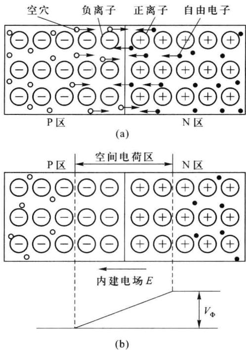  

图 1.2.1 PN 结的形成

在空间电荷区中，由于P区和N区分别存在不可移动的正、负离子，必将形成一个由N区指向P区的内建电场，电场强度用 $E$ 表示，如图1.2.1(b)所示。与此同时，空间电荷区两侧存在一个静态电位差 $V_{\Phi}, V_{\Phi}$ 一般被称为接触电位差。

内建电场一旦形成, 就会对双方多子的扩散运动形成一个阻力, 因此, 只有一部分能量较大的多子有可能克服内建电场的阻力扩散到对方成为少子。与此相反, 在交界面附近的 P 型和 N 型半导体中本征激发产生的少子, 则受到内建电场的加速作用向对方漂移, 即 N 区中的空穴将顺电场方向漂移到 P 区, 而 P 区中的自由电子将逆电场方向漂移到 N 区, 形成漂移电流。因此, 在交界面的两侧, 同时存在着多子的扩散运动和少子的漂移运动。随着扩散运动的不断进行, 空间电荷区的电荷量不断增多, 空间电荷区变宽, 内建电场增强, 接触电位差增大, 多子扩散运动所受的阻力也不断增大, 扩散电流减小而漂移电流增大。当扩散运动达到一定程度, 扩散到对方的多子和漂移到对方的少子的数量达到相等时, 扩散电流与漂移电流方向相反、大小相等，多子的扩散和少子的漂移达到动态平衡，空间电荷区的电荷量及空间电荷区的宽度也不再变化而达到相对稳定，从而形成PN结。这时，流过PN结的总电流为零，交界面两侧的空间电荷量、空间电荷区宽度、内建电场E等参量都维持一定的常数，这些数值与半导体材料、掺杂浓度、温度等因素有关。这就是动态平衡下的PN结。

在 PN 结的空间电荷区内,电子或空穴载流子的数量都很少,所以又称为耗尽区;同时,由于空间电荷区对多子的扩散运动有阻挡作用,又称其为阻挡层、势垒区。由于耗尽区内载流子浓度很低,所以该区域的电阻率很高,为高阻区;空间电荷区以外的区域仍处于热平衡状态,是电中性区,没有电位差,为低阻区。

PN 结达到动态平衡后,两侧的正、负离子数不再变化,使空间电荷区有一定宽度,并建立起有一定值的内建电场 E 和接触电位差 $V_{\Phi}, V_{\Phi}$ 的表达式为

$$

V _ {\Phi} = \frac {k T}{q} \mathrm{ln} \bigg (\frac {N _ {\mathrm{A}} N _ {\mathrm{D}}}{n _ {\mathrm{i}} ^ {2}} \bigg) = V _ {T} \mathrm{ln} \bigg (\frac {N _ {\mathrm{A}} N _ {\mathrm{D}}}{n _ {\mathrm{i}} ^ {2}} \bigg)\tag{1.2.1}

$$

式中，T 为绝对温度，k 为玻耳兹曼常数， $k=1.38\times10^{-23}$ J/K，q 是一个电子的电荷量， $q=1.6\times10^{-19}$ C， $N_{A}$ 和 $N_{D}$ 分别为 P 区受主杂质和 N 区施主杂质的浓度， $n_{i}$ 为半导体的本征载流子浓度； $V_{T}$ 为温度电压当量，室温下，T=300 K 时， $V_{T}\approx26\ mV$ 。

式(1.2.1)表明，PN结的接触电位差与两侧半导体掺杂浓度的乘积、温度和半导体材料有关。温度上升， $n_{i}$ 增大， $V_{\Phi}$ 减小，即 $V_{\Phi}$ 具有负温度系数，温度每升高1℃， $V_{\Phi}$ 下降2\~2.5mV。由于硅的本征载流子浓度小于锗，所以在相同的温度和掺杂浓度时，硅PN结的接触电位差比锗大。室温下，锗PN结的接触电位差为0.2\~0.3V，硅PN结的接触电位差为0.6\~0.7V，其极性是N区为正，P区为负。

在空间电荷区中，正、负电荷量应该相等。当P区与N区杂质掺杂浓度相等时，负离子区与正离子区的宽度也相等，称为对称结；而当两边杂质浓度不等时，构成PN结的两个空间电荷区的宽度 $W_{p}$ 和 $W_{N}$ 也不等，称为不对称结。 $W_{p}$ 和 $W_{N}$ 与掺杂浓度成反比，即

$$

\frac {W _ {\mathrm{P}}}{W _ {\mathrm{N}}} = \frac {N _ {\mathrm{D}}}{N _ {\mathrm{A}}}\tag{1.2.2}

$$

上述对称结和不对称结的外部特性是相同的。

## 二、PN 结的单向导电性

如果在 PN 结的两端外加电压,其动态平衡状态就会被破坏,此时,扩散电流不等于漂移电流,PN 结将有电流流过。当外加电压极性不同时,PN 结表现出截然不同的导电性能,即呈现出单向导电性。

### 1. PN 结加正向电压——正向导通

在 PN 结的两端加上直流电压 V，将 V 的正端与 P 型半导体相连，V 的负端与 N 型半导体相连，如图 1.2.2 所示，称为施加正向电压（简称正偏）。由于外加电压的方向与 PN 结势垒电压 $V_{\Phi}$ 的方向相反，使 PN 结的势垒电压减小，阻挡层内的合成电场减弱，扩散运动加强，进而使空间电荷量减少，空间电荷区的宽度变窄。由于势垒电压从原来的 $V_{\Phi}$ 下降为 $V_{\Phi}-V$ 、空间电荷区变窄，使更多的多子能越过阻挡层向对方扩散，所以扩散电流加大。至于漂移电流，则取决于少子浓度，它主要取决于工作温度，与外加电压的大小基本无关。

总之,外加正向电压时,扩散电流大于漂移电流,将产生正向电流,方向由P区流向N区,即图1.2.2中I所示的方向。扩散所消耗的空穴和电子将源源不断地从外电源得到补充,因而形成了回路电流。当正向电压增大到一定值后,正向电流很大,PN结呈现很小的电阻,此时,PN结处于正向(低阻)导通状态。当外加正向电压V增大时,势垒电压进一步降低,扩散电流也进一步增大,正向电流会随着正向电压的增大而显著增大。

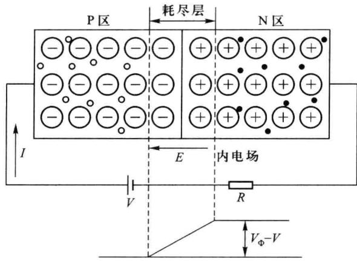  

图 1.2.2 PN 结加正向电压

需要指出的是，在外加正向电压增大时，正向电流 I 也随着增大，使中性区内的电压降也增大，真正加到 PN 结上的电压将比外加电压小，加到 PN 结上的电压不可能超过 $V_{\Phi}$ ，所以尽管外加的正向电压值很大，但 PN 结中电场的方向总是由 N 区指向 P 区。硅半导体 PN 结加正向电压时，PN 结两端的电压在 0.6～0.7 V 以下；锗半导体 PN 结加正向电压时，PN 结两端的电压在 0.2～0.3 V 以下。使用时，都应在它所在的回路中串联一个电阻，以限制回路中的电流，防止 PN 结因正向电流过大而烧坏。

### 2. PN 结加反向电压——反向截止

当外加直流电压的正端与 N 型半导体相连, 负端与 P 型半导体相连时, 如图 1.2.3 所示, 称为施加反向电压(简称反偏), 其方向与 PN 结势垒电压 $V_{\Phi}$ 的方向相同。因此当 PN 结反偏时, 势垒电压增大, 同时在反向电压的作用下, 多子将背离耗尽层, 空间电荷量增加, 空间电荷区的宽度加大。由于势垒电压增大, 空间电荷区加宽, 只有极少数多子能越过阻挡层向对方扩散,所以扩散电流极小,以致漂移电流大于扩散电流。由于漂移电流的大小主要取决于本征激发产生的少子浓度,其值很小,因此流过PN结的漂移电流也很小。此时在外电路中产生的电流,称为反向电流,其方向由N区流向P区,即图1.2.3中I所示的方向,PN结呈现很大的电阻,处于反向截止状态。由于少子浓度很低,当反向电压并不很高时,几乎所有的少子均已参与了导电,所以当反向电压增大时,反向电流几乎不增大,故又将反向电流称为反向饱和电流。但是它对温度的变化非常敏感,温度上升,少子数目增多,反向电流急剧增大。

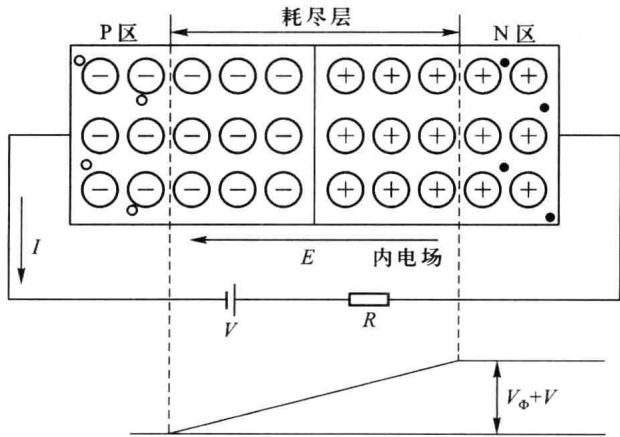  

图 1.2.3 PN 结加反向电压

总之，当 PN 结正偏时导通，呈现很小的正向电阻，电路中产生较大的正向电流，正向电流随正向电压的大小急剧改变；当 PN 结反偏时截止，呈现很大的反向电阻，电路中的反向电流很小，且基本上不随反向电压的大小变化。这种正向导通、反向截止的特性称为单向导电特性，这是 PN 结最重要的特性。

## 1.2.2 二极管的结构与类型

在 PN 结的外面装上管壳,再引出两个电极,就构成了半导体二极管,简称二极管,其电路符号如图 1.2.4 所示。P 区引出的电极为正极,N 区为负极。符号中三角形箭头所指的方向为正向电流的流通方向。

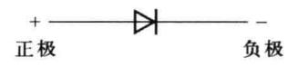

二极管按所用的半导体材料不同分为硅管和锗管；按其结构特点可分为点接触型、面接触型和平面型三大类，如图1.2.5所示。

图 1.2.4 二极管的电路符号

图 1.2.5(a) 所示为点接触型二极管, 它是用一根很细的金属丝(如三价元素铝)经过特殊工艺触压在半导体晶片上, 使部分金属原子渗入晶体中, 形成 PN 结。其特点是 PN 结面积很小, 不能承受大的电流和高的反向电压, 但其结电容很小, 工作速度快, 频率高, 因此适用于高频、小电流的场合，例如高频检波、小电流整流以及小功率开关等。

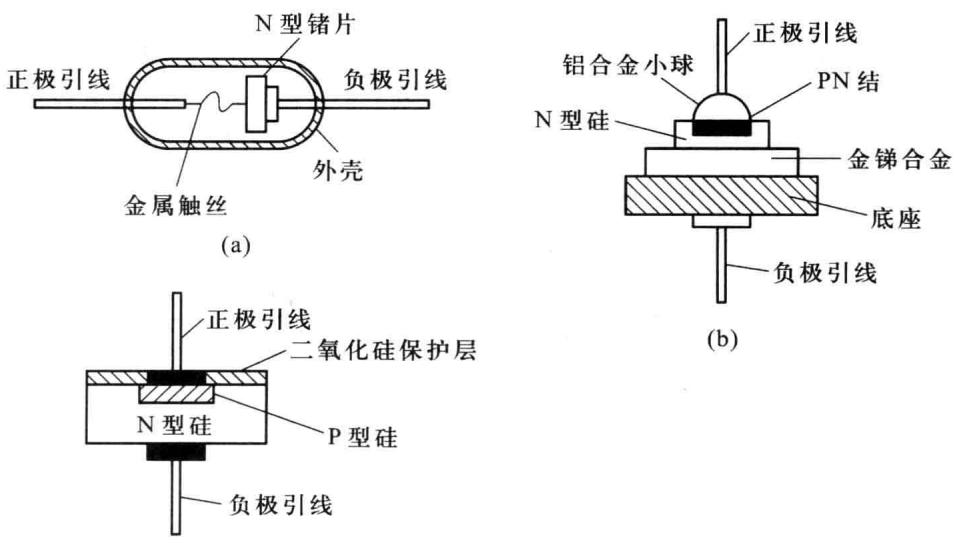  

图 1.2.5 半导体二极管的结构

图 1.2.5(b) 所示为面接触型二极管, 它是采用合金法工艺制成的, 其特点是 PN 结面积大, 可以承受较大的电流, 但结电容也较大, 适用于低频、大电流的应用电路, 例如低频整流、低速开关电路等。

图 1.2.5(c) 所示为硅平面型二极管, 它是采用扩散法工艺制成的, 其制造工艺与晶体管和集成电路常用工艺相同。根据需要, 它的 PN 结面积可大可小, 结面积较大的可用于大功率整流, 结面积小的可用于高频或脉冲数字电路中的开关管。

## 1.2.3 二极管的伏安特性

加到二极管两端的电压 $v_{D}$ 和流过二极管的电流 $i_{D}$ 之间的关系, 称为二极管的伏安特性。伏安特性可以用公式表示, 也可以用曲线来描述。

## 一、二极管电流方程

由于二极管本质上是一个 PN 结, 所以它的伏安特性可以近似地用 PN 结的理想伏安特性方程表示, 即

$$

i _ {\mathrm{D}} = I _ {\mathrm{S}} (\mathrm{e} ^ {\frac {v _ {\mathrm{D}}}{V _ {T}}} - 1)\tag{1.2.3}

$$

式中， $v_{D}$ 为二极管两端所加的电压； $i_{D}$ 为二极管中流过的电流； $I_{S}$ 为二极管的反向饱和电流，硅管为纳安级； $V_{T}$ 为温度的电压当量，当 T=300 K 时， $V_{T}\approx26\ mV$ 。

二极管方程可以在很宽的电流范围内比较准确地描述二极管的特性。当正偏时，二极管处于导通状态，如果外加电压 $v_{D} \gg V_{T}$ ，使 $e^{\frac{v_{D}}{V_{T}}} \gg 1$ ，式(1.2.3)可以近似为

$$

i _ {\mathrm{D}} = I _ {\mathrm{S}} \mathrm{e} ^ {\frac {v _ {\mathrm{D}}}{V _ {T}}}\tag{1.2.4}

$$

此时， $i_{D}$ 随 $v_{D}$ 的增加按指数规律迅速增大，电流值很大。

当反偏时,二极管处于截止状态,如果外加电压 $\left|v_{D}\right| \gg V_{T}$ ,使 $e^{\frac{T}{V_{T}}}\ll1$ ,式(1.2.3)可以近似为

$$

i _ {\mathrm{D}} \approx - I _ {\mathrm{s}}\tag{1.2.5}

$$

此时，反向电流很小，几乎为零。

需要指出,式(1.2.3)是理想二极管的伏安特性表达式。实际上,二极管还存在电极的引线电阻、管外电极间的漏电阻、PN结两侧的P区和N区的电阻(简称体电阻)等因素的影响,公式推导时还忽略了空间电荷区内载流子的复合作用、大注入的影响以及反向击穿现象,所以实测的二极管伏安特性会与理论计算存在一定的误差。在正向电流较小以及反向电压不大时,理想特性与实际二极管特性相近,超出此范围就会出现较大的误差。

## 二、二极管的伏安特性

由式(1.2.3)可以画出理想二极管的伏安特性曲线,如图1.2.6(a)所示。图1.2.6(b)为考虑反向击穿特性后的实际特性曲线,它被分为以下三个工作区域。

### 1. 正向工作区

二极管加正偏电压,由图1.2.6可见,当 $v_{D}<V_{th}$ 时,正向电流几乎为零,这是因为外加电压在PN结上形成的外电场还不足以克服内电场对载流子扩散运动的阻力,故正向电流非常微小,二极管呈现较大的电阻。当 $v_{D}>V_{th}$ 时,正向电流随正偏电压的增加而迅速增大,这是因为PN结内电场被大大削弱，二极管的电阻变得很小，由式(1.2.4)可知，电流与正偏电压之间呈指数关系。工程上定义一个电压值 $V_{\mathrm{th}}$ ，称为阈值电压（或死区电压），当外加电压 $v_{\mathrm{D}} < V_{\mathrm{th}}$ 时，PN结截止；当外加电压 $v_{\mathrm{D}} > V_{\mathrm{th}}$ 时，PN结导通。室温下，硅管的 $V_{\mathrm{th}}\approx 0.5\mathrm{V}$ ，锗管的 $V_{\mathrm{th}}\approx 0.1\mathrm{V}$ 。

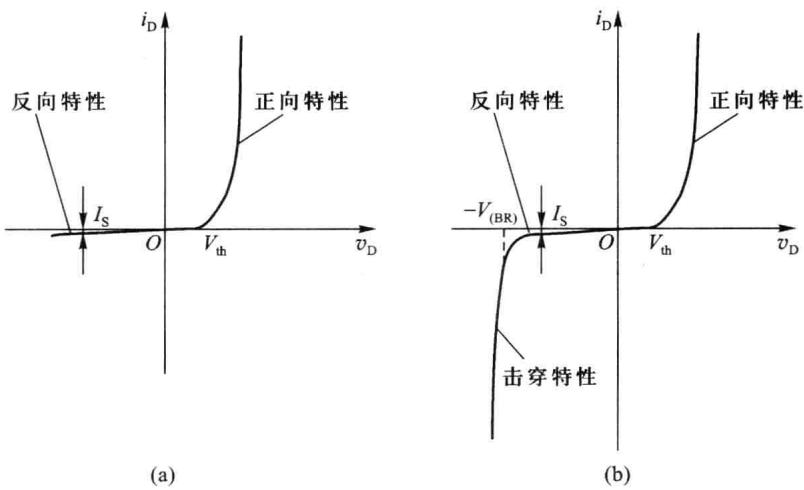  

图 1.2.6 二极管的伏安特性曲线

由图 1.2.6 还可以看到, 当二极管正向导通后, 正偏电压足够大时, 正向电流随端电压按照指数规律增大, 其特性近似于直线, 即二极管正偏导通后, 两端的电压几乎为恒值。这是因为正向电压较大时, 内电场大部分被抵消, 结电阻很小, 而 PN 结两侧半导体材料的体电阻电压降增大, 电流和电压关系主要由体电阻特性决定, 故电流随电压近似呈线性关系。在实际电路中, 硅管导通时的压降为 0.6 \~ 0.8 V, 锗管的为 0.1 \~ 0.3 V。工程上将二极管导通时的正向压降称为导通电压, 用 $V_{on}$ 表示。

### 2. 反向工作区

由图 1.2.6(a) 可见, 当二极管所加的反偏电压小于 $V_{(BR)}$ 时, 反向电流基本不变, 且与反向电压无关, 为反向饱和电流 $I_{s}$ 。它的数值很小, 常温下, 锗管约为几十微安, 硅管则小于 $0.1 \mu A$ 。

### 3. 反向击穿区

当反向电压增大到一定值 $(V_{\mathrm{(BR)}})$ 时，反向电流突然急剧加大，二极管失去单向导电性，如图1.2.6(b)所示。这种现象称为反向击穿， $V_{\mathrm{(BR)}}$ 称为反向击穿电压。

## 1.2.4 二极管的反向击穿特性、温度特性和电容效应

## 一、二极管的反向击穿特性

如前所述,二极管发生击穿时,反向电流会急剧增大。如果不加限制,消耗在 PN 结上的功率可能会超过允许值,造成二极管的损坏。因此在应用时,加在二极管上的反向电压不能超过击穿电压。另一方面,二极管发生击穿后,在击穿区的曲线很陡,反向电流变化很大,但两端的电压降却几乎不变,可以利用二极管的这种特性制成稳压二极管,从而获得所需要的恒定电压。

二极管的反向击穿分为雪崩击穿和齐纳击穿两类。

### 1. 雪崩击穿

当 PN 结加反向电压后,PN 结的内电场加强,使少子的漂移速度加快,动能增大,在通过空间电荷区时碰撞中性原子,能把其中的价电子碰撞出来,产生新的电子-空穴对(碰撞电离)。这些新产生的载流子又会被加速撞击其他的原子,产生更多的载流子,这种载流子的倍增效应如同雪崩一样,使反向电流急剧增加,所以称这种击穿为雪崩击穿。它发生在掺杂浓度低、空间电荷区宽、外加电压比较大的情况下。

### 2. 齐纳击穿

对于高浓度掺杂材料制成的 PN 结, 其空间电荷区宽度很窄。不大的反向电压就能在空间电荷区中形成很强的电场, 将空间电荷区内的中性原子的价电子直接从共价键中拉出来, 产生电子-空穴对(场致激发)。从而使载流子突然增多, 引起反向电流急剧增加, 这种击穿称为齐纳击穿。它发生在掺杂浓度高、外加电压比较低的情况下。

一般情况下， $V_{(BR)}$ 在 6 V 以下的属于齐纳击穿， $V_{(BR)}$ 大于 6 V 时主要是雪崩击穿。雪崩击穿电压随温度升高而增大，因而具有正温度系数；齐纳击穿电压随温度的升高而减小，因而具有负温度系数。当击穿电压在 6 V 左右时，两种击穿会同时发生，相应击穿电压的温度系数趋近于零。

需要指出,发生上述两种击穿现象时,只要将 PN 结的反向电流限制在一定的范围内,使消耗在 PN 结上的功率未超过允许值,PN 结未被烧毁,那么,当反向电压下降到击穿电压以下后,其性能可以恢复到原有状态,即这种击穿是可逆的,统称为电击穿。

当外加反向电压较大,如果反向击穿电流也比较大时,则会导致 PN 结因结温过高而烧坏,这种击穿是不可逆的,称为热击穿。使用时必须采取措施避免热击穿。二极管在使用中通常要串联电阻,以限制其电流的增加,避免被烧坏;或者采用加装散热片、强制风冷等手段,设法将热量及时散发出去。

## 二、二极管的温度特性

在方程 $i_{\mathrm{D}} = I_{\mathrm{S}}(\mathrm{e}^{\frac{v_{\mathrm{D}}}{V_T}} - 1)$ 中，反向饱和电流 $I_{\mathrm{S}}$ 和温度电压当量 $V_{T}$ 均是温度的函数。当温度

升高时,热激发加强,少子浓度增加,少子漂移运动构成的反向饱和电流增大,反向伏安特性随温度升高而下移,如图1.2.7所示。实验证明,温度每增加10℃,硅或锗的反向饱和电流 $I_{s}$ 约增大1倍。

当二极管正偏时, 温度升高, 使得 $V_{T}$ 增大, 导致 $e^{\frac{i_{D}}{V_{T}}}$ 随温度升高而变小, 但是不如 $I_{S}$ 增加得快, 所以, 在相同电压下, 温度升高时, $i_{D}$ 值变大, 结果使二极管的正向伏安特性随温度上升而左移。

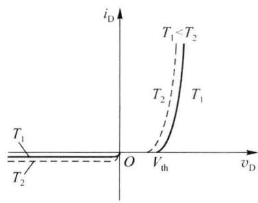  

图 1.2.7 二极管的温度特性

由图 1.2.7 可以看出,随着温度升高,曲线左移。在室温附近,温度每升高 $1^{\circ}C$ ,正向压降减小约 2.5 mV。

## 三、二极管的电容效应

在二极管内部,当 PN 结两端电压发生变化时,空间电荷区内的电荷量将随之变化;另一方面,当 PN 结正偏时,由于载流子的扩散,会在势垒区以外的中性区内形成非平衡载流子的存储,且存储电荷量与所加正偏电压的大小有关。这种现象使得二极管对外呈现出电容效应,即势垒电容和扩散电容。

### 1. 势垒电容 $C_{\mathrm{T}}$

它是由势垒区内电荷存储作用引起的。当外加于 PN 结两端的电压改变时，空间电荷区的宽度将会改变，从而使得空间电荷区内存储的电荷量 Q 发生改变，引起电容效应，这种电容效应称为势垒电容，用 $C_{T}$ 表示。

例如,当反偏电压减小时,空间电荷区变窄,N区的部分电子和P区的部分空穴将进入空间电荷区与部分杂质离子中和,这就好像将电子和空穴存入PN结,相当于向势垒电容充电;反之,当外加反偏电压增大时,空间电荷区变宽,部分电子和空穴将离开空间电荷区,相当于势垒电容放电。

势垒电容 $C_{T}$ 与一般的线性电容不同。当外加电压改变时，空间电荷区的宽度会发生改

变,因此势垒电容也会跟着变化,所以势垒电容是非线性电容。它随外加电压的变化关系如图1.2.8所示。此时,PN结处于截止状态,利用 $v_{D}$ 控制 $C_{T}$ 的变化,可以制成变容二极管。

### 2. 扩散电容 $C_{\mathrm{D}}$

它是由多子在扩散过程中的积累所引起的。当 PN 结正偏时，P 区和 N 区的多子会分别越过势垒扩散到 N 区和 P 区，这些扩散到 PN 结另一侧的载流子称为非平衡少子。非平衡少子在靠近 PN 结的边缘处浓度高，远离 PN 结边缘的地方浓度低（被复合掉了），且浓度自高

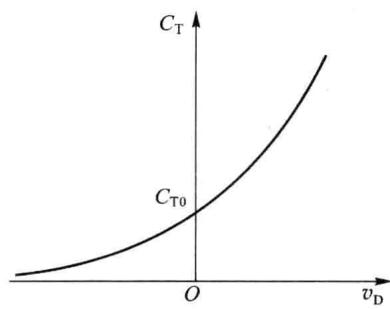  

图 1.2.8 势垒电容的非线性特性

到低逐渐衰减，形成一定的浓度梯度，从而形成扩散电流。因此，在P区有电子的积累，在N区有空穴的积累。当正偏电压增大时，非平衡少子增多，载流子的积累也增多，相当于P区和N区被充电；反之，当正偏电压减小时，非平衡少子减少，载流子的积累也减少，相当于从P区和N区放电。所以，PN结对外呈现出电容效应，这种电容效应称为扩散电容，用 $C_{D}$ 表示。 $C_{D}$ 的值随外加电压的改变而改变，因此也是非线性电容。

势垒电容 $C_{T}$ 与扩散电容 $C_{D}$ 是并联的, 所以 PN 结的总电容(称为 PN 结电容) $C_{j}$ 为两者之和, 即

$$

C _ {\mathrm{j}} = C _ {\mathrm{T}} + C _ {\mathrm{D}}\tag{1.2.6}

$$

当 PN 结正偏时, 结电容值比较大, 扩散电容起主要作用, $C_{D} \gg C_{T}, C_{j} \approx C_{D}$ ; 当 PN 结反偏时, 结电容数值较小, $C_{D}$ 趋于零, $C_{j} \approx C_{T}$ 。

一般情况下,二极管结电容 $C_{j}$ 很小,对低频电路的影响可以忽略。当工作频率较高时,结电容的容抗变小,有可能使 PN 结失去单向导电特性。所以,二极管的电容效应是限制半导体的响应速度、影响高频特性的主要因素。

## 1.2.5 二极管的主要参数

元件的参数是标志其质量好坏和安全适用范围的物理量,是选用器件的依据。一般器件手册都会给出不同型号二极管的主要参数。常用的参数主要有以下几个。

（1）最大整流电流 $I_{F}$ : 指二极管长期工作时允许通过的最大正向平均电流。使用时若

超过此值,可能会烧坏二极管。

（2）最高反向工作电压 $V_{R}$ : 指二极管工作时允许外加的最大反向电压, 通常规定为反向击穿电压的一半。

（3）反向电流 $I_{R}$ ：指二极管未击穿时的反向电流。 $I_{R}$ 越小，表明二极管的单向导电性和温度稳定性越好。

（4）最高工作频率 $f_{M}$ ：指二极管工作的上限频率。使用中如果工作频率超过此值，结电容的影响不能忽略，二极管的单向导电特性变差。

二极管的参数可以在器件手册中查到,但是这些参数均与温度有关,当实际应用条件与测试条件相差较大时,应对参数做必要修正;另外,由于半导体器件制作的分散性,对于同一型号的二极管,其参数也会有所差异,使用时应予以注意。

## 1.2.6 特殊二极管

二极管的种类非常多,除前面讨论的普通二极管外,还有一些特殊用途的二极管,常用的有稳压二极管、变容二极管、肖特基二极管和光电子器件等,简单介绍如下。

## 一、稳压二极管

稳压二极管又称齐纳二极管，简称稳压管，它是一种特殊的面接触型硅二极管，其符号和伏安特性曲线如图1.2.9所示。正常情况下，稳压管工作在反向击穿区，由于曲线很陡，反向电流在很大范围内变化时，端电压变化很小，因而具有稳压作用。稳压管的稳压值 $V_{Z}$ 即为二极管的反向击穿电压。在图1.2.9(b)中， $I_{Z\min}$ 表示最小允许电流，它表示稳压管保持稳压特性的最小电流值； $I_{Z\max}$ 表示最大允许电流，它表示稳压管不被烧毁所能承受的最大电流。通常用动态电阻 $r_{Z}$ 来描述击穿区特性曲线的陡峭程度

$$

r _ {z} = \frac {\Delta V _ {z}}{\Delta I _ {z}}\tag{1.2.7}

$$

显然,特性曲线越陡, $r_{z}$ 越小,稳压性能越好。

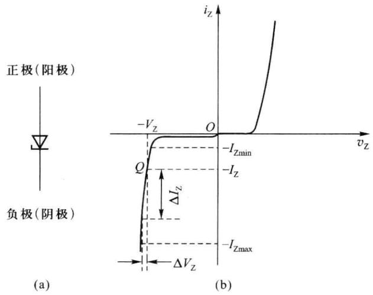  

图 1.2.9 稳压管的符号和伏安特性曲线

稳压管在使用时应串联限流电阻 R，以保证流过稳压管的反向电流 $I_{Z}$ 的值在合适的范围之内，即 $I_{Zmin} < I_{Z} < I_{Zmax}$ 。

## 二、变容二极管

如前所述,二极管结电容的大小除了与本身结构和制作工艺有关以外,还受外加电压控制,它的值随反向电压的增大而减小,利用这种效应制成的二极管称为变容二极管,图1.2.10所示为其符号和电容电压特性曲线。变容二极管在高频电路中应用较多,例如压控振荡器中的压控电容。

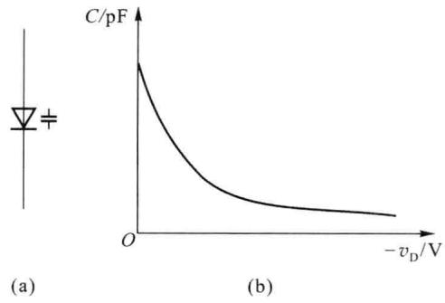  

图 1.2.10 变容二极管的符号与电容电压特性

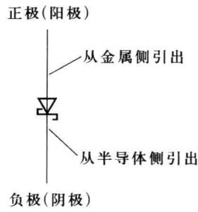  

图1.2.11 肖特基二极管的电路符号

## 三、肖特基二极管

肖特基二极管又称肖特基表面势垒二极管，其内部是一个金属半导体结，即金属-硅结构。肖特基二极管的符号如图1.2.11所示，它是在金属和低掺杂N型半导体的交界处形成一个类似于PN结的势垒区，产生内建电场，其伏安特性与PN结相似，也具有单向导电性。但是，肖特基二极管与普通二极管相比，差别比较大。首先，肖特基二极管是靠多子（电子）导电，不存在普通二极管的少子储存现象，因此工作速度快，适用于高频高速电路；其次，肖特基二极管的势垒区较薄，正向导通电压较低，约为0.4 V，但反向击穿电压也比较低；此外，它的体电阻也比普通二极管小。

## 四、光电子器件

半导体在光照作用下会产生光电效应,即改变电导率和产生电动势;某些半导体材料(如砷化镓)在自由电子和空穴复合时,会释放能量产生光的辐射,并且不同半导体材料会

辐射不同颜色的光,利用这种光电转换性质可以制成光电子器件。它在光电子系统中的光信号和电信号的接口中应用非常广泛。

### 1. 发光二极管

发光二极管简称 LED（Light Emitting Diode），是将电能转换成光能的器件。其电路符号如图 1.2.12 所示，它通常是在半导体中掺入特定杂质（如磷砷化镓等）形成 PN 结构成的。当这种二极管加正向电压并且导通电流足够大时（典型值为 10 mA），N 区和 P 区的多子分别向对方扩散，并与对方的多子直接复合释放出能量而发光。采用不同的材料,可以分别得到红、黄、绿等不同颜色的可见光或者红外线。发光二极管的伏安特性与普通二极管相似,也具有单向导电性,但是其正向导通电压较大。发光二极管具有功耗低、体积小、寿命长等优点,被广泛应用于指示器或显示器件。

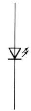  

图1.2.12 发光  

二极管的电路符号

### 2. 光电二极管

光电二极管是对光照敏感的二极管,是一种将光信号转换为电信号的半导体器件,其电路符号如图1.2.13所示。光电二极管的结构与普通二极管类似,但在管壳上有一个用于接收外部光照的玻璃窗口。无光照时,与普通二极管一样具有单向导电性;有光照时,应使光电二极管的PN结工作在反偏状态,反向电流随光照强度的增加而上升(这时的反向电流称为光电流),它是一种远红外接收管。这种特性广泛应用于遥控、报警及光电耦合器中。

显然,将发光器件和光电器件组合可以构成光电耦合器,实现信号的光传输,例如将发光二极管和光电二极管构成光电耦合器,如图1.2.14所示。其中,发光二极管 $D_{1}$ 所发出的光将按照输入信号的规律变化,光电二极管 $D_{2}$ 接收到这种光信号后,将光信号还原为按照输入信号的规律变化的电信号输出,从而实现了信号的光电耦合。

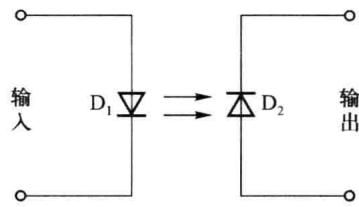  

图 1.2.13 光电二极管的电路符号  

图 1.2.14 光电耦合器

### 3. 激光二极管

如图 1.2.15(a) 所示, 激光二极管的物理结构是在发光二极管的 PN 结之间添加一层具有光活性的半导体, 其端面经过抛光后具有部分反射功能, 从而形成一个光谐振腔。当激光二极管工作在正偏时, LED 结发射出光来并与光谐振腔相互作用, 进一步激励, 从结上发射出单波长的光, 即相干的单色光信号。激光二极管发射的主要是红外线, 不是可见光, 这与所用的半导体材料的物理性质有关。与发光二极管相比, 它的优点是效率高, 并且产生的是准直单色光束。激光二极管在小功率光电设备中应用很广泛, 如计算机上的光盘驱动器、激光打印机中的打印头等。激光二极管的电路符号如图 1.2.15(b) 所示。

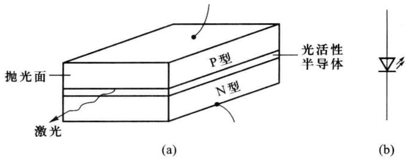  

图 1.2.15 半导体激光二极管
