import Guide from '@/components/Guide.astro';
import Knowledge from '@/components/Knowledge.astro';
import Example from '@/components/Example.astro';
import Analysis from '@/components/Analysis.astro';
import Solution from '@/components/Solution.astro';
import Variant from '@/components/Variant.astro';
import Note from '@/components/Note.astro';
import Block from '@/components/Block.astro';
import Method from '@/components/Method.astro';
import Exercise from '@/components/Exercise.astro';

由二极管、线性元件和独立电源构成的电路称为二极管电路。由于二极管属于非线性元器件，所以含有二极管的电路属于非线性电路。

## 1.3.1 二极管的等效电阻

如前所述,由于二极管是一个非线性器件,所以它的等效电阻是随工作电压变化的,不是常数,并且对于直流和交流两种情况来说会呈现出不同的数值。工程上常用静态电阻和动态电阻来表征其电阻特性。

## 一、静态电阻

当电路中只有直流电源,没有信号源时,电路中各处的电压、电流都是不变的直流量,这

种状态称为静止状态。此时，二极管对外呈现的直流电阻称为静态电阻，常用 $R_{D}$ 表示。设二极管两端的直流电压降为 $V_{DQ}$ ，相应的直流电流为 $I_{DQ}$ ，如图1.3.1所示，则静态电阻 $R_{D}$ 为

$$

R _ {\mathrm{D}} = \frac {V _ {\mathrm{DQ}}}{I _ {\mathrm{DQ}}}\tag{1.3.1}

$$

当管子的工作电流和电压确定后, 就在特性曲线上对应地确定了一个点 Q, 图 1.3.1 中的 Q 点称为静态工作点或直流工作点。可见, 静态电阻 $R_{D}$ 等于原点与 Q 点连线斜率的倒数, 其值与 Q 点的位置有关, Q 点越高, $R_{D}$ 的值越小, 这是非线性电阻的一个特点。分析电路直流工作情况的过程称为直流分析或静态分析。

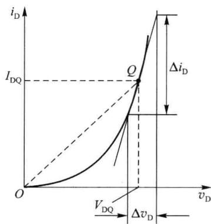  

图1.3.1 二极管的静态电阻与动态电阻

## 二、动态电阻

当电路中既有直流电源又含有信号源时,电路中各处的电压、电流都处于变动状态,称为动态。分析电路在信号源作用下工作情况的过程称为交流分析或动态分析。

由于电路中的电流和电压均由直流量和交流量叠加而成,分析时首先进行直流分析求出直流量,再进行交流分析求出交流量,然后将直流量和交流量叠加得到总量。

如图 1.3.1 所示, 假设在 Q 点的基础上外加微小的变化量, 即加在二极管上的电压 $v_{D}$ 是在静态电压 $V_{DQ}$ 的基础上叠加一个微小的变化量 $\Delta v_{D}$ , 则 $v_{D} = V_{DQ} + \Delta v_{D}$ 。由于 $\Delta v_{D}$ 很小, 二极管工作在 Q 点附近一个很小的范围内, 所以可以用以 Q 点为切点的直线来近似微小变化时的特性曲线。也就是说, 在 $\Delta v_{D}$ 范围内, 二极管的伏安特性曲线可以近似为直线, 二极管的动态电阻可以看成线性电阻, 其阻值等于 Q 点处切线斜率的倒数, 它还被称为微变电阻或者交流电阻, 表示输入小信号工作条件下, 交流电压与交流电流之间的关系, 即

$$

r _ {\mathrm{d}} = \frac {\mathrm{d} v _ {\mathrm{D}}}{\mathrm{d} i _ {\mathrm{D}}} \Bigg | _ {\mathrm{Q}} \approx \frac {\Delta v _ {\mathrm{D}}}{\Delta i _ {\mathrm{D}}} \Bigg | _ {\mathrm{Q}}\tag{1.3.2}

$$

另一方面，利用二极管的电流方程式 $i_{\mathrm{D}} = I_{\mathrm{S}}(\mathrm{e}^{\frac{\tau_{\mathrm{D}}}{\nu_{T}}} - 1)$ ，也可以得到理想二极管的动态电

阻表达式

$$

r _ {\mathrm{d}} = \frac {\mathrm{d} v _ {\mathrm{D}}}{\mathrm{d} i _ {\mathrm{D}}} \Bigg | _ {\mathrm{Q}} = \frac {V _ {T}}{I _ {\mathrm{S}} \mathrm{e} ^ {\frac {v _ {\mathrm{D}}}{V _ {T}}}} \Bigg | _ {v _ {\mathrm{D}} = V _ {\mathrm{DQ}}} \approx \frac {V _ {T}}{I _ {\mathrm{DQ}}}\tag{1.3.3}

$$

在室温下 $(T = 300\mathrm{K})$

$$

r _ {\mathrm{d}} \approx \frac {2 6 \mathrm{mV}}{I _ {\mathrm{DQ}} \mathrm{mA}}\tag{1.3.4}

$$

可见，二极管的动态电阻主要取决于其直流工作电流，即与 Q 点的位置有关；由于二极管正向特性为指数曲线，所以 Q 点位置越高， $r_{d}$ 的数值越小。例如，设 $V_{DQ}=0.7\ V, I_{DQ}=1\ mA$ ，则直流电阻 $R_{D}=700\ \Omega$ ，交流电阻 $r_{d}\approx26\ \Omega$ 。还需要指出的是，直流电阻 $R_{D}$ 可以用普通万用表测量得到，而交流电阻 $r_{d}$ 只能通过计算得到。

## 1.3.2 二极管的模型

由于二极管的伏安特性是非线性的,所以精确地描述一个实际的二极管特性是很复杂的,工程上往往要用某些简化的模型来描述其电特性。能够近似表征器件特性的图表、曲线、函数表达式,或者由基本电路元件构成的电路都可以称为器件的模型。在一定条件下,建立近似反映器件特性的模型,是分析和计算由这种器件构成的电路的特性和参数的基础。用数学表达式来表征器件特性的模型称为数学模型;用基本电路元件(如电阻、电容、电感)以及独立电源和受控源构成的模型,称为器件的网络模型。任何模型都是实际器件特性的近似。一般来说,器件模型的精度越高,模型的结构越复杂,要求的模型参数也越多,分析电路时计算量就越大。因此,实际工作中应根据不同的工作条件和具体要求选用合适的模型,使非线性电路简化为线性电路,然后进行分析计算。下面介绍几种常用的二极管电路模型。

## 一、数学模型

二极管在直流和低频条件下的数学模型已由式(1.2.3)给出,这个模型只能借助于计算机求它的数值。用数值法虽然可以取得数值结果,但难以直观地说明电路的基本功能和物理概念。

## 二、理想化模型

为了突出二极管的单向导电性,常采用理想化模型。理想二极管的符号及其伏安特性

如图1.3.2所示。在正偏时，其管压降为 $0\mathrm{V}$ ；反偏时，其电阻为无穷大，电流为零。它的特点是：导通时，电阻为零，相当于短路；截止时，电阻为无穷大，相当于开路。即，当 $i_{\mathrm{D}} \geqslant 0$ 时， $v_{\mathrm{D}} = 0; v_{\mathrm{D}} \leqslant 0$ 时， $i_{\mathrm{D}} = 0$ 。理想二极管的工作过程与开关的工作过程相似，即正偏时，二极管导通，相当于开关闭合；反偏时，二极管截止，相当于开关断开。这种开关特性充分体现了二极管单向导电性的本质。当大信号工作条件下并且精度要求不高时，常采用这一模型。

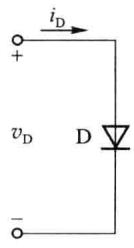  

(a)

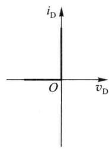  

(b)  

图1.3.2 二极管理想化开关模型及其符号

(a)

(b)

## 三、恒压降模型

如果电源电压较小(例如3 V)，需要考虑二极管的电压降 $v_{D}$ ，且由于曲线较陡，动态电阻 $r_{d}$ 较小可以忽略，常用图1.3.3(a)所示的二段折线来近似二极管的伏安特性。正向导通时，二极管电压降为一个常量 $V_{on}$ ，截止时反向电流为零。相应的电路模型是理想二极管串联电压源 $V_{on}$ ，如图1.3.3(b)所示。这个模型在集成电路的大信号分析中经常使用。

## 四、分段线性模型

如果为了提高电路的分析精度,考虑到导通状态时的电阻 $r_{D}$ ,忽略反向电流,则二极管的大信号分段线性伏安特性如图 1.3.4(a) 所示。其中,动态电阻 $r_{D}$ 包括 PN 结体电阻 $r_{S}$ 与理想 PN 结动态电阻 $r_{d}$ ,即 $r_{D}=r_{S}+r_{d}$ ,相应的等效电路模型如图 1.3.4(b) 所示。由于制作二极管导致的特性分散性, $V_{on}$ 和 $r_{D}$ 的值不是固定不变的。

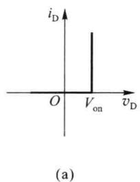

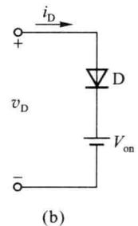

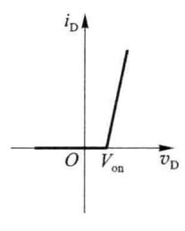  

图 1.3.3 二极管的恒压降电路模型

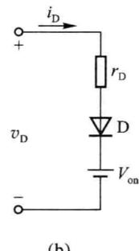  

图 1.3.4 二极管的分段线性电路模型

以上所介绍的模型在整个 v-i 平面上能够基本上反映二极管的伏安特性（没有考虑反向击穿），这类能覆盖整个 v-i 平面的模型称为全模型，或大信号模型，用来近似表示二极管在安全工作范围内电压与电流之间的关系。

在工程应用的近似分析中,二极管的理想化模型、恒压降模型、分段线性模型三种等效电路比较起来,以理想化模型误差最大,分段线性模型误差最小,一般情况下多采用恒压降模型。

<Example title="例 1.3.1">
电路如图 1.3.5 所示, 设二极管导通电压降 $V_{on} \approx 0.7 V$ 。采用恒压降模型, 试估算开关闭合前后的输出电压 $V_{0}$ 为多少?

<Solution title="解">
当开关断开时, 二极管两端加正向电压导通, 有

$$

V _ {\mathrm{O}} = V _ {\mathrm{I}} - V _ {\mathrm{on}} = (4 - 0. 7) \mathrm{V} = 3. 3 \mathrm{V}

$$

当开关闭合时,二极管两端加反向电压截止,因此

$$

V _ {0} = V _ {2} = 8 \mathrm{V}

$$
</Solution>
</Example>

<Example title="例 1.3.2">
电路如图 1.3.6 所示, 输入电压 $v_{i}=6\sin\omega t\ V$ , 设二极管 D 为硅管, 请分别使用理想化模型和恒压降模型 ( $V_{on}=0.7\ V$ ), 求输出电压 $v_{0}$ 的波形。

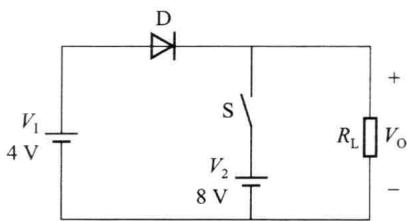  

图1.3.5 例1.3.1电路图

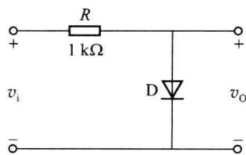  

图1.3.6 例1.3.2电路图

<Solution title="解">
(1) 使用理想化等效电路模型

当 $v_{i}<0\ V$ 时，二极管截止， $v_{0}=v_{i}$ ;

当 $v_{i} \geqslant 0$ V 时，二极管导通， $v_{0} = 0$ V。输出电压 $v_{0}$ 的波形如图 1.3.7(b) 所示。

(2) 使用恒压降等效电路模型

当 $v_{i}<0.7\ V$ 时，二极管截止， $v_{0}=v_{i}$ ;

当 $v_{i} \geqslant 0.7 V$ 时，二极管导通， $v_{0} = 0.7 V$ 。输出电压 $v_{0}$ 的波形如图 1.3.7(c) 所示。
</Solution>
</Example>

## 五、交流小信号模型

如果加在二极管上的电压 $v_{D}$ 是在静态电压 $V_{DQ}$ 的基础上叠加一个微小的变化量 $\Delta v_{D}$ ，二极管的电压、电流变化范围很小，可将二极管用电阻 $r_{d}$ 来等效，如图 1.3.8(a) 所示，此模型称为二极管的交流小信号模型，又称微变等效电路模型。如果考虑结电容后，二极管的高频小信号模型如图 1.3.8(b) 所示。工作频率越高，结电容的旁路现象越严重。

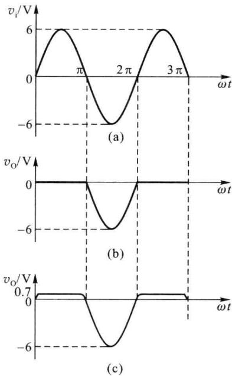  

图1.3.7 例1.3.2图解

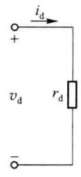  

(a)

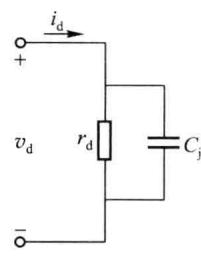  

(b)  

图 1.3.8 二极管的交流小信号模型

需要指出的是,交流小信号模型是为电路的交流分析而建立的,表示叠加在直流工作点之上的信号电压 $v_{d}$ 与信号电流 $i_{d}$ 之间的关系,因此模型中只有交流量,没有直流量。在进行交流小信号分析之前,需要首先确定静态工作点 Q,然后才能确定模型中的动态电阻 $r_{d}$ 值。还应注意,模型的应用条件是小信号(或者微小增量信号),即一般在输入信号幅度小于 10 mV 时,才可以应用;并且,它只能用于计算增量信号值,不能用于计算直流值和总瞬时值(或称全值)。

综上所述,实际工作中常采用模型法分析二极管应用电路,分析时首先需要根据电路的具体情况选择合适的二极管模型;将二极管用模型代替后,实际上就已经把非线性电路转化为线性电路,然后采用线性电路的分析方法进行分析计算,就可以得到需要的结果。对于直流电路和大信号工作电路,通常采用理想化模型或者恒压降模型进行分析。对于既有直流电源又有小信号源的电路,一般首先利用恒压降模型进行静态分析,估算电路的 Q 点;然后根据 Q 点计算出交流电阻;再用小信号模型法进行动态分析,求出小信号作用下的交流电压、电流;最后,将交流量与静态值相叠加,得到完整的结果。下面举例说明。

<Example title="例 1.3.3">
在图 1.3.9(a) 所示的电路中, 已知 $V_{DD} = 5 \, V, R = 4.3 \, k\Omega$ , 二极管的导通电压 $V_{on} = 0.7 \, V$ , 信号电压 $v_{s} = 0.6 \sin \omega t \, V$ 。求输出电压 $v_{0}$ (包括直流量和交流量) 的值并且画出其波形。

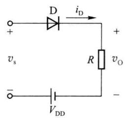  

(a)

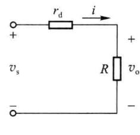  

(b)

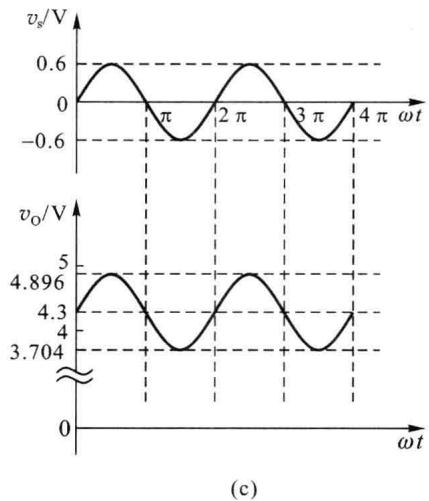  

图1.3.9 例1.3.3电路图

<Solution title="解">
利用叠加定理, 将直流电压源和交流电压源的作用分开考虑。

(1) 首先利用恒压降模型进行直流分析, 求出 Q 点。

令 $v_{s}=0$ ，由图可知，二极管是导通的，二极管的静态工作电流

$$

I _ {\mathrm{DQ}} \approx \frac {V _ {\mathrm{DD}} - V _ {\mathrm{on}}}{R} = \frac {5 - 0 . 7}{4 . 3} \mathrm{mA} = 1 \mathrm{mA}

$$

输出电压的直流分量为

$$

V _ {\mathrm{o}} = I _ {\mathrm{DQ}} \cdot R = 1 \times 4. 3 \mathrm{V} = 4. 3 \mathrm{V}

$$

（2）计算交流分量之前，首先需要画出电路的交流小信号模型，如图1.3.9(b)所示。计算在此工作点之下的理想二极管交流电阻为

$$

r _ {\mathrm{d}} = \frac {V _ {T}}{I _ {\mathrm{DQ}}} = \frac {2 6}{1} \Omega = 2 6 \Omega

$$

输出电压的交流分量为

$$

v _ {\mathrm{o}} = \frac {R}{R + r _ {\mathrm{d}}} v _ {\mathrm{s}} = \frac {4 . 3}{4 . 3 + 0 . 0 2 6} v _ {\mathrm{s}} \approx 0. 5 9 6 \sin \omega t \mathrm{V}

$$

输出电压的总量为

$$

v _ {0} = V _ {0} + v _ {o} = (4. 3 + 0. 5 9 6 \sin \omega t) \mathrm{V}

$$

(3) 根据上述计算结果, 画出输出电压 $v_{0}$ 的波形图, 如图 1.3.9(c) 所示。
</Solution>
</Example>

## 1.3.3 二极管模拟电路

在通信、无线电技术和其他电子学领域中，常用的简单二极管电路有整流电路、限幅电路、稳压电路、钳位电路以及开关电路等，它们都属于二极管模拟电路。应用二极管模型可以对上述电路进行分析。

## 一、整流电路

利用电子器件的单向导电性将交流电变为直流电的过程称为整流。

最简单的半波整流电路如图1.3.10(a)所示。在纯电阻负载的情况下，设输入电压为 $v_{\mathrm{s}} = V_{\mathrm{sm}}\sin \omega t$ 。假设二极管D为理想二极管。采用理想化模型，当 $v_{s} > 0$ ，为正半周时，二极管加正向偏置电压处于导通状态，输出电压

$$

v _ {\mathrm{O}} = \frac {R _ {\mathrm{L}}}{R _ {\mathrm{s}} + R _ {\mathrm{L}}} v _ {\mathrm{s}} = \frac {R _ {\mathrm{L}}}{R _ {\mathrm{s}} + R _ {\mathrm{L}}} V _ {\mathrm{sm}} \sin \omega t\tag{1.3.5}

$$

而当 $v_{i}<0$ 时，二极管加反向偏置电压处于截止状态，输出电压 $v_{0}(t)=0$ 。电路的输出波形如图 1.3.10(b) 所示。可见，输入信号为正半周期时有输出，负半周期时无输出。这种只有半周期有输出的正弦波电压称为半波整流正弦波电压，产生这种电压的电路称为半波整流电路。

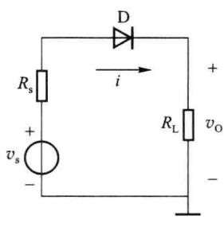  

(a)

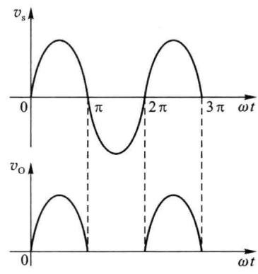  

(b)  

图 1.3.10 半波整流电路及其工作波形

由于输出电压 $v_{0}$ 的半波整流正弦波是单向的，含有平均分量，即直流分量，所以用滤波器滤除输出电压的交流分量，取出直流成分，即可获得直流电压。

用两只二极管可以构成如图 1.3.11(a) 所示的全波整流电路。图中 Tr 是一个二次绕组中心接地、一次绕组和二次绕组匝数比为 1:1 的理想变压器， $D_{1}$ 、 $D_{2}$ 为理想二极管。当 $v_{s}$ >0 时， $D_{1}$ 导通、 $D_{2}$ 截止， $v_{0}=v_{s}$ ，负载电阻 $R_{L}$ 中的电流如图 1.3.11(a) 中实线箭头方向所示；当 $v_{s}\leqslant0$ 时， $D_{1}$ 截止、 $D_{2}$ 导通， $v_{0}=-v_{s}$ ，负载电阻中的电流如图 1.3.11(a) 中虚线箭头方向所示。可见，无论 $v_{s}$ 的极性如何变化， $v_{0}$ 的极性是不变的。也就是说，全波整流使电源电压的正、负半周均得到响应，它在相同输入电压情况下的输出直流电压是半波整流电路的 2 倍。因此全波整流电路是大多数直流电源采用的整流方式。

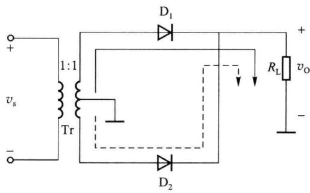  

(a)

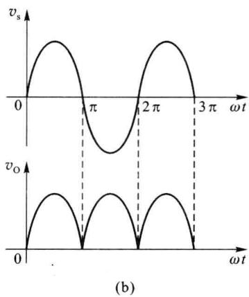  

图1.3.11 全波整流电路

## 二、限幅电路

按照规定的范围,将输入信号波形的一部分传送到输出端,而将其余部分消去的过程称为限幅。一般是利用器件的开关特性实现限幅功能。二极管的限幅电路有串联型和并联型两种基本结构,如图1.3.12所示。图中R为限流电阻,理想二极管D起开关作用,直流电压源V决定限幅电平。

假设输入电压 $v_{s}$ 为幅度大于 V 的三角波。在图 1.3.12(a) 中，当 $v_{s}-V<0$ 时，D 导通， $v_{0}=v_{s}$ ；当 $v_{s}-V\geqslant0$ 时，D 截止， $v_{0}=V$ 。输出波形如图 1.3.13 所示，由图可见，在输出波形中，大于 V 的部分被消去。因此，这种电路又称为上限幅电路。

用同样的方法可以得到图 1.3.12(b) 所示的并联限幅电路的输出波形, 它和图 1.3.12(a) 所示电路的波形完全相同。将图 1.3.12 中二极管 D 反接, 就可以得到下限幅电路。

(b)  

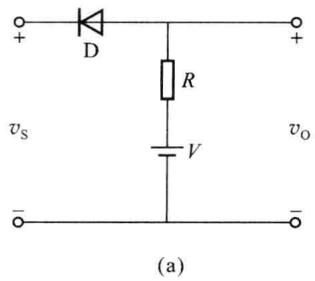

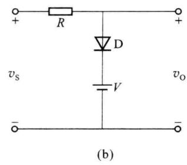  

图 1.3.12 串联型和并联型限幅电路

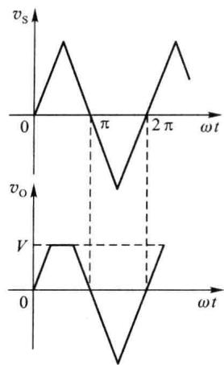  

图1.3.13 限幅电路的输出波形

还有一种双向限幅电路,如图 1.3.14(a) 所示。

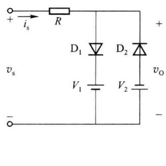  

(a)

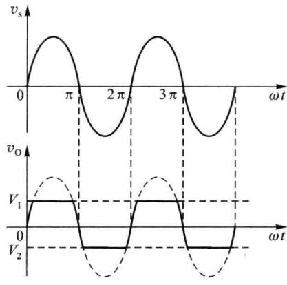  

图 1.3.14 双向限幅电路

当 $v_{s}>V_{1}$ 时， $D_{1}$ 导通、 $D_{2}$ 截止， $v_{0}=V_{1}$ ；当 $v_{s}<-V_{2}$ 时， $D_{1}$ 截止、 $D_{2}$ 导通， $v_{0}=-V_{2}$ ；当 $-V_{2}\leqslant v_{s}\leqslant V_{1}$ 时， $D_{1}$ 、 $D_{2}$ 均截止， $v_{0}=v_{s}$ 。假设输入电压为正弦波，则输出电压. $v_{0}$ 的波形如图 1.3.14(b) 所示，波形的上部和下部均被削掉一部分。

## 三、稳压电路

在通信和电子设备中,一般都需要稳定的直流电源,这些电源大都是由市电电源经过整流后得到的。市电电网电压的波动(一般允许±10%的变化)和直流电源负载的波动都会导致整流后直流电压的变化。对于电源电压稳定度要求较高的设备,这种波动的电源不能满足要求,需要采取稳压措施。利用稳压管的恒压特性可以构成最简单的直流稳压电路。

常用的稳压电路如图 1.3.15 所示。图中 R 为限流电阻, R 的选择应使稳压管工作在稳

压区。这种电路稳压工作的原因在于,当稳定电流 $I_{z}$ 有较大幅度的变化 $\Delta I_{z}$ 时,稳定电压的

变化 $\Delta V_{Z}$ 却很小。因此，当 $V_{S}$ 或 $R_{L}$ 变化时，电路能自动地调整 $I_{Z}$ 的大小，以改变 R 上的电压降 $I_{R} \cdot R$ ，达到维持输出电压 $V_{0}$ 基本恒定的目的。

当 $V_{s}>V_{z}$ 时，稳压管被击穿工作在稳压状态，如果 $V_{s}$ 增大，则 $I_{z}$ 增加，以使 R 上的电压降增大，保证 $V_{0}$ 基本不变；如果 $V_{s}$ 不变，当负载 $R_{L}$ 变化时，如 $I_{L}$ 增大，这时 $I_{z}$ 减小，保证 R 上电压降几乎不变，从而使输出电压 $V_{0}$ 保持稳定。也就是说，当输入电压 $V_{s}$ 或者负载电阻 $R_{L}$ 在一定范围内变化时， $V_{0}=V_{z}$ 几乎不变，稳压管 $D_{z}$ 等效于一个直流电压源 $V_{z}$ 。

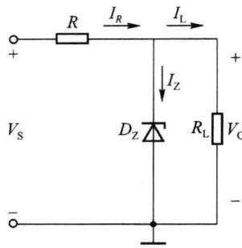  

图 1.3.15 稳压管稳压电路

<Example title="例 1.3.4">
在图 1.3.15 所示稳压管稳压电路中，已知电源电压 $V_{s}=10\ V$ ，稳压管稳定电压 $V_{z}=6\ V$ ，最小稳定电流 $I_{Zmin}=5\ mA$ ，最大稳定电流 $I_{Zmax}=25\ mA$ ；负载电阻 $R_{L}=600\ \Omega$ 。试求限流电阻 R 的取值范围。

<Solution title="解">
由图 1.3.15 所示电路可知,稳压管工作在反偏击穿状态,因此

$$

\begin{array}{r l} & I _ {\mathrm{L}} = V _ {\mathrm{Z}} / R _ {\mathrm{L}} = 6 / 6 0 0 \mathrm{A} = 0. 0 1 \mathrm{A} = 1 0 \mathrm{mA} \\ & I _ {R} = I _ {\mathrm{Z}} + I _ {\mathrm{L}} = [ (5 \sim 2 5) + 1 0 ] \mathrm{mA} = 1 5 \sim 3 5 \mathrm{mA} \end{array}

$$

所以

电阻 R 上的电压 $V_{R}=V_{S}-V_{Z}=(10-6)\mathrm{V}=4\mathrm{~V}$ ，因而

$$

R _ {\mathrm{max}} = \frac {V _ {R}}{I _ {R \mathrm{min}}} = \frac {4}{1 5 \times 1 0 ^ {- 3}} \Omega \approx 2 6 7 \Omega

$$

$$

R _ {\mathrm{min}} = \frac {V _ {R}}{I _ {R \mathrm{max}}} = \frac {4}{3 5 \times 1 0 ^ {- 3}} \Omega \approx 1 1 4 \Omega

$$

限流电阻 R 的取值范围为 114 \~ 267 Ω。
</Solution>
</Example>

## 四、钳位电路

钳位电路的功能是将周期信号波形的某一部分固定在一个选定的电位上,而信号其余部分波形形状保持不变。利用二极管构成的典型钳位电路如图1.3.16(a)所示,图1.3.16(b)为其工作波形。

设输入电压为 $v_{\mathrm{s}}(t) = V_{\mathrm{sm}}\sin \omega t$ ，假设 D 为理想二极管， $RC >> T, T$ 为输入电压的周期，电容 C 的初始电压 $v_{C}(0) = 0$ 。令在时间 $t_1$ 时刻， $v_{\mathrm{s}}(t_1) = V_{\mathrm{R}}$ 。当 $t < t_1$ 时， $v_{\mathrm{s}}(t_1) < V_{\mathrm{R}}$ ，D 截止，由于 $RC >> T, v_{C}(t) \approx 0$ ，因而 $v_{0}(t) = v_{\mathrm{s}}(t)$ 。当 $t = t_1$ ，D 开始导通， $v_{\mathrm{D}} = 0, v_{0}(t_1) = V_{\mathrm{R}}$ 。在 $t_1 < t \leqslant \frac{T}{4}$ 期间，D 导通，仍有 $v_{\mathrm{D}} = 0, v_{0}(t) = V_{\mathrm{R}}, v_{C}(t) = v_{\mathrm{s}}(t) - v_{0}(t) = V_{\mathrm{sm}}\sin \omega t - V_{\mathrm{R}}, v_{C}(t)$ 随 $v_{\mathrm{s}}(t)$ 的增大而增大。当 $t = \frac{T}{4}$ 时， $v_{C}(t) = V_{\mathrm{sm}} - V_{\mathrm{R}}$ ，达到最大值。当 $t > \frac{T}{4}$ 以后，D 截止，因为 $RC >> T$ ，在正弦波一个周期内，电容基本没有放电，C 上的电压 $v_{C}(t)$ 可以认为基本不变，如图 1.3.16 (b) 所示。此时 D 总是处于截止状态，所以输出电压为 $v_{0}(t) = v_{\mathrm{s}}(t) - v_{C}(t) = V_{\mathrm{sm}}\sin \omega t - (V_{\mathrm{sm}} - V_{\mathrm{R}})$ ，相当于把 $v_{\mathrm{s}}(t)$ 波形向下移动 $V_{\mathrm{sm}} - V_{\mathrm{R}}$ ，该波形的顶部被钳位在 $V_{\mathrm{R}}$ 电位上。

由上述分析可见,在 $0 \sim \frac{T}{4}$ 时间间隔内,输出波形为瞬态过渡过程;其余时间的输出波

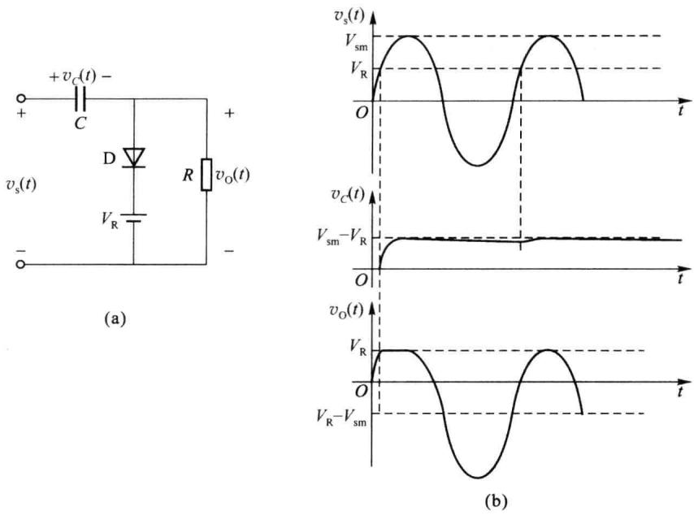  

图 1.3.16 钳位电路及其波形图

形，除了向下平移 $V_{sm}-V_{R}$ ，均与输入信号波形的形状相同。

## 五、开关电路

在脉冲和数字电路中,其输入、输出量一般用高、低电平来表示,用以代表两个不同的状态。在数字电路中,一般将高、低电平分别称为逻辑1和逻辑0,基本的逻辑运算有与、或、非三种,实现这种运算的电路分别称为与门、或门、非门。利用二极管的单向导电性,可以方便地构成电路中的与门、或门开关电路。在分析这种电路时,应当注意的一条基本原则是:判断电路中的二极管处于导通还是截止状态,可以先将二极管断开,然后观察正、负两个电极间的偏置电压,如果是正向偏置电压,则二极管导通;如果是反向偏置电压,则二极管截止。

### 1. 二极管与门

图 1.3.17 所示为二极管与门电路。输入信号 $v_{11}$ 和 $v_{12}$ 的值为 0 V 或者 5 V，简单起见，设二极管为理想开关。

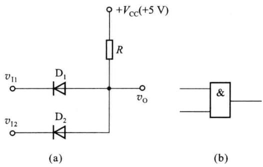  

图 1.3.17 二极管与门电路及其符号

当 $v_{11}=0\ V$ 、 $v_{12}=5\ V$ 时， $D_{1}$ 为正偏，导通， $v_{0}=0\ V$ ；此时 $D_{2}$ 反偏，截止。类似地，将 $v_{11}$ 和 $v_{12}$ 的其余三种组合及输出电压列于表 1.3.1 中。

表 1.3.1 与门电路输入、输出电平关系

<table><tr><td rowspan="2"> ${v}_{11}/\mathrm{V}$ </td><td rowspan="2"> ${v}_{12}/\mathrm{V}$ </td><td colspan="2">二极管工作状态</td><td rowspan="2"> ${v}_{0}/\mathrm{V}$ </td></tr><tr><td> ${\mathrm{D}}_{1}$ </td><td> ${\mathrm{D}}_{2}$ </td></tr><tr><td>0</td><td>0</td><td>导通</td><td>导通</td><td>0</td></tr><tr><td>0</td><td>5</td><td>导通</td><td>截止</td><td>0</td></tr><tr><td>5</td><td>0</td><td>截止</td><td>导通</td><td>0</td></tr><tr><td>5</td><td>5</td><td>截止</td><td>截止</td><td>5</td></tr></table>

由上表可见,输入电压中只要有一个为低电平,则输出为低电平;只有当所有输入电压均为高电平时,输出才为高电平。这种关系在数字电路中称为与逻辑,其功能电路称为与门电路。

### 2. 二极管或门

图 1.3.18 为二极管或门电路。由图可以得到其输入、输出的对应关系，见表 1.3.2。由表可见，该电路输入电压中只要有一个为高电平，输出就是高电平；只有当所有输入电压均为低电平时，输出才是低电平。这种逻辑关系称为或逻辑，其功能电路称为或门电路。

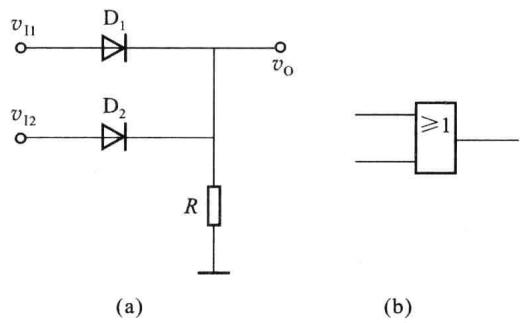  

图 1.3.18 二极管或门电路及其符号

表 1.3.2 或门电路输入、输出电平关系

<table><tr><td rowspan="2"> $v_{11}/V$ </td><td rowspan="2"> $v_{12}/V$ </td><td colspan="2">二极管工作状态</td><td rowspan="2"> $v_0/V$ </td></tr><tr><td> $D_1$ </td><td> $D_2$ </td></tr><tr><td>0</td><td>0</td><td>截止</td><td>截止</td><td>0</td></tr><tr><td>0</td><td>5</td><td>截止</td><td>导通</td><td>5</td></tr><tr><td>5</td><td>0</td><td>导通</td><td>截止</td><td>5</td></tr><tr><td>5</td><td>5</td><td>导通</td><td>导通</td><td>5</td></tr></table>
