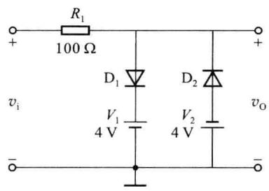
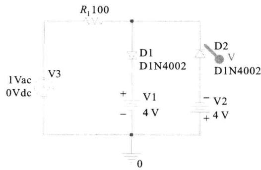
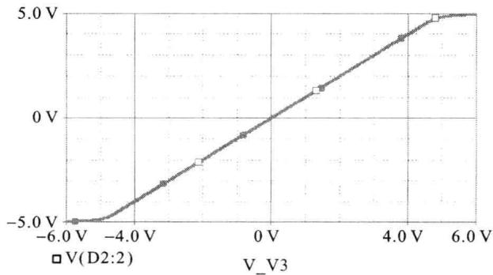
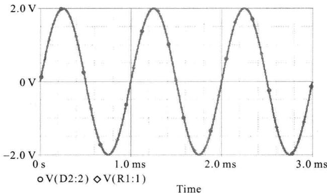
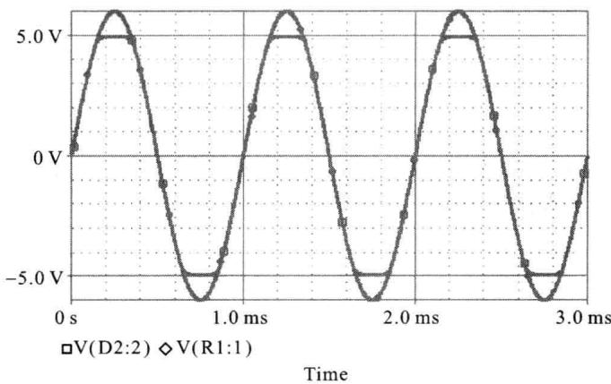

import Guide from '@/components/Guide.astro';
import Knowledge from '@/components/Knowledge.astro';
import Example from '@/components/Example.astro';
import Analysis from '@/components/Analysis.astro';
import Solution from '@/components/Solution.astro';
import Variant from '@/components/Variant.astro';
import Note from '@/components/Note.astro';
import Block from '@/components/Block.astro';
import Method from '@/components/Method.astro';
import Exercise from '@/components/Exercise.astro';

在电路的分析设计过程中,利用计算机对电路进行仿真,也是一种非常好的辅助手段。下面通过使用 OrCAD 软件(该软件的使用方法,请参看本书附录 1.1),对一个双向限幅电路进行仿真来说明。

仿真原理图如图 1.4.1 所示, 图中二极管 $D_{1}$ 、 $D_{2}$ 的参数相同, 均为 $I_{S}=2\times10^{-14}A$ , $r_{d}=1\Omega$ 。试做如下分析:

（1）分析电路的直流传输特性并说明二极管工作状态的变化情况。

（2）设输入信号是幅度为 $2 \, V$ 、频率为 $2 \, kHz$ 的正弦波，求 $v_{0}$ 的波形。

(3) 设输入信号是幅度为 $6 \, V$ 、频率为 $2 \, kHz$ 的正弦波，求 $v_{0}$ 的波形。

  

图 1.4.1 二极管双向限幅电路

  

图 1.4.2 使用 OrCAD 绘制的结果

<Solution title="解">
使用 OrCAD 绘制该电路, 如图 1.4.2 所示。

图 1.4.2 中, 使用二极管 D1N4002, 同时将 $I_{s}$ 和 $r_{d}$ 这两个参数改为题中所提供的值。首先需要分析的是直流传输特性, 故可将 $V_{3}$ 设置为简单的 Vac, 并在直流扫描中设置其取值范围为 $-6 \sim +6 \, V$ , 仿真结果如图 1.4.3 所示。

  

图 1.4.3 使用直流扫描求输入输出特性

从图 1.4.3 中可以看出, 当 $\left|v_{i}\right| > 4.7 V$ 后, 两只二极管只有一只能导通, 另外一只截止, 此时输出电压基本不随输入电压的变化而变化, 其绝对值近似为 4.7 V, 此即为限幅特性；当 $\left|v_{i}\right|<4.7\ V$ 时，两只二极管均截止，输入电压可无衰减地传输至输出端， $v_{0}=v_{i}$ ，此时为非限幅区。

在分析题中第(2)、(3)问时,需要将输入信号源换为VSIN型,并根据题中要求设置信号源的参数值,此时还可在信号源的正端处增加一个电压探针。仿真结果如图1.4.4所示,其中图(a)所示为输入信号峰值为2V时的情况,图(b)所示为输入信号峰值为6V时的情况。

从以上两图中可以看出,当输入信号较小时,电路工作于非限幅区,此时输入电压可以等量传送到输出端;当输入信号较大时,电路进入限幅区,此时输入电压中过大的那一部分会被“削去”,此即限幅的含义。

(a)  

  

(b)  

图 1.4.4 使用正弦波信号源时的输出电压波形
</Solution>
