import Guide from '@/components/Guide.astro';
import Knowledge from '@/components/Knowledge.astro';
import Example from '@/components/Example.astro';
import Analysis from '@/components/Analysis.astro';
import Solution from '@/components/Solution.astro';
import Variant from '@/components/Variant.astro';
import Note from '@/components/Note.astro';
import Block from '@/components/Block.astro';
import Method from '@/components/Method.astro';
import Exercise from '@/components/Exercise.astro';

## 习题

<Exercise title="习题 1.1.1">
假设在硅材料的 P 型半导体中，受主杂质浓度为 $N_{A}=10^{23}$ m $^{-3}$ 。试求该材料中的空穴浓度和电子浓度（设 T=300 K）。

<Solution>
$p_0\approx 10^{23}\mathrm{m}^{-3},n_0\approx 2.25\times 10^9\mathrm{m}^{-3}$
</Solution>
</Exercise>

<Exercise title="习题 1.1.2">
在 $T = 300\mathrm{K}$ 时，硅的本征载流子浓度为 $n_{\mathrm{i}} = 1.5\times 10^{16}\mathrm{m}^{-3}$ 。试求：

（1）如果在 300 K 时掺入受主杂质，其浓度为 $N_{A}=2\times10^{20}$ m $^{-3}$ ，计算这时的空穴浓度和电子浓度。

（2）当温度升高到 573 K 时， $n_{i}$ 近似为 $3 \times 10^{21} \, m^{-3}$ 。设掺入杂质浓度不变，这时半导体呈现什么类型的导电性？

<Solution>
(1) $p_0 \approx 2 \times 10^{20} \mathrm{~m}^{-3}, n_0 \approx 1.125 \times 10^{12} \mathrm{~m}^{-3}$ (2) 本征导电特性
</Solution>
</Exercise>

<Exercise title="习题 1.2.1">
对于一个锗 PN 结, 在 $T=290\ K$ 时, 试求:

（1）当反向电流达到其饱和电流 $I_{s}$ 的 90% 时所加的反向电压；

(2) 当正向电压和反向电压都是 0.05 V 时的正向电流和反向电流之比；

(3) 如果反向饱和电流等于 $1 \mu \mathrm{A}$ , 正向电压为 $0.1 \mathrm{~V} 、 0.2 \mathrm{~V} 、 0.3 \mathrm{~V}$ 时的电流值。

<Solution>
(1) $v_{\mathrm{D}} = -0.0576\mathrm{V}$ (2) $i_{\text{正}} / i_{\text{反}} = -7.389$ (3) $53.6\mu \mathrm{A}, 2.98\mathrm{mA}, 0.16\mathrm{A}$
</Solution>
</Exercise>

<Exercise title="习题 1.2.2">
在室温为 290 K 时, 锗和硅二极管的反向饱和电流 $I_{s}$ 分别为 1 nA 和 0.5 pA, 如果两只二极管串联如图题 1.2.2 所示, 且通过 1 mA 正向电流。二极管的结电压各是多少?

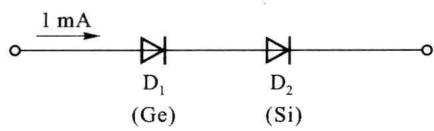  

图题1.2.2

<Solution>
$V_{\mathrm{Ge}} = 0.345\mathrm{V}, V_{\mathrm{Si}} = 0.535\mathrm{V}$
</Solution>
</Exercise>

<Exercise title="习题 1.2.3">
一只二极管的伏安特性可用 $I=20\times10^{-12}\left(\mathrm{e}^{\frac{v_{\mathrm{D}}}{V_{T}}}-1\right)\mathrm{A}$ 来表示，设 $V_{T}=26\ mV$ ，试计算：

(1) 如果用一个 $1.5 \mathrm{~V}$ 的干电池接在上述二极管的两端, 问有多大电流通过? 是否与实际情况相符?

（2）用万用表的电阻挡测量上述二极管的正向电阻时，发现用 $\Omega \times 10$ 挡测出的阻值小，用 $\Omega \times 100$ 挡测出阻值大，为什么？
</Exercise>

<Exercise title="习题 1.2.4">
一硅稳压管稳压电路如图题1.2.4所示。其中直流输入电压 $V_{\mathrm{I}} = 18 \mathrm{~V}, R = 1 \mathrm{k}\Omega, R_{\mathrm{L}} = 2 \mathrm{k}\Omega$ ，硅稳压管 $\mathrm{D}_{\mathrm{Z}}$ 的稳压电压 $V_{\mathrm{Z}} = 10 \mathrm{~V}$ ，动态电阻及未被击穿时的反向电流均可忽略。

(1) 试求 $V_{0}$ 、 $I_{0}$ 、I 和 $I_{z}$ 的值；

(2) 试求 $R_{L}$ 值降低到多大时, 电路的输出电压将不再稳定。

<Solution>
(1) $V_{0} = 10\mathrm{V}, I_{0} = 5\mathrm{mA}, I = 8\mathrm{mA}, I_{\mathrm{Z}} = 3\mathrm{mA}$ (2) $R_{\mathrm{L}} < 1.25\mathrm{k}\Omega$
</Solution>
</Exercise>

<Exercise title="习题 1.2.5">
电路如图题 1.2.5 所示, 稳压管 $D_{z}$ 的稳定电压 $V_{z}=8\ V$ , 限流电阻 $R=3\ k\Omega$ , 设 $v_{i}=15\sin\omega t\ V$ , 试画出输出电压 $v_{0}(t)$ 的波形。

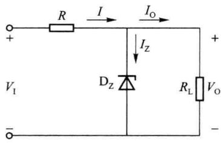  

图题1.2.4

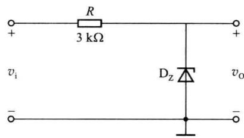  

图题1.2.5
</Exercise>

<Exercise title="习题 1.3.1">
某二极管的伏安特性如图题 1.3.1 所示, 试求 a、b 两点的静态电阻和动态电阻。

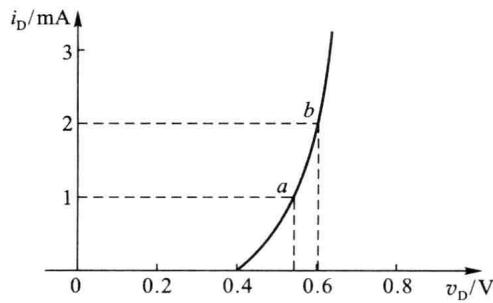  

图题1.3.1

<Solution>
a 点: $R_{D}=530\ \Omega, r_{d}=26\ \Omega$ ; b 点: $R_{D}=300\ \Omega, r_{d}=13\ \Omega$
</Solution>
</Exercise>

<Exercise title="习题 1.3.2">
二极管电路如图题1.3.2所示。请判断图中的二极管D是导通还是截止？并求出 $V_{p}$ 值。

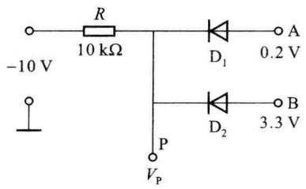  

(a)

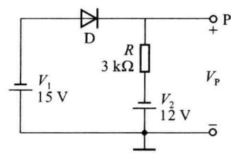  

(b)

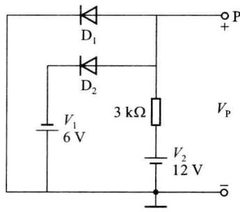  

(c)  

图题1.3.2

在图(a)中,二极管导通时 $V_{D}=0.3\ V$ , 截止时断开。在图(b)、(c)中, 假设二极管为理想的。

<Solution>
(a) 图: $V_{p}=3\ V$ ; (b) 图: $V_{p}=-12\ V$ ; (c) 图: $V_{p}=-6\ V$
</Solution>
</Exercise>

<Exercise title="习题 1.3.3">
图题 1.3.3 所示为桥式整流电路, 假定二极管 D 均为理想, 试求输出电压波形。

如果有一只整流管断路会产生什么后果？如果有一只整流管极性接反会出现什么后果？如果有一只整流管短路会出现什么后果？

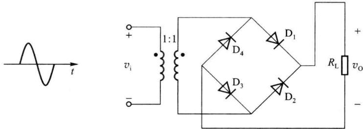  

图题1.3.3
</Exercise>

<Exercise title="习题 1.3.4">
设输入信号 $v_{\mathrm{s}}(t)=9\sin\omega t\;\mathrm{V}$ ，试对图题 1.3.4 所示两个限幅电路，画出输出电压 $v_{0}(t)$ 波形。

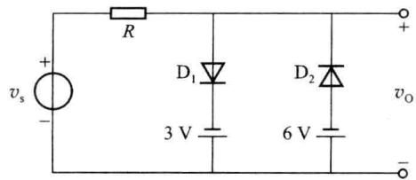  

(a)

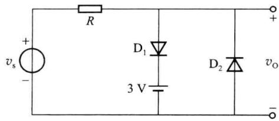  

(b)  

图题1.3.4
</Exercise>

<Exercise title="习题 1.3.5">
有一串联双向限幅电路,其电路如图题1.3.5所示。如果输入信号为一幅度为15 V的正弦波电压,求输出电压 $v_{0}(t)$ 的波形。
</Exercise>

<Exercise title="习题 1.3.6">
电路如图题1.3.6所示， $D_{1}$ 、 $D_{2}$ 为硅二极管，当 $v_{i}=6\sin\omega t\ V$ 时，试用恒压降模型和分段线性模型( $V_{on}=0.5\ V,r_{D}=200\ \Omega$ )分析输出电压 $v_{0}$ 的波形。

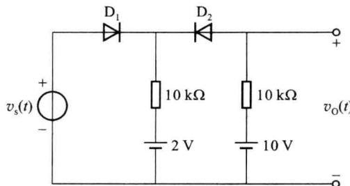  

图题1.3.5

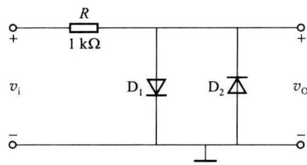  

图题1.3.6
</Exercise>

<Exercise title="习题 1.3.7">
在 $0 \leqslant t \leqslant 10 \, ms$ 时间内，绘出图题 1.3.7(a) 所示电路的输出电压 $v_{0}(t)$ 的波形。输入电压波形如图题 1.3.7 所示。

(1) 使用理想化模型。

(2) 使用恒压降模型。

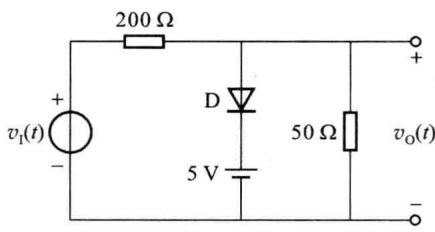  

(a)

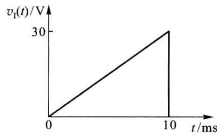  

(b)  

图题1.3.7
</Exercise>

<Exercise title="习题 1.3.8">
电路如图题 1.3.8 所示, 常温下 $V_{T} \approx 26 \, mV$ , 导通电压 $V_{on} = 0.7 \, V$ , 电容 C 对交流信号可视为短路, 信号电压 $v_{i}(t) = 15 \sin \omega t \, \text{mV}$ 。试问:

(1) 二极管在 $v_{i}$ 为零时的电流和电压各为多少?

(2) 二极管中流过的交流电流 $i_{d}$ 为多少?

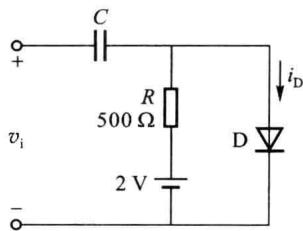  

图题1.3.8

## 第二章 双极型晶体管及其放大电路

双极型晶体管是常用的半导体器件之一,由它构成的基本放大电路是组成各种复杂电路的单元和基础,而随着集成工艺的发展,集成电路的应用越来越广泛。

本章首先介绍双极型晶体管的结构、工作原理、特性曲线和主要参数，然后重点讨论双极型模拟集成电路中常用的基本单元电路的组成、工作原理、性能指标和分析计算方法，主要包括三种基本组态放大电路、电流源电路、差分放大电路、功率放大电路和多级放大电路等。

<Solution>
(1) $V_{\mathrm{DQ}} = 0.7\mathrm{V}, I_{\mathrm{DQ}} = 2.6\mathrm{mA}$ (2) $r_{\mathrm{d}} = 10\Omega, i_{\mathrm{d}} = 1.5\sin \omega t\mathrm{mA}$

$$
\textcircled{2} \rightarrow \mathrm{B} \textcircled{1} \rightarrow \mathrm{E} \textcircled{3} \rightarrow \mathrm{C}
$$
</Solution>
</Exercise>
