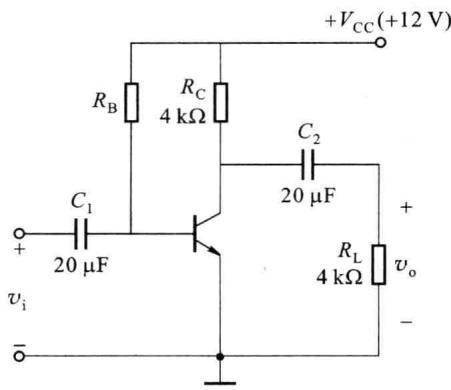
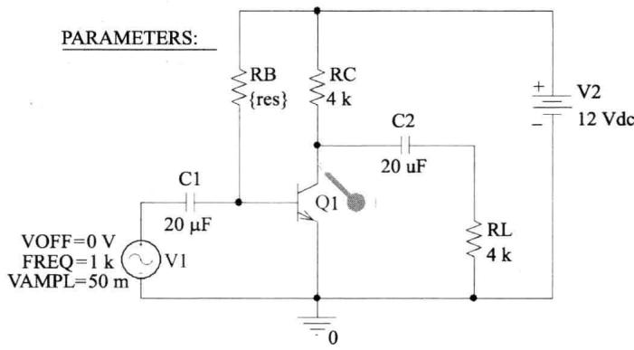
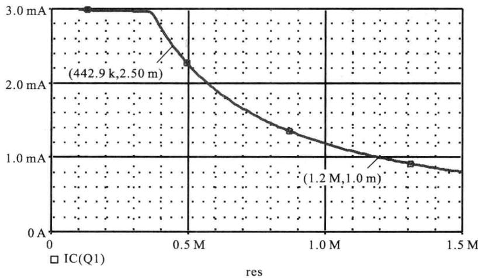
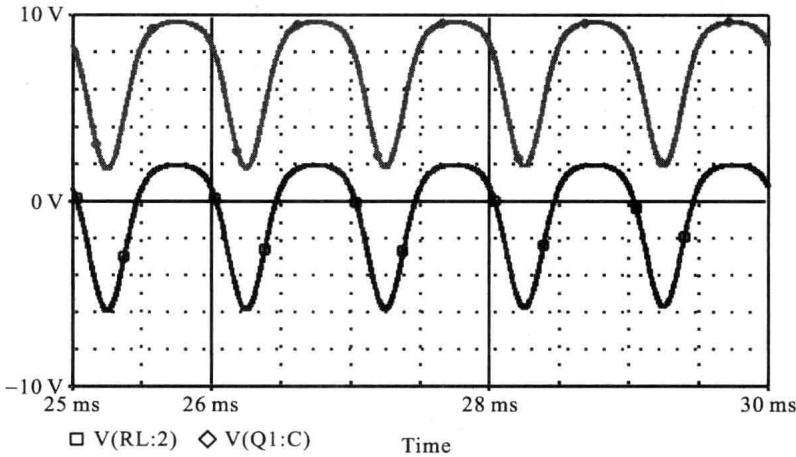
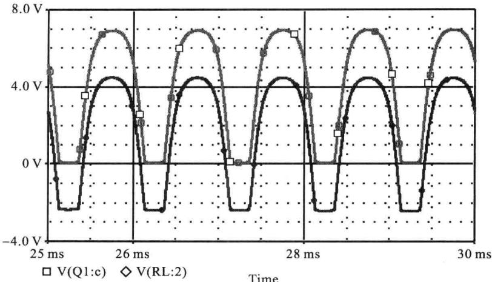
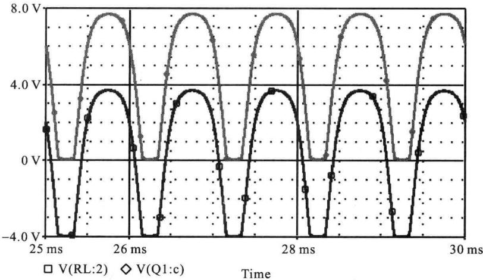
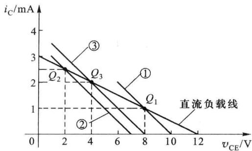

import Guide from '@/components/Guide.astro';
import Knowledge from '@/components/Knowledge.astro';
import Example from '@/components/Example.astro';
import Analysis from '@/components/Analysis.astro';
import Solution from '@/components/Solution.astro';
import Variant from '@/components/Variant.astro';
import Note from '@/components/Note.astro';
import Block from '@/components/Block.astro';
import Method from '@/components/Method.astro';
import Exercise from '@/components/Exercise.astro';

使用 OrCAD 对图 2.10.1 所示的共射放大电路进行仿真分析, 分析静态工作点不同时对输出电压动态范围的影响。

<Example title="例 2.10.1">
设有共射放大电路如图 2.10.1 所示, 图中晶体管的 $\beta = 100, r_{bb'} = 200 \Omega$ 。设输入信号为 1 kHz 的正弦波。

（1）调节 $R_{B}$ 使 $I_{CQ} \approx 1 \, mA$ ，求此时输出电压 $v_{o}$ 的动态范围。

(2) 调节 $R_{B}$ 使 $I_{CQ} \approx 2.5 \, mA$ ，求此时输出电压 $v_{o}$ 的动态范围。

(3) 为使 $v_{o}$ 的动态范围最大, $I_{CQ}$ 应为多少 mA? 此时 $R_{B}$ 为何值?

(4) 试用图解法解释上述仿真结果。

  

图 2.10.1 共射放大电路

<Solution title="解">
由于题目中要求通过调整 $R_{B}$ 来获得所需的 $I_{CQ}$ ，故需要先对 $R_{B}$ 进行直流扫描分析。在 OrCAD 中将该图绘出，如图 2.10.2 所示。

在绘制该图时,需要注意如下几点:

（1）由于题目中未指明晶体管的其他参数，故任选一只晶体管放入，但在放入晶体管后需要将其参数改为题目中所要求的值。

  

图 2.10.2 OrCAD 中的原理图

（2）由于需要对基极偏置电阻做直流扫描仿真，故在图中放入了可变参数器件，并将 $R_{B}$ 的取值设置为该可变参数。

（3）为了观察 $R_{B}$ 变化时对 $I_{CQ}$ 的影响，在 Q1 的集电极处放置一个电流探针。

（4）由于需要观察不同静态工作点时的时域波形，故信号源使用了VSIN形式。

完成原理图的绘制后即可进行相应的仿真工作, 设置 $R_{B}$ 的取值范围从 100 kΩ 到 1.5 MΩ, 步长 10 kΩ。仿真结果如图 2.10.3 所示。

从图 2.10.3 中可以看出: 当 $R_{B} \approx 1.2 \, M\Omega$ 时, $I_{CQ} \approx 1 \, mA$ ; 当 $R_{B} \approx 443 \, k\Omega$ 时, $I_{CQ} \approx 2.5 \, mA$ 。

  

图 2.10.3 $R_{B}$ 变化时的 $I_{CQ}$

然后对以上两个 $R_{B}$ 所对应的时域电压波形进行分析，将探针类型由电流改为电压，并在电容 $C_{2}$ 的两端分别放置一个探针，测出 $v_{CE}$ 和 $v_{o}$ ，其中 $v_{o}$ 是 $v_{CE}$ 的交流分量。

(1) $R_{B} \approx 1.2 M\Omega, I_{CQ} \approx 1 mA$ 时的输出电压波形如图 2.10.4 所示，由图可以看出，此时输出电压波形出现顶部失真，为截止失真，动态范围约为 $2 V, V_{CEQ} \approx 8 V$ 。

  

图 2.10.4 $R_{B} \approx 1.2 M\Omega, I_{CQ} \approx 1 mA$ 时的输出电压波形

(2) $R_{\mathrm{B}} \approx 443 \mathrm{k}\Omega, I_{\mathrm{CQ}} \approx 2.5 \mathrm{~mA}$ 时的输出电压波形如图2.10.5所示，从图中可以看出，此时输出电压波形出现底部失真，为饱和失真，动态范围约为 $2 \mathrm{~V}, V_{\mathrm{CEQ}} \approx 2 \mathrm{~V}$ 。

（3）当 $I_{CQ}R_{L}^{\prime}=V_{CEQ}-V_{CE(sat)}$ 时，输出电压 $v_{o}$ 的动态范围最大，推出 $I_{CQ}\approx2mA$ ，从图

  

图 2.10.5 $R_{B} \approx 443 \, k\Omega$ , $I_{CQ} \approx 2.5 \, mA$ 时的输出电压波形

2.10.3 中可看出, 此时 $R_{B} \approx 560 \, k\Omega$ 。以该值重新进行瞬态仿真, 输出电压波形如图 2.10.6 所示, 动态范围约为 $4 \, V, V_{CEQ} \approx 4 \, V$ 。

  

图 2.10.6 $R_{B} \approx 560 \, k\Omega$ , $I_{CQ} \approx 2 \, mA$ 时的输出电压波形

（4）用图解法对图2.10.1进行分析，如图路的交流负载电阻 $R_{L}^{\prime}=2\ k\Omega$ ，三条斜率相同的交流负载线分别对应 $I_{CQ}\approx1\ mA$ 、2.5mA、2mA的上述三种情况，对应的直流工作点分别为 $Q_{1}$ 、 $Q_{2}$ 、 $Q_{3}$ 。由于 $Q_{1}$ 偏低，当信号逐渐增大时，输出电压首先出现截止失真，动态范围为 $I_{CQ}R_{L}^{\prime}\approx2\ V$ ；由于 $Q_{2}$ 偏高，输出电压首先出现饱和失真，动态范围为 $V_{CEQ}-V_{CEQ(sat)}\approx2\ V$ ； $Q_{3}$ 大致位于交流负载线的中点，获得最大的动态范围约为4V。与仿真结果相一致。

  

图 2.10.7 图解法分析
</Solution>
</Example>
