import Guide from '@/components/Guide.astro';
import Knowledge from '@/components/Knowledge.astro';
import Example from '@/components/Example.astro';
import Analysis from '@/components/Analysis.astro';
import Solution from '@/components/Solution.astro';
import Variant from '@/components/Variant.astro';
import Note from '@/components/Note.astro';
import Block from '@/components/Block.astro';
import Method from '@/components/Method.astro';
import Exercise from '@/components/Exercise.astro';

## 习题

<Exercise title="习题 2.1.1">
怎样用万用表的电阻挡判别双极型晶体管的三个电极及类型(NPN或PNP)?
</Exercise>

<Exercise title="习题 2.1.2">
在某放大电路中,分别测得三个晶体管各电极的对地电位,如图题2.1.2所示,试判断它们是NPN型还是PNP型?是硅管还是锗管?并区分出E、B、C三个电极。

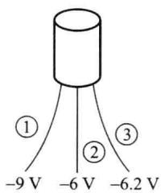

(a)

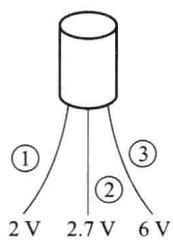

(b)

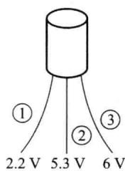

(c)
</Exercise>

<Exercise title="习题 2.1.3">
某放大电路中晶体管三个电极的电流如图题 2.1.3 所示，用万用表直流电流挡测得 $I_{1}=2\ mA, I_{2}=0.04\ mA, I_{3}=-2.04\ mA$ ，试区分出 E、B、C 三个电极，并说明此晶体管是 NPN 型还是 PNP 型？它的 $\bar{\beta}$ 等于多少？

<Solution>
③→E②→B①→C NPN型管 $\bar{\beta}=50$
</Solution>
</Exercise>

<Exercise title="习题 2.1.4">
测量某硅晶体管各电极对地的电压值如下,试判别该管的工作状态(放大、截止或饱和)。

(1) $V_{\mathrm{C}} = 6 \mathrm{~V}, V_{\mathrm{B}} = 0.7 \mathrm{~V}, V_{\mathrm{E}} = 0 \mathrm{~V}$ ;

图题2.1.2  

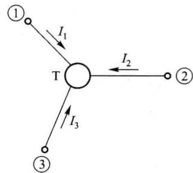

(2) $V_{\mathrm{C}} = 6 \mathrm{~V}, V_{\mathrm{B}} = 2 \mathrm{~V}, V_{\mathrm{E}} = 1.3 \mathrm{~V}$ ;

图题2.1.3

(3) $V_{\mathrm{C}} = 6 \mathrm{~V}, V_{\mathrm{B}} = 6 \mathrm{~V}, V_{\mathrm{E}} = 5.3 \mathrm{~V}$ ;

(4) $V_{\mathrm{C}} = 6 \mathrm{~V}, V_{\mathrm{B}} = 4 \mathrm{~V}, V_{\mathrm{E}} = 3.6 \mathrm{~V}$ ;

(5) $V_{\mathrm{C}} = 3.6 \mathrm{~V}, V_{\mathrm{B}} = 4 \mathrm{~V}, V_{\mathrm{E}} = 3.3 \mathrm{~V}$ 。

<Solution>
（1）放大；（2）放大；（3）临界饱和；（4）截止；（5）饱和
</Solution>
</Exercise>

<Exercise title="习题 2.1.5">
测得 3 只硅 NPN 型晶体管的极间电压 $V_{BE}$ 、 $V_{CE}$ 如表题 2.1.5 所示，试判别它们的工作状态（放大、截止或饱和），填入表中。

<Solution>
a 截止; b 饱和; c 放大
</Solution>
</Exercise>

<Exercise title="习题 2.1.6">
测得 3 只锗 PNP 型晶体管的极间电压 $V_{BE}$ 、 $V_{CE}$ 如表题 2.1.6 所示，试判别它们的工作状态（放大、截止或饱和），填入表中。

表题 2.1.5 硅 NPN 型晶体管极间电压

<table><tr><td></td><td> ${V}_{\mathrm{{BE}}}/\mathrm{V}$ </td><td> ${V}_{\mathrm{{CE}}}/\mathrm{V}$ </td><td>工作状态</td></tr><tr><td>a 管</td><td>-3</td><td>5</td><td></td></tr><tr><td>b 管</td><td>0.7</td><td>0.3</td><td></td></tr><tr><td>c 管</td><td>0.7</td><td>5</td><td></td></tr></table>

表题 2.1.6 锗 PNP 型晶体管极间电压

<table><tr><td></td><td> ${V}_{\mathrm{{BE}}}/\mathrm{V}$ </td><td> ${V}_{\mathrm{{CE}}}/\mathrm{V}$ </td><td>工作状态</td></tr><tr><td>a 管</td><td>-0.2</td><td>-3</td><td></td></tr><tr><td>b 管</td><td>-0.2</td><td>-0.1</td><td></td></tr><tr><td>c 管</td><td>3</td><td>-5</td><td></td></tr></table>

<Solution>
a 放大; b 饱和; c 截止
</Solution>
</Exercise>

<Exercise title="习题 2.1.7">
用万用表直流电压挡测得电路中晶体管各个电极的对地电位如图题 2.1.7 所示,试判断这些晶体管分别处于哪种工作状态(饱和、放大、截止、倒置或已损坏)。

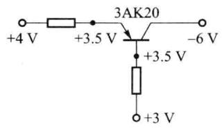  

(a)

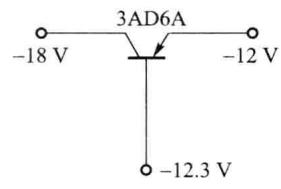  

(b)

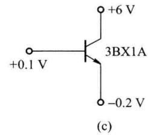

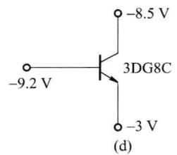

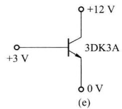

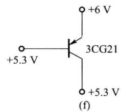  

图题2.1.7

<Solution>
(a) $\mathrm{J_e}$ 击穿短路；(b) 放大；(c) 放大；(d) 截止；(e) $\mathrm{J_e}$ 断路损坏；(f) 临界饱和
</Solution>
</Exercise>

<Exercise title="习题 2.1.8">
某晶体管的厄尔利电压 $V_{A}=80\ V$ ，电压 $V_{CEQ}=10\ V$ ，分别求工作电流 $I_{CQ}$ 为 1 mA 和 0.1 mA 时的 $r_{ce}$ 值。

<Solution>
90 kΩ, 900 kΩ
</Solution>
</Exercise>

<Exercise title="习题 2.1.9">
已知某晶体管在室温 $27^{\circ}C$ 下的 $\bar{\beta}=50, V_{BE}=0.2\ V, I_{CBO}=10^{-8}\ A, \bar{\beta}$ 随温度的变化为 $1\%/^{\circ}C, V_{BE}$ 随温度的变化为 $-2.5\ mV/^{\circ}C$ ，温度每增加 $10^{\circ}C, I_{CBO}$ 扩大一倍，若设温度 $T_{1}$ 时 $I_{CBO}=I_{CBO1}$ ，温度 $T_{2}$ 时 $I_{CBO}=I_{CBO2}$ ，则 $I_{CBO2}=I_{CBO1}\frac{T_{2}-T_{1}}{10}$ ，试求当温度升高到 $60^{\circ}C$ 时的 $\bar{\beta}, V_{BE}, I_{CBO}$ 值。

<Solution>
66.5,0.1175 V, $9.85 \times 10^{-8} \mathrm{~A}$
</Solution>
</Exercise>

<Exercise title="习题 2.1.10">
有两只晶体管,其中一只管子的 $\beta=150, I_{CEO}=200\ \mu A$ , 另一只管子的 $\beta=50, I_{CEO}=10\ \mu A$ , 其他参数一样,你选哪个?为什么?

<Solution>
选 $\beta = 50, I_{\mathrm{CEO}} = 10 \mu \mathrm{A}$ 的晶体管，稳定性好
</Solution>
</Exercise>

<Exercise title="习题 2.1.11">
NPN 型晶体管的输出特性如图题 2.1.11 所示, Q 点为静态工作点。

(1) 求 Q 点直流电阻和交流电阻；

(2) 求 Q 点附近的 $\bar{\beta}$ 和 $\beta$ ;

（3）试画出 $v_{CE}=6\ V$ 时的 $i_{C}$ 与 $i_{B}$ 的关系曲线。
</Exercise>

<Exercise title="习题 2.1.12">
测得某型号晶体管的 $\bar{\beta}$ 值范围为 50\~150，试求 $\bar{\alpha}$ 值的范围。

<Solution>
0.98\~0.993
</Solution>
</Exercise>

<Exercise title="习题 2.1.13">
一个硅 NPN 型晶体管，已知 $I_{CBO}=5\ pA, I_{B}=14.5\ \mu A, I_{C}=1.45\ mA$ ，试求 $\bar{\alpha}, \bar{\beta}, I_{CEO}$ 。

<Solution>
0.99,100,505 pA
</Solution>
</Exercise>

<Exercise title="习题 2.1.14">
某晶体管的输出特性如图题2.1.14所示，试求出该管的 $\alpha, \beta, I_{\mathrm{CEO}}, V_{(\mathrm{BR})\mathrm{CEO}}$ 和 $P_{\mathrm{CM}}$ 。

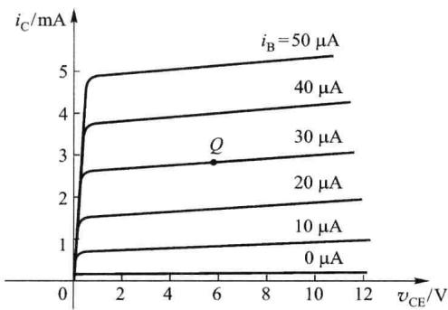  

图题2.1.11

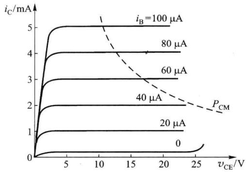  

图题2.1.14

<Solution>
0.98,50,0.2 mA,25 V,50 mW
</Solution>
</Exercise>

<Exercise title="习题 2.1.15">
某晶体管的极限参数 $I_{CM} = 100 \, mA, P_{CM} = 150 \, mW, V_{(BR)CEO} = 30 \, V$ ，若它的工作电压 $V_{CE} = 10 \, V$ ，则工作电流 $I_{C}$ 不得超过多大？若工作电压 $V_{CE} = 1 \, V$ ，则工作电流 $I_{C}$ 不得超过多大？若工作电流 $I_{C} = 1 \, mA$ ，则工作电压的极限值应为多少？

<Solution>
15 mA, 100 mA, 30 V
</Solution>
</Exercise>

<Exercise title="习题 2.2.1">
两个放大电路 A 和 B 的开路电压增益相同,用它们对同一具有内阻的电压信号进行放大,测得二者开路输出电压 $V_{OA} > V_{OB}$ ,这是什么原因?

<Solution>
放大电路A的 $R_{\mathrm{i}}$ 大于放大电路B
</Solution>
</Exercise>

<Exercise title="习题 2.2.2">
用放大电路 A 和 B 分别对同一电压信号进行放大, 当负载电阻 $R_{L} \rightarrow \infty$ 时, 二者输出均为 2 V, 都接负载电阻 $R_{L} = 2 \, k\Omega$ , $V_{OA}$ 下降至 1 V, $V_{OB}$ 下降至 1.8 V, 这是为什么?

<Solution>
放大电路A的 $R_{\mathrm{o}}$ 大于放大电路B
</Solution>
</Exercise>

<Exercise title="习题 2.3.1">
试分析图题 2.3.1 所示各电路对正弦交流信号有无放大作用, 并简述理由(设各电容的容抗可忽略)。

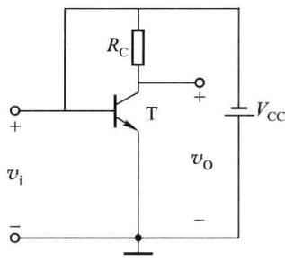  

(a)

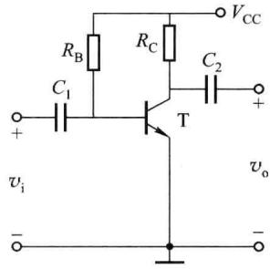

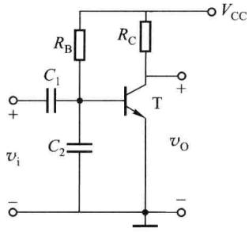  

(c)

(b)  

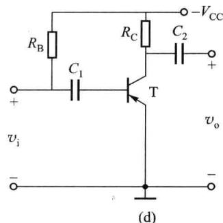

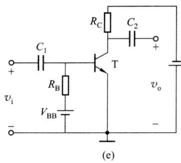

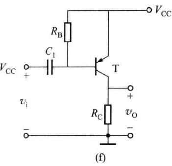  

图题2.3.1

<Solution>
(a) 无；(b) 有；(c) 无；(d) 无；(e) 无；(f) 无
</Solution>
</Exercise>

<Exercise title="习题 2.3.2">
试改正图题2.3.2所示放大电路的错误。图中各电容 $C$ 对信号频率呈短路。

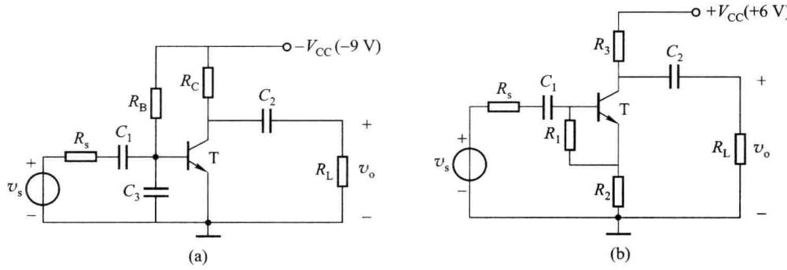  

图题2.3.2
</Exercise>

<Exercise title="习题 2.3.3">
单管放大电路及晶体管输入、输出特性曲线如图题 2.3.3 所示， $V_{CC}=6\ V, R_{B}=270\ k\Omega, R_{C}=2\ k\Omega$ 。

(1) 用图解法确定静态工作点；

(2) 当 $R_{c}$ 由 2 kΩ 增大到 4 kΩ 时, 静态工作点移至何处?

(3) 当电源电压 $V_{cc}$ 由 6 V 变到 10 V 时, 静态工作点移至何处?

（4）试确定 $R_{\mathrm{L}} \rightarrow \infty$ 及 $R_{\mathrm{L}} = 510 \Omega$ 两种情况下输出电压的动态范围。当输入正弦信号幅度逐渐加大时，输出电压波形首先出现什么失真？

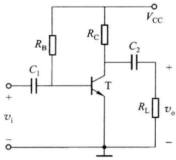  

(a)

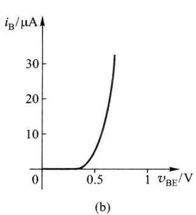  

图题2.3.3

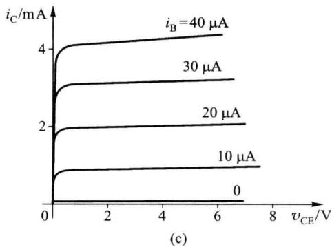

<Solution>
(4) 饱和失真
</Solution>
</Exercise>

<Exercise title="习题 2.3.4">
有两个放大电路, 其形式与图题 2.3.4(a) 相同。输入正弦信号, 用示波器观测输出 $v_{0}$ 的波形分别如图题 2.3.4(b)、(c) 所示。试说明它们各是什么性质 (饱和或截止) 的失真? 怎样才能消除这种失真? 如果放大电路中的晶体管是 PNP 型呢?

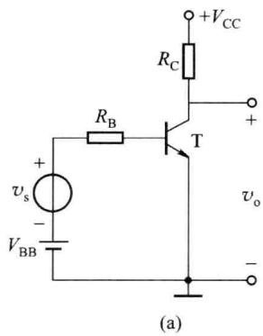

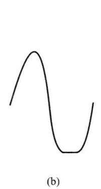  

图题2.3.4

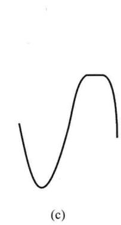

<Solution>
(b) 饱和失真, 降低 Q 点; (c) 截止失真, 提高 Q 点; PNP 型管刚好相反
</Solution>
</Exercise>

<Exercise title="习题 2.3.5">
一个如图题 2.3.3(a) 所示共射电路中的晶体管具有图题 2.3.5 所示的输出特性, 静态工作点 Q 和直流负载线已在图上标出。

（1）确定 $V_{CC}$ 、 $R_{B}$ 和 $R_{C}$ 的数值（设 $V_{BE}$ 可以忽略不计）；

(2) 若 $R_{L}=6\ k\Omega$ ，画出交流负载线；

（3）若输入电流 $i_{b}=18\sin\omega t\mu A$ ，在保证放大信号不失真的前提下，为尽可能减小直流损耗，应如何调整电路参数？调整后的元件数值可取为多大？

<Solution>
(1) $12\mathrm{V},400\mathrm{k}\Omega ,2\mathrm{k}\Omega ;(3)I_{\mathrm{BQ}} = 20~\mu \mathrm{A},R_{\mathrm{B}} = 600\mathrm{k}\Omega$
</Solution>
</Exercise>

<Exercise title="习题 2.3.6">
图题 2.3.6 画出了如图题 2.3.3(a) 所示共射电路中晶体管的输出特性及交、直流负载线，试求：

（1）电源电压 $V_{cc}$ 、静态电流 $I_{B}$ 、 $I_{C}$ 和管压降 $V_{CE}$ 的值；

(2) 电阻 $R_{B}$ 、 $R_{C}$ 的值，设 $V_{BE}$ 可以忽略不计；

(3) 输出电压的最大不失真幅度；

(4) 要使该电路能不失真地放大, 基极正弦电流的最大幅值是多少?

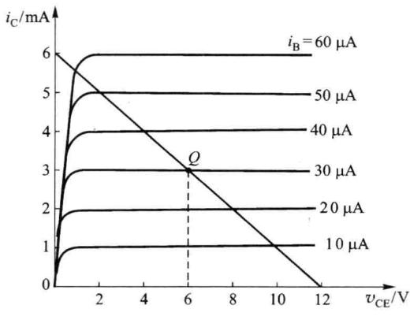  

图题2.3.5

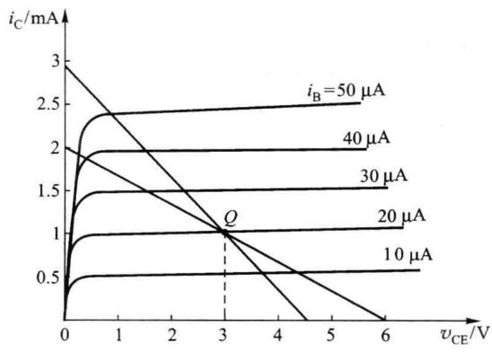  

图题2.3.6

<Solution>
(1) 6 V, 20 μA, 1 mA, 3 V; (2) 300 kΩ, 3 kΩ; (3) 1.5 V; (4) 20 μA
</Solution>
</Exercise>

<Exercise title="习题 2.3.7">
电路如图题2.3.7所示，设晶体管的 $\beta = 80, V_{\mathrm{BE}} = 0.6\mathrm{V}, I_{\mathrm{CBO}}, V_{\mathrm{CE(sat)}}$ 可忽略不计，试分析当开关S分别接通A、B、C三位置时，晶体管分别工作在其输出特性曲线的哪个区域，并求出相应的集电极电流 $I_{\mathrm{C}}$ 。

<Solution>
S→A:饱和区,3 mA;S→B:放大区,1.82 mA;S→C:截止区,0 mA
</Solution>
</Exercise>

<Exercise title="习题 2.3.8">
电路如图题 2.3.8 所示, 已知 $V_{BE} = 0.7 \, V$ , $V_{CE(sat)} = 0.3 \, V$ , 试判断晶体管的工作状态, 并计算晶体管集电极电位 $V_{C}$ 。

<Solution>
(a) 放大区, 4.41 V; (b) 截止区, 6 V; (c) 饱和区, 0.3 V
</Solution>
</Exercise>

<Exercise title="习题 2.3.9">
放大电路如图题 2.3.3(a) 所示, 设 $V_{CC} = 12 \, V$ , $R_{B} = 560 \, k\Omega$ , $R_{C} = 6 \, k\Omega$ , $V_{BE} = 0.7 \, V$ , $V_{CE(sat)} = 0.3 \, V$ 。

（1）当 $\beta=50$ 时，求静态电流 $I_{B}$ 、 $I_{C}$ 和管压降 $V_{CE}$ 的值；

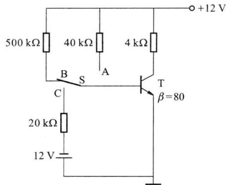

（2）如果 $\beta=100$ ，求静态电流 $I_{B}$ 、 $I_{C}$ 和管压降 $V_{CE}$ 的值，此时电路能否正常放大？

<Solution>
(1) $20\mu \mathrm{A},1\mathrm{mA},6\mathrm{V}$ ; (2) $19.5\mu \mathrm{A},1.95\mathrm{mA},0.3\mathrm{V}$ , 不能正常放大(饱和)
</Solution>
</Exercise>

<Exercise title="习题 2.3.10">
单管放大电路如图题 2.3.3(a) 所示, $V_{\mathrm{CC}} = 12 \mathrm{~V}, R_{\mathrm{B}} = 300 \mathrm{k} \Omega, R_{\mathrm{C}} = R_{\mathrm{L}} = 4 \mathrm{k} \Omega$ , 晶体管的 $\beta = 50, V_{\mathrm{BE}} = 0.6 \mathrm{~V}, r_{\mathrm{bb}'} = 200 \Omega$ 。

图题2.3.7

(1) 估算 Q 点；

(2) 画出交流通路及交流等效电路, 计算 $\dot{A}_{v}$ 、 $R_{i}$ 、 $R_{o}$ ;

(3) 若所加信号源内阻 $R_{s}$ 为 $500 \Omega$ ，计算 $A_{vs}$ 。

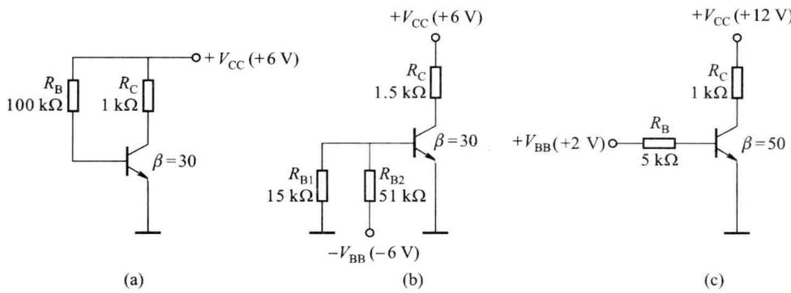  

图题2.3.8

<Solution>
(1) $I_{\mathrm{B}} = 0.038\mathrm{mA}, I_{\mathrm{C}} = 1.9\mathrm{mA}, V_{\mathrm{CE}} = 4.4\mathrm{V}$ ; (2) -111,898 $\Omega, 4\mathrm{k}\Omega$ ; (3) -71.53
</Solution>
</Exercise>

<Exercise title="习题 2.3.11">
在图题 2.3.11 所示电路中，设电容 $C_{1}$ 、 $C_{2}$ 、 $C_{3}$ 对交流信号可视为短路。

(1) 写出静态电流 $I_{c}$ 及电压 $V_{CE}$ 的表达式；

(2) 求 $\dot{A}_{v}$ 、 $R_{i}$ 、 $R_{o}$ 的表达式；

(3) 若将电容 $C_{3}$ 开路, 对电路将会产生什么影响?
</Exercise>

<Exercise title="习题 2.3.12">
电路如图题 2.3.12 所示, 设晶体管的 $\beta = 100, r_{bb'} = 100 \Omega, V_{BE} = 0.7 V$ , 各电容对交流信号可视为短路。

(1) 画出直流通路图, 求 Q 点;

(2) 画出交流通路及交流等效电路, 计算 $\dot{A}_{v}$ 、 $R_{i}$ 、 $R_{o}$ 和 $\dot{A}_{vs}$ 。

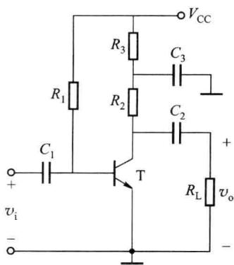  

图题2.3.11

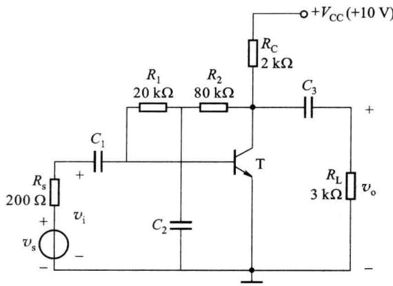  

图题2.3.12

<Solution>
(1) $I_{\mathrm{B}} = 30.8\mu \mathrm{A}, I_{\mathrm{C}} = 3.08\mathrm{mA}, V_{\mathrm{CE}} = 3.84\mathrm{V}$

(2) -124,0.91 kΩ,1.95 kΩ,-102
</Solution>
</Exercise>

<Exercise title="习题 2.3.13">
在图题 2.3.13 所示电路中， $I_{EQ}$ 均为 1 mA，已知晶体管 $\beta=99, r_{bb'}=300\ \Omega$ ，电容足够大。试计算这些电路的输入电阻。

<Solution>
(a) 2.9 kΩ; (b) 2.9 kΩ; (c) 3 kΩ; (d) 12.9 kΩ
</Solution>
</Exercise>

<Exercise title="习题 2.3.14">
在图题 2.3.14 所示的放大电路中,二极管和晶体管均为硅管,其 PN 结正向电压降均为 0.7 V。设晶体管 $\beta=50, r_{bb'}=300\ \Omega$ ,二极管的动态电阻可以忽略不计,电容 $C_{1}, C_{2}$ 对交流信号可视为短路。

(1) 要使 $I_{CQ}=2\ mA, R_{B}$ 应为多大?

(2) 计算 $\dot{A}_{v}$ 、 $R_{i}$ 和 $R_{o}$ 。

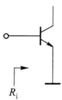  

(a)

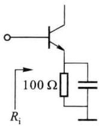  

(b)

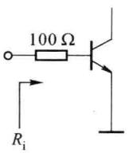  

(c)

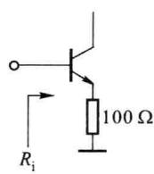  

图题2.3.13  

(d)

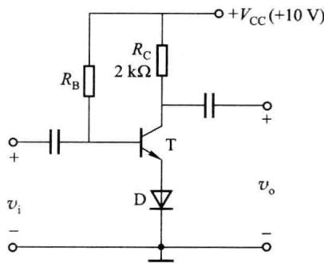  

图题2.3.14

<Solution>
(1) $215\mathrm{k}\Omega$ ;(2)-105,950 $\Omega ,2\mathrm{k}\Omega$
</Solution>
</Exercise>

<Exercise title="习题 2.4.1">
如图题 2.4.1 所示的偏置电路中, 热敏电阻 R 具有负温度系数, 问能否起到稳定工作点的作用?

<Solution>
(a) 能；(b) 不能
</Solution>
</Exercise>

<Exercise title="习题 2.4.2">
电路如图题 2.3.3(a) 所示, $V_{cc} = 12 \, V$ , $R_{B} = 750 \, k\Omega$ , $R_{C} = 6.8 \, k\Omega$ 。

(1) 当 $T=25^{\circ}C$ 时, $\beta=60$ , $V_{BE}=0.7V$ , 求 Q 点;

（2）如 $\beta$ 随温度的变化为 $0.5\%/^{\circ}C$ ，而 $V_{BE}$ 随温度的变化为 $-2\ mV/^{\circ}C$ ，当温度升高至 $75^{\circ}C$ 时，估算 Q 点的变化情况；

（3）如温度维持在 $25^{\circ}$ C 不变，只是换用一只 $\beta=115$ 的管子，Q 点如何变化，此时放大电路的工作状态

(b)  

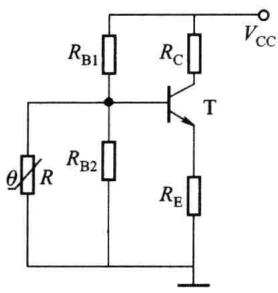  

(a)

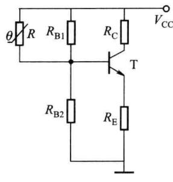  

图题2.4.1

是否正常？

<Solution>
(1) $I_{\mathrm{B}} = 15\mu \mathrm{A}, I_{\mathrm{C}} = 0.9\mathrm{mA}, V_{\mathrm{CE}} = 5.88\mathrm{V}$ (2) $\beta = 75, V_{\mathrm{BE}} = 0.6\mathrm{V}, I_{\mathrm{B}} = 15.2\mu \mathrm{A}, I_{\mathrm{C}} = 1.14\mathrm{mA}, V_{\mathrm{CE}} = 4.25\mathrm{V}$ (3) $I_{\mathrm{B}} = 15\mu \mathrm{A}, I_{\mathrm{C}} = 1.725\mathrm{mA}, V_{\mathrm{CE}} = 0.21\mathrm{V}$ , 饱和
</Solution>
</Exercise>

<Exercise title="习题 2.4.3">
在图题 2.4.3 所示电路中，已知晶体管的 $\beta=200, V_{BE}=0.7\ V, V_{CE(sat)}=0.3\ V$ 。

(1) 求 Q 点；

（2）若电路中元件做如下变化，试分析晶体管的工作状态：① $R_{B2}=2\ k\Omega$ ，② $R_{B1}=15\ k\Omega$ ，③ $R_{E}=100\ \Omega$ 。

<Solution>
(1) $I_{\mathrm{B}} = 32.5 \mu \mathrm{A}, I_{\mathrm{C}} = 6.5 \mathrm{~mA}, V_{\mathrm{CE}} = 1.2 \mathrm{~V}$ ; (2) 截止, 饱和, 饱和
</Solution>
</Exercise>

<Exercise title="习题 2.4.4">
电路如图题 2.4.4 所示, 设晶体管的 $\beta=100$ , 阈值电压 $V_{th}=0.5\ V$ , 导通时 $V_{BE}=0.7\ V$ , $V_{CE(sat)}=0.2\ V$ 。试分析 $R_{B1}=560\ k\Omega$ , $180\ k\Omega$ 和 $82\ k\Omega$ 时晶体管的工作状态及相应的集电极电流 $I_{C}$ 。

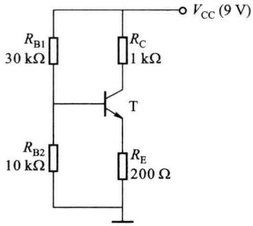  

图题2.4.3

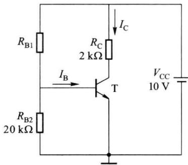  

图题2.4.4

<Solution>
截止,0 mA,放大,1.67 mA,饱和,4.9 mA
</Solution>
</Exercise>

<Exercise title="习题 2.4.5">
在如图题 2.4.5 所示的电路中, 二极管 D 和热敏电阻 R 具有温度补偿作用。问:

(1) 在图(a)和图(b)中, 放大电路是利用二极管正向电压降的温度特性还是其反向电流的温度特性来补偿温度对静态工作点的影响的?

(2) 在图(c)和图(d)中,为了稳定静态工作点,热敏电阻应分别具有怎样的温度特性(正或负的温度系数)?

<Solution>
(1) (a) 二极管反向电流的正温度系数；(b) 二极管正向电压降的负温度系数

(2) (c) 热敏电阻 R 的正温度系数; (d) 热敏电阻 R 的负温度系数
</Solution>
</Exercise>

<Exercise title="习题 2.4.6">
图题 2.4.6 所示电路， $V_{CC}=24\ V, R_{B}=68\ k\Omega, R_{C}=0.5\ k\Omega, R_{E1}=50\ \Omega, R_{E2}=220\ \Omega, R_{L}=1\ k\Omega$ ，晶体管的 $\beta=70, r_{bb'}=80\ \Omega, V_{BE}=0.7\ V$ ，计算 $\dot{A}_{v}, R_{i}$ 和 $R_{o}$ 。

<Solution>
-6.25,3.53 kΩ,0.5 kΩ
</Solution>
</Exercise>

<Exercise title="习题 2.4.7">
在图题 2.4.7 所示的电路中，已知晶体管的 $\beta=200, r_{bb'}=80\ \Omega, V_{BE}=0.7\ V$ ，图中各电容 C 对信号频率呈短路，计算 $\dot{A}_{v}, R_{i}, R_{o}$ 和 $\dot{A}_{vs}$ 。

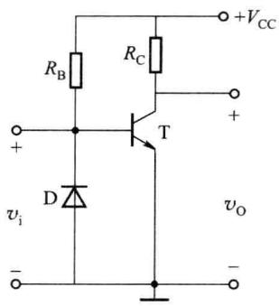  

(a)

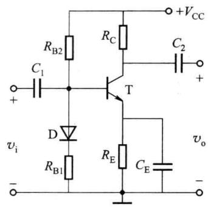  

(b)

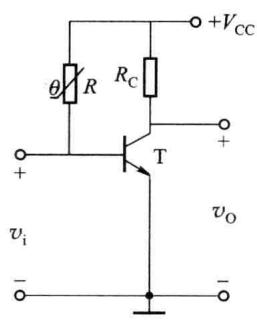  

(c)

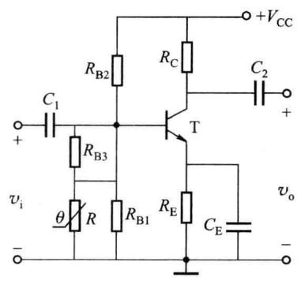  

(d)  

图题2.4.5

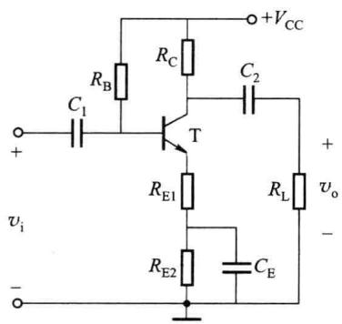  

图题2.4.6

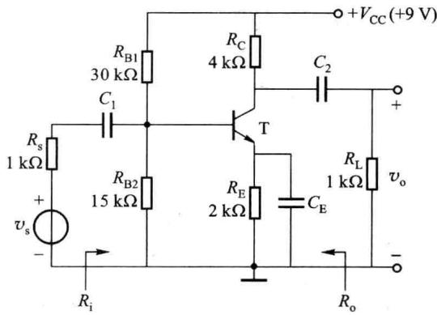  

图题2.4.7

<Solution>
-33.61,3.22 kΩ,4 kΩ,-25.61
</Solution>
</Exercise>

<Exercise title="习题 2.4.8">
在图题 2.4.8 所示电路中, 已知晶体管的 $\beta = 150, r_{\mathrm{bb}'} = 200 \Omega, V_{\mathrm{BE}} = 0.7 \mathrm{~V}$ , 忽略 $r_{\mathrm{ce}}$ , 图中各电容 $C$ 对交流呈短路, 计算 $\dot{A}_{\mathrm{v}}, R_{\mathrm{i}}$ 和 $R_{\mathrm{o}}$ 。

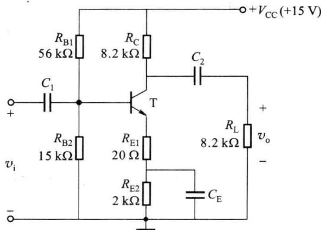  

图题2.4.8

<Solution>
-93.5,4.23 kΩ,8.2 kΩ
</Solution>
</Exercise>

<Exercise title="习题 2.4.9">
在图题 2.4.9 所示的放大电路中，晶体管的 $\beta=100, r_{bb'}=300\ \Omega, V_{BE}=0.7\ V$ ，忽略 $r_{ce}$ ，设电容 $C_{1}, C_{2}, C_{3}$ 对交流信号可视为短路。试求：

(1) 静态工作点；

(2) $\dot{A}_{v}$ 、 $R_{i}$ 和 $R_{o}$ ;

（3）设输入信号源具有 $R_{s}=1\ k\Omega$ 的内阻，信号源电压 $v_{s}=10\ mV$ ，计算输出电压 $v_{o}$ 。

<Solution>
(1) $I_{\mathrm{B}} = 8.9 \mu \mathrm{A}, I_{\mathrm{C}} = 0.89 \mathrm{~mA}, V_{\mathrm{CE}} = 11.1 \mathrm{~V}$ ; (2) -12.58, 33.01 kΩ, 6.2 kΩ; (3) $121 \mathrm{~mV}, -121.3 \mathrm{~mV}$
</Solution>
</Exercise>

<Exercise title="习题 2.5.1">
共集放大电路的交流通路如图题 2.5.1 所示, $I_{\mathrm{CQ}} = 1 \mathrm{~mA}$ , 晶体管的 $\beta = 100, r_{\mathrm{bb'}} = 80 \Omega$ , 图中各电容 $C$ 对信号频率呈短路, 计算 $\dot{A}_{v}, R_{i}, R_{o}$ 和 $\dot{A}_{vs}$ 。

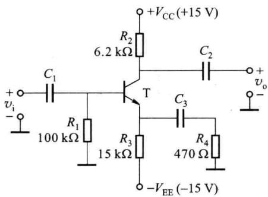  

图题2.4.9

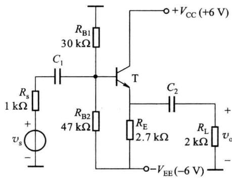  

图题2.5.1

<Solution>
0.98,15.86 kΩ,36 Ω,0.92
</Solution>
</Exercise>

<Exercise title="习题 2.5.2">
在图题 2.5.2 所示的电路中，设晶体管的 $\beta=100, r_{bb'}=300\ \Omega$ ，电容 $C_{1}, C_{2}$ 足够大，求 $\dot{A}_{v}, R_{i}$ 和 $R_{o}$ 。

<Solution>
67,5.5 $\Omega$ ,750 $\Omega$
</Solution>
</Exercise>

<Exercise title="习题 2.5.3">
图题 2.5.3 所示为共基放大电路交流通路，晶体管的 $\beta=150, r_{be}=2.4\ k\Omega$ ，忽略 $r_{ce}$ ，求 $A_{v}, R_{i}$ 和 $R_{o}$ 。

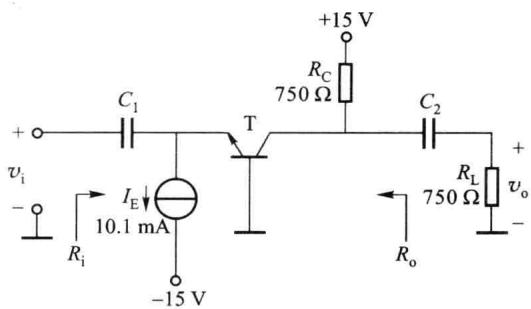  

图题2.5.2

  

图题2.5.3

<Solution>
62.5,15.9 $\Omega ,2\mathrm{k}\Omega$
</Solution>
</Exercise>

<Exercise title="习题 2.5.4">
在图题 2.5.4 所示的电路中， $R_{s}=500\ \Omega, R_{L}=5\ k\Omega$ ，晶体管的 $\beta=100, r_{bb'}=200\ \Omega, V_{BE}=0.7\ V$ ，电路中的 $C_{1}, C_{2}$ 的容抗可忽略。

(1) 为使发射极电流 $I_{E}$ 为 1 mA, 求 $R_{E}$ 的值;

(2) 如需建立集电极电压 $V_{c}$ 为 5 V, 求 $R_{c}$ 的值;

(3) 求 $\dot{A}_{vs}$

<Solution>
(1) $14.3\mathrm{k}\Omega$ ;(2) $10\mathrm{k}\Omega$ ;(3)-100.22
</Solution>
</Exercise>

<Exercise title="习题 2.5.5">
电路如图题 2.5.5 所示, $V_{\mathrm{CC}} = 24 \mathrm{~V}, R_{\mathrm{B}} = 96 \mathrm{k} \Omega, R_{\mathrm{C}} = 2.4 \mathrm{k} \Omega, R_{\mathrm{E}} = 2.4 \mathrm{k} \Omega$ , 晶体管的 $\beta = 20, r_{\mathrm{bb'}} = 80 \Omega, V_{\mathrm{BE}} = 0.7 \mathrm{~V}$ , 若输入电压 $v_{\mathrm{i}} = 1 \mathrm{~V}$ , 求:

(1) 输出电压 $v_{o1}$ 、 $v_{o2}$ ;

（2）用内阻为 $10 \, k\Omega$ 的交流电压表分别测量 $v_{o1}$ 、 $v_{o2}$ 时，表的读数各为多少？

图题2.5.4

<Solution>
(1) -0.95 V, 0.995 V; (2) 0.764 V, 0.994 V
</Solution>
</Exercise>

<Exercise title="习题 2.5.6">
电路如图题2.5.6所示， $R_{s}=500\ \Omega$ ，设晶体管的 $\beta=100,r_{bb'}=200\ \Omega,V_{BE}=0.7\ V$ ，试求：

(1) Q 点；

(2) $R_{i}$ ;

(3) $\dot{A}_{vs1}$ 和 $\dot{A}_{vs2}$ ;

(4) 输出电阻 $R_{o1}$ 和 $R_{o2}$ 。

  

图题2.5.5

  

图题2.5.6

<Solution>
(1) $I_{\mathrm{B}} = 16.94\mu \mathrm{A}, I_{\mathrm{C}} = 1.69\mathrm{mA}; V_{\mathrm{CE}} = 3.24\mathrm{V}$ ; (2) $8.2\mathrm{k}\Omega$ ; (3) $-0.92, 0.93$ ; (4) $2\mathrm{k}\Omega, 22\Omega$
</Solution>
</Exercise>

<Exercise title="习题 2.5.7">
电路如图题 2.5.7(a) 所示, 已知晶体管的 $\beta, r_{\mathrm{be}}$ , 略去了偏置电路。试求下列三种情况下的 $\dot{A}_{v}, R_{i}$ 和 $R_{o}$ :

(1) $v_{s2}=0$ ,从集电极输出;

(2) $v_{s1}=0$ ,从集电极输出;

（3） $v_{s2}=0$ ，从发射极输出。并指出上述(1)、(2)两种情况的相位关系能否用图题2.5.7(b)来表示？符号“+”表示同相输入端，即 $v_{C}$ 与 $v_{E}$ 同相，而符号“-”表示反相输入端，即 $v_{C}$ 与 $v_{B}$ 反相。
</Exercise>

<Exercise title="习题 2.5.8">
电路如图题2.5.8所示，设晶体管的 $\beta = 100, r_{\mathrm{bb}'} = 200\Omega, V_{\mathrm{BE}} = 0.7\mathrm{V}$ ，电路中容抗可忽略。

(1) 求各电极的静态电压值 $V_{B}$ 、 $V_{E}$ 及 $V_{C}$ ;

(2) 求 $r_{be}$ 的值；

（3）若Z端接地，X端接信号源且 $R_{s}=10\ k\Omega$ ，Y端接一个 $10\ k\Omega$ 的负载电阻，求 $\dot{A}_{vs}=\dot{V}_{Y}/\dot{V}_{s}$ ;

（4）若 X 端接地，Z 端接一个 $R_{s}=200\ \Omega$ 的信号电压 $\dot{V}_{s}$ ，Y 端接一个 $10\ k\Omega$ 的负载电阻，求 $\dot{A}_{vs}=\dot{V}_{Y}/\dot{V}_{s}$ ;

（5）若Y端接地，X端接一个内阻 $R_{\mathrm{s}}$ 为 $100\mathrm{k}\Omega$ 的信号电压 $\dot{V}_{\mathrm{s}}$ ，Z端接一个负载电阻 $1\mathrm{k}\Omega$ ，求 $\dot{A}_{\mathrm{vs}} = \dot{V}_{\mathrm{Z}} / \dot{V}_{\mathrm{s}}$ 。

  

图题2.5.7

  

图题2.5.8

<Solution>
(1) -0.1 V, -0.8 V, 2 V; (2) 2.83 kΩ; (3) -28.32; (4) 19.3; (5) 0.08
</Solution>
</Exercise>

<Exercise title="习题 2.6.1">
多路电流源电路如图题 2.6.1 所示, 已知所有的晶体管的特性均相同, $V_{BE}$ 均为 0.7 V, 试求 $I_{C1}$ 、 $I_{C2}$ 各为多少。

<Solution>
0.11 mA
</Solution>
</Exercise>

<Exercise title="习题 2.6.2">
在图题 2.6.2 所示的电路中，设两管特性相同， $\beta=200, V_{BE}=0.7\ V$ ，厄尔利电压 $V_{A}=100\ V$ ，试求 $V_{CE2}=5\ V$ 和 20 V 时的输出电流 $I_{0}$ 及输出电阻 $R_{o}$ 。

  

图题2.6.1

  

图题2.6.2

<Solution>
$I_0 = 1.033\mathrm{mA},1.18\mathrm{mA},R_0 = 101.7\mathrm{k}\Omega$
</Solution>
</Exercise>

<Exercise title="习题 2.6.3">
在图题 2.6.3 所示的电路中，设各管特性相同， $\beta=200, V_{BE}=0.7\ V, r_{ce}=60\ k\Omega$ ，求 $I_{0}$ 及 $R_{o}$ 的值。

<Solution>
0.837 mA, 20 kΩ
</Solution>
</Exercise>

<Exercise title="习题 2.6.4">
在如图题 2.6.4 所示的电路中， $T_{1}$ 、 $T_{2}$ 特性完全对称， $\beta=100, V_{BE}=0.6\ V$ ，求开关 S 合上后电容 C 两端建立 10 V 电压所需的时间（设电容器在开关合上前的端电压为零），若改换 $\beta=10$ 的管子，则所需的时间是否有变化？如有变化，算出它是多少？

  

图题2.6.3

  

图题2.6.4

<Solution>
0.083 S, 有变化, 0.1 S
</Solution>
</Exercise>

<Exercise title="习题 2.6.5">
在图题 2.6.5 所示的电流源电路中， $V_{CC}=30\ V, R=30\ k\Omega, \beta=100, V_{BE}=0.6\ V, r_{bb'}=80\ \Omega, V_{A}=100\ V, I_{0}=10\ \mu A$ ，试确定 $R_{2}$ ，并求输出电阻 $R_{o}$ 。

<Solution>
11.92 kΩ,51.29 MΩ
</Solution>
</Exercise>

<Exercise title="习题 2.6.6">
计算如图题 2.6.6 所示的多路电流源中各发射极电阻的数值。设各管的 $\beta$ 值均相等且很大， $V_{BE}=0.7\ V$ 。

  

图题2.6.5

  

图题2.6.6

<Solution>
$R_{\mathrm{E2}} = 11.97\mathrm{k}\Omega ,R_{\mathrm{E3}} = 600\Omega$
</Solution>
</Exercise>

<Exercise title="习题 2.6.7">
图题 2.6.7 所示为多集电极晶体管构成的多路电流源。已知集电极 $C_{0}$ 和 $C_{1}$ 所接集电区的面积相同， $C_{2}$ 所接集电区的面积是 $C_{0}$ 的两倍。 $I_{C0}/I_{B}=$

$$

V _ {\mathrm{BE}} = 0. 7 \mathrm{V}

$$

$$

I _ {\mathrm{C} 1}, I _ {\mathrm{C} 2}

$$

<Solution>
0.16 mA, 0.32 mA
</Solution>
</Exercise>

<Exercise title="习题 2.7.1">
电路如图题 2.7.1 所示, 两管特性相同, $\beta = 100$ , $r_{bb'} = 200 \Omega$ , $V_{BE} = 0.6 V$ , 求:

(1) Q 点；

（2）当 $v_{11}=0.01\ V, v_{12}=-0.01\ V$ 时，求输出电压 $v_{0}=v_{01}-v_{02}$ 的值；

(3) 当 $C_{1}$ 、 $C_{2}$ 间接入负载电阻 $R_{L}=5.6\ k\Omega$ 时，求 $v_{0}$ 的值；

(4) 求 $R_{id}$ 、 $R_{od}$ 。

图题2.6.7

<Solution>
(1) $I_{\mathrm{B}} = 10~\mu \mathrm{A}, I_{\mathrm{C}} = 1~\mathrm{mA}, V_{\mathrm{CE}} = 5~\mathrm{V};$ (2) $-0.87\mathrm{V};$ (3) $-0.29\mathrm{V};$ (4) $25.8\mathrm{k}\Omega, 11.2\mathrm{k}\Omega$
</Solution>
</Exercise>

<Exercise title="习题 2.7.2">
差放如图题 2.7.2 所示, 其中 $V_{CC} = V_{EE} = 12 \, V$ , $R_{B} = R_{C} = R_{E} = 10 \, k\Omega$ , $R_{P} = 200 \, \Omega$ , 且设其滑动端位于中点, $R_{L} = \infty$ , 两个对称管的 $\beta = 50$ , $r_{be} = 2.5 \, k\Omega$ , $V_{BE} = 0.7 \, V$ 。

(1) 求 Q 点；

(2) 计算 $A_{vd}$ 、 $A_{vc}$ 、 $K_{CMR}$ ;

(3) 计算 $R_{id}$ 、 $R_{ic}$ 、 $R_{od}$ 。

  

图题2.7.1

  

图题2.7.2

<Solution>
(1) $I_{\mathrm{B}} = 10.9\mu \mathrm{A}, I_{\mathrm{C}} = 0.56\mathrm{mA}, V_{\mathrm{CE}} = 7.2\mathrm{V}$ ; (2) $-28.4, 0, \infty$ ; (3) $35.2\mathrm{k}\Omega, 518.8\mathrm{k}\Omega, 20\mathrm{k}\Omega$
</Solution>
</Exercise>

<Exercise title="习题 2.7.3">
差放如图题 2.7.2 所示, 已知 $T_{1}$ 、 $T_{2}$ 静态时的集电极电位(对地)均为 6.7 V, $R_{L} = \infty$ 。

（1）当 $v_{ID}=0.1\ V$ 时，测得 $V_{A}=3.4\ V, V_{D}=10\ V$ ，求 $A_{rd}$ ;

（2）当 $v_{11}=v_{12}=v_{1C}=0.1\ V$ 时，测得 $V_{A}=V_{D}=6.67\ V$ ，求单端输出时与双端输出时的共模抑制比 $K_{CMR}$ 。

<Solution>
(1) -66; (2) 110,∞
</Solution>
</Exercise>

<Exercise title="习题 2.7.4">
某差放的输出电压表达式为 $v_{0} = 1000v_{11} - 999v_{12}$ ，求 $A_{vd}, A_{vc}, K_{CMR}$ 。

<Solution>
999.5,1,999.5
</Solution>
</Exercise>

<Exercise title="习题 2.7.5">
差放如图题 2.7.5 所示, 两管特性相同, $\beta=50, r_{be}=1.5\ k\Omega, V_{BE}=0.7\ V$ , 设 $R_{P}$ 的滑动端位于中点。求:

(1) 静态工作点 $I_{C1}$ 、 $I_{C2}$ 、 $V_{C1}$ 、 $V_{C2}$ ;

(2) $A_{\mathrm{vd}}, R_{\mathrm{id}}, R_{\mathrm{od}} \circ$

  

图题2.7.5

<Solution>
(1) 1 mA, 1 mA, 7 V, 7 V; (2) -25, 10 kΩ, 10 kΩ
</Solution>
</Exercise>

<Exercise title="习题 2.7.6">
在图题 2.7.6 所示的差放中， $V_{CC} = V_{EE} = 6 \, V, R_{B} = 50 \, \Omega, R_{C} = 18 \, k\Omega, R_{1} = R_{3} = 2.2 \, k\Omega, R_{2} = 430 \, \Omega, R_{L} = 36 \, k\Omega$ ，电位器 $R_{P}$ 的数值很小，其影响可以忽略不计。所有的晶体管参数均相同， $\beta = 60$ ， $V_{BE} = 0.6 \, V, r_{bb'} = 300 \, \Omega$ ，试计算：

(1) 静态工作点 $I_{C1}$ 、 $I_{C2}$ 、 $V_{C1}$ 、 $V_{C2}$ ;

(2) $A_{vd}$

<Solution>
(1) $0.2\mathrm{mA}, 0.2\mathrm{mA}, 2.4\mathrm{V}, 2.4\mathrm{V}$ ; (2) -65.2
</Solution>
</Exercise>

<Exercise title="习题 2.7.7">
在图题 2.7.7 所示的差放中, 已知两只对称晶体管的 $\beta=50, r_{be}=1.2\ k\Omega$ 。

(1) 画出共模、差模半边电路的交流通路；

(2) 求 $A_{vd}$ ;

(3) 求单端输出时的 $K_{CMR}$ 。

<Solution>
(2) -3.5; (3) 4.22
</Solution>
</Exercise>

<Exercise title="习题 2.7.8">
为了保证图题 2.7.8 中所示电路的正常放大作用, 电路允许的最大共模输入电压范围

  

图题2.7.6

(负向和正向)是多大？已知 $R_{C}=R_{2}=10\ k\Omega, R_{1}=20\ k\Omega, R_{E}=7.5\ k\Omega, V_{BE}=0.6\ V$ 。

  

图题2.7.7

  

图题2.7.8

<Solution>
-7.4 V, 9.7 V
</Solution>
</Exercise>

<Exercise title="习题 2.7.9">
图题 2.7.9 所示为有源负载差放，已知各管参数相同， $\beta=100, V_{BE}=0.7\ V$ ，忽略 $r_{bb'}$ ， $V_{A}$ 为 100 V，试画出差模交流通路，并求 $A_{ed2}, R_{id}, R_{od}$ 。

<Solution>
182.7,10.5 kΩ,187 kΩ
</Solution>
</Exercise>

<Exercise title="习题 2.7.10">
放大电路如图题 2.7.10 所示, 其中 $T_{1}$ 、 $T_{2}$ 完全对称, $T_{3}$ 、 $T_{4}$ 也完全对称, 各管的电流放大系数均为 $\beta$ , 电路处于正常放大状态, 变化电压 $v_{2}$ 的最大幅值比 $\left|-V_{EE}\right|$ 小得多。

（1）写出输出电压 $v_{0}$ 与 $v_{1}$ 、 $v_{2}$ 的近似关系式 ( $V_{BE}$ 、 $r_{bb'}$ 可以忽略不计)；

(2) 根据写出的关系式,说明该电路具有何种功能。

<Solution>
(2) 乘法
</Solution>
</Exercise>

<Exercise title="习题 2.8.1">
电路如图题2.8.1所示 $(\mathrm{T}_3$ 的偏置电路未画出），输入电压为正弦波，电源电压 $V_{\mathrm{CC}} = 20\mathrm{V}$ ，负载电阻 $R_{\mathrm{L}} = 8\Omega$ 。假定 $\mathrm{T}_{3}$ 的电压放大倍数 $\Delta v_{\mathrm{C3}} / \Delta v_{\mathrm{B3}} = -10$ ，射极输出器的电压放大倍数为 $1, \mathrm{T}_{1}, \mathrm{T}_{2}$ 的饱和电压降可以忽略，试计算当输入电压有效值 $V_{\mathrm{i}} = 1\mathrm{V}$ 时，电路的输出功率 $P_{\circ}$ 、电源供给的功率 $P_{\mathrm{DC}}$ 、两管的管耗 $P_{\mathrm{T}}$ 以及效率 $\eta$ 。

<Solution>
12.5 W, 22.5 W, 10 W, 56%
</Solution>
</Exercise>

<Exercise title="习题 2.8.2">
功放如图 2.8.2 所示， $T_{1}$ 、 $T_{2}$ 为互补对称管。请回答下列问题：

  

图题2.7.9

  

图题2.7.10

(1) 静态时, 流过负载电阻 $R_{L}$ 的电流有多大?

(2) $R_{1}$ 、 $R_{2}$ 、 $R_{3}$ 、 $D_{1}$ 、 $D_{2}$ 各起什么作用？

(3) 若 $D_{1}$ 、 $D_{2}$ 中有一个接反, 会出现什么后果?

  

图题2.8.1

  

图题2.8.2

<Solution>
(1) 0; (3) $\mathrm{T}_{2}$ 失去跟随作用, 并可能烧坏功率管

$$
R _ {3}; (2)
$$

$$
R _ {2}; (3) P _ {\mathrm{T}} = 1 1 5 6 \mathrm{mW} > > P _ {\mathrm{CM}}
$$
</Solution>
</Exercise>

<Exercise title="习题 2.8.3">
单电源互补对称电路如图题 2.8.3 所示, 设 $T_{1}$ 、 $T_{2}$ 的特性完全对称, $v_{i}$ 为正弦波, $V_{CC} = 12 \, V$ , $R_{L} = 8 \, \Omega$ , 试回答下列问题:

(1) 静态时,电容 $C_{2}$ 两端电压应是多少? 调整哪个电阻能满足这一要求?

(2) 动态时, 若输出电压 $v_{0}$ 出现交越失真, 应调整哪个电阻? 如何调整?

（3）若 $R_{1}=1.1\ k\Omega, T_{1}, T_{2}$ 的 $\beta=40, |V_{BE}|=0.7\ V, P_{CM}=400\ mW$ ，假设 $D_{1}, D_{2}, R_{2}$ 中任意一个开路，将会产生什么后果？
</Exercise>

<Exercise title="习题 2.8.4">
在图题 2.8.3 所示单电源互补对称电路中, 已知 $V_{cc} = 35 \, V, R_{L} = 35 \, \Omega$ , 流过负载电阻的电流为

$i_{0}=0.45\cos\omega t$ A, 求:

(1) 负载上所能得到的功率 $P_{0}$ 。

(2) 电源供给的功率 $P_{DC}$ 。

<Solution>
3.54 W, 5.02 W
</Solution>
</Exercise>

<Exercise title="习题 2.8.5">
判断图题 2.8.5 中各种复合管连接是否正确。如正确，指出它们各等效于什么类型的晶体管（NPN 型或 PNP 型），管脚 1、2、3 分别对应于什么电极。

<Solution>
(a)、(c)、(f)、(h)、(i)、(k)、(l)正确，均为 $1\to \mathrm{E},2\to \mathrm{B},3\to \mathrm{C}$
</Solution>
</Exercise>

<Exercise title="习题 2.8.6">
在图题 2.8.6 所示电路中, 已知二极管的导通电压为 0.7 V, 晶体管的 $\left|V_{BE}\right|=0.7\ V, T_{2}, T_{3}$ 的发射极静态电位 $V_{EQ}=0\ V, T_{2}, T_{4}$ 的饱和电压降 $V_{CE(sat)}=2\ V$ 。

(1) 求 $T_{1}$ 、 $T_{3}$ 、 $T_{5}$ 基极的静态电位；

（2）设 $R_{2}=10\ k\Omega, R_{3}=422\ \Omega$ ，若 $T_{1}, T_{3}$ 基极的静态电流可忽略不计，求 $T_{5}$ 集电极静态电流；

  

图题2.8.3

（3）求负载上可能获得的最大输出功率 $P_{om}$ 和效率 $\eta$ ;

（4）求 $T_{2}$ 、 $T_{4}$ 的最大集电极电流和集电极最大功耗。

(b)  

(c)  

(j)  

(a)  

  

(e)

(d)  

  

(f)  

(g)

  

(h)

  

(i)

  

(k)  

图题2.8.5

  

(1)

<Solution>
(1) 1.4 V, -0.7 V, -17.3 V; (2) 0.7 mA; (3) 4 W, 69.8%; (4) 0.5 A, 1.026 W
</Solution>
</Exercise>

<Exercise title="习题 2.8.7">
OTL 电路如图题 2.8.7 所示。

（1）为了使最大不失真输出电压幅值最大，静态时 $\mathrm{T}_{2}$ 和 $\mathrm{T}_{3}$ 的发射极电位 $V_{\mathrm{EQ}}$ 应为多少？若不合适，则一般应调节哪个元件参数？

(2) 若 $T_{2}$ 和 $T_{4}$ 的饱和电压降 $V_{\mathrm{CE(sat)}} = 3 \, \mathrm{V}$ ，输入电压足够大，则电路的最大输出功率 $P_{om}$ 和效率 $\eta$ 各为

多少？

(3) $T_{2}$ 和 $T_{4}$ 的 $I_{CM}$ 、 $V_{(BR)CEO}$ 和 $P_{CM}$ 应如何选择？

  

图题2.8.6

  

图题2.8.7

<Solution>
(1) $12\mathrm{V}, R_{2}$ ; (2) $5.0625\mathrm{W}, 58.9\%$ ; (3) $1.5\mathrm{A}, 24\mathrm{V}, 1.01\mathrm{W}$
</Solution>
</Exercise>

<Exercise title="习题 2.9.1">
有甲、乙、丙三个直接耦合放大电路，甲电路的放大倍数为1000，乙电路的放大倍数为50，丙电路的放大倍数是20。当温度从 $20^{\circ}\mathrm{C}$ 升到了 $25^{\circ}\mathrm{C}$ 时，甲电路的输出电压漂移了 $10\mathrm{V}$ ，乙电路的输出电压漂移了 $1\mathrm{V}$ ，丙电路的输出电压漂移了 $0.5\mathrm{V}$ 。你认为哪个电路的温漂参数最小？其数值是多少？

<Solution>
甲电路, $2 \mathrm{mV} / ^{\circ} \mathrm{C}$
</Solution>
</Exercise>

<Exercise title="习题 2.9.2">
在图题 2.9.2 所示的电平移动电路中, 所有晶体管的 $\beta$ 值均很大, $V_{BE}$ 都为 0.7 V, 且 $T_{2}$ 、 $T_{3}$ 的特性完全相同。为使静态时 ( $v_{i}=0$ ) 输出电压 $v_{0}=0$ V, 电阻 $R_{2}$ 的数值应为多大?

<Solution>
313 Ω
</Solution>
</Exercise>

<Exercise title="习题 2.9.3">
在图题 2.9.3 所示的电路中，已知晶体管特性相同， $\beta=100, V_{BE}=0.7\ V$ ，要求 $I_{EQ1}=0.5\ mA$ ， $I_{EQ2}=1\ mA, V_{CEQ1}=2.5\ V, V_{CEQ2}=4\ V$ 。设 $V_{CC}=12\ V, V_{CQ2}=6\ V, I_{1}=10\ I_{BQ1}$ ，试计算各电阻值。

  

图题2.9.2

  

图题2.9.3

<Solution>
$R_{\mathrm{C2}} = 6\mathrm{k}\Omega ,R_{\mathrm{E2}} = 2.1\mathrm{k}\Omega ,R_{\mathrm{C1}} = 18.6\mathrm{k}\Omega ,R_{\mathrm{E1}} = 400\Omega ,R_1 = 22\mathrm{k}\Omega ,R_{\mathrm{B2}} = 16.4\mathrm{k}\Omega$
</Solution>
</Exercise>

<Exercise title="习题 2.9.4">
在图题 2.9.4 所示的多级直接耦合放大电路中，第二级为电平位移电路。已知各管的 $\beta=100$ ， $V_{BE}=0.7\ V$ ， $I_{BQ}$ 可忽略不计。 $I_{0}=2\ mA$ ，各管的 $V_{CEQ}=3\ V$ ， $V_{CQ1}=2.3\ V$ 。

（1）为使 $V_{00}=0$ ，试确定 $R_{E2}$ 的值；

(2) 若 $R_{E2}=0$ ，电路能否正常工作？

<Solution>
(1) $3.1\mathrm{k}\Omega$ ;(2)不能
</Solution>
</Exercise>

<Exercise title="习题 2.9.5">
图题 2.9.5 所示共射-共基组合电路中，已知晶体管的 $\beta=100, V_{BE}=0.7\ V, r_{bb'}=80\ \Omega, V_{B2}=5\ V$ ，各电容对交流呈短路。试求 $V_{CEQ1}, V_{CEQ2}, A_{v}, A_{vs}$ 。

  

图题2.9.4

  

图题2.9.5

<Solution>
2.91 V, 2.67 V, -118.6, -66.2
</Solution>
</Exercise>

<Exercise title="习题 2.9.6">
简述图题 2.9.6 中电路各为何种放大电路？其中 $T_{1}$ 、 $T_{2}$ 各起什么作用？

  

图题2.9.6
</Exercise>

<Exercise title="习题 2.9.7">
放大电路如图题 2.9.7 所示，设 $C_{1}$ 、 $C_{2}$ 足够大，写出 $R_{i}$ 、 $R_{o}$ 和 $A_{v}$ 的表达式。
</Exercise>

<Exercise title="习题 2.9.8">
三级放大电路如图题2.9.8所示，晶体管的 $V_{BE}$ 均为0.7 V, $\beta$ 均为50, $r_{be1}=1.6\ k\Omega,r_{be2}=3\ k\Omega,r_{be3}=0.7\ k\Omega$ ，试求中频电压放大倍数 $A_{vs}$ 和输出电阻 $R_{o}$ （所有的容抗均可忽略不计）。

<Solution>
40,16 Ω
</Solution>
</Exercise>

<Exercise title="习题 2.9.9">
放大电路如图题 2.9.9 所示, 各晶体管的 $\beta = 100$ , $V_{BE} = 0.7 \, V$ , $r_{bb'} = 300 \, \Omega$ 。

(1) 欲使静态时 $v_{0}=0\ V$ , 求 $R_{E3}$ ;

（2）当输出端接负载 $R_{L}=1\ k\Omega$ 时，求电压放大倍数 $A_{v}$ 和输出电阻 $R_{o}$ 。

<Solution>
(1) 80 Ω; (2) 20.64,382.59 Ω
</Solution>
</Exercise>

<Exercise title="习题 2.9.10">
在图题 2.9.10 所示的放大电路中, 各晶体管的 $\beta = 50, V_{BE} = 0.7 \, V, r_{be1} = r_{be2} = 3 \, k\Omega, r_{be4} = r_{be5} = 1.6 \, k\Omega$ 。静态时电位器 $R_{p}$ 的滑动端调至中点, 测得输出电压为 $v_{0} = 3 \, V$ , 试计算:

图题2.9.7

（1）各级静态工作点 $I_{C1}$ 、 $V_{C1}$ 、 $I_{C2}$ 、 $V_{C2}$ 、 $I_{C4}$ 、 $V_{C4}$ 、 $I_{C5}$ 、 $V_{C5}$ （其中电压均为对地值），以及 $R_{E}$ 的阻值；

(2) 电压放大倍数 $A_{v}$ 。

  

图题2.9.8

  

图题2.9.9

  

图题2.9.10

## 第三章 场效应晶体管及其放大电路

场效应晶体管(Field Effect Transistor, 简写为 FET, 简称场效应管) 是利用输入电压形成的电场影响导电沟道的形状进而控制输出电流的压控型器件。与双极型晶体管相比, 场效应晶体管的优点是输入阻抗高、抗辐射能力强、热稳定性好、功耗低、集成度高, 缺点是跨导较低。由于 MOS 场效应晶体管集成电路具有集成度高, 耗电低, 易于实现数模混合集成等优点, 它的快速发展是近年半导体技术进步的一个重要标志。

根据场效应晶体管内结构和工作原理,小功率场效应晶体管有 MOS 场效应晶体管 (Metal-Oxide-Semiconductor Field Effect Transistor, 简写为 MOSFET 或 MOS。MOSFET 也称绝缘栅场效应晶体管, Insulated Gate Field Effect Transistor, 简写为 IGFET) 和结型场效应晶体管 (Junction Field Effect Transistor, 简写为 JFET) 两大类。大功率场效应晶体管有 VDMOS (Vertical Double-diffusion Metal Oxide Semiconductor, 纵向双扩散 MOS 场效应晶体管)、IGBT (Insulated Gate Bipolar Transistor, 绝缘栅双极型晶体管) 等类型。本章以介绍 MOS 场效应晶体管的结构、工作原理及其应用电路为主。

<Solution>
(1) $0.5\mathrm{mA}, 2.57\mathrm{V}, 0.5\mathrm{mA}, 2.57\mathrm{V}, 1\mathrm{mA}, 3\mathrm{V}, 1\mathrm{mA}, 3\mathrm{V}, 3.9\mathrm{k}\Omega$ ；(2) 461
</Solution>
</Exercise>
