import Guide from '@/components/Guide.astro';
import Knowledge from '@/components/Knowledge.astro';
import Example from '@/components/Example.astro';
import Analysis from '@/components/Analysis.astro';
import Solution from '@/components/Solution.astro';
import Variant from '@/components/Variant.astro';
import Note from '@/components/Note.astro';
import Block from '@/components/Block.astro';
import Method from '@/components/Method.astro';
import Exercise from '@/components/Exercise.astro';

双极型晶体管简称晶体管，由两个背靠背的 PN 结构成，具有放大作用，由于其中有带有电荷极性相反的电子和空穴两种载流子参与导电，所以称为双极性结型晶体管（Bipolar Junction Transistor, 简写为 BJT）。

晶体管有多种分类方法: 按半导体材料分, 有硅管、锗管等; 按频率分, 有高频管、低频管; 按功率分, 有大、中、小功率管。

晶体管有 NPN 和 PNP 两种类型, 图 2.1.1(a) 所示为 NPN 型硅平面管的结构图, 图 2.1.1(b) 所示为其结构示意图。它有三个掺杂区, 中间的掺杂区称为基区, 两侧的掺杂区分别称为发射区和集电区。各区引出电极, 分别为发射极 E、基极 B 和集电极 C。发射区与基区之间的 PN 结称为发射结 $J_{E}$ , 基区和集电区之间的 PN 结称为集电结 $J_{C}$ 。NPN 型晶体管的电路符号如图 2.1.1(c) 所示, 图中的箭头方向表示发射结正偏时的电流方向。基区很薄, 且掺杂浓度很低, 发射区的掺杂浓度远大于基区和集电区的掺杂浓度 (用 $N^{+}$ 表示高掺杂), 集电结结面积大, 这是使晶体管具有放大作用所需的内部条件。

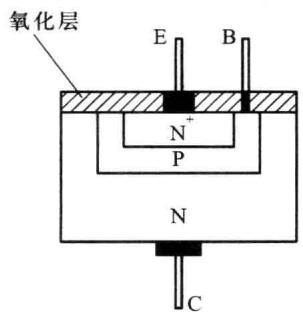  

(a)

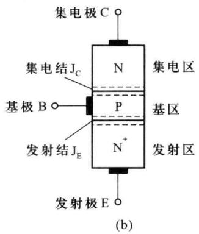

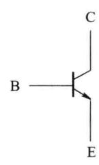  

(c)  

图 2.1.1 NPN 型晶体管的结构和电路符号

PNP 型晶体管三个区的杂质与 NPN 型相反, 其结构示意图如图 2.1.2(a) 所示, 其电路符号如图 2.1.2(b) 所示。

本节主要讨论 NPN 型晶体管的工作原理、特性曲线和参数,但讨论的结果同样适用于 PNP 型晶体管,所不同的仅是 PNP 型晶体管各极的电压极性和电流方向与前者相反。

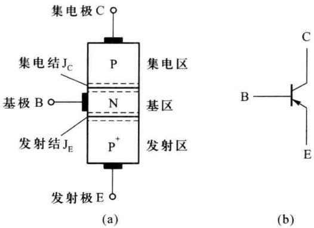  

图 2.1.2 PNP 型晶体管的结构和电路符号

## 2.1.1 晶体管的工作原理

根据晶体管的 2 个 PN 结所加偏置电压的不同, 晶体管可分为四种工作状态。

（1）放大工作状态: 发射结正偏, 集电结反偏。其主要特性是正向控制作用, 是实现信号放大的基础。

（2）饱和工作状态：发射结、集电结均正偏。此时，晶体管集电极与发射极之间的电压降很小，相当于闭合的开关。

（3）截止工作状态：发射结、集电结均反偏。此时，晶体管集电极与发射极之间有极小的漏电流流过，相当于断开的开关。

（4）反向(倒置)工作状态:发射结反偏,集电结正偏。与放大状态的偏置电压极性正好相反,因此得名。

放大工作状态主要应用于放大电路中；饱和与截止工作状态表现出的受控开关特性是开关电路的基础，主要用于脉冲与数字电路中；反向工作状态很少应用。

本节主要讨论晶体管在放大状态下的载流子传输过程,即正向控制作用的工作原理。

## 一、内部载流子运动规律

图 2.1.3 所示为 NPN 型晶体管在放大状态下的电路，直流电源 $V_{EE}$ 、 $V_{CC}$ 保证发射结正偏、集电结反偏，这是晶体管具有放大作用所需的外部条件。

图 2.1.4 所示为晶体管内部载流子传输过程的示意图。

### 1. 发射区向基区流入电子

由于发射结正偏,耗尽层变薄,多子扩散占主导地位,发射区中的多子电子向基区扩散,形成电子扩散电流

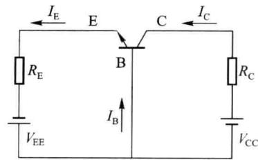  

图2.1.3 NPN型晶体管放大电路的偏压

$I_{En}$ ; 基区的多子空穴向发射区扩散, 形成空穴电流 $I_{Ep}$ , 二者之和就是发射极电流 $I_{E}$ 。由于发射区的掺杂浓度远大于基区掺杂浓度, 所以 $I_{En} \gg I_{Ep}$ , 故发射极电流 $I_{E}$ 为

$$

I _ {\mathrm{E}} = I _ {\mathrm{En}} + I _ {\mathrm{Ep}} \approx I _ {\mathrm{En}}\tag{2.1.1}

$$

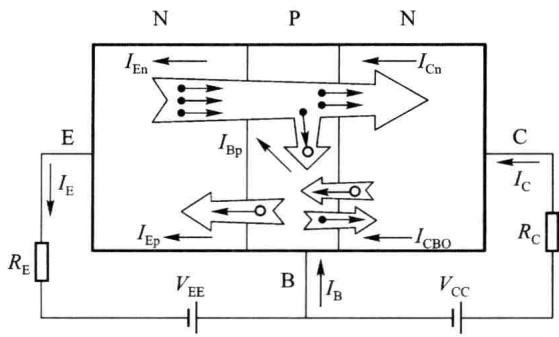  

图 2.1.4 NPN 型晶体管中载流子传输示意图

### 2. 电子在基区中的扩散与复合

由发射极注入到基区的电子,成为基区的非平衡少子,在基区靠近发射结的边界积累起来,在发射结附近的浓度最高,离发射结越远浓度越低,在基区形成了一定的浓度梯度,因此电子在基区内将继续向集电结扩散,边扩散边与基区多子空穴复合。电源 $V_{EE}$ 不断地从基区拉走电子,等效于向基区提供空穴,使基区空穴的浓度基本保持不变。由于基区很薄且掺杂浓度低,所以从发射区注入到基区的电子只有少部分与空穴复合形成基区复合电流 $I_{Bp}$ ,绝大部分到达集电结边缘,被集电结的反向电场拉向集电区,形成 $I_{Cn}$ ,故

$$

I _ {\mathrm{Bp}} = I _ {\mathrm{En}} - I _ {\mathrm{Cn}}\tag{2.1.2}

$$

### 3. 集电区收集载流子

由于集电结反偏且结面积大，在基区中扩散到集电结边缘的电子漂移通过集电结，被集电区收集，形成 $I_{Cn}$ 。同时，由于集电结反偏，少子漂移占主导地位，基区中少子电子和集电区少子空穴形成集电结反向漂移电流 $I_{CBO}$ ，称反向饱和电流，数值很小，故集电极电流为

$$

I _ {\mathrm{C}} = I _ {\mathrm{Cn}} + I _ {\mathrm{CBO}} \approx I _ {\mathrm{Cn}}\tag{2.1.3}

$$

由图 2.1.4 可看出, 基极电流为

$$

I _ {\mathrm{B}} = I _ {\mathrm{Bp}} + I _ {\mathrm{Ep}} - I _ {\mathrm{CBO}}\tag{2.1.4}

$$

一般 $I_{Ep}$ 、 $I_{CBO}$ 都很小，故

$$

I _ {\mathrm{B}} \approx I _ {\mathrm{Bp}}\tag{2.1.5}

$$

将晶体管看成一个节点,晶体管三个电极的电流应满足节点方程

$$

I _ {\mathrm{E}} = I _ {\mathrm{C}} + I _ {\mathrm{B}}\tag{2.1.6}

$$

式 $(2.1.6)$ 也可由式 $(2.1.1)$ \~式 $(2.1.4)$ 得到验证。

从以上分析可以看出，在忽略 $I_{Ep}$ 、 $I_{CBO}$ 的情况下，晶体管内部载流子的传输过程是：由发射区注入基区的电子，一部分与空穴复合，绝大部分被集电极收集。晶体管制成以后（掺杂浓度、基区宽度确定），复合所占的比例就确定了，该比例越小越好，即希望发射区注入基区的电子尽可能多地被集电极收集。因此要求发射区的掺杂浓度远大于基区和集电区的掺杂浓度，发射结正偏，有利于发射载流子；基区很薄，且掺杂浓度很低，有利于传送载流子；集电

结反偏且结面积大,便于收集载流子。

可见,发射区的作用是向基区注入电子,故名发射区;基区的作用是传送和控制由发射区注入的电子;集电区则是收集经基区传送过来的电子,故名集电区。 $I_{E}$ 、 $I_{C}$ 主要为电子电流, $I_{B}$ 主要为空穴电流,两种载流子参与导电,故为双极型。

由此可知，晶体管的正向控制作用就是通过上述过程实现的：发射结正偏电压控制 $I_{\mathrm{E}}$ （和 $I_{\mathrm{B}}$ ）， $I_{\mathrm{E}}$ （其中 $I_{\mathrm{En}}$ ）通过注入、扩散、收集而转化为 $I_{\mathrm{C}}$ ，这种转化几乎不受集电结反偏电压的影响。正是这种正向控制作用使晶体管具有了放大作用。由于电流 $I_{\mathrm{Ep}}$ 、 $I_{\mathrm{CBO}}$ 对放大没有贡献，希望它们的值越小越好。

值得指出的是:简单地将两个 PN 结背靠背地连在一起并不能构成具有放大作用的晶体管;另外,要想构成具有放大作用的晶体管,不仅需要一定的内部条件,还需要相应的外部条件。

## 二、晶体管的电流传输关系

晶体管为三端器件,作为二端口网络应用时,必有一个极作为输入和输出端口的公共端点。根据公共端点的不同,晶体管有共基极(CB,简称共基)、共发射极(CE,简称共射)和共集电极(CC,简称共集)三种连接方式,即三种基本工作组态,如图2.1.5所示。

(c)  

(b)  

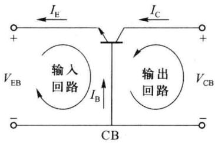  

(a)

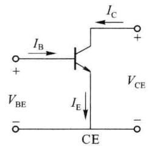

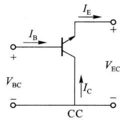  

图 2.1.5 晶体管的三种连接方式

对于三种不同的组态,在放大状态下,晶体管内部载流子的运动规律是相同的,但是不同组态下的输入变量、输出变量不同,因而输出电流与输入电流之间的传输关系也不同,称之为电流传输关系。

### 1. 共基电流传输关系

如图 2.1.5(a) 所示, 共基组态的输入电流为 $I_{E}$ , 输出电流为 $I_{C}$ , 电流传输关系即描述 $I_{C}$ 和 $I_{E}$ 之间的关系。引入参数 $\bar{\alpha}$ , 定义为

$$

\overline {{\alpha}} = \frac {I _ {\mathrm{Cn}}}{I _ {\mathrm{E}}}\tag{2.1.7}

$$

代入式 $(2.1.3)$ ，可得

$$

I _ {\mathrm{C}} = \bar {\alpha} I _ {\mathrm{E}} + I _ {\mathrm{CBO}}\tag{2.1.8}

$$

上式就是描述共基组态时输出电流 $I_{\mathrm{C}}$ 受输入电流 $I_{\mathrm{E}}$ 控制的方程，称为共基直流电流传输方程， $\bar{\alpha}$ 称为共基直流电流放大系数，表示 $I_{\mathrm{E}}$ 转化为 $I_{\mathrm{Cn}}$ 的能力。显然，其值小于1而趋近于1，典型值为0.95\~0.995。为了使 $\bar{\alpha} \rightarrow 1$ ，要求 $I_{\mathrm{Ep}} \ll I_{\mathrm{En}}$ 、 $I_{\mathrm{Bp}} \ll I_{\mathrm{Cn}}$ ，即要求发射区掺杂浓度高、基区掺杂浓度低且很薄。

若忽略 $I_{CBO}$ ，该电流传输方程可简化为

$$

I _ {\mathrm{C}} \approx \bar {\alpha} I _ {\mathrm{E}}\tag{2.1.9}

$$

### 2. 共射电流传输关系

此时输入电流为 $I_{B}$ ，输出电流为 $I_{C}$ ，电流传输关系即 $I_{C}$ 与 $I_{B}$ 之间的关系。

由于 $I_{E}=I_{C}+I_{B}$ ，代入式(2.1.8)，可得

$$

I _ {\mathrm{C}} = \overline {{{\alpha}}} (I _ {\mathrm{C}} + I _ {\mathrm{B}}) + I _ {\mathrm{CBO}}

$$

则

$$

I _ {\mathrm{C}} = \frac {\overline {{\alpha}}}{1 - \overline {{\alpha}}} I _ {\mathrm{B}} + \frac {1}{1 - \overline {{\alpha}}} I _ {\mathrm{CBO}}

$$

引入参数 $\bar{\beta}$ 和 $I_{CEO}$ ，分别定义为

$$

\bar {\beta} = \frac {\bar {\alpha}}{1 - \bar {\alpha}}\tag{2.1.10}

$$

$$

I _ {\mathrm{CEO}} = \frac {1}{1 - \bar {\alpha}} I _ {\mathrm{CBO}} = (1 + \bar {\beta}) I _ {\mathrm{CBO}}\tag{2.1.11}

$$

则

$$

I _ {\mathrm{C}} = \bar {\beta} I _ {\mathrm{B}} + I _ {\mathrm{CEO}}\tag{2.1.12}

$$

上式即为共射直流电流传输方程,式中 $\bar{\beta}$ 称为共射直流电流放大系数,一般为几十至几百; $I_{CEO}$ 是基极开路( $I_{B}=0$ )时流过集电极与发射极之间的电流,称为穿透电流。

通常 $I_{CEO}$ 很小, 上式可简化为

$$

I _ {\mathrm{C}} \approx \bar {\beta} I _ {\mathrm{B}}\tag{2.1.13}

$$

式 $(2.1.13)$ 体现出共射接法时的正向电流控制作用。

### 3. 共集电流传输关系

即输出电流 $I_{E}$ 与输入电流 $I_{B}$ 之间的关系

$$

I _ {\mathrm{E}} = I _ {\mathrm{B}} + I _ {\mathrm{C}} = I _ {\mathrm{B}} + (\bar {\beta} I _ {\mathrm{B}} + I _ {\mathrm{CEO}}) = (1 + \bar {\beta}) I _ {\mathrm{B}} + I _ {\mathrm{CEO}}\tag{2.1.14}

$$

上式为共集直流电流传输方程。

可见,晶体管的三种组态在放大状态时,输入电流对输出电流都有正向控制作用,这就是能够实现信号放大的机理。

## 2.1.2 晶体管的静态特性曲线

上面讨论了晶体管中载流子的运动规律、电流分配关系和电流传输方程，然而在使用晶体管时，重要的是晶体管的外部特性，即晶体管的电流与外部电压之间的关系，这种关系可以用晶体管的静态特性曲线来说明，静态特性曲线也就是晶体管的伏安特性曲线。由于制造工艺等原因，晶体管特性有一定的离散性，即使一个工厂生产的同型号的管子，特性也不会完全一致，因此器件手册中所给出的特性曲线是典型曲线，仅供参考，一般是通过晶体管特性图示仪测得实际的特性曲线。

晶体管为三端器件,作为二端口网络应用时,它的输入、输出端口均有两个变量(端电压和端电流),共有四个端变量。因而,要在平面坐标上表示晶体管的伏安特性,就需要采用两组曲线族,其中用得最多的两组曲线族是输入特性曲线族和输出特性曲线族。前者是以输出电压为参变量,描述输入电流与输入电压之间关系的曲线族;后者是以输入电流(或电压)为参变量,描述输出电流与输出电压之间关系的曲线族。

由于晶体管有共射、共集和共基三种连接组态，不同组态连接时有不同的端电压和端电流,因此相应地有三种不同的特性曲线,但都是晶体管内部载流子运动的外部表现,下面仅介绍应用最多的共射组态的特性曲线。

## 一、输入特性曲线

晶体管共射组态的端电流和端电压如图2.1.6所示，输入特性曲线是指当输出电压 $v_{CE}$ 为某一常数时，输入电流 $i_{B}$ 与输入电压 $v_{BE}$ 之间的关系曲线，即

$$

i _ {\mathrm{B}} = f (v _ {\mathrm{BE}}) \Big | _ {v _ {\mathrm{CE}} = \mathrm{常数}}\tag{2.1.15}

$$

如图 2.1.7 所示。

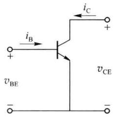  

图 2.1.6 晶体管共射组态端电压和端电流

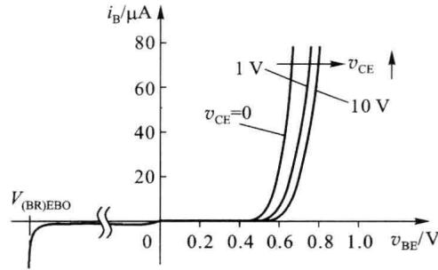  

图 2.1.7 晶体管共射输入特性曲线

当发射结加正向电压 $(v_{\mathrm{BE}}>0)$ 时，随着 $v_{CE}$ 的增大，曲线右移。

当 $v_{CE}=0\ V$ 时, 集电极与发射极之间短路, 即发射结与集电结并联, 所以特性曲线与 PN 结伏安特性曲线类似, 呈指数关系。

当 $v_{CE}$ 增大时, 集电结由正偏逐渐变成反偏, 吸引电子的能力变强, 从发射区注入到基区的电子更多地被集电结收集, 流向基极的电流 $i_{B}$ 逐渐减小, 因此随 $v_{CE}$ 增大输入特性曲线向右移动。

当 $v_{CE}>1\ V$ 时，集电结所加的反向电压已经能将发射区注入到基区的电子绝大部分收集到集电区，所以再增加 $v_{CE}, i_{B}$ 不再明显减小而是略有减小，使特性曲线略向右移，这是由基区宽度调制效应引起的。因为此时当 $v_{CE}$ 增大时，集电结的反向电压 $v_{CB}$ 也随着增大，集电结的空间电荷区加宽，基区有效宽度 $W_{B}$ 变窄，复合机会变少，基极电流 $i_{B}$ 减小。通常将由 $v_{CE}$ 变化引起的基区有效宽度变化而导致电流变化的现象称为基区宽度调制效应。在工程分析时，一般可以忽略基区宽度调制效应对输入特性的影响，认为 $v_{CE}>1\ V$ 以后的输入特性曲线近似重合为一条。

当发射结加反向电压 $(v_{\mathrm{BE}}<0)$ 时，基极反向饱和电流很小。当 $v_{BE}$ 向负值方向增大到 $V_{(BR)EBO}$ 时，发射结被击穿。 $V_{(BR)EBO}$ 称为发射结反向击穿电压，由于发射区掺杂浓度很高，因此属于齐纳击穿，其值在-6 V左右。

## 二、输出特性曲线

输出特性曲线是指当输入电流 $i_{B}$ 为某一常数时, 输出电流 $i_{C}$ 与输出电压 $v_{CE}$ 之间的关系曲线, 即

$$

i _ {\mathrm{C}} = f (v _ {\mathrm{CE}}) \Bigg | _ {i _ {\mathrm{B}} = \text {常数}}\tag{2.1.16}

$$

如图 2.1.8 所示。

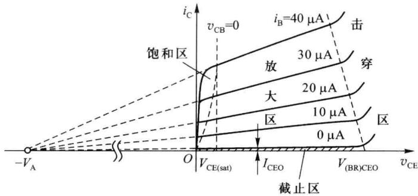  

图 2.1.8 共射输出特性曲线

根据外加电压的不同,整个输出曲线族可分为4个区域:饱和区、放大区、截止区和击穿区。图2.1.8中 $v_{CB}=0$ 的虚线是 $v_{CE}=v_{BE}$ 各点的连线,是放大区与饱和区的分界线。由图可见,给定一个 $i_{B}$ 值,就有一条输出曲线,形成输出曲线族,各条输出曲线的形状基本相同,现取其中一条(如 $i_{B}=40\mu A$ )进行说明。

### 1. 饱和区

饱和是指晶体管发射结、集电结都正偏的工作状态，对应输出特性曲线的起始陡峭部分。

当 $v_{CE}$ 很小时，集电结收集能力很弱， $v_{CE}$ 稍有增加，集电结收集能力增强，将更多的由基区扩散到集电结边缘处的电子拉到集电区， $i_{C}$ 增加很快，使 $i_{C}$ 受 $v_{CE}$ 的影响很大，所以曲线很陡，但随着 $v_{CE}$ 的增大， $i_{C}$ 增加速度变缓。

在饱和区,晶体管集电极与发射极之间的电压降称为饱和压降,用 $V_{\mathrm{CE(sat)}}$ 表示,其大小与集电区体电阻和集电极电流有关,对于小功率晶体管, $V_{\mathrm{CE(sat)}}$ 很小,其值常取 0.3 V,工程上近似为 0,即将集电极与发射极之间近似为短路。

显然，在饱和区内，由于集电结正偏，收集载流子的能力减弱，使发射极发射有余，而集电极收集不足，因此 $i_{B}$ 已不再与 $i_{C}$ 成比例关系，即 $i_{C} \neq \bar{\beta} i_{B}$ ，而是 $i_{C} < \bar{\beta} i_{B}$ 。

### 2. 放大区

放大是指晶体管发射结正偏、集电结反偏的工作状态,输出特性曲线基本水平稍有上翘。

当 $v_{CE}>1\ V$ 后，集电结的电场已足够强，能使发射区扩散到基区的电子绝大部分都到达集电区，故 $v_{CE}$ 再增大， $i_{C}$ 几乎不变，表现为特性曲线基本水平；同时由于基区宽度调制效应的影响，当 $v_{CE}$ 增大，基区有效宽度减小，这样在基区内载流子的复合机会减少，使电流放大系数 $\bar{\beta}$ 增大，在 $i_{B}$ 不变的情况下， $i_{C}$ 增大，但基区宽度调制效应对电流 $i_{C}$ 的影响甚微，故电流 $i_{C}$ 随 $v_{CE}$ 的增大而增大不多，表现为特性曲线基本水平但略有上翘。

可以证明,如果将输出特性曲线族的每一条曲线向负轴方向延伸,它们将近似在电压轴上交于一点 A,对应的电压用 $V_{A}$ 表示, $V_{A}$ 称为厄尔利电压(Early Voltage)。 $V_{A}$ 的大小可用来表示输出特性曲线的上翘程度, $V_{A}$ 与基区宽度 $W_{B}$ 有关, $W_{B}$ 越小,基区宽度调制效应对 $i_{C}$ 的影响越大, $V_{A}$ 也就越小。典型的 NPN 型小功率管的 $V_{A}$ 为 50\~100 V。

放大区输出特性曲线的上翘程度通常用晶体管输出电阻 $r_{ce}$ 来表示, 定义为工作点 Q 处曲线斜率的倒数, 如图 2.1.9 所示, 显然

$$

r _ {\mathrm{ce}} = \frac {V _ {\mathrm{A}} + V _ {\mathrm{CEQ}}}{I _ {\mathrm{CQ}}} \approx \frac {V _ {\mathrm{A}}}{I _ {\mathrm{CQ}}}\tag{2.1.17}

$$

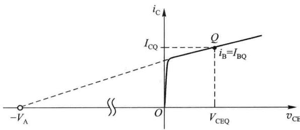  

图 2.1.9 晶体管输出电阻 $r_{ce}$ 的含义

工程上，通常认为放大区的输出特性曲线是平行等间隔的，即满足 $i_{\mathrm{C}} = \bar{\beta} i_{\mathrm{B}} + I_{\mathrm{CEO}}$ ，对于一个确定的 $i_{\mathrm{B}}$ 值， $v_{\mathrm{CE}}$ 在一定范围内增加， $i_{\mathrm{C}}$ 几乎不变， $i_{\mathrm{B}}$ 增加， $i_{\mathrm{C}}$ 成比例增大，这体现了输入电流 $i_{\mathrm{B}}$ 对输出电流 $i_{\mathrm{C}}$ 的控制作用。实际的输出特性曲线并不是平行等间隔的，如图2.1.10(a)所示，在 $i_{\mathrm{C}}$ 的一定范围内， $\bar{\beta}$ 值较大，且随 $i_{\mathrm{C}}$ 的变化很小，可认为是常数，输出特性曲线接近平行等间隔；但在 $i_{\mathrm{C}}$ 过小或过大时， $\bar{\beta}$ 值下降，输出特性曲线比较密集。 $\bar{\beta}$ 值与 $i_{\mathrm{C}}$ 的关系如图2.1.10(b)所示。

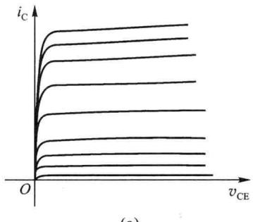

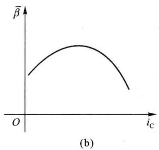  

图2.1.10 $\bar{\beta}$ 与 $i_{\mathrm{c}}$ 的关系

### 3. 截止区

截止是指晶体管发射结、集电结都反偏的工作状态,对应输出特性曲线 $i_{B}=0$ 以下的区域。

此时集电极电流很小,可将集电极近似看成开路。图2.1.8中 $i_{B}=0$ (基极开路)时的集电极电流 $i_{C}$ 即为穿透电流 $I_{CEO}$ 。

严格说来,晶体管截止,应当对应于 $i_{E}=0$ ,这时流过集电结的是反向饱和电流 $I_{CBO}$ ,即 $i_{C}=I_{CBO},i_{B}=-I_{CBO}$ 。但 $I_{CBO}$ 很小,所以在工程上规定 $i_{B}=0$ 以下的区域作为晶体管的截止区。

### 4. 击穿区

随着 $v_{CE}$ 的增大, 加在集电结上的反压 $v_{CB}$ 随之增大。当 $v_{CB}$ 增大到一定值时, 集电结发

生反向击穿,造成集电极电流 $i_{c}$ 剧增。

基区与集电区掺杂浓度均较低，产生的反向击穿主要是雪崩击穿，击穿电压较大。由图2.1.8可见，击穿电压随着 $i_{B}$ 的增大而减小。其物理原因是， $i_{B}$ 增大时 $i_{C}$ 也增大，通过集电结的载流子数目增多，碰撞机会增大，因而产生雪崩击穿所需的电压减小。

$i_{B}=0$ 时的击穿电压用 $V_{(BR)CEO}$ 表示，是基极开路时集电极与发射极之间的击穿电压。

在模拟电路中,晶体管通常工作在放大区;在数字电路中,晶体管通常工作在截止区和饱和区。一般晶体管不允许工作在击穿区。

因为晶体管在结构上的对称性,反向运用(即倒置)和正向运用(即放大区)类似,所以在倒置状态下也有相应的电流放大倍数,常用 $\bar{\beta}_{R}$ 表示,俗称“倒 $\bar{\beta}$ ”,但是,由于发射区掺杂浓度高,集电区掺杂浓度低,所以在性能上晶体管是不对称的,“倒 $\bar{\beta}$ ”很小,而且希望越小越好。

## 2.1.3 温度对晶体管特性曲线的影响

由于半导体材料的热敏特性,晶体管的参数几乎都与温度有关。对于电子电路,如果不能解决温度稳定性问题,将不能使其应用于实际,因此了解温度对晶体管参数的影响是非常必要的。

当温度变化时,晶体管的参数 $v_{BE}$ 、 $I_{CBO}$ 、 $\bar{\beta}$ 等随之变化。

## 一、温度对发射结正向电压降 $v_{BE}$ 的影响

与二极管的情况相似,温度升高时,发射结的正向伏安特性向左移动,使 $i_{B}$ 保持一定时的发射结电压降 $v_{BE}$ 值减小。温度每升高1℃, $v_{BE}$ 减小2\~2.5mV,即发射结电压降 $v_{BE}$ 具有负温度系数。

## 二、温度对反向饱和电流 $I_{CBO}$ 的影响

$I_{CBO}$ 由基区和集电区的少子漂移运动而产生,由于少子的数量随温度上升而增大,所以 $I_{CBO}$ 也随温度上升而增大。穿透电流 $I_{CEO}$ 同样也随温度上升而增大。

硅管的温度系数比锗管大,但由于硅管的 $I_{CBO}$ 比锗管小很多,因此硅管比锗管的热稳定性好。

## 三、温度对电流放大系数 $\bar{\beta}$ 的影响

温度升高后,注入到基区的载流子的扩散速度加快,电子与空穴在基区的复合数目减小,所以 $\bar{\beta}$ 增大。温度每升高1℃, $\bar{\beta}$ 增加0.5%\~1.0%。

由于温度变化时,晶体管的参数 $v_{BE}$ 、 $I_{CBO}$ 、 $\bar{\beta}$ 发生变化,因此晶体管的特性曲线也将发生变化。

由于发射结电压降 $v_{BE}$ 具有负温度系数, 因此温度升高时, 晶体管的输入特性曲线左移(如图 1.2.7 所示)。

温度对输出特性曲线的影响如图2.1.11所示。温度升高时，由于 $v_{BE}$ 减小， $I_{CBO}$ 、 $\bar{\beta}$ 增大，均使集电极电流 $i_{C}$ 增大，因此随温度升高，输出特性曲线上移且曲线间隔增大。

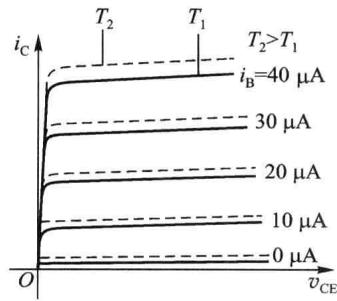  

图2.1.11 温度对输出特性曲线的影响

## 2.1.4 晶体管的参数

晶体管的参数用来表征晶体管的性能优劣和适用范围,是选用晶体管的依据。了解这些参数的意义,对于合理使用和充分利用晶体管,达到电路设计的经济性和可靠性是十分必要的。这些参数归纳起来可以分为电流放大系数、极间反向电流、极限参数和高频参数。

## 一、电流放大系数

晶体管电流放大系数有直流 $(\bar{\alpha},\bar{\beta})$ 和交流 $(\alpha,\beta)$ 两种。

1. 共射直流电流放大系数 $\bar{\beta}$

其定义为 $v_{\mathrm{CE}}$ 一定时

$$

\overline {{{{\beta}}}} = \frac {I _ {\mathrm{C}} - I _ {\mathrm{CEO}}}{I _ {\mathrm{B}}} \approx \frac {I _ {\mathrm{C}}}{I _ {\mathrm{B}}}\tag{2.1.18}

$$

2. 共射交流电流放大系数 $\beta$

在有交流信号输入时,晶体管基极电流产生一个变化量 $\Delta i_{B}$ , 引起集电极电流的变化量为 $\Delta i_{C}$ , 则交流电流放大系数为

$$

\beta = \frac {\Delta i _ {\mathrm{C}}}{\Delta i _ {\mathrm{B}}} \Big | _ {v _ {\mathrm{CE}} = \mathrm{常数}}\tag{2.1.19}

$$

$v_{CE}$ 保持不变, 即 $\Delta v_{CE}=0$ , 相当于输出交流短路, 故 $\beta$ 又称为短路电流放大系数。

3. 共基直流电流放大系数 $\bar{\alpha}$

其定义为当 $v_{\mathrm{CB}}$ 一定时

$$

\overline {{{{\alpha}}}} = \frac {I _ {\mathrm{C}} - I _ {\mathrm{CBO}}}{I _ {\mathrm{E}}} \approx \frac {I _ {\mathrm{C}}}{I _ {\mathrm{E}}}\tag{2.1.20}

$$

4. 共基交流电流放大系数 $\alpha$

与 $\beta$ 的定义类似,也是短路电流放大系数

$$

\alpha = \frac {\Delta i _ {\mathrm{C}}}{\Delta i _ {\mathrm{E}}} \Bigg | _ {v _ {\mathrm{CB}} = \mathrm{常数}}\tag{2.1.21}

$$

由式(2.1.18) \~ 式(2.1.21)可见, $\bar{\alpha}$ 和 $\bar{\beta}$ 是静态(直流)电流之比,反映了晶体管内部电流的分配规律,体现了晶体管的放大能力, $\alpha$ 和 $\beta$ 是静态工作点 Q 上动态(交流)电流之比,均可由输出特性曲线求出。在输出特性曲线间距基本相等并忽略 $I_{CBO}$ 、 $I_{CEO}$ 时,两者数值近似相等。因此在工程上,通常不再区分交流电流放大系数和直流电流放大系数,都用 $\alpha$ 和 $\beta$ 表示。

### 5. $\alpha$ 与 $\beta$ 的关系

根据晶体管内部载流子的运动规律,做一些合理的近似后,可以这样理解:发射极电流 $i_{E}$ 是总电流,其绝大部分形成集电极电流 $i_{C}$ ,剩余很小部分复合为基极电流 $i_{B}$ 。如果将 $i_{E}$ 看成一个单位,则 $i_{C}$ 为 $\alpha$ 单位, $i_{B}$ 为 $(1-\alpha)$ 单位;如果将 $i_{B}$ 看成一个单位,则 $i_{C}$ 为 $\beta$ 单位, $i_{E}$ 为 $(1+\beta)$ 单位。其示意图如图2.1.12所示,由图2.1.12(a)及 $\beta$ 定义可得

$$

\beta = \frac {\alpha}{1 - \alpha}\tag{2.1.22}

$$

与式(2.1.10)相同。同理由图2.1.12(b)及 $\alpha$ 定义可得

$$

\alpha = \frac {\beta}{1 + \beta}\tag{2.1.23}

$$

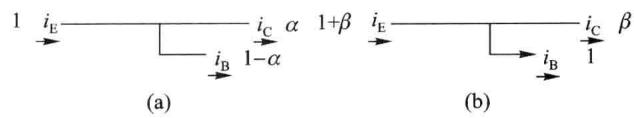  

图2.1.12 $\alpha$ 和 $\beta$ 的物理含义

## 二、极间反向电流

1. 反向饱和电流 $I_{CBO}$

$I_{CBO}$ 表示发射极开路时集电结的反向饱和电流, 测量电路如图 2.1.13 (a) 所示。

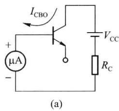

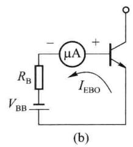

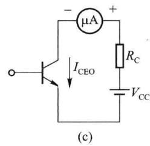  

图 2.1.13 晶体管极间反向电流的测试电路

2. 反向饱和电流 $I_{EBO}$

$I_{EBO}$ 表示集电极开路时发射结的反向饱和电流, 测量电路如图 2.1.13 (b) 所示。

3. 穿透电流 $I_{\mathrm{CEO}}$

$I_{CEO}$ 表示基极开路时集电极和发射极之间的穿透电流, 测量电路如图 2.1.13 (c) 所示。

由图可知,加在集电极与发射极之间的电压被分配在发射结和集电结上,所以发射结正偏,集电结反偏,晶体管处于放大状态。集电区的少子空穴漂移到基区,其数量就等于 $I_{CBO}$ 。由于基极开路,从集电区漂移到基区的空穴不能由基极外部电源补充电子与其复合从而形成基极电流,而只能与发射区注入基区的电子复合。由此可见,由发射区注入基区的电子,为了与由集电区到达基区的空穴复合而分出来的部分刚好是 $I_{CBO}$ ,其余大部分到达集电区。根据晶体管电流分配规律:发射区每向基区提供一个复合用的载流子,就要向集电区提供 $\beta$ 个载流子,因此到达集电区的电子数等于在基区复合数的 $\beta$ 倍。于是发射极总的电流为

$$

I _ {\mathrm{CEO}} = \beta I _ {\mathrm{CBO}} + I _ {\mathrm{CBO}} = (\beta + 1) I _ {\mathrm{CBO}}\tag{2.1.24}

$$

与式 $(2.1.11)$ 相同。

可见， $I_{CEO}$ 与 $I_{CBO}$ 、 $I_{EBO}$ 不同，它不是单纯 PN 结的反向电流，它的形成伴随有放大作用，其值也比 $I_{CBO}$ 、 $I_{EBO}$ 大得多。通常把 $I_{CEO}$ 作为判断晶体管质量的重要依据。 $I_{CEO}$ 大的晶体管性能不稳定。

上述参数受温度影响比较大,故选用晶体管时,要求 $I_{CBO}$ 和 $I_{CEO}$ 尽可能小, $\alpha$ 和 $\beta$ 不要过大。

## 三、极限参数

1. 集电极最大允许电流 $I_{CM}$

如前所述,当集电极电流 $i_{c}$ 增大到一定程度时, $\beta$ 将明显下降。一般取 $\beta$ 值下降至最高

值的 2/3 时所对应的集电极电流为 $I_{CM}$ 。

### 2. 极间反向击穿电压

在晶体管的某一极开路的情况下,发生击穿时的另外两个极间所加的反向电压就是极间反向击穿电压。

（1） $V_{(BR)CBO}$ 是发射极开路时集电结的反向击穿电压，它取决于集电结的雪崩击穿电压，通常为几十伏，高反压管可达几百伏以上，此时的集电极电流就是 $I_{CBO}$ 。测试电路如图2.1.14(a)所示。

（2） $V_{(BR)EBO}$ 是集电极开路时发射结的反向击穿电压，就是发射结本身的击穿电压，一般只有几伏。测试电路如图2.1.14(b)所示。

（3） $V_{(BR)CEO}$ 是基极开路时集电极与发射极之间的反向击穿电压，此时的集电极电流就是 $I_{CEO}$ 。测试电路如图2.1.14(c)所示。由于 $I_{CEO}>I_{CBO}$ ，所以 $V_{(BR)CEO}<V_{(BR)CBO}$ 。

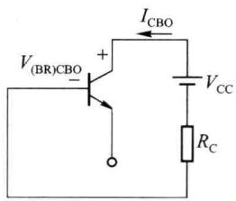  

(a)

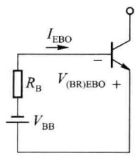  

(b)

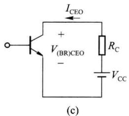

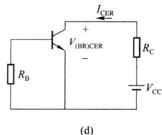  

图 2.1.14 晶体管反向击穿电压的测试电路

在实际情况下，晶体管常在发射极与基极间接有电阻，如图2.1.14（d）所示，这时击穿电压用 $V_{(\mathrm{BR})\mathrm{CER}}$ 表示，由于基极电阻 $R_{\mathrm{B}}$ 对发射结有分流作用，延缓了集电结雪崩击穿的产生，故 $V_{(\mathrm{BR})\mathrm{CER}} > V_{(\mathrm{BR})\mathrm{CEO}}$ 。当 $R_{\mathrm{B}} \rightarrow 0$ ，即发射极与基极短路时， $V_{(\mathrm{BR})\mathrm{CER}}$ 增至最大，用 $V_{(\mathrm{BR})\mathrm{CES}}$ 表示。

上述各种击穿电压满足如下关系：

$$

V _ {(\mathrm{BR}) \mathrm{CBO}} > V _ {(\mathrm{BR}) \mathrm{CES}} > V _ {(\mathrm{BR}) \mathrm{CER}} > V _ {(\mathrm{BR}) \mathrm{CEO}} > V _ {(\mathrm{BR}) \mathrm{EBO}}

$$

为保证晶体管安全使用,晶体管各极间的最大反向电压必须小于相应的击穿电压。

3. 集电极最大允许耗散功率 $P_{CM}$

集电极功耗 $p_{C}$ 或称集电极耗散功率等于集电极电流 $i_{C}$ 与 $v_{CE}$ 的乘积，即 $p_{C}=i_{C}v_{CE}$ 。集电极功耗将使集电结发热，结温上升， $p_{C}$ 若过大，结温过高，不仅会改变晶体管的参数，还会使晶体管烧坏，因此集电极的耗散功率受到一定的限制。 $P_{CM}$ 表示集电结上允许耗散功率的最大值。锗管允许集电结温度为 $75^{\circ}C$ ，硅管允许集电结温度为 $150^{\circ}C$ 。对于大功率管，

为了提高 $P_{CM}$ ，通常采用加散热装置的方法。

在共射输出特性曲线上,综合考虑 $I_{CM}$ 、 $V_{(BR)CEO}$ 和 $P_{CM}$ , 晶体管的工作范围应限制在如图 2.1.15 所示的阴影区域内, 称为安全工作区。

## 四、高频参数

1. $\alpha$ 截止频率 $f_{\alpha}$ 和 $\beta$ 截止频率 $f_{\beta}$

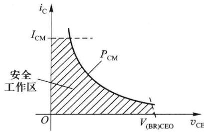

由于晶体管中 PN 结结电容的存在, 晶体管的交流电流放大系数 $\alpha$ 和 $\beta$ 是所加信号频率 f 的函数, 信号频率高到一定程度时, $\alpha$ 和 $\beta$ 不但数值下降, 且产图 2.1.15 晶体管的安全工作区

生相移,此时应用复数 $\dot{\alpha}$ 和 $\dot{\beta}$ 表示。用 $\alpha_{0}$ 、 $\beta_{0}$ 分别表示晶体管在低频时的 $\alpha$ 和 $\beta$ , 则使 $|\dot{\alpha}|$ 和 $|\dot{\beta}|$ 下降为 $\alpha_{0}/\sqrt{2}$ 和 $\beta_{0}/\sqrt{2}$ 时的频率 $f_{\alpha}$ 和 $f_{\beta}$ 称为晶体管的共基截止频率和共射截止频率, 或称 $\alpha$ 截止频率 $f_{\alpha}$ 和 $\beta$ 截止频率 $f_{\beta}$ , 如图 2.1.16 所示。 $f_{\alpha}$ 和 $f_{\beta}$ 均取决于晶体管本身的结构, $f_{\alpha}$ 远大于 $f_{\beta}$ , 说明共基电路比共射电路允许工作在更高的工作频率范围内。

### 2. 特征频率 $f_{\mathrm{T}}$

$f_{\beta}$ 只说明 $\beta$ 值开始下降的频率，并不表示晶体管所能应用的最高频率。将 $|\dot{\beta}|$ 下降到 1 时的频率定义为晶体管的特征频率 $f_{T}$ ，如图 2.1.16(b) 所示。特征频率是晶体管的一个重要高频参数，它比较确切地反映出晶体管的高频放大能力，当工作频率低于 $f_{T}$ 时， $\beta > 1$ ，晶体管具有电流放大作用；当工作频率超过 $f_{T}$ 时， $\beta < 1$ ，晶体管就没有电流放大作用了。所以，特征频率是晶体管的最高可应用的频率。

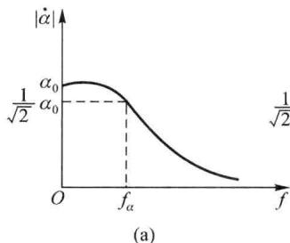

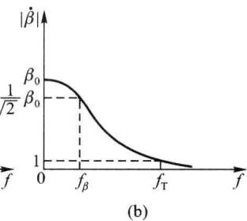  

图2.1.16 晶体管 $f_{\alpha}f_{\beta}$ 和 $f_{\mathrm{T}}$ 的定义

## 五、锗管与硅管的比较

由于锗和硅半导体本身的区别,因此锗管和硅管的特性也有很多不同。

### 1. 最高允许结温和最大允许功耗

硅管允许的最高结温 $T_{iM}$ 比锗管高，硅管的 $T_{iM}$ 约为 150～200 ℃，而锗管约为 75～100 ℃，因此当管子结构和工作温度相同时，硅管的最大允许功耗 $P_{CM}$ 比锗管要大 2～3 倍。所以在高温、功率大的工作情况下应采用硅管。

2. 集电结反向饱和电流 $I_{CBO}$

硅管的 $I_{CBO}$ 比锗管的 $I_{CBO}$ 小 2\~3 个数量级，小功率硅管的 $I_{CBO}$ 一般在 0.1 nA 以下，而锗管约为 1\~10 μA。由于 $I_{CBO}$ 随温度变化，它将影响晶体管静态工作的稳定性，对于硅管，

$I_{CBO}$ 的影响一般可不考虑，而锗管就必须考虑。又由于锗管的 $I_{CBO}$ 较大，所以小功率锗管运用时集电极电流应不小于 $10 \mu A$ ，否则 $I_{CBO}$ 的影响太大。而硅管在集电极电流小于 $10 \mu A$ 时还能工作，在低噪声放大器中，要求集电极电流很小的情况下应选用硅管。

### 3. 反向击穿电压

硅管的反向击穿电压 $V_{(BR)CEO}$ 比锗管高，一般锗管的 $V_{(BR)CEO}$ 为几十伏，硅管可达几百伏，所以在需要高反压运用的情况下也应采用硅管。

### 4. 发射结门限电压

锗管发射结门限电压为 $0.2 \sim 0.3 \, V$ ，硅管较高，为 $0.5 \sim 0.6 \, V$ 。

从以上的比较可以看出,硅管的性能比锗管好,所以通信设备及测量仪表中一般都优先选用硅管。

## 2.1.5 集成电路中的晶体管

集成电路(Integrated Circuit,简称IC)是20世纪60年代初期发展起来的一种半导体器件,就是采用一定的制造工艺,将有源器件晶体管、场效应晶体管、二极管、无源元件电阻、电容以及电路连接线等都集成在一小块半导体基片上,然后加以封装构成一个完整的电路和系统。它和传统的分立元件电路相比,具有密度高、体积小、重量轻、功耗低、功能强、可靠性高和成本低廉以及组装调试简单等一系列优点,为电子技术的应用开创了一个新的时代。本小节将简单介绍双极型集成电路元件的工艺结构和特点。

## 一、集成晶体管

### 1. 集成 NPN 型晶体管

集成电路按器件结构和工艺不同,可以有不同的分类。本书限于介绍半导体集成工艺,它以外延平面晶体管的制造工艺为基本工艺,这种集成工艺是按 NPN 型晶体管编制工艺流程的,因此 NPN 型晶体管性能最好,所用芯片面积最小。电阻、电容和晶体管是在同一工艺流程中制作的,在制作元器件的过程中,采用隔离技术,使各元器件之间彼此相互绝缘;最后连成电路时,是在硅表面蒸发一层金属铝薄膜,完成相互间的连接。

分立的外延平面硅 NPN 型晶体管的结构如图 2.1.17 所示, 首先在掺杂浓度高的 $N^{+}$ 硅衬底上生成 N 型外延层, 然后再扩散 P 型基区和 $N^{+}$ 型发射区, 最后切片并封装管壳, 引出 C、B、E 三个电极, 即生成单个 NPN 型晶体管。

集成 NPN 型晶体管制作工艺与分立晶体管类似,但由于要求各元器件能用同一工艺流程制作在同一块基片上,必须考虑各元器件之间的隔离和工艺的兼容性。常用的隔离技术有 PN 结隔离和介质隔离两种,PN 结隔离技术是利用 PN 结反偏时具有很高电阻的特点,把元件所在区域四周用 PN 结包围起来,使元件之间绝缘;介质隔离是用 $SiO_{2}$ 等介质材料进行隔离。采用 PN 结隔离的结构剖面图如图 2.1.18 所示,与分立 NPN 型晶体管的结构主要有两点不同:① 衬底为 P 型,与 $P^{+}$ 隔离槽连在一起,将准备制作 NPN 型晶体管的区域包围起来,形成一个隔离岛;② 集电极要从结构的上部引出。

### 2. 集成 PNP 型晶体管

这里将要介绍的 PNP 型晶体管是指制作工艺和 NPN 型晶体管兼容,无需增添工艺程序的 PNP 型晶体管。

集成电路中的 PNP 型晶体管有衬底 PNP 型晶体管和横向 PNP 型晶体管两种, 它们的结构如图2.1.19所示。图中右边是横向PNP型晶体管的结构图，载流子空穴沿着水平方向由发射区经基区运动至集电区，因此得名。由于制造工艺的限制，其基区宽度难以做得很薄，故 $\beta, f_{\mathrm{T}}$ 相对较低；但其发射结和集电结都有较高的反向击穿电压，即 $V_{(\mathrm{BR})\mathrm{EBO}} = V_{(\mathrm{BR})\mathrm{CBO}}$ ，所以其发射结允许施加较高的反压。因而可与NPN型晶体管复合而构成既有足够大的电流放大系数又耐压高的晶体管，从而构成各方面性能俱佳的放大电路。

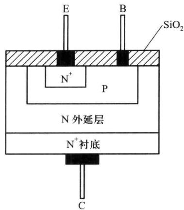  

图 2.1.17 硅外延平面晶体管

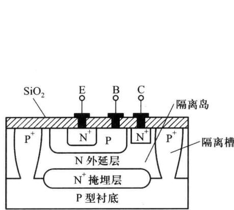  

图2.1.18 用PN结隔离的NPN型晶体管的结构

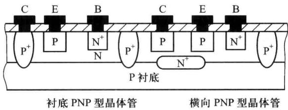  

图 2.1.19 集成电路中的 PNP 型晶体管

图 2.1.19 中左边是衬底 PNP 型晶体管的结构图，以衬底作为集电极，因此得名，载流子沿纵向运动，所以又称为纵向 PNP 型晶体管。其基区宽度可准确地进行控制，因此可以做得非常薄，故 $\beta$ 值比上述横向 PNP 型晶体管的大，但不及 NPN 型晶体管；由于作为集电极的衬底只能接在整个电路的电位最低点，所以在集成电路中纵向 PNP 型晶体管只能接成共集组态，其应用范围受到很大的限制。

### 3. 其他类型的晶体管

在制造 NPN 型晶体管时,同时制作多个发射区,则得到多发射极晶体管,其结构与符号如图 2.1.20 所示,广泛应用于集成数字电路。

在制作横向 PNP 型晶体管时,同时制作多个集电区,则得到多集电极晶体管,各集电极电流之比取决于对应的集电区面积之比,其结构与符号如图 2.1.21 所示,多用于集成放大电路中的电流源电路。

集成电路中普通 NPN 型晶体管的基区宽度为 $0.5 \sim 1 \mu m$ ，如果将基区做得很薄，厚度只有 $0.1 \sim 0.2 \mu m$ ，则得到超 $\beta$ 晶体管。其优点是当基极电流很小时， $\beta$ 可高达千倍以上，缺点是其反向击穿电压很低， $V_{(BR)CBO}$ 为 $10 \sim 20 V, V_{(BR)CEO}$ 为 $5 \sim 10 V$ ，常用于高精度集成放大电路的输入级。

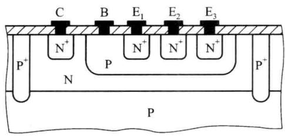  

(a)

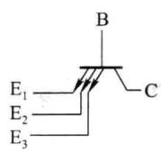  

(b)

图 2.1.20 多发射极晶体管的结构与符号  

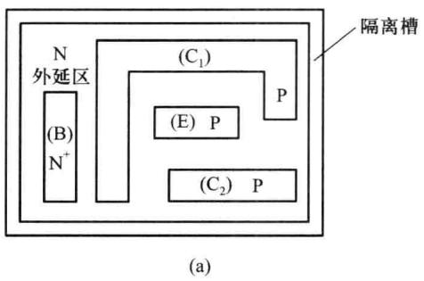

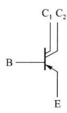  

(b)  

图 2.1.21 多集电极晶体管的结构与符号

## 二、集成电路中的二极管、电阻和电容

集成电路中的二极管是利用晶体管的一个 PN 结, 当利用发射结和集电结中的一个结时, 余下的一个电极可以开路或是和二极管两个极中的一个极相连, 因而有图 2.1.22 中的 4 种连接方式。当利用发射结时, 击穿电压较低; 而利用集电结时, 击穿电压较高。在模拟集成电路中, 大多采用第二种连接方式, 其工作速度快, 无寄生 PNP 型晶体管效应。

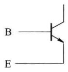  

(a)

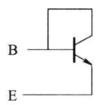  

(b)

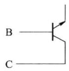  

(c)

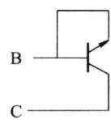  

(d)  

图 2.1.22 集成电路中二极管的 4 种连接方式

各种无源元件不需要特殊工艺,可在制造晶体管的同时制出,不需要增加额外工作。集成电路中的电阻多是利用 NPN 型晶体管基区或发射区的体电阻作为电阻,由于受到工艺的限制,阻值范围在几十欧至几十千欧,阻值过大或过小都会占用较大的硅片面积,很不经济;且对温度较敏感,是一个随工作电压变化的非线性电阻。

集成电路中的电容一种是利用 PN 结反偏时的势垒电容,另一种是用 $SiO_{2}$ 层作为电介质做成电容。由于制作电容需要较大的硅片面积,所以在集成电路中应尽量避免使用电容器,必须使用时,可以采用外接电容器。

## 三、集成电路的特点

与分立元件相比,集成电路中的元件有如下特点:

（1）具有良好的对称性。由于元件在同一硅片上用相同工艺制造，且因元件很密集而环境温度差别很小，所以元件的性能比较一致，而且同类元件温度对称性也较好。但是，由于生产过程中各道工序的工艺条件难以精确控制，所以前后两批生产出来的成品性能差异较大，即元器件性能参数的绝对误差大。

（2）由于芯片面积的限制，电阻的阻值不宜过大或过小，一般在几十欧至几十千欧之间。在集成电路中应尽量用有源器件来代替电阻、电容等无源器件。

（3）集成工艺不能制作大电容，一般只能制作 200 pF 以下的小电容。

(4) 集成工艺不能制作电感。

(5) 寄生参量影响严重。

根据上述特点,在集成电路中,首先,应选用元器件匹配性要求高但允许绝对误差大的电路;其次,由于集成工艺按 NPN 型晶体管编制,因此集成元器件中,NPN 型晶体管的性能最佳,占用芯片面积最小。针对这两个特点,所选用的电路中,应尽可能包含更多的 NPN 型晶体管,以取代其他元器件。总之,在设计集成电路时,要充分发挥集成元器件的独特优点,而力求避免其固有缺点。
