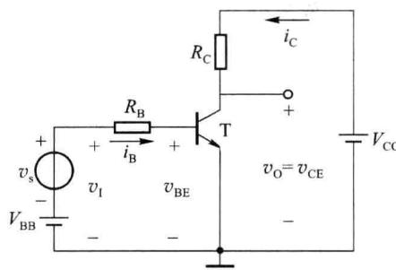
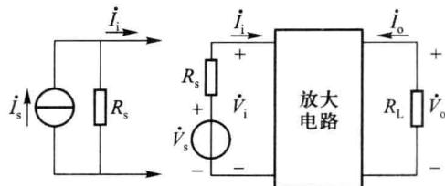
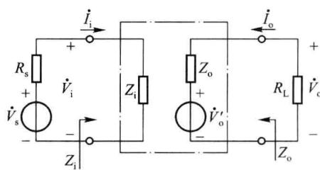
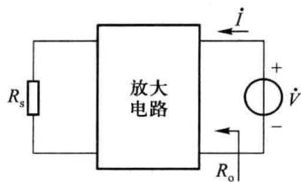
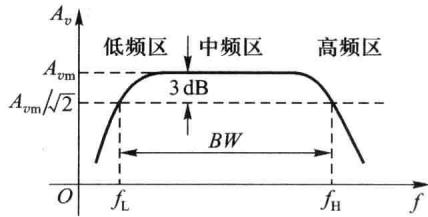
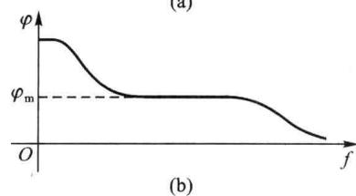

import Guide from '@/components/Guide.astro';
import Knowledge from '@/components/Knowledge.astro';
import Example from '@/components/Example.astro';
import Analysis from '@/components/Analysis.astro';
import Solution from '@/components/Solution.astro';
import Variant from '@/components/Variant.astro';
import Note from '@/components/Note.astro';
import Block from '@/components/Block.astro';
import Method from '@/components/Method.astro';
import Exercise from '@/components/Exercise.astro';

在电子系统中,放大电路是信号处理的基本电路,其作用是将微弱的输入信号不失真地增强(放大)到所需的数值。本节主要讨论放大电路的组成和主要性能指标。

## 2.2.1 放大电路的组成

放大的前提是不失真,即只有在不失真的情况下放大才有意义。晶体管只有工作在放

大区,才能使输出量与输入量始终保持线性关系,即电路不会产生失真。

基本共射放大电路的原理图如图 2.2.1 所示，其中 $v_{s}$ 为待放大交流小信号，输出电压由晶体管的集电极取出。由于任何稳态信号都可分解为若干频率正弦信号（谐波）的叠加，所以放大电路常以正弦波作为测试信号。

## 一、直流工作点的设置

设 $v_{s}$ 是幅度很小（如几毫伏）的正弦信号 $v_{s}=V_{sm}\sin\omega t$ ，如果直接加在电路的输入端，由于其值远

  

图 2.2.1 基本共射放大电路的原理图

小于发射结的阈值电压 $V_{th}$ ，晶体管在信号的整个周期内均处于截止状态，不能实现信号的放大。

显然，为了实现信号的放大，晶体管必须在信号的整个周期内都工作在放大区，为此在输入端加一个合适的直流电压 $V_{\mathrm{BB}}$ ，将交流小信号 $v_{\mathrm{s}}$ 叠加在 $V_{\mathrm{BB}}$ 之上，使作用于电路输入端的电压 $v_{\mathrm{I}} = V_{\mathrm{BB}} + v_{\mathrm{s}}$ 始终大于发射结的阈值电压 $V_{\mathrm{th}}$ ，使晶体管的发射结正偏；同时集电极电源电压 $V_{\mathrm{CC}}$ 要足够高，保证集电极电流最大时的 $v_{\mathrm{O}} = v_{\mathrm{CE}} = V_{\mathrm{CC}} - R_{\mathrm{C}}i_{\mathrm{C}} > v_{\mathrm{BE}}$ ，使晶体管的集电结反偏。这样，在信号的整个周期内，保证了晶体管均处于放大状态，从而实现了信号的放大。

施加合适的直流电压 $V_{BB}$ 和 $V_{CC}$ ，使晶体管各极电流、极间电压均有确定的值，称为设置直流工作点或静态工作点，一般用 Q 点表示，设置静态工作点的电路称为放大电路的偏置电路。可见，设置合适的直流工作点是保证晶体管始终工作于放大区、实现信号不失真放大的必要条件。习惯上用 $I_{BQ}$ 、 $I_{CQ}$ 、 $V_{BEQ}$ 和 $V_{CEQ}$ 表示晶体管静态工作点的电流和电压。

## 二、交流信号的放大

设置 $Q$ 点之后，幅度很小的交流输入信号电压 $v_{\mathrm{s}}$ 叠加在 $V_{\mathrm{BB}}$ 之上，使电路的输入电压 $v_{\mathrm{I}} = V_{\mathrm{BB}} + v_{\mathrm{s}}$ ，晶体管发射结电压 $v_{\mathrm{BE}} = V_{\mathrm{BEQ}} + v_{\mathrm{be}}$ 。由于晶体管的发射结对交流小信号 $v_{\mathrm{s}}$ 可等效为一个线性电阻 $r_{\mathrm{be}}$ ，并与 $R_{\mathrm{B}}$ 串联，故分得的信号电压 $v_{\mathrm{be}} = \frac{r_{\mathrm{be}}}{R_{\mathrm{B}} + r_{\mathrm{be}}} \cdot v_{\mathrm{s}}$ 。于是在 $v_{\mathrm{BE}} = V_{\mathrm{BEQ}} + V_{\mathrm{bem}}$ $\sin \omega t$ 作用下的集电极电流 $i_{\mathrm{C}} = I_{\mathrm{CQ}} + i_{\mathrm{c}} = I_{\mathrm{CQ}} + I_{\mathrm{cm}}$ $\sin \omega t$ ，则输出电压 $v_{\mathrm{o}} = v_{\mathrm{CE}} = V_{\mathrm{CC}} - R_{\mathrm{C}}i_{\mathrm{C}} = (V_{\mathrm{CC}} - R_{\mathrm{C}}I_{\mathrm{CQ}}) - R_{\mathrm{C}}I_{\mathrm{cm}}$ $\sin \omega t = V_{\mathrm{CEQ}} + V_{\mathrm{om}}$ $\sin (\omega t + 180^{\circ})$ 。其中第二项就是交流输出信号电压 $v_{\mathrm{o}}$ ，即 $v_{\mathrm{o}} = -R_{\mathrm{C}}I_{\mathrm{cm}}$ $\sin \omega t = V_{\mathrm{om}}$ $\sin (\omega t + 180^{\circ})$ 。可见，只要 $R_{\mathrm{C}}$ 足够大，就可使输出信号的幅度 $V_{\mathrm{om}}$ 比输入信号的幅度 $V_{\mathrm{sm}}$ 大得多，从而实现信号的放大。

通过上面的讨论可以看出,由于设置了合适的直流工作点,使 $v_{BE}$ 、 $i_{B}$ 、 $i_{C}$ 及 $v_{0}$ 均由直流分量(直流工作点)和交流信号分量组成,且交流信号分量的幅度比直流工作点的值要小,晶体管才始终工作于放大区。所以直流 Q 点是基础,交流放大是目的。

## 三、放大电路的组成原则

综上所述,组成放大电路必须遵循以下三条原则:

（1）提供大小和极性都合适的直流电源，为电路设置合适的直流 Q 点，使晶体管工作于放大区，同时作为电路的能源；

（2）待放大交流输入信号能够顺利地加至放大电路的输入端；

（3）被放大的交流输出信号能够顺利地送至负载，以实现信号的放大。

## 四、放大的本质

放大电路的基本功能是将微弱的电信号加以放大。根据能量守恒原理，能量只能转换，不能凭空产生，当然也不能放大。被放大后所增加的能量，是从放大电路的直流供电电源中的能量转换而来的。放大是对变化量而言，放大电路放大的本质是能量的控制和转换：在交流输入信号的作用下，将直流电源供给的能量转化为按输入信号变化的交流能量供给负载，使负载获得的能量大于输入信号的能量。因此，电子电路放大的基本特征是功率的放大，即负载上总是获得比输入信号大得多的电压或电流，有时兼而有之，晶体管则是能够控制能量和转换的有源元件。

## 2.2.2 放大电路的主要性能指标

放大电路的性能指标是衡量它的品质优劣的标准，并决定其适用范围。这里主要讨论放大电路的输入电阻、输出电阻、增益、频率响应和非线性失真等几项主要性能指标，主要是针对放大能力和保真度两方面要求提出的。

小信号放大电路作为线性有源二端口网络的组成框图如图2.2.2所示，在正弦稳态分析中的信号电压、电流均用复数表示。图中 $\dot{V}_{s}$ 、 $R_{s}$ 代表电压源的电压和内阻，信号源也可采用电流源 $(\dot{I}_{s},R_{s}),\dot{V}_{i},\dot{I}_{i}$ 为输入电压和电流， $\dot{V}_{o},\dot{I}_{o}$ 为输出电压和电流，它们的参考方向符合二端口网络的一般约定， $R_{L}$ 是放大电路的负载电阻。

  

图2.2.2 小信号放大电路的组成框图

## 一、输入阻抗和输出阻抗

放大电路的输入端要接信号源(该信号源可能是前级放大电路,其输出阻抗即是等效

信号源的内阻抗），输出端要接负载（该负载可能是下一级放大电路的输入阻抗），其等效电路如图2.2.3所示。因此，输入阻抗和输出阻抗是考虑放大电路与信号源、负载或放大电路级联时相互影响的重要参数。

### 1. 输入阻抗

放大电路的输入阻抗是从放大电路输入端看进去的等效阻抗,用 $Z_{i}$ 来表示,如图 2.2.3 所示,即

图 2.2.3 放大电路的输入阻抗和输出阻抗

$$

Z _ {\mathrm{i}} = \frac {\dot {V} _ {\mathrm{i}}}{\dot {I} _ {\mathrm{i}}}\tag{2.2.1}

$$

若放大电路工作在中频区(中频区的含义将在2.3.4节中说明),可不考虑电抗元件的作用,放大电路为纯阻性网络,可用输入电阻 $R_{i}$ 来代替输入阻抗 $Z_{i}$ ,即

$$

R _ {\mathrm{i}} = \frac {\dot {V} _ {\mathrm{i}}}{\dot {I} _ {\mathrm{i}}}\tag{2.2.2}

$$

则放大电路的输入电压

$$

\dot {V} _ {\mathrm{i}} = \frac {R _ {\mathrm{i}}}{R _ {\mathrm{s}} + R _ {\mathrm{i}}} \dot {V} _ {\mathrm{s}}\tag{2.2.3}

$$

$R_{i}$ 越大,表明放大电路从信号源索取的电流越小, $\dot{V}_{i}$ 越接近信号源电压 $\dot{V}_{s}$ ,信号电压在内阻 $R_{s}$ 上的损失就越小,所以 $R_{i}$ 体现了对信号源电压的衰减程度。

### 2. 输出阻抗

对负载电阻 $R_{L}$ 而言，放大电路的输出即是它的信号源，可用戴维宁定理将其等效为一个含有内阻抗的电压源（或用诺顿定理等效为一个含有内阻抗的电流源），如图 2.2.3 所示。等效电压源（电流源）的内阻抗 $Z_{d}$ 即为放大电路的输出阻抗，所以输出阻抗 $Z_{0}$ 即是从放大电路输出端看进去的等效阻抗。

同样,若放大电路工作在中频区,可用输出电阻 $R_{o}$ 来代替输出阻抗 $Z_{o}$ 。

由图2.2.3可得

$$

\dot {V} _ {\mathrm{o}} = \frac {R _ {\mathrm{L}}}{R _ {\mathrm{L}} + R _ {\mathrm{o}}} \dot {V} _ {\mathrm{o}} ^ {\prime}\tag{2.2.4}

$$

该式表明,放大电路带负载时的输出电压 $\dot{V}_{o}$ 要比空载 ( $R_{L} = \infty$ ) 时 $\dot{V}_{o}'$ 有所下降, $R_{o}$ 越小, 带负载前后输出电压相差越小, 电路带负载能力越强, 所以 $R_{o}$ 的大小表示放大电路带负载的能力。

在电子电路中计算输出电阻常用两种方法。

### (1) 外加电压法

如图 2.2.4 所示, 将负载电阻 $R_{L}$ 开路, 电压源 $\dot{V}_{s}$ 短路 (或电流源 $\dot{I}_{s}$ 开路), 保留其内阻 $R_{s}$ , 在输出端加一个正弦测试电压 $\dot{V}$ , 在输出回路中相应地产生电流 $\dot{I}$ , 则

  

图 2.2.4 外加电压法求输出电阻

$$

R _ {\mathrm{o}} = \frac {\dot {V}}{\dot {I}} \Bigg | _ { \begin{array}{c} R _ {\mathrm{L}} = \infty \\ \dot {V} _ {\mathrm{s}} = 0 \end{array} }\tag{2.2.5}

$$

### (2) 实验法

分别测出放大电路带负载 $R_{L}$ 时的输出电压 $\dot{V}_{o}$ 和空载 ( $R_{L} = \infty$ ) 时的电压 $\dot{V}_{o}'$ ，由式 (2.2.4) 可以推出

$$

R _ {\mathrm{o}} = \left(\frac {\dot {V} _ {\mathrm{o}} ^ {\prime}}{\dot {V} _ {\mathrm{o}}} - 1\right) R _ {\mathrm{L}}\tag{2.2.6}

$$

本书采用外加电压法计算输出电阻。

必须注意,以上所讨论的放大电路的输入电阻和输出电阻不是直流电阻,而是在线性运用情况下的交流电阻。

## 二、增益

增益又称放大倍数,用 A 表示,定义为放大电路输出量与输入量的比值,是直接衡量放大电路放大能力的指标。

根据输出量和输入量不同,可有四种类型的放大电路,即电压放大电路、电流放大电路、互阻放大电路和互导放大电路,它们相应的增益分别为电压增益 $\dot{A}_{v}=\frac{\dot{V}_{o}}{\dot{V}_{i}}$ 、电流增益 $\dot{A}_{i}=\frac{\dot{I}_{o}}{\dot{I}_{i}}$ 、互阻增益 $\dot{A}_{r}=\frac{\dot{V}_{o}}{\dot{I}_{i}}$ 和互导增益 $\dot{A}_{g}=\frac{\dot{I}_{o}}{\dot{V}_{i}}$ ,其中, $\dot{A}_{v}$ 和 $\dot{A}_{i}$ 均为量纲为 1 的数值,而 $\dot{A}_{r}$ 的单位是欧[姆](Ω), $\dot{A}_{g}$ 的单位是西[门子](S)。

本章重点研究放大电路的电压放大倍数 $\dot{A}_{v}$ ，有时需要考虑放大电路直接对信号源 $\dot{V}_{s}$ 的放大倍数，称为源电压增益 $\dot{A}_{vs} = \frac{\dot{V}_{o}}{\dot{V}_{s}}$ ，可推得

$$

\dot {A} _ {\mathrm{vs}} = \frac {\dot {V} _ {\mathrm{o}}}{\dot {V} _ {\mathrm{s}}} = \frac {\dot {V} _ {\mathrm{o}}}{\dot {V} _ {\mathrm{i}}} \cdot \frac {\dot {V} _ {\mathrm{i}}}{\dot {V} _ {\mathrm{s}}} = \frac {R _ {\mathrm{i}}}{R _ {\mathrm{s}} + R _ {\mathrm{i}}} \dot {A} _ {\mathrm{v}}\tag{2.2.7}

$$

同样可以推出源电流增益

$$

\dot {A} _ {i \mathrm{s}} = \frac {\dot {I} _ {\mathrm{o}}}{\dot {I} _ {\mathrm{s}}} = \frac {\dot {I} _ {\mathrm{o}}}{\dot {I} _ {\mathrm{i}}} \cdot \frac {\dot {I} _ {\mathrm{i}}}{\dot {I} _ {\mathrm{s}}} = \frac {R _ {\mathrm{s}}}{R _ {\mathrm{s}} + R _ {\mathrm{i}}} \dot {A} _ {i}\tag{2.2.8}

$$

四种类型的放大电路的主要区别是对输入电阻 $R_{i}$ 和输出电阻 $R_{o}$ 的要求不同。

在输入端,为了将信号尽可能多地送至放大电路的输入端,且在 $R_{s}$ 变化时保持输入信号基本不变,则当输入量是电压时,要求 $R_{i}\gg R_{s}$ ,即所谓恒压激励;当输入量是电流时,要求 $R_{i}\ll R_{s}$ ,即所谓恒流激励。

在输出端,为了将放大后的信号尽可能多地传送至负载,且在 $R_{L}$ 变化时保持输出信号基本不变,则当输出量是电压时,要求 $R_{o} \ll R_{L}$ ,即所谓恒压输出;当输出量是电流时,要求 $R_{o} \gg R_{L}$ ,即所谓恒流输出。

所以电压放大电路应是输入电阻高、输出电阻低的放大电路；而电流放大电路应是输入电阻低、输出电阻高的放大电路。

在工程中常使用功率增益 $G_{p}$ 来衡量功率放大能力, 定义为输出功率 $P_{o}$ 与输入功率 $P_{i}$ 的比值

$$

G _ {p} = \frac {P _ {\mathrm{o}}}{P _ {\mathrm{i}}} = \frac {V _ {\mathrm{o}} I _ {\mathrm{o}}}{V _ {\mathrm{i}} I _ {\mathrm{i}}} = A _ {v} A _ {i}\tag{2.2.9}

$$

注意,式中的 $V_{o}$ 、 $I_{o}$ 和 $V_{i}$ 、 $I_{i}$ 均为有效值。

在实际应用中，增益的大小常用分贝（dB）数表示，即 $A_{v}(\mathrm{dB}) = 20\lg A_{v}, A_{i}(\mathrm{dB}) = 20\lg A_{i}$ 和 $G_{p}(\mathrm{dB}) = 10\lg G_{p}$ 。

增益采用 dB 表示有以下优点: 首先, 在电话通信中, 电信号经电路传输到达终端后, 由受话器将电信号转换为声音, 而人耳对信号的响应近似呈对数特性; 其次, 用 dB 表示增益时, 增益值及增益值的范围都比较小, 易于计算, 多级放大电路的总增益应为各级增益之乘积, 总增益的计算可由原来的乘积化为求和, 计算比较方便。

## 三、通频带

一般情况下,放大电路只适合放大某一频段的信号。由于电路中电容和晶体管极间电容的影响,当输入信号频率较高或较低时,增益的幅值会下降并产生相移,图2.2.5(a)所示为一种典型的增益幅值与信号频率的关系曲线,称为幅频特性,图2.2.5(b)所示是增益相

位与信号频率的关系曲线，称为相频特性。在中频区，增益的大小和相位基本不随频率变化，分别用 $A_{vm}$ 和 $\varphi_{m}$ 表示；在高频区和低频区，电压增益下降，相位亦随频率变化。当电压增益下降至 $A_{vm}$ 的 $1/\sqrt{2}=0.707$ 倍，即下降了-3 dB时，对应的频率分别称为上限截止频率 $f_{H}$ 和下限截止频率 $f_{L},f_{H}$ 和 $f_{L}$ 之间的频率范围称为通频带，又称3 dB带宽，用BW表示，则

$$

B W = f _ {\mathrm{H}} - f _ {\mathrm{L}}\tag{2.2.10}

$$

一般 $f_{H} \gg f_{L}$ ，故 $BW \approx f_{H}$ 。可见通频带用于衡量放大电路对不同频率信号的放大能力，通频带越宽，表明放大电路对不同频率信号的适应能力越强。

## 四、非线性失真

由于晶体管是非线性器件,所以在输入正弦信号的幅度较大时,输出信号不可避免地要产生非线性失真,不再是正弦波,除了基波外,还含有许多谐波分量,即在输出信号中产生了输入信号所没有的新的频率分量,这是非线性失真的基本特征。

(a)  

  

图2.2.5 典型的幅频特性与相频特性曲线

基波是不失真的分量,各谐波成分是失真分量。输出波形中的谐波成分总量与基波成分之比称为非线性失真系数 N。设基波幅值为 $A_{1}$ , 各谐波幅值为 $A_{2}$ 、 $A_{3}$ 、 $\cdots$ , 则

$$

N = \frac{\sqrt{A_{2}^{2} + A_{3}^{2} + \cdots}}{A_{1}}\times 100\%\tag{2.2.11}

$$

非线性失真的大小与晶体管 Q 点及输入信号幅度的大小有关。如果 Q 点合适，输入信号的幅度又足够小，非线性失真的系数就很小。随着输入信号幅度的增加，非线性失真系数会加大。

## 五、最大输出幅度

由于晶体管的非线性和直流电源电压的限制,输出信号的非线性失真系数会随输入信号幅度的增大而增加。最大输出幅度是指非线性失真系数不超过额定值时的输出信号最大值,用 $V_{ommax}$ 或 $I_{ommax}$ 表示,也可用峰-峰值 $V_{OP-P}$ 或 $I_{OP-P}$ 表示。

## 六、最大输出功率与效率

最大输出功率 $P_{omax}$ 是指输出信号非线性失真系数符合规定的情况下能输出的最大功率。在放大电路中，输入信号的功率通常很小，但经放大电路的控制和转换后，负载从直流电源获得的信号功率却较大。直流电源能量的利用率称为效率 $\eta$ ，设 $P_{o}$ 为输出信号功率， $P_{DC}$ 为直流电源供给的平均功率，则效率 $\eta$ 等于 $P_{o}$ 与 $P_{DC}$ 之比，即

$$

\eta = \frac {P _ {\mathrm{o}}}{P _ {\mathrm{DC}}}\tag{2.2.12}

$$
