import Guide from '@/components/Guide.astro';
import Knowledge from '@/components/Knowledge.astro';
import Example from '@/components/Example.astro';
import Analysis from '@/components/Analysis.astro';
import Solution from '@/components/Solution.astro';
import Variant from '@/components/Variant.astro';
import Note from '@/components/Note.astro';
import Block from '@/components/Block.astro';
import Method from '@/components/Method.astro';
import Exercise from '@/components/Exercise.astro';

本节将以基本共射放大电路为例,首先阐明放大电路的工作原理,然后在理解放大电路工作原理的基础上对放大电路进行分析,求解静态工作点和各项动态参数,针对电子电路中存在着非线性器件——晶体管,而且直流量与交流量同时作用的特点,介绍分析的方法。

## 2.3.1 基本共射放大电路的工作原理

在 2.2.1 节中,作为放大电路的组成简单介绍了共射放大电路的基本原理。为了叙述

方便,现将其原理图重画于图2.3.1中。正弦输入信号 $v_{s}$ 从基极输入,输出信号从集电极取出,发射极是输入回路与输出回路的公共端,故为共射放大电路。

$V_{CC}$ 、 $V_{BB}$ 与 $R_{B}$ 、 $R_{C}$ 配合，为晶体管设置直流工作点Q，使之工作于放大区。 $R_{C}$ 还可以将集电极电流转化为电压送至输出端，使电路具有电压放大功能。直流电源 $V_{CC}$ 为输出提供所需能量。

当 $v_{s}=0$ 时, 即放大电路没有交流输入信号时,电路中各处的电压、电流都是不变的直流，称为直流工作状态或静止状态，简称静态。晶体管工作于 Q 点，有 $V_{BEQ}$ 、 $I_{BQ}$ 、 $I_{CQ}$ 和 $V_{CEQ}$ 四个直流值。

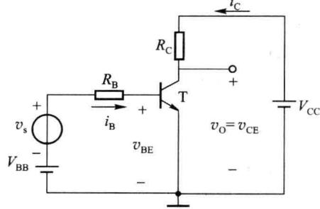  

图 2.3.1 基本共射放大电路的原理图

当 $v_{s} \neq 0$ 时，即有交流输入信号时，该正弦信号叠加在 $V_{BB}$ 上，使晶体管的电压、电流均在直流分量的基础上叠加一个正弦交流分量，即

$$

\begin{array}{r l} & v _ {\mathrm{BE}} = V _ {\mathrm{BEQ}} + v _ {\mathrm{be}} \\ & i _ {\mathrm{B}} = I _ {\mathrm{BQ}} + i _ {\mathrm{b}} \\ & i _ {\mathrm{C}} = I _ {\mathrm{CQ}} + i _ {\mathrm{c}} \\ & v _ {\mathrm{CE}} = V _ {\mathrm{CEQ}} + v _ {\mathrm{ce}} \end{array}\tag{2.3.1}

$$

式 $(2.3.1)$ 右边第一项为直流分量,第二项为交流分量,左边是直流分量与交流分量之

和，称为全值量，是晶体管中的实际电压或电流值。根据晶体管基极电流对集电极电流的控制作用，应有 $i_{c}=\beta i_{b}$ ，则交流电流 $i_{c}$ 必将在 $R_{C}$ 上产生一个与 $i_{c}$ 波形相同的交流电压。而由于 $R_{C}$ 上的电压增大时，管压降 $v_{CE}$ 必然减小； $R_{C}$ 上的电压减小时， $v_{CE}$ 必然增大，所以管压降 $v_{CE}$ 是在直流分量 $V_{CEQ}$ 的基础上叠加一个与 $i_{c}$ 变化方向相反的交流电压 $v_{ce}$ 。 $v_{s}$ 是待放大的交流信号， $v_{ce}$ 就是被放大的交流输出信号，所以输出电压与输入电压的相位相反。

晶体管各极电流、电压工作波形如图2.3.2所示。它们的全值量均是在直流分量的基础上叠加相应的交流分量，而直流分量的值要比交流分量的幅值大，故它们的全值量方向即极性始终保持不变，只有大小的变化，没有方向即极性的改变。采用PNP型晶体管的共射放大电路的工作原理与NPN型晶体管的电路相同，只是电流的方向、电压的极性相反而已。

从以上分析可知,对于基本共射放大电路,必须设置合适的静态工作点,使交流信号叠加在直流分量之上,以保证晶体管在输入信号的整个周期内始终工

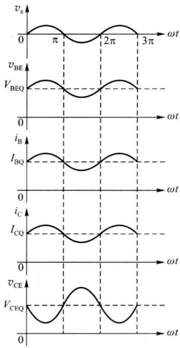  

图 2.3.2 共射放大电路的工作波形

作在放大状态,输出电压波形才不会产生非线性失真。基本共射放大电路的电压放大作用是利用晶体管的电流放大作用,并依靠 $R_{c}$ 将电流的变化转化成电压的变化来实现的。

综上所述，在基本共射放大电路中，既有直流电源，又有交流输入信号，由于交、直流共存，电路中各处的全值量 $=$ 直流分量 $+$ 交流分量， $V_{\mathrm{CC}}$ 、 $V_{\mathrm{BB}}$ 、 $R_{\mathrm{B}}$ 、 $R_{\mathrm{C}}$ 提供直流 $Q$ 点在放大区， $R_{\mathrm{C}}$ 将电流变化转化为电压变化输出，实现交流放大。这充分体现了直流 $Q$ 点是基础，交流放大是目的。

## 2.3.2 直流通路与交流通路

一般情况下,在放大电路中,直流量(静态电流与电压)和交流信号(动态电流与电压)总是共存的,因此在分析放大电路时,应遵循“先静态,后动态”的原则。

由于电容、电感等电抗元件的存在,直流量所流经的通路与交流信号所流经的通路是不完全相同的。因此,为了研究问题方便起见,常把直流电源对电路的作用和交流输入信号对电路的作用区分开来,分成直流通路和交流通路。直流通路是在直流电源作用下直流电流流经的通路,也就是静态电流流经的通路,用于研究静态工作点。对于直流通路:①电容视为开路;②电感线圈视为短路(即忽略线圈电阻);③交流电压信号源视为短路,交流电流信号源视为开路,但应保留其内阻。交流通路是交流输入信号作用下交流信号流经的通路,用于研究动态参数。对于交流通路,在中频区(中频区的定义在2.3.4节有详细介绍):①容量大的电容(如耦合电容)视为短路;②电感线圈视为开路;③直流电源视为短路。

求解静态工作点时应利用直流通路,求解动态参数时应利用交流通路,两种通路切不可混淆。静态工作点合适,动态分析才有意义。交流分析和直流分析之所以可以分别进行,是因为放大器件工作在线性放大区,交流信号幅值很小时,交流信号与直流可以直接相加,而不会带来失真,即线性电路适用于叠加定理。所以,直流分析的结果一定要保证直流工作点在线性放大区内,交流分析结果才正确。

所以,对放大电路进行分析计算应包括两方面的内容:一是直流分析(静态分析),求出静态工作点;二是交流分析(动态分析),主要是计算电路的性能指标或分析电压、电流的波形等。分析计算的方法有图解法、等效电路法等,下面分别加以介绍。

## 2.3.3 图解法

图解法是利用晶体管的伏安特性曲线及外部电路特性,用作图的方法对放大电路进行分析。

图 2.3.1 所示的电路有以下 3 个缺点: ① 输入回路中, $i_{B}$ 中的交流分量 $i_{b}$ 经过 $R_{B}$ 并在其上产生电压降。这样信号电压将损失一部分, 导致增益的下降; ② $i_{B}$ 中的直流分量 $I_{B}$ 必须流过信号源, 有时会影响信号源的工作, 并且要求信号源必须具备直流通路, 允许直流电流流过, 这不是所有的信号源都能够做到的; ③ 需要有两个直流电源 $V_{CC}$ 和 $V_{BB}$ , 使用不方便。

为了克服以上缺点,实际放大电路都采用图2.3.3所示的电路,只用一个直流电源 $V_{CC}$ , $I_{B}$ 也由 $V_{CC}$ 供给,图(a)是其一般画法,图(b)是习惯画法,直流电源 $V_{CC}$ 采用简化画法,它的负端接地。电容 $C_{1}$ 用于连接信号源与放大电路,电容 $C_{2}$ 用于连接放大电路与负载,在电路中起连接作用,称为耦合电容,利用电容连接电路称为阻容耦合。 $C_{1}$ 和 $C_{2}$ 对直流呈开路状态,又称为隔直电容。 $C_{1}$ 和 $C_{2}$ 的容量应足够大,使其在输入信号频率范围内的容抗很小,可视为交流短路。可见, $C_{1}$ 和 $C_{2}$ 的作用是隔直流、通交流,故待放大交流信号 $v_{s}$ 可顺利通过 $C_{1}$ 加至发射结上,被放大的交流输出信号即集电极电压 $v_{CE}$ 的交流分量 $v_{ce}$ 可通过 $C_{2}$ 送至 $R_{L}$ 上。故该电路满足组成放大电路的三条原则,可以实现信号的放大。

下面以图 2.3.3 所示的阻容耦合单管共射放大电路为例来讨论图解法的思路和步骤。

## 一、静态工作点分析

步骤如下。

### 1. 画出放大电路的直流通路

放大电路的直流通路如图 2.3.4 所示, 图(a) 是一般画法, 图(b) 是习惯画法。

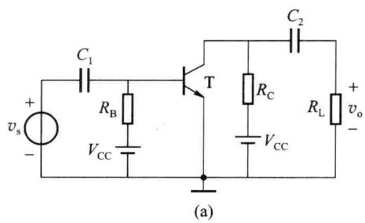

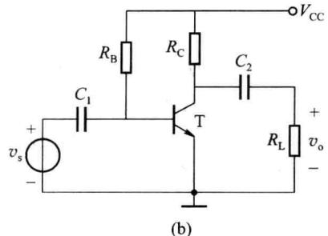  

图 2.3.3 阻容耦合共射放大电路的一般画法与习惯画法

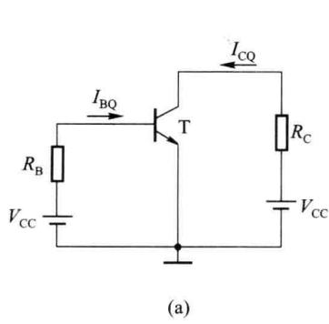

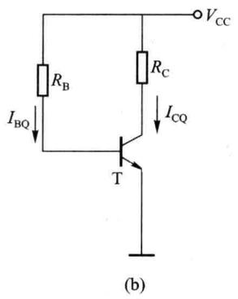  

图 2.3.4 阻容耦合共射放大电路的直流通路的一般画法与习惯画法

2. 在输入特性曲线上作输入回路的直流负载线, 求出 $I_{BQ}$ 、 $V_{BEQ}$

在晶体管的输入回路中,静态工作点既应在晶体管的输入特性曲线上,又应满足外电路的回路方程

$$

V _ {\mathrm{BE}} = V _ {\mathrm{CC}} - I _ {\mathrm{B}} R _ {\mathrm{B}}\tag{2.3.2}

$$

在输入特性坐标系中，画出式(2.3.2)所确定的直线，它与横轴的交点为 $(V_{\mathrm{CC}},0)$ ，与纵轴的交点为 $(0,V_{\mathrm{CC}} / R_{\mathrm{B}})$ ，斜率为 $-1 / R_{\mathrm{B}}$ ，称为输入回路的直流负载线，与输入曲线的交点即为静态工作点 $Q$ ，从而可确定出 $I_{\mathrm{BQ}}$ 和 $V_{\mathrm{BEQ}}$ ，如图2.3.5(a)所示。

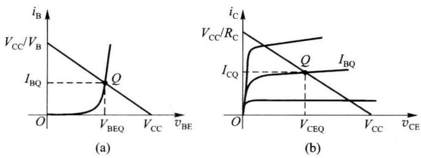  

图 2.3.5 图解法求静态工作点

工程上为方便起见,经常近似估算 $I_{BQ}$ 的值

$$

I _ {\mathrm{BQ}} = \frac {V _ {\mathrm{CC}} - V _ {\mathrm{BEQ}}}{R _ {\mathrm{B}}}\tag{2.3.3}

$$

对于小功率硅管取 $V_{BEQ}=0.6\sim0.7\ V$ ，锗管取 $V_{BEQ}=0.2\sim0.3\ V$ 。

3. 在输出特性曲线上作输出回路的直流负载线, 求出 $I_{CQ}$ 、 $V_{CEQ}$

与输入回路相似,在晶体管的输出回路中,静态工作点应既在晶体管的输出特性曲线上,又满足外电路的回路方程

$$

V _ {\mathrm{CE}} = V _ {\mathrm{CC}} - I _ {\mathrm{C}} R _ {\mathrm{C}}\tag{2.3.4}

$$

在输出特性坐标系中，画出式(2.3.4)所确定的直线，它与横轴的交点为 $(V_{\mathrm{CC}},0)$ ，与纵轴的交点为 $(0,V_{\mathrm{CC}} / R_{\mathrm{C}})$ ，斜率为 $-1 / R_{\mathrm{C}}$ ，称为输出回路的直流负载线；并且找到 $I_{\mathrm{B}} = I_{\mathrm{BQ}}$ 的那条输出曲线，这两条线的交点即为静态工作点 $Q$ ，从而可确定出 $I_{\mathrm{CQ}}$ 、 $V_{\mathrm{CEQ}}$ ，如图2.3.5(b)所示。

应当指出,如果输出特性曲线中没有 $I_{B}=I_{BQ}$ 的那条输出曲线,则应该补上该曲线。

Q 点确定后, 就可以在此基础上进行动态分析了。

## 二、动态图解分析

步骤如下。

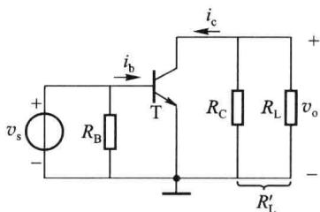

1. 画出放大电路的交流通路

放大电路的交流通路如图 2.3.6 所示。

2. 根据输入信号求 $v_{\mathrm{BE}}$ 、 $i_{\mathrm{B}}$ 的波形

图 2.3.6 阻容耦合放大电路的交流通路

设输入信号 $v_{s}=V_{sm}\sin\omega t(V_{sm}<<V_{BEQ})$ ，直接加在晶体管的发射结上 $v_{be}=v_{s}$ ，叠加在 $V_{BEQ}$ 上，即 $v_{BE}=V_{BEQ}+v_{s}$ ，将 $v_{BE}$ 的波形画在输入特性曲线的下方，如图 2.3.7(a) 所示。根据 $v_{BE}$ 的变化规律，便可从输入特性画出对应的 $i_{B}$ 、 $i_{b}$ 的波形。 $i_{B}$ 的最大值为 $I_{B1}$ ，最小值为 $I_{B2}$ ，它们决定了输出特性曲线的工作范围。

3. 在输出特性曲线上作交流负载线, 求 $i_{C}$ 及 $v_{CE}$ 波形

### (1) 作交流负载线

设晶体管集电极的交流等效电阻为 $R_{L}^{\prime}$ ，则 $R_{L}^{\prime}=R_{C}\parallel R_{L}$ ，由交流通路图可以写出输出回路方程式

$$

v _ {\mathrm{ce}} = - R _ {\mathrm{L}} ^ {\prime} i _ {\mathrm{c}}\tag{2.3.5}

$$

由于 $v_{ce}=v_{CE}-V_{CEQ}, i_{c}=i_{C}-I_{CQ}$ ，代入上式可得

则

$$

\begin{array}{r l} & v _ {\mathrm{CE}} - V _ {\mathrm{CEQ}} = - R _ {\mathrm{L}} ^ {\prime} (i _ {\mathrm{C}} - I _ {\mathrm{CQ}}) \\ & v _ {\mathrm{CE}} = - R _ {\mathrm{L}} ^ {\prime} i _ {\mathrm{C}} + (V _ {\mathrm{CEQ}} + I _ {\mathrm{CQ}} R _ {\mathrm{L}} ^ {\prime}) \\ & i _ {\mathrm{C}} = - \frac {1}{R _ {\mathrm{L}} ^ {\prime}} v _ {\mathrm{CE}} + \frac {V _ {\mathrm{CEQ}} + I _ {\mathrm{CQ}} R _ {\mathrm{L}} ^ {\prime}}{R _ {\mathrm{L}} ^ {\prime}} \end{array}\tag{2.3.6}

$$

将式(2.3.6)确定的直线画在输出特性曲线上,如图2.3.7(b)所示,它与横轴的交点M为 $\left(V_{\mathrm{CEQ}}+I_{\mathrm{CQ}}R'_{\mathrm{L}},0\right)$ ，斜率等于 $-1/R_{L}'$ ，称为交流负载线。将式(2.3.5)称为交流负载线的交流方程，式(2.3.6)称为交流负载线的全值方程。

交流负载线和直流负载线必然在 Q 点相交, 这是因为在线性工作范围内, 输入电压在变化过程中必经过零点, 在通过零点时 $v_{s}=0$ , 这一时刻既是动态过程中的一个点, 又与静态工作情况相符,所以这一时刻的 $i_{C}$ 和 $v_{CE}$ 应同时在两条负载线上,这只有是两条负载线的交点才有可能。因此通过图 2.3.7 中的 M 点与 Q 点所作的直线即为交流负载线。

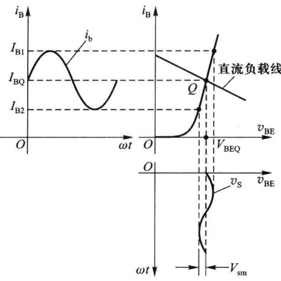  

(a)

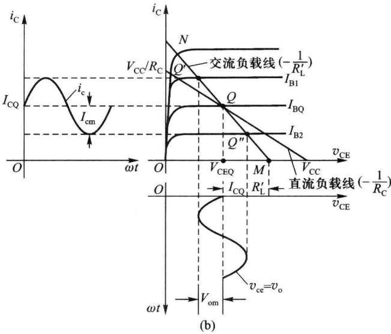  

图 2.3.7 阻容耦合共射放大电路的动态图解分析

(2) 求 $i_{c}$ 及 $v_{CE}$ 波形

基极电流 $i_{B}$ 在 $I_{B1} \sim I_{B2}$ 之间随时间变化，每一个 $i_{B}$ 取值对应一条输出特性曲线，该曲线与交流负载线的交点便是此 $i_{B}$ 值下的工作点。当 $i_{B}$ 分别为 $I_{B1}$ 和 $I_{B2}$ 时，两条输出特性曲线与负载线分别相交于 $Q'$ 和 $Q''$ ，晶体管的工作范围处于 $Q'$ 和 $Q''$ 之间。由此可画出 $i_{C}$ 、 $v_{CE}$ 的波形，如图 2.3.7(b) 所示。

由图2.3.7可看出信号电压、电流之间的幅度与相位关系，其中 $v_{\mathrm{s}}$ 、 $i_{\mathrm{b}}$ 、 $v_{\mathrm{be}}$ 、 $i_{\mathrm{c}}$ 四者同相， $v_{\mathrm{o}} = v_{\mathrm{ce}}$ 与 $v_{\mathrm{s}}$ 反相。由图中的 $V_{\mathrm{sm}}$ 和 $V_{\mathrm{om}}$ 便可求出源电压增益 $A_{vs} = V_{\mathrm{om}} / V_{\mathrm{sm}}$ 。

## 三、交流负载线与直流负载线的区别

由上面的分析可知,直流负载线表示的是直流电压、电流的关系,是直流工作点移动的轨迹,取决于直流通路,只能用来确定直流工作点Q;交流负载线表示的是交流电压、电流之间的关系,是动态时工作点移动的轨迹,即任何瞬时交流电流与对应的电压关系都在交流负载线上,所以动态分析应使用交流负载线。注意二者的斜率不同,直流负载线的斜率是 $-1/R_{C}$ ,交流负载线的斜率是 $-1/R_{L}^{\prime}(R_{L}^{\prime}=R_{C}\parallel R_{L})$ ,由于 $R_{L}^{\prime}<R_{C}$ ,因此通常交流负载线比直流负载线更陡,而且只有负载开路 $(R_{L}=\infty)$ 时交、直流负载线才重合为一条。

## 四、静态工作点的选择与波形失真及动态范围

由图 2.3.7(b) 可以看出, 为使晶体管不进入截止区和饱和区, 静态工作点 Q 的选择应满足下列条件

$$

\left\{ \begin{array}{l} I _ {\mathrm{CQ}} > I _ {\mathrm{cm}} + I _ {\mathrm{CEO}} \\ V _ {\mathrm{CEQ}} > V _ {\mathrm{om}} + V _ {\mathrm{CE(sat)}} \end{array} \right.\tag{2.3.7}

$$

静态工作点 Q 位置设置不当, 对波形失真有直接影响。

如果 Q 点偏低, 如图 2.3.8 所示, $V_{BEQ}$ 、 $I_{BQ}$ 较小, 晶体管在输入信号 $v_{s}$ 的负峰值附近进入截止区, 使 $i_{B}$ 、 $i_{C}$ 波形底部失真, $v_{CE}$ 及 $v_{O}$ 波形顶部失真, 这种由于晶体管截止引起的失真称为截止失真。

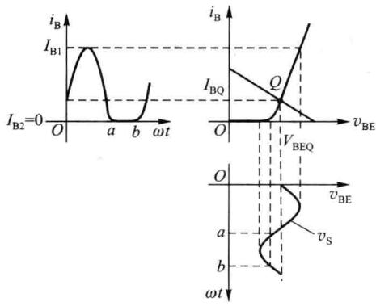  

(a)

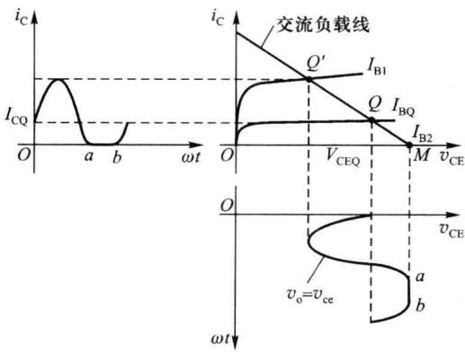  

(b)  

图 2.3.8 工作点偏低引起的截止失真

如果 Q 点偏高，如图 2.3.9 所示， $V_{BEQ}$ 、 $I_{BQ}$ 较大，基极电流 $i_{B}$ 不失真，但在 $i_{B}$ 正峰值附近晶体管进入饱和区，引起 $i_{C}$ 波形顶部失真， $v_{CE}$ 及 $v_{0}$ 波形底部失真，这种由于晶体管饱和引起的失真称为饱和失真。

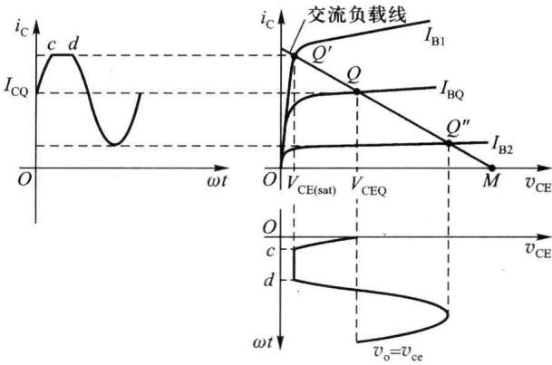  

图 2.3.9 工作点偏高引起的饱和失真

截止失真和饱和失真均是由晶体管的非线性引起的，为非线性失真。

在不出现截止失真和饱和失真的条件下,放大电路所能输出信号电压的最大幅值称为

放大电路的动态范围，如图2.3.10所示。考虑到不失真正弦信号的正负半周是对称的，因此动态范围应是图中 $V_{om1}$ 、 $V_{om2}$ 这两个数值中的小者，其中 $V_{om1}=V_{CEQ}-V_{CE(sat)}$ ， $V_{om2}=I_{CQ}R_{L}^{\prime}$ 。显然，如果要获得最大动态范围，应使 $V_{om1}=V_{om2}$ ，即Q点应位于负载线MN段的中点。放大电路的动态范围与最大输出幅度的意义是不同的，后者要比前者小一些，设计电路时应留有20%\~30%的裕量。

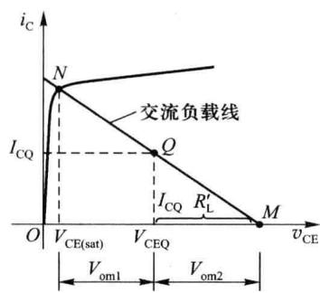

实际上,即使晶体管在信号的整个周期内均工作于放大区,也会因为晶体管的非线性使输出波形产生一定程度的失真,只不过当输入信号比较小时,输出波形的失真也较小,可以忽略不计。

图 2.3.10 放大电路的动态范围

综上所述，Q 点的选择，除非为了要得到最大不失真输出，往往可以采取比较灵活的原则，如当信号幅度不大时，为了降低直流电源 $V_{cc}$ 的能量消耗，在不产生失真和保证一定的电压增益的前提下，常把 Q 点选得低一些。应当注意的是，Q 点选得过低，将导致产生截止失真；反之，若 Q 点选得过高，又将引起饱和失真。一般来说，Q 点选在交流负载线 MN 的中央，这时可获得最大的不失真输出，亦即可得到最大的动态范围。

## 五、图解法的特点

图解法是分析非线性电路的常用方法,它直观形象地反映了晶体管的工作情况,但是必须实测所用管的特性曲线;而且用图解法进行定量分析时误差较大;此外,晶体管的特性曲线只能反映信号频率较低时电压、电流的关系,而不反映信号频率较高时极间电容产生的影响;图解法不能分析电路的输入电阻、输出电阻;在放大电路带有负反馈时,用图解法分析也是很困难的。因此，图解法一般多适用于分析输入幅值比较大而工作频率不太高时的情况，在实际应用中，多用于分析 Q 点位置、最大不失真输出电压和失真情况。

## 2.3.4 等效电路法

晶体管电路分析的复杂性在于晶体管特性的非线性,如果能在一定条件下将晶体管的特性线性化,即用线性电路来描述非线性特性,建立线性模型,就可以应用线性电路的分析方法来分析晶体管电路了。这就是把非线性问题线性化的工程处理方法。

等效电路法就是这样一种方法,其思路是将晶体管用合适的模型来等效,与其他元件一起组成线性电路,用求解线性电路的方法进行分析计算。晶体管的模型有多种形式,复杂度和精度各不相同,可以根据不同的要求和场合进行选取。采用计算机辅助分析工具可对电路进行精确地分析,在工程上则需采用简化的模型对电路进行粗略地估算,下面介绍这方面的内容。

## 一、晶体管的静态工作点估算

### 1. 晶体管的简化直流模型

晶体管的实际输入特性曲线如图2.3.11(a)中虚线所示，在工程上用两折线近似，如图中的实线所示，计算出来的静态工作点不会产生很大的误差。折线的转折点为阈值电压 $V_{\mathrm{th}}$ ，硅管取 $0.7\mathrm{V}$ ，锗管取 $0.3\mathrm{V}$ 。晶体管的实际输出特性曲线如图2.3.11(b)中虚线所示，在工程上用一族平行等间隔的水平线来近似，如图中的实线所示，即认为 $\bar{\beta}$ 是常数，且不考虑 $v_{\mathrm{CE}}$ 对 $i_{\mathrm{C}}$ 的影响。这样，工作于放大区的晶体管输入回路用恒压源 $V_{\mathrm{th}}$ 等效，输出回路用受控电流源 $\bar{\beta} I_{\mathrm{B}}$ 来等效，便得到了晶体管工作在放大区的简化直流模型，如图2.3.11(c)所示。习惯将 $V_{\mathrm{th}}$ 写成 $V_{\mathrm{BE}},\bar{\beta}$ 写成 $\beta$ 。

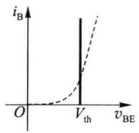  

(a)

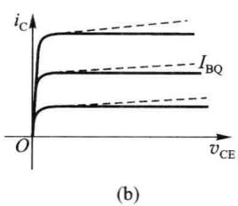

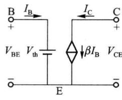  

(c)  

图 2.3.11 晶体管的简化直流模型

需要说明晶体管的直流模型是晶体管在静态时工作在放大状态的模型,它的使用条件是: $V_{BE}>V_{th}$ 且 $V_{CE}>V_{BE}$ 。

### 2. 静态工作点估算

下面以图 2.3.3 所示电路为例来计算 Q 点。考虑到晶体管的直流模型，由图 2.3.4 所示直流通路的输入、输出回路易得

$$

\left\{ \begin{array}{l} I _ {\mathrm{BQ}} = \frac {V _ {\mathrm{CC}} - V _ {\mathrm{BEQ}}}{R _ {\mathrm{B}}} \\ I _ {\mathrm{CQ}} = \beta I _ {\mathrm{BQ}} \\ V _ {\mathrm{CEQ}} = V _ {\mathrm{CC}} - R _ {\mathrm{C}} I _ {\mathrm{CQ}} \end{array} \right.\tag{2.3.8}

$$

上述简化直流模型计算 Q 点简单方便,但在计算复杂电路时会产生较大误差,需选用更复杂、更精确的模型,并用计算机进行计算。

<Example title="例 2.3.1">
在图 2.3.3 所示电路中, 已知 $V_{CC} = 12 \, V, R_{B} = 510 \, k\Omega, R_{C} = 3 \, k\Omega$ , 晶体管的 $\beta = 80, V_{BEQ} = 0.7 \, V, V_{CE(sat)} = 0.3 \, V$ , 求:

(1) 静态工作点 Q 点；

(2) 求 $R_{B}=51\ k\Omega$ 时的 $I_{B}$ 、 $I_{C}$ 、 $V_{CE}$ 。

<Solution title="解">
(1)由式(2.3.8)可得

$$

I _ {\mathrm{BQ}} = 2 2. 2 \mu \mathrm{A}, I _ {\mathrm{CQ}} = 1. 7 7 \mathrm{mA}, V _ {\mathrm{CEQ}} = 6. 6 9 \mathrm{V}

$$

(2) 同样由式(2.3.8)可得

$$

I _ {\mathrm{BQ}} = 2 2 2 \mu \mathrm{A}, I _ {\mathrm{CQ}} = 1 7. 7 \mathrm{mA}, V _ {\mathrm{CEQ}} = - 4 1. 1 \mathrm{V}

$$
</Solution>
</Example>

<Note title="注意">
$V_{CEQ}$ 不可能为负值,错在哪里?原因:此时晶体管已不在放大区工作,进入饱和区,在饱和区 $I_{C}=\beta I_{B}$ 不成立,而是 $I_{C}<\beta I_{B}$ 。故正确解答为

$$

I _ {\mathrm{B}} = 2 2 2 \mu \mathrm{A}, V _ {\mathrm{CE}} = V _ {\mathrm{CE(sat)}} = 0. 3 \mathrm{V}, I _ {\mathrm{C}} = (V _ {\mathrm{CC}} - V _ {\mathrm{CE(sat)}}) / R _ {\mathrm{C}} = 3. 9 \mathrm{mA}

$$

说明:由于在放大区与饱和区的临界点 $I_{C}=\beta I_{B}$ 仍然成立,将临界点处的电流用 $I_{BS}$ 、 $I_{CS}$ 表示,则

$$

I _ {\mathrm{BS}} = I _ {\mathrm{CS}} / \beta = (V _ {\mathrm{CC}} - V _ {\mathrm{CE(sat)}}) / (\beta R _ {\mathrm{C}})\tag{2.3.9}

$$

可知判断晶体管在饱和区的条件为

$$

I _ {\mathrm{B}} > I _ {\mathrm{BS}}\tag{2.3.10}

$$

对于上题, 可得 $I_{BS}=48.75\ \mu A, I_{B}=222\ \mu A>I_{BS}$ , 因此晶体管进入饱和区。
</Note>

## 二、晶体管的混合 $\pi$ 模型及交流指标的计算

### 1. 晶体管混合 $\pi$ 模型的导出

在放大电路中,如果加在晶体管发射结的交流输入信号幅度很小,则在晶体管输入和输出特性曲线上,直流 Q 点附近信号作用范围内的非线性伏安特性可近似为线性,因此,对交流小信号非线性晶体管可以看成是线性网络,这个线性网络即是晶体管的小信号模型或微变模型。这样就可用解线性电路的方法对晶体管电路进行分析,计算其交流指标了。

小信号模型是用来描述叠加在直流量上的各交流量之间的依存关系,与直流量的极性或流向无关。因此,无论晶体管是哪种类型(NPN型或PNP型),它们的小信号模型是一样的。

在工程上,不管晶体管接成什么组态,只要其发射结所加信号的电压幅度 $V_{sm}<10\ mV$ （室温下),就可以认为是小信号,可以应用小信号模型对电路进行分析。

晶体管的小信号模型有各种不同的形式，混合 $\pi$ 模型是常用的一种。它是一个物理模型，其中的每一个参数都描述器件内部的某一物理现象，可直接由处于放大状态的晶体管 $EM_{2}$ 模型导出。EM 模型是在计算机辅助分析或设计电子电路时较为常见的晶体管模型，EM 为 J. J. Ebors 和 J. L. Moll 二人姓的字头， $EM_{2}$ 模型是其瞬态模型，其详细内容限于篇幅不再赘述。

这里由图2.3.12所示晶体管的结构示意图来说明图2.3.13所示的晶体管混合 $\pi$ 模型。在图2.3.12中分别用 $\mathrm{b}^{\prime},\mathrm{e}^{\prime},\mathrm{c}^{\prime}$ 表示晶体管三个区内部的等效节点，则三个区的体电阻分别为 $r_{\mathrm{bb}^{\prime}},r_{\mathrm{ee}^{\prime}},r_{\mathrm{cc}^{\prime}}$ ；对于交流小信号，发射结用其 $Q$ 点处的动态电阻 $r_{\mathrm{b}^{\prime}\mathrm{e}^{\prime}}$ 表示，同样集电结也用其动态电阻 $r_{\mathrm{b}^{\prime}\mathrm{c}^{\prime}}$ 表示。由于发射区的掺杂浓度高、集电区的结面积大， $r_{\mathrm{ee}^{\prime}},r_{\mathrm{cc}^{\prime}}$ 较小，基区薄且掺杂浓度低， $r_{bb'}$ 较大，故在混合 $\pi$ 模型中只保留了基区的体电阻 $r_{bb'}$ ，发射结的动态电阻 $r_{b'e'}$ 和集电结的动态电阻 $r_{b'c'}$ 可表示为 $r_{b'e}$ 和 $r_{b'c}$ ，易知

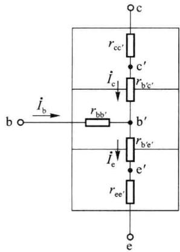

$$

r _ {\mathrm {b^{\prime} e}} = \frac {V _ {T}}{I _ {\mathrm{BQ}}} = (1 + \beta) \frac {V _ {T}}{I _ {\mathrm{EQ}}}\tag{2.3.11}

$$

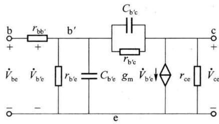  

图 2.3.12 晶体管结构示意图  

图 2.3.13 晶体管的混合 $\pi$ 模型

考虑到PN结的电容，分别用 $C_{\mathrm{b'e}}$ 、 $C_{\mathrm{b'c}}$ 表示发射结、集电结的电容。在放大区，晶体管的输出电流 $i_{\mathrm{C}}$ 受输入电流 $i_{\mathrm{B}}$ 的控制，而输入电流 $i_{\mathrm{B}}$ 是受发射结电压 $\dot{V}_{\mathrm{b'e}}$ 控制的，因此实质上输出电流 $i_{\mathrm{C}}$ 受输入发射结电压 $\dot{V}_{\mathrm{b'e}}$ 控制，故在混合 $\pi$ 模型中用一个受 $\dot{V}_{\mathrm{b'e}}$ 控制的电流源 $g_{\mathrm{m}}\dot{V}_{\mathrm{b'e}}$ 表示晶体管的输出， $g_{\mathrm{m}}$ 称为跨导，表示输入电压对输出电流的控制能力； $r_{\mathrm{ce}}$ 是描述基区宽度调制效应的输出电阻。将上述分析结果综合起来即可得到晶体管混合 $\pi$ 模型。由于交流分析是在稳态正弦小信号下进行的，所以混合 $\pi$ 模型中各电压、电流均用复数表示。该模型的形状像希腊字母 $\pi$ ，且各参数有不同的量纲，故称之为混合 $\pi$ 模型，只适用于对器件工作于放大区，而且是交流小信号作用时进行分析。

在低频区，由于晶体管在放大区集电结反偏， $r_{b'c}$ 很大（一般在几百千欧至几兆欧之间），可以忽略，且不考虑 $C_{b'e}$ 、 $C_{b'c}$ 的影响，故低频混合 $\pi$ 模型如图 2.3.14(a) 所示。图中 $r_{bb'}$ 与 $r_{b'e}$ 串联，总电阻用 $r_{be}$ 表示，即

$$

r _ {\mathrm{be}} = r _ {\mathrm {bb^ {\prime}}} + r _ {\mathrm {b^ {\prime} e}} = r _ {\mathrm {bb^ {\prime}}} + (1 + \beta) \frac {V _ {T}}{I _ {\mathrm{EQ}}}\tag{2.3.12}

$$

中频区的混合 $\pi$ 模型与低频区相同。

而在高频区必须考虑极间电容 $C_{b'e}$ 、 $C_{b'c}$ 的影响，由于晶体管在放大区发射结正偏， $C_{b'e}$ 主要是扩散电容，数值较大，对于小功率晶体管，一般在十几至几百皮法之间，集电结反偏， $C_{b'c}$ 主要是势垒电容，数值较小，为零点几到几皮法之间；且由于 $r_{b'c} >> 1 / (\omega C_{b'c})$ ，忽略 $r_{b'c}$ ，故高频混合 $\pi$ 模型如图 2.3.14(b) 所示。

放大电路的中频区是指这样的频率范围,即在此范围内容量为 $\mu F$ 数量级的耦合电容和旁路电容的容抗可以近似看成短路,而容量为 pF 数量级的晶体管结电容又可近似看成开路。因此在此频率范围内,放大电路中所有电抗元件的作用均可忽略。本章对放大电路所进行的分析和计算都是针对此中频段频率范围而言的。至于中频区以外的高、低频区,即必须考虑晶体管结电容或耦合电容、旁路电容等电抗元件的作用时，放大电路的特性将有不同的变化，有关这方面的问题，将在后面章节中详细讨论。

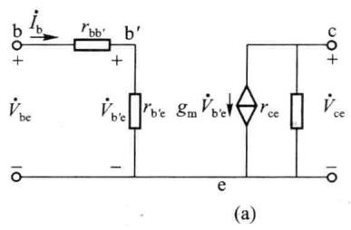

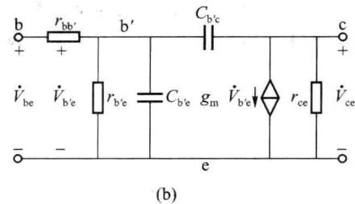  

图 2.3.14 晶体管的低频与高频混合 $\pi$ 模型

### 2. 混合 $\pi$ 模型参数的计算及特点

有了混合 $\pi$ 模型后，需要确定模型的参数。 $r_{\mathrm{bb}^{\prime}}$ 一般器件手册都会给出； $r_{\mathrm{b}^{\prime}\mathrm{e}}$ 可由式(2.3.11)给出； $r_{\mathrm{ce}}$ 可由2.1节的式(2.1.17)算出，但较大，经常忽略；可以证明， $g_{\mathrm{m}}r_{\mathrm{b}^{\prime}\mathrm{e}} = \beta$ ，故

$$

g _ {\mathrm{m}} = \frac {\beta}{r _ {\mathrm {b^ {\prime} e}}}\tag{2.3.13}

$$

将式 $(2.3.11)$ 代入,又可得

$$

g _ {\mathrm{m}} = \frac {\beta}{(1 + \beta) \frac {V _ {T}}{I _ {\mathrm{EQ}}}} = \frac {\alpha I _ {\mathrm{EQ}}}{V _ {T}} = \frac {I _ {\mathrm{CQ}}}{V _ {T}}\tag{2.3.14}

$$

至此得到了低频混合 $\pi$ 模型的所有参数。

对于低频和中频区的混合 $\pi$ 模型，由模型可得 $g_{m}\dot{V}_{b'e}=g_{m}r_{b'e}\dot{I}_{b}=\beta\dot{I}_{b}$ ，所以输出回路的受控源也常用 $\beta\dot{I}_{b}$ 表示。显然，对于高频混合 $\pi$ 模型，上述关系不成立，输出回路的受控源不能用 $\beta\dot{I}_{b}$ 表示。在后面的低频和中频区的混合 $\pi$ 模型中，本书均用 $\beta\dot{I}_{b}$ 代替 $g_{m}\dot{V}_{b'e}$ ，是为了计算的方便。由于一般器件手册都会给出 $\beta$ ，所以模型参数的计算主要是 $r_{b'e}$ 或 $r_{be}$ 一个参数了。

混合 $\pi$ 模型是交流小信号模型, 只能进行交流小信号分析; 其参数均与静态工作点有关, 即是 Q 点的函数; 各参数在频率低于 $f_{T}/3$ 时基本与频率无关, 因此它的频率适用范围是 $f < f_{T}/3$ 。

### 3. 用混合 $\pi$ 模型计算放大电路的动态性能指标

应当指出,虽然利用混合 $\pi$ 模型分析的是交流(动态)指标,但是由于模型参数与静态 Q 点紧密相关,而且只有在 Q 点合适时动态分析才有意义,所以对放大电路进行分析时,总是遵循“先静态,后动态”的原则,也只有 Q 点合适才可进行动态分析。

根据以上介绍,可以归纳出利用混合 $\pi$ 模型分析放大电路的步骤如下:

(1) 确定放大电路的静态工作点 Q;

(2) 求出 Q 点处的混合 $\pi$ 模型参数 $\beta$ 和 $r_{b'e}$ ;

（3）画出放大电路的交流通路，将电路中的晶体管 T 用低频混合 $\pi$ 模型代替，即得到小信号交流等效电路；

(4) 求解放大电路的交流性能指标 $\dot{A}_{v}$ 、 $R_{i}$ 、 $R_{o}$ 等。

下面来分析图 2.3.3 所示的阻容耦合单管共射放大电路。其交流通路如图 2.3.15(a) 所示, 图 2.3.15(b) 所示是其小信号交流等效电路。

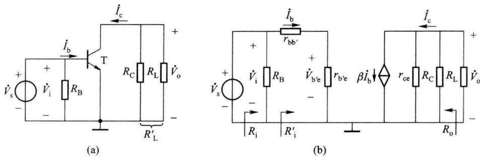  

图 2.3.15 阻容耦合共射放大电路的交流通路及交流等效电路

### (1) 电压增益

总负载电阻 $R_{L}^{\prime}=r_{ce}\parallel R_{C}\parallel R_{L}$ ，由电路不难得出

$$

\dot {V} _ {\mathrm{o}} = - \beta \dot {I} _ {\mathrm{b}} R _ {\mathrm{L}} ^ {\prime}, \quad \dot {V} _ {\mathrm{i}} = \dot {I} _ {\mathrm{b}} (r _ {\mathrm {bb^ {\prime}}} + r _ {\mathrm {b^ {\prime} e}}) = \dot {I} _ {\mathrm{b}} r _ {\mathrm{be}}

$$

则

$$

\dot {A} _ {v} = \frac {\dot {V} _ {\mathrm{o}}}{\dot {V} _ {\mathrm{i}}} = - \frac {\beta R _ {\mathrm{L}} ^ {\prime}}{r _ {\mathrm{be}}}\tag{2.3.15}

$$

因 $R_{s}=0$ ，故 $\dot{A}_{vs}=\dot{A}_{v\circ}$

### (2) 输入电阻

由图 2.3.15(b) 所示电路, 按定义可得 $R_{i}^{\prime}=\frac{\dot{V}_{i}}{\dot{I}_{b}}=r_{be}$

则

$$

R _ {\mathrm{i}} = \frac {\dot {V} _ {\mathrm{i}}}{\dot {I} _ {\mathrm{i}}} = R _ {\mathrm{B}} / / R _ {\mathrm{i}} ^ {\prime} = R _ {\mathrm{B}} / / r _ {\mathrm{be}}\tag{2.3.16}

$$

### (3) 输出电阻

求输出电阻 $R_{o}$ 的等效电路如图 2.3.16 所示。由于输入、输出回路只有地线相连，外加电压 $\dot{V}$ 对输入回路没有影响， $\dot{I}_{b}=0$ ，输出端的受控电流源 $\beta\dot{I}_{b}=0$ （开路），所以

$$

R _ {\mathrm{o}} = \frac {\dot {V}}{\dot {I}} = r _ {\mathrm{ce}} / / R _ {\mathrm{C}}\tag{2.3.17}

$$

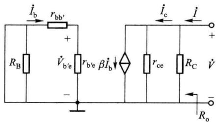  

图2.3.16 求 $R_{\mathrm{o}}$ 的电路

<Example title="例 2.3.2">
在图 2.3.3 所示电路中，已知 $V_{CC}=12\ V, R_{B}=510\ k\Omega, R_{C}=3\ k\Omega, R_{L}=3\ k\Omega$ ，晶体管的 $r_{bb'}=150\ \Omega, \beta=80, r_{ce}=40\ k\Omega, V_{BEQ}=0.7\ V, V_{CE(sat)}=0.3\ V$ 。

(1) 求出电路的 $\dot{A}_{v}$ 、 $R_{i}$ 、 $R_{o}$ ;

(2) 若所加信号源内阻 $R_{s}$ 为 $2 k\Omega$ ，求出 $\dot{A}_{vs}$ 。

<Solution title="解">
(1) 例 2.3.1 已解得此电路的 $I_{CQ}=1.77\ mA, V_{CEQ}=6.69\ V$ , 则可以计算出

$$

\begin{array}{r l} r _ {\mathrm{be}} & = r _ {\mathrm {b b ^ {\prime}}} + (1 + \beta) \frac {V _ {T}}{I _ {\mathrm{EQ}}} \approx \left[ 1 5 0 + (1 + 8 0) \frac {2 6}{1 . 7 7} \right] \Omega = 1 3 4 0 \Omega = 1. 3 4 \mathrm{k} \Omega \\ R _ {\mathrm{L}} ^ {\prime} & = r _ {\mathrm{ce}} / / R _ {\mathrm{C}} / / R _ {\mathrm{L}} = 1. 4 5 \mathrm{k} \Omega \\ \dot {A} _ {v} & = - \frac {\beta R _ {\mathrm{L}} ^ {\prime}}{r _ {\mathrm{be}}} = - \frac {8 0 \times 1 . 4 5}{1 . 3 4} = - 8 6. 6 \\ R _ {\mathrm{i}} & = R _ {\mathrm{B}} / / r _ {\mathrm{be}} \approx 1. 3 4 \mathrm{k} \Omega \\ R _ {\mathrm{o}} & = r _ {\mathrm{ce}} / / R _ {\mathrm{C}} = 2. 7 9 \mathrm{k} \Omega \end{array}

$$

(2) $\dot{A}_{\mathrm{vs}} = \frac{R_{\mathrm{i}}}{R_{\mathrm{s}} + R_{\mathrm{i}}} \cdot \dot{A}_{\mathrm{v}} = \frac{1.34}{2 + 1.34} \times (-86.6) = -34.7$
</Solution>
</Example>

## 三、等效电路法与图解法的比较

上面学习了图解法和等效电路法,这是分析放大电路的两种基本方法,它们是互相联系、互相补充的。下面对两种分析方法进行比较。

（1）图解法比较直观，分析大信号电路或功率放大电路时比较合适，但比较繁琐，当电路规模较大、较复杂或频率较高时，图解法不再适用。

（2）等效电路法比较方便，适合于小信号电路的分析，也适合于复杂放大电路的分析，但不够形象直观，不宜用于分析工作点是否合适以及求取最大输出幅度和动态范围等问题。
