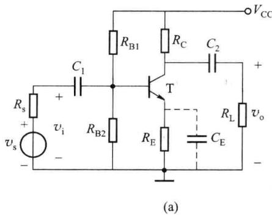
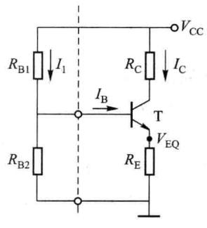
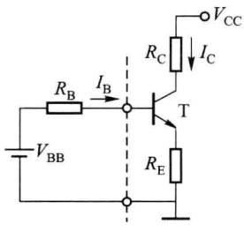
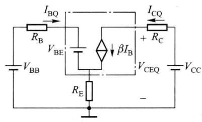
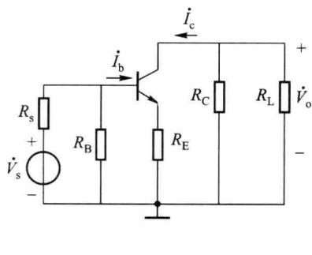
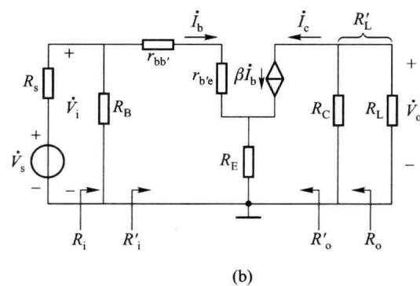
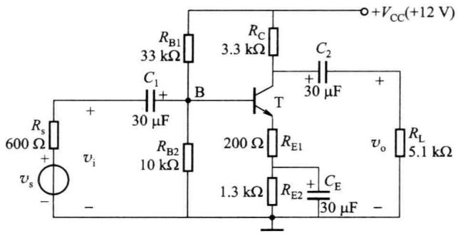
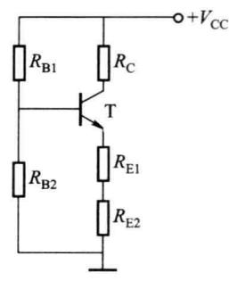
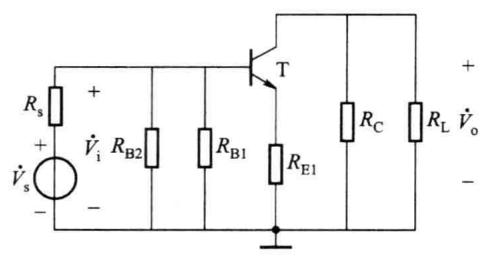

import Guide from '@/components/Guide.astro';
import Knowledge from '@/components/Knowledge.astro';
import Example from '@/components/Example.astro';
import Analysis from '@/components/Analysis.astro';
import Solution from '@/components/Solution.astro';
import Variant from '@/components/Variant.astro';
import Note from '@/components/Note.astro';
import Block from '@/components/Block.astro';
import Method from '@/components/Method.astro';
import Exercise from '@/components/Exercise.astro';

从上节的分析可以看出，静态工作点不但决定了电路是否会产生失真，而且还影响着电压放大倍数、输入电阻等动态参数，所以在设计或调试放大电路时，为获得较好的性能，必须首先设置一个合适的 $Q$ 点。在前面讨论的图2.3.3中，当电源电压 $V_{\mathrm{CC}}$ 和集电极电阻 $R_{\mathrm{C}}$ 确定后，放大电路的 $Q$ 点就由基极电流 $I_{\mathrm{B}}$ 来决定，这个电流就称为偏置电流，而获得偏置电流的电路叫做偏置电路，由 $V_{\mathrm{CC}}$ 和 $R_{\mathrm{B}}$ 构成的偏置电路称为固定偏流电路。固定偏流电路实际上是由一个偏置电阻 $R_{\mathrm{B}}$ 构成的，这种电路结构简单，调试方便，只要适当选择电路参数就可以保证 $Q$ 点处于合适的位置。但是，由于这种电路的偏置电流是“固定”的 $(I_{\mathrm{B}} \approx V_{\mathrm{CC}} / R_{\mathrm{B}})$ ，当更换晶体管或环境温度变化引起晶体管参数变化时，电路的工作点往往会移动，甚至移到不合适的位置而使放大电路无法正常工作，为此必须设计能够自动调整工作点位置的偏置电路，以使工作点能稳定在合适的位置。

本节讨论环境温度对工作点的影响以及稳定工作点的偏置电路。

## 2.4.1 静态工作点稳定的必要性

稳定静态工作点是电路设计的一个重要问题。这是因为放大电路的动态性能指标如$\dot{A}_{v}$ 、 $R_{i}$ 、 $R_{o}$ 及动态范围等与静态工作点密切相关，若静态工作点不稳定，放大电路的动态性能指标将随之变化，所以要求直流工作点不但要合适，而且要稳定。

影响静态工作点稳定的因素很多,如电源电压的波动、元件参数的变化、晶体管老化等,但温度变化对晶体管特性参数的影响是引起静态工作点漂移的主要因素。温度升高时晶体管的 $I_{CBO}$ 、 $\beta$ 增大、 $v_{BE}$ 减小,其结果集中表现为静态电流 $I_{CQ}$ 的增大。因此,要求放大电路性能稳定,必须首先设计工作点 Q 对温度不敏感的偏置电路。

## 2.4.2 典型的静态工作点稳定电路

## 一、电路组成和 $Q$ 点稳定原理

典型的 Q 点稳定电路如图 2.4.1(a) 所示, 其直流通路如图 2.4.1(b) 所示。在电路结构上采取了两点措施: 第一, 采用分压式电路固定基极电位; 第二, 发射极接入电阻 $R_{E}$ 实现自动调节作用。

  

(b)  

图 2.4.1 典型的 Q 点稳定电路及直流通路

如果 $I_{1} \gg I_{\mathrm{B}}(I_{1}$ 是流经 $R_{\mathrm{B1}}, R_{\mathrm{B2}}$ 的电流），就可近似地认为基极电位 $V_{\mathrm{BQ}} \approx R_{\mathrm{B2}} V_{\mathrm{CC}} / (R_{\mathrm{B1}} + R_{\mathrm{B2}})$ ，而与环境温度无关。在此条件下，当温度升高时， $I_{\mathrm{CQ}}(I_{\mathrm{EQ}})$ 增加，电阻 $R_{\mathrm{E}}$ 上电压降增大，射极电位 $V_{\mathrm{EQ}}$ 上升，由于基极电位 $V_{\mathrm{BQ}}$ 固定，加到发射结上的电压 $V_{\mathrm{BEQ}}$ 减小， $I_{\mathrm{BQ}}$ 减小，从而使 $I_{\mathrm{CQ}}$ 减小。结果牵制了 $I_{\mathrm{CQ}}$ 的增加，维持了 $I_{\mathrm{CQ}}$ 的基本不变。这种将输出量 $I_{\mathrm{C}}$ 通过一定的方式（利用 $R_{\mathrm{E}}$ 将 $I_{\mathrm{C}}$ 的变化转化成电压的变化）引回到输入回路来影响输入量 $V_{\mathrm{BE}}$ 的自动调节作用称为反馈；由于反馈的结果使电流输出量的变化减小，故称为电流负反馈；又由于反馈出现在直流通路中，故称为直流负反馈。 $R_{\mathrm{E}}$ 为负反馈电阻， $R_{\mathrm{E}}$ 越大，负反馈越强， $I_{\mathrm{CQ}}$ 的稳定性越好。但对于一定的集电极电流 $I_{\mathrm{C}}$ ，由于 $V_{\mathrm{CC}}$ 的限制， $R_{\mathrm{E}}$ 太大会使晶体管进入饱和区，电路将不能正常工作。上述过程可简述如下：

$$

T \uparrow \rightarrow I _ {\mathrm{CQ}} \setminus I _ {\mathrm{EQ}} \uparrow \rightarrow V _ {\mathrm{EQ}} \uparrow \rightarrow V _ {\mathrm{BEQ}} \downarrow \rightarrow I _ {\mathrm{BQ}} \downarrow \rightarrow I _ {\mathrm{CQ}} \setminus I _ {\mathrm{EQ}} \downarrow

$$

由此可见该电路稳定 Q 点的原因是：

(1) $R_{E}$ 的直流负反馈作用；

(2) 在 $I_{1} \gg I_{B}$ 的情况下, $V_{BQ}$ 在温度变化时基本不变。

所以也称这种电路为分压式电流负反馈 Q 点稳定电路。

## 二、静态工作点的计算

1. 近似估算

已知 $I_{1} \gg I_{\mathrm{B}}, V_{\mathrm{BQ}} \approx R_{\mathrm{B2}} V_{\mathrm{CC}} / (R_{\mathrm{B1}} + R_{\mathrm{B2}})$ ，可得

$$

I _ {\mathrm{CQ}} \approx I _ {\mathrm{EQ}} = \frac {V _ {\mathrm{BQ}} - V _ {\mathrm{BEQ}}}{R _ {\mathrm{E}}}\tag{2.4.1}

$$

$$

I _ {\mathrm{BQ}} = \frac {I _ {\mathrm{EQ}}}{1 + \beta} = \frac {V _ {\mathrm{BQ}} - V _ {\mathrm{BEQ}}}{(1 + \beta) R _ {\mathrm{E}}}\tag{2.4.2}

$$

$$

V _ {\mathrm{CEQ}} = V _ {\mathrm{CC}} - I _ {\mathrm{CQ}} (R _ {\mathrm{C}} + R _ {\mathrm{E}})\tag{2.4.3}

$$

### 2. 准确计算

无论电路参数是否满足 $I_{1} \gg I_{\mathrm{B}}, R_{\mathrm{E}}$ 的负反馈作用都存在。将图2.4.1(b)所示直流通路中基极偏置电路 $V_{\mathrm{CC}}, R_{\mathrm{B1}}, R_{\mathrm{B2}}$ 用戴维宁定理等效成一个电压源，如图2.4.2(a)所示，电压源的电压 $V_{\mathrm{BB}}$ 、内阻 $R_{\mathrm{B}}$ 分别为

$$

\left\{ \begin{array}{l} V _ {\mathrm{BB}} = \frac {R _ {\mathrm{B2}}}{R _ {\mathrm{B1}} + R _ {\mathrm{B2}}} V _ {\mathrm{CC}} \\ R _ {\mathrm{B}} = R _ {\mathrm{B1}} / / R _ {\mathrm{B2}} \end{array} \right.\tag{2.4.4}

$$

再将晶体管用它的简化直流模型代替,得到如图 2.4.2(b) 所示的直流等效电路。输入回路的方程为

$$

I _ {\mathrm{BQ}} R _ {\mathrm{B}} + V _ {\mathrm{BEQ}} + (I _ {\mathrm{B}} + \beta I _ {\mathrm{B}}) R _ {\mathrm{E}} = V _ {\mathrm{BB}}

$$

则

$$

\left\{ \begin{array}{l} I _ {\mathrm{BQ}} = \frac {V _ {\mathrm{BB}} - V _ {\mathrm{BEQ}}}{R _ {\mathrm{B}} + (1 + \beta) R _ {\mathrm{E}}} \\ I _ {\mathrm{CQ}} = \beta I _ {\mathrm{BQ}} \\ V _ {\mathrm{CEQ}} \approx V _ {\mathrm{CC}} - (R _ {\mathrm{C}} + R _ {\mathrm{E}}) I _ {\mathrm{CQ}} \end{array} \right.\tag{2.4.5}

$$

  

(a)

  

(b)  

图 2.4.2 典型的 Q 点稳定电路的直流通路及直流等效电路

### 3. 两种计算方法的比较

将式(2.4.2)与式(2.4.5)中 $I_{BQ}$ 的表达式比较,可以看出当 $(1+\beta)R_{E}\gg R_{B}$ 时,两种计算方法的 $I_{BQ}$ 的表达式相同,当然 $I_{CQ}$ 、 $V_{CEQ}$ 也相同,因此可用 $(1+\beta)R_{E}$ 与 $R_{B1}\parallel R_{B2}$ 的大小关系来判断式 $I_{1}\gg I_{B}$ 是否成立。即近似估算是在满足条件 $I_{1}\gg I_{B}$ 时的准确计算,是准确计算的特例。在实际工程中,电路的设计往往满足 $I_{1}\gg I_{B}$ 这一条件。

## 三、交流指标 $\dot{A}_{v}$ 、 $\dot{A}_{vs}$ 、 $R_{i}$ 、 $R_{o}$ 的计算

在未接 $C_{E}$ 时, 典型的 Q 点稳定电路的交流通路如图 2.4.3(a) 所示, 图中 $R_{B}=R_{B1} \parallel R_{B2}$ , 将晶体管用混合 $\pi$ 模型代替, 忽略晶体管的 $r_{ce}$ , 得到交流等效电路, 如图 2.4.3(b) 所

示, 其中 $R_{L}^{\prime}=R_{C}\parallel R_{L}$ 。由电路可列出

则

$$

\begin{array}{r l} \dot {V} _ {\mathrm{o}} & = - \beta \dot {I} _ {\mathrm{b}} R _ {\mathrm{L}} ^ {\prime} \\ \dot {V} _ {\mathrm{i}} & = \dot {I} _ {\mathrm{b}} (r _ {\mathrm {bb^ {\prime}}} + r _ {\mathrm {b^{\prime} e}}) + (\dot {I} _ {\mathrm{b}} + \beta \dot {I} _ {\mathrm{b}}) R _ {\mathrm{E}} = \dot {I} _ {\mathrm{b}} r _ {\mathrm{be}} + (1 + \beta) \dot {I} _ {\mathrm{b}} R _ {\mathrm{E}} \\ \dot {A} _ {v} & = \frac {\dot {V} _ {0}}{\dot {V} _ {\mathrm{i}}} = - \frac {\beta R _ {\mathrm{L}} ^ {\prime}}{r _ {\mathrm{be}} + (1 + \beta) R _ {\mathrm{E}}} \end{array}\tag{2.4.6}

$$

$$

R _ {\mathrm{i}} ^ {\prime} = \frac {\dot {V} _ {\mathrm{i}}}{\dot {I} _ {\mathrm{b}}} = r _ {\mathrm{be}} + (1 + \beta) R _ {\mathrm{E}}

$$

可得

$$

R _ {\mathrm{i}} = R _ {\mathrm{B}} / / R _ {\mathrm{i}} ^ {\prime} = R _ {\mathrm{B}} / / \left[ r _ {\mathrm{be}} + (1 + \beta) R _ {\mathrm{E}} \right]\tag{2.4.7}

$$

$$

\dot {A} _ {v s} = \frac {R _ {\mathrm{i}}}{R _ {\mathrm{s}} + R _ {\mathrm{i}}} \dot {A} _ {v}\tag{2.4.8}

$$

电路的输出电阻仍可用外加电压法求出。忽略 $r_{ce}$ 之后，受控电流源的内阻为无穷大，外加电压 $\dot{V}$ 不会通过该电流源作用于输入端，因而 $\dot{I}_{b}=0$ ，受控电流源 $\beta\dot{I}_{b}=0$ （相当于开路），故输出电阻为

$$

R _ {\mathrm{o}} \approx R _ {\mathrm{C}}\tag{2.4.9}

$$

  

图 2.4.3 典型的 Q 点稳定电路交流通路及交流等效电路

由式(2.4.6)和式(2.4.7)可以看出,加入 $R_{E}$ 后,由于输入电流为 $\dot{I}_{b}$ ,流过 $R_{E}$ 上的电流为 $\dot{I}_{e}$ ,而 $\dot{I}_{e}=(1+\beta)\dot{I}_{b}$ ,故射极电阻 $R_{E}$ 折合到基极的等效电阻为 $(1+\beta)R_{E}$ ,使 $\dot{A}_{v}$ 下降, $R_{i}$ 增加。

可见,接入电阻 $R_{E}$ , 可以稳定工作点, 且输入电阻显著增大, 但电压增益将显著下降。为了在稳定工作点的同时又不降低电压增益, 可在 $R_{E}$ 两端并联一个大电容 $C_{E}, C_{E}$ 又称为射极旁路电容, 如图 2.4.1(a) 中虚线所示。接入 $C_{E}$ 后, 对电路工作点没有影响, 交流通路中的 $R_{E}$ 被旁路, 使晶体管的射极直接接地, 与阻容耦合放大电路的交流等效电路完全相同, 因此交流指标分别为

$$

\begin{array}{l} \dot {A} _ {v} = - \frac {\beta R _ {\mathrm{L}} ^ {\prime}}{r _ {\mathrm{be}}} \\ R _ {\mathrm{i}} = R _ {\mathrm{B}} / / r _ {\mathrm{be}} \\ R _ {\mathrm{o}} \approx R _ {\mathrm{C}} \end{array}

$$

<Example title="例 2.4.1">
在图 2.4.4(a) 所示电路中, 晶体管 $\beta=50, V_{BEQ}=0.6\ V, r_{bb'}=200\ \Omega$ 。

(1) 分析静态工作点 Q;

(2) 求放大电路的 $\dot{A}_{v}$ 、 $\dot{A}_{vs}$ 、 $R_{i}$ 和 $R_{o}$ 。

<Solution title="解">
(1) 求静态工作点, 其直流通路如图 2.4.4(b) 所示, 与典型的 Q 点稳定电路的直流通路相同。采用近似计算, 可得

(a)  

(b)  

  

(c)  

图 2.4.4 例 2.4.1 的电路及直流、交流通路

$$

V _ {\mathrm{BQ}} = \frac {R _ {\mathrm{B2}}}{R _ {\mathrm{B1}} + R _ {\mathrm{B2}}} \cdot V _ {\mathrm{CC}} = \frac {1 0}{3 3 + 1 0} \times 1 2 \mathrm{V} = 2. 7 9 \mathrm{V}

$$

$$

I _ {\mathrm{CQ}} \approx I _ {\mathrm{EQ}} = \frac {V _ {\mathrm{BQ}} - V _ {\mathrm{BEQ}}}{R _ {\mathrm{E1}} + R _ {\mathrm{E2}}} = \frac {2 . 7 9 - 0 . 6}{0 . 2 + 1 . 3} \mathrm{mA} = 1. 4 6 \mathrm{mA}

$$

$$

I _ {\mathrm{BQ}} = \frac {I _ {\mathrm{EQ}}}{1 + \beta} = \frac {1 . 4 6}{1 + 5 0} \mathrm{mA} = 0. 0 2 8 6 \mathrm{mA} = 2 8. 6 \mu \mathrm{A}

$$

$$

V _ {\mathrm{CEQ}} = V _ {\mathrm{CC}} - I _ {\mathrm{CQ}} (R _ {\mathrm{C}} + R _ {\mathrm{E1}} + R _ {\mathrm{E2}}) = [ 1 2 - 1. 4 6 \times (3. 3 + 0. 2 + 1. 3) ] \mathrm{V} = 5 \mathrm{V}

$$

（2）求交流指标,其交流通路如图2.4.4(c)所示,与未接 $C_{E}$ 时的典型Q点稳定电路的交流通路相同。则

$$

\begin{array}{r l} r _ {\mathrm{be}} & = r _ {\mathrm {bb^ {\prime}}} + (1 + \beta) \frac {V _ {T}}{I _ {\mathrm{EQ}}} = \left[ 2 0 0 + (1 + 5 0) \times \frac {2 6}{1 . 4 6} \right] \Omega = 1 1 0 8 \Omega = 1. 1 0 8 \mathrm{k} \Omega \\ \dot {A} _ {v} & = \frac {\dot {V} _ {\mathrm{o}}}{\dot {V} _ {\mathrm{i}}} = - \frac {\beta (R _ {\mathrm{C}} / / R _ {\mathrm{L}})}{r _ {\mathrm{be}} + (1 + \beta) R _ {\mathrm{E1}}} = - \frac {5 0 \times \left(\frac {3 . 3 \times 5 . 1}{3 . 3 + 5 . 1}\right)}{1 . 1 0 8 + (1 + 5 0) \times 0 . 2} = - 8. 8 6 \\ R _ {\mathrm{i}} & = R _ {\mathrm{B1}} / / R _ {\mathrm{B2}} / / [ r _ {\mathrm{be}} + (1 + \beta) R _ {\mathrm{E1}} ] = 4. 5 7 \mathrm{k} \Omega \\ \dot {A} _ {v s} & = \frac {R _ {\mathrm{i}}}{R _ {\mathrm{s}} + R _ {\mathrm{i}}} \dot {A} _ {v} = - \frac {4 . 5 7}{0 . 6 + 4 . 5 7} \times (- 8. 8 6) = - 7. 8 3 \\ R _ {\mathrm{o}} & \approx R _ {\mathrm{C}} = 3. 3 \mathrm{k} \Omega \end{array}

$$
</Solution>
</Example>
