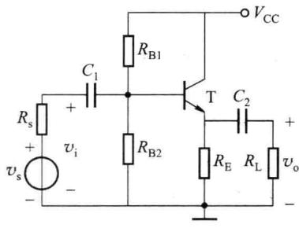
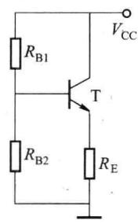
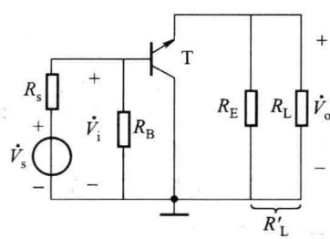
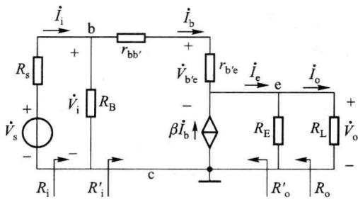
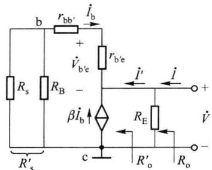
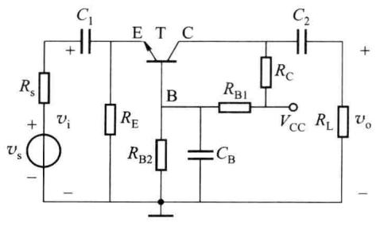
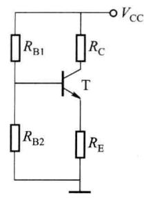
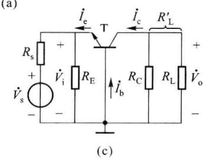
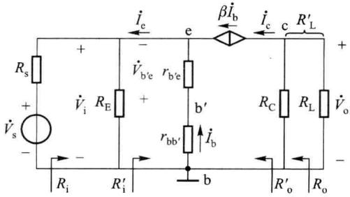

import Guide from '@/components/Guide.astro';
import Knowledge from '@/components/Knowledge.astro';
import Example from '@/components/Example.astro';
import Analysis from '@/components/Analysis.astro';
import Solution from '@/components/Solution.astro';
import Variant from '@/components/Variant.astro';
import Note from '@/components/Note.astro';
import Block from '@/components/Block.astro';
import Method from '@/components/Method.astro';
import Exercise from '@/components/Exercise.astro';

从共射放大电路的分析中可知，当晶体管在输入信号整个周期内均工作在放大状态时，不但使输出电压与输入电压保持线性关系，而且通过 $i_{B}$ 对 $i_{C}$ 的控制作用，实现了能量的转换，使负载电阻从直流电源 $V_{CC}$ 中获得比信号源提供的大得多的输出信号功率。共射放大电路的输出电流是 $i_{C}$ ，输入电流是 $i_{B}$ ，故也实现了电流放大，即共射放大电路同时实现了电流放大和电压放大。实际上，一个放大电路仅能放大电流或仅能放大电压，都能实现功率的放大。共集放大电路以集电极为公共端，通过 $i_{B}$ 对 $i_{E}$ 的控制作用实现功率放大；而共基放大电路以基极为公共端，通过 $i_{E}$ 对 $i_{C}$ 的控制作用实现功率放大。共射、共集、共基是单管放大电路的三种基本组态。

对于共射组态前面已作了比较详尽的分析,所以本节将首先介绍共集和共基接法的放大电路,然后对三种组态的特点和应用进行比较和分析。

## 2.5.1 共集放大电路

图 2.5.1(a) 是一个共集组态的单管放大电路, 图 2.5.1(b) 是其直流通路, 也是分压式电流负反馈结构, 与共射组态典型的 Q 点稳定电路相同, 故不再进行直流分析。图 2.5.1(c) 是其交流通路, 图中 $R_{B}=R_{B1} \parallel R_{B2}$ , 输入信号与输出信号的公共端是集电极, 所以是共集组态, 又由于输出信号从射极引出, 也称为射极输出器。

由此可知,直流通路即偏置电路与组态无关,由交流通路决定放大电路的组态。一般也可从电路图直接判断组态:待放大交流信号从晶体管的一个极输入,输出信号从晶体管的另一个极输出,晶体管剩下的那个极就决定了电路的组态。所以也可由图2.5.1(a)直接判断组态:信号从基极输入,从射极输出,故为共集组态。

  

(a)

  

(b)

  

(c)  

图 2.5.1 共集放大电路及其直流、交流通路

## 一、共集放大电路的动态指标

由共集放大电路的交流通路得到其交流等效电路图如图2.5.2所示。设 $R_{L}^{\prime}=R_{E}\parallel R_{L}$ ，一般晶体管的输出电阻 $r_{ce}\gg R_{L}^{\prime}$ ，图中忽略了 $r_{ce}$ 。

### 1. 电压增益与电流增益

由图2.5.2可得

$$

\begin{array}{r l} \dot {V} _ {\mathrm{o}} & = \dot {I} _ {\mathrm{e}} R _ {\mathrm{L}} ^ {\prime} = (\dot {I} _ {\mathrm{b}} + \beta \dot {I} _ {\mathrm{b}}) R _ {\mathrm{L}} ^ {\prime} \\ & \dot {V} _ {\mathrm{i}} = r _ {\mathrm{be}} \dot {I} _ {\mathrm{b}} + \dot {V} _ {\mathrm{o}} \end{array}

$$

则

$$

\dot {A} _ {v} = \frac {\dot {V} _ {\mathrm{o}}}{\dot {V} _ {\mathrm{i}}} = \frac {(1 + \beta) R _ {\mathrm{L}} ^ {\prime}}{r _ {\mathrm{be}} + (1 + \beta) R _ {\mathrm{L}} ^ {\prime}}\tag{2.5.1}

$$

可知 $\dot{A}_{v}$ 为正值，即 $\dot{V}_{o}$ 与 $\dot{V}_{i}$ 同相；一般 $(1+\beta)R_{L}^{\prime}\gg r_{be}$ ，所以 $|\dot{A}_{v}|\leqslant1,\dot{V}_{o}\approx\dot{V}_{i}$ ，故共集放大电路又称为射极跟随器；虽然电压没有得到放大，但是输出电流 $i_{E}$ 远大于输入电流 $i_{B}$ ，电流增益较高，所以电路仍有功率放大作用。

  

图 2.5.2 共集放大电路的交流等效电路

### 2. 输入电阻

由图2.5.2可得

$$

R _ {\mathrm{i}} ^ {\prime} = \frac {\dot {V} _ {\mathrm{i}}}{\dot {I} _ {\mathrm{b}}} = \frac {r _ {\mathrm{be}} \dot {I} _ {\mathrm{b}} + (\dot {I} _ {\mathrm{b}} + \beta \dot {I} _ {\mathrm{b}}) R _ {\mathrm{L}} ^ {\prime}}{\dot {I} _ {\mathrm{b}}} = r _ {\mathrm{be}} + (1 + \beta) R _ {\mathrm{L}} ^ {\prime}

$$

则

$$

R _ {\mathrm{i}} = \frac {\dot {V} _ {\mathrm{i}}}{\dot {I} _ {\mathrm{i}}} = R _ {\mathrm{B}} / / R _ {\mathrm{i}} ^ {\prime} = R _ {\mathrm{B}} / / [ r _ {\mathrm{be}} + (1 + \beta) R _ {\mathrm{L}} ^ {\prime} ]\tag{2.5.2}

$$

可见射极回路电阻 $R_{L}^{\prime}$ 折合到基极回路时，将增大 $(1+\beta)$ 倍，这是因为射极电流 $\dot{I}_{e}$ 是基极电流 $\dot{I}_{b}$ 的 $(1+\beta)$ 倍，因此其输入电阻比共射放大电路高得多，一般可达几十千欧，甚至几百千欧。

### 3. 输出电阻

求输出电阻的等效电路如图 2.5.3 所示, 设 $R_{s}^{\prime}=R_{s}\parallel R_{B}$ 。

由图2.5.3可得

则

$$

\begin{array}{r l} & R _ {\mathrm{o}} ^ {\prime} = \frac {\dot {V}}{\dot {I} ^ {\prime}} = \frac {- \dot {I} _ {\mathrm{b}} (R _ {\mathrm{s}} ^ {\prime} + r _ {\mathrm{be}})}{- (\dot {I} _ {\mathrm{b}} + \beta \dot {I} _ {\mathrm{b}})} = \frac {R _ {\mathrm{s}} ^ {\prime} + r _ {\mathrm{be}}}{1 + \beta} \\ & R _ {\mathrm{o}} = R _ {\mathrm{E}} / / R _ {\mathrm{o}} ^ {\prime} = R _ {\mathrm{E}} / / \left(\frac {R _ {\mathrm{s}} ^ {\prime} + r _ {\mathrm{be}}}{1 + \beta}\right) \end{array}\tag{2.5.3}

$$

可见基极回路电阻 $(R_{\mathrm{s}}^{\prime}+r_{\mathrm{be}})$ 折合到射极回路时，将减小到原来的 $1/(1+\beta)$ ，因此其输出电阻 $R_{0}$ 很小，一般为几十至几百欧，所以具有很强的带负载能力。

  

图 2.5.3 求输出电阻的等效电路

## 二、共集放大电路的特点及主要应用

由此可见，共集电路电压放大倍数小于1，但接近于1，且输出电压和输入电压同相；输入电阻大，输出电阻小，电流驱动能力强。因此共集放大电路是应用十分广泛的单元电路。

因为共集放大电路输入电阻大、输出电阻小、电流驱动能力强，因而从信号源索取的电流小而带负载能力强，所以常用于多级放大电路的输入级和输出级；也可用它连接两电路，减小电路间直接相连所带来的影响，起缓冲作用，称为缓冲级或隔离级。

这是因为为了获得较高的电压增益,一般要将多个单级放大电路级联起来实现逐级放大。在放大电路级联时,后一级的输入阻抗是前一级的负载,而前一级的输出是后一级的信号源,往往因下一级输入阻抗低导致前级增益下降。在两级间加一级共集放大电路,则由于它的输入阻抗高,可减弱对前级增益的影响;其输出阻抗低,有利于对下一级的激励;共集放大电路本身的电压增益接近于1,不影响整个电路的增益,所以常用共集放大电路作缓冲级。

以上对共集放大电路的特点和主要应用进行了讨论。

<Example title="例 2.5.1">
在图 2.5.1(a) 所示电路中, 已知 $V_{CC} = 12 \, V, R_{B1} = 100 \, k\Omega, R_{B2} = 27 \, k\Omega, R_{E} = 1 \, k\Omega, R_{L} = 1 \, k\Omega, R_{s} = 200 \, \Omega$ , 晶体管的 $\beta = 200, V_{BEQ} = 0.7 \, V, r_{be} = 3.2 \, k\Omega$ , 求 $\dot{A}_{v}, R_{i}$ 和 $R_{o}$ 。

<Solution title="解">
已知 $R_{B}=R_{B1} \parallel R_{B2}=21.26\ k\Omega, R_{s}^{\prime}=R_{s} \parallel R_{B}=0.198\ k\Omega, R_{L}^{\prime}=R_{E} \parallel R_{L}=0.5\ k\Omega$ ，代入式(2.5.1)～式(2.5.3)，可得

$$

\begin{array}{r l} \dot {A} _ {v} & = \frac {\dot {V} _ {\mathrm{o}}}{\dot {V} _ {\mathrm{i}}} = \frac {(1 + \beta) R _ {\mathrm{L}} ^ {\prime}}{r _ {\mathrm{be}} + (1 + \beta) R _ {\mathrm{L}} ^ {\prime}} = \frac {(1 + 2 0 0) \times 0 . 5}{3 . 2 + (1 + 2 0 0) \times 0 . 5} = 0. 9 7 \\ & R _ {\mathrm{i}} = \frac {\dot {V} _ {\mathrm{i}}}{\dot {I} _ {\mathrm{i}}} = R _ {\mathrm{B}} / / [ r _ {\mathrm{be}} + (1 + \beta) R _ {\mathrm{L}} ^ {\prime} ] = 1 7. 6 4 \mathrm{k} \Omega \\ & R _ {\mathrm{o}} = R _ {\mathrm{E}} / / (\frac {R _ {\mathrm{s}} ^ {\prime} + r _ {\mathrm{be}}}{1 + \beta}) = 0. 0 1 6 6 \mathrm{k} \Omega = 1 6. 6 \Omega \end{array}

$$
</Solution>
</Example>

## 2.5.2 共基放大电路

图 2.5.4(a) 所示为一个共基组态的单管放大电路, 图 2.5.4(b) 是其直流通路, 同样也是分压式电流负反馈结构, 与共射组态典型的 Q 点稳定电路完全相同, 故也不再进行直流分析。可见共射、共集、共基三种组态的直流通路都一样, 即偏置电路与组态无关。图

2.5.4(c)是其交流通路,输入信号与输出信号的公共端是基极,所以是共基组态。也可由图2.5.4(a)直接判断组态:信号从射极输入,从集电极输出,故为共基组态。

(b)  

(a)  

  

图 2.5.4 共基放大电路及直流、交流通路

## 一、共基放大电路的动态指标

由共基放大电路的交流通路得到其交流等效电路图如图2.5.5所示。设 $R_{L}^{\prime}=R_{C}\parallel R_{L}$ ，一般晶体管的输出电阻 $r_{ce}\gg R_{L}^{\prime}$ ，图中忽略了 $r_{ce}$ 。

### 1. 电压增益与电流增益

由图2.5.5可得

则

$$

\begin{array}{r l} & {\dot {V} _ {\mathrm{o}} = - \beta \dot {I} _ {\mathrm{b}} R _ {\mathrm{L}} ^ {\prime}} \\ & {\dot {V} _ {\mathrm{i}} = - \dot {I} _ {\mathrm{b}} (r _ {\mathrm {bb^ {\prime}}} + r _ {\mathrm {b^ {\prime} e}}) = - \dot {I} _ {\mathrm{b}} r _ {\mathrm{be}}} \\ & {\dot {A} _ {v} = \frac {\dot {V} _ {\mathrm{o}}}{\dot {V} _ {\mathrm{i}}} = \frac {- \beta \dot {I} _ {\mathrm{b}} R _ {\mathrm{L}} ^ {\prime}}{- \dot {I} _ {\mathrm{b}} r _ {\mathrm{be}}} = \frac {\beta R _ {\mathrm{L}} ^ {\prime}}{r _ {\mathrm{be}}}} \end{array}\tag{2.5.4}

$$

可见共基放大电路的 $\dot{V}_{o}$ 与 $\dot{V}_{i}$ 是同相的，增益的值与共射放大电路相同。

由于共基电路的输入电流为 $i_{E}$ ，而输出电流为 $i_{C}$ ，所以无电流放大能力，但有足够的电压放大能力，从而实现功率放大。

  

图 2.5.5 共基放大电路的交流等效电路

### 2. 输入电阻

由图2.5.5可得

$$

R _ {\mathrm{i}} ^ {\prime} = \frac {\dot {V} _ {\mathrm{i}}}{- \dot {I} _ {\mathrm{e}}} = \frac {- \dot {I} _ {\mathrm{b}} r _ {\mathrm{be}}}{- (1 + \beta) \dot {I} _ {\mathrm{b}}} = \frac {r _ {\mathrm{be}}}{1 + \beta}

$$

则

$$

R _ {\mathrm{i}} = \frac {\dot {V} _ {\mathrm{i}}}{\dot {I} _ {\mathrm{i}}} = R _ {\mathrm{E}} / / R _ {\mathrm{i}} ^ {\prime} = R _ {\mathrm{E}} / / \left(\frac {r _ {\mathrm{be}}}{1 + \beta}\right)\tag{2.5.5}

$$

由于基极回路电阻 $r_{be}$ 折合到射极回路时，应减小到原来的 $1/(1+\beta)$ ，故共基放大电路的输入电阻比共射放大电路小得多。

### 3. 输出电阻

如暂不考虑电阻 $R_{C}$ 的作用，则 $R_{o}=r_{cb}$ ，晶体管的 $r_{cb}$ 比其 $r_{ce}$ 大得多，如果考虑集电极电阻 $R_{C}$ ，则

$$

R _ {\mathrm{o}} = r _ {\mathrm{cb}} / / R _ {\mathrm{C}} \approx R _ {\mathrm{C}}\tag{2.5.6}

$$

故共基放大电路的输出电阻与共射放大电路相同。

## 二、共基放大电路的特点及主要应用

综上所述，共基放大电路的输出电压与输入电压同相，电压增益数值与共射放大电路相同；输入电阻较共射放大电路小；输出电阻与共射放大电路相同，均为 $R_{c}$ 。共基放大电路的最大优点是频带宽，因而适用于宽频带放大。

<Example title="例 2.5.2">
在图 2.5.4(a) 所示电路中, 已知 $V_{CC} = 12 \, V, R_{B1} = 10 \, k\Omega, R_{B2} = 3 \, k\Omega, R_{E} = 2 \, k\Omega, R_{C} = 5.1 \, k\Omega, R_{L} = 5.1 \, k\Omega$ , 晶体管的 $\beta = 50, V_{BEQ} = 0.7 \, V, r_{be} = 1.6 \, k\Omega$ , 求 $\dot{A}_{v}, R_{i}$ 和 $R_{o}$ 。

<Solution title="解">
已知 $R_{L}^{\prime}=R_{C}\parallel R_{L}=2.55\ k\Omega$ ，代入式(2.5.4)～式(2.5.6)，可得

$$

\dot {A} _ {v} = \frac {\dot {V} _ {\mathrm{o}}}{\dot {V} _ {\mathrm{i}}} = \frac {\beta R _ {\mathrm{L}} ^ {\prime}}{r _ {\mathrm{be}}} = \frac {5 0 \times 2 . 5 5}{1 . 6} = 7 9. 7

$$

$$

R _ {\mathrm{i}} = \frac {\dot {V} _ {\mathrm{i}}}{\dot {I} _ {\mathrm{i}}} = R _ {\mathrm{E}} / / \left(\frac {r _ {\mathrm{be}}}{1 + \beta}\right) = 0. 0 3 \mathrm{k} \Omega = 3 0 \Omega

$$

$$

R _ {\mathrm{o}} \approx R _ {\mathrm{c}} = 5. 1 \mathrm{k} \Omega

$$
</Solution>
</Example>

## 2.5.3 晶体管单管放大电路三种组态的比较

综上所述,晶体管单管放大电路三种基本组态的特点归纳如下。

（1）共射电路既能放大电流又能放大电压，输入电阻在三种电路中居中，输出电阻大，频带窄，常作为低频电压放大电路的单元电路。

（2）共集电路只能放大电流不能放大电压，是三种接法中输入电阻最大、输出电阻最小的电路，并具有电压跟随的特点。常用于多级放大电路的输入级、输出级和缓冲级，在功率放大电路中也常采用射极输出形式。

（3）共基电路只能放大电压不能放大电流，输入电阻小，电压增益和输出电阻与共射电路相同，频率特性是三种接法中最好的电路，常用于宽频带放大电路。

所以共射、共集、共基三种放大电路均能实现功率放大，但各有不同特点。共射放大电路的电压、电流和功率增益都比较大，并且可以组成多级放大电路，获得很大的倍数，因此其应用最为广泛。但在高频情况，共基放大电路就比较合适。共集电路的独特优点是输入电阻很大,输出电阻很小,高频特性也比较好。这三种放大电路的基本特性见表2.5.1。

表 2.5.1 三种放大电路的基本特性

<table><tr><td>类别</td><td>共射</td><td>共集</td><td>共基</td></tr><tr><td>输入与输出的相位</td><td>反相</td><td>同相</td><td>同相</td></tr><tr><td> $\dot{A}_{v}$ 、 $\dot{A}_{i}$ </td><td>电压、电流都放大</td><td>只放大电流</td><td>只放大电压</td></tr><tr><td>特点</td><td> $|\dot{A}_{v}|$ 大, $R_{i}$ 、 $R_{o}$ 适中</td><td> $|\dot{A}_{v}| \leqslant 1$ , $R_{i}$ 大 $R_{o}$ 小</td><td> $|\dot{A}_{v}|$ 、 $R_{o}$ 同共射, $R_{i}$ 小</td></tr><tr><td>高频特性</td><td>不好</td><td>好</td><td>好</td></tr><tr><td>主要用途</td><td>功率增益最大应用最广泛</td><td>输入级、输出级和缓冲级</td><td>用于高频电路</td></tr></table>
