import Guide from '@/components/Guide.astro';
import Knowledge from '@/components/Knowledge.astro';
import Example from '@/components/Example.astro';
import Analysis from '@/components/Analysis.astro';
import Solution from '@/components/Solution.astro';
import Variant from '@/components/Variant.astro';
import Note from '@/components/Note.astro';
import Block from '@/components/Block.astro';
import Method from '@/components/Method.astro';
import Exercise from '@/components/Exercise.astro';

用电流源代替电阻对电路进行直流偏置，既稳定可靠，又可减小芯片面积，提高电路集成度，解决集成电阻精度不高和大容量旁路电容难以制作等问题。同时，由于电流源输出电阻很大，用电流源作负载代替晶体管的集电极电阻 $R_{c}$ ，可以获得极大的电压增益，而工作点电流却不必升高。基于以上的原因，集成电路中大量采用了电流源技术，从而使电流源成为电子电路特别是模拟集成电路中不可缺少的基本单元电路，应用广泛。

电流源作为信号源时的电路如图 2.6.1(a) 所示, 本节讨论的电流源都可以等效为如图 2.6.1(b) 所示电路, 可见 $I_{0}$ 相当于 $I_{s}, R_{o}$ 相当于 $R_{s}$ , 因此对电流源的主要要求是:

(1) 能够输出符合要求的恒定直流电流 $I_{0}$ ;

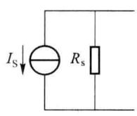  

(a)

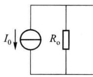  

(b)

(2) 输出电阻 $R_{0}$ 尽可能大；

(3) 对温度的灵敏度低;

图 2.6.1 常见电流源形式及

(4) 受电源电压等因素的影响要小。

等效形式

由于晶体管在放大区的输出特性具有恒流的特点,因此一个工作在放大区的晶体管就可作为电流源,称为单管电流源,其简单示意图如图2.6.2(a)所示,晶体管的集电极电流 $I_{c}$ 就是恒定输出电流 $I_{0}$ ,晶体管的 $r_{ce}$ 就是输出电阻 $R_{o}$ 。设晶体管工作于Q点,如图2.6.2(b)所示,则电流源输出端对地之间的直流等效电阻 $R_{DC}=V_{CE}/I_{C}$ ,其值较小,而动态电阻 $R_{o}=r_{ce}$ 的值较大。可见,直流电阻小、交流电阻大是电流源的突出特点,这一特点使电流源获得了广泛的应用。

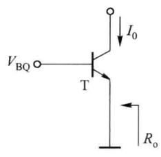  

(a)

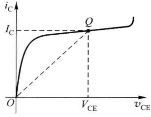  

(b)  

图 2.6.2 单管电流源及伏安特性

由于基区宽度调制效应的影响,晶体管在放大区的输出特性是基本水平稍有上翘,而不是完全水平,因此单管电流源的恒流特性不太好,即输出电阻 $r_{ce}$ 数值不够大。虽然 $r_{ce}$ 数值较大,但电流源的内阻是越大越好,故作为电流源的内阻, $r_{ce}$ 数值还是不够大,需要进一步提高。

使用适当的辅助电路可以使其恒流特性更接近于理想情况。下面介绍常见的电流源电路及电流源的应用。

## 2.6.1 常见的电流源电路

## 一、镜像电流源

### 1. 基本型镜像电流源

基本型的镜像电流源电路如图2.6.3所示。 $T_{1}$ 接成二极管的形式， $R,T_{1}$ 为参考支路，提供参考电流 $I_{R}$ ； $T_{2}$ 为电流源输出管，工作于放大区，输出稳定的直流电流 $I_{0}=I_{C2}$ ， $T_{1}$ 、 $T_{2}$ 特性一致。为了简单，图中没有画出 $T_{2}$ 管集电极所接的外部电路。

若忽略 $v_{\mathrm{CE}}$ 对 $I_{\mathrm{C}}$ 的影响，即基区宽度调制效应，则由于 $\mathrm{T}_{1},\mathrm{T}_{2}$ 两管参数相同，基极接在一起，必有 $V_{\mathrm{BE1}} = V_{\mathrm{BE2}} = V_{\mathrm{BE}},I_{\mathrm{B1}} = I_{\mathrm{B2}} = I_{\mathrm{B}},I_{\mathrm{C1}} = I_{\mathrm{C2}} = I_0$ 。由图2.6.3可得

$$

I _ {\mathrm{R}} = I _ {0} + 2 I _ {\mathrm{B}} = I _ {0} + 2 I _ {0} / \beta = I _ {0} (1 + 2 / \beta)

$$

则

$$

I _ {0} = \frac {1}{1 + 2 / \beta} I _ {\mathrm{R}}\tag{2.6.1}

$$

$$

I _ {\mathrm{R}} = \frac {V _ {\mathrm{CC}} - V _ {\mathrm{BE}}}{R}\tag{2.6.2}

$$

如果 $\beta >> 2$ ，则 $I_0 \approx I_{\mathrm{R}}$ ，如同一面镜子， $I_0$ 犹如 $I_{\mathrm{R}}$ 的镜像，故称为镜像电流源或电流镜。电流源的输出电阻 $R_{\mathrm{o}}$ 即是晶体管 $\mathrm{T}_{2}$ 的输出电阻 $r_{\mathrm{ce2}}$ ，即

$$

R _ {\mathrm{o}} = r _ {\mathrm{ce2}}\tag{2.6.3}

$$

若忽略 $I_{\mathrm{B}}$ ，只考虑基区宽度调制效应的影响时，则 $I_{\mathrm{Cl}} = I_{\mathrm{R}}$ ，由图2.6.4可得

$$

\frac {I _ {0}}{I _ {\mathrm{R}}} = \frac {I _ {0}}{I _ {\mathrm{C1}}} = \frac {V _ {\mathrm{A}} + V _ {\mathrm{CE2}}}{V _ {\mathrm{A}} + V _ {\mathrm{CE1}}}\tag{2.6.4}

$$

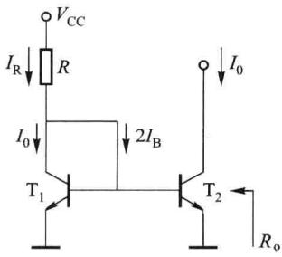  

图 2.6.3 基本型镜像电源

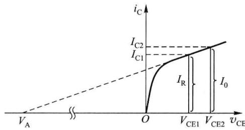  

图 2.6.4 考虑基区宽度调制效应时 $I_{0}$ 示意图

式中 $V_{A}$ 为 $T_{1}$ 、 $T_{2}$ 管的厄尔利电压。在高精度电流源中必须同时考虑 $I_{B}$ 和基区宽度调制效应的影响，因此式(2.6.1)调整为

$$

I _ {0} = \left(\frac {1}{1 + 2 / \beta}\right) \left(\frac {V _ {\mathrm{A}} + V _ {\mathrm{CE2}}}{V _ {\mathrm{A}} + V _ {\mathrm{CE1}}}\right) I _ {\mathrm{R}}\tag{2.6.5}

$$

通常 $V_{A} \gg V_{CE1} = V_{BEQ1}$ ，若满足 $V_{A} \gg V_{CE2}$ ，则可忽略基区宽度调制效应。

(a)

镜像电流源 $T_{1}$ 对 $T_{2}$ 具有一定的温度补偿作用, 简述如下:

$$

\begin{array}{r l}T \uparrow&\rightarrow I _ {0} \uparrow\\&\searrow I _ {\mathrm{Cl}} \uparrow \rightarrow I _ {\mathrm{R}} \uparrow \rightarrow V _ {\mathrm{R}} (I _ {\mathrm{R}} R) \uparrow \rightarrow V _ {\mathrm{B}} \downarrow \rightarrow I _ {\mathrm{B}} \downarrow \rightarrow I _ {0} \downarrow\end{array}

$$

因此提高了电流源的稳定性。

基本型的镜像电流源电路的优点是:简单,元件少。缺点是:

(1) $I_{0}$ 做不到很小(如几十微安),因为在集成电路中难以制作大电阻R;

(2) $I_{0}$ 受 $V_{cc}$ 的影响大；

(3) $R_{0}$ 不够大；

（4）镜像精度不高， $I_{0}$ 与 $I_{R}$ 的镜像精度决定于晶体管的 $\beta$ ，当 $\beta$ 较小时， $I_{0}$ 与 $I_{R}$ 的差别不能忽略，这对于用横向 PNP 型管组成的电流源尤为重要；

（5） $I_{0}$ 的温度稳定性不是很好，虽然 $T_{1}$ 对 $T_{2}$ 具有一定的温度补偿作用，但是晶体管的 $V_{BE}$ 和 $\beta$ 均对温度敏感。

因此镜像电流源引入了如图 2.6.5 所示的两种改进型电路。

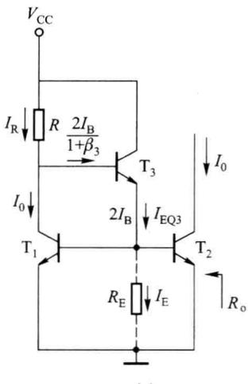

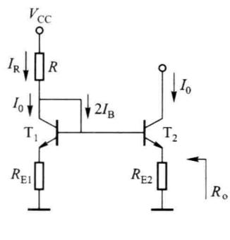  

(b)  

图 2.6.5 基本镜像电流源的两种改进型电路

### 2. 两种改进型镜像电流源

图 2.6.5(a) 所示为带有缓冲管的镜像电流源, 图中增加了缓冲管 $T_{3}$ , 利用 $T_{3}$ 的电流放大作用, 减小 $I_{B}$ 对 $I_{R}$ 的分流作用, 从而提高镜像精度。由图 2.6.5(a) 可得

$$

I _ {\mathrm{R}} = I _ {0} + \frac {2 I _ {\mathrm{B}}}{1 + \beta_ {3}} = I _ {0} + \frac {2 I _ {0} / \beta_ {1}}{1 + \beta_ {3}} = \left[ 1 + \frac {2}{\beta_ {1} (1 + \beta_ {3})} \right] I _ {0}

$$

则

$$

I _ {0} = \frac {1}{1 + 2 / [ \beta_ {1} (1 + \beta_ {3}) ]} I _ {\mathrm{R}}\tag{2.6.6}

$$

$$

I _ {\mathrm{R}} = (V _ {\mathrm{CC}} - 2 V _ {\mathrm{BE}}) / R\tag{2.6.7}

$$

此时镜像关系成立的条件为 $\beta_{1}(\beta_{3}+1)\gg2$ ，很容易满足，因此提高了镜像精度，但输出电阻仍为 $r_{ce2}$ 不够大。

实际电路中,为了避免 $T_{3}$ 因工作电流过小而引起 $\beta$ 的减小,从而使 $i_{B3}$ 增大,在 $T_{3}$ 发射极接入电阻 $R_{E}$ ,如图中虚线所示,产生电流 $I_{E}$ ,使 $I_{EQ3}$ 适当增大。只要 $R_{E}$ 取值适当,与未加 $R_{E}$

前比较, $i_{B3}$ 也不一定会增大。

图 2.6.5(b) 所示的是带有射极电阻的镜像电流源, 提高了输出电阻, 具有很好的恒流特性。若负反馈电阻 $R_{E1} = R_{E2}$ , 则两管输入仍保持对称性, 因而对该电路式 (2.6.1) 仍有效, 故镜像精度没有改变, 但参考电流

$$

I _ {\mathrm{R}} \approx (V _ {\mathrm{CC}} - V _ {\mathrm{BE}}) / (R + R _ {\mathrm{E1}})\tag{2.6.8}

$$

求输出电阻 $R_{o}$ 的交流等效电路如图 2.6.6 所示，图中 $r_{d}$ 为接成二极管形式的 $T_{1}$ 的动态电阻，由于 $r_{d} \ll R_{E1}$ ，经常忽略 $r_{d}$ 。设基极回路总的等效电阻为 $R_{B}$ ，则 $R_{B} \approx R \parallel R_{E1}$ ，由图 2.6.6 可分别列出输入回路和输出回路方程

$$

\begin{array}{r l} & \dot {I} _ {\mathrm{b}} (r _ {\mathrm{be}} + R _ {\mathrm{B}}) + (\dot {I} _ {\mathrm{b}} + \dot {I}) R _ {\mathrm{E2}} = 0 \\ & \dot {V} = (\dot {I} - \beta \dot {I} _ {\mathrm{b}}) r _ {\mathrm{ce}} + (\dot {I} _ {\mathrm{b}} + \dot {I}) R _ {\mathrm{E2}} \end{array}

$$

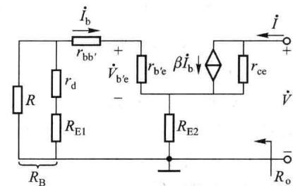  

图 2.6.6 求输出电阻的交流等效电路

解得

$$

\dot {V} = \dot {I} \Big [ r _ {\mathrm{ce}} + R _ {\mathrm{E2}} + \frac {R _ {\mathrm{E2}}}{r _ {\mathrm{be}} + R _ {\mathrm{B}} + R _ {\mathrm{E2}}} (\beta r _ {\mathrm{ce}} - R _ {\mathrm{E2}}) \Big ]

$$

由于 $r_{\mathrm{ce}} \gg R_{\mathrm{E2}}$ ，故

$$

R _ {\mathrm{o}} = \frac {\dot {V}}{\dot {I}} \approx r _ {\mathrm{ce}} \left(1 + \frac {\beta R _ {\mathrm{E2}}}{r _ {\mathrm{be}} + R _ {\mathrm{B}} + R _ {\mathrm{E2}}}\right)\tag{2.6.9}

$$

可见,加入射极电阻 $R_{E}$ 后,使电流源的输出电阻大为提高;而且 $R_{E}$ 引入的是电流负反馈,提高了 $I_{0}$ 的温度稳定性。

通过以上的讨论可知,各种改进型电流源电路的主要设计目标一是提高镜像精度,二是提高输出电流的稳定性,三是增大输出电阻,以改进电流源的恒流特性。

## 二、威尔逊电流源

威尔逊电流源如图2.6.7所示。 $\mathrm{T}_{3}$ 是放大管， $\mathrm{T}_{1},\mathrm{T}_{2}$ 特性一致构成基本镜像电流源。 $\mathrm{T}_{1},\mathrm{T}_{2},\mathrm{T}_{3}$ 同时制作在硅片上， $\beta$ 值相同。 $\mathrm{T}_{2}$ 的C-E串联在 $\mathrm{T}_{3}$ 的发射极，其作用与典型工作点稳定电路中的 $R_{\mathrm{E}}$ 相同，故威尔逊电流源也是利用负反馈原理构成的，因而具有良好的温度特性及很高的输出电阻。当温度或负载变化使 $I_0 = I_{\mathrm{C3}}$ 增大时， $I_{\mathrm{E3}}$ 随之增加，它的镜像电流 $I_{\mathrm{C1}}$ 也跟着增加，由于 $I_{\mathrm{R}}$ 恒定，使 $I_{\mathrm{B3}}$ 减小，从而牵制了 $I_0$ 的增加，维持 $I_0$ 基本不变。

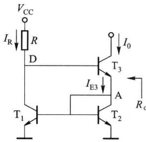  

图 2.6.7 威尔逊电流源

由图 2.6.7 可列出 $T_{3}$ 射极节点 A 的电流方程

$$

\begin{array}{r l} I _ {\mathrm{E3}} & = I _ {\mathrm{C2}} + 2 I _ {\mathrm{B2}} = I _ {\mathrm{C2}} + \frac {2 I _ {\mathrm{C2}}}{\beta} \\ & \Rightarrow I _ {\mathrm{C2}} = \frac {\beta}{2 + \beta} I _ {\mathrm{E3}} = \frac {\beta}{2 + \beta} \cdot \frac {1 + \beta}{\beta} I _ {0} = \frac {1 + \beta}{2 + \beta} I _ {0} \end{array}

$$

代入 $\mathrm{T}_{3}$ 基极节点D的电流方程

$$

\begin{array}{r l} I _ {\mathrm{R}} & = I _ {\mathrm{C2}} + I _ {\mathrm{B3}} = \frac {1 + \beta}{2 + \beta} I _ {0} + \frac {I _ {0}}{\beta} \\ & \Rightarrow I _ {0} = \left(1 - \frac {2}{\beta^ {2} + 2 \beta + 2}\right) I _ {\mathrm{R}} \approx I _ {\mathrm{R}} \end{array}\tag{2.6.10}

$$

可见其镜像精度很高。

$$

\text { 可以推出其输出电阻为 } \qquad R _ {\mathrm{o}} \approx \frac {1}{2} (1 + \beta) r _ {\mathrm{ce3}}\tag{2.6.11}

$$

为了消除 $T_{1}$ 、 $T_{2}$ 两管 $V_{CE}$ 不同引起的 $I_{C}$ 电流的微小差别，可在 $T_{1}$ 的集电极串入一只接成二极管形式的晶体管 $T_{4}$ 。

威尔逊电流源同时提高了镜像精度和输出电阻,并改善了温度特性,但 $I_{0}$ 仍受 $V_{cc}$ 影响大, $I_{0}$ 做不到很小。

## 三、比例电流源

常用的比例电流源的电路与带射极电阻的镜像电流源相同, 只是 $R_{E1} \neq R_{E2}$ 。由图 2.6.5(b) 可知

$$

V _ {\mathrm{BE1}} + I _ {\mathrm{E1}} R _ {\mathrm{E1}} = V _ {\mathrm{BE2}} + I _ {\mathrm{E2}} R _ {\mathrm{E2}}

$$

若忽略基极电流，则 $I_{E1}\approx I_{R},I_{E2}\approx I_{0}$ ，代入上式，可得

$$

I _ {0} \approx \frac {(V _ {\mathrm{BE1}} - V _ {\mathrm{BE2}}) + I _ {\mathrm{R}} R _ {\mathrm{E1}}}{R _ {\mathrm{E2}}}

$$

考虑到两管 $V_{BE}$ 的差别远小于 $R_{E1}$ 和 $R_{E2}$ 上的电压降时，则有

$$

I _ {0} \approx \frac {R _ {\mathrm{E1}}}{R _ {\mathrm{E2}}} I _ {\mathrm{R}}\tag{2.6.12}

$$

可见输出电流和参考电流之比与两个射极电阻成反比,故称其为比例电流源。其参考电流和输出电阻仍与带射极电阻的镜像电流源相同。

另一种比例电流源的电路与基本型镜像电流源相同, 只是 $T_{1}$ 、 $T_{2}$ 两管参数不同。由图

## 2.6.3 可得

$$

\frac {I _ {0}}{I _ {\mathrm{R}}} \approx \frac {I _ {\mathrm{E2}}}{I _ {\mathrm{EI}}} \approx \frac {I _ {\mathrm{ES2}} \mathrm{e} ^ {v _ {\mathrm{BE}} / V _ {T}}}{I _ {\mathrm{ES1}} \mathrm{e} ^ {v _ {\mathrm{BE}} / V _ {T}}} = \frac {I _ {\mathrm{ES2}}}{I _ {\mathrm{ES1}}} = \frac {S _ {2}}{S _ {1}}\tag{2.6.13}

$$

式中， $S_{2}$ 、 $S_{1}$ 分别为 $T_{2}$ 、 $T_{1}$ 的发射结面积。可见输出电流和参考电流之比与两管的发射结面积成正比，在制作时适当控制 $S_{2}$ 与 $S_{1}$ 的比例，即可得到与 $I_{R}$ 成比例的 $I_{0}$ 。其参考电流和输出电阻仍与基本型镜像电流源相同。这种比例电流源电路简单，在要求不高时经常使用。

## 四、微电流源

将带射极电阻的镜像电流源中的电阻 $R_{\mathrm{E1}}$ 短路，便构成了微电流源，如图2.6.8所示，可知 $I_0 \approx \frac{V_{\mathrm{BE1}} - V_{\mathrm{BE2}}}{R_{\mathrm{E}}}$

由PN结伏安方程 $I_{\mathrm{E}} \approx I_{\mathrm{ES}} \mathrm{e}^{V_{\mathrm{BE}} / V_T} \Rightarrow V_{\mathrm{BE}} \approx V_T \ln (I_{\mathrm{E}} / I_{\mathrm{ES}})$ ，则

$$

V _ {\mathrm{BE1}} - V _ {\mathrm{BE2}} \approx V _ {T} \ln (I _ {\mathrm{E1}} / I _ {\mathrm{E2}}) \approx V _ {T} \ln (I _ {\mathrm{R}} / I _ {0})

$$

代入上式,可得

$$

I _ {0} \approx \frac {V _ {T}}{R _ {\mathrm{E}}} \ln \frac {I _ {\mathrm{R}}}{I _ {0}}\tag{2.6.14}

$$

在已知 $R_{E}$ 的情况下, 上式对 $I_{0}$ 而言是一个超越方程, 可用图解法或试探法求解。参考电流为

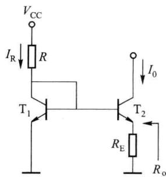

$$

I _ {\mathrm{R}} = \frac {V _ {\mathrm{CC}} - V _ {\mathrm{BE}}}{R}\tag{2.6.15}

$$

图 2.6.8 微电流源

实际上，在设计电路时，首先应确定 $I_{R}$ 和 $I_{0}$ 的数值，然后求出R和 $R_{E}$ 的数值。例如，若 $V_{CC}=$

15 V, $I_{R}=1\ mA$ , $V_{BE}=0.7\ V$ , $V_{T}=26\ mV$ , $I_{0}=20\ \mu A$ ; 则根据式(2.6.15)可得 R=14.3 kΩ, 根据式(2.6.14)可得 $R_{E}\approx5.09\ k\Omega$ 。可见求解过程并不复杂, 而且 $R_{E}$ 不大就可得到微电流。

微电流源的输出电阻可用式(2.6.9)求出。

在电路中, 当电源电压 $V_{CC}$ 发生变化时, $I_{R}$ 以及 $V_{BE}$ 也将发生变化, 由于 $R_{E}$ 的值一般为数千欧, 使 $V_{BE2} \ll V_{BE1}$ , 以致 $T_{2}$ 的 $V_{BE2}$ 值很小而工作在输入特性的弯曲部分, 则 $I_{0}$ 的变化远小于 $I_{R}$ 的变化, 故电源电压波动对电流 $I_{0}$ 的影响不大。 $I_{0}$ 的温度稳定性也较好。

可见微电流源有如下特点：

（1）用较小的电阻 $R_{E}$ 即可获得微电流 $I_{0}$ ;

（2）提高了输出电阻，恒流特性和温度稳定性更好，这是因为 $R_{E}$ 的负反馈作用；

(3) $I_{0}$ 受 $V_{\mathrm{cc}}$ 的影响很小。

## 五、多路电流源电路

图 2.6.9 所示为多路电流源电路,用一个基准电流 $I_{R}$ 获得多个恒定电流 $I_{01}$ 、 $I_{02}$ 、…、 $I_{0(n-1)}$ , 其原理与比例电流源电路相同。

设 $T_{1}$ 、 $T_{2}$ 、 $\cdots$ 、 $T_{n}$ 特性相同，则各路输出电流为

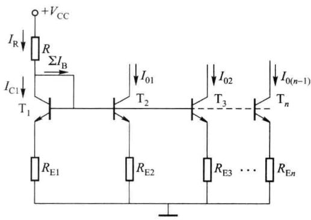  

图 2.6.9 多路电流源电路

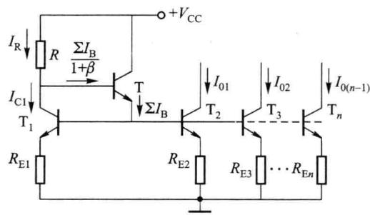  

图 2.6.10 带有缓冲级的多路电流源

$$

I _ {0 1} \approx I _ {\mathrm{C} 1} \cdot \frac {R _ {\mathrm{E} 1}}{R _ {\mathrm{E} 2}}, I _ {0 2} \approx I _ {\mathrm{C} 1} \cdot \frac {R _ {\mathrm{E} 1}}{R _ {\mathrm{E} 3}}, \dots , I _ {0 (n - 1)} \approx I _ {\mathrm{C} 1} \cdot \frac {R _ {\mathrm{E} 1}}{R _ {\mathrm{E} n}}\tag{2.6.16}

$$

必须注意:随着多路电流源路数增加,各晶体管的基极电流之和 $\sum I_{B}$ 增加,因而 $I_{C1}$ 与 $I_{R}$ 之间的差值增大。这样,各路输出电流 $I_{0i}(i=1\sim n-1)$ 与基准电流 $I_{R}$ 的传输比将出现较大误差。为了减小这种偏差可加一级射极跟随器作缓冲级,如图2.6.10所示,使各晶体管基极电流总和折算到射极跟随器基极上的电流分量减小 $(1+\beta)$ ,则 $T_{1}$ 管的集电极电流为

$$

I _ {\mathrm{C1}} = I _ {\mathrm{R}} - \frac {\sum I _ {\mathrm{B}}}{1 + \beta}\tag{2.6.17}

$$

使各路电流 $I_{0i}$ 与 $I_{R}$ 之间的比例关系更为精确。

图 2.6.11 所示电路为多集电极晶体管构成的多路电流源，T 一般为横向 PNP 型晶体管。当基极电流一定时，集电极电流之比等于它们的集电区面积之比。设各集电区面积分别为 $S_{0}$ 、 $S_{1}$ 、 $S_{2}$ ，则

$$

\frac {I _ {\mathrm{C1}}}{I _ {\mathrm{C0}}} = \frac {S _ {1}}{S _ {0}}, \frac {I _ {\mathrm{C2}}}{I _ {\mathrm{C0}}} = \frac {S _ {2}}{S _ {0}}\tag{2.6.18}

$$

<Example title="例 2.6.1">
图 2.6.12 所示是集成运算放大器 F007 偏置电路的一部分, 假设 $V_{CC} = V_{EE} = 15 \, V$ , 所有晶体管的 $\left|V_{BE}\right| = 0.7 \, V$ , 其中 NPN 型晶体管的 $\beta \gg 2$ , 横向 PNP 型晶体管的 $\beta = 2$ , 电阻 $R_{5} = 39 \, k\Omega$ 。

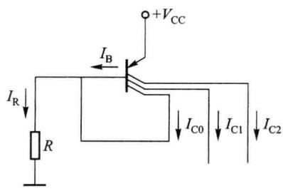  

图 2.6.11 多集电极晶体管构成的多路电流源

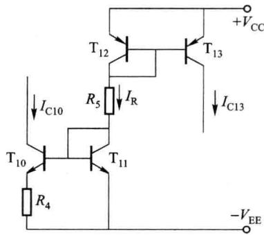  

图2.6.12 例2.6.1的电路

（1）分析电路中各晶体管组成何种电流源；

(2) 估算基准电流 $I_{R}$ ;

(3) 估算 $T_{13}$ 的集电极电流；

(4) 若要求 $I_{C10}=28\ \mu A$ ，试估算电阻 $R_{4}$ 的阻值。

<Solution title="解">
（1）由 $T_{11}$ 、 $T_{12}$ 和 $R_{5}$ 确定基准电流 $I_{R}$ ， $T_{12}$ 和 $T_{13}$ 组成镜像电流源（输出电流 $I_{C13}$ ）， $T_{10}$ 、 $T_{11}$ 和 $R_{4}$ 组成微电流源（输出电流 $I_{C10}$ ）。

(2) 由图 2.6.12 可知

$$

I _ {\mathrm{R}} = \frac {V _ {\mathrm{CC}} + V _ {\mathrm{EE}} - 2 V _ {\mathrm{BE}}}{R _ {5}} = \frac {1 5 + 1 5 - 2 \times 0 . 7}{3 9} \mathrm{mA} = 0. 7 3 \mathrm{mA}

$$

（3）因横向 PNP 型晶体管 $T_{12}$ 、 $T_{13}$ 不满足 $\beta>>2$ ，故不能简单地认为 $I_{C13}\approx I_{R}$ 。由式 (2.6.1) 可得

$$

I _ {\mathrm{C13}} = \frac {1}{1 + 2 / \beta} I _ {\mathrm{R}} = \frac {1}{1 + 2 / 2} \times 0. 7 3 \mathrm{mA} = 0. 3 6 5 \mathrm{mA}

$$

（4）因NPN型晶体管 $\mathrm{T}_{10}$ 、 $\mathrm{T}_{11}$ 的 $\beta >>2$ ，故可以认为 $I_{\mathrm{C}11}\approx I_{\mathrm{R}}$ ，由式(2.6.14)可知

$$

R _ {4} \approx \frac {V _ {T}}{I _ {\mathrm{C10}}} \cdot \ln \left(\frac {I _ {\mathrm{C11}}}{I _ {\mathrm{C10}}}\right) = \frac {2 6}{0 . 0 2 8} \times \ln \frac {0 . 7 3}{0 . 0 2 8} \mathrm{k} \Omega = 3 \mathrm{k} \Omega

$$
</Solution>
</Example>

## 2.6.2 电流源的应用

以上讨论的电流源都可以等效为如图 2.6.1(b) 所示的电路, 因此电流源在直流通路中相当于一个恒定电流 $I_{0}$ , 在交流通路中相当于一个大电阻 $R_{0}$ 。故电流源可为放大电路提供稳定的偏置电流, 或作为放大电路的有源负载。

## 一、作直流偏置电路

电流源作为直流偏置电路可为放大电路提供稳定的静态电流。图 2.6.13 所示是用电流源作直流偏置的共集放大电路的原理图。 $T_{1}$ 为放大管， $T_{2}$ 、 $T_{3}$ 组成镜像电流源为 $T_{1}$ 提供稳定的偏置电流 $I_{EQ1}=I_{0}=I_{R}$ ，不受 $T_{1}$ 基极直流偏置电压波动的影响。

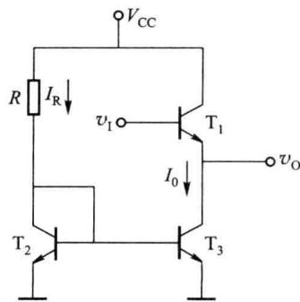  

图2.6.13 用电流源作偏置的共集放大电路

在下一节讨论的差分放大电路中,广泛采用电流源作为直流偏置电路。

## 二、作有源负载

在共射放大电路中,为了提高电压增益,行之有效的方法是增大集电极电阻 $R_{c}$ 。然而为了维持晶体管的静态电流不变,在增大 $R_{c}$ 的同时必须提高电源电压。当电源电压增大到一定程度时,电路的设计就变得不合理了。以电流源取代电阻作放大电路的负载,称为有源负载。由于电流源具有直流电阻小、交流电阻大的特性,用电流源作负载可以在电源电压不变的情况下,既获得合适的静态工作点,又有较高的电压增益和较宽的动态范围。

图 2.6.14(a) 所示为有源负载共射放大电路的原理图。 $T_{1}$ 为放大管， $T_{2}$ 、 $T_{3}$ 组成 PNP 型晶体管镜像电流源作为 $T_{1}$ 的集电极有源负载。其简化电路如图 2.6.14(b) 所示。

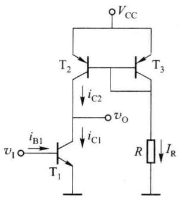  

(a)

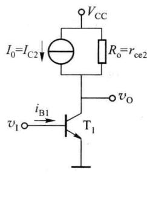  

(b)  

图 2.6.14 用电流源作负载的共射放大电路

### 1. 直流分析

由图 2.6.14(a) 可得

$$

I _ {\mathrm{R}} = \frac {V _ {\mathrm{CC}} - V _ {\mathrm{BE3}}}{R}

$$

$$

I _ {\mathrm{C1}} = I _ {\mathrm{C2}} = \frac {1}{1 + 2 / \beta} I _ {\mathrm{R}}

$$

可见电路中并不需要很高的电源电压, 只要 $V_{cc}$ 和 R 相互配合, 就可设置合适的 Q 点。

### 2. 交流指标的计算

图 2.6.15 是图 2.6.14(a) 所示电路的小信号交流等效电路, 若无外接负载电阻 $R_{L}$ , 电流源的输出电阻 $r_{ce2}$ 即是 $T_{1}$ 的负载电阻, $r_{ce2}$ 与 $T_{1}$ 的 $r_{ce1}$ 同数量级, 因此不能再将 $r_{ce1}$ 视为开路, 则放大电路的负载电阻 $R_{L}^{\prime}=r_{ce1} // r_{ce2}$ , 故

$$

\dot {A} _ {v} = \frac {\dot {V} _ {\mathrm{o}}}{\dot {V} _ {\mathrm{i}}} = - \frac {\beta_ {1} R _ {\mathrm{L}} ^ {\prime}}{r _ {\mathrm{bel}}} = - \frac {\beta_ {1} (r _ {\mathrm{cel}} / / r _ {\mathrm{ce2}})}{r _ {\mathrm{bel}}}\tag{2.6.19}

$$

$$

R _ {\mathrm{o}} = r _ {\mathrm{ce1}} / / r _ {\mathrm{ce2}}\tag{2.6.20}

$$

可见电压增益很大。

有源负载共射放大电路的动态范围最大接近于 $V_{cc}/2$ ，其详细分析限于篇幅这里不再赘述。

电流源也常用作射极负载。在图2.6.13中，由 $\mathrm{T}_{2},\mathrm{T}_{3}$ 组成的电流源既是 $\mathrm{T}_{1}$ 的直流偏置

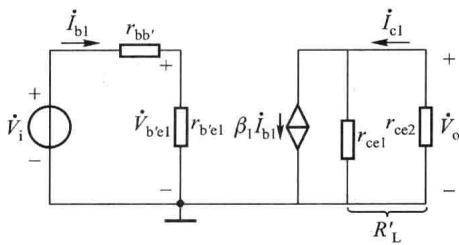  

图 2.6.15 有源负载共射放大电路的小信号等效电路

电路,同时也是 $T_{1}$ 的射极有源负载。电压增益为

$$

\dot {A} _ {v} = \frac {\dot {V} _ {\mathrm{o}}}{\dot {V} _ {\mathrm{i}}} = \frac {(1 + \beta_ {1}) (r _ {\mathrm{ce1}} / / r _ {\mathrm{ce3}})}{r _ {\mathrm{bel}} + (1 + \beta_ {1}) (r _ {\mathrm{ce1}} / / r _ {\mathrm{ce3}})}\tag{2.6.21}

$$

可见有源负载射极跟随器的电压增益更接近于1,即跟随特性更好。

## 三、其他应用

在模拟集成电路中,电流源常用作直流电平移动电路,这方面的内容将在2.9节详细介绍;电流源也常用于电流的传输与放大,这方面的应用限于篇幅此处不再赘述。
