import Guide from '@/components/Guide.astro';
import Knowledge from '@/components/Knowledge.astro';
import Example from '@/components/Example.astro';
import Analysis from '@/components/Analysis.astro';
import Solution from '@/components/Solution.astro';
import Variant from '@/components/Variant.astro';
import Note from '@/components/Note.astro';
import Block from '@/components/Block.astro';
import Method from '@/components/Method.astro';
import Exercise from '@/components/Exercise.astro';

差分放大电路又称差动放大电路,简称差放,其基本特性是放大差模信号、抑制共模信号,因此得名;其电路结构是左右对称,有利于集成;两级差放可以直接相连,耦合十分方便。所以差放是模拟集成电路中非常重要的单元电路。

## 2.7.1 差分放大电路的组成及特性

## 一、差分放大电路的组成

差放的基本形式如图2.7.1(a)所示，可见电路左右对称， $\mathrm{T}_{1}, \mathrm{T}_{2}$ 特性一致，故称 $\mathrm{T}_{1}, \mathrm{T}_{2}$ 为差分对管； $I_{\mathrm{EE}}, R_{\mathrm{EE}}$ 为电流源电路，可以是上节介绍的各种电流源电路，为 $\mathrm{T}_{1}, \mathrm{T}_{2}$ 差分对管提供偏置电流。差放有两个输入端，有两个输出端，所以差放有双端输入-双端输出、双端输入-单端输出、单端输入-单端输出、单端输入-双端输出4种电路形式。

### 1. 直流分析

静态时 $v_{11}=v_{12}=0$ ，由于电路对称、晶体管特性一致且射极接在一起，则有

因此

$$

\begin{array}{r l} V _ {\mathrm{BEQ1}} & = V _ {\mathrm{BEQ2}} \approx 0. 7 \mathrm{V}, I _ {\mathrm{EQ1}} = I _ {\mathrm{EQ2}} \approx I _ {\mathrm{EE}} / 2 \\ V _ {\mathrm{CQ1}} & = V _ {\mathrm{CQ2}} \approx V _ {\mathrm{CC}} - \frac {1}{2} R _ {\mathrm{C}} I _ {\mathrm{EE}} \\ V _ {\mathrm{O}} & = V _ {\mathrm{CQ1}} - V _ {\mathrm{CQ2}} = 0 \end{array}

$$

可见差放输入信号为 0 时, 输出信号也为 0。

若电流源部分改为没有电流源, 只有一个射极电阻 $R_{E}$ , 如图 2.7.1(b) 所示, 则需先计算 $I_{EE}$ , 由图可得

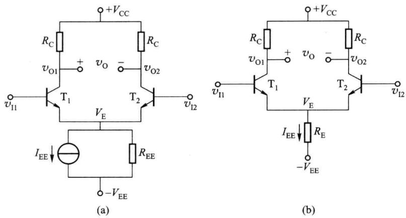  

图 2.7.1 电流源偏置和电阻偏置的差分放大电路

$$

I _ {\mathrm{EE}} = \frac {V _ {\mathrm{EE}} - V _ {\mathrm{BEQ}}}{R _ {\mathrm{E}}}

$$

2. 差模信号与共模信号

设 $v_{11}$ 、 $v_{12}$ 是任意大小与极性的信号，则可分解为

$$

v _ {\mathrm{I1}} = \frac {1}{2} (v _ {\mathrm{I1}} + v _ {\mathrm{I2}}) + \frac {1}{2} (v _ {\mathrm{I1}} - v _ {\mathrm{I2}})

$$

$$

v _ {1 2} = \frac {1}{2} (v _ {1 1} + v _ {1 2}) - \frac {1}{2} (v _ {1 1} - v _ {1 2})

$$

可见 $v_{I1}$ 、 $v_{I2}$ 中含有大小相等、极性相同的一对信号和大小相等、极性相反的一对信号。前者称为共模输入信号，用 $v_{IC}$ 表示，并定义为 $v_{\mathrm{IC}} = (v_{\mathrm{II}} + v_{\mathrm{I2}}) / 2$ ；后者称为差模输入信号，用 $v_{ID}$ 表示，并定义为 $v_{ID} = v_{II} - v_{I2}$ 。于是上式改写为

$$

\left\{ \begin{array}{l} v _ {\mathrm{I1}} = v _ {\mathrm{IC}} + \frac {1}{2} v _ {\mathrm{ID}} \\ v _ {\mathrm{I2}} = v _ {\mathrm{IC}} - \frac {1}{2} v _ {\mathrm{ID}} \end{array} \right.\tag{2.7.1}

$$

由于差放在小信号放大状态时可以认为是线性网络,故可用叠加定理,将输入信号 $v_{11}$ 、 $v_{12}$ 的作用结果等效为共模输入信号 $v_{IC}$ 和差模输入信号 $v_{ID}$ 分别作用结果的叠加,从而利用差放的左右对称结构,使电路的分析计算非常方便。即任意一对输入信号都可以分解为一对差模信号和一对共模信号,然后分别计算差模输出和共模输出,二者输出之和就是电路总输出。

下面先讨论差放的直流传输特性,以便对差放电路的特性有较全面的了解。

## 二、差分放大电路的直流传输特性

直流传输特性指的是差放的输出电流(或电压)与差模输入电压 $v_{ID}$ 的函数关系。

由于差分对管特性一致，并设电流源输出电阻 $R_{\mathrm{EE}} \to \infty$ ，由图2.7.1可得

$$

I _ {\mathrm{EE}} = i _ {\mathrm{E1}} + i _ {\mathrm{E2}} = i _ {\mathrm{E1}} \left(1 + \frac {i _ {\mathrm{E2}}}{i _ {\mathrm{E1}}}\right) \approx i _ {\mathrm{E1}} \left(1 + \frac {I _ {\mathrm{ES}} \mathrm{e} ^ {v _ {\mathrm{BE2}} / V _ {T}}}{I _ {\mathrm{ES}} \mathrm{e} ^ {v _ {\mathrm{BE1}} / V _ {T}}}\right) = i _ {\mathrm{E1}} \left[ 1 + \mathrm{e} ^ {- (v _ {\mathrm{BE1}} - v _ {\mathrm{BE2}}) / V _ {T}} \right]

$$

将 $v_{\mathrm{ID}} = v_{11} - v_{12} = v_{\mathrm{BE1}} - v_{\mathrm{BE2}}$ 代入上式，则推出

$$

i _ {\mathrm{C1}} \approx i _ {\mathrm{E1}} \approx \frac {I _ {\mathrm{EE}}}{1 + \mathrm{e} ^ {- v _ {\mathrm{ID}} / V _ {T}}} = \frac {I _ {\mathrm{EE}} \mathrm{e} ^ {v _ {\mathrm{ID}} / V _ {T}}}{1 + \mathrm{e} ^ {v _ {\mathrm{ID}} / V _ {T}}} = \frac {1}{2} I _ {\mathrm{EE}} + \frac {1}{2} I _ {\mathrm{EE}} \frac {\mathrm{e} ^ {v _ {\mathrm{ID}} / V _ {T}} - 1}{\mathrm{e} ^ {v _ {\mathrm{ID}} / V _ {T}} + 1}

$$

即

$$

i _ {\mathrm{C1}} \approx \frac {1}{2} I _ {\mathrm{EE}} + \frac {1}{2} I _ {\mathrm{EE}} \operatorname{th} \left(\frac {v _ {\mathrm{ID}}}{2 V _ {T}}\right)\tag{2.7.2}

$$

同理

$$

i _ {\mathrm{C2}} \approx \frac {1}{2} I _ {\mathrm{EE}} - \frac {1}{2} I _ {\mathrm{EE}} \mathrm{th} \left(\frac {v _ {\mathrm{ID}}}{2 V _ {T}}\right)\tag{2.7.3}

$$

故双端输出时的电流及电压分别为

$$

i _ {\mathrm{O}} = i _ {\mathrm{C1}} - i _ {\mathrm{C2}} = I _ {\mathrm{EE}} \mathrm{th} \left(\frac {v _ {\mathrm{ID}}}{2 V _ {T}}\right)\tag{2.7.4}

$$

$$

v _ {\mathrm{O}} = v _ {\mathrm{O} 1} - v _ {\mathrm{O} 2} = \left(V _ {\mathrm{CC}} - R _ {\mathrm{C}} i _ {\mathrm{C} 1}\right) - \left(V _ {\mathrm{CC}} - R _ {\mathrm{C}} i _ {\mathrm{C} 2}\right) = - i _ {\mathrm{O}} R _ {\mathrm{C}} = - I _ {\mathrm{EE}} R _ {\mathrm{C}} \operatorname{th} \left(\frac {v _ {\mathrm{ID}}}{2 V _ {T}}\right)\tag{2.7.5}

$$

可以看出,输出电流(电压)与差模输入电压 $v_{ID}$ 之间的关系符合双曲正切函数的变化规律,所以差放的传输特性是非线性的。由式(2.7.2)、式(2.7.3)画出的以 $i_{C1}$ 、 $i_{C2}$ 为输出变量的直流传输特性如图2.7.2所示。可以看出:

（1）静态时 $v_{ID}=0$ ，电路工作于 Q 点， $I_{C1}=I_{C2}\approx I_{EE}/2$ ，即直流工作状态。

(2) $v_{ID} \neq 0$ , 即加差模电压 $v_{ID}$ 后, $i_{C1}$ 、 $i_{C2}$ 一增一减, 且增减量相等, 总和不变, 近似等于 $I_{EE}$ 。由式 (2.7.4)、式 (2.7.5) 可知, 此时电路有输出电流和电压, 即放大差模信号。

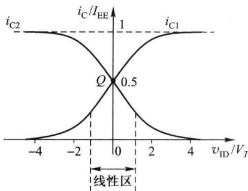

（3）加共模信号时，必有 $v_{B1}=v_{B2}, v_{ID}=0$ ，因假设 $R_{EE}\rightarrow\infty$ ，故两管集电极没有电流输出，此时电路无输出电流和电压，即抑制共模信号。

(4) 当 $\left|v_{ID}\right|\leqslant V_{T}$ 时， $i_{C1}$ 、 $i_{C2}$ 与 $v_{ID}$ 间是线性关系，

图 2.7.2 差放的直流传输特性

差分对管工作在放大区,差放近似为线性电路,称此区域为差放的线性区。本节所讨论的差放工作状态即局限于此线性区。

（5）当 $|v_{ID}| \geqslant 4V_{T} \approx 104\ mV$ 时，一管导通，电流已接近 $I_{EE}$ ，另一管已接近截止，故称此区域为限幅区，即非线性区。差放电路呈现良好的限幅特性。

因此放大差模信号、抑制共模信号是差放的基本特性。差模信号是待放大的有用信号，共模信号是不需要的有害信号。

共模信号就是漂移信号或者是伴随输入信号一起加入的干扰信号(对两边输入相同的干扰信号)。工作点的漂移称为零点漂移。在差放电路中,无论是温度变化,还是电源电压的波动都会引起两管集电极电流以及相应的集电极电压相同的变化,其效果相当于在两个输入端加入了共模信号,由于电路的对称性和电流源输出电阻 $R_{EE}$ 的射极负反馈作用,在理想情况下,可使输出电压不变,从而抑制了零点漂移。当然实际上要保持电路完全对称很困难,故仍存在较小的零点漂移,此时又因为 $R_{EE}$ 的负反馈作用,零点漂移虽然不能被完全抵消,但已经大大减小了。故抑制零点漂移是差放的突出优点,使差放在集成电路中得到了广泛应用。

## 三、差分放大电路的大信号工作状态

差放作为小信号放大电路的性能将在下一节进行详细分析,现在简单讨论差放的大信

号工作状态。

### 1. 最大差模输入电压 $V_{IDM}$

由于 $v_{ID}=v_{BE1}-v_{BE2}$ ，当 $v_{ID}>V_{BE1}$ 后， $T_{1}$ 导通， $T_{2}$ 发射结承受反压而截止，当 $v_{ID}$ 达到 $V_{BE1}+V_{(BR)EBO}$ 时， $T_{2}$ 管发射结反向击穿；同理，当 $v_{ID}$ 达到 $-(V_{\mathrm{BE2}}+V_{(\mathrm{BR})\mathrm{EBO}})$ 时， $T_{1}$ 管发射结反向击穿。因此最大差模输入电压 $V_{IDM}$ 受截止管发射结反向击穿电压 $V_{(BR)EBO}$ 的限制而不能无限加大。

### 2. 线性区的扩展

差放输入信号的幅度经常比 $V_{T}$ 大得多, 超过线性区, 因此需要扩展线性区, 以实现无失真放大。可在两管射极接入负反馈电阻 $R_{E}$ , 如图 2.7.3(a) 所示, 使直流传输特性曲线变平缓, 线性区变宽, 且 $R_{E}$ 越大, 线性区越宽, 如图 2.7.3(b) 所示, 但同时增益下降得越多。可见线性区的扩展是以牺牲增益为代价的, 所以 $R_{E}$ 的选择要合适。

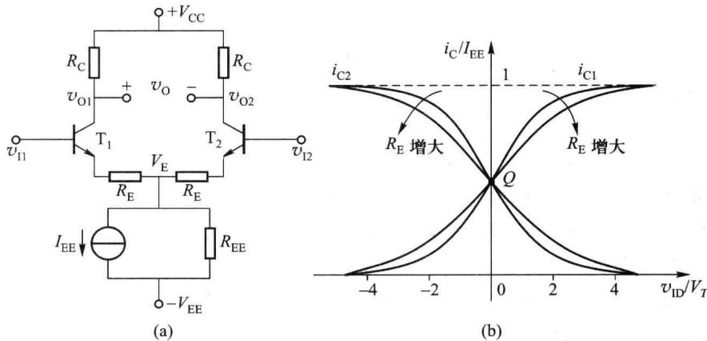  

图 2.7.3 差放线性范围的扩展

## 2.7.2 差分放大电路的小信号放大

在交流小信号条件下,差放近似为线性放大电路,因此可用叠加定理分差模输入和共模输入两种情况分别进行分析。

在差模输入信号 $v_{id}$ 作用下，产生差模输出电压 $v_{od} = A_{vd} v_{id} = A_{vd}(v_{i1} - v_{i2})$ ， $A_{vd}$ 为差模电压增益；在共模输入信号 $v_{ic}$ 作用下，产生共模输出电压 $v_{oc} = A_{vc} v_{ic} = A_{vc}(v_{i1} + v_{i2}) / 2$ ， $A_{vc}$ 为共模电压增益。故差放的总输出电压为

$$

v _ {\mathrm{o}} = v _ {\mathrm{od}} + v _ {\mathrm{oc}} = A _ {v \mathrm{d}} v _ {\mathrm{id}} + A _ {v \mathrm{c}} v _ {\mathrm{ic}}\tag{2.7.6}

$$

为了抑制共模输出，要求 $v_{\mathrm{od}} \gg v_{\mathrm{oc}}$ ，即 $|A_{\mathrm{vd}} / A_{\mathrm{vc}}| \gg |v_{\mathrm{ic}} / v_{\mathrm{id}}|$ 。

## 一、差模分析

### 1. 差模交流通路

双端输出的差放电路如图2.7.4(a)所示。由于电路对称和差分对管特性一致，在差模信号 $v_{\mathrm{i1}} - v_{\mathrm{i2}}$ 的作用下，两管射极电流 $i_{\mathrm{E1}}, i_{\mathrm{E2}}$ 一增一减，且增减量相等即 $i_{\mathrm{e1}} = -i_{\mathrm{e2}}$ ，流经电流源的电流不变，射极电位 $v_{\mathrm{E}}$ 不变，故E点交流接地，电流源可视为交流短路；同理两管集电极电位也是一增一减，且增减量相同即 $v_{\mathrm{od1}} = -v_{\mathrm{od2}}, R_{\mathrm{L}}$ 的中点电位不变，故 $R_{\mathrm{L}}$ 的中点交流接地，则每管集电极负载为 $R_{L}/2$ 。根据这两点结论可得出其交流通路如图 2.7.4(b) 所示，由两个完全相同的单管共射放大电路组成，分析半边电路就可以得到差放的差模特性，使电路的分析计算变得非常简单。

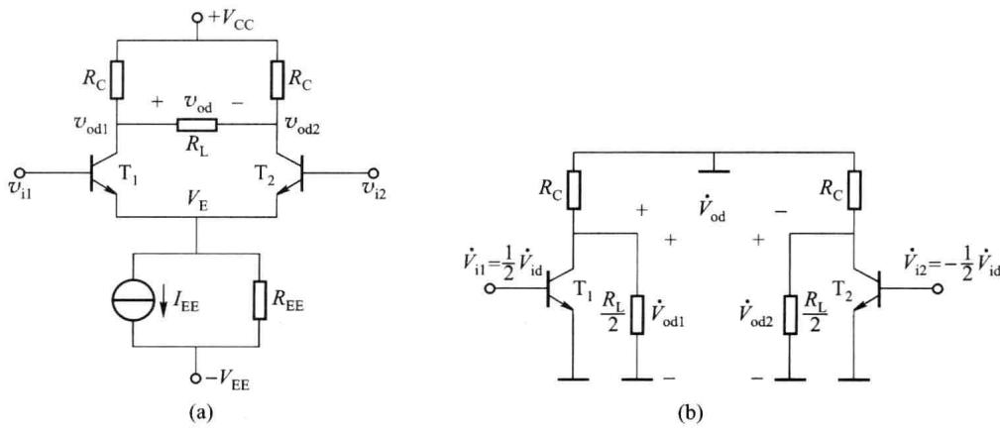  

图 2.7.4 双端输出差放及其差模交流通路

如果差放是单端输出， $R_{L}$ 接于 $T_{1}$ 或 $T_{2}$ 集电极， $R_{L}$ 只需将一管集电极电流转换成电压，所以另一管的集电极可直接接至电源 $V_{CC}$ ，输出取自 $T_{2}$ 集电极的差放电路如图 2.7.5(a) 所示。由于两管的集电极负载不同，电路不对称，严格地说不能用半边电路来分析计算，但是若忽略基区宽度调制效应，即不考虑输出 $v_{CE}$ 对 $i_{C}$ 的影响，则仍认为电路是对称的。因此可得其交流通路如图 2.7.5(b) 所示，电流源仍交流短路，只是 $R_{L}$ 不再分一半。

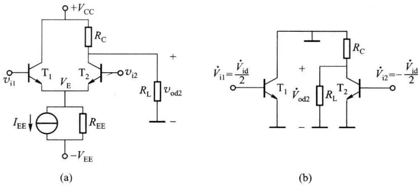  

图 2.7.5 单端输出差放及其差模交流通路

可见电流源输出电阻 $R_{EE}$ 对差模信号无负反馈作用。

2. 差模交流指标的计算

### (1) 差模电压增益

双端输出时,由图 2.7.4 (a) 可得

$$

\dot {A} _ {\mathrm{vd}} = \frac {\dot {V} _ {\mathrm{od}}}{\dot {V} _ {\mathrm{id}}} = \frac {\dot {V} _ {\mathrm{od1}} - \dot {V} _ {\mathrm{od2}}}{\dot {V} _ {\mathrm{i1}} - \dot {V} _ {\mathrm{i2}}} = \frac {2 \dot {V} _ {\mathrm{od1}}}{2 \dot {V} _ {\mathrm{i1}}} = \frac {\dot {V} _ {\mathrm{od1}}}{\dot {V} _ {\mathrm{i1}}} \cdot \frac {\dot {V} _ {\mathrm{od1}}}{\dot {V} _ {\mathrm{i1}}}

$$

即是半边电路的电压增益,故

$$

\dot {A} _ {\mathrm{vd}} = \frac {\dot {V} _ {\mathrm{od}}}{\dot {V} _ {\mathrm{id}}} = - \frac {\beta R _ {\mathrm{L}} ^ {\prime}}{r _ {\mathrm{be}}}, R _ {\mathrm{L}} ^ {\prime} = R _ {\mathrm{C}} / / (R _ {\mathrm{L}} / 2)\tag{2.7.7}

$$

可见,双端输出的电压增益与半边电路的电压增益相同,所以差放是以成倍的元件换取了抑制零点漂移的能力。

单端输出时,由图 2.7.5 (b) 可得

$$

\left\{ \begin{array}{l l} \dot {A} _ {\mathrm{vd1}} = \frac {\dot {V} _ {\mathrm{od1}}}{\dot {V} _ {\mathrm{id}}} = - \frac {1}{2} \frac {\beta R _ {\mathrm{L}} ^ {\prime}}{r _ {\mathrm{be}}} & (\text {从T} _ {1} \text {集电极输出}) \\ \dot {A} _ {\mathrm{vd2}} = \frac {\dot {V} _ {\mathrm{od2}}}{\dot {V} _ {\mathrm{id}}} = \frac {1}{2} \frac {\beta R _ {\mathrm{L}} ^ {\prime}}{r _ {\mathrm{be}}} & (\text {从T} _ {2} \text {集电极输出}) \\ R _ {\mathrm{L}} ^ {\prime} = R _ {\mathrm{C}} / / R _ {\mathrm{L}} \end{array} \right.\tag{2.7.8}

$$

可见选择从不同的晶体管输出,可使输出电压与输入电压反相或同相;此电路适用于将双端输入转换为单端输出。

### (2) 差模输入电阻

差模输入电阻 $R_{id}$ 为差模输入电压 $\dot{V}_{id}$ 与输入电流 $\dot{I}_{id}$ 的比值, 亦即由两输入端看进去的等效电阻, 所以是半边电路输入电阻的两倍, 即

$$

R _ {\mathrm{id}} = \frac {\dot {V} _ {\mathrm{id}}}{\dot {I} _ {\mathrm{id}}} = \frac {\dot {V} _ {\mathrm{id}}}{\dot {I} _ {\mathrm{b1}}} = 2 r _ {\mathrm{be}}\tag{2.7.9}

$$

### (3) 差模输出电阻

双端输出时

$$

R _ {\mathrm{od}} = 2 R _ {\mathrm{C}}\tag{2.7.10}

$$

单端输出时

$$

R _ {\mathrm{od1}} = R _ {\mathrm{od2}} = R _ {\mathrm{C}}\tag{2.7.11}

$$

可见输出电阻与输出方式有关。

上面所讨论的都是双端输入方式,下面讨论单端输入方式。

### 3. 单端输入方式

令 $v_{i1}=0$ 或 $v_{i2}=0$ ，双端输入就变为单端输入，所以单端输入是双端输入的特例，单端输入双端输出的差放电路如图 2.7.6（a）所示，同样可以将输入信号分解为差模信号和共模信号，如图 2.7.6（b）所示，因此双端输入的分析方法和结果同样适用于单端输入，即差分放大电路的性能与输入方式无关。

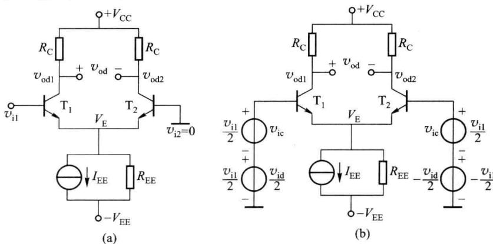  

图 2.7.6 单端输入、双端输出差放

## 二、共模分析

### 1. 共模交流通路

共模输入时的差放电路如图2.7.7(a)所示。由于电路对称，在共模信号 $v_{\mathrm{ic}}$ 作用下，两管射极电流相等即 $i_{\mathrm{e1}} = i_{\mathrm{e2}}$ ，两者相加在电阻 $R_{\mathrm{EE}}$ 上产生的电压为 $v_{\mathrm{e}} = 2R_{\mathrm{EE}}i_{\mathrm{e1}} = 2R_{\mathrm{EE}}i_{\mathrm{e2}}$ ，则对每只晶体管而言，相当于射极接了 $2R_{\mathrm{EE}}$ 的电阻；若双端输出，输出电压 $v_{\mathrm{oc1}} = v_{\mathrm{oc2}}, v_{\mathrm{oc}} = v_{\mathrm{oc1}} - v_{\mathrm{oc2}} = 0, R_{\mathrm{L}}$ 中无电流，故 $R_{\mathrm{L}}$ 对共模信号可视为开路。根据这两点结论可得出其交流通路如图2.7.7(b)所示，其半边电路即是射极接有 $2R_{\mathrm{EE}}$ 负反馈电阻的共射放大电路。如果是单端输出， $R_{\mathrm{L}}$ 接于 $\mathrm{T}_{2}$ （或 $\mathrm{T}_{1}$ ）的集电极，其交流通路如图2.7.7(c)所示。可见电流源输出电阻 $R_{\mathrm{EE}}$ 对共模信号有负反馈作用。

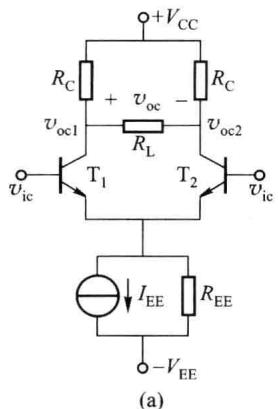

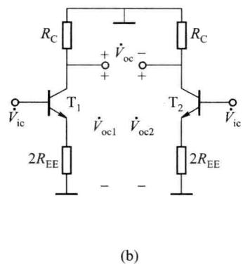  

图 2.7.7 共模输入差放及其共模交流通路

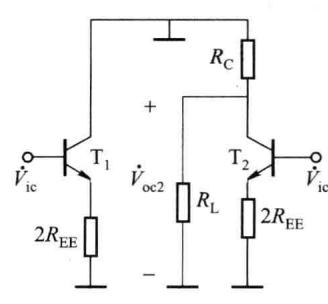

### 2. 共模交流指标的计算

### (1) 共模电压增益

双端输出时，若电路及晶体管参数理想对称， $\dot{V}_{oc}=0$ ，则 $\dot{A}_{vc}=\dot{V}_{oc}/\dot{V}_{ic}=0$ 。

单端输出时,由图 2.7.7(c) 可得

$$

\left\{ \begin{array}{l l} \dot {A} _ {\mathrm{vc1}} = \frac {\dot {V} _ {\mathrm{oc1}}}{\dot {V} _ {\mathrm{ic}}} = - \frac {\beta R _ {\mathrm{L}} ^ {\prime}}{r _ {\mathrm{be}} + (\beta + 1) 2 R _ {\mathrm{EE}}} \approx - \frac {R _ {\mathrm{L}} ^ {\prime}}{2 R _ {\mathrm{EE}}} & (\text {从T} _ {1} \text {集电极输出}) \\ \dot {A} _ {\mathrm{vc2}} = \frac {\dot {V} _ {\mathrm{oc2}}}{\dot {V} _ {\mathrm{ic}}} = - \frac {\beta R _ {\mathrm{L}} ^ {\prime}}{r _ {\mathrm{be}} + (\beta + 1) 2 R _ {\mathrm{EE}}} \approx - \frac {R _ {\mathrm{L}} ^ {\prime}}{2 R _ {\mathrm{EE}}} & (\text {从T} _ {2} \text {集电极输出}) \\ R _ {\mathrm{L}} ^ {\prime} = R _ {\mathrm{C}} / / R _ {\mathrm{L}} \end{array} \right.\tag{2.7.12}

$$

一般 $R_{L}^{\prime} \ll 2R_{EE}$ ，故 $\left|\dot{A}_{vc1}\right| = \left|\dot{A}_{vc2}\right| \ll 1, R_{EE}$ 越大， $\left|\dot{A}_{vc1}\right|$ 、 $\left|\dot{A}_{vc2}\right|$ 越小，抑制共模信号的能力越强。

可见差放电路在双端输出时,靠电路的对称抑制了共模信号;在单端输出时,靠电流源输出电阻 $R_{EE}$ 的负反馈抑制了共模信号。因此应尽力改善差放电路的匹配程度和提高 $R_{EE}$ 。

### (2) 共模输入电阻

由于共模电压 $v_{ic}$ 同时加在两个管子的基极, 所以共模输入电阻是两个完全相同的半边

电路输入电阻的并联。若 $R_{EE}$ 较小，则

$$

R _ {\mathrm{ic}} = \frac {\dot {V} _ {\mathrm{ic}}}{\dot {I} _ {\mathrm{ic}}} = \frac {\dot {V} _ {\mathrm{ic}}}{\dot {I} _ {\mathrm{b1}} + \dot {I} _ {\mathrm{b2}}} = \frac {1}{2} [ r _ {\mathrm{be}} + 2 (1 + \beta) R _ {\mathrm{EE}} ]\tag{2.7.13}

$$

若 $R_{EE}$ 值很大,不能忽略晶体管的 $r_{ce}$ 、 $r_{b'c}$ ,可推出

$$

R _ {\mathrm{ic}} = \frac {\dot {V} _ {\mathrm{ic}}}{\dot {I} _ {\mathrm{ic}}} = \frac {\dot {V} _ {\mathrm{ic}}}{\dot {I} _ {\mathrm{b1}} + \dot {I} _ {\mathrm{b2}}} \approx \frac {\beta}{2} \left(2 R _ {\mathrm{EE}} / / \frac {r _ {\mathrm{ce}}}{2}\right)\tag{2.7.14}

$$

可见 $R_{ic}$ 比差模输入电阻 $R_{id}$ 大得多。

### (3) 共模输出电阻

双端输出时

$$

R _ {\mathrm{oc}} \approx 2 R _ {\mathrm{c}}\tag{2.7.15}

$$

单端输出时

$$

R _ {\mathrm{oc1}} = R _ {\mathrm{oc2}} \approx R _ {\mathrm{C}}\tag{2.7.16}

$$

可见共模输出电阻与差模输出电阻相同,也与输出方式有关。

## 三、共模抑制比

为了综合考察差放对差模信号的放大能力和对共模信号的抑制能力,常用共模抑制比 $K_{CMR}$ 作为一项技术指标来衡量,其定义为差模电压增益与共模电压增益之比的绝对值,也常用分贝数来表示,即

$$

K _ {\mathrm{CMR}} = \left| \frac {\dot {A} _ {v \mathrm{d}}}{\dot {A} _ {v \mathrm{c}}} \right| \quad \text {或} \quad K _ {\mathrm{CMR}} = 2 0 \mathrm{lg} \left| \frac {\dot {A} _ {v \mathrm{d}}}{\dot {A} _ {v \mathrm{c}}} \right| (\mathrm{dB})\tag{2.7.17}

$$

可见 $K_{CMR}$ 越大, 对差模信号的放大能力和对共模信号的抑制能力就越强。

双端输出时，若差放理想对称， $\left|A_{\mathrm{vc}}\right|=0$ ，故 $K_{CMR}\rightarrow\infty$ ；单端输出时，由式(2.7.8)和式(2.7.12)，可得

$$

K _ {\mathrm{CMR}} = \left| \frac {\dot {A} _ {v \mathrm{d} 1}}{\dot {A} _ {v \mathrm{c} 1}} \right| \approx \frac {\beta R _ {\mathrm{EE}}}{r _ {\mathrm{be}}}\tag{2.7.18}

$$

所以为了提高 $K_{CMR}$ ，应该尽量使差放电路对称和提高电流源的输出电阻 $R_{EE}$ ，这与前面的分析完全一致。

通过上面的分析,可以得出以下几点结论:

(1) 差放的性能与输出方式有关, 而与输入方式无关;

（2）双端输出的电压增益与半边电路相同，而单端输出的电压增益约为双端输出的一半；

(3) 双端输出的输出电阻为 $2R_{c}$ ，单端输出的输出电阻是它的一半；

(4) 差模输入电阻均为半边电路的 2 倍。

<Example title="例 2.7.1">
差放如图 2.7.8 所示, 设各晶体管参数一致, $\beta = 100$ , $V_{BE} = 0.7 \, V$ , $r_{bb'} = 80 \, \Omega$ , $r_{ce} \approx 100 \, k\Omega$ 。

(1) 求各管静态工作点 $I_{CQ}$ 及 $V_{CEQ}$ ;

(2) 求双端输出时的差模电压增益及差模输入电阻；

（3）求从 $T_{1}$ 集电极单端输出时的共模电压增益及 $K_{CMR}$ 。

<Solution title="解">
（1）图中 $T_{1}$ 、 $T_{2}$ 为差分放大管， $T_{3}$ 、 $T_{4}$ 组成比例电流源作为差放的偏置电路。

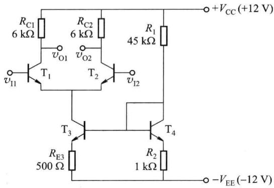  

图2.7.8 例2.7.1的电路

电流源的参考电流 $I_{\mathrm{CQ4}} = \frac{V_{\mathrm{CC}} + V_{\mathrm{EE}} - V_{\mathrm{BE}}}{R_1 + R_2} = \frac{12 + 12 - 0.7}{45 + 1}\mathrm{mA} = 0.507\mathrm{mA}$

电流源的输出电流 $I_{\mathrm{CQ3}} = \frac{R_2}{R_{\mathrm{E3}}} \cdot I_{\mathrm{CQ4}} = \frac{1}{0.5} \times 0.507 \mathrm{~mA} = 1.01 \mathrm{~mA}$

$$

I _ {\mathrm{CQ1}} = I _ {\mathrm{CQ2}} = I _ {\mathrm{CQ3}} / 2 = 0. 5 \mathrm{mA}

$$

$T_{1}$ 、 $T_{2}$ 的射极电位 $V_{E}=-0.7\ V$ ， $V_{C1}=V_{C2}=V_{CC}-I_{CQ1}R_{C1}=(12-0.5\times6)\ V=9\ V$ ，故

$$

V _ {\mathrm{CEQ1}} = V _ {\mathrm{CEQ2}} = V _ {\mathrm{C1}} - V _ {\mathrm{E1}} = [ 9 - (- 0. 7) ] \mathrm{V} = 9. 7 \mathrm{V}

$$

$T_{3}$ 的集电极电位 $V_{C3}=V_{E}=-0.7V, V_{E3}=-V_{EE}+R_{E3}I_{CQ3}=(-12+0.5\times1.01)V=-11.5V$ ，可得

$$

\begin{array}{r l} & V _ {\mathrm{CEQ3}} = V _ {\mathrm{C3}} - V _ {\mathrm{E3}} = \left[ - 0. 7 - (- 1 1. 5) \right] \mathrm{V} = 1 0. 8 \mathrm{V} \\ & V _ {\mathrm{B3}} = V _ {\mathrm{B4}} = V _ {\mathrm{E3}} + V _ {\mathrm{BE}} = - 1 0. 8 \mathrm{V} \\ & V _ {\mathrm{CEQ4}} = 0. 7 \mathrm{V} \end{array}

$$

(2) 忽略 $T_{1}$ 的输出电阻 $r_{ce1}$ ，有 $r_{be1}=r_{be2}=\left[80+101\times(26/0.5)\right]$ $\Omega=5.33\ k\Omega$

由式(2.7.7)可得 $\dot{A}_{vd}=\frac{\dot{V}_{od}}{\dot{V}_{id}}=-\frac{\beta R_{C1}}{r_{be1}}=-\frac{100\times6}{5.33}=-112.6$

差模输入电阻

$$

R _ {\mathrm{id}} = 2 r _ {\mathrm{bel}} = 1 0. 6 6 \mathrm{k} \Omega

$$

（3）为了求共模增益，需要求出电流源的输出电阻 $R_{EE}, r_{be3} = [80 + 101 \times (26/1)] \Omega = 2.71 \, k\Omega, T_{3}$ 管基极往右看的等效电阻 $R_{B} = R_{1} // R_{2} = 0.98 \, k\Omega$ ，由式(2.6.9)可得

$$

R _ {\mathrm{EE}} \approx r _ {\mathrm{ce3}} \left(1 + \frac {\beta R _ {\mathrm{E3}}}{r _ {\mathrm{be3}} + R _ {\mathrm{B}} + R _ {\mathrm{E3}}}\right) = 1 0 0 \times \left(1 + \frac {1 0 0 \times 0 . 5}{2 . 7 1 + 0 . 9 8 + 0 . 5}\right) \mathrm{k} \Omega = 1 2 9 3 \mathrm{k} \Omega

$$

由式 $(2.7.12)$ 可得

$$

\dot {A} _ {\mathrm{vc1}} = \frac {\dot {V} _ {\mathrm{oc}}}{\dot {V} _ {\mathrm{ic}}} \approx - \frac {R _ {\mathrm{C1}}}{2 R _ {\mathrm{EE}}} = - \frac {6}{2 \times 1 2 9 3} \approx - 2. 3 2 \times 1 0 ^ {- 3}

$$

$$

K _ {\mathrm{CMR}} = \left| \frac {\dot {A} _ {v \mathrm{dl}}}{\dot {A} _ {v \mathrm{cl}}} \right| = \left| \frac {1 1 2 . 6 / 2}{2 . 3 2 \times 1 0 ^ {- 3}} \right| = 2 4 2 6 7 \approx 8 7. 7 \mathrm{dB}

$$
</Solution>
</Example>

<Example title="例 2.7.2">
电路如图 2.7.9(a) 所示。设 $V_{CC} = V_{EE} = 12 \, V, R_{C} = 10 \, k\Omega, R_{L} = 20 \, k\Omega, R_{E} =$

100 Ω, 晶体管的 $\beta = 100, V_{BE} = 0.7 V, r_{bb'} = 60 \Omega, r_{ce}$ 可忽略。

（1）为使 $T_{1}$ 、 $T_{2}$ 的射极静态电流均为 0.5 mA，求 $R_{EE}$ 的取值及 $T_{1}$ 、 $T_{2}$ 的 $V_{CEQ}$ ;

(2) 求差模电压增益和差模输入电阻。

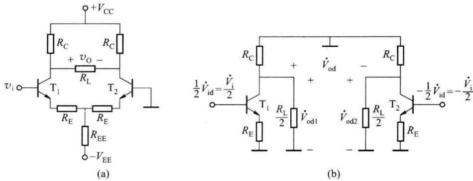  

图2.7.9 例2.7.2的电路

<Solution title="解">
该电路是单端输入双端输出的差放,与前面电路不同之处是两管射极接有负反馈电阻 $R_{E}$ ,且直流偏置电流由 $-V_{EE}$ 及电阻 $R_{EE}$ 来提供。

（1）静态时 $v_{\mathrm{i}} = 0$ ，由图2.7.9(a)可知， $V_{\mathrm{BEQ1}} + I_{\mathrm{EQ1}}R_{\mathrm{E}} + 2I_{\mathrm{EQ1}}R_{\mathrm{EE}} = V_{\mathrm{EE}}$ ，则可得

$$

\begin{array}{r l} I _ {\mathrm{CQ1}} & = I _ {\mathrm{CQ2}} \approx I _ {\mathrm{EQ1}} = I _ {\mathrm{EQ2}} = (V _ {\mathrm{EE}} - V _ {\mathrm{BEQ1}}) / (R _ {\mathrm{E1}} + 2 R _ {\mathrm{EE}}) \\ & \Rightarrow R _ {\mathrm{EE}} = \frac {1}{2} \left(\frac {V _ {\mathrm{EE}} - V _ {\mathrm{BEQ1}}}{I _ {\mathrm{CQ1}}} - R _ {\mathrm{E}}\right) = \frac {1}{2} \left(\frac {1 2 - 0 . 7}{0 . 5} - 0. 1\right) \mathrm{k} \Omega = 1 1. 2 5 \mathrm{k} \Omega \\ & V _ {\mathrm{CEQ1}} = V _ {\mathrm{CEQ2}} = V _ {\mathrm{C1}} - V _ {\mathrm{E1}} = (V _ {\mathrm{CC}} - I _ {\mathrm{CQ1}} R _ {\mathrm{C}}) - (- V _ {\mathrm{BE1}}) \\ & = [ (1 2 - 0. 5 \times 1 0) + 0. 7 ] \mathrm{V} = 7. 7 \mathrm{V} \end{array}

$$

（2）对于差模信号， $R_{EE}$ 对地短路，但 $T_{1}$ 、 $T_{2}$ 的射极电阻 $R_{E}$ 的负反馈作用仍然存在，可得差模交流通路如图 2.7.9(b) 所示。由 $I_{CQ1}=I_{CQ2}=0.5\ mA\Rightarrow r_{be1}=r_{be2}\approx5.3\ k\Omega$ ，则

$$

\begin{array}{l} \dot {A} _ {\mathrm{vd}} = \frac {\dot {V} _ {\mathrm{od}}}{\dot {V} _ {\mathrm{id}}} = - \frac {\beta [ R _ {\mathrm{C}} / / (R _ {\mathrm{L}} / 2) ]}{r _ {\mathrm{be1}} + (1 + \beta) R _ {\mathrm{E1}}} = - \frac {1 0 0 \left(\frac {1 0 \times \frac {2 0}{2}}{1 0 + \frac {2 0}{2}}\right)}{5 . 3 + 1 0 1 \times 0 . 1} = - 3 2. 4 7 \\ R _ {\mathrm{id}} = 2 [ r _ {\mathrm{be}} + (1 + \beta) R _ {\mathrm{E1}} ] = 2 (5. 3 + 1 0 1 \times 0. 1) \mathrm{k} \Omega = 3 0. 8 \mathrm{k} \Omega \end{array}

$$

前面讨论了差放的最大差模输入电压 $V_{IDM}$ ，共模输入电压的最大值同样也有限制。以图2.7.8所示电路为例，设共模增益 $\left|\dot{A}_{vc}\right| \rightarrow 0$ ，加共模信号时， $T_{1}$ 、 $T_{2}$ 的集电极电位相等且基本不变，约等于其静态电位，所以当共模输入电压正向增至 $V_{C1} = V_{C2}$ 时， $T_{1}$ 、 $T_{2}$ 开始饱和；当共模输入电压负向增加时，偏置电流源输出管 $T_{3}$ 的集电极电位随之下降，当共模输入电压负向增加到一定值时， $T_{3}$ 也会饱和，使其输出电阻急剧下降。以上两种情况都会使差放失去对共模信号的抑制能力。差放两输入端所允许施加的共模电压的最大值称为最大共模输入电压 $V_{ICM}$ 。对于图2.7.8所示的电路， $V_{C1} = V_{C2} = 9 \, V$ ， $V_{B3} = V_{B4} = -10.8 \, V$ ，所以最大正向共模输入电压约为9 V，最大负向共模输入电压约为10.1 V。
</Solution>
</Example>

## 2.7.3 有源负载差分放大电路

电流源的应用十分广泛,2.6节已介绍了它在直流偏置和有源负载中的应用,这里进一步讨论它在差放中作为有源负载所起的独特作用。

差放的后级电路如果是单端放大电路,就需要将两个大小相等相位相反的差分输出信

号转换成一个单端输出信号。如果采用简单的单端输出差放，则差放的增益将减小一半，而利用有源负载的差放可以将电路转变为单端输出且增益没有损失。

图 2.7.10 是采用有源负载的差分放大电路,采用双端输入单端输出方式。其中 $T_{1}$ 、 $T_{2}$ 为 NPN 型差分放大管, $T_{3}$ 、 $T_{4}$ 为 PNP 型镜像电流源,作 $T_{1}$ 、 $T_{2}$ 的有源负载, $T_{1}$ 、 $T_{2}$ 发射极的电流源决定放大管的静态偏置电流。设各管 $\beta$ 值足够大,可以忽略 $I_{B}$ 。

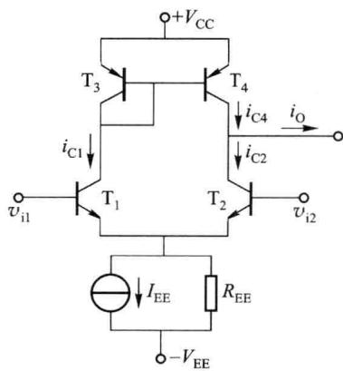

静态时， $v_{i1}=v_{i2}=0$ ， $I_{CQ1}\approx I_{CQ2}\approx I_{EE}/2$ ， $I_{CQ1}$ 是镜像电流源的参考电流，被等量地传送到 $T_{4}$ 的集电极，使 $I_{CQ4}\approx I_{CQ1}\approx I_{EE}/2$ ，则直流输出电流 $I_{O}=I_{CQ4}-I_{CQ2}\approx0$ ，保证了输入为零时，输出也为零。

图 2.7.10 采用有源负载的差放

加入差模信号后， $i_{c1}=i, i_{c2}=-i, i_{c1}$ 经镜像电流源传送到 $T_{4}$ ，使 $i_{c4}\approx i_{c1}=i$ ，则输出信号电流 $i_{o}=i_{c4}-i_{c2}\approx2i$ 。可见，电路虽然是单端输出，却可以得到相当于双端输出时的输出电流变化量，所以其差模电压增益与双端输出相同。差模电压增益、输入电阻和输出电阻分别为

$$

\left\{ \begin{array}{l} \dot {A} _ {v d} = \frac {\beta R _ {L} ^ {\prime}}{r _ {b e}} \\ R _ {i d} = 2 r _ {b e} \\ R _ {o} = r _ {c e 2} / / r _ {c e 4} \end{array} \right.\tag{2.7.19}

$$

式中， $R_{L}^{\prime}=r_{ce2}\parallel r_{ce4}\parallel R_{L},r_{ce4}$ 是镜像电流源的输出电阻， $r_{ce2}$ 是 $T_{2}$ 的输出电阻。

输入共模信号时， $i_{c1}=i_{c2}$ ， $i_{c1}$ 经电流源传输到 $T_{4}$ ，使 $i_{c4}\approx i_{c1}$ ，则输出共模信号电流 $i_{o}=i_{c4}-i_{c2}\approx0$ ，因此其共模抑制能力与双端输出差放相同。

以上分析没有考虑 $T_{1}$ 、 $T_{2}$ 两管集电极负载不同产生的影响。若考虑的话，分析计算较为复杂，需要计算机辅助分析来解决。

## 2.7.4 非理想对称差分放大电路的性能

上面讨论了差放两边对称情况下的性能,实际差放总是存在着两边晶体管特性和电阻 $R_{c}$ 不相等或者说不匹配的情况,虽然这种不匹配是极其微小的,特别是在集成电路中,但是对某些性能的影响比较大,这些性能主要是:双端输出时的共模抑制比、失调及温漂等。下面分别作一简要介绍。

## 一、双端输出时的共模抑制比

以图 2.7.1 所示电路为例,对于理想对称差放,输入差模信号时输出仅有差模信号;输入共模信号时输出仅有共模信号。在双端输出时,由于两管共模输出电压相抵消,因而差放对共模输入信号具有无限抑制能力。

实际的差放不可能理想对称，电路的不对称包括晶体管 $\mathrm{T}_{1}$ 、 $\mathrm{T}_{2}$ 参数的失配、电阻 $R_{\mathrm{C}}$ 的失配等。当电路两边不对称时，在差模输入信号作用下，两管输出电压不会严格等值反相 $v_{\mathrm{od1}}\neq -v_{\mathrm{od2}}$ ，这样两输出端电压中除了差模分量外，还同时出现了共模分量，不过与差模输出分量相比较，它数值很小，且后级差放对此共模分量还有很强的抑制作用，所以它的危害并不严重；同理，在共模输入信号作用下，两管输出电压不会严格等值同相 $v_{\mathrm{oc1}}\neq v_{\mathrm{oc2}}$ ，这样两输出端电压中除了共模分量外，还同时出现了差模分量，后级差放对这种以差模形式出现的共模干扰不仅不能抑制，而且还要放大，与差模输入信号作用下产生的差模输出分量混在一起，无法分离，因而更加有害。由于存在从共模输入到差模输出的转换，使 $v_{\mathrm{oc}}$ 及 $|\dot{A}_{vc}|$ 增加，共模抑制比下降。

所以对于非理想对称差放,双端输出的共模抑制比可定义为

$$

K _ {\mathrm{CMR}} = \left| \frac {\dot {A} _ {v \mathrm{d}}}{\dot {A} _ {v (\mathrm{c-d})}} \right|\tag{2.7.20}

$$

式中， $\dot{A}_{v(c-d)}$ 是共模输入-差模输出的电压增益，即 $A_{v(c-d)} = (v_{\mathrm{oc1}} - v_{\mathrm{oc2}}) / v_{\mathrm{ic}}$ 。显然电路两边越对称， $A_{v(c-d)}$ 就越小， $K_{CMR}$ 就越大。

$v_{oc1}$ 、 $v_{oc2}$ 的大小与电流源输出电阻 $R_{EE}$ 大小有关。如果 $R_{EE} \rightarrow \infty$ ，不管电路是否对称， $v_{oc1} = v_{oc2} = 0, A_{v(c-d)} = 0, K_{CMR} \rightarrow \infty$ 。当然如果电路理想对称 $(R_{EE} \neq \infty), v_{oc1} = v_{oc2} \neq 0$ ，从共模输入到差模输出的转换分量为零，故 $K_{CMR} \rightarrow \infty$ 。因此为了提高 $K_{CMR}$ ，应尽力改善电路的匹配精度，提高 $R_{EE}$ 。与前面分析结论相同。

## 二、差分放大电路的失调及温漂

理想对称的差放,当输入电压为零时,双端输出电压也应为零,称为零输入-零输出。但在实际电路中,由于电路不可能完全对称,所以输出电压并不为零,这种输入为零时输出不为零的现象称为差放的失调,失调是由于晶体管参数和电路元件参数不对称而引起的,差放的失调用输入失调电压和输入失调电流来衡量。

### 1. 差分放大电路的输入失调电压

由于电路不对称,使得零输入时双端输出电压不等于零,此输出电压称为输出失调电

压,输出失调电压与输出信号电压混在一起,二者无法区分。所以考虑失调问题是模拟集成电路设计的一个十分重要的问题。

输出失调电压与差放的增益有关,增益越大输出失调电压也越大,为了排除差放增益的影响,需将输出失调电压折合到输入端,输入失调电压 $V_{10}$ 是指当输入信号为零时,输出失调电压折算到输入端的数值。如果用一个与 $V_{10}$ 大小相同、极性相反的恒压源加到差放的输入端,就能使差放的输出失调电压为 0,如图 2.7.11 所示,因此从等效观点来看, $V_{10}$ 就是为使零输入时输出电压为零,所需加在差放输入端的补偿电压。由于电路两边的不对称是随机的,因而 $V_{10}$ 值的正或负是不确定的。

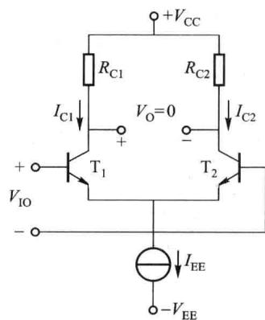  

图 2.7.11 差放的输入失调电压

为使输出电压为零,要求 $I_{C1}R_{C1}=I_{C2}R_{C2}\Rightarrow\frac{I_{C1}}{I_{C2}}=\frac{R_{C2}}{R_{C1}}$

(2.7.21)

由图2.7.11可知

$$

V _ {\mathrm{IO}} = V _ {\mathrm{BE1}} - V _ {\mathrm{BE2}} \approx V _ {T} \ln \frac {I _ {\mathrm{C1}}}{I _ {\mathrm{ES1}}} - V _ {T} \ln \frac {I _ {\mathrm{C2}}}{I _ {\mathrm{ES2}}} = V _ {T} \ln \left(\frac {I _ {\mathrm{C1}}}{I _ {\mathrm{C2}}} \cdot \frac {I _ {\mathrm{ES2}}}{I _ {\mathrm{ES1}}}\right) = V _ {T} \ln \left(\frac {R _ {\mathrm{C2}}}{R _ {\mathrm{C1}}} \cdot \frac {I _ {\mathrm{ES2}}}{I _ {\mathrm{ES1}}}\right)\tag{2.7.22}

$$

该式说明差放的 $V_{10}$ 主要是由晶体管参数 $I_{ES}$ 和 $R_{C}$ 的失配造成的。

设 $I_{ES}$ 、 $\Delta I_{ES}$ 和 $R_{C}$ 、 $\Delta R_{C}$ 分别为失配 $I_{ES}$ 和 $R_{C}$ 的均值及差值，即 $I_{\mathrm{ES}} = (I_{\mathrm{ES1}} + I_{\mathrm{ES2}}) / 2$ ， $\Delta I_{\mathrm{ES}} = I_{\mathrm{ES1}} - I_{\mathrm{ES2}}$ ， $R_{\mathrm{C}} = (R_{\mathrm{C1}} + R_{\mathrm{C2}}) / 2$ ， $\Delta R_{C} = R_{C1} - R_{C2}$ ，则

$$

\left\{ \begin{array}{l} R _ {\mathrm{C1}} = R _ {\mathrm{C}} + \Delta R _ {\mathrm{C}} / 2 \\ R _ {\mathrm{C2}} = R _ {\mathrm{C}} - \Delta R _ {\mathrm{C}} / 2 \end{array} \right. \quad \left\{ \begin{array}{l} I _ {\mathrm{ES1}} = I _ {\mathrm{ES}} + \Delta I _ {\mathrm{ES}} / 2 \\ I _ {\mathrm{ES2}} = I _ {\mathrm{ES}} - \Delta I _ {\mathrm{ES}} / 2 \end{array} \right.\tag{2.7.23}

$$

代入式 $(2.7.22)$ ，得

$$

V _ {\mathrm{IO}} \approx V _ {T} \ln \left(\frac {R _ {\mathrm{C}} - \Delta R _ {\mathrm{C}} / 2}{R _ {\mathrm{C}} + \Delta R _ {\mathrm{C}} / 2} \cdot \frac {I _ {\mathrm{ES}} - \Delta I _ {\mathrm{ES}} / 2}{I _ {\mathrm{ES}} + \Delta I _ {\mathrm{ES}} / 2}\right)\tag{2.7.24}

$$

$$

\mathrm{由于} \Delta R _ {\mathrm{C}} <   <   R _ {\mathrm{C}}, \Delta I _ {\mathrm{ES}} <   <   I _ {\mathrm{ES}} \Rightarrow V _ {1 0} \approx V _ {T} \ln \left[ \left(1 - \frac {\Delta R _ {\mathrm{C}}}{R _ {\mathrm{C}}}\right) \left(1 - \frac {\Delta I _ {\mathrm{ES}}}{I _ {\mathrm{ES}}}\right) \right]\tag{2.7.25}

$$

按幂级数展开且忽略高阶小量 $\Rightarrow V_{10} \approx V_{T}\left(-\frac{\Delta R_{C}}{R_{C}} - \frac{\Delta I_{ES}}{I_{ES}}\right)$

(2.7.26)

可知输入失调电压 $V_{10}$ 为 $R_{C}$ 失配和 $I_{ES}$ 失配产生影响的线性叠加。两种失配方向是随机

的,所以式(2.7.26)中的负号没有实际意义,当二者失调方向相同,则数值相加是最坏的情况。

2. 差分放大电路的输入失调电流

若差分对管的基极接有较大的电阻 $R_{\mathrm{B}}$ （也包括信号源内阻），而 $I_{B1} \neq I_{B2}$ ，使两管基极电位不等，相当于在两输入端之间产生差模输入电压 $R_{\mathrm{B}}(I_{\mathrm{B1}} - I_{\mathrm{B2}})$ 。当该电压比 $V_{10}$ 大得多时，输出失调电压则主要由它决定。忽略 $V_{10}$ 的影响，如果用一个恒流源加至差放的输入端作补偿，可使输出电压为零，这个补偿电流就是输入失调电流 $I_{10}$ ，如图 2.7.12 所示。输入失调电流等于两管基极电流之差，即

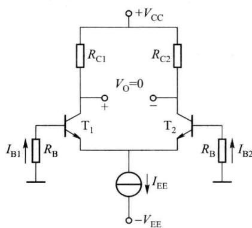  

图 2.7.12 差放的输入失调电流

$$

I _ {\mathrm{IO}} = | I _ {\mathrm{B1}} - I _ {\mathrm{B2}} |\tag{2.7.27}

$$

与推导 $V_{10}$ 类似，设 $I_{c1}=I_{c}+\Delta I_{c}/2$ 、 $I_{c2}=I_{c}-\Delta I_{c}/2$ 和 $\beta_{1}=\beta+\Delta\beta/2$ 、 $\beta_{2}=\beta-\Delta\beta/2$ ，则

$$

I _ {\mathrm{10}} = I _ {\mathrm{B1}} - I _ {\mathrm{B2}} = \frac {I _ {\mathrm{C1}}}{\beta_ {1}} - \frac {I _ {\mathrm{C2}}}{\beta_ {2}} = \frac {I _ {\mathrm{C}} + \Delta I _ {\mathrm{C}} / 2}{\beta + \Delta \beta / 2} - \frac {I _ {\mathrm{C}} - \Delta I _ {\mathrm{C}} / 2}{\beta - \Delta \beta / 2} \approx \frac {I _ {\mathrm{C}}}{\beta} \left(\frac {\Delta I _ {\mathrm{C}}}{I _ {\mathrm{C}}} - \frac {\Delta \beta}{\beta}\right)\tag{2.7.28}

$$

由式(2.7.21)知 $\frac{I_{C}+\Delta I_{C}/2}{I_{C}-\Delta I_{C}/2}=\frac{R_{C}-\Delta R_{C}/2}{R_{C}+\Delta R_{C}/2}\Rightarrow1+\frac{\Delta I_{C}}{I_{C}}\approx1-\frac{\Delta R_{C}}{R_{C}}\Rightarrow\frac{\Delta I_{C}}{I_{C}}\approx-\frac{\Delta R_{C}}{R_{C}}$ ，代入式

(2.7.28)，得 $I_{10} \approx \frac{I_{C}}{\beta} \left( -\frac{\Delta \beta}{\beta} - \frac{\Delta R_{C}}{R_{C}} \right)$ (2.7.29)

可见 $I_{10}$ 主要是由两管 $\beta$ 值失配和 $R_{c}$ 失配引起的。

由于 $\frac{\Delta\beta}{\beta}\gg\frac{\Delta R_{c}}{R_{c}}$ ，故

$$

I _ {\mathrm{IO}} \approx - \frac {\Delta \beta}{\beta} I _ {\mathrm{B}}\tag{2.7.30}

$$

其中 $I_{B}$ 、 $\beta$ 分别为两管基极电流、电流放大系数的均值， $\Delta\beta$ 为两管 $\beta$ 的差值。为了减小 $I_{10}$ ，可以减小 $I_{B}$ 或加大 $\beta$ 值。由于超 $\beta$ 管的 $\beta$ 值可达 1 000～10 000，故可用做差分放大管。

### 3. 输入失调电压和输入失调电流的温漂

当环境温度、电源电压等变化时，引起晶体管及电阻元件参数变化，输入失调电压 $V_{10}$ 和输入失调电流 $I_{10}$ 将随着漂移，其中以温度变化的影响最大，简称温漂。

可以证明, $V_{10}$ 随温度T的变化率为

$$

\frac {\mathrm{d} V _ {\mathrm{IO}}}{\mathrm{d} T} \approx \frac {V _ {\mathrm{BE1}} - V _ {\mathrm{BE2}}}{T} - \frac {V _ {T}}{T} \cdot \frac {\Delta R _ {\mathrm{C}}}{R _ {\mathrm{C}}} - V _ {T} \frac {\mathrm{d}}{\mathrm{d} T} \left(\frac {\Delta R _ {\mathrm{C}}}{R _ {\mathrm{C}}}\right)\tag{2.7.31}

$$

即 $V_{IO}$ 的漂移由三部分组成: ① 差分对管 $V_{BE}$ 不匹配造成的温漂, 因此必须尽可能使两管 $V_{BE}$ 匹配, 这是一个重要结论; ② $R_{C}$ 失配产生的温漂; ③ $R_{C}$ 温度系数不同产生的温漂。

输入失调电流 $I_{10}$ 随温度 T 的变化率为

$$

\frac {\mathrm{d} I _ {\mathrm{IO}}}{\mathrm{d} T} \approx - \frac {1}{\beta} \cdot \frac {\mathrm{d} \beta}{\mathrm{d} T} (I _ {\mathrm{B1}} - I _ {\mathrm{B2}}) = - \frac {1}{\beta} \cdot \frac {\mathrm{d} \beta}{\mathrm{d} T} I _ {\mathrm{IO}}\tag{2.7.32}

$$

其中 $\frac{1}{\beta}\cdot\frac{d\beta}{dT}$ 为 $\beta$ 的平均温度系数。可见输入失调电流的温漂和输入失调电流成正比，因而降低差放的 $I_{B}$ 是减小输入失调电流及其温漂的有效方法。

### 4. 失调模型和调零电路

综上所述， $T_{1}$ 、 $T_{2}$ 两管基极之间总的失调电压 $V_{10\Sigma}$ 是由 $V_{10}$ 和 $I_{10}$ 共同产生的，输入失调模型如图2.7.13所示，图中 $V_{10}$ 的极性和 $I_{10}$ 的方向均无实际意义，最不利的情况是两者同向叠加。由图可得

$$

V _ {\mathrm{IO} \Sigma} = \left(V _ {\mathrm{IO}} + \frac {1}{2} R _ {\mathrm{B}} I _ {\mathrm{IO}}\right) - \left(- \frac {1}{2} R _ {\mathrm{B}} I _ {\mathrm{IO}}\right) = V _ {\mathrm{IO}} + R _ {\mathrm{B}} I _ {\mathrm{IO}}\tag{2.7.33}

$$

若 $R_{B}$ 很小，则 $R_{B}I_{10}$ 可忽略， $V_{10\Sigma}\approx V_{10}$ ；若 $R_{B}$ 很大，则 $R_{B}I_{10}\gg V_{10}, V_{10\Sigma}\approx R_{B}I_{10}\circ V_{10\Sigma}$ 的大小与 $R_{B}$ 有关，因此差放基极串联电阻及信号源内阻应尽可能小一些，以减小 $I_{10}$ 的影响。

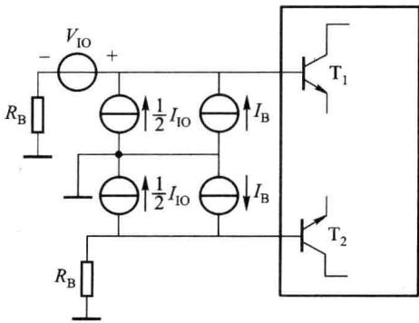  

图 2.7.13 差放的输入失调模型

在直接耦合电路中， $V_{10\Sigma}$ 与输入信号一起加至差放的输入端进行放大，因此 $V_{10\Sigma}$ 是一种有害的干扰信号。除了在设计电路和选择元器件时要尽量减小 $V_{10}$ 、 $I_{10}$ 外，还常采用调零电路以保证在输入信号为零时，放大电路输出电压也为零，从而消除 $V_{10\Sigma}$ 的影响。常用的两种调零电路如图 2.7.14 所示，其中图（a）是射极调零电路，图（b）是集电极调零电路，通过调节调零电位器 $R_{p}$ ，使静态工作时双端输出的电压减小到零。

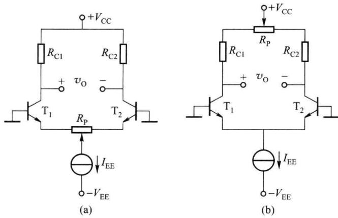  

图 2.7.14 差放的两种调零电路

必须指出,调零电路的调零不可能跟踪温度的变化,因此调零电路可以克服失调,但不能消除失调的温漂。

通过以上讨论可以看到,随着输入失调电压、输入失调电流的减小,其温度漂移也将减小。

差放由于电路对称的特点,以及由于电路中不需要大容量电容和阻值很高的电阻,所以很适宜作成集成电路。同时由于集成电路的工艺特点,又保证了差放元件参数,特别是晶体管特性尽可能对称的要求,使它具有良好的共模抑制性能,适合于低漂移直接耦合放大电路的输入级。
