import Guide from '@/components/Guide.astro';
import Knowledge from '@/components/Knowledge.astro';
import Example from '@/components/Example.astro';
import Analysis from '@/components/Analysis.astro';
import Solution from '@/components/Solution.astro';
import Variant from '@/components/Variant.astro';
import Note from '@/components/Note.astro';
import Block from '@/components/Block.astro';
import Method from '@/components/Method.astro';
import Exercise from '@/components/Exercise.astro';

在实用电路中,往往要求多级放大电路的末级(即输出级)输出一定的功率,以驱动负载,能够向负载提供足够信号功率的放大电路称为功率放大电路,简称功放。前面所讨论的放大电路主要用于增强电压幅度或电流幅度,因而相应地称为电压放大电路或电流放大电路,属于小信号放大电路。其实无论哪种放大电路,在负载上都同时存在输出电压、电流和功率,上述称呼上的区别只不过是强调的输出量不同而已。从能量控制和转换的角度看,功放与其他放大电路在本质上没有根本区别,它既不是单纯追求输出高电压,也不是单纯追求输出大电流,而是追求在电源电压确定的情况下,输出尽可能大的功率。

一个多级放大器常常由前置放大级和功率放大级所组成。前置放大级往往由小信号放大电路组成，其主要任务是不失真地提高输入信号电压或电流幅度，以驱动后面的功放；而功放的任务是保证信号失真在允许范围内，输出足够的功率，以驱动负载。由此可见，功放通常工作在大信号状态,因此,从功放电路的组成和分析方法,到元器件的选择,都与小信号放大电路有着明显的区别。

## 2.8.1 功率放大电路的特点及分类

## 一、功率放大电路的特点

如前所述,放大电路实质上都是能量转换电路。从能量控制的观点来看,功放和电压放大电路没有本质的区别。但是,功放和电压放大电路所要完成的任务不同。对电压放大电路的主要要求是使负载得到不失真的电压信号,讨论的主要指标是电压增益、输入和输出的阻抗等,输出的功率并不一定大。而功放则不同,它主要要求获得一定的不失真(或失真较小)的输出功率,所以对功放的要求或称为功放的特点有如下几点。

### 1. 输出功率要尽可能大

功率等于电压与电流之积,为了获得大的功率输出,要求用于功放中的晶体管(以下简称功率管)的电压和电流都有足够大的输出幅度,因此功率管往往在接近极限运用状态下工作。

### 2. 效率要高

功放的输出功率是由直流电源供给的直流能量转换得到的,由于输出功率大,因此直流电源消耗的功率也大,这就存在一个效率问题。所谓效率就是负载得到的有用信号功率和电源供给的直流功率的比值。这个比值越大,意味着效率越高。

### 3. 非线性失真要小

功放是在大信号下工作,所以不可避免地会产生非线性失真,而且同一功率管输出的功率越大,非线性失真往往越严重,这就使得输出功率和非线性失真成为一对主要矛盾。实践中,需要根据非线性失真的要求限制输出功率。

### 4. 要考虑功率管的散热和保护问题

在功放中,有相当大的功率消耗在功率管的集电结上,使结温和管壳温度升高。通常将功率管消耗的功率称为管耗,为了充分利用允许的管耗而使功率管输出足够的功率,功率管的散热就成为一个重要的问题。此外,功率管工作在大信号极限运用状态,因此,选择功率管时要注意不要超过极限参数,并要考虑过电压和过电流保护措施。

### 5. 在分析方法上,通常采用图解法

功放工作在大信号下,小信号等效电路分析方法不再适用,应采用图解法分析功放。

综上所述,对功放的要求是:在保证功率管安全工作的条件下和失真允许的范围内,充分发挥其潜力,输出尽量大的功率,同时还要减小功率管的损耗,以提高其效率。

## 二、功率放大电路的分类

功放的类型很多,按照功率管工作状态的不同可分为甲类、乙类、甲乙类和丙类4种,如图2.8.1所示。在图2.8.1(a)中,功率管的静态Q点在放大区,在输入信号的整个周期内均有电流流过,即功率管在一周内都导通,通常将这种工作方式称为甲类放大。若将在信号的一个周期内功率管导通角度的一半定义为导通角θ,则甲类功放 $\theta=180^{\circ}$ ;在图2.8.1(b)中,Q点靠近截止区,功率管有半个周期以上导通,称为甲乙类放大, $90^{\circ}<\theta<180^{\circ}$ ;在图2.8.1(c)中,Q点在截止区,功率管只有半个周期导通,称为乙类放大, $\theta=90^{\circ}$ ;在图2.8.1(d)中,Q点在截止区以下,功率管的导通时间少于半个周期,称为丙类放

大, $\theta<90^{\circ}$ 。

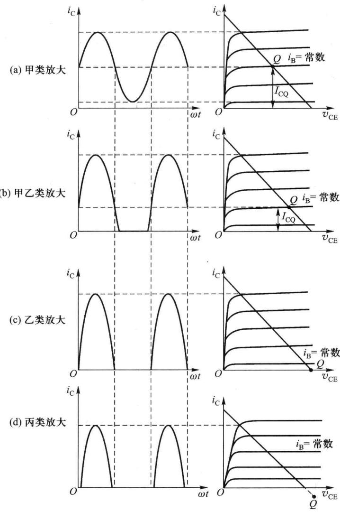  

图 2.8.1 功率管的 4 种工作状态

在甲类放大电路中,电源始终不断地输送功率,在没有信号输入即静态时,这些功率全部消耗在功率管(和电阻)上,并转化为热量的形式耗散出去。当有信号输入时,其中一部分转化为有用的输出功率,信号越大,输送给负载的功率越多。可以证明,即使在理想情况下,甲类放大电路的效率最高也只能达到50%。

怎样才能使电源供给的功率大部分转化为有用的信号输出功率从而提高效率呢？从甲类放大电路中知道，静态电流是造成管耗的主要因素。如果把 Q 点向下移动，使信号等于零时电源输出的功率也等于零（或很小），信号增大时，电源供给的功率也随之增大，这样电源供给功率及管耗都随着输出功率的大小而变，也就改变了甲类放大时效率低的状况。因此 Q 点越低，静态功耗越低，功放的效率越高，所以丙类放大效率最高，然后是乙类和甲乙类，甲类最低。

但是 Q 点越低,非线性失真越大,输出波形失真越严重,如图 2.8.1 所示,所以丙类放大非线性失真最大,然后是乙类和甲乙类,甲类失真最小。注意,对于丙类,静态时将功率管的发射结反偏使其截止,在图 2.8.1(d) 中,虽将 Q 点画在横轴下,并不表示静态有反向的集电极电流,只是表示当输入信号足够大时功率管才开始导电,因此其导通角总小于 $90^{\circ}$ 。

可见,提高效率与减小非线性失真是一对矛盾。由于甲类效率最低,丙类非线性失真最大,综合考虑效率和非线性失真,在功放中常采用乙类和甲乙类放大;前面讲的电压放大电路都是甲类放大;丙类功放通常用于放大高频大功率窄带信号,利用谐振回路作负载,就可选出集电极电流中的基波分量使输出电压仍为信号分量,故丙类主要应用在有 LC 调谐回路进行选频的射频功放即高频大功率电路中,如无线广播和电视发射机中。

乙类和甲乙类放大,虽然减小了静态功耗,提高了效率,但都出现了严重的波形失真,因此乙类和甲乙类放大必须妥善解决效率和失真的矛盾,既要保持静态时管耗小,又要使失真不太严重,这就需要在电路结构上采取措施。

## 2.8.2 互补功率放大电路

## 一、乙类互补功率放大电路

### 1. 电路组成

工作在乙类的放大电路,虽然管耗小,有利于提高效率,但存在严重的失真,使得输入信号的半个波形被削掉了。如果用两只功率管,使之都工作在乙类放大状态,但一只在正半周工作,而另一只在负半周工作,同时使这两个输出波形都能加到负载上,从而在负载上得到一个完整的波形,这样就能解决效率与失真的矛盾。

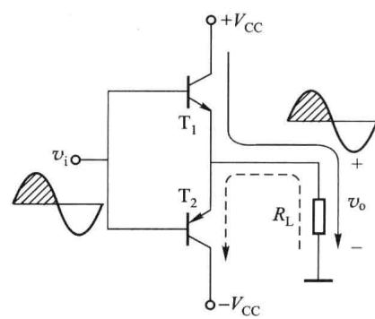

如图 2.8.2 所示的电路,由两只特性对称的 NPN 型管和 PNP 型管组成,输入电压 $v_{i}$ 加至两管的基极,输出电压 $v_{o}$ 由两管射极取出。电路采用数值相等的正、负电源供电。

图 2.8.2 乙类互补对称电路

静态时 $v_{i}=0$ ，两管无偏置电压，同时截止， $I_{CQ1}=I_{CQ2}=0$ ， $V_{CEQ1}=V_{CEQ2}=V_{CC}$ ， $V_{0}=0$ ， $I_{0}=0$ ，功耗为零。

加上正弦输入信号 $v_{i}$ 后，若忽略功率管发射结阈值电压（令 $V_{th}=0$ ），则在 $v_{i}$ 的正半周， $T_{1}$ 导通， $T_{2}$ 截止，此时电路是由 $T_{1}$ 构成的共集放大电路，获得 $v_{o}$ 及 $i_{o}$ 的正半周；在 $v_{i}$ 的负半周， $T_{1}$ 截止， $T_{2}$ 导通，此时电路是由 $T_{2}$ 构成的共集放大电路，获得 $v_{o}$ 及 $i_{o}$ 的负半周。这样，两管交替导通半个周期，为乙类放大，在负载电阻上得到了 $v_{o}$ 及 $i_{o}$ 的完整的正弦波形。

可见电路实现了在静态时功率管不取电流,而在有信号时, $T_{1}$ 和 $T_{2}$ 轮流导通,组成推挽式电路,既提高了效率,又减小了非线性失真。由于两只功率管互补对方的不足,工作性能对称,所以称为乙类互补对称电路。

电路中 $T_{2}$ 管的集电极接 $-V_{cc}$ (电路中的最低电位)，故在集成电路中输出电流不大时可选用纵向 PNP 型管。

### 2. 主要参数的计算

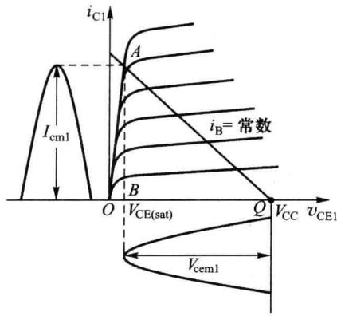  

(a)

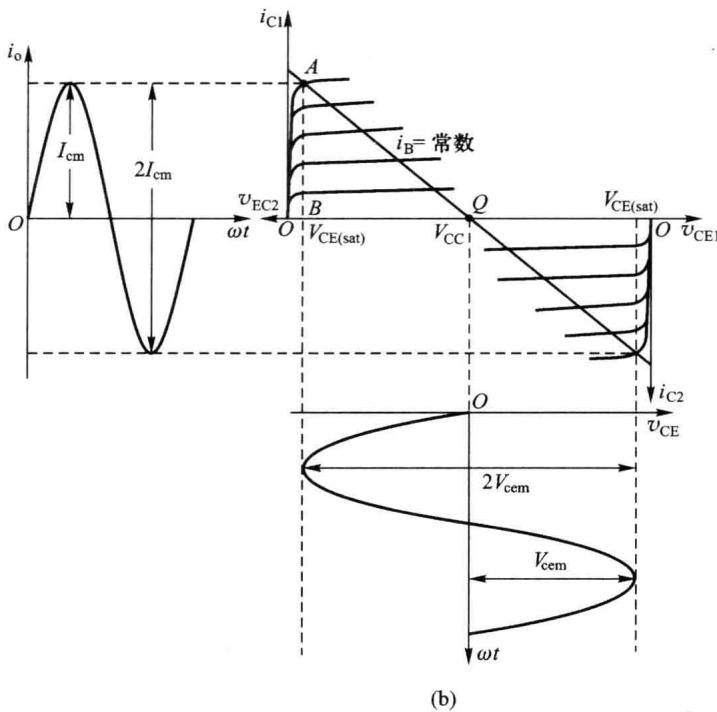  

图 2.8.3 乙类互补对称电路图解分析

图 2.8.3(a) 表示电路在 $v_{i}$ 为正半周时 $T_{1}$ 的工作情况。图中假定，只要 $v_{BE} > 0, T_{1}$ 就开始导电。鉴于 $T_{1}, T_{2}$ 特性完全对称，极性相反，且工作时轮流导通，为了分析方便，在图解法中把 $T_{2}$ 的特性曲线倒置于 $T_{1}$ 特性曲线的右下方，并令二者在 Q 点，即 $v_{CE} = V_{CC}$ 处重合，得到 $T_{1}, T_{2}$ 的组合特性曲线，如图 2.8.3(b) 所示。由于电路对称，因此 $T_{1}, T_{2}$ 的交流负载线斜率相等均为 $-1/R_{L}$ ，且它们的交流负载线均通过 Q 点，所以 $T_{1}, T_{2}$ 的合成交流负载线在 $T_{1}, T_{2}$ 组合特性曲线坐标里为通过 $V_{CC}$ 点的一条直线。

显然，允许的 $i_{C}$ 的最大变化范围为 $2I_{cm}$ ， $v_{CE}$ 的变化范围为 $2(V_{\mathrm{CC}}-V_{\mathrm{CE(sat)}})=2V_{\mathrm{cem}}=2I_{\mathrm{cm}}R_{\mathrm{L}}$ ，则 $V_{om}=V_{cem}=V_{CC}-V_{CE(sat)}$ ，如果忽略饱和电压降 $V_{\mathrm{CE(sat)}}$ ， $V_{om}=V_{cem}=I_{cm}R_{L}\approx V_{CC}$ 。

实际上即使不画出图来，也能得到同样的结论。若输出功率最大，则在正弦信号的正半周， $v_{i}$ 从零逐渐增大时，输出电压随之逐渐增大， $T_{1}$ 的管压降必然逐渐减小，当管压降下降到饱和管压降时，输出电压达到最大幅值，其值为 $V_{CC}-V_{CE(sat)}$ ，与图解法分析结论一致。

根据以上分析,不难求出乙类互补对称电路的输出功率、直流电源供给的功率和效率。

### (1) 输出功率 $P_{0}$

设输出电压幅度为 $V_{om}$ ，输出电流幅度为 $I_{om}$ ，则 $V_{om} = V_{cem1} = V_{cem2}$ ， $I_{om} = V_{om} / R_{L} \approx I_{cml} = I_{cm2}$ ，可得

$$

P _ {\mathrm{o}} = \frac {V _ {\mathrm{om}}}{\sqrt {2}} \cdot \frac {I _ {\mathrm{om}}}{\sqrt {2}} = \frac {V _ {\mathrm{om}} ^ {2}}{2 R _ {\mathrm{L}}}\tag{2.8.1}

$$

上式中的 $V_{om}$ 和 $I_{om}$ 可以分别用图 2.8.3(b) 中的 BQ 和 AB 来表示，因此， $\triangle ABQ$ 的面积就代表了工作在乙类的互补对称电路输出功率的大小， $\triangle ABQ$ 的面积越大，就表明输出功率 $P_{o}$ 越大。必须注意，对应于图 2.8.3(b) 的负载线 AQ，其功率三角形面积最大，非线性失真不明显，这是一种较理想的工作状态，但实际负载 $R_{L}$ 是固定的，不能随意改变，因而很难达到这种理想情况，除非采用变压器耦合，将实际负载 $R_{L}$ 变换成所期望的值 $R_{L}^{\prime}$ ，以实现阻抗匹配。

### (2) 电源供给的功率 $P_{DC}$

正、负电源在一周内轮流供电，电路的对称性使正、负电源供给功率相同，所以电源总供给功率为单个电源供给功率的2倍。可得

$$

P _ {\mathrm{DC}} = 2 \times \frac {1}{2 \pi} \int_ {0} ^ {\pi} V _ {\mathrm{CC}} I _ {\mathrm{cm}} \sin \omega t \mathrm{d} (\omega t) = \frac {2 V _ {\mathrm{CC}}}{\pi} \cdot \frac {V _ {\mathrm{om}}}{R _ {\mathrm{L}}}\tag{2.8.2}

$$

(3) 效率 $\eta$

$$

\eta = \frac {P _ {\mathrm{o}}}{P _ {\mathrm{DC}}} = \frac {\pi}{4} \cdot \frac {V _ {\mathrm{om}}}{V _ {\mathrm{CC}}}\tag{2.8.3}

$$

可见 $P_{o}$ 、 $P_{DC}$ 与 $\eta$ 均与信号幅度 $V_{om}$ 有关。静态时， $V_{om}=0, P_{o}=P_{DC}=0$ 。加入信号后，随着信号幅度 $V_{om}$ 的增加， $P_{o}$ 增加， $P_{DC}$ 也增加， $\eta$ 提高。当 $V_{om}$ 达到最大 ( $V_{CC}-V_{CE(sat)}$ ) 时，它们均达到最大值，称为尽限使用，此时式 (2.8.1) \~ 式 (2.8.3) 变为

$$

P _ {\mathrm{omax}} = \frac {1}{2} \cdot \frac {(V _ {\mathrm{CC}} - V _ {\mathrm{CE(sat)}}) ^ {2}}{R _ {\mathrm{L}}} \approx \frac {1}{2} \cdot \frac {V _ {\mathrm{CC}} ^ {2}}{R _ {\mathrm{L}}}\tag{2.8.4}

$$

$$

P _ {\mathrm{DCmax}} = \frac {2 V _ {\mathrm{CC}}}{\pi} \cdot \frac {V _ {\mathrm{CC}} - V _ {\mathrm{CE(sat)}}}{R _ {\mathrm{L}}} \approx \frac {2}{\pi} \cdot \frac {V _ {\mathrm{CC}} ^ {2}}{R _ {\mathrm{L}}}\tag{2.8.5}

$$

$$

\eta_{\mathrm{max}} = \frac{\pi}{4}\cdot \frac{V_{\mathrm{CC}} - V_{\mathrm{CE(sat)}}}{V_{\mathrm{CC}}} \approx \frac{\pi}{4}\times 100\% \approx 78.5\%\tag{2.8.6}

$$

式(2.8.6)是忽略了 $V_{\mathrm{CE(sat)}}$ 得到的,因此实际最大效率要比它小,一般在60%上下。

### 3. 功率管参数的选择

指的是对功率管三个极限参数的选择。

(1) $I_{CM}$

输出电压幅度最大值为 $(V_{\mathrm{CC}}-V_{\mathrm{CE(sat)}})$ ，因而功率管最大电流为 $(V_{\mathrm{CC}}-V_{\mathrm{CE(sat)}})/R_{\mathrm{L}}$ ，故

$$

I _ {\mathrm{CM}} \geqslant \frac {V _ {\mathrm{CC}}}{R _ {\mathrm{L}}}\tag{2.8.7}

$$

(2) $V_{(BR)CEO}$

由图2.8.2可知， $\mathrm{T}_{1}$ 导通时， $\mathrm{T}_{2}$ 截止，而且当 $\mathrm{T}_{1}$ 饱和时， $\mathrm{T}_{2}$ 所承受的最大反压接近于

-2 $V_{cc}$ ; 同理, $T_{2}$ 导通时, $T_{1}$ 截止, 而且当 $T_{2}$ 饱和时, $T_{1}$ 所承受的最大反压也接近 -2 $V_{cc}$ 。故要求

$$

V _ {(\mathrm{BR}) \mathrm{CEO}} \geqslant 2 V _ {\mathrm{CC}}\tag{2.8.8}

$$

(3) $P_{\mathrm{CM}}$

电源提供的功率,除了转换成输出功率外,其余部分主要消耗在功率管上,因此 $T_{1}$ 、 $T_{2}$ 的功耗应等于 $P_{DC}$ 与 $P_{o}$ 之差,即

$$

P _ {\mathrm{T1}} + P _ {\mathrm{T2}} = P _ {\mathrm{DC}} - P _ {\mathrm{o}} = \frac {2 V _ {\mathrm{CC}}}{\pi} \cdot \frac {V _ {\mathrm{om}}}{R _ {\mathrm{L}}} - \frac {1}{2} \cdot \frac {V _ {\mathrm{om}} ^ {2}}{R _ {\mathrm{L}}}\tag{2.8.9}

$$

$$

P _ {\mathrm{T1}} = P _ {\mathrm{T2}} = \frac {V _ {\mathrm{CC}}}{\pi} \cdot \frac {V _ {\mathrm{om}}}{R _ {\mathrm{L}}} - \frac {1}{4} \cdot \frac {V _ {\mathrm{om}} ^ {2}}{R _ {\mathrm{L}}}\tag{2.8.10}

$$

管耗与输出电压幅度 $V_{om}$ 有关。为了求出管耗的最大值，可将式(2.8.10)对 $V_{om}$ 求导数并令其为零，解得当 $V_{om} = 2/\pi \cdot V_{cc}$ 时管耗最大，且最大管耗为

$$

P _ {\mathrm{T1max}} = P _ {\mathrm{T2max}} = \frac {1}{\pi^ {2}} \cdot \frac {V _ {\mathrm{CC}} ^ {2}}{R _ {\mathrm{L}}}\tag{2.8.11}

$$

上式可改写为

$$

P _ {\mathrm{T1max}} = P _ {\mathrm{T2max}} = \frac {2}{\pi^ {2}} \cdot \frac {V _ {\mathrm{CC}} ^ {2}}{2 R _ {\mathrm{L}}} \approx 0. 2 P _ {\mathrm{omax}}\tag{2.8.12}

$$

可见最大管耗仅为最大输出功率的 1/5。但管耗和输出功率出现最大的时刻并不相同，当 $V_{om}=2/\pi \cdot V_{CC}$ 时管耗最大，当 $V_{om}=V_{CC}-V_{CE(sat)}$ 时输出功率最大。为了安全，应考虑最危险的情况，故要求

$$

P _ {\mathrm{CM}} \geqslant 0. 2 P _ {\mathrm{omax}}\tag{2.8.13}

$$

式(2.8.7)、式(2.8.8)和式(2.8.13)通常称为选择功率管的三个条件。实际在选择功率管时，尽量还应留有一定的余地。

<Example title="例 2.8.1">
功放如图 2.8.2 所示, 设 $V_{CC} = 12 \, V, R_{L} = 8 \, \Omega$ , 功率管的极限参数为 $I_{CM} = 2 \, A, V_{(BR)CEO} = 30 \, V, P_{CM} = 5 \, W$ 。试求:

（1）最大输出功率 $P_{omax}$ 值，并检验所给功率管是否能安全工作；

(2) 放大电路在 $\eta=0.6$ 时的输出功率 $P_{o}$ 值。

<Solution title="解">
(1)由式(2.8.4)可求出

$$

P _ {\mathrm{omax}} = \frac {V _ {\mathrm{cc}} ^ {2}}{2 R _ {\mathrm{L}}} = \frac {1 2 ^ {2}}{2 \times 8} \mathrm{W} = 9 \mathrm{W}

$$

由式 $(2.8.7)$ 、式 $(2.8.8)$ 和式 $(2.8.13)$ 可得

$$

\begin{array}{r l} I _ {\mathrm{CM}} & \geqslant \frac {V _ {\mathrm{CC}}}{R _ {\mathrm{L}}} = \frac {1 2}{8} \mathrm{A} = 1. 5 \mathrm{A}, V _ {(\mathrm{BR}) \mathrm{CEO}} \geqslant 2 V _ {\mathrm{CC}} = 2 4 \mathrm{V} \\ & P _ {\mathrm{CM}} \geqslant 0. 2 P _ {\mathrm{omax}} = 0. 2 \times 9 \mathrm{W} = 1. 8 \mathrm{W} \end{array}

$$

故功率管能安全工作。

(2) 由式 $(2.8.3)$ 可求出

$$

V _ {\mathrm{om}} = \frac {4}{\pi} \eta V _ {\mathrm{cc}} = \frac {4}{\pi} \times 0. 6 \times 1 2 \mathrm{V} = 9. 2 \mathrm{V}

$$

将 $V_{om}$ 代入式(2.8.1)得

$$

P _ {\mathrm{o}} = \frac {V _ {\mathrm{om}} ^ {2}}{2 R _ {\mathrm{L}}} = \frac {9 . 2 ^ {2}}{2 \times 8} \mathrm{W} = 5. 3 \mathrm{W}

$$
</Solution>
</Example>

## 二、甲乙类互补功率放大电路

### 1. 交越失真

前面讨论了由两个射极输出器组成的乙类互补对称电路，如图2.8.2所示，实际上这种电路并不能使输出波形很好地反映输入的变化。由于功率管阈值电压 $V_{th}$ 的存在，只有当 $|v_{i}|>V_{th}$ 时，输出电压 $v_{o}$ 才跟随 $v_{i}$ 的变化，因此当输入信号 $|v_{i}|<V_{th}$ 时， $T_{1}$ 和 $T_{2}$ 都截止， $i_{C1}$ 和 $i_{C2}$ 为零，负载 $R_{L}$ 上无电流通过， $v_{o}$ 为零，如图2.8.4所示，这种输出电压波形在零点附近产生的失真称为交越失真。

### 2. 甲乙类互补对称电路

### (1) 工作原理

消除交越失真的方法就是要设置合适的静态工作点。可以设想，若在静态时 $\mathrm{T}_{1}$ 与 $\mathrm{T}_{2}$ 均处于临界导通或微导通（即有一个微小的静态电流）状态，由于电路对称，两管静态电流相等，因而负载 $R_{\mathrm{L}}$ 上无静态电流流过， $v_{0} = 0$ ；当输入信号作用时，一只功率管导通增强，另一只功率管导通减弱直至截止，这样即使 $v_{i}$ 很小，总能保证至少有一只功率管导通，因而消除了交越失真，其工作波形如图2.8.5所示，由于导通角 $90^{\circ} < \theta < 180^{\circ}$ ，此时电路称为甲乙类互补对称电路。

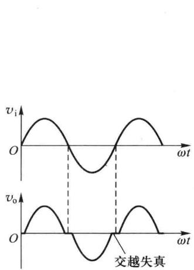  

图 2.8.4 乙类互补对称电路的交越失真

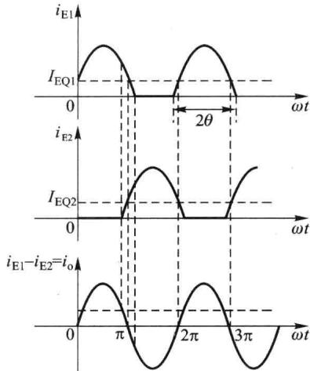  

图 2.8.5 甲乙类互补对称电路的电流波形

甲乙类互补对称电路的偏置电路除了在直流时要为电路设置合适的静态工作点外，在交流时应能保证两管基极激励信号幅度基本相等，使 $v_{0}$ 的正、负峰值对称。

常用的两种偏置电路如图2.8.6所示。在图2.8.6（a）中， $\mathrm{T}_{3}$ 为甲类共射放大电路，组成前置放大级， $\mathrm{T}_{1}, \mathrm{T}_{2}$ 为互补输出级，在 $\mathrm{T}_{1}, \mathrm{T}_{2}$ 两管的基极间接入二极管 $\mathrm{D}_{1}, \mathrm{D}_{2}$ ，作为直流偏置电路， $R_{\mathrm{C}}$ 是 $\mathrm{T}_{3}$ 的集电极负载，也是 $\mathrm{D}_{1}, \mathrm{D}_{2}$ 的限流电阻。静态时利用 $\mathrm{T}_{3}$ 的静态电流 $I_{\mathrm{C3}}$ 流过 $\mathrm{D}_{1}, \mathrm{D}_{2}$ 产生的直流电压降为 $\mathrm{T}_{1}, \mathrm{T}_{2}$ 提供直流偏置电压，使 $\mathrm{T}_{1}, \mathrm{T}_{2}$ 微导通；对于交流，由于 $\mathrm{D}_{1}, \mathrm{D}_{2}$ 的动态电阻很小，远小于 $R_{\mathrm{C}}, \mathrm{T}_{1}, \mathrm{T}_{2}$ 两管基极之间的信号电压降可以忽略，保证了 $\mathrm{T}_{1}, \mathrm{T}_{2}$ 两管激励信号幅度基本相等。

在图 2.8.6(b) 中，在 $T_{1}$ 、 $T_{2}$ 两管的基极间接入 $T_{4}$ 、 $R_{1}$ 、 $R_{2}$ 组成的恒压源，为 $T_{1}$ 、 $T_{2}$ 提供直流偏置。若 $I_{1} \gg I_{\mathrm{BQ4}}$ ，则 $V_{\mathrm{BEQ4}} \approx \frac{R_2}{R_1 + R_2} V_{\mathrm{CEQ4}}$ ，因此 $V_{\mathrm{CEQ4}} = V_{\mathrm{BEQ1}} + V_{\mathrm{EBQ2}} \approx (1 + R_1 / R_2) V_{\mathrm{BEQ4}}$ ，显然， $V_{\mathrm{BE}}$ 扩大了 $(1 + R_1 / R_2)$ 倍后作为偏置电压，故称为 $V_{\mathrm{BE}}$ 倍增电路，调整 $R_1 / R_2$ 的比值，可改变电路的偏置状况。实际上它是电压负反馈电路，直流时 $V_{\mathrm{CEQ4}}$ 很稳定，相当于恒压源为 $\mathrm{T}_{1}, \mathrm{T}_{2}$ 提供合适的直流偏置电压，使 $\mathrm{T}_{1}, \mathrm{T}_{2}$ 微导通；交流时由于 $\mathrm{T}_{4}$ 恒压源的动态电阻很小，其上的电压降可以忽略，保证了 $\mathrm{T}_{1}, \mathrm{T}_{2}$ 两管激励信号幅度基本相等。

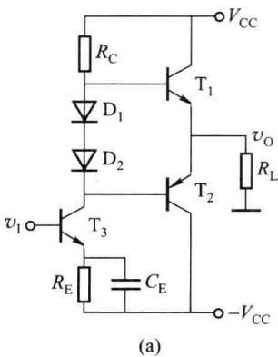

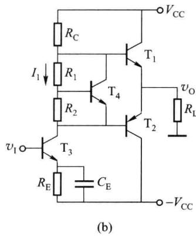  

图 2.8.6 甲乙类互补对称电路的直流偏置电路

### (2) 参数的计算

在甲乙类互补对称电路中,为了避免降低效率,通常使静态 Q 点很低,接近横轴,也就是上面讲的静态时 $T_{1}$ 、 $T_{2}$ 均处于微导通,与乙类互补对称电路的工作情况相近,所以定量计算时,可忽略静态电流的影响,按乙类工作状态进行计算。

采用甲乙类互补对称电路既能减小交越失真,同时又能获得较高的效率,所以在实际工作中得到了广泛的应用。

## 三、单电源供电的互补功率放大电路

### 1. 工作原理

上述甲乙类互补对称电路是双电源供电的，静态时输出端的直流电位为零，负载电阻 $R_{L}$ 中无直流电流通过，因此负载电阻可以与输出端直接相连，采用直接耦合方式，称为OCL（Output Capacitorless）电路。在某些只能由单电源供电的场合，可采用如图2.8.7所示的单电源互补对称电路，这时输出端的直流电位 $V_{K}=V_{CC}/2$ ，所以在输出端和负载电阻之间需要串入隔直电容，采用阻容耦合方式，称为OTL（Output Transformerless）电路。

在图 2.8.7 中, 静态时要求 K 点电位 $V_{K} = V_{CC} / 2$ , 为了提高电路工作点的稳定性, 通常将 K 点通过电阻分压器 $(R_{1}, R_{2})$ 与前置放大电路的输入端相连, 以引入负反馈, 使 $V_{K}$ 趋于稳定。值得指出的是, $R_{1}, R_{2}$ 还引入了交流负反馈, 使放大电路的动态性能指标得到了改善。

直流时通过调节电阻 $R_{1}$ ，使输出端的直流电位 $V_{K}=V_{CC}/2$ ，耦合电容 $C_{2}$ 充有左正、右负的直流电压，大小也为 $V_{CC}/2$ 。

当有信号 $v_{i}$ 时，由于 $T_{3}$ 的反相作用，在信号的负半周， $T_{1}$ 导电，有电流流过负载 $R_{L}$ ，同时向 $C_{2}$ 充电；在信号的正半周， $T_{2}$ 导电， $C_{2}$ 通过负载 $R_{L}$ 放电。只要合理选择 $C_{2}$ ，使其充、放电时间常数远大于信号的周期，则在两管轮流导通时，电容 $C_2$ 两端的电压基本不变，相当于电压为 $V_{\mathrm{cc}} / 2$ 的直流恒压源。这样用电容 $C_2$ 和一个电源就可代替原来正、负两个电源的作用，其中 $\mathrm{T}_{1}$ 的供电电压为 $V_{\mathrm{cc}}$ 和 $V_{\mathrm{cc}} / 2$ 之差，即等于 $V_{\mathrm{cc}} / 2, \mathrm{T}_{2}$ 的供电电压就是 $C_2$ 上的直流电压，也等于 $V_{\mathrm{cc}} / 2$ ，因而 $\mathrm{T}_{1}, \mathrm{T}_{2}$ 的等效供电电压均为 $V_{\mathrm{cc}} / 2$ ，与前面讨论的正、负电源供电的情况是一样的。

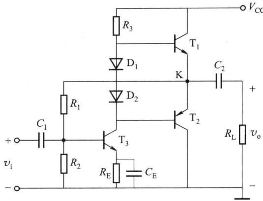  

图 2.8.7 单电源供电的互补对称电路

单电源供电互补对称电路指标的计算和双电源供电电路一样,只需注意计算时应以 $V_{cc}/2$ 代替各相关公式中的 $V_{cc}$ 即可。

### 2. 存在的问题及解决方法

图 2.8.7 所示的 OTL 电路，在理想情况下，当输入信号 $v_{i}$ 为负半周最大值时， $T_{2}$ 截止， $T_{1}$ 饱和， $R_{L}$ 上得到最大的正向输出电压幅度 $V_{om+}=V_{CC}/2-V_{CE(sat)1}\approx V_{CC}/2$ ；当 $v_{i}$ 为正半周最大值时， $T_{2}$ 、 $T_{3}$ 饱和， $R_{L}$ 上得到最大的负向输出电压幅度 $V_{om-}=V_{CC}/2-V_{CE(sat)2}\approx V_{CC}/2$ ，故最大输出电压幅度 $V_{om}\approx V_{CC}/2$ 。但实际的输出电压幅值达不到 $V_{om}\approx V_{CC}/2$ 。

为了提高输出功率,功率管一般都希望有尽可能大的动态范围,所以推动级的功率管一般也工作在尽限运用状态,当输入信号 $v_{i}$ 到达最大或最小值时, $T_{3}$ 正好到达临界饱和或截止状态。

当 $v_{i}$ 为正半周峰值时， $T_{3}$ 临界饱和，此时 $T_{2}$ 导通， $T_{1}$ 截止，K 点有最低电位 $v_{Kmin} = V_{CE(sat)3} + v_{EB2}$ ；当 $v_{i}$ 到达负半周峰值时， $T_{3}$ 临界截止， $T_{1}$ 导通， $T_{2}$ 截止，此时 K 点有最高电位 $v_{Kmax} = V_{CC} - v_{R3} - V_{BE1}$ ，式中 $v_{R3}$ 为 $T_{1}$ 的基极电流在 $R_{3}$ 上的电压降，由于此时 $T_{1}$ 中的电流很大，所以 $v_{R3}$ 也比较大，它限制了 K 点电位的上升，使 K 点的最高电位 $v_{Kmax}$ 比 $V_{CC}$ 小得多，输出信号电压的幅度因此受到限制。K 点的静态电位为 $V_{K} = V_{CC}/2$ ，因此最大的正向、负向输出电压幅度分别为

$$

\begin{array}{r l} & V _ {\mathrm{om+}} = v _ {\mathrm{Kmax}} - V _ {\mathrm{K}} = (V _ {\mathrm{CC}} - V _ {R 3} - V _ {\mathrm{BE1}}) - V _ {\mathrm{CC}} / 2 = V _ {\mathrm{CC}} / 2 - V _ {R 3} - V _ {\mathrm{BE1}} \\ & V _ {\mathrm{om-}} = V _ {\mathrm{K}} - v _ {\mathrm{Kmin}} = V _ {\mathrm{CC}} / 2 - V _ {\mathrm{CE(sat)3}} - v _ {\mathrm{EB2}} \end{array}

$$

由于 $v_{R3}$ 值较大, 故最大正向输出电压幅度小于最大负向输出电压幅度, 致使 $V_{om}$ 明显小于 $V_{cc}/2$ , 较理想时小。

为了提高最大正向输出电压幅度,就必须提高 $v_{Kmax}$ 值,通常采用自举的方法,电路如图2.8.8所示,引入由 $R_{4}$ 、 $C_{3}$ 组成的自举电路。静态时 $C_{3}$ 充有上正下负的电压 $V_{C3}=V_{R3}+V_{BE1}$ ,由于 $C_3$ 的充、放电时间常数远大于信号的周期，所以 $C_3$ 上的电压可近似认为不变，相当于恒压源。在 $v_{\mathrm{i}}$ 负半周， $\mathrm{T}_{1}$ 导通，A点的电位 $v_{\mathrm{A}} = v_{\mathrm{K}} + V_{C3}$ ，因 $V_{C3}$ 固定不变，所以当K点电位上升到最大时，A点的电位也随着上升到最大且值超过 $V_{\mathrm{CC}}$ ，因此 $v_{\mathrm{Kmax}}$ 的数值比未采用 $C_3$ 时要高，使最大正向输出电压幅度得到提高。

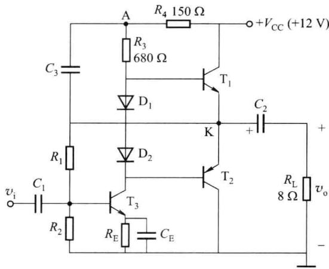  

图 2.8.8 带自举的单电源互补对称电路

$R_{4}$ 的作用是使 A 点的电位不同于 $V_{cc}$ ，否则若 A 点电位固定为 $V_{cc}$ ，其值将不随 $v_{K}$ 而变。由于 A 点电位是通过电容 $C_{3}$ 取自电路自身的输出电压，故这个电路称为自举电路，电容 $C_{3}$ 称为自举电容。

## 2.8.3 准互补输出电路

前述的互补输出电路需要一对特性对称的互补管，由于集成工艺的限制，类型不同的大功率管难以做到特性对称；而且输出管的 $\beta$ 有限，会限制最大输出功率。因此采用复合管结构，即准互补输出电路。

## 一、复合管

所谓的复合管就是把两只或三只晶体管通过一定的方式连接形成的一个等效晶体管，其中的晶体管可以是同类型或不同类型。复合管组成的原则：① 前一只晶体管的集电极或发射极一定要接至后一只晶体管的基极，以实现电流的两次放大；② 保证晶体管都工作在放大区。因此，要求前一只晶体管的输出电流流向必须与后一只晶体管基极电流的流向一致。

图 2.8.9 便是按上述原则构成的 4 种复合管结构图, 前两种由同类型晶体管构成, 后两种由不同类型晶体管构成。

以图 2.8.9(a) 为例讨论复合管的类型及参数。由于复合管电流 $i_{B}=i_{B1}$ 流入基极，故复合管为 NPN 型，即与第一只晶体管类型相同；由图 2.8.9(a) 可得复合管的电流放大系数为

$$

\beta = \frac {I _ {\mathrm{C}}}{I _ {\mathrm{B}}} = \frac {I _ {\mathrm{C1}} + I _ {\mathrm{C2}}}{I _ {\mathrm{B1}}} = \frac {I _ {\mathrm{C1}} + \beta_ {2} I _ {\mathrm{B2}}}{I _ {\mathrm{B1}}} = \frac {I _ {\mathrm{C1}} + \beta_ {2} I _ {\mathrm{E1}}}{I _ {\mathrm{B1}}} = \beta_ {1} + \beta_ {2} (1 + \beta_ {1}) \approx \beta_ {1} \beta_ {2}\tag{2.8.14}

$$

即复合管的电流系数近似等于两管电流放大系数的乘积。

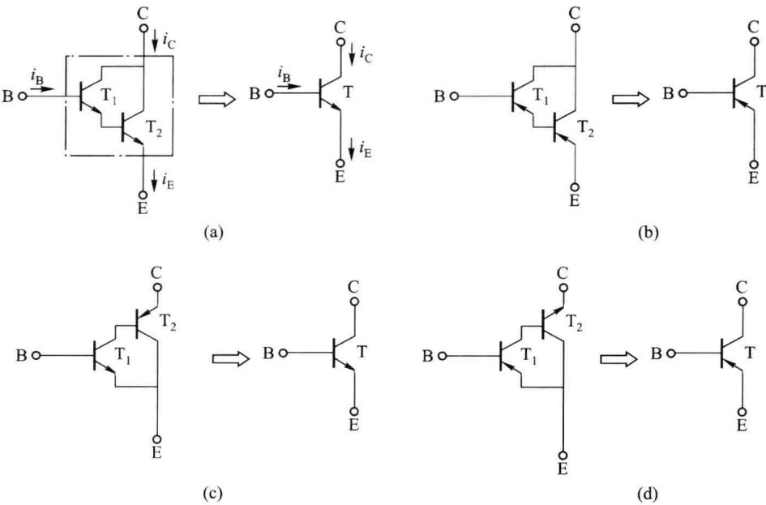  

图 2.8.9 4 种复合管结构

用类似的方法可以得出图 2.8.9(b)、(c)、(d) 所示三只复合管的管型及其等效的 $\beta$ ，其管型如图 2.8.9 中所示，等效 $\beta$ 均为 $\beta \approx \beta_{1} \beta_{2}$ 。

综上所述,复合管有如下特点:① 复合管的管型与第一只管子相同;② 复合管的电流放大系数近似等于两管电流放大系数的乘积。由于复合管是由达林顿提出的,故也称为达林顿管。目前市场上有封装在一个管壳内的达林顿管出售。

但复合管的输入电阻与接法有关,对于由同类型晶体管构成的复合管,如图2.8.9(a)、(b)所示两种接法, $r_{be}=r_{be1}+(1+\beta_{1})r_{be2}$ ;对于由不同类型晶体管构成的复合管,如图2.8.9

(c)、(d)所示两种接法， $r_{be}=r_{bel}$

复合管也有缺点:① $\beta$ 的稳定性差。当温度改变而引起 $\beta_{1}$ 、 $\beta_{2}$ 变化时,复合管由此而产生的 $\beta$ 值的变化比较大,为 $T_{1}$ 和 $T_{2}$ 的 $\beta$ 值相对变化之和,使电路工作点的变化也很剧烈;② 复合管的 $f_{\beta}$ 值比 $T_{1}$ 和 $T_{2}$ 的 $f_{\beta}$ 值低。因为 $T_{1}$ 和 $T_{2}$ 的 $\beta$ 值都会因频率升高而下降,构成复合管后, $\beta$ 的下降将因此而积累,使复合管的 $\beta$ 值下降更多。

## 二、复合管组成的准互补输出电路

图 2.8.10 所示为准互补输出电路， $T_{1}$ 、 $T_{3}$ 组成的 NPN 型复合管和 $T_{2}$ 、 $T_{4}$ 组成的 PNP 型复合管组成互补输出级， $T_{5}$ 、 $R_{1}$ 、 $R_{2}$ 组成的 $V_{BE}$ 倍增电路是其直流偏置元件， $T_{6}$ 是前置放大级，电流源 $I_{0}$ 为其集电极有源负载。之所以称为准互补是因为该电路的输出管

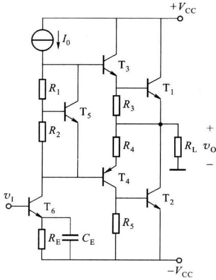  

图 2.8.10 准互补输出电路

$T_{1}$ 、 $T_{2}$ 是同类型管，而互补是由 $T_{3}$ 、 $T_{4}$ 实现的。 $R_{3}$ 、 $R_{5}$ 的主要作用是为 $T_{1}$ 、 $T_{2}$ 的反向漏电流 $I_{CBO}$ 提供泄放通路，以免在 $T_{1}$ 、 $T_{2}$ 结温升高时， $I_{CBO}$ 随温度指数上升，引起 $T_{1}$ 、 $T_{2}$ 的 $I_{CEO}$ 的迅速增大而造成的恶性热循环，提高电路的温度稳定性。

## 2.8.4 功率管的安全工作问题

在功放中,功率管既要流过大电流,又要承受高电压,只有功率管不超过其极限值,电路才能正常工作。因此在实用电路中需要保证功率管的安全工作,通常采取保护措施,以防止功率管过电压、过电流和过功耗。限于篇幅,本小节简单介绍功率管的散热问题、二次击穿和保护措施。

## 一、功率管的散热问题

典型的功率管外形如图 2.8.11 所示。通常功率管有一个大面积的集电结,为了使热传导达到理想的情况,功率管集电极的衬底与它的金属外壳保持良好的接触。

功率管损坏的重要原因是其实际耗散功率超过额定数值 $P_{CM}$ ，而功率管的耗散功率直接表现在使结温（主要是集电结温度） $T_{j}$ 升高，当 $T_{j}$ 超过允许值（锗管一般约为 $85^{\circ}C$ ，硅管

约为 $120 \sim 180^{\circ}C$ ) 后，集电极电流将急剧增大而烧坏管子。耗散功率等于结温在允许值时集电极电流与管压降之积。功率管的功耗越大，结温越高，因此改善功率管的散热条件，如加装散热器或散热片、加用鼓风装置，可以在同样的结温下提高集电极最大耗散功率 $P_{CM}$ ，也就可以提高输出功率。

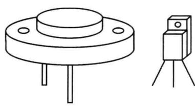  

图 2.8.11 功率管外形图

## 二、功率管的二次击穿

前面讨论了功率管的散热问题,在实际工作中,常发现功率管的功耗并未超过允许的 $P_{CM}$ 值,管身也并不烫,但功率管却突然失效或者性能显著下降。这种损坏的原因,有不少是由于二次击穿所造成的。

### 1. 二次击穿

由晶体管的输出特性可知，对于某一条输出特性曲线，当 $v_{CE}$ 增大到一定数值时，晶体管将产生击穿现象，而且 $I_{B}$ 越大，击穿电压越低，称这种击穿为“一次击穿”。只要适当限制晶体管的电流（或功耗），且进入击穿的时间不长，晶体管并不会损坏，所以一次击穿（雪崩击穿）具有可逆性。晶体管在一次击穿出现后，如果继续增大 $i_{C}$ ，则晶体管的工作点变化到临界点A时，工作点将以毫秒甚至微秒级的高速度从A点到B点，此时电流猛增，而管压降却减小，如图2.8.12(a)所示，称为“二次击穿”。经过二次击穿后，晶体管性能明显下降，甚至造成永久性损坏。

将 $I_{B}$ 不同时的二次击穿临界点连接起来,便得到二次击穿临界曲线,简称为 S/B 曲线,如图 2.8.12(b) 所示。从二次击穿产生的过程可知,防止晶体管的一次击穿,并限制其集电极电流,就可避免二次击穿。例如在功率管的 C-E 间加稳压管,就可防止一次击穿。

产生二次击穿的原因至今尚不完全清楚,二次击穿是一种与电流、电压、功率和结温都有关系的效应。一种比较切合实际的解释是认为,由于晶体管的制造工艺和材料不均匀等原因,使晶体管结面上某个局部位置电流过于集中,该局部位置的温度明显升高而形成所谓“热点”,因而产生热击穿所致。

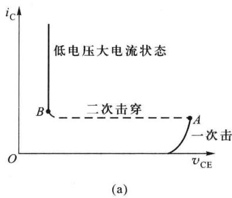

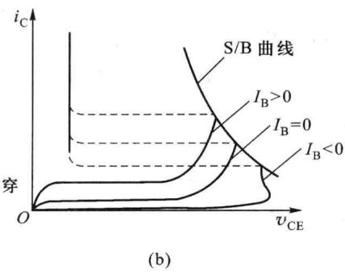  

图 2.8.12 晶体管的二次击穿及其曲线

### 2. 功率管的安全工作区

晶体管的二次击穿特性对功率管，特别是外延型功率管，在运用性能的恶化和损坏方面起着重要影响。为了保证功率管安全工作，必须避免二次击穿。因此，功率管的安全工作区如图2.8.13所示，不仅受3个极限参数 $I_{CM}$ 、 $V_{(BR)CEO}$ 和 $P_{CM}$ 的限制，而且还受到S/B曲线的限制。显然，功率管的安全工作范围变小了。

## 三、提高功率管的可靠性

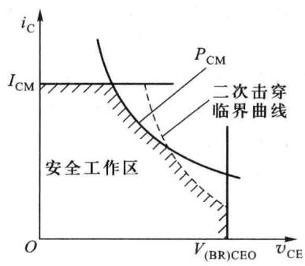  

图2.8.13 由 $I_{\mathrm{CM}}, P_{\mathrm{CM}}$ 、 $V_{(\mathrm{BR})\mathrm{CEO}}$ 和二次击穿

提高功率管可靠性的主要途径是使用时要降低额定值,从可靠性和节约的角度考虑,推荐使用下面几种方法来降低额定值:

临界曲线限制的安全工作区

(1) 在最坏的条件下(包括冲击电压在内), 工作电压不超过极限值的 80%;

(2) 在最坏的条件下(包括冲击电流在内), 工作电流不超过极限值的 80%;

（3）在最坏的条件下（包括冲击功耗在内），工作功耗不超过器件最大工作环境温度下的最大允许功耗的50%；

(4) 工作时, 器件的结温不超过器件允许最大结温的 70% \~ 80%。

降低额定值使用能提高可靠性,但是需要考虑平均损耗。

## 四、功率管的安全使用和保护

### 1. 安全使用

（1）应使功率管工作在安全区内，且必须留有充分的余量。大功率管必须加装散热器以提高 $P_{CM}$ 。

（2）使用时要尽量避免产生过压和过流。不要将负载开路、短路或过载，不要突然加强信号，同时不允许电源电压有较大的波动。

### 2. 采取适当的保护措施

(1) 加入适当的过流、过压保护电路。

（2）为了防止由于感性负载而使功率管产生过压或过流，可在负载两端并联容性网络以抵消感性负载的不利影响。

（3）在功率管的输入端、输出端并联保护二极管或稳压管，当出现瞬时过电压时保护功率管。
