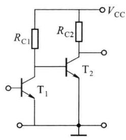
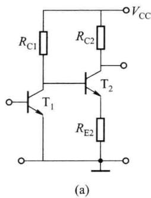
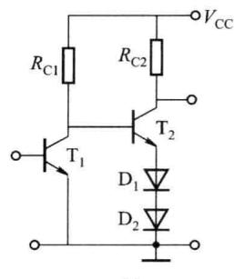
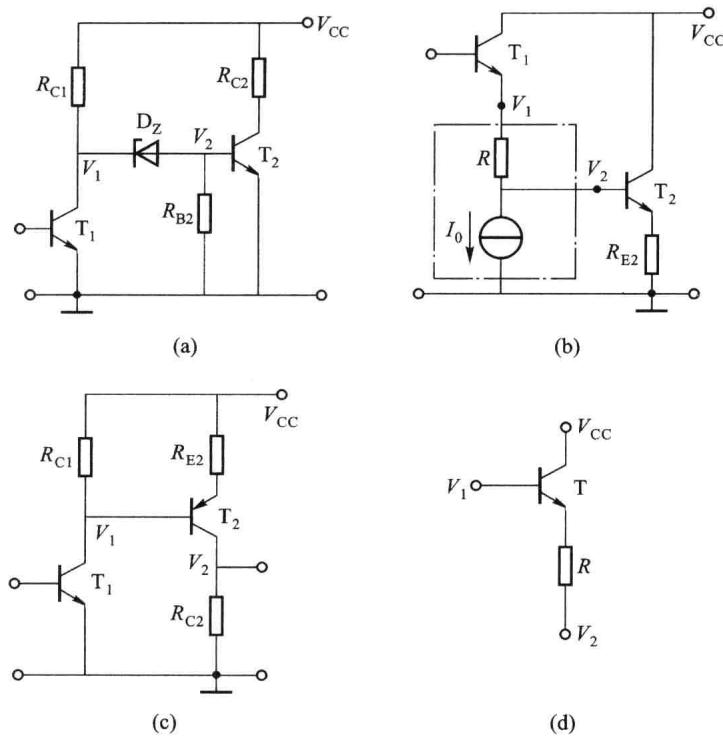
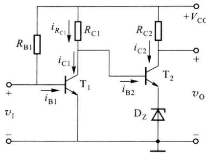
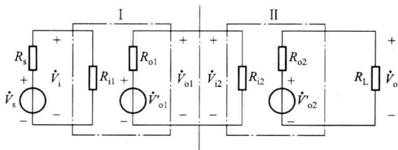
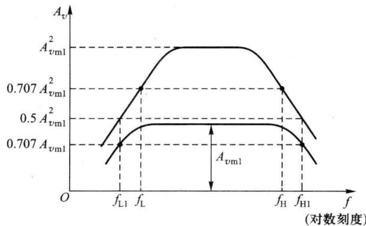
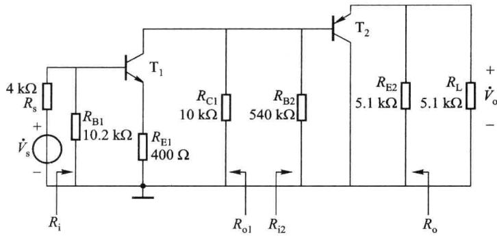
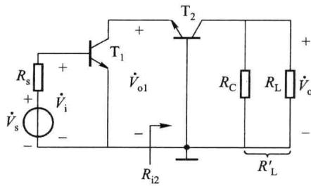
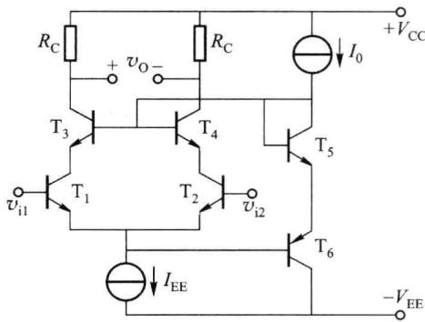

import Guide from '@/components/Guide.astro';
import Knowledge from '@/components/Knowledge.astro';
import Example from '@/components/Example.astro';
import Analysis from '@/components/Analysis.astro';
import Solution from '@/components/Solution.astro';
import Variant from '@/components/Variant.astro';
import Note from '@/components/Note.astro';
import Block from '@/components/Block.astro';
import Method from '@/components/Method.astro';
import Exercise from '@/components/Exercise.astro';

在实际应用中,常对放大电路的性能提出多方面的要求,如获得足够高的增益或考虑输入电阻、输出电阻的特殊要求,仅靠前面所讲的任何一种放大电路都不可能同时满足所有要求,这时就可以选择多个基本放大电路,并将它们合理连接,构成多级放大电路。组成多级放大电路的每一个基本放大电路称为一级,级与级之间的连接方式称为耦合方式。本节将首先介绍多级放大电路的耦合方式,接着介绍直接耦合放大电路存在的问题及解决方法,然后讨论多级放大电路的静态 Q 点和交流指标的计算,最后举例说明其应用。

## 2.9.1 多级放大电路的耦合方式

多级放大电路有三种常见的耦合方式:阻容耦合、变压器耦合和直接耦合。

阻容耦合就是前面介绍的以电容作为耦合元件的电路。其优点是:①各级的静态工作点相互独立;②只要耦合电容容量足够大,放大电路交流信号损失就小,能保证较高的放大倍数。其缺点是:①耦合电容隔断直流,不能放大直流信号和缓慢变化的信号,且当信号频率较低时,放大倍数下降;②耦合电容容量大,不易集成。

变压器耦合是以变压器作为耦合元件的电路。其优点是:① 各级的静态工作点相互独立;② 可进行阻抗变换,使后级或负载上得到最大的功率。其缺点是:① 变压器体积大,无法采用集成工艺;② 对于低频和高频信号,放大效果不理想。

阻容耦合和变压器耦合这两种方式都是交流耦合,主要用于分立元件电路中。

直接耦合也称为直流耦合, 是将前、后级直接或通过阻性网络相连的一种耦合方式, 由于没有电抗元件, 便于集成, 其下限截止频率 $f_{\mathrm{L}} = 0$ , 可用来放大直流信号和缓慢变化的信号, 所以集成电路几乎全部采用直接耦合方式。可见直接耦合的优点是: ① 电路中没有电容和变压器, 易于集成; ② 能放大交流信号, 同时也能放大直流信号和缓慢变化的信号。其缺点是: ① 各级工作点相互影响, 因此必须合理解决级间电平匹配问题; ② 产生零点漂移。

不管采用何种耦合方式,都必须保证:① 各级都有合适的直流工作点;② 前级的输出信号能够顺利地传送到后级的输入端。

由于集成电路的应用越来越广泛,我们主要介绍直接耦合放大电路。下面首先讨论直接耦合所带来的级间直流电位匹配和零点漂移的问题。

## 2.9.2 直接耦合放大电路的问题及解决方法

## 一、级间直流电位匹配问题及解决方法

在直接耦合电路中，前级的静态输出电压是后级的输入偏置电压，该电压的大小需要保证前、后两级晶体管的 $Q$ 点均合适。若将两级电路简单地直接耦合，如图2.9.1所示， $\mathrm{T}_{1}$ 的集电极电位被 $\mathrm{T}_{2}$ 的基极限制在 $0.7\mathrm{V}$ 左右，使 $\mathrm{T}_{1}$ 的 $Q$ 点接近饱和区，因而不能正常放大，这就是级间直流电平匹配问题。因此为使两级都有合适的 $Q$ 点，可以采取两种办法：①抬高后级的直流输入电压；②降低前级的直流输出电压。

图2.9.2所示电路采用的是提高后级射极电位的办法。在图2.9.2(a)中，在 $\mathrm{T}_{2}$ 的射极加入电阻 $R_{\mathrm{E2}}$ ，提高了 $\mathrm{T}_{1}$ 的集电极电位，使其工作于放大状态，但 $R_{\mathrm{E2}}$ 的加入会降低第二级的增益。用二极管或稳压管代替电阻 $R_{\mathrm{E2}}$ 可以解决这一问题，如图2.9.2(b)所示，直流时利用二极管的正向导通电压降或稳压管的稳压值 $V_{\mathrm{Z}}$ 可提高 $\mathrm{T}_{1}$ 的集电极电位，交流时由于二极管或稳压管的动态电阻小，使第二级的增益不致损失太大。但是随着级数的增多，越往后级，其基极静态电位越高，相应的集电极电位也就越高，最终由于电源电压 $V_{\mathrm{CC}}$ 的限制而无法实现。

  

图 2.9.1 两级电路简单地直接耦合

  

图 2.9.2 采用提高后级射极电位的方法实现级间电位匹配

解决这个问题的办法是采用直流电平移动电路，就是一种能将直流电平按需要从高降到低但交流信号的损失又尽可能小的电路，其实就是降低前级的直流输出电压，如图2.9.3所示。图2.9.3(a)中将稳压管串联在两级间，使直流电位下降 $V_{z}$ 值，而稳压管的交流电阻小，信号在稳压管上几乎没有电压降，同时解决了电位逐级抬高的问题。稳压管也可用多个二极管正向串联来代替。其缺点是稳压管的噪声较大。图2.9.3(b)所示是用电阻R和电流源 $I_{0}$ 组成直流电平移动电路，电平移动值 $V_{1}-V_{2}\approx I_{0}R$ ，由于电流源的动态电阻、第二级的输入电阻均比R大得多，因而电阻R上的信号电压降可以忽略，可见是利用电流源的高阻特性以避免信号的损失，在频率较高、分布电容的影响较大时，不宜采用。图2.9.3(c)所示是利用PNP型管实现直流电平移动的电路，由于PNP型管工作于放大区时 $V_{c}<V_{B}$ ，将静态电位由 $V_{1}$ 移至 $V_{2}$ ，也不存在电位逐级抬高的问题，这种电路简单，电平移动值可灵活设计，应用较多。图2.9.3(d)所示是利用射极跟随器实现的直流电平移动电路，不仅可以按照需要调整直流电位，同时其增益近似为1，不影响信号的传输，还能起到各放大级之间互相隔离的作用。

## 二、零点漂移问题及解决方法

这是直接耦合电路最突出的问题。如果将直接耦合放大电路的输入端短路，其输出端应有一固定的直流电压，即静态输出电压。但是实际上输出电压将随时间偏离初始值而缓慢地随机波动，这种现象称为零点漂移。零点漂移就是工作点的漂移。产生零点漂移的主要原因是放大电路中器件的参数随温度变化而变化，导致放大电路的静态工作点不稳定。这种不稳定可看作缓慢变化的干扰信号，被放大电路逐级传递并放大。在输出端零点漂移和有用信号叠加在一起，可能将有用信号淹没，严重时甚至使后级电路进入饱和或截止状态,放大电路无法正常工作。放大电路的级数越多,零点漂移问题越严重。很明显,输入级的零点漂移影响最大,因为它传送到输出端所获增益最大,所以应选择漂移很小的单元电路作输入级。由于差放电路能抑制零点漂移,因此一般模拟集成电路均采用差放电路作输入级。

  

图 2.9.3 常用的直流电平移动电路

## 2.9.3 多级放大电路静态工作点的确定

对于多级放大电路,各级静态工作点的选择又各有所侧重。对于输入级,由于输入及输出电压都比较小,静态集电极电流允许小一些;从减小噪声的角度来考虑,输出级的输出信号功率较大,即输出电压和输出电流的幅度都比较大,所以输出级的静态工作点应该高一些;中间放大级的工作点,一般处于二者之间。从提高放大电路增益的角度来考虑,应该使各级的静态工作点适当提高一些,但是如果放大电路的直流电源功耗是个重要的问题,从减小直流功耗来考虑,则又应将各级Q点适当降低。总之,各级的工作点要根据具体情况,兼顾到多方面的要求合理选择。

直接耦合放大电路静态工作点的计算过程比阻容耦合电路复杂。由于前、后级之间存在直流通路，因此它们的静态工作点互相有影响，而不能各级独立计算。在分析具体的电路时，为了简化计算过程，常常首先找出最容易确定的环节，然后再计算其他各处的静态电位和电流，有时只能通过解联立方程来求解。

<Example title="例 2.9.1">
两级直接耦合放大电路如图 2.9.4 所示, 已知 $V_{CC} = 24 \, V, R_{B1} = 240 \, k\Omega, R_{C1} =$

3.9 kΩ, $R_{C2}=500$ kΩ, 稳压管 $D_{z}$ 的 $V_{z}=4$ V, 晶体管 $T_{1}$ 、 $T_{2}$ 的 $V_{BEQ}=0.7$ V, $\beta_{1}=45$ , $\beta_{2}=40$ , 试计算各级的静态工作点 Q 点。

  

图2.9.4 例2.9.1的电路

<Solution title="解">
由图可得

$$

V _ {\mathrm{CQ1}} = V _ {\mathrm{CEQ1}} = V _ {\mathrm{BQ2}} = V _ {\mathrm{BEQ2}} + V _ {\mathrm{Z}} = (0. 7 + 4) \mathrm{V} = 4. 7 \mathrm{V}

$$

因此

$$

I _ {R _ {\mathrm{C1}}} = \frac {V _ {\mathrm{CC}} - V _ {\mathrm{CQ1}}}{R _ {\mathrm{C1}}} = \frac {2 4 - 4 . 7}{3 . 9} \mathrm{mA} = 4. 9 5 \mathrm{mA}

$$

而

$$

I _ {\mathrm{BQ1}} = \frac {V _ {\mathrm{CC}} - V _ {\mathrm{BEQ1}}}{R _ {\mathrm{B1}}} = \frac {2 4 - 0 . 7}{2 4 0} \mathrm{mA} \approx 0. 0 9 7 \mathrm{mA}

$$

$$

I _ {\mathrm{CQ1}} = \beta_ {1} I _ {\mathrm{BQ1}} = 4 5 \times 0. 0 9 7 \mathrm{mA} = 4. 3 7 \mathrm{mA}

$$

则

$$

I _ {\mathrm{BQ2}} = I _ {R _ {\mathrm{C1}}} - I _ {\mathrm{CQ1}} = (4. 9 5 - 4. 3 7) \mathrm{mA} = 0. 5 8 \mathrm{mA}

$$

$$

I _ {\mathrm{CQ2}} = \beta_ {2} I _ {\mathrm{BQ2}} = 4 0 \times 0. 5 8 \mathrm{mA} = 2 3. 2 \mathrm{mA}

$$

所以

$$

V _ {\mathrm{O}} = V _ {\mathrm{CQ2}} = V _ {\mathrm{CC}} - I _ {\mathrm{CQ2}} R _ {\mathrm{C2}} = (2 4 - 2 3. 2 \times 0. 5) \mathrm{V} = 1 2. 4 \mathrm{V}

$$

$$

V _ {\mathrm{CEQ2}} = V _ {\mathrm{CQ2}} - V _ {\mathrm{EQ2}} = (1 2. 4 - 4) \mathrm{V} = 8. 4 \mathrm{V}

$$
</Solution>
</Example>

## 2.9.4 多级放大电路交流指标的计算

图 2.9.5 所示为两级放大电路的框图。前级的输出电压就是后级的输入电压，即 $\dot{V}_{o1} = \dot{V}_{i2}$ ，所以总的电压增益为

$$

\dot {A} _ {v} = \frac {\dot {V} _ {\mathrm{o}}}{\dot {V} _ {\mathrm{i}}} = \frac {\dot {V} _ {\mathrm{o1}}}{\dot {V} _ {\mathrm{i}}} \cdot \frac {\dot {V} _ {\mathrm{o}}}{\dot {V} _ {\mathrm{o1}}} = \frac {\dot {V} _ {\mathrm{o1}}}{\dot {V} _ {\mathrm{i}}} \cdot \frac {\dot {V} _ {\mathrm{o}}}{\dot {V} _ {\mathrm{i2}}} = \dot {A} _ {v 1} \cdot \dot {A} _ {v 2}\tag{2.9.1}

$$

  

图 2.9.5 两级放大电路框图

依次类推，n 级放大电路的总电压增益为

$$

\dot {A} _ {v} = \dot {A} _ {v 1} \cdot \dot {A} _ {v 2} \cdot \dots \cdot \dot {A} _ {v n}\tag{2.9.2}

$$

其幅频特性与相频特性分别为

$$

\mid \dot {A} _ {v} \mid = \mid \dot {A} _ {v 1} \mid \cdot \mid \dot {A} _ {v 2} \mid \cdot \dots \cdot \mid \dot {A} _ {v n} \mid\tag{2.9.3}

$$

$$

\varphi = \varphi_ {1} + \varphi_ {2} + \dots + \varphi_ {n}\tag{2.9.4}

$$

式(2.9.2)表明,多级放大电路总的电压增益等于组成它的各级放大电路电压增益的乘积,因此可采用分级计算的方法。只是在进行单级计算时必须考虑级与级之间的相互影响:对后级来说,前级相当于信号源,其输出阻抗就是等效信号源的内阻抗;对前级来说,后级相当于负载,其输入阻抗就是前级的负载阻抗。所以每一级增益均应该是以后级的输入阻抗作为负载阻抗时的增益。

其实由图 2.9.5 还可写出总电压增益的另一种形式

$$

\dot {A} _ {v} = \frac {\dot {V} _ {\mathrm{o}}}{\dot {V} _ {\mathrm{i}}} = \frac {\dot {V} _ {\mathrm{ol}} ^ {\prime}}{\dot {V} _ {\mathrm{i}}} \cdot \frac {\dot {V} _ {\mathrm{o}}}{\dot {V} _ {\mathrm{ol}} ^ {\prime}} = \dot {A} _ {v \mathrm{ol}} \cdot \dot {A} _ {v \mathrm{s2}}\tag{2.9.5}

$$

其中 $\dot{A}_{vol}$ 是第一级负载开路时的开路电压增益， $\dot{A}_{vs2}$ 是第二级源电压增益。同样可推广到 n 级放大电路。式(2.9.1)和式(2.9.5)体现了计算多级放大电路增益的两种方法，后一种方法是将前级的开路电压和输出电阻作为后级的信号源来考虑，两者的效果是一样的。通常采用前一种方法，即将后级的输入电阻作为前级的负载来考虑。

根据放大电路输入电阻的定义,多级放大电路的输入电阻就是其第一级的输入电阻;根据放大电路输出电阻的定义,多级放大电路的输出电阻等于最后一级的输出电阻。应当注意,当共集放大电路作为第一级时,它的输入电阻与其负载,即第二级的输入电阻有关;而当共集放大电路作为最后一级时,它的输出电阻与其信号源内阻,即倒数第二级的输出电阻有关。

现在来分析两级完全相同放大电路的通频带与其单级电路通频带的关系，如图2.9.6所示。设每级的中频电压增益为 $A_{vml}$ ，则每级的上限频率 $f_{H1}$ 和下限频率 $f_{L1}$ 对应的电压增益为 $0.707A_{vml}$ ，两级放大电路的上、下限频率就不能再取 $f_{H1}$ 和 $f_{L1}$ 了，因为在这两个频率的电压增益将是 $(0.707A_{vml})^{2}=0.5A_{vml}^{2}$ 了。根据放大电路通频带的定义，两级放大电路的下限频率 $f_{L}$ 和上限频率 $f_{H}$ 都是对应于电压增益为 $A_{v}=0.707A_{vml}^{2}$ 的频率。显然， $f_{L}>f_{L1},f_{H}<f_{H1}$ ，即两级电路的通频带变窄了（其具体计算详见第四章）。从两级放大电路的通频带可以推知，多级放大电路的通频带一定比它的任何一级都窄，级数越多，则 $f_{L}$ 越高、 $f_{H}$ 越低，通频带越窄。这就是说，将几级放大电路串联起来后，总电压增益虽然提高了，但是通频带变窄了，这是多级放大电路一个重要的概念。

  

图 2.9.6 单级和两级放大电路的通频带

<Example title="例 2.9.2">
图 2.9.7 所示为两级放大电路的交流通路，已知 $\beta_{1} = \beta_{2} = 50, r_{bel} = 1.6 \, k\Omega, r_{be2} = 1.3 \, k\Omega$ ，试求 $\dot{A}_{v}, \dot{A}_{vs}, R_{i}, R_{o}$ 。

  

图2.9.7 例2.9.2的电路

<Solution title="解">
由图 2.9.6 可知

$$

R _ {\mathrm{i}} = R _ {\mathrm{B1}} / / \left[ r _ {\mathrm{bel}} + (1 + \beta_ {1}) R _ {\mathrm{E1}} \right] = 6. 9 7 \mathrm{k} \Omega

$$

$$

R _ {\mathrm{i2}} = R _ {\mathrm{B2}} / / \left[ r _ {\mathrm{be2}} + (1 + \beta_ {2}) \left(R _ {\mathrm{E2}} / / R _ {\mathrm{L}}\right) \right] = 1 0 5. 6 5 \mathrm{k} \Omega

$$

则

$$

\dot {A} _ {_ {v 1}} = - \frac {\beta_ {_ {1}} (R _ {_ {C 1}} / / R _ {_ {i 2}})}{r _ {_ {b e 1}} + (1 + \beta_ {_ {1}}) R _ {_ {E 1}}} = - \frac {5 0 \times \left(\frac {1 0 \times 1 0 5 . 6 5}{1 0 + 1 0 5 . 6 5}\right)}{1 . 6 + (1 + 5 0) \times 0 . 4} = - 2 0. 7 6

$$

$$

\dot {A} _ {v 2} = \frac {(1 + \beta_ {2}) (R _ {\mathrm{E2}} / / R _ {\mathrm{L}})}{r _ {\mathrm{be2}} + (1 + \beta_ {2}) (R _ {\mathrm{E2}} / / R _ {\mathrm{L}})} = \frac {(1 + 5 0) \times \left(\frac {5 . 1 \times 5 . 1}{5 . 1 + 5 . 1}\right)}{1 . 3 + (1 + 5 0) \times \left(\frac {5 . 1 \times 5 . 1}{5 . 1 + 5 . 1}\right)} = 0. 9 9

$$

$$

\dot {A} _ {v} = \dot {A} _ {v 1} \cdot \dot {A} _ {v 2} = - 2 0. 7 6 \times 0. 9 9 = - 2 0. 5 5

$$

$$

\dot {A} _ {\mathrm{vs}} = \frac {R _ {\mathrm{i}}}{R _ {\mathrm{i}} + R _ {\mathrm{s}}} \cdot \dot {A} _ {\mathrm{v}} = \frac {6 . 9 7}{6 . 9 7 + 4} \times (- 2 0. 5 5) = - 1 3. 0 6

$$

$$

R _ {\mathrm{o}} = R _ {\mathrm{E2}} / / \frac {r _ {\mathrm{be2}} + R _ {\mathrm{B2}} / / R _ {\mathrm{o1}}}{1 + \beta_ {2}} = R _ {\mathrm{E2}} / / \frac {r _ {\mathrm{be2}} + R _ {\mathrm{B2}} / / R _ {\mathrm{C1}}}{1 + \beta_ {2}} = 0. 2 \mathrm{k} \Omega

$$
</Solution>
</Example>

## 2.9.5 多级放大电路应用举例

由于晶体管三种基本组态放大电路各有优缺点,实际应用中常将它们进行适当的组合,扬长避短,发挥其各自的优点,获得更佳的电路性能。

## 一、共射-共基两级放大电路

其交流通路如图2.9.8所示，晶体管 $\mathrm{T}_{1}$ 、 $\mathrm{T}_{2}$ 分别组成共射、共基组态。为了简便，设 $\mathrm{T}_{1}$ 、 $\mathrm{T}_{2}$ 两管参数相同， $\beta_{1} = \beta_{2} = \beta ,r_{\mathrm{bb^{\prime}1}} = r_{\mathrm{bb^{\prime}2}} = r_{\mathrm{bb^{\prime}}}$ ，忽略 $r_\mathrm{ce}$ ，一般静态时 $I_{\mathrm{EQ1}}\approx I_{\mathrm{EQ2}}$ ，则 $r_{\mathrm{be1}} = r_{\mathrm{be2}} = r_{\mathrm{be}}$ 。

由图 2.9.8 可知, $T_{1}$ 的负载电阻就是 $T_{2}$ 的输入电阻 $R_{i2}$ , 可得

$$

\dot {A} _ {v 1} = - \frac {\beta R _ {\mathrm{i2}}}{r _ {\mathrm{be}}} = - \frac {\beta [ r _ {\mathrm{be}} / (1 + \beta) ]}{r _ {\mathrm{be}}} \approx - 1

$$

  

图 2.9.8 共射-共基两级放大电路的交流通路

$$

\dot {A} _ {v 2} = \frac {\beta R _ {\mathrm{L}} ^ {\prime}}{r _ {\mathrm{be}}}

$$

所以

$$

\dot {A} _ {v} = \dot {A} _ {v 1} \cdot \dot {A} _ {v 2} \approx - \frac {\beta R _ {\mathrm{L}} ^ {\prime}}{r _ {\mathrm{be}}}\tag{2.9.6}

$$

$$

R _ {\mathrm{i}} = r _ {\mathrm{be}}\tag{2.9.7}

$$

$$

R _ {\mathrm{o}} = R _ {\mathrm{C}}\tag{2.9.8}

$$

可见共射-共基两级放大电路的电压增益与单级共射电路相同。它最突出的特点是高频特性好、频带宽。由于共射电路的上限频率远小于共基电路，因此两级电路的上限频率主要取决于共射电路；而两级电路利用共基电路输入阻抗小的特性，将它作为共射电路的负载，就可以有效地克服共射电路的密勒倍增效应，从而扩展共射电路的上限频率，因此两级电路的上限频率也随之提高。

也可组成共集-共基两级放大电路，其高频特性好，这是因为共集与共基电路都有好的高频特性。对于单端输入、从另一只晶体管单端输出的差放电路，其交流通路恰为共集-共基两级放大电路。

实用中还经常采用共集-共射两级放大电路，其主要优点是输入阻抗高和高频特性好。由于共集电路的上限频率远大于共射电路，故组合电路的上限频率主要取决于共射电路；同时组合电路利用共集电路输出阻抗小的特性，将其作为共射电路的源阻抗 $R_{s}$ ，就能有效地扩展共射电路的上限频率，从而使共集-共射放大电路有较高的上限频率。

这几种多级放大电路的高频特性较好,广泛应用于宽带放大电路中。

## 二、差放电路中的共射-共基两级放大电路

在图 2.9.9 所示电路中， $T_{1} \sim T_{4}$ 为采用两级放大电路的差分对管，其半边电路即是前面

讨论的共射-共基放大电路， $\mathrm{T}_{5}$ 、 $\mathrm{T}_{6}$ 及电流源 $I_{0}$ 组成共模自举电路，利用 $\mathrm{T}_{5}$ 、 $\mathrm{T}_{6}$ 两管的导通电压降将 $\mathrm{T}_{1}$ 、 $\mathrm{T}_{2}$ 两管的 $v_{\mathrm{CE}}$ 钳位在 $0.7\mathrm{V}$ 左右，使其 $v_{\mathrm{CB}} \approx 0$ 。因此共模自举电路有如下优点。

（1）当共模输入电压 $v_{IC}$ 在 $V_{ICM}$ 范围内大幅度变化时，由于 $T_{1}$ 、 $T_{2}$ 两管 $v_{CB} \approx 0$ ， $T_{1}$ 、 $T_{2}$ 基本上感受不到共模电压的作用，使 $K_{CMR}$ 大大提高。共模电压的变化全部由 $T_{3}$ 、 $T_{4}$ 管承担。

（2）由于 $T_{1}$ 、 $T_{2}$ 管的 $v_{CB} \approx 0$ ，其 $I_{CBO} \approx 0$ ，大大减小了 $I_{CBO}$ 对差放输入失调电流及其温漂的不利影响。

  

图 2.9.9 共射-共基差放电路

（3）如果 $T_{1}$ 、 $T_{2}$ 是超 $\beta$ 管，其 $V_{(BR)CEO}$ 只有 3\~5 V 很小，则该共模自举电路起保护作用，以免发射结被击穿。
