import Guide from '@/components/Guide.astro';
import Knowledge from '@/components/Knowledge.astro';
import Example from '@/components/Example.astro';
import Analysis from '@/components/Analysis.astro';
import Solution from '@/components/Solution.astro';
import Variant from '@/components/Variant.astro';
import Note from '@/components/Note.astro';
import Block from '@/components/Block.astro';
import Method from '@/components/Method.astro';
import Exercise from '@/components/Exercise.astro';

像晶体管有 NPN 和 PNP 之分一样,根据导电沟道和载流子类型的不同,MOS 场效应管(简称 MOS 管)有 N 沟道、P 沟道两类。同时,根据没有外加电压时,MOS 管内是否有初始导电沟道,又有增强型和耗尽型之分。

## 3.1.1 增强型 MOS 场效应管

增强型 MOS 管没有初始导电沟道,导电沟道需外加足够的偏置电压才能够建立。

一、N 沟道增强型 MOS 管的结构(简称增强型 NMOS 管)

图 3.1.1(a) 为增强型 NMOS 管的结构示意图。图 3.1.1(b) 为其符号。

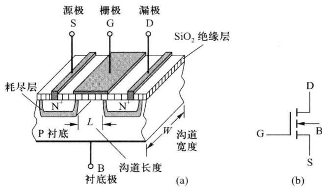  

图 3.1.1 增强型 NMOS 管的结构示意和符号

增强型NMOS管是在一块掺杂浓度相对较低的P型半导体衬底上用半导体的扩散工艺形成两块高掺杂的 $\mathrm{N}^{+}$ 区，分别作为源区和漏区，在其上蒸镀金属并引出电极分别作为源极S和漏极D。在衬底和两个 $\mathrm{N}^{+}$ 区上氧化形成一层二氧化硅绝缘层，在两个 $\mathrm{N}^{+}$ 区之间的绝缘层上再蒸镀一层金属并引出电极作为栅极G。在工作时，源区、漏区之间及绝缘层的下方形成导电沟道，导电沟道的厚度和形状受到栅、源极之间电压 $v_{\mathrm{GS}}$ 及漏、源极之间电压 $v_{\mathrm{DS}}$ 的影响，输出电流 $i_{\mathrm{D}}$ 也随 $v_{\mathrm{GS}}, v_{\mathrm{DS}}$ 的改变而变化。导电沟道的宽度 $W$ 与长度 $L$ 的比值 $(W / L)$ 对MOS管的性能有着较大的影响。

## 二、增强型NMOS管的基本工作原理

第二章中我们已经知道,晶体管可以看成是一个双端口网络,如图3.1.2(a)所示,其端口电压的大小和方向确定了晶体管的工作状态(放大、截止、饱和、倒置)。与晶体管类似,MOS管的端口电压的大小与方向会影响沟道的形状和长度,使其工作于不同状态,共源组态的NMOS管的端口电压电流方向如图3.1.2(b)所示。

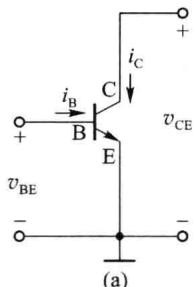

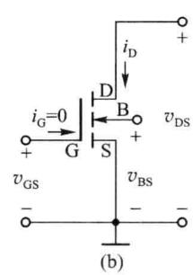

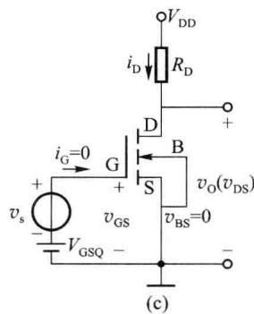  

图 3.1.2 晶体管共射组态和 NMOS 管共源组态

与晶体管不同的是，NMOS管多了一个衬底B。在场效应管正常应用时，漏极D、源极S与衬底B之间的PN结不应出现正向导通的情况，这要求NMOS管的衬源电压 $v_{\mathrm{BS}}$ 应满足 $v_{\mathrm{BS}} \leqslant 0$ 。单个的增强型NMOS管构成放大电路时，通常将衬底与源极短接，即令 $v_{\mathrm{BS}} = 0$ 。图3.1.2(c)是使用单独NMOS管构成的基本共源放大电路，可将衬底和源极连接在一起。而在集成电路中，由于所有MOS管的衬底是公共的，对于增强型NMOS电路，衬底应接最低电位，以保证所有MOS管的PN结都反偏。

### 1. 栅源电压 $v_{GS}$ 对 MOS 管沟道的影响

将源极与衬底直接连接，并令漏源之间电压 $v_{DS}=0$ ，在栅、源极间（同时也是在栅极和衬底之间）加有电压 $v_{GS}>0$ 时，栅极与源极之间、栅极与漏极之间以及栅极与衬底之间形成电场，在这一纵向电场作用下，P 型衬底中的自由电子向栅极方向运动，与绝缘层下方的空穴复合，使栅极下方的 P 型半导体中出现一层耗尽层，如图 3.1.3(a) 所示。当 $v_{GS}$ 再增加，更多的自由电子到达并集聚在栅极下方，使栅极下方区域 P 型半导体中的自由电子的浓度超过空穴浓度，这时该区域的半导体由原来的 P 型转为 N 型，称这个区域的半导体为反型层。反型层作为导电沟道将漏区、源区（均为 $N^{+}$ 型）连通，如图 3.1.3(b) 所示。进一步增加 $v_{GS}$ ，反型层的厚度将增加，如图 3.1.3(c) 所示。

当栅极板下刚刚开始出现反型层时的栅源电压 $v_{GS}$ 称为 MOS 管的开启电压，用 $V_{GS(th)}$ 表

示,简写为 $V_{th}$ 。开启电压的大小由增强型 NMOS 管的材料、工艺参数决定。

(a) $0 < v_{\mathrm{DS}} < v_{\mathrm{GS}} - V_{\mathrm{th}}$ $(v_{\mathrm{GD}} > V_{\mathrm{th}})$  

(c) $v_{\mathrm{DS}} > v_{\mathrm{GS}} - V_{\mathrm{th}}$ $(v_{\mathrm{GD}} <   V_{\mathrm{th}})$  

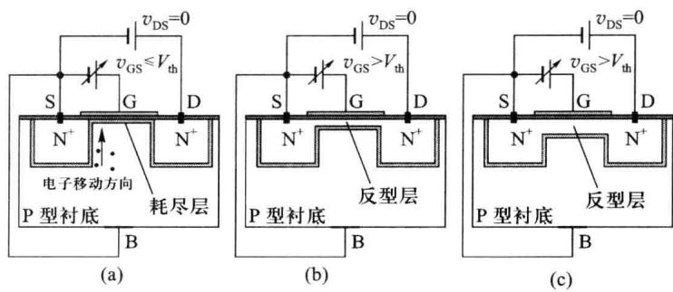  

图 3.1.3 栅源电压 $v_{GS}$ 对导电沟道的影响 ( $v_{DS}=0$ 时)

### 2. 漏源电压 $v_{DS}$ 对 MOS 管沟道的影响

由图3.1.3(a)可见，在 $v_{\mathrm{GS}} = 0$ 或 $v_{\mathrm{GS}} < V_{\mathrm{th}}$ 时，漏区、源区 $(\mathbf{N}^{+})$ 之间没有沟道形成，漏、源区之间为NPN结构，相当于有两个对接的PN结，在漏极和源极之间加电压 $v_{\mathrm{DS}}$ 时，总有一个PN结为反向偏置，因此漏源电流 $i_{\mathrm{D}}$ 基本为零。此状态称为MOS管的截止状态，也就是场效应管工作于截止区。

如果 $v_{GS}>V_{th}$ 使导电沟道形成后，在漏、源极之间施加电压 $v_{DS}$ ，当 $v_{DS}$ 由零正向增大时，栅、漏极间电压将小于栅、源极之间的电压，即 $v_{GS}-v_{DS}=v_{GD}<v_{GS}$ （此时保持栅、漏极之间的电压仍大于 $V_{th}$ ），这使得沟道靠近漏极一侧吸引自由电子的数量少于源极一侧，靠近漏区的导电沟道将变得相对较薄，沟道呈楔形状，如图 3.1.4(a) 所示。随着 $v_{DS}$ 的继续增加，电流 $i_{D}$ 也随之增大，栅、漏极间电压将变得更小，导电沟道靠近漏区的一侧变得更薄。此时场效应管工作于可变电阻区。

当 $v_{DS}$ 增大到恰使栅、漏极之间电压 $v_{GD}$ 等于开启电压 $V_{th}$ ，靠近漏区一侧的反型层完全消失，退为耗尽层，即导电沟道在该位置点被耗尽层夹断，称此状态为预夹断。此时， $v_{GD} = v_{GS} - v_{DS} = V_{th}$ 。沟道形状如图 3.1.4(b) 所示。

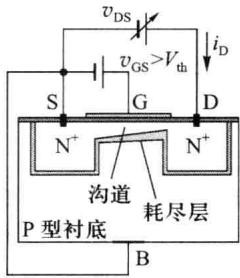

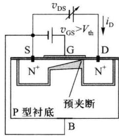

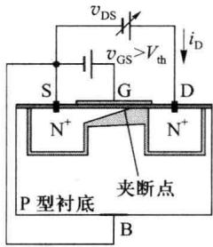  

(b) $v_{\mathrm{DS}} = v_{\mathrm{GS}} - V_{\mathrm{th}}$ $(v_{\mathrm{GD}} = V_{\mathrm{th}})$  

图 3.1.4 漏源电压 $v_{DS}$ 对导电沟道的影响 ( $v_{GS} > V_{th}$ )

在预夹断产生后继续增大 $v_{DS}$ ，使得 $v_{GD} < V_{th}$ ，夹断点向源区的方向移动，靠近漏区一侧的导电沟道被耗尽层夹断的部分增多，沟道长度变短，耗尽层区域长度增加，如图 3.1.4(c)

所示。在 $v_{DS}$ 的作用下，在夹断点与漏极之间的耗尽层上产生较强电场，自由电子由源区沿导电沟道向漏区方向运动并到达夹断点时，被耗尽区内的强电场作用继续向漏区漂移，依然形成漏极电流 $i_{D}$ ，且该漏极电流基本保持预夹断产生时的漏极电流值，即产生预夹断后，漏极电流 $i_{D}$ 基本不随 $v_{DS}$ 的增加而增加，此时场效应管工作于饱和区（或称恒流区）。当 $v_{DS}$ 增大时，栅极到沟道夹断点处的电压总为 $V_{th}$ ，夹断点到源极间的剩余导电沟道上的电压也仍总为 $(v_{\mathrm{GS}}-V_{\mathrm{th}})$ ， $v_{DS}$ 大于 $(v_{\mathrm{GS}}-V_{\mathrm{th}})$ 的增加量主要降在漏、源极之间呈高电阻的耗尽层区域上。

根据上述分析,栅、源极电压 $v_{GS}$ 起着建立导电沟道和控制沟道厚度的作用,漏、源极电压 $v_{DS}$ 改变沟道形状并产生漏极电流 $i_{D}$ 。

由于在漏、源极电压 $v_{DS}$ 作用下，增强型 NMOS 管导电沟道中的主要载流子流为自由电子流，自由电子是 N 沟道及源区、漏区的多数载流子。沟道电流仅由多数载流子流构成，没有少子构成的电流。因而也称场效应管为单极型晶体管。而双极型晶体管中参与导电的载流子既有多子也有少子。由第一章的介绍可知，少子流密度受温度、辐射的影响较大（如 $I_{CBO}$ 、 $I_{CEO}$ 等）。由于没有少子参与导电，场效应管比双极型晶体管具有温度稳定性能好、抗辐射能力强等优点。

## 三、增强型NMOS管的伏安特性曲线

第二章中的晶体管共射组态伏安特性曲线给出了 $i_{\mathrm{B}}$ 和 $v_{\mathrm{BE}}$ 、 $i_{\mathrm{C}}$ 和 $v_{\mathrm{CE}}$ 之间的电流、电压关系，是晶体管应用时的重要依据。对于MOS管，其栅极G由氧化层绝缘，栅极和源极间输入电阻极高，可达 $10^{9}\Omega$ 以上，栅极输入电流极小。因而应用中一般无需分析MOS管栅、源极间的输入电压与输入电流的关系，而是通常用输出特性 $i_{\mathrm{D}} = f(v_{\mathrm{DS}})$ 和转移特性 $i_{\mathrm{D}} = f(v_{\mathrm{GS}})$ 描述MOS管的特性。

### 1. 增强型 NMOS 管的输出特性曲线

与晶体管的共射特性曲线类似，增强型MOS管输出特性曲线给出以输入电压 $v_{\mathrm{GS}}$ 为参变量时输出电流 $i_{\mathrm{D}}$ 与输出电压 $v_{\mathrm{DS}}$ 的关系曲线族。图3.1.5为增强型NMOS管输出特性曲线示意图。图中电流 $i_{\mathrm{D}}$ 的参考方向为流入漏极、流出源极，也是N沟道场效应管工作时 $i_{\mathrm{D}}$ 的实际流向。根据 $i_{\mathrm{D}}$ 和 $v_{\mathrm{DS}},v_{\mathrm{GS}}$ 的关系特点，可在输出特性曲线上分成四个区域：截止区、可变电阻区、饱和区（或称恒流区）和击穿区，分别对应于晶体管的截止区、饱和区、放大区和击穿区。

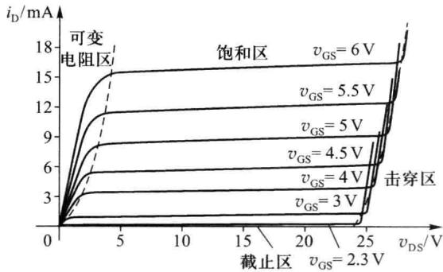  

图 3.1.5 增强型 NMOS 管的输出特性曲线

### (1) 截止区

$v_{GS}<V_{th}$ ，导电沟道尚未形成，漏、源极间电流 $i_{D}$ 很小，漏、源极间呈现很大的电阻。一般应用中可认为 $i_{D}\approx0$ ，漏、源极之间呈断开状态。

研究表明，当 $v_{GS}$ 接近 $V_{th}$ 时，电流 $i_{D}$ 并不无限接近于零，一般可在 $\mu A$ 数量级且 $i_{D}$ 与 $v_{GS}$ 呈指数关系。称这种现象为亚阈区效应。在大规模模拟集成电路中，也会利用 MOS 管的亚阈区进行小信号放大，可在低功耗下获得高增益。本书在后面的分析中，不考虑亚阈区效应，设 $v_{GS} < V_{th}$ 时，漏、源极间电流 $i_{D} = 0$ 。

### (2) 可变电阻区

$v_{GS}>V_{th},v_{GD}>V_{th},v_{DS}<v_{GS}-V_{th}$ 。漏、源区之间存在未被夹断的楔形导电沟道，漏极电流 $i_{D}$ 随 $v_{DS}$ 增加而增大。 $i_{D}$ 和 $v_{DS},v_{GS}$ 的关系可表示为

$$

i _ {\mathrm{D}} = \frac {k _ {\mathrm{p}}}{2} \cdot \frac {\mathrm{W}}{\mathrm{L}} \left[ 2 \left(v _ {\mathrm{GS}} - V _ {\mathrm{th}}\right) v _ {\mathrm{DS}} - v _ {\mathrm{DS}} ^ {2} \right] - v _ {\mathrm{GS}} > V _ {\mathrm{th}}, 0 <   v _ {\mathrm{DS}} \leqslant v _ {\mathrm{GS}} - V _ {\mathrm{th}}\tag{3.1.1}

$$

式(3.1.1)中， $k_{p}=\mu_{n}C_{OX}$ 称为本征导电因子 $(A/V^{2})$ ; $\mu_{n}$ 为沟道中自由电子迁移率 $[cm^{2}/(V\cdot s)]$ ; $C_{OX}$ 为栅极下氧化层的单位面积电容 $(F/cm^{2})$ ; W 为沟道宽度, L 为沟道长度, W/L 为沟道宽长比。

在可变电阻区，MOS管的漏、源极之间可看成是在 $v_{GS}$ 控制下的可变电阻 $R_{on}$ ，其等效电路如图3.1.6(a)、(b)所示。当 $v_{DS}$ 较小时，式(3.1.1)中的二次项 $v_{DS}^{2}$ 可被忽略，式(3.1.1)近似为式(3.1.2)。该式表明在 $v_{DS}$ 较小时， $i_{D}$ 与 $v_{DS}$ 呈近似线性关系，示意图如图3.1.6(c)所示。此时，MOS管漏、源极间受 $v_{GS}$ 控制的等效压控电阻 $R_{on}$ 的阻值由式(3.1.3)给出。

$$

i _ {\mathrm{D}} \approx k _ {\mathrm{p}} \frac {W}{L} (v _ {\mathrm{GS}} - V _ {\mathrm{th}}) v _ {\mathrm{DS}} - v _ {\mathrm{GS}} > V _ {\mathrm{th}}, 0 <   v _ {\mathrm{DS}} \leqslant v _ {\mathrm{GS}} - V _ {\mathrm{th}}\tag{3.1.2}

$$

$$

R _ {\mathrm{on}} = \frac {v _ {\mathrm{DS}}}{i _ {\mathrm{D}}} \approx \frac {1}{k _ {\mathrm{p}} \frac {W}{L} (v _ {\mathrm{GS}} - V _ {\mathrm{th}})}\tag{3.1.3}

$$

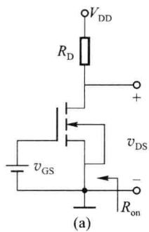

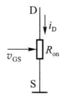  

(b)

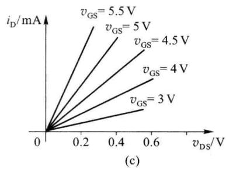  

图 3.1.6 在可变电阻区 MOS 管漏、源极间等效的压控电阻 $R_{on}$

### (3) 饱和区

$v_{GS}>V_{th},v_{GD}<V_{th}$ ，漏、源区之间的导电沟道出现夹断。在产生预夹断之后，漏极电流 $i_{D}$ 基本不随 $v_{DS}$ 的增加而增加，形成饱和区（恒流区）。饱和区与可变电阻区的分界是预夹断状态，在产生预夹断时， $v_{GD}=v_{GS}-v_{DS}=V_{th},v_{DS}=v_{GS}-V_{th}$ ，将 $v_{DS}=v_{GS}-V_{th}$ 带入式(3.1.1)可得式(3.1.4)。该式描述的 $i_{D}$ 是MOS管脱离可变电阻区进入饱和区工作状态后的 $i_{D}$ 值，该值对应 $i_{D}=f(v_{DS})$ 特性曲线上的拐点。

$$

i _ {\mathrm{D}} = \frac {k _ {\mathrm{p}}}{2} \cdot \frac {W}{L} (v _ {\mathrm{GS}} - V _ {\mathrm{th}}) ^ {2} - v _ {\mathrm{GS}} > V _ {\mathrm{th}}, v _ {\mathrm{DS}} = v _ {\mathrm{GS}} - V _ {\mathrm{th}}\tag{3.1.4}

$$

根据前面的分析,沟道夹断后,随着 $v_{DS}$ 的再增大,剩余导电沟道上的电压基本不变。如果仅考虑这一点,在 MOS 管工作进入饱和区后, $i_{D}$ 将保持刚进入饱和区时的数值[由式(3.1.4)表示],即 $i_{D}$ 与 $v_{GS}$ 呈二次函数关系,与 $v_{DS}$ 无关,输出特性曲线是一水平直线。

实际上,随着 $v_{DS}$ 的增大,剩余沟道长度有所缩短,沟道电阻也随之有所减小,这使得饱和区内的 $i_{D}$ 也会随 $v_{DS}$ 增加而稍有增大，称这种现象为沟道长度调制效应。一般沟道长度 L 越短，沟道长度调制效应会越严重。

一般情况下，饱和区内 $i_{D}$ 随 $v_{DS}$ 增加而增大的增量与 $v_{DS}$ 的增量之间呈近似线性关系，为了描述沟道长度调制效应，引入沟道长度调制因子 $\lambda$ 。考虑了沟道长度调制效应后的饱和区漏极电流 $i_{D}$ 如式(3.1.5)所示。 $\lambda$ 数值越大，沟道长度调制效应的影响程度就越严重，饱和区内输出特性曲线的上翘程度也就越大。通常的 $\lambda$ 在 $(0.001 \sim 0.03)/V$ 的范围。

$$

i _ {\mathrm{D}} = \frac {k _ {\mathrm{p}}}{2} \cdot \frac {W}{L} (v _ {\mathrm{GS}} - V _ {\mathrm{th}}) ^ {2} \cdot (1 + \lambda \cdot v _ {\mathrm{DS}}) - v _ {\mathrm{GS}} > V _ {\mathrm{th}}, v _ {\mathrm{DS}} > v _ {\mathrm{GS}} - V _ {\mathrm{th}}\tag{3.1.5}

$$

参照双极型晶体管对基区调宽效应的描述方法，在进行场效应管放大电路交流分析时，也引用厄尔利电压 $V_{A}$ 和微变输出电阻 $r_{ds}$ 来描述沟道长度调制效应。将饱和区内的输出特性曲线向 $v_{DS}$ 的负值方向延长，与 $v_{DS}$ 轴相交于 $-V_{A}$ 点， $V_{A}$ 称为厄尔利电压。 $V_{A}$ 数值越大，饱和区内的 $i_{D}$ 曲线就越平缓，沟道长度调制效应越弱。

根据图 3.1.7, 工作在饱和区内直流工作点为 $(V_{\mathrm{DSQ}}, I_{\mathrm{DQ}})$ 的 MOS 管, 其沟道长度调制效应可等效为漏、源极之间的微变输出电阻 $r_{ds}$ 。由于 $\lambda \approx 1/V_{A}$ , 微变输出电阻 $r_{ds}$ 的表达式为

$$

r _ {\mathrm{ds}} = \frac {\Delta v _ {\mathrm{DS}}}{\Delta i _ {\mathrm{D}}} \Bigg | _ {I _ {\mathrm{DQ} V _ {\mathrm{DSQ}}}} = \frac {V _ {\mathrm{DSQ}} + V _ {\mathrm{A}}}{I _ {\mathrm{DQ}}} \approx \frac {V _ {\mathrm{A}}}{I _ {\mathrm{DQ}}} = \frac {1}{\lambda \cdot I _ {\mathrm{DQ}}}\tag{3.1.6}

$$

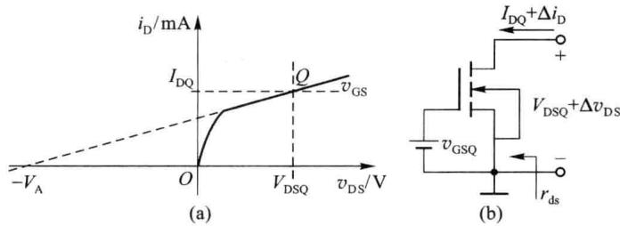  

图 3.1.7 沟道长度调制效应及微变输出电阻 $r_{ds}$

### 2. 增强型 NMOS 管的转移特性曲线

转移特性反映了场效应管在截止区和饱和区内输出电流 $i_{\mathrm{D}}$ 与输入电压 $v_{\mathrm{GS}}$ 的关系。图3.1.8(b)为增强型NMOS管转移特性曲线。在 $v_{\mathrm{GS}} \leqslant V_{\mathrm{th}}$ 的范围，场效应管处于截止区工作， $i_{\mathrm{D}}$ 基本为零。在饱和区内，当 $v_{\mathrm{DS}}$ 为大于 $v_{\mathrm{GS}} - V_{\mathrm{th}}$ 的某一固定值， $i_{\mathrm{D}} = f(v_{\mathrm{GS}}, V_{\mathrm{DSQ}})$ 由式(3.1.5)描述[不考虑沟道长度调制效应时，为式(3.1.4)]，输出电流与输入电压呈二次函数关系。而双极型晶体管在放大工作区时输出电流 $i_{\mathrm{C}}$ 与输入电压 $v_{\mathrm{BE}}$ 呈指数关系。转移特性曲线也可通过输出特性曲线获得，如图3.1.8(a)、(b)所示的对应关系。

为描述输出电流与输入电压的变化量之间的关系,定义微变跨导 $g_{m}$ 为

$$

g _ {\mathrm{m}} = \frac {\Delta i _ {\mathrm{D}}}{\Delta v _ {\mathrm{GS}}} \left| \begin{array}{l} v _ {\mathrm{GS}} = V _ {\mathrm{GSQ}} \\ i _ {\mathrm{D}} = I _ {\mathrm{DQ}} \\ v _ {\mathrm{DS}} = V _ {\mathrm{DSQ}} \end{array} \right.\tag{3.1.7}

$$

$g_{m}$ 反映了在某一直流工作点 $(V_{GSQ}, I_{DQ}, V_{DSQ})$ 基础上场效应管输出电流的变化量受输入电压变化量影响的程度。在转移特性曲线上， $g_{m}$ 是直流工作点位置处的斜率。当场效应管工作在饱和区且不考虑沟道长度调制效应时,根据式(3.1.4)可得

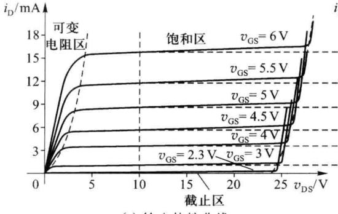  

(a) 输出特性曲线

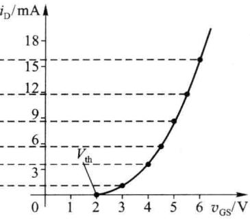  

(b) 转移特性曲线  

图 3.1.8 增强型 NMOS 管的转移特性曲线

$$

g _ {\mathrm{m}} = k _ {\mathrm{p}} \frac {W}{L} (V _ {\mathrm{GSQ}} - V _ {\mathrm{th}}) = \sqrt {2 k _ {\mathrm{p}} \frac {W}{L} I _ {\mathrm{DQ}}} = \frac {2 I _ {\mathrm{DQ}}}{V _ {\mathrm{GSQ}} - V _ {\mathrm{th}}}\tag{3.1.8}

$$

考虑沟道长度调制效应时,根据式(3.1.5)可得

$$

g _ {\mathrm{m}} = k _ {\mathrm{p}} \frac {W}{L} \left(V _ {\mathrm{GSQ}} - V _ {\mathrm{th}}\right) (1 + \lambda V _ {\mathrm{DSQ}}) = \sqrt {2 k _ {\mathrm{p}} \frac {W}{L} I _ {\mathrm{DQ}} (1 + \lambda V _ {\mathrm{DSQ}})} = \frac {2 I _ {\mathrm{DQ}}}{V _ {\mathrm{GSQ}} - V _ {\mathrm{th}}}\tag{3.1.9}

$$

由于式(3.1.9)中的 $I_{DQ}$ 是考虑了沟道长度调制效应后的值,所求得的 $g_{m}$ 会比式(3.1.8)给出的值稍大。一般情况下, $\lambda\cdot V_{DSQ}$ 远小于1,所以在对场效应管电路进行功能分析时多采用式(3.1.8)近似求解。

式(3.1.8)和式(3.1.9)还表明，当MOS管材料、工艺参数确定后，微变跨导与静态工作电流的平方根成正比，这是由于MOS管的伏安特性为二次函数的缘故。而双极型晶体管的微变跨导与其静态工作电流成正比 $(g_{\mathrm{m}} = I_{\mathrm{CQ}} / 26)$ 。在相同静态工作点情况下，MOS管 $g_{\mathrm{m}}$ 的数值通常会比双极型晶体管小一二个数量级。这是MOS管的一个缺点。

## 四、MOS 场效应管的击穿

MOS 管内存在着多种击穿现象,形成机理较为复杂。应用中应避免出现各种击穿。

在 MOS 管饱和区内，过大的 $v_{DS}$ 会导致漏、源区之间的耗尽区出现击穿，使漏、源极间电流 $i_{D}$ 随 $v_{DS}$ 增大而急增。这种击穿与输出特性曲线上的击穿区对应。导致这种击穿的漏源电压值 $V_{(BR)DS}$ 是随着电流 $i_{D}$ 的增大而增加的，这一点与双极型晶体管不同。当 $v_{GS}$ 增加，导电沟道变宽，电流 $i_{D}$ 增加，沟道被夹断的区域长度变短， $v_{DS}$ 分压在夹断区耗尽层的量值减小，导致击穿所需 $v_{DS}$ 的量值 $(V_{(BR)DS})$ 会稍有增加。

MOS 管工作时, 源、漏区与衬底间的 PN 结均应呈反偏截止状态, 当 $v_{DS}$ 过大时, 会导致漏区与衬底间的 PN 结出现反向击穿, 使漏极衬底间出现较大的击穿电流。

在饱和区内，随着 $v_{DS}$ 的增大，夹断点向源区方向移动，漏、源区之间的剩余导电沟道长度缩短，耗尽区长度增加。对某些沟道长度 (L) 较短的管子，过大的 $v_{DS}$ 会致使夹断点与源区连接，使漏、源区之间全部转为耗尽区，源区 $\left(\mathrm{N}^{+}\right)$ 中的载流子在 $v_{DS}$ 的作用下漂移运动到漏区，使漏、源极间电流突增。这种现象称为贯通击穿。

由于栅极下为 $SiO_{2}$ 绝缘层，MOS 管栅、源极间输入电阻 $R_{GS}$ 极大 ( $10^{9}\Omega$ 以上)，因静电感应，在栅极上容易积累静电荷而产生较大的感应电压 $v_{GS}$ 。由于绝缘层较薄，当 $v_{GS}$ 相对过大时，会致使绝缘层被击穿，导致 MOS 管的永久性损坏。

## 五、MOS 场效应管衬底调制效应

在 MOS 管正常工作时，源区、漏区、导电沟道与衬底之间的 PN 结不应出现正向导通情况。这要求增强型 NMOS 管的衬、源极间电压 $v_{BS}$ 应满足 $v_{BS} \leqslant 0$ ，增强型 PMOS 管的衬、源极间电压应满足 $v_{BS} \geqslant 0$ 。在集成电路中，同类型的各 MOS 管都集成在公共衬底上，对于 NMOS 电路，衬底应接电路中的最低电位。由于各 MOS 管的功能不同，难以保证各 MOS 管的源极都与衬底短接 ( $v_{BS} = 0$ )。对那些源极不与衬底短接的 NMOS 管，衬底、源极间存在负值的电压差 $v_{BS}$ ，且 $v_{BS}$ 可能是变化的。例如，图 3.1.9(a) 所示的共漏放大电路。

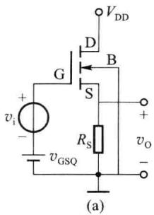

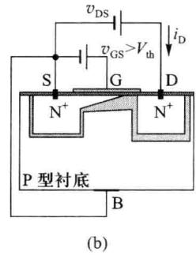

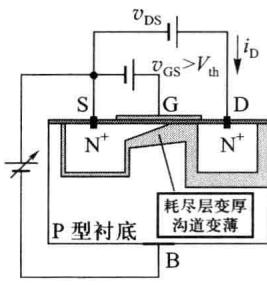  

图 3.1.9 衬源电压 $v_{BS}$ 的影响

在 MOS 管饱和区, 假设 $v_{BS}=0$ 时的沟道及耗尽层的示意图由图 3.1.9(b) 表示, 则当 $v_{BS}<0$ 时, 使源区、漏区及导电沟道与衬底之间的 PN 结反偏电压增加, 其耗尽层也增厚, 导电沟道因而变薄, 沟道电阻增加, 如图 3.1.9(c) 所示。所以在 $v_{GS}$ 、 $v_{DS}$ 不变的情况下, $|v_{BS}|$ 增加, 使漏源电流 $i_{D}$ 减小。在导电沟道未形成时, $v_{BS}$ 也会使初建反型层导电沟道所需的栅、源开启电压 $V_{\mathrm{GS(th)}}$ 增大。

衬、源电压对漏极电流的影响称为衬底调制效应。可通过参数背栅跨导 $g_{mb}$ 来描述衬底调制效应的大小。 $g_{mb}$ 由器件的材料参数决定。一般情况下，背栅跨导 $g_{mb}$ 与微变跨导 $g_{m}$ 的关系由式(3.1.10)给出，其中 $\eta$ 称为跨导比常数， $\eta$ 一般在 0.1\~0.2 范围之内。

$$

g _ {\mathrm{mb}} = \eta \cdot g _ {\mathrm{m}}\tag{3.1.10}

$$

<Example title="例 3.1.1">
N 沟道 MOS 场效应管放大电路如图 3.1.2(c) 所示。电路中电阻 $R_{D} = 1.5 \, k\Omega$ ，工作电源电压 $V_{DD} = 5V$ 。管参数为：开启电压 $V_{th} = 1.5V$ ，本征导电因子 $k_{p}$ 为 $50 \, \mu A/V^{2}$ ，沟道宽长比 W/L = 10。沟道长度调制因子 $\lambda = 0.001/V$ 。试求：（1）为使管的微变跨导 $g_{m} = 1 \, mS$ ，直流偏置电压源 $V_{GSQ}$ 的数值应为多少？（2）为使管工作在饱和区，电压信号源（其直流分量为零） $v_{i}$ 的动态范围是多少？

<Solution title="解">
因为工作电源电压 $V_{DD}$ 为 5V, 由电路知, 漏、源极之间的电压 $v_{DS}$ 的变化范围为 0\~5V。由于 $\lambda$ 数值较小, 在 $v_{DS}$ 的变化范围内均有 $(\lambda v_{\mathrm{DS}}) \ll 1$ , 故在分析中可忽略沟道长度调制效应的影响。

（1）根据式(3.1.8)， $g_{m}=\sqrt{2k_{p}\frac{W}{L}I_{DQ}}=1\ mS$ ，可得

$$

I _ {\mathrm{DQ}} = \frac {g _ {\mathrm{m}} ^ {2}}{2 k _ {\mathrm{p}} \frac {W}{L}} = 1 \mathrm{mA}

$$

根据式(3.1.4)， $(V_{\mathrm{GSQ}}-V_{\mathrm{th}})^{2}=\frac{I_{\mathrm{DQ}}}{\frac{k_{\mathrm{p}}}{2}\cdot\frac{W}{L}}=\frac{1\times10^{-3}}{\frac{50}{2}\times10^{-6}\times10}=4$ ，故应得

$$

V _ {\mathrm{GSQ}} = 2 + V _ {\mathrm{th}} = 3. 5 \mathrm{V}

$$

（2）输入信号电压增加时，MOS管不应进入可变电阻区，即当 $v_{\mathrm{GS}} = V_{\mathrm{GSmax}}$ 时， $i_{\mathrm{D}} = I_{\mathrm{Dmax}}$ ， $v_{\mathrm{DS}} = V_{\mathrm{DSmin}} = V_{\mathrm{GSmax}} - V_{\mathrm{th}} \circ$

此时,场效应管由饱和区恰进入可变电阻区,沟道处于预夹断状态, $v_{GD}=V_{th}$ 。根据输出特性曲线方程有

$$

i _ {\mathrm{Dmax}} = \frac {k _ {\mathrm{p}}}{2} \cdot \frac {W}{L} (V _ {\mathrm{GSmax}} - V _ {\mathrm{th}}) ^ {2} = 2 5 0 \times 1 0 ^ {- 6} (V _ {\mathrm{GSmax}} - V _ {\mathrm{th}}) ^ {2}

$$

根据电路的输出回路,有

$$

i _ {\mathrm{Dmax}} = \frac {V _ {\mathrm{DD}} - V _ {\mathrm{DSmin}}}{R _ {\mathrm{D}}} = \frac {5 - (V _ {\mathrm{GSmax}} - V _ {\mathrm{th}})}{1 . 5 \times 1 0 ^ {3}}

$$

求解上述两式，得方程： $0.375x^{2} + x - 5 = 0$ ，其中 $x = (V_{\mathrm{GSmax}} - V_{\mathrm{th}})$ 。可以得到： $V_{\mathrm{GSmax}} = (2.55+$

1.5) V = 4.05V。由于 $V_{GSmax} = V_{imax} + V_{GSQ}$ ，得： $V_{i\max}=(4.05-3.5)\mathrm{V}=0.55\mathrm{V}$

当输入信号电压减小时，MOS管也不应进入截止区，应有 $V_{GS\min}=V_{GSQ}+V_{imin}>V_{th}$ ，故， $V_{imin}=V_{th}-V_{GSQ}=(1.5-3.5)\mathrm{V}=-2\mathrm{V}_{\circ}$

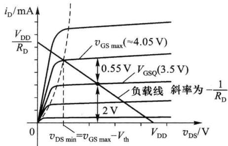

根据以上分析,信号源 $v_{i}$ 的变化范围应为 $(-2V, +0.55V)$ 。如图 3.1.10 所示。若 $v_{i}$ 高于 +0.55V，管子进入可变电阻区，输出电压 $v_{o}$ 出现削底失真。若 $v_{i}$ 低于 -2V，管进入截止区，输出电压 $v_{o}$ 出现削顶失真。

图3.1.10 $v_{\mathrm{GS}}$ 的动态范围
</Solution>
</Example>

## 六、P 沟道增强型 MOS 场效应管(简称增强型 PMOS 管)

增强型 PMOS 管的结构与增强型 NMOS 管的结构基本相同, 只是 PMOS 管的衬底为 N 型半导体, 源区、漏区及反型层导电沟道为 P 型, 其导电载流子为空穴。图 3.1.11(a)、(b) 和 (c) 分别给出了增强型 PMOS 管的结构示意、符号和基本共源放大应用电路。

增强型 PMOS 管的工作原理与 NMOS 管基本相同,但在饱和区应用时,要求栅极电位应低于源极 $v_{\mathrm{GS}}<0$ 且 $v_{GS}<V_{th}<0$ , 漏极电位应低于源极, 漏极电流 $i_{D}$ 的实际流向为流出漏极。若以图 3.1.11(c) 中标注的方向为 $v_{GS}$ 、 $v_{DS}$ 、 $i_{D}$ 的参考方向时, 转移特性、输出特性曲线如图 3.1.12 所示。

增强型 PMOS 管的饱和区电压、电流关系仍如式(3.1.4)所示,但等式右边增加一个负号,表示标注的电流参考方向与实际电流方向相反。微变跨导也仍可如式(3.1.8)所示,其中 $I_{DQ}$ 、 $V_{GSQ}$ 、 $V_{th}$ 均为负值。

由于空穴载流子的迁移率 $\mu_{p}$ 比电子载流子的迁移率 $\mu_{N}$ 低, 这使得 PMOS 管的沟道电阻比 NMOS 管（相同的 W/L 时）大，工作速度比 NMOS 管低。PMOS 管的微变跨导也比 NMOS 管低。在集成电路中通常以 PMOS 管配合 NMOS 管工作，构成互补 MOS（Complementary Metal Oxide Semiconductor）电路，简称 CMOS 电路。

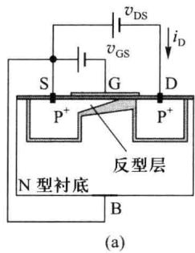

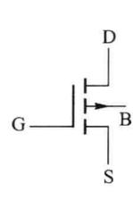

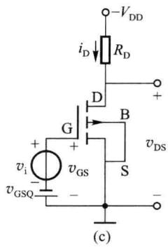  

图 3.1.11 增强型 PMOS 管

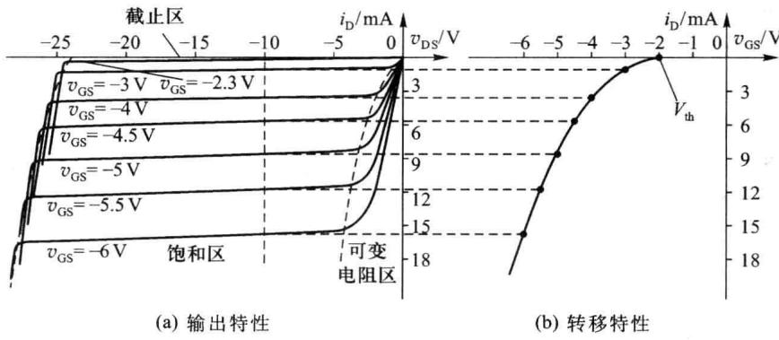  

图 3.1.12 增强型 PMOS 管的特性曲线

## 3.1.2 耗尽型 MOS 场效应管

增强型 MOS 管应用于信号放大时，栅、源间必须通过直流偏置电路给出一定的偏置电压（例如，NMOS，要求 $V_{GSQ} > V_{th}$ ），才能使 MOS 管建立导电沟道并工作于饱和区。还有一类 MOS 管，称为耗尽型 MOS 管，可以无需栅、源直流偏置电路和偏置电压，即在 $V_{GSQ} = 0$ 时已经具有初始导电沟道。

耗尽型 MOS 管与增强型 MOS 管结构基本相同,通过特殊半导体工艺直接在栅极下方生成反型层,其反型层将源区、漏区连通构成内建初始导电沟道。以耗尽型 N 沟道 MOS 管为例,在栅极下面的绝缘层中掺入大量的碱金属正离子(如 $Na^{+}$ 或 $K^{+}$ ),这样,即使不加栅、源偏压,也会由于正离子的存在,使栅极下方感应出 N 型薄层,形成初始导电沟道。图 3.1.13(a) 为 N 沟道耗尽型 MOS 管的结构示意图,图 3.1.13(b)、(c) 分别为耗尽型 NMOS 管和 PMOS 管的符号。

初始导电沟道的存在使管在 $v_{GS}=0$ 的情况下，在漏、源之间加电压 $v_{DS}$ 就会产生电流 $i_{D}$ 。

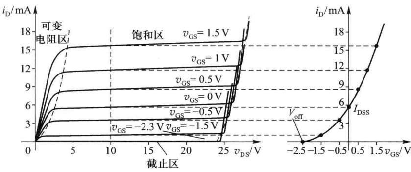

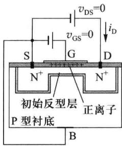  

(a)

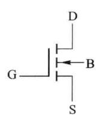  

(b)

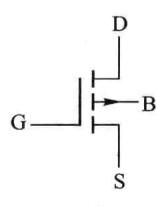  

(c)  

图 3.1.13 耗尽型 MOS 管

对于耗尽型NMOS管，在 $v_{\mathrm{DS}}$ 为某一较小的固定值，MOS管仍处于可变电阻区时，当 $v_{\mathrm{GS}}$ 正向增加时，栅极电位升高，吸引源区、漏区及衬底中更多的自由电子积聚到栅极下，使N型反型层导电沟道增厚，沟道电阻减小，电流 $i_{\mathrm{D}}$ 增大。当 $v_{\mathrm{GS}}$ 反向增加，栅极电位为负，排斥电子，使导电沟道变薄，沟道电阻增大，电流 $i_{\mathrm{D}}$ 减小。当 $v_{\mathrm{GS}}$ 反向增大到 $V_{\mathrm{GS(off)}}$ 时，反型层变薄到刚好沟道完全消失，电流 $i_{\mathrm{D}}$ 减小到零，称此时的 $v_{\mathrm{GS}} = V_{\mathrm{GS(off)}}$ 为夹断电压，简写为 $V_{\mathrm{off}}$ 。耗尽型NMOS管的转移特性曲线如图3.1.14(b)所示。由上述分析可见，耗尽型MOS管的转移特性曲线与增强型MOS管的变化规律一样，只是曲线中 $i_{\mathrm{D}} = 0$ 的起点左移至负值电压 $V_{\mathrm{off}}$ 处。

(a) 输出特性  

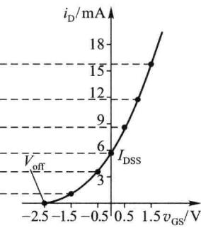  

(b) 转移特性  

图 3.1.14 耗尽型 NMOS 管的特性曲线

耗尽型 MOS 管中 $v_{DS}$ 对导电沟道及电流 $i_{D}$ 的影响与增强型 MOS 管相同，因而输出特性曲线与增强型 MOS 管的规律一样。图 3.1.14(a) 为耗尽型 NMOS 管的输出特性曲线示例。当 $v_{GS} \leqslant V_{off}$ ，管处于截止区工作， $i_{D} = 0$ 。当 $v_{GS} > V_{off}$ ， $0 < v_{DS} \leqslant v_{GS} - V_{off}$ ，MOS 管处于可变电阻区工作， $i_{D} = f(v_{\mathrm{DS}}, v_{\mathrm{GS}})$ 关系由式 (3.1.11) 给出。当 $v_{GS} > V_{off}$ ， $v_{DS} > v_{GS} - V_{off}$ ，MOS 管处于饱和区工作，不考虑沟道长度调制效应时， $i_{D} = f(v_{\mathrm{DS}}, v_{\mathrm{GS}})$ 的关系由式 (3.1.12) 给出。

$$

i _ {\mathrm{D}} = \frac {k _ {\mathrm{p}}}{2} \cdot \frac {W}{L} \big [ 2 (v _ {\mathrm{GS}} - V _ {\mathrm{off}}) v _ {\mathrm{DS}} - v _ {\mathrm{DS}} ^ {2} \big ] - v _ {\mathrm{GS}} > V _ {\mathrm{off}}, 0 <   v _ {\mathrm{DS}} \leqslant v _ {\mathrm{GS}} - V _ {\mathrm{off}}\tag{3.1.11}

$$

$$

i _ {\mathrm{D}} = \frac {k _ {\mathrm{p}}}{2} \cdot \frac {W}{L} (v _ {\mathrm{GS}} - V _ {\mathrm{off}}) ^ {2} - v _ {\mathrm{GS}} > V _ {\mathrm{off}}, v _ {\mathrm{GS}} - V _ {\mathrm{off}} <   v _ {\mathrm{DS}}\tag{3.1.12}

$$

当 $v_{GS}=0$ 时，对应的可变电阻区与饱和区交界处 $(v_{\mathrm{DS}}=v_{\mathrm{GS}}-V_{\mathrm{off}}=-V_{\mathrm{off}})$ 的漏极电流 $i_{D}$ 称为漏极饱和电流 $I_{DSS}$ 。如果忽略沟道长度调制效应，可令 $v_{GS}=0$ ，直接根据式(3.1.11)求出 $I_{DSS}$ 。其表达式为

$$

I _ {\mathrm{DSS}} = \frac {k _ {\mathrm{p}}}{2} \cdot \frac {W}{L} V _ {\mathrm{off}} ^ {2}\tag{3.1.13}

$$

引入漏极饱和电流 $I_{DSS}$ 后，饱和区内的 $i_{\mathrm{D}} = f(v_{\mathrm{DS}}, v_{\mathrm{GS}})$ 关系式为

$$

i _ {\mathrm{D}} = I _ {\mathrm{DSS}} \left(1 - \frac {v _ {\mathrm{GS}}}{V _ {\mathrm{off}}}\right) ^ {2} - v _ {\mathrm{GS}} > V _ {\mathrm{off}}, v _ {\mathrm{GS}} - V _ {\mathrm{off}} <   v _ {\mathrm{DS}}\tag{3.1.14}

$$

在饱和区内，耗尽型 MOS 管的微变跨导 $g_{m}$ 的定义仍如式（3.1.7）所示。根据式（3.1.14）可得到基于 $I_{DSS}$ 的微变跨导 $g_{m}$ 的表达式为

$$

g _ {\mathrm{m}} = \frac {- 2 I _ {\mathrm{DSS}}}{V _ {\mathrm{off}}} \left(1 - \frac {V _ {\mathrm{GSQ}}}{V _ {\mathrm{off}}}\right) = \frac {- 2}{V _ {\mathrm{off}}} \sqrt {I _ {\mathrm{DSS}} \cdot I _ {\mathrm{DQ}}} = \frac {2 I _ {\mathrm{DQ}}}{V _ {\mathrm{GSQ}} - V _ {\mathrm{off}}}\tag{3.1.15}

$$

耗尽型PMOS管的特性类似增强型PMOS管。但其夹断电压 $V_{\mathrm{off}}$ 为正值。放大应用中，漏极电位应低于源极，漏极电流 $i_{\mathrm{D}}$ 的实际流向为流出漏极。 $v_{\mathrm{GS}}, v_{\mathrm{DS}}, i_{\mathrm{D}}$ 的参考方向与图3.1.11(c)中的假定相同时，输出特性、转移特性曲线如图3.1.15所示。

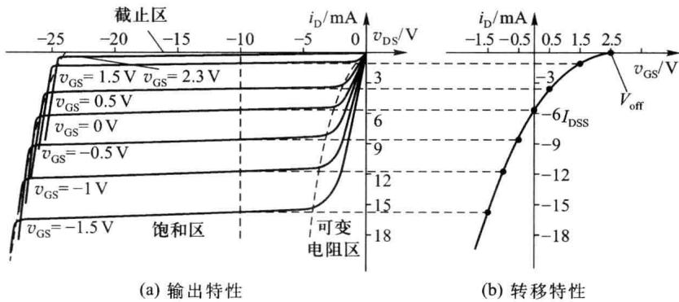  

图 3.1.15 耗尽型 PMOS 管的特性曲线
