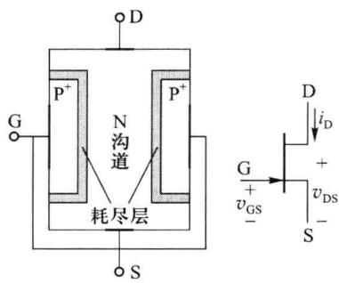
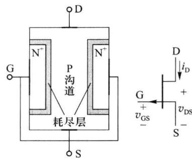
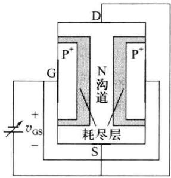
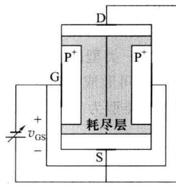
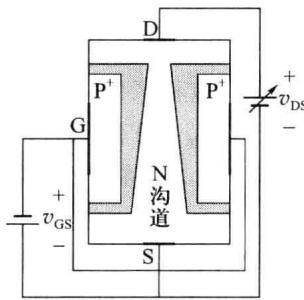
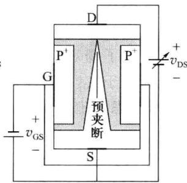
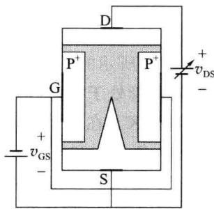
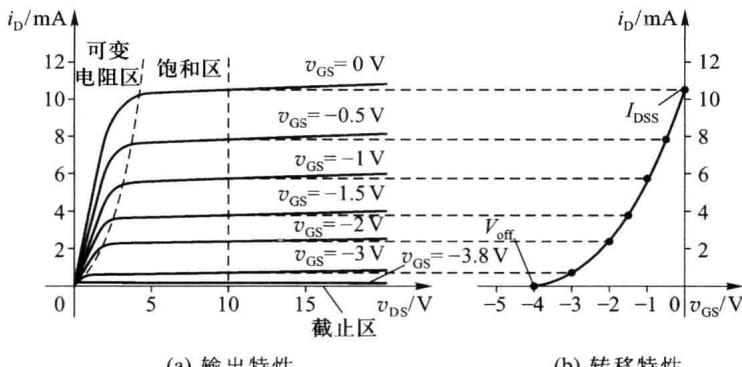
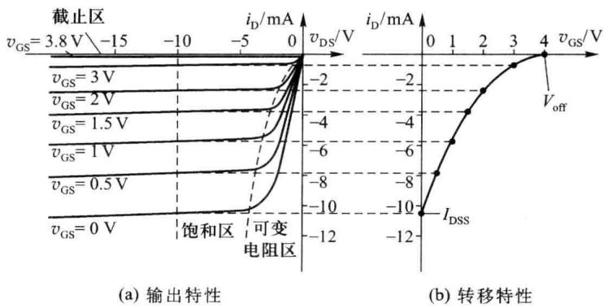

import Guide from '@/components/Guide.astro';
import Knowledge from '@/components/Knowledge.astro';
import Example from '@/components/Example.astro';
import Analysis from '@/components/Analysis.astro';
import Solution from '@/components/Solution.astro';
import Variant from '@/components/Variant.astro';
import Note from '@/components/Note.astro';
import Block from '@/components/Block.astro';
import Method from '@/components/Method.astro';
import Exercise from '@/components/Exercise.astro';

结型场效应管(Junction Field Effect Transistor, JFET)的结构示意图和符号如图3.2.1所示。在一块半导体(N型或P型)的上、下两端各引出电极作为漏极(D)和源极(S)，在两侧用半导体工艺扩散形成另一类型的高掺杂半导体区域( $P^{+}$ 或 $N^{+}$ )，引出电极作为栅极(G)。在实际应用时，漏、源极之间形成导电沟道，如果沟道类型为N型，称管为N沟道结型场效应管(NJFET)。如果沟道类型为P型，称管为P沟道结型场效应管(PJFET)。

## 3.2.1 结型场效应管的基本工作原理

由图 3.2.1 的结构示意图可见, 漏极(D)、源极(S)间的半导体区域是载流子运动的通道, 因而, 结型场效应管存在着内建初始导电沟道, 这一点与耗尽型 MOS 管类似。

结型场效应管应用于信号放大时,两个 PN 结必须处于反偏状态,栅极输入电流为 PN结的反向饱和电流,数值很小,输入电阻很大,一般可达 $10^{7}\Omega$ 以上。由于沟道区的掺杂浓度相对低于栅极区,反偏PN结的耗尽层向沟道区一侧延伸的厚度相对较多。耗尽层是高电阻的区域,导电沟道的有效宽度受耗尽层的挤占而变窄。当栅源、栅漏极间的反偏电压 $v_{GS}$ 、 $v_{GD}$ 变化时,导电沟道的有效宽度随之改变,沟道电阻随之改变,流经沟道的漏、源极间电流 $i_{D}$ 也随之变化。可见,与MOS管的工作类似,结型管也是通过控制导电沟道的形态改变漏极输出电流的。

  

(a) N 沟道结型管 (NJFET)

  

(b) P 沟道结型管 (PJFET)  

图 3.2.1 结型场效应管的结构示意图和符号

结型场效应管构成放大电路时，输入信号 $v_{i}$ 控制栅源电压 $v_{GS}$ ，输出电流取自漏极电流 $i_{D}$ ，输出电压取自漏极或源极。这与 MOS 管的工作也是类似的。

以下仍以 N 沟道结型场效应管为例进行分析, P 沟道结型场效应管的工作原理基本相同。

## 一、栅源电压 $v_{GS}$ 对沟道的影响

为保证PN结反偏，N沟道结型场效应管工作时，栅源电压 $v_{\mathrm{GS}}$ 不应出现正值，总应保证 $v_{\mathrm{GS}} < 0$ 。当漏源电压 $v_{\mathrm{DS}} = 0$ 时，栅源间及栅漏间PN结的反偏电压 $|v_{\mathrm{GS}}|$ 越大，耗尽层厚度也越厚，导电沟道的有效宽度也就越窄，沟道电阻越大。如图3.2.2所示。当反偏电压 $|v_{\mathrm{GS}}|$ 数值增大到 $|V_{\mathrm{GS(off)}}|$ 数值时（对于NJFET， $V_{\mathrm{GS(off)}}$ 为负值），导电沟道完全被耗尽层挤占，其有效厚度减小至零，沟道电阻趋于无限大，称此状态为全夹断。全夹断状态下，漏、源极间电流 $i_{\mathrm{D}}$ 为零，相当于漏、源极间断开。 $V_{\mathrm{GS(off)}}$ 称为夹断电压，简写为 $V_{\mathrm{off}}$ 。 $V_{\mathrm{off}}$ 的数值大小由场效应管的材料和工艺决定。

  

(a) $V_{off}<V_{GS}\leq0$

  

(b) $v_{GS} \leqslant V_{off}$  

图 3.2.2 N 沟道结型场效应管中 $v_{GS}$ 对沟道的影响

## 二、漏源电压 $v_{DS}$ 对沟道的影响

在栅源电压 $v_{\mathrm{GS}}$ 处于 $[V_{\mathrm{off}}, 0]$ 范围内时，漏、源极之间存在着导电沟道。在漏源电压 $v_{\mathrm{DS}}$ 由零正向增大时，靠近漏极侧的PN结反偏电压增大，也就是 $|v_{\mathrm{GD}}| > |v_{\mathrm{GS}}|$ ，栅、漏极间耗尽层的厚度大于栅、源极间的耗尽层。导电沟道呈楔形，当 $0 < v_{\mathrm{DS}} < v_{\mathrm{GS}} - V_{\mathrm{off}}$ 时，沟道形状如图3.2.3(a)所示。 $v_{\mathrm{DS}}$ （或 $v_{\mathrm{GD}}$ ）的数值越大，沟道靠漏极一端的有效宽度就越窄。在楔形沟道仍在漏、源极之间贯通的情况下，场效应管处于可变电阻区工作。沟道电流 $i_{\mathrm{D}}$ 与 $v_{\mathrm{DS}}$ 、 $v_{\mathrm{GS}}$ 的关系式为

$$

i _ {\mathrm{D}} = I _ {\mathrm{DSS}} \left[ - 2 \left(1 - \frac {v _ {\mathrm{GS}}}{V _ {\mathrm{off}}}\right) \frac {v _ {\mathrm{DS}}}{V _ {\mathrm{off}}} - \left(\frac {v _ {\mathrm{DS}}}{V _ {\mathrm{off}}}\right) ^ {2} \right] - V _ {\mathrm{off}} <   v _ {\mathrm{GS}} \leqslant 0, 0 <   v _ {\mathrm{DS}} \leqslant v _ {\mathrm{GS}} - V _ {\mathrm{off}}\tag{3.2.1}

$$

当 $v_{DS}$ 由零增大到 $v_{DS}=v_{GS}-V_{off}$ ，恰使 $v_{GD}$ 负向增大到 $v_{GD}=-v_{DS}+v_{GS}=V_{off}$ 时，导电沟道在漏极端一侧被耗尽层夹断，称此时状态为预夹断，如图 3.2.3(b) 所示。预夹断状态的漏源电流 $i_{D}$ 由式 (3.2.2) 给出，只是式中的 $v_{DS}=v_{GS}-V_{off}$ 。当 $v_{GS}=0$ 时的预夹断漏源电流称为饱和电流 $I_{DSS}$ 。

$$

i _ {\mathrm{D}} = I _ {\mathrm{DSS}} \left(1 - \frac {v _ {\mathrm{GS}}}{V _ {\mathrm{off}}}\right) ^ {2} - V _ {\mathrm{off}} <   v _ {\mathrm{GS}} \leqslant 0, v _ {\mathrm{DS}} = v _ {\mathrm{GS}} - V _ {\mathrm{off}}\tag{3.2.2}

$$

在预夹断发生后继续增大 $v_{DS}$ ，进一步使 $\left|v_{GD}\right|>\left|V_{off}\right|$ ，靠近漏区一侧的导电沟道被耗尽层夹断的部分增多，夹断点向源区的方向移动，剩余沟道长度有所减短。如图 3.2.3(c) 所示。在 $v_{DS}$ 的作用下，自由电子由源极沿导电沟道向漏区方向运动，到达夹断区域时被耗尽层内的强电场吸引继续向漏区漂移，形成漏极电流 $i_{D}$ 。当 $v_{DS}$ 增大时，栅极到沟道夹断点处的电压总为 $V_{off}$ ，夹断点到源极间的剩余导电沟道上的电压也仍总为 $v_{GS}-V_{off}$ ， $v_{DS}$ 大于 $v_{GS}-V_{off}$ 的增加量主要降在漏源间呈高电阻的耗尽层夹断区上。因而在预夹断后电流 $i_{D}$ 基本保持不变。

  

(a) $0 < v_{\mathrm{DS}} < v_{\mathrm{GS}} - V_{\mathrm{off}}$

  

(b) $v_{DS} = v_{GS} - V_{off}$

  

(c) $v_{DS} > v_{GS} - V_{off}$  

图 3.2.3 N 沟道结型场效应管 $v_{DS}$ 对沟道的影响

考虑到沟道预夹断后，剩余沟道长度随着 $v_{\mathrm{DS}}$ 的增大有所减短，沟道电阻也随之有所减小，沟道电流 $i_{\mathrm{D}}$ 会随 $v_{\mathrm{DS}}$ 增加而稍有增大。与MOS场效应管一样，这种现象称为沟道长度调制效应，可引入沟道长度调制因子 $\lambda$ （或厄尔利电压 $V_{\mathrm{A}}$ )给予描述。在进行结型场效应管的交流分析时，可用漏、源极间的微变电阻 $r_{\mathrm{ds}}$ 表示沟道长度调制效应的影响， $r_{\mathrm{ds}}$ 的定义及关系式仍如式(3.1.6)所示。

在饱和区内,结型场效应管的微变跨导 $g_{m}$ 的表达式与式(3.1.15)相同。

## 3.2.2 结型场效应管的特性曲线

N 沟道结型场效应管的转移特性曲线和输出特性曲线与耗尽型 NMOS 管相近。图 3.2.4 是 N 沟道结型场效应管特性曲线的示意图。由于结型场效应管的 PN 结不允许正偏，所以特性曲线中没有 $v_{GS} > 0$ 的部分。

结型场效应管输出特性曲线也分为可变电阻区、饱和区、截止区、击穿区，如图3.2.4(a)所示（图中没有画出击穿区）。可变电阻区和饱和区的分界为： $v_{\mathrm{DS}} = v_{\mathrm{GS}} - V_{\mathrm{off}}, v_{\mathrm{GD}} = V_{\mathrm{off}}$ 。与 $v_{\mathrm{GS}} = 0$ 对应的输出特性曲线拐点位置的电流 $i_{\mathrm{D}}$ 数值为饱和电流 $I_{\mathrm{DSS}}$ 。

当 $v_{DS}$ 足够大时，会致使栅、漏极间 PN 结出现反向击穿。当 $v_{GS}$ 增加时，导电沟道变宽，电流 $i_{D}$ 增加，沟道被夹断的区域长度变短， $v_{DS}$ 分压在夹断区耗尽层的数值减小，导致击穿所需的漏源电压 $V_{(BR)DS}$ 也稍微增加。因此，结型场效应管输出曲线击穿区的形状与 MOS 管一样。

  

(a) 输出特性  

(b) 转移特性  

图 3.2.4 N 沟道结型场效应管的特性曲线

图 3.2.4(b) 所示的转移特性曲线反映了场效应管在截止区、饱和区的 $i_{\mathrm{D}} = f(v_{\mathrm{GS}})$ 。当 $v_{GS} \leqslant V_{off}$ ，场效应管处于截止区。当 $v_{DS}$ 为大于 $v_{GS} - V_{off}$ 且 $v_{GS}$ 处于 $(V_{\mathrm{off}}, 0)$ 范围时，是转移特性曲线上的饱和区。在 $\lambda$ 值较小（或不考虑沟道长度调制效应）时，转移特性曲线上对应 $v_{GS} = 0$ 的电流 $i_{D}$ 值为饱和电流 $I_{DSS}$ 。

P 沟道结型场效应管中载流子为空穴。基本工作原理与 N 沟道结型场效应管相同。NJFET 的基本公式，即式(3.2.1)和式(3.2.2)，在考虑电压和电流的方向定义后也适用 PJFET。图 3.2.5 为 PJFET 的特性曲线示意图。曲线中电压、电流的参考方向如图 3.2.1 所示。PJFET 的夹断电压 $V_{off}$ 为正值。放大应用中，栅极电位应高于源极 ( $0 < v_{GS} < V_{off}$ )，漏极电位应低于源极，漏极电流 $i_{D}$ 的实际流向为流出漏极。

  

图 3.2.5 P 沟道结型场效应管的特性曲线
