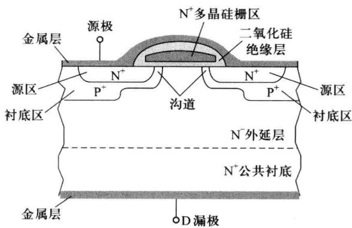
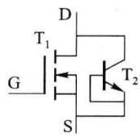
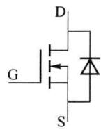
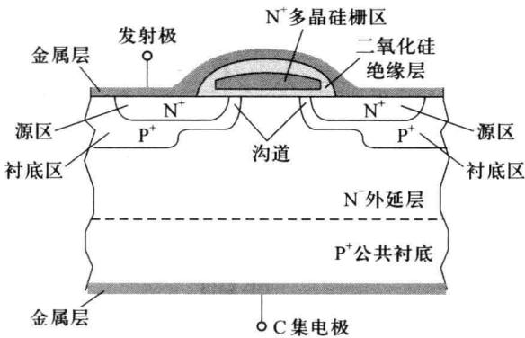
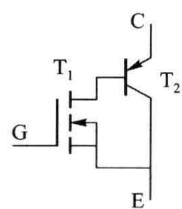
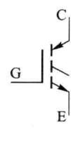

import Guide from '@/components/Guide.astro';
import Knowledge from '@/components/Knowledge.astro';
import Example from '@/components/Example.astro';
import Analysis from '@/components/Analysis.astro';
import Solution from '@/components/Solution.astro';
import Variant from '@/components/Variant.astro';
import Note from '@/components/Note.astro';
import Block from '@/components/Block.astro';
import Method from '@/components/Method.astro';
import Exercise from '@/components/Exercise.astro';

在功率放大电路中，晶体管处于大电流、高电压的工作状态。这要求管的最大允许工作电流 $I_{DM}$ 、击穿电压 $V_{(BR)DS}$ 、最大耗散功率 $P_{DM}$ 的数值均应足够大。这几项指标数值较大的管通常被称为大功率管。

前面介绍的场效应管的漏极、源极结构对称，载流子沿水平方向在漏、源极间的导电沟道内流动。这种构造称为横向结构。横向结构场效应管的漏源击穿电压 $V_{(\mathrm{BR})\mathrm{DS}}$ 与沟道长度呈正比，为得到高 $V_{(\mathrm{BR})\mathrm{DS}}$ 需增加沟道长度，而沟道的增长又会使沟道电阻增加、降低 $P_{DM}$ 和 $I_{DM}$ 的指标。因而横向结构场效应管通常作为小功率型管。

## 3.3.1 VDMOS 管

VDMOS 管 (Vertical Double-diffused MOSFET) 是多个元胞单元并联而得的器件。图

3.3.1给出了N沟道管单个元胞单元的结构。在一层高掺杂的 $\mathbf{N}^{+}$ 层公共衬底上生长低掺杂的 $\mathbf{N}^{-}$ 外延层作为漏区，在 $\mathbf{N}^{-}$ 外延层上扩散形成 $\mathrm{P}^{+}$ 区域作为衬底区，在 $\mathrm{P}^{+}$ 区中再次扩散形成出 $\mathbf{N}^{+}$ 区域作为源区。在 $\mathbf{N}^{+}$ 源区及 $\mathrm{P}^{+}$ 衬底区上镀金属层引出电极作为源极S。栅区由重掺杂多晶硅构成，栅区与 $\mathbf{N}^{+}$ 源区、 $\mathrm{P}^{+}$ 衬底区及 $\mathbf{N}^{-}$ 外延层间有二氧化硅绝缘层，栅区与源极金属层之间也有二氧化硅绝缘层（栅区引出极G未在图中标出）。在 $\mathbf{N}^{+}$ 层公共衬底上镀金属层引出电极作为漏极D。

  

图 3.3.1 VDMOS 管中元胞的剖面图

当在栅、源极间加电压 $v_{GS}$ 时， $P^{+}$ 衬底区中的自由电子受电场作用向栅区积聚，当 $v_{GS}$ 大于开启电压 $V_{th}$ 后，在栅区下方的 P 区表面形成反型层导电沟道，导电沟道将 $N^{+}$ 源区和 $N^{-}$ 外延层漏区连通，在漏源电压 $v_{DS}$ 的作用下，自由电子由源极（S）进入源区，经导电沟道进入 $N^{-}$ 漏区，在漏区中纵向流动到 $N^{+}$ 层，由漏极（D）流出。

由图 3.3.1 可见, $N^{+}$ 源区和 $P^{+}$ 衬底区由源极金属层短接。由 $N^{+}$ 源区、 $P^{+}$ 衬底区、 $N^{-}$ 外

$$

\mathrm{T} _ {2} (\mathrm{B}, \mathrm{E}

$$

二极管)与MOS管并联,这一寄生二极管在 $v_{DS}$ 为正时不导通,对MOS管工作的影响很小。VDMOS管的等效电路和符号如图3.3.2所示。

VDMOS 管由多个元胞在二维平面上并联而得。有资料表明，构成一个 VDMOS 器件的元胞个数可有几千到数百万个不等。VDMOS 管的漏极面积较横向结构场效应管增加许多，漏极可与管外壳连接以

(a) 等效电路

(b) 符号

图 3.3.2 VDMOS 管等效电路和符号

便散热,这使得 VDMOS 的 $I_{DM}$ 和 $P_{DM}$ 指标可大大增加。

管导通时,各元胞中的 $N^{-}$ 外延层电阻是导通电阻的主要成分,这一电阻是对多数载流子呈现的电阻,温度系数为正,这使得漏源电流 $i_{D}$ 可在各并联元胞间均衡分配,减小出现二次击穿的可能。

目前，VDMOS 管已可做到最大工作电流达数百安，耐压上千伏。

## 3.3.2 IGBT 管

IGBT 管与 VDMOS 管的结构类似, 图 3.3.3 为 IGBT 管中的元胞结构示意图。IGBT 管与 VDMOS 管的主要不同点是 IGBT 管的公共衬底层为 $P^{+}$ 型半导体, 这一不同点使两种管的特性有了较大的区别。

由图 3.3.3 可见，在一个元胞中存在由 $N^{+}$ 源区、 $P^{+}$ 衬底区、 $N^{-}$ 外延层漏区构成的 MOS 管 $T_{1}$ ，也存在着由 $P^{+}$ 公共衬底区（C）、 $N^{-}$ 外延层（B）、 $P^{+}$ 衬底区（E）构成的 PNP 型晶体管 $T_{2}$ 。 $T_{1}$ 、 $T_{2}$ 的连接关系如图 3.3.4(a) 所示。可见 IGBT 管是 MOS 管和双极型晶体管组成的复合管，故称为绝缘栅双极型晶体管（Insulated Gate Bipolar Transistor）。

  

图 3.3.3 IGBT 管中元胞的剖面图

  

(a) 等效电路  

(b) 符号  

图 3.3.4 IGBT 管等效电路和符号

当 $v_{GE}$ 间电压大于 MOS 管 $T_{1}$ 的开启电压 $V_{th}$ 后。导电沟道形成，在 $v_{CE}$ 作用下， $P^{+}$ 公共衬底层中的空穴向 $N^{-}$ 外延层注入，使 $N^{-}$ 外延层的导电率增加，导通电阻减小，因而 IGBT 管的最大工作电流指标可以做得更高。可见，IGBT管兼有了MOS管输入电阻高和双极型管导通电阻小的优点。但由于N外延层有少子的注入存储，增加了管开关工作时存储时间，使管的开关工作速度有所降低。
