import Guide from '@/components/Guide.astro';
import Knowledge from '@/components/Knowledge.astro';
import Example from '@/components/Example.astro';
import Analysis from '@/components/Analysis.astro';
import Solution from '@/components/Solution.astro';
import Variant from '@/components/Variant.astro';
import Note from '@/components/Note.astro';
import Block from '@/components/Block.astro';
import Method from '@/components/Method.astro';
import Exercise from '@/components/Exercise.astro';

对信号进行放大是场效应管的一种基本应用。本节以 MOS 管为重点介绍场效应管的基本放大电路。

## 3.4.1 场效应管的模型

器件模型一般是基于对器件工作原理的分析,使用理想元件构建的一种电路,并且电路的端口电压、电流关系与器件外特性基本一致。借助模型容易实现对器件工作原理的理解认识,也方便对电路性能的计算。

本节主要介绍长导电沟道(沟道长度 $L>4\mu m$ ) 场效应管的微变信号模型。短导电沟道 ( $L<4\mu m$ ) 场效应管, 因为需要考虑更多的高阶效应参数, 模型也比较复杂, 如需要了解, 可参见其他有关参考资料。

场效应管瞬态模型可以描述各电极间的电压、电流的瞬时值(直流+交流)的关系,适用于分析工作在可变电阻区、饱和区、截止区工作的场效应管电路,模型稍微复杂,其模型的构成和应用方法可参考其他资料。

## MOS 场效应管的微变信号模型

像晶体管的混合 $\pi$ 模型一样, MOS 场效应管的微变信号模型(或称交流小信号模型)用于分析静态工作点确定、工作在饱和区、输入为交流小信号时各极电压、电流的关系。

构建 MOS 场效应管的微变信号模型,也就是根据 MOS 管在饱和区工作时的工作原理,各电极之间电压、电流的关系及各电极之间的电容效应,用标准元件构成一个能够描述其特性的电路。

MOS 管各电极间的电阻:由于栅极与其他各电极绝缘,因此栅极到源极、栅极到漏极、栅极到沟道、栅极到衬底均为开路;而衬底到源极、衬底到漏极、衬底到沟道之间由于 PN 结反偏,也可看成近似开路;不考虑沟道长度调制效应及衬底调制效应(后面单独考虑),且栅源电压确定时,漏、源极之间的电流与漏源电压无关,因此,构建的模型中各电极间的电阻均

MOS 管各电极间的电容: 各电极之间的等效电容如图 3.4.1 所示。其中源区、漏区、沟道与衬底之间存在着反偏 PN 结电容 $C_{bs}$ 、 $C_{bd}$ 、 $C_{bc}$ ，这三个电容主要表现为势垒电容，是非线性电容；栅极和沟道之间存在着电容 $C_{gc}$ ，栅极和源区、漏区之间也存在着电容 $C_{gs}$ 、 $C_{gd}$ ，这三个电容为线性电容。在模型中用五个电容进行描述，其中 $C_{gb}$ 等于 $C_{gc}$ 与 $C_{bc}$ 的串联。

栅源电压对漏极电流的控制作用:在微变信

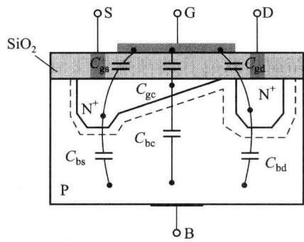  

图 3.4.1 MOS 管的等效电容示意图

号模型中，漏、源极之间用受控电流源 $g_{m}\dot{V}_{gs}$ 反映栅源电压变化与漏极电流变化之间的关系，其中 $g_{m}$ 为 MOS 管的跨导。

衬源电压对漏极电流的控制作用:模型中在漏、源极之间用受控电流源 $g_{mb} \dot{V}_{bs}$ 反映衬底调制效应,即衬源电压变化与漏极电流变化之间的关系,其中 $g_{mb}$ 为背栅跨导。

沟道长度调制效应:用漏、源极之间微变电阻 $r_{ds}$ 反映沟道长度调制效应,即漏源电压变化与漏极电流变化之间的关系。

根据以上分析可得到 MOS 管的微变信号模型, 如图 3.4.2 所示。用 $\dot{V}$ 、 $\dot{I}$ 表示正弦信号输入时电压、电流的稳态变化量。

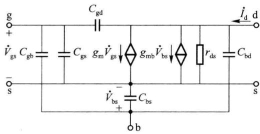  

图 3.4.2 MOS 管的微变信号模型

当工作信号频率较低时,由于模型中各微变电容的容量较小,其容抗很大,可以看成开路。于是中、低频的微变信号模型如图 3.4.3(a) 所示,可用于中、低频 MOS 电路的分析。当衬底、源极短接时,中、低频微变信号模型可进一步简化,如图 3.4.3(b) 所示。

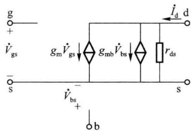  

(a)

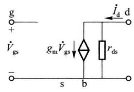  

(b)  

图 3.4.3 MOS 管的低频微变信号模型

结型场效应管的高频微变信号模型如图 3.4.4(a) 所示, 中、低频微变信号模型如图 3.4.4(b) 所示。

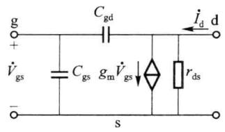  

(a)

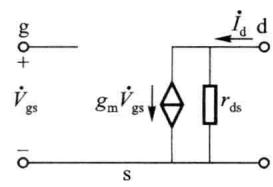  

(b)  

图 3.4.4 结型场效应管的微变信号模型

需要强调的是,微变信号模型适用于场效应管工作在饱和区、在直流工作点基础上、对较小交流信号的等效及分析。由于漏极电流与栅源电压之间是非线性关系,当信号较小时,在工作点附近的动态特性可看成是近似线性的,信号小的程度应依对输出信号中非线性失真容许的程度而定。

<Example title="例 3.4.1">
N 沟道 MOS 场效应管的本征导电因子 $k_{p}$ 为 $40\mu A/V^{2}$ ，沟道宽度 $W=100\mu m$ ，沟道长度 $L=10\mu m$ 。沟道长度调制因子 $\lambda=0.01/V$ ，跨导比 $\eta=0.1$ 。工作点电流 $I_{DQ}=1mA$ ， $V_{DSQ}=3V$ 。试求出管的低频微变信号模型中的各参量。

<Solution title="解">
根据式(3.1.9),考虑沟道长度调制效应时,微变跨导 $g_{m}$ 为

$$

\begin{array}{r l} & g _ {\mathrm{m}} = \sqrt {2 k _ {\mathrm{p}} \frac {W}{L} I _ {\mathrm{DQ}} (1 + \lambda V _ {\mathrm{DSQ}})} = \sqrt {2 \times 4 0 \times 1 0 ^ {- 6} \frac {1 0 0}{1 0} \times 1 0 ^ {- 3} \times (1 + 0 . 0 1 \times 3)} \mathrm{S} = 0. 9 0 7 7 \mathrm{mS} \\ & \text { 跨导 } \quad g _ {\mathrm{mb}} = \eta \cdot g _ {\mathrm{m}} = 0. 1 g _ {\mathrm{m}} = 0. 0 9 0 7 7 \mathrm{mS} \end{array}

$$

背栅跨导

根据式(3.1.8)，不考虑沟道长度调制效应时，微变跨导 $g_{m}$ 为

背栅跨导

$$

\begin{array}{r l} & g _ {\mathrm{m}} = \sqrt {2 k _ {\mathrm{p}} \frac {W}{L} I _ {\mathrm{DQ}}} = \sqrt {2 \times 4 0 \times 1 0 ^ {- 6} \frac {1 0 0}{1 0} \times 1 0 ^ {- 3}} \mathrm{S=0.8944~mS} \\ & g _ {\mathrm{mb}} = \eta \cdot g _ {\mathrm{m}} = 0. 1 g _ {\mathrm{m}} = 0. 0 8 9 4 4 \mathrm{mS} \\ & 6), r _ {\mathrm{ds}} \approx 1 / (\lambda I _ {\mathrm{DQ}}) = 1 / (0. 0 1 \times 1 \times 1 0 ^ {- 3}) \Omega = 1 0 0 \mathrm{k} \Omega_ {\circ} \end{array}

$$

通过在考虑以及不考虑沟道长度调制效应时对 $g_{m}$ 的计算可知，该例题的相对误差大约为 1.5%。因此，工程中进行功能分析时，由于 $\lambda$ 通常较小，可根据实际情况对 $I_{DQ}$ 、 $g_{m}$ 等参数进行近似计算。
</Solution>
</Example>

## 3.4.2 场效应管的直流偏置电路

如同双极型晶体管的工作情况,为完成对交流输入信号的线性放大,应为场效应管设置合适的直流工作点,使场效应管处于放大状态(工作于饱和区)工作并有足够的电压、电流动态范围。直流工作点的设置由直流偏置电路完成。场效应放大电路中的直流偏置形式有分压式偏置、自给偏压偏置和直接偏置等。

## 一、分压式偏置

图 3.4.5 为分压式偏置电路的基本形式。偏置电路非常类似于双极型晶体管电路中分

压式负反馈偏置电路,同样具有稳定静态工作点的作用,适用于对所有类型的场效应管(增强型 MOS 管、耗尽型 MOS 管、JFET)提供直流偏置。分压式偏置电路中

$$

\begin{array}{r l} & V _ {\mathrm{GQ}} = \frac {R _ {\mathrm{G2}}}{R _ {\mathrm{G1}} + R _ {\mathrm{G2}}} V _ {\mathrm{DD}}, V _ {\mathrm{SQ}} = I _ {\mathrm{DQ}} R _ {\mathrm{SS}}, \\ & V _ {\mathrm{GSQ}} = V _ {\mathrm{GQ}} - V _ {\mathrm{SQ}} = \frac {R _ {\mathrm{G2}}}{R _ {\mathrm{G1}} + R _ {\mathrm{G2}}} V _ {\mathrm{DD}} - I _ {\mathrm{DQ}} R _ {\mathrm{SS}} \end{array}

$$

分析及计算时可首先假定 MOS 管处于饱和区工作，在 $\lambda$ 数值较小时，可忽略沟道长度调制效应。 $I_{DQ}$ 可根据管类型的不同由式(3.1.4)(增强型 MOS 管)、

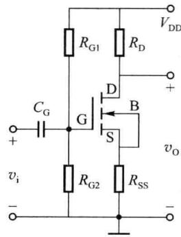  

图 3.4.5 场效应管的分压式偏置

式(3.1.14)(耗尽型MOS管)、式(3.2.2)(JFET)求解。由于 $I_{DQ}$ 是 $V_{GSQ}$ 的二次函数,因而可求解一元二次方程得出 $I_{DQ}$ 和 $V_{GSQ}$ 进而算出 $V_{DSQ}$ 。合适的 $I_{DQ}$ 、 $V_{GSQ}$ 和 $V_{DSQ}$ 应使管处于饱和区工作。对于不同类型的场效应管，在饱和区工作时，各电极的电位应满足如下条件。

对 N 沟道增强型管(开启电压 $V_{th}>0$ )，应使 $V_{GQ}>V_{SQ}$ ，且应 $V_{GSQ}>V_{th}$ ，同时还应保证 $V_{GQ}<V_{DQ}$ ，且 $V_{GDQ}<V_{th}$ 或 $V_{DSQ}>V_{GSQ}-V_{th}$ 。

对 N 沟道耗尽型管（夹断电压 $V_{off}<0$ ）， $V_{GSQ}$ 可为正、负值，也可为零，但需 $V_{GSQ}>V_{off}$ 。同时还应保证 $V_{GDQ}<V_{off}$ 或 $V_{DSQ}>V_{GSQ}-V_{off}$ 。

对 N 沟道结型管（夹断电压 $V_{off}<0$ ），应使 $V_{GQ}<V_{SQ}$ ，且应 $V_{GSQ}>V_{off}$ 。同时还应保证 $V_{GQ}<V_{DQ}$ ，且 $V_{GDQ}<V_{off}$ 或 $V_{DSQ}>V_{GSQ}-V_{off}$ 。

对 P 沟道管, 图 3.4.5 中的电源电压应为负值。分压式偏置电路也适用。可根据 P 沟道管的类型得出偏置电压 $V_{GSQ}$ 、 $V_{DSQ}$ 的应用范围。

<Example title="例 3.4.2">
增强型 NMOS 管的分压式偏置电路如图 3.4.5 所示。其中， $R_{G1}=10\ k\Omega, R_{G2}=10\ k\Omega, R_{SS}=0.5\ k\Omega$ 。 $V_{DD}=10\ V$ 。NMOS 管转移特性为 $i_{D}=0.2(v_{GS}-V_{th})^{2}(1+\lambda v_{DS})\ mA$ ， $V_{th}=2V, \lambda=0.01$ 。试求：（1）管的电压、电流工作点；（2）为保证管处于饱和区，电阻 $R_{D}$ 的上限数值是多少？

<Solution title="解">
计算中忽略沟道调制效应。由于 $\lambda = 0.01, v_{DS} < V_{DD} = 10V, (1 + \lambda v_{DS}) < (1 + 0.1)$ ，忽略沟道调制效应后， $i_{D}$ 的误差将小于 10%。

$$

\begin{array}{r l} V _ {\mathrm{GQ}} & = \frac {R _ {\mathrm{G2}}}{R _ {\mathrm{G1}} + R _ {\mathrm{G2}}} V _ {\mathrm{DD}} = 5 \mathrm{V} \\ & V _ {\mathrm{SQ}} = R _ {\mathrm{SS}} I _ {\mathrm{DQ}} = 0. 5 I _ {\mathrm{DQ}} \\ & V _ {\mathrm{GSQ}} = V _ {\mathrm{GQ}} - V _ {\mathrm{SQ}} = 5 - 0. 5 I _ {\mathrm{DQ}} \end{array}

$$

将 $V_{GSQ}$ 带入场效应管的转移特性方程, 可得

$$

I _ {\mathrm{DQ}} = 0. 2 (5 - 0. 5 I _ {\mathrm{DQ}} - 2) ^ {2} \qquad \text {即}: I _ {\mathrm{DQ}} ^ {2} - 3 2 I _ {\mathrm{DQ}} + 3 6 = 0

$$

解得 $I_{DQ1} \approx 31 \, mA$ , $I_{DQ2} \approx 1.168 \, mA$ 。

若取 $I_{DQ1}$ 为漏极静态工作电流，则源极电位 $V_{SQ}=I_{DQ1}R_{SS}=31\times0.5V=15.5V>V_{DD}$ ，故 $I_{DQ1}$ 不合理，舍去。漏极静态工作电流应为 $I_{DQ}=I_{DQ2}=1.168mA$ 。

$$

V _ {\mathrm{SQ}} = I _ {\mathrm{DQ}} R _ {\mathrm{SS}} = 1. 1 6 8 \times 0. 5 \mathrm{V} = 0. 5 8 4 \mathrm{V}, V _ {\mathrm{GSQ}} = V _ {\mathrm{GQ}} - V _ {\mathrm{SQ}} = (5 - 0. 5 8 4) \mathrm{V} = 4. 4 1 4 \mathrm{V}

$$

由于 $V_{GQ}=5V, V_{th}=2V$ ，因此漏极电位不应低于3V，否则进入可变电阻区，也就是在 $R_{D}$ 上压降不应超过7V，因此 $I_{DQ}R_{D}<7V$ 。可以求出 $R_{Dmax}\approx6\ k\Omega$ 。
</Solution>
</Example>

## 二、自给偏压式偏置

自给偏压式偏置电路是基于耗尽型场效应管特点的一种简单偏置电路,适用于耗尽型MOS管和JFET,如图3.4.6所示。由于场效应管

MOS 管和 JFET, 如图 3.4.6 所示。由于场效应管输入电阻极高（例如 JFET 的输入阻抗在 $10^{7}\Omega$ 以上），栅极输入电流很小，电阻 $R_{G}$ 两端的直流压降近似为零（也就是栅极电位 $V_{G} \approx 0$ ）。因此 $V_{GSQ} = -V_{SQ} = -I_{DQ} R_{SS}$ 。可根据耗尽型场效应管的 $i_{D}$ 与 $v_{GS}$ 函数关系，解出 $I_{DQ}$ 和 $V_{DSQ}$ 。

$$

\begin{array}{r l} I _ {\mathrm{DQ}} & = I _ {\mathrm{DSS}} \left(1 - \frac {v _ {\mathrm{GSQ}}}{V _ {\mathrm{off}}}\right) ^ {2} = I _ {\mathrm{DSS}} \left(1 - \frac {- I _ {\mathrm{DQ}} R _ {\mathrm{SS}}}{V _ {\mathrm{off}}}\right) ^ {2} \\ V _ {\mathrm{DSQ}} & = V _ {\mathrm{DD}} - I _ {\mathrm{DQ}} (R _ {\mathrm{D}} + R _ {\mathrm{SS}}) \end{array}

$$

自给偏压式偏置提供的 $V_{GSQ}$ 电压方向与 $V_{DSQ}$

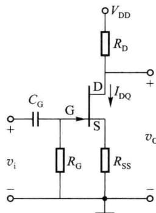  

图 3.4.6 场效应管的自给偏压式偏置

电压方向相反，称为反极性偏置。以 N 沟道结型场效应管为例，其栅极电位为最低，源极电位次之，漏极电位最高，因此 $V_{GSQ}<0, V_{DSQ}>0$ 。自给偏压式偏置电路适用于耗尽型 MOS 管和 JFET。

增强型 MOS 管需要同极性偏置,以增强型 NMOS 管为例,要求 $V_{GSQ}>0,V_{DSQ}>0$ 。因此,应使用分压式偏置电路。

<Example title="例 3.4.3">
N 沟道结型场效应管的自给偏压电路如图 3.4.6 所示。电路中， $R_{G}=1M\Omega$ ， $R_{SS}=0.5k\Omega$ ， $R_{D}=1k\Omega$ ， $V_{DD}=9V$ 。NJFET 特性曲线如图 3.4.7 所示。试求：（1）场效应管的静态工作点；（2）在不进入可变电阻区及截止区的情况下， $v_{GS}$ 、 $v_{DS}$ 、 $i_{D}$ 的变化范围，计算时可忽略沟道长度调制效应。

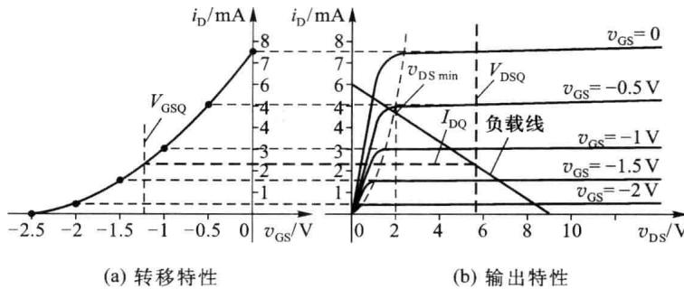  

图 3.4.7 例 3.4.3 中 NJFET 特性曲线

<Solution title="解">
(1)由图3.4.7可知,夹断电压 $V_{off}\approx-2.5V$ ,饱和电流 $I_{DSS}\approx7.5mA$ 。忽略沟道长度调制效应时,NJFET转移特性为

$$

i _ {\mathrm{D}} = I _ {\mathrm{DSS}} \left(1 - \frac {v _ {\mathrm{GS}}}{V _ {\mathrm{off}}}\right) ^ {2}

$$

漏极静态工作电流为

$$

I _ {\mathrm{DQ}} = 7. 5 \left(1 - \frac {V _ {\mathrm{GSQ}}}{- 2 . 5}\right) ^ {2} (\mathrm{mA})

$$

将 $V_{GSQ} = -I_{DQ} \cdot R_{SS} = -0.5 I_{DQ}$ 带入转移特性关系式中得到方程 $0.3 I_{DQ}^{2} - 4 I_{DQ} + 7.5 = 0$ 。解方程得 $I_{DQ1} = 2.257 mA, I_{DQ2} = 11.077 mA (I_{DQ2}$ 不合题意，超出最大漏极电流，舍去）。根据 $I_{DQ} = I_{DQ1}$ ，可计算出 $V_{GSQ} = -I_{DQ} \cdot R_{SS} = -1.129 V$ 。

根据电路， $V_{DSQ}=V_{DD}-I_{DQ}\cdot(R_{SS}+R_{D})=9-2.257\times(0.5+1)V=5.61V$ 。

由于 $V_{DSQ} > V_{GSQ} - V_{off} = [-1.129 - (-2.5)]$ V = 1.371 V，因而场效应管处于饱和区工作。

（2）可根据场效应管的工作原理、输出特性曲线和负载线[如图3.4.7（b）所示]，计算 $v_{GS}$ 、 $v_{DS}$ 、 $i_{D}$ 的动态范围时，要求场效应管正常工作时不应进入截止区和可变电阻区。根据场效应管工作原理，当 $v_{GS}=V_{off}$ 时，场效应管进入截止区，此时 $i_{D}=0,v_{DS}=V_{DD}$ 。因此，在靠近截止区处： $v_{GS}>-2.5V,i_{D}>0,v_{DS}<V_{DD}$ 。

在靠近可变电阻区处，设 $v_{GS} = V_{GSmax}$ 时开始进入可变电阻区， $v_{GS} = V_{GSmax}$ 时 $i_{D} = I_{Dmax}$ ，这时， $V_{DSmin} = V_{DD} - I_{Dmax} \cdot (R_{SS} + R_{D})$ ，同时根据定义，在可变电阻区和饱和区的边界，有 $V_{DSmin} = V_{GSmax} - V_{off} \circ$ 即

$$

V _ {\mathrm{DD}} - I _ {\mathrm{Dmax}} (R _ {\mathrm{SS}} + R _ {\mathrm{D}}) = V _ {\mathrm{GSmax}} - V _ {\mathrm{off}}

$$

$$

\begin{array}{r l} & V _ {\mathrm{DD}} - I _ {\mathrm{DSS}} \left(1 - \frac {V _ {\mathrm{GSmax}}}{V _ {\mathrm{off}}}\right) ^ {2} \cdot (R _ {\mathrm{SS}} + R _ {\mathrm{D}}) = V _ {\mathrm{GSmax}} - V _ {\mathrm{off}} \\ & 1. 8 V _ {\mathrm{GSmax}} ^ {2} + 1 0 V _ {\mathrm{GSmax}} + 4. 7 5 = 0 \end{array}

$$

可以解出 $V_{\mathrm{GSmax1}} = -0.5248\mathrm{V};V_{\mathrm{GSmax2}} = -5.031\mathrm{V}$ （舍去）。根据 $V_{\mathrm{GSmax}} = V_{\mathrm{GSmax1}}$ 可以求出

$$

I _ {\mathrm{Dmax}} = I _ {\mathrm{DSS}} \left(1 - \frac {V _ {\mathrm{GSmax}}}{V _ {\mathrm{off}}}\right) ^ {2} = 7. 5 \left(1 - \frac {- 0 . 5 2 4 8}{- 2 . 5}\right) ^ {2} \mathrm{mA} \approx 4. 6 8 \mathrm{mA}

$$

$$

V _ {\mathrm{DSmin}} = V _ {\mathrm{DD}} - I _ {\mathrm{Dmax}} (R _ {\mathrm{D}} + R _ {\mathrm{SS}}) = (9 - 4. 6 8 \times 1. 5) \mathrm{V} = 1. 9 8 \mathrm{V}

$$

由以上分析可知， $v_{GS}$ 的变化范围是 $[-2.5V, -0.5248V]$ ， $v_{DS}$ 的变化范围是 $[1.98V, 9V]$ ， $i_{D}$ 的变化范围是 $[0, 4.68mA]$ 。

从场效应管的工作原理和以上对偏置电路的分析可以看到,不同的场效应管应施加不同的偏置电压。表 3.4.1 给出了增强型 MOS 管、耗尽型 MOS 管及结型场效应管的偏置电压范围和极性。

表 3.4.1 效应管的偏置电压范围和极性

<table><tr><td>类型</td><td>沟道</td><td>开启电压 $V_{\text{th}}$ 或夹断电压 $V_{\text{off}}$ 的极性</td><td> $V_{\text{GS}}$ 范围和极性</td><td> $V_{\text{DS}}$ 极性</td><td> $I_{\text{D}}$ 的方向</td></tr><tr><td rowspan="2">增强型MOS管</td><td>N沟道</td><td> $V_{\text{th}}>0$ (正)</td><td> $V_{\text{GS}}>V_{\text{th}}$ (正)</td><td> $V_{\text{DS}}>0$ (正)</td><td>流入漏极</td></tr><tr><td>P沟道</td><td> $V_{\text{th}}<0$ (负)</td><td> $V_{\text{GS}}<V_{\text{th}}$ (负)</td><td> $V_{\text{DS}}<0$ (负)</td><td>流出漏极</td></tr><tr><td rowspan="2">耗尽型MOS管</td><td>N沟道</td><td> $V_{\text{off}}<0$ (负)</td><td> $V_{\text{GS}}>V_{\text{off}}$ (可正可负)</td><td> $V_{\text{DS}}>0$ (正)</td><td>流入漏极</td></tr><tr><td>P沟道</td><td> $V_{\text{off}}>0$ (正)</td><td> $V_{\text{GS}}<V_{\text{off}}$ (可正可负)</td><td> $V_{\text{DS}}<0$ (负)</td><td>流出漏极</td></tr><tr><td rowspan="2">结型场效应管</td><td>N沟道</td><td> $V_{\text{off}}<0$ (负)</td><td> $V_{\text{GS}}>V_{\text{off}}$ (负)</td><td> $V_{\text{DS}}>0$ (正)</td><td>流入漏极</td></tr><tr><td>P沟道</td><td> $V_{\text{off}}>0$ (正)</td><td> $V_{\text{GS}}<V_{\text{off}}$ (正)</td><td> $V_{\text{DS}}<0$ (负)</td><td>流出漏极</td></tr></table>

从表 3.4.1 可以看出: 增强型 MOS 管的偏置电压 ( $V_{GS}$ 和 $V_{DS}$ ) 为同极性偏置, 即 N 沟道的 $V_{GS}$ 和 $V_{DS}$ 都为正值, P 沟道的 $V_{GS}$ 和 $V_{DS}$ 都为负值。耗尽型 MOS 管的偏置电压可为同极性偏置, 也可为反极性偏置 ( $V_{GS}$ 可正可负)。结型场效应管为反极性偏置。N 沟道的场效应管的漏极电流 $I_{D}$ 均为流入漏极, P 沟道的场效应管的漏极电流 $I_{D}$ 均为流出漏极。
</Solution>
</Example>

## 3.4.3 场效应管基本放大电路

场效应管电路与双极型晶体管电路的构成和分析方法基本相同。场效应管漏极(D)的特性可类比双极型晶体管的集电极C，源极S类比发射极E，栅极G类比基极B。场效应管基本放大电路也有共源极、共栅极、共漏极三种工作组态，分别对应双极型晶体管的共射、共基和共集三种工作组态。在场效应管的交流分析时，只需将场效应管的微变信号模型替代交流通路图中的场效应管，形成微变等效电路，在微变等效电路中求取相关参数即可。

本节主要分析场效应管放大电路的中频特性,在第四章中介绍高频特性的分析。

## 一、基本共源极放大电路

图 3.4.8(a) 为共源极放大电路的一种基本形式, 信号从栅极输入, 从漏极输出。其静态偏置电路为分压式偏置, 与图 3.4.5 给出的偏置电路相似, 只是由于没有源极的电阻

(b)  

(a)  

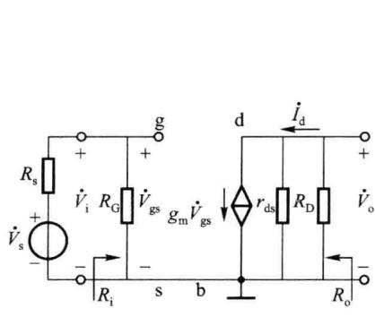

$R_{ss}$ ，源极电位为0，可直接通过 $R_{G1}$ 和 $R_{G2}$ 的分压获得 $V_{GSQ}$ 。关于静态分析，这里不再赘述。

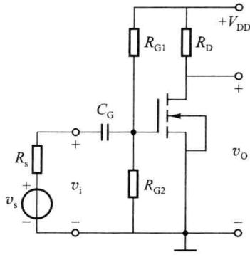  

图 3.4.8 基本共源极放大电路

将场效应管的微变信号模型替换场效应管符号，可得到图3.4.8(b)所示的中频微变等效电路，图中 $r_{ds}$ 为沟道长度调制效应的等效微变电阻， $R_{G}=R_{G1}//R_{G2}$ 。根据图3.4.8(b)可求出中频段电压增益 $\dot{A}_{v}$ 、源电压增益 $\dot{A}_{vs}$ 、输入电阻 $R_{i}$ 、输出电阻 $R_{o}$ ，分别如式(3.4.1)～式(3.4.4)所示。

$$

\dot {A} _ {v} = \frac {\dot {V} _ {\mathrm{o}}}{\dot {V} _ {\mathrm{i}}} = - g _ {\mathrm{m}} \cdot (r _ {\mathrm{ds}} / / R _ {\mathrm{D}})\tag{3.4.1}

$$

$$

\dot {A} _ {\mathrm{vs}} = \frac {\dot {V} _ {\mathrm{o}}}{\dot {V} _ {\mathrm{s}}} = - \frac {R _ {\mathrm{G}}}{R _ {\mathrm{s}} + R _ {\mathrm{G}}} \cdot g _ {\mathrm{m}} \cdot (r _ {\mathrm{ds}} / / R _ {\mathrm{D}})\tag{3.4.2}

$$

$$

R _ {\mathrm{i}} = R _ {\mathrm{G}} = R _ {\mathrm{G1}} / / R _ {\mathrm{G2}}\tag{3.4.3}

$$

$$

R _ {\mathrm{o}} = r _ {\mathrm{ds}} / / R _ {\mathrm{D}}\tag{3.4.4}

$$

<Example title="例 3.4.4">
基本共源极放大电路如图 3.4.8(a) 所示。其中 $R_{G1}=15k\Omega, R_{G2}=10k\Omega, R_{D}=4k\Omega, R_{s}=1k\Omega$ 。 $V_{DD}=5V$ 。 $C_{G}$ 为耦合电容，可视为中频短路。管参数为 $k_{p}=40\mu A/V^{2}, W/L=20, V_{th}=1V, \lambda=0.01$ 。试计算电路的 $\dot{A}_{v}, \dot{A}_{vs}, R_{i}, R_{o}$ 。

<Solution title="解">
由于 $\lambda$ 值较小, $1+\lambda v_{DS}\approx1$ 。故计算 $I_{DQ}$ 、 $g_{m}$ 时可忽略沟道长度调制效应。

根据图 3.4.8 (a) 所示电路, 有

$$

\begin{array}{r l} & V _ {\mathrm{GSQ}} = \frac {R _ {\mathrm{G2}}}{R _ {\mathrm{G1}} + R _ {\mathrm{G2}}} V _ {\mathrm{DD}} = 2 \mathrm{V} \\ & I _ {\mathrm{DQ}} = \frac {k _ {\mathrm{p}}}{2} \cdot \frac {W}{L} (V _ {\mathrm{GSQ}} - V _ {\mathrm{th}}) ^ {2} = 0. 4 \mathrm{mA} \\ & g _ {\mathrm{m}} = \frac {2 I _ {\mathrm{DQ}}}{V _ {\mathrm{GSQ}} - V _ {\mathrm{th}}} = 0. 8 \mathrm{mS} \\ & r _ {\mathrm{ds}} \approx \frac {1}{\lambda I _ {\mathrm{DQ}}} = 2 5 0 \mathrm{k} \Omega \end{array}

$$

根据图 3.4.8(b) 所示微变等效电路, 有

$$

\dot {A} _ {v} = \frac {\dot {V} _ {\mathrm{o}}}{\dot {V} _ {\mathrm{i}}} = - g _ {\mathrm{m}} \cdot r _ {\mathrm{ds}} / / R _ {\mathrm{D}} = - 0. 8 \frac {2 5 0 \times 4}{2 5 0 + 4} \approx - 3. 2

$$

$$

\dot {A} _ {\mathrm{vs}} = \frac {\dot {V} _ {\mathrm{o}}}{\dot {V} _ {\mathrm{s}}} = - \frac {R _ {\mathrm{i}}}{R _ {\mathrm{s}} + R _ {\mathrm{i}}} \cdot g _ {\mathrm{m}} \cdot r _ {\mathrm{ds}} / / R _ {\mathrm{D}} = - \frac {6}{1 + 6} \times 0. 8 \times \frac {2 5 0 \times 4}{2 5 0 + 4} \approx - 2. 7

$$

$$

R _ {\mathrm{i}} = R _ {\mathrm{G}} = R _ {\mathrm{G1}} / / R _ {\mathrm{G2}} = 6 \mathrm{k} \Omega

$$

$$

R _ {\mathrm{o}} = r _ {\mathrm{ds}} / / R _ {\mathrm{D}} = \frac {2 5 0 \times 4}{2 5 0 + 4} \mathrm{k} \Omega \approx 4 \mathrm{k} \Omega

$$

由以上分析和计算结果可见,共源放大电路与共射放大电路类似,输出信号与输入信号的相位相反;输入阻抗较高,由于从栅极看入的输入阻抗为无穷大,所以输入阻抗仅取决于输入偏置电阻(在共射电路中输入阻抗还包含了从基极看入的阻抗);输出阻抗为 $r_{ds} // R_{D}$ ,近似为 $R_{D}$ (共射电路的输出阻抗为 $r_{ce} // R_{C}$ ,近似为 $R_{C}$ )。
</Solution>
</Example>

## 二、基本共栅极放大电路

图 3.4.9(a) 为 N 沟道结型场效应管共栅极放大电路的基本形式, 信号从源极输入, 从漏极输出。由图 3.4.9(a) 可见, 场效应管的偏置为自给偏压方式。图 3.4.9(b) 为中频交流通路图, 图 3.4.9(c) 为微变等效电路。计算直流工作点的方法可参见例 3.4.3。

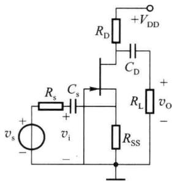  

(a) 共栅放大电路

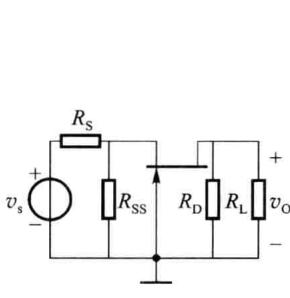  

(b) 交流通路

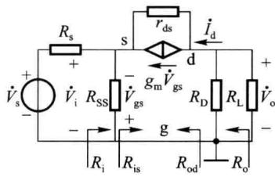  

(c) 微变等效电路  

图 3.4.9 基本共栅极放大电路

对图 3.4.9(c) 微变等效电路分析可知

$$

- \dot {V} _ {\mathrm{gs}} = \dot {V} _ {\mathrm{o}} - (\dot {I} _ {\mathrm{D}} - g _ {\mathrm{m}} \dot {V} _ {\mathrm{gs}}) r _ {\mathrm{ds}} = \dot {V} _ {\mathrm{o}} - \left(- \frac {\dot {V} _ {\mathrm{o}}}{R _ {\mathrm{D}} / / R _ {\mathrm{L}}} - g _ {\mathrm{m}} \dot {V} _ {\mathrm{gs}}\right) r _ {\mathrm{ds}}

$$

整理后可以得到

$$

\frac {\dot {V} _ {\mathrm{o}}}{- \dot {V} _ {\mathrm{gs}}} = \frac {1 + g _ {\mathrm{m}} r _ {\mathrm{ds}}}{R _ {\mathrm{D}} / / R _ {\mathrm{L}} + r _ {\mathrm{ds}}} \cdot (R _ {\mathrm{D}} / / R _ {\mathrm{L}})

$$

由于 $r_{ds}$ 数值较大,通常满足 $r_{ds} >> R_{D} // R_{L}$ 和 $g_{m} r_{ds} >> 1$ , 将分子上的“1”忽略并将分母上的 $R_{D} // R_{L}$ 忽略, 可以得到

$$

\frac {\dot {V} _ {\mathrm{o}}}{- \dot {V} _ {\mathrm{gs}}} \approx g _ {\mathrm{m}} (R _ {\mathrm{D}} / / R _ {\mathrm{L}})

$$

由于 $\dot{V}_{i} = -\dot{V}_{gs}$ ，所以该共栅放大电路的电压增益为

$$

\dot {A} _ {v} = \frac {\dot {V} _ {\mathrm{o}}}{\dot {V} _ {\mathrm{i}}} \approx g _ {\mathrm{m}} \cdot (R _ {\mathrm{D}} / / R _ {\mathrm{L}})\tag{3.4.5}

$$

从源极端看入的输入电阻为

$$

R _ {\mathrm{is}} = \frac {- \dot {V} _ {\mathrm{gs}}}{\dot {I} _ {\mathrm{s}}} = \frac {- \dot {V} _ {\mathrm{gs}}}{\dot {I} _ {\mathrm{d}}} \approx \frac {- \dot {V} _ {\mathrm{gs}}}{- g _ {\mathrm{m}} \dot {V} _ {\mathrm{gs}}} = \frac {1}{g _ {\mathrm{m}}} (\text {   忽略了   } r _ {\mathrm{ds}} \text {   的影响   })

$$

放大电路输入电阻为

$$

R _ {\mathrm{i}} = R _ {\mathrm{SS}} / / R _ {\mathrm{is}} \approx R _ {\mathrm{SS}} / / \left(\frac {1}{g _ {\mathrm{m}}}\right)\tag{3.4.6}

$$

源电压增益为

$$

\dot {A} _ {\mathrm{vs}} = \frac {\dot {V} _ {\mathrm{o}}}{\dot {V} _ {\mathrm{s}}} = \frac {- \dot {V} _ {\mathrm{gs}}}{\dot {V} _ {\mathrm{s}}} \cdot \frac {\dot {V} _ {\mathrm{o}}}{- \dot {V} _ {\mathrm{gs}}} \approx \frac {R _ {\mathrm{i}}}{R _ {\mathrm{s}} + R _ {\mathrm{i}}} \cdot g _ {\mathrm{m}} \cdot R _ {\mathrm{D}} / / R _ {\mathrm{L}}\tag{3.4.7}

$$

放大电路的输出电阻 $R_{o}=R_{od}//R_{D}, R_{od}$ 为从管漏极向放大电路看进去的输出电阻。求 $R_{od}$ 时，信号源 $\dot{V}_{s}$ 短路，保留内阻。设有一电流 $\dot{I}_{d}$ 流入漏极，计算 $\dot{I}_{d}$ 在漏极端产生的电压 $\dot{V}_{d}$ ，则有

$$

\left(R _ {\mathrm{s}} / / R _ {\mathrm{SS}}\right) \cdot \dot {I} _ {\mathrm{d}} + \left[ \dot {I} _ {\mathrm{d}} + g _ {\mathrm{m}} \left(R _ {\mathrm{s}} / / R _ {\mathrm{SS}}\right) \dot {I} _ {\mathrm{d}} \right] r _ {\mathrm{ds}} = \dot {V} _ {\mathrm{d}}

$$

可以得到

$$

R _ {\mathrm{od}} = \frac {\dot {V} _ {\mathrm{d}}}{\dot {I} _ {\mathrm{d}}} = R _ {\mathrm{s}} / / R _ {\mathrm{SS}} + \left[ 1 + g _ {\mathrm{m}} \left(R _ {\mathrm{s}} / / R _ {\mathrm{SS}}\right) \right] r _ {\mathrm{ds}}

$$

由于一般 $g_{\mathrm{m}}(R_{\mathrm{s}}//R_{\mathrm{SS}})>1$ ，所以 $R_{od}>r_{ds}$ ，又通常 $r_{ds}\gg R_{D}$ ，所以输出电阻为

$$

R _ {\mathrm{o}} = R _ {\mathrm{od}} / / R _ {\mathrm{D}} \approx R _ {\mathrm{D}}\tag{3.4.8}

$$

<Example title="例 3.4.5">
图 3.4.9 所示的共栅极放大电路中， $V_{DD}=5V, R_{SS}=1\ k\Omega, R_{D}=3\ k\Omega$ ，信号源内阻 $R_{s}=1\ k\Omega$ ，负载电阻 $R_{L}=6\ k\Omega$ 。FET 管的参数为 $I_{DSS}=4.5mA, V_{off}=-1.5V, \lambda=0.01$ 。试计算电路的 $\dot{A}_{v}, \dot{A}_{vs}, R_{i}, R_{o}$ 。

<Solution title="解">
由于 $\lambda$ 数值较小,计算直流工作点时忽略沟道调制效应。参照例 3.4.3 可计算得到 $I_{DQ}=0.85mA, V_{GSQ}=-0.85V$ 。由于 $V_{GDQ}=-(V_{DD}-I_{DQ}R_{D})=-2.45V<V_{off}$ , 管处于饱和区工作。

$$

\begin{array}{r l} g _ {\mathrm{m}} & = \frac {2 \cdot I _ {\mathrm{DQ}}}{V _ {\mathrm{GSQ}} - V _ {\mathrm{off}}} = \frac {2 \times 0 . 8 5}{- 0 . 8 5 - (- 1 . 5)} \mathrm{mS} = 2. 6 2 \mathrm{mS} \\ & r _ {\mathrm{ds}} \approx \frac {1}{\lambda I _ {\mathrm{DQ}}} = 1 1 7 \mathrm{k} \Omega \end{array}

$$

$R_{i} \approx R_{ss} / \frac{1}{g_{m}} \approx 276\Omega$ ，与晶体管的共基电路一样，共栅极放大电路的输入电阻较低（远低于共源极和共漏极电路），这是由于从源极看入的输入电阻 $1/g_{m}$ 较小的缘故。

电压增益

$$

\dot {A} _ {_ v} = \frac {\dot {V} _ {_ o}}{\dot {V} _ {_ i}} \approx g _ {_ m} \cdot R _ {_ D} / / R _ {_ L} = 2. 6 2 \times 2 = 5. 2 4

$$

源电压增益

$$

\dot {A} _ {\mathrm{vs}} = \frac {\dot {V} _ {\mathrm{o}}}{\dot {V} _ {\mathrm{s}}} \approx \frac {R _ {\mathrm{i}}}{R _ {\mathrm{s}} + R _ {\mathrm{i}}} \cdot g _ {\mathrm{m}} \cdot R _ {\mathrm{D}} / / R _ {\mathrm{L}} = \frac {2 7 6}{1 0 0 0 + 2 7 6} \times 2. 6 2 \times 2 = 1. 1 3

$$

源电压增益会较低的原因是由于输入电阻较小,且信号源内阻 $R_{s}$ 较大造成的。

输出电阻

$$

R _ {\mathrm{o}} \approx R _ {\mathrm{D}} = 3 \mathrm{k} \Omega

$$

由上分析和计算结果可见,共栅放大电路与共基放大电路类似,输出信号与输入信号的相位相同;输入阻抗较低,如要求有较大的源电压增益,信号源的内阻必须很小;输出阻抗近似为 $R_{D}$ 。
</Solution>
</Example>

## 三、基本共漏极放大电路(或称源极输出器或源极跟随器)

图 3.4.10(a) 为共漏极放大电路的基本形式, 信号从栅极输入, 从源极输出。栅极偏置电路中增加了 $R_{G}$ , 由于管栅极输入电流基本为零, $R_{G}$ 上没有压降, 不会影响 $R_{G1}$ 、 $R_{G2}$ 分压给栅极的电位值, 通常 $R_{G}$ 的阻值较大, 从而提高电路的交流输入电阻。图 3.4.10(b) 为中频微变等效电路。

由于衬底不是直接与源极相接，所以存在着衬底调制效应。根据MOS管微变信号模型，衬底调制效应可用受控电流源 $g_{mb}\dot{V}_{bs}$ 进行描述。观察图3.4.10(b)所示共漏放大电路的微变等效电路可以看到，受控电流源 $g_{mb}\dot{V}_{bs}$ 的控制电压 $\dot{V}_{bs}$ 就是其两端电压。因此受控电流源可等效为一个电阻： $r_{mb} = \frac{\dot{V}_{bs}}{g_{mb}\dot{V}_{bs}} = \frac{1}{g_{mb}}$ 。

从微变等效电路很容易求出中频输入电阻为

$$

R _ {\mathrm{i}} = R _ {\mathrm{G}} + R _ {\mathrm{G1}} / / R _ {\mathrm{G2}}\tag{3.4.9}

$$

求电路的输出电阻时，令信号源 $\dot{V}_{\mathrm{s}}$ 短路，保留内阻，由于输入端所有电阻上没有电流，压降为零，此时栅极为参考点电位，也就是与漏极电位相同，于是 $\dot{V}_{\mathrm{gs}} = -\dot{V}_{\mathrm{o}}$ ，为受控电流源 $g_{\mathrm{m}}\dot{V}_{\mathrm{gs}}$ 两端的电压。因此，如同前面提到的衬底调制效应受控电流源 $g_{\mathrm{mb}}\dot{V}_{\mathrm{bs}}$ 的分析处理方法一样，受控电流源 $g_{\mathrm{m}}\dot{V}_{\mathrm{gs}}$ 等效为一个阻值为 $\frac{1}{g_{\mathrm{m}}}$ 的电阻。输出电阻 $R_{\mathrm{o}}$ 为

$$

R _ {\mathrm{o}} = \left(\frac {1}{g _ {\mathrm{m}}}\right) / / \left(\frac {1}{g _ {\mathrm{mb}}}\right) / / r _ {\mathrm{ds}} / / R _ {\mathrm{ss}}\tag{3.4.10}

$$

(b)  

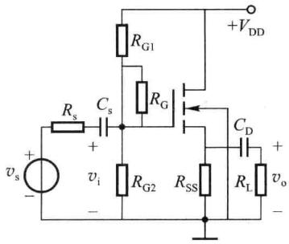  

(a)

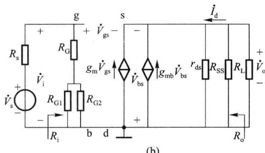  

图 3.4.10 基本共漏极放大电路

在分析电压增益和源电压增益时, 可令受控源 $g_{m} \dot{V}_{gs}$ 后面的总电阻为 $R_{L}^{\prime}=\left(\frac{1}{g_{mb}}\right)/r_{ds}/R_{ss}//R_{L}$ , 可得

电压增益为

$$

\begin{array}{r l} \dot {V} _ {\mathrm{o}} & = g _ {\mathrm{m}} \dot {V} _ {\mathrm{gs}} R _ {\mathrm{L}} ^ {\prime}, \dot {V} _ {\mathrm{i}} = \dot {V} _ {\mathrm{gs}} + \dot {V} _ {\mathrm{o}} = \dot {V} _ {\mathrm{gs}} (1 + g _ {\mathrm{m}} R _ {\mathrm{L}} ^ {\prime}) \\ \dot {A} _ {v} & = \frac {\dot {V} _ {\mathrm{o}}}{\dot {V} _ {\mathrm{i}}} = \frac {g _ {\mathrm{m}} R _ {\mathrm{L}} ^ {\prime}}{(1 + g _ {\mathrm{m}} R _ {\mathrm{L}} ^ {\prime})} \end{array}\tag{3.4.11}

$$

当 $R_{L}^{\prime}$ 足够大，使 $g_{m}R_{L}^{\prime}\gg1,\dot{A}_{v}=\frac{\dot{V}_{o}}{\dot{V}_{i}}\approx1$ ，即，源极输出电压 $v_{o}$ 跟随栅极输入电压 $v_{i}$ 的变化而变化。所以，共漏极放大电路也称为源极跟随器（类似晶体管的射极跟随器）。

考虑信号源内阻的影响,源电压增益为

$$

\dot {A} _ {\mathrm{vs}} = \frac {\dot {V} _ {\mathrm{o}}}{\dot {V} _ {\mathrm{s}}} = \frac {\dot {V} _ {\mathrm{i}}}{\dot {V} _ {\mathrm{s}}} \cdot \frac {\dot {V} _ {\mathrm{o}}}{\dot {V} _ {\mathrm{i}}} = \frac {R _ {\mathrm{i}}}{R _ {\mathrm{s}} + R _ {\mathrm{i}}} \cdot \frac {g _ {\mathrm{m}} R _ {\mathrm{L}} ^ {\prime}}{(1 + g _ {\mathrm{m}} R _ {\mathrm{L}} ^ {\prime})}\tag{3.4.12}

$$

<Example title="例 3.4.6">
源极跟随器电路如图 3.4.10(a) 所示。其中， $R_{G1}=10k\Omega, R_{G2}=10k\Omega, R_{G}=1M\Omega, R_{SS}=0.5k\Omega$ ，负载电阻 $R_{L}$ 开路， $V_{DD}=10V$ ，信号源内阻 $R_{S}=1k\Omega$ 。NMOS 管转移特性为 $i_{D}=0.2(v_{GS}-V_{th})^{2}(1+\lambda v_{DS})\mathrm{mA}$ ，开启电压 $V_{th}=2V$ ，沟道长度调制系数 $\lambda=0.01$ ，跨导比系数 $\eta=0.1$ 。试估算电路的 $\dot{A}_{vs}, R_{i}, R_{o}$ 。

<Solution title="解">
作为估算,在 $\eta$ 不很大时,可忽略衬底调制效应对直流工作点的影响。电路中场效应管直流工作点的计算方法及数值与例 3.4.2 相同,即 $I_{DQ}=1.168mA,V_{SQ}=0.584V,V_{GSQ}=4.414V,V_{DSQ}=9.416V$ 。

$$

\begin{array}{r l} & g _ {\mathrm{m}} = \frac {2 \cdot I _ {\mathrm{DQ}}}{V _ {\mathrm{GSQ}} - V _ {\mathrm{th}}} = 0. 9 7 \mathrm{mS} \\ & r _ {\mathrm{ds}} \approx \frac {1}{\lambda I _ {\mathrm{DQ}}} = 8 5. 6 2 \mathrm{k} \Omega \\ & g _ {\mathrm{mb}} = \eta g _ {\mathrm{m}} = 0. 0 9 7 \mathrm{mS} \end{array}

$$

$R_{i}=R_{G}+R_{G1}//R_{G2}=(1000+5)\mathrm{k}\Omega=1005\mathrm{k}\Omega$ ，可见用大阻值 $R_{G}$ 可增大输入电阻 $R_{i}$ 。

$$

R _ {\mathrm{o}} = \left(\frac {1}{g _ {\mathrm{m}}}\right) / / \left(\frac {1}{g _ {\mathrm{mb}}}\right) / / r _ {\mathrm{ds}} / / R _ {\mathrm{ss}} \approx \frac {1}{g _ {\mathrm{m}}} / / R _ {\mathrm{ss}} = 3 3 7 \Omega

$$

类似晶体管的射极跟随器,源极跟随器的交流输出电阻 $R_{o}$ 比共源、共栅电路的都要小,但由于 $g_{m}$ 的数值通常比晶体管的 $g_{m}$ 小得多,源极跟随器的 $R_{o}$ 比双极型晶体管射极跟随器的 $R_{o}$ 的数值要大。

$$

\dot {A} _ {\mathrm{vs}} = \frac {R _ {\mathrm{i}}}{R _ {\mathrm{s}} + R _ {\mathrm{i}}} \cdot \frac {g _ {\mathrm{m}} \cdot R _ {\mathrm{L}} ^ {\prime}}{(1 + g _ {\mathrm{m}} \cdot R _ {\mathrm{L}} ^ {\prime})} = \frac {1 0 0 5}{1 + 1 0 0 5} \times \frac {0 . 9 7 \times 0 . 4 7 4}{1 + 0 . 9 7 \times 0 . 4 7} \approx 1 \times 0. 3 1 4 = 0. 3 1 4

$$

其中的 $R_{\mathrm{L}}^{\prime}=\left(\frac{1}{g_{\mathrm{mb}}}\right)/r_{\mathrm{ds}}/R_{\mathrm{SS}}\approx0.474\ \mathrm{k}\Omega$ 。从计算结果看， $\dot{A}_{vs}$ 仅约为 0.3 ，电压跟随特性不理想（远低于 1），这是由于场效应管跨导 $g_{m}$ 的数值较小、 $R_{L}^{\prime}$ 也较小的缘故。源极跟随器的电压跟随特性一般会差于双极型晶体管的射极跟随器。欲使源极跟随器的增益接近 1 ，源极电阻 $R_{ss}$ 、负载电阻 $R_{L}$ 阻值应尽可能大，同时要尽量避免衬底调制效应的影响。因而在集成电路中常采用有源负载替代源极电阻 $R_{ss}$ 。

小结:根据对基本共源、共栅、共漏极放大电路的介绍,对比双极型晶体管的共射、共基、共集电路,其对应电路的分析方法、电路特性均非常相似。

共源电路与共射电路:均为反相电压放大器,电压及电流增益较高,输入阻抗较高,输出

阻抗较高。

共栅电路与共基电路:均为同相电压放大器,电压增益较高,电流增益较低(小于1),输入阻抗很低,输出阻抗较高。

共漏电路与共集电路:均为同相电压放大器,电压增益较低(小于1),电流增益较高,输入阻抗很高,输出阻抗很低。
</Solution>
</Example>

## 3.4.4 场效应管有源电阻及电流源电路

在场效应管集成电路中,由于场效应管跨导较低,为提高单级放大电路的增益、改善电路性能,通常使用有源电阻或电流源作为放大电路中负载电阻。即:用场效应管构成有源电阻或电流源替代共源和共栅电路中负载电阻 $R_{D}$ 以及共漏电路中的 $R_{SS}$ ,其优点是制作工艺简单、集成度可提高、为放大电路提供较稳定的静态工作点、提高放大电路的动态范围,并且可提供较高的等效交流阻抗,从而提高放大电路的增益。

## 一、MOS 管有源电阻

### 1. 增强型 MOS 管有源电阻

图 3.4.11(a)、(b) 是常用的 N 沟道和 P 沟道增强型 MOS 管有源电阻。将增强型 MOS 管栅、漏极短接，当漏源之间的电压 $v_{DS}$ 大于开启电压 $V_{th}$ 后，必有 $v_{GD} = 0 < V_{th}$ ，也就是场效应管处于饱和区工作。在场效应管漏源两端加电压 v，会产生电流 i，等效的微变电阻 r 可通过图 3.4.11(c) 所示的微变等效电路求得。图 3.4.11(d) 是将受控源进一步等效后的电路。等效微变电阻 r 由式 (3.4.13) 定义并给出。

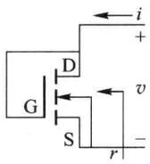  

(a)

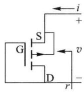  

(b)

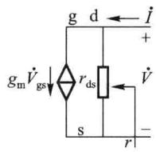  

(c)

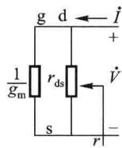  

(d)  

图 3.4.11 增强型 MOS 管有源电阻

$$

r = \frac {\Delta v}{\Delta i} \Bigg | _ {I _ {\mathrm{DSQ}}} = r _ {\mathrm{ds}} / / \left(\frac {1}{g _ {\mathrm{m}}}\right) \approx \frac {1}{g _ {\mathrm{m}}}\tag{3.4.13}

$$

由于增强型 MOS 管构成的有源电阻 r 与 $g_{m}$ 有关，而 $g_{m}$ 的值与静态工作点有关，因此，静态工作点不同，r 的数值不同。

当场效应管的衬源不相接时,需要考虑 $v_{BS}$ 的衬底调制效应影响,应该根据实际应用电路进行重新推导。

### 2. 耗尽型 MOS 管有源电阻

耗尽型 MOS 管有源电阻的电路形式如图 3.4.12(a)、(b) 所示，是由栅、源极短接的耗尽型 MOS 管构成的。由于 $v_{GS}=0$ ，只要漏源之间的直流电压大于夹断电压的数值（对于 NMOS 管： $v_{DS}>-V_{off}$ ，对于 PMOS 管： $v_{DS}<-V_{off}$ ）时，MOS 管就会工作于饱和区。因此，图 3.4.12(a)、(b) 电路的微变等效电路如图 3.4.12(c) 所示。由于 $\dot{V}_{gs}=0$ ，图 3.4.12(c) 可进一步等效为图 3.4.12(d)。微变电阻 r 等于漏源输出电阻 $r_{ds}$ ，即

$$

r = \frac {\Delta v}{\Delta i} \Bigg | _ {V _ {\mathrm{DSQ}}} = r _ {\mathrm{ds}} I _ {\mathrm{DQ}}\tag{3.4.14}

$$

与增强型 MOS 管有源电阻的情况一样, 当衬源不相接时, 应用电路中还需考虑衬源电压 $v_{BS}$ 对 r 的影响。

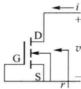  

(a)

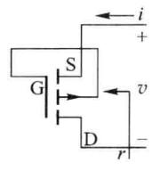  

(b)

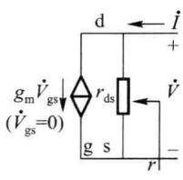  

(c)

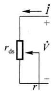  

(d)  

图 3.4.12 耗尽型 MOS 管有源电阻

从对耗尽型 MOS 管有源电阻分析可知, 其有源电阻近似为 $r_{ds}$ 。 $I_{DQ}$ 越小, $r_{ds}$ 越大。由于 $r_{ds}$ 通常较大, 耗尽型 MOS 管有源电阻电路也是一个内阻为 $r_{ds}$ 、电流为 $I_{DSS}$ 的近似恒流源电路。

## 二、基本电流源

图 3.4.13 为 MOS 管基本电流源的电路形式。正常工作时，MOS 管 $T_{1}$ 、 $T_{2}$ 应处于饱和

区， $T_{2}$ 漏极电流为输出电流 $I_{0}$ ， $T_{1}$ 漏极电流为参考电流 $I_{R}$ 。

$T_{1}$ 的栅漏极短接，当 $v_{DS1}=v_{GS1}>V_{th1}$ 时，必有 $v_{GD1}=0<V_{th1}$ ，使 $T_{1}$ 处于饱和区工作。只要 $T_{2}$ 漏极端负载上的压降不是很大，也就是漏极端电位足够高，就可以保证 $T_{2}$ 处于饱和区正常工作。

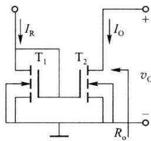

设 $\mathrm{T}_{1},\mathrm{T}_{2}$ 两管的参数 $k_{\mathrm{p}},V_{\mathrm{th}},\lambda$ 分别相等，由于两管的栅极连接，有 $v_{\mathrm{GS1}} = v_{\mathrm{GS2}}$ ，根据式(3.1.5），输出电流与参考电流之比 $(I_0 / I_R)$ 为

图 3.4.13 基本电流源电路

$$

\frac {I _ {\mathrm{O}}}{I _ {\mathrm{R}}} = \frac {(W / L) _ {2} \cdot (1 + \lambda v _ {\mathrm{DS2}})}{(W / L) _ {1} \cdot (1 + \lambda v _ {\mathrm{DS1}})} \approx \frac {(W / L) _ {2}}{(W / L) _ {1}}\tag{3.4.15}

$$

式中的近似条件是沟道长度调制因子 $\lambda$ 足够小。

由式(3.4.15)可见， $I_{0}$ 与 $I_{R}$ 的比例关系正比于 $T_{1}$ 、 $T_{2}$ 两管的沟道宽长 (W/L) 之比。如果两管的 (W/L) 相等，则电路为镜像电流源。

基本电流源的输出电阻 $R_{o}$ 为 $T_{2}$ 管的漏源微变输出电阻 $r_{ds2}$ ，即

$$

R _ {\mathrm{o}} = \frac {\Delta v _ {\mathrm{O}}}{\Delta I _ {\mathrm{O}}} = r _ {\mathrm{ds2}} \approx \frac {1 + \lambda v _ {\mathrm{O}}}{\lambda I _ {\mathrm{O}}} \approx \frac {1}{\lambda I _ {\mathrm{O}}}\tag{3.4.16}

$$

## 三、威尔逊电流源

MOS 管威尔逊电流源的电路形式如图 3.4.14。与双极型晶体管威尔逊电流源的工作原理类似，MOS 管威尔逊电流源也是利用 $T_{2}$ 、 $T_{1}$ 两管的有源负反馈提高了输出管 $T_{3}$ 漏极对地的交流输出电阻，从而提高了输出电流 $I_{0}$ 的稳定度，减小了 $I_{0}$ 受输出端电压影响而变化

的程度。

威尔逊电流源可提高交流输出电阻,减小沟道长度调制效应的不利影响。但由于在输出回路中串接有两个 MOS 管且要求两管均工作于饱和区,这要求输出端的电压直流工作点也要相应提高,在电源电压一定的情况下,这会减小输出端电压变化的动态范围。

## 3.4.5 场效应管有源负载放大电路

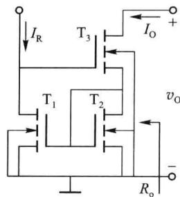

由于场效应管的微变跨导 $g_{m}$ 的数值较小,为提高放大电路的性能,需要增大负载电阻的阻值。在电源电压一定时,负

图 3.4.14 威尔逊电流源电路

载电阻过大会导致输出信号动态范围变小。在集成电路中，大阻值的集成电阻占用的芯片面积也较大，使集成度下降。因而，在集成电路中常采用有源电阻或恒流源组成有源负载放大电路。

## 一、NMOS 共源 E/E 型放大电路

在图 3.4.15(a) 所示电路中, 增强型 NMOS 管 $T_{1}$ 为放大管, 增强型 NMOS 管 $T_{2}$ 构成有源电阻, 作为 $T_{1}$ 的负载, 称为负载管。由于 $T_{1}$ 为共源组态, 且两只 MOS 管均为增强型 (Enhancement Mode), 称这一电路为共源 E/E 型放大电路。图 3.4.15(b) 为中频微变等效电路。

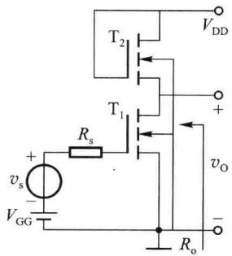  

(a)

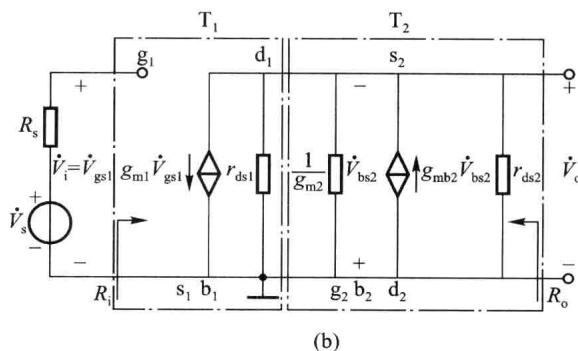  

图 3.4.15 共源极 E/E 型放大电路

图 3.4.15(b) 中，两个点画线框分别标出了两个 MOS 管的微变信号模型。对于 $T_{2}$ ，如果衬源短接时可等效为 $r_{\mathrm{ds2}} / / \left( \frac{1}{g_{\mathrm{m2}}} \right)$ [见式 (3.4.13)]。当 $v_{bs2} \neq 0$ 时可用漏、源极两端的受控电流源 $g_{mb2} \dot{V}_{bs2}$ 表示衬底调制效应。由于这一受控电流源两端电压就是 $\dot{V}_{bs2}$ ，因而它可等效为电阻 $(1 / g_{\mathrm{mb2}})$ 。

根据图 3.4.15(b) 所示微变等效电路可求出中频电压增益 $\dot{A}_{vs}$ (与 $\dot{A}_{v}$ 相同) 为

$$

\dot {A} _ {\mathrm{vs}} = \frac {\dot {V} _ {\mathrm{o}}}{\dot {V} _ {\mathrm{s}}} = - g _ {\mathrm{m1}} \cdot \left(r _ {\mathrm{ds1}} / / \frac {1}{g _ {\mathrm{m2}}} / / \frac {1}{g _ {\mathrm{mb2}}} / / r _ {\mathrm{ds2}}\right) = - \frac {g _ {\mathrm{m1}}}{g _ {\mathrm{ds1}} + g _ {\mathrm{m2}} + g _ {\mathrm{mb2}} + g _ {\mathrm{ds2}}}\tag{3.4.17}

$$

电路的输出电阻 $R_{o}$ 为

$$

R _ {\mathrm{o}} = r _ {\mathrm{ds1}} / / \frac {1}{g _ {\mathrm{m2}}} / / \frac {1}{g _ {\mathrm{mb2}}} / / r _ {\mathrm{ds2}}\tag{3.4.18}

$$

PMOS 共源 E/E 型放大电路的分析方法及电路特性与 NMOS 共源 E/E 型放大电路相同。

## 二、NMOS 共源 E/D 型放大电路

NMOS 共源 E/D 型放大电路以增强型(Enhancement Mode) NMOS 管 $T_{1}$ 作为放大管、以耗尽型(Depletion Mode) NMOS 管 $T_{2}$ 作为有源负载构成的放大电路。如图 3.4.16(a) 所示。

(a)  

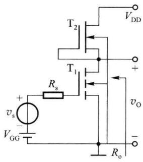

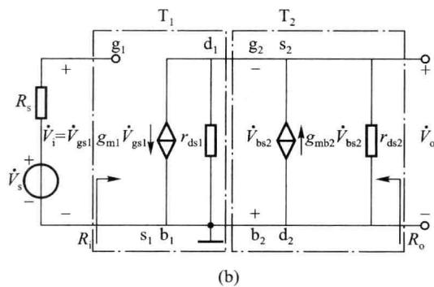  

图 3.4.16 共源极 E/D 型放大电路

由于负载管 $\mathrm{T}_{2}$ 的 $\dot{V}_{\mathrm{gs2}} = 0$ ，所以图3.4.16(b)的微变等效电路中没有等效电阻 $\frac{1}{g_{\mathrm{m2}}}$ 。其他部分与共源E/E型电路完全相同。根据图3.4.16(b)所示电路，可求出中频电压增益 $\dot{A}_{vs}(\dot{A}_v = \dot{A}_{vs})$ 为

$$

\dot {A} _ {\mathrm{vs}} = \frac {\dot {V} _ {\mathrm{o}}}{\dot {V} _ {\mathrm{s}}} = - g _ {\mathrm{m1}} \cdot \left(r _ {\mathrm{ds1}} / / \frac {1}{g _ {\mathrm{mb2}}} / / r _ {\mathrm{ds2}}\right) = - \frac {g _ {\mathrm{m1}}}{g _ {\mathrm{ds1}} + g _ {\mathrm{mb2}} + g _ {\mathrm{ds2}}}\tag{3.4.19}

$$

输出电阻 $R_{0}$ 为

$$

R _ {\mathrm{o}} = r _ {\mathrm{ds1}} / / \frac {1}{g _ {\mathrm{mb2}}} / / r _ {\mathrm{ds2}}\tag{3.4.20}

$$

与 E/E 型电路比较, E/D 型电路的输出负载回路中由于没有电阻 $1/g_{m2}$ , 因而在同样工作条件下的电压增益要大于 E/E 型电路的电压增益。

PMOS 共源 E/D 型放大电路的分析方法及电路特性与 NMOS 共源 E/D 型放大电路相同。

## 三、CMOS 共源 E/E 型放大电路

前面提到 NMOS 共源 E/D、E/E 型放大电路均由同类型沟道 MOS 管构成，在集成电路中由于衬底是公共的，这两种电路难以避免衬底调制效应的存在，而反映衬底调制效应的背栅跨导 $g_{mb}$ 又会使电压增益下降较多。

CMOS 电路以 NMOS 管和 PMOS 管互补配合作为放大管和负载管。由于 NMOS 管衬底接电路中最低电位，PMOS 管衬底接电路中最高电位，因而可以消除衬底调制现象。

图 3.4.17(a) 为共源极组态的一种 CMOS 共源 E/E 型放大电路。电路中 $T_{1}$ 为增强型

NMOS 放大管, 增强型 PMOS 管 $T_{2}$ 、 $T_{3}$ 组成镜像电流源 (也称电流镜, $T_{2}$ 、 $T_{3}$ 参数完全一致), 并作为 $T_{1}$ 的负载管。由于所有 MOS 管的衬底都与自己的源极相接, 均有 $v_{BS}=0$ , 不存在衬底调制效应。

根据图 3.4.13 和式(3.4.16)，从 $T_{2}$ 漏极看入的等效电阻就是 $T_{2}$ 的 $r_{ds}$ 。很容易画出图 3.4.17(a) 的中频微变等效电路，如图 3.4.17(b) 所示。

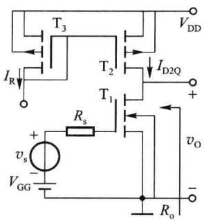  

(a)

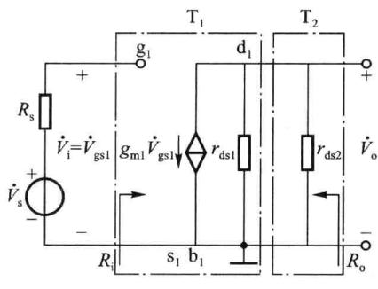  

(b)  

图 3.4.17 共源 CMOS 放大电路

根据图 3.4.17(b) 可求得电路的中频源电压增益和输出电阻, 即

$$

\dot {A} _ {v s} (= \dot {A} _ {v}) = \frac {\dot {V} _ {\mathrm{o}}}{\dot {V} _ {\mathrm{s}}} = - g _ {\mathrm{m1}} (r _ {\mathrm{ds1}} / / r _ {\mathrm{ds2}}) = - \frac {g _ {\mathrm{m1}}}{g _ {\mathrm{ds1}} + g _ {\mathrm{ds2}}}\tag{3.4.21}

$$

$$

R _ {\mathrm{o}} = r _ {\mathrm{ds1}} / / r _ {\mathrm{ds2}}\tag{3.4.22}

$$

由于共源 CMOS 放大电路中没有衬底调制效应的影响,使得放大管漏极总负载电阻的阻值大大提高,也就大大提高了电路的增益。

图 3.4.18(a) 为另一种连接形式的 CMOS 共源 E/E 型放大电路。正常工作时，NMOS 管和 PMOS 管均工作于饱和区，同时对输入信号进行放大。当两只 MOS 管的特性完全一致时，假如栅极电压在 $V_{GSQ}$ 的基础上有一个电压变化 $\Delta v$ （即 $V_{GSQ} + \Delta v$ ）， $T_{1}$ 的漏极电流会在 $I_{DQ1}$ 的基础上有一个电流变化 $\Delta i$ （即 $I_{DQ1} + \Delta i$ ），同时 $T_{2}$ 的漏极电流将会在 $I_{DQ2}$ 的基础上减小一个电流变化 $-\Delta i (I_{DQ2} - \Delta i)$ ，负载电流将获得 $2\Delta i$ 的变化。如果画出交流通路图，可以看到两只 MOS 管是并联工作的。对应的微变等效电路如图 3.4.18(b) 所示。在输出回路，总电流是 $g_{m1}\dot{V}_{gs1}+g_{m2}\dot{V}_{gs2}$ ，总的负载电阻是 $r_{dsl}//r_{ds2}$ 。与图 3.4.17(a) 所示的电路相比，如果 MOS 管的参数完全一样，电压增益将加倍。中频电压增益 $A_{vs}$ 如式 (3.4.23) 所示。通常称图 3.4.18(a) 所示电路为 CMOS 反相器。

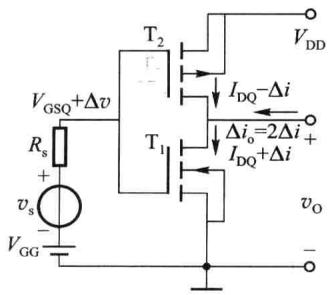  

(a)

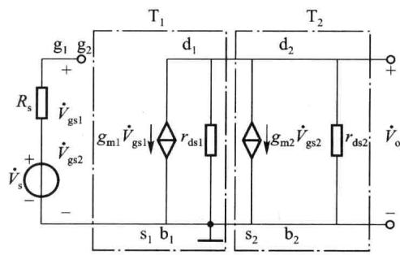  

(b)  

图 3.4.18 CMOS 反相器

放大电路的电压增益、源电压增益及输出电阻为

$$

\begin{array}{r l} \dot {A} _ {v s} = \dot {A} _ {v} & = \frac {\dot {V} _ {o}}{\dot {V} _ {s}} = - (g _ {m 1} + g _ {m 2}) \cdot (r _ {d s 1} / / r _ {d s 2}) = - \frac {g _ {m 1} + g _ {m 2}}{g _ {d s 1} + g _ {d s 2}} \\ R _ {o} & = r _ {d s 1} / / r _ {d s 2} \end{array}\tag{3.4.23}

$$

## 3.4.6 场效应管差分放大电路

与双极型晶体管差分电路的构成原理类似,基于一对参数一致的场效应管也可构成差分放大电路,其基本目的也是为了放大差模输入信号,抑止共模信号。与双极型晶体管差分电路相比,场效应管差分电路有输入电阻高、输入线性工作范围宽的优点,也有微变增益低、失调电压大的缺点。

## 一、MOS 管基本差分放大电路

图 3.4.19 为电流源偏置的 MOS 管差分放大电路。差分对管 $T_{1}$ 、 $T_{2}$ 的参数相同。 $T_{3}$ 、 $T_{4}$ 构成电流源，其输出电流 $I_{ss}$ 为差分对管提供直流偏置电流，使 $I_{DQ1}=I_{DQ2}=I_{ss}/2$ ，并使 $T_{1}$ 、 $T_{2}$ 处于饱和区工作。

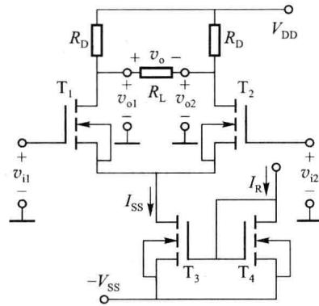  

图 3.4.19 MOS 管差分放大电路

### 1. 差模微变电压增益

当输入信号为小幅度差模信号时， $v_{i1} = -v_{i2}$ ，由于 $T_{1}$ 、 $T_{2}$ 两管参数相同，两管的漏极电流变化大小相等、方向相反，即 $\Delta i_{D1} = -\Delta i_{D2}$ ， $T_{3}$ 管输出电流没有变化， $T_{1}$ 、 $T_{2}$ 两管的源极电位没有变化，等效源极交流接地。参照双极型晶体管差分电路的分析方法

$$

\dot {V} _ {\mathrm{ol}} = - \frac {1}{2} g _ {\mathrm{m}} \left(\mathrm{r} _ {\mathrm{ds}} / / R _ {\mathrm{D}} / / \frac {R _ {\mathrm{L}}}{2}\right) (\dot {V} _ {\mathrm{i1}} - \dot {V} _ {\mathrm{i2}})

$$

$$

\dot {V} _ {\mathrm{o2}} = \frac {1}{2} g _ {\mathrm{m}} \left(\mathrm{r} _ {\mathrm{ds}} / / R _ {\mathrm{D}} / / \frac {R _ {\mathrm{L}}}{2}\right) (\dot {V} _ {\mathrm{i1}} - \dot {V} _ {\mathrm{i2}})

$$

可求得 MOS 管差分电路的低、中频段电压增益和输出阻抗,分别为

$$

\dot {A} _ {v} = \frac {\dot {V} _ {\mathrm{o}}}{\dot {V} _ {\mathrm{i1}} - \dot {V} _ {\mathrm{i2}}} = \frac {\dot {V} _ {\mathrm{o1}} - \dot {V} _ {\mathrm{o2}}}{\dot {V} _ {\mathrm{i1}} - \dot {V} _ {\mathrm{i2}}} = - g _ {\mathrm{m}} \left(r _ {\mathrm{ds}} / / R _ {\mathrm{D}} / / \frac {R _ {\mathrm{L}}}{2}\right)\tag{3.4.24}

$$

$$

R _ {\mathrm{o}} = 2 \left(R _ {\mathrm{D}} / / r _ {\mathrm{ds}}\right) \approx 2 R _ {\mathrm{D}}\tag{3.4.25}

$$

### 2. 传输特性

传输特性给出了电路的输出信号和输入信号间的关系。由于传输特性通常是在直流输入情况下逐点测量出的，也常称为直流传输特性（或称为直流转移特性）。传输特性适用于分析直流及低频工作情况时输入、输出信号的瞬时值之间的关系。

当 $T_{1}$ 、 $T_{2}$ 工作于饱和区时，在忽略沟道长度调制效应的情况下， $T_{1}$ 、 $T_{2}$ 管的输入、输出传输特性分别为

$$

i _ {\mathrm{D1}} = \frac {k _ {\mathrm{p}}}{2} \cdot \frac {W}{L} (v _ {\mathrm{GS1}} - V _ {\mathrm{th}}) ^ {2}, i _ {\mathrm{D2}} = \frac {k _ {\mathrm{p}}}{2} \cdot \frac {W}{L} (v _ {\mathrm{GS2}} - V _ {\mathrm{th}}) ^ {2}

$$

在差模输入电压的作用下， $i_{D1} + i_{D2} = I_{SS}$ 。令 $v_{ID} = v_{i1} - v_{i2}$ ，则 $v_{GS1} - v_{GS2} = v_{ID}$ 。两管的差模输出电流为

$$

i _ {\mathrm{OD}} = i _ {\mathrm{D1}} - i _ {\mathrm{D2}} = \frac {k _ {\mathrm{p}}}{2} \cdot \frac {W}{L} \big [ (v _ {\mathrm{GS1}} - V _ {\mathrm{th}}) ^ {2} - (v _ {\mathrm{GS2}} - V _ {\mathrm{th}}) ^ {2} \big ]

$$

进行整理可得

$$

i _ {\mathrm{OD}} = \sqrt {k _ {\mathrm{p}} \frac {W}{L} I _ {\mathrm{SS}}} \cdot v _ {\mathrm{ID}} \cdot \sqrt {1 - v _ {\mathrm{ID}} ^ {2} / \frac {4 L I _ {\mathrm{SS}}}{k _ {\mathrm{p}} W}}\tag{3.4.26}

$$

$$

i _ {\mathrm{D} 1} = \frac {i _ {\mathrm{D} 1} + i _ {\mathrm{D} 2}}{2} + \frac {i _ {\mathrm{D} 1} - i _ {\mathrm{D} 2}}{2} = \frac {I _ {\mathrm{SS}}}{2} + \sqrt {\frac {k _ {\mathrm{p}} W}{4 L} I _ {\mathrm{SS}}} \cdot v _ {\mathrm{ID}} \cdot \sqrt {1 - v _ {\mathrm{ID}} ^ {2} / \frac {4 L I _ {\mathrm{SS}}}{k _ {\mathrm{p}} W}}\tag{3.4.27a}

$$

$$

i _ {\mathrm{D} 2} = \frac {i _ {\mathrm{D} 1} + i _ {\mathrm{D} 2}}{2} - \frac {i _ {\mathrm{D} 1} - i _ {\mathrm{D} 2}}{2} = \frac {I _ {\mathrm{SS}}}{2} - \sqrt {\frac {k _ {\mathrm{p}} W}{4 L} I _ {\mathrm{SS}}} \cdot v _ {\mathrm{ID}} \cdot \sqrt {1 - v _ {\mathrm{ID}} ^ {2} / \frac {4 L I _ {\mathrm{SS}}}{k _ {\mathrm{p}} W}}\tag{3.4.27b}

$$

式(3.4.27)描述了 MOS 管差分放大电路的传输特性,其曲线图形如图 3.4.20 所示。

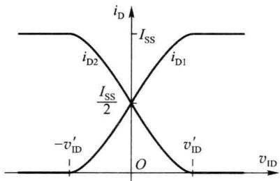  

图 3.4.20 MOS 管差分放大电路的传输特性曲线

由式(3.4.27)和图3.4.20可见，当 $v_{\mathrm{ID}} = 0$ ，即 $v_{\mathrm{GS1}} = v_{\mathrm{GS2}}$ 时， $i_{\mathrm{D1}} = i_{\mathrm{D2}} = I_{\mathrm{SS}} / 2$ 。这是无输入信号或共模输入的情况。

当差模输入电压 $v_{ID}$ 较小 ( $v_{ID} \ll \sqrt{\frac{4LI_{SS}}{k_{p}W}}$ ) 时, $i_{D1}$ 、 $i_{D2}$ 的变化量为

$$

\Delta i _ {\mathrm{D} 1} \approx \sqrt {\frac {k _ {\mathrm{p}} W}{4 L} I _ {\mathrm{SS}}} \cdot v _ {\mathrm{ID}} = \sqrt {\frac {k _ {\mathrm{p}}}{2} \cdot \frac {W}{L} \cdot \frac {I _ {\mathrm{SS}}}{2}} \cdot v _ {\mathrm{ID}} = \sqrt {\frac {1}{4} \cdot 2 k _ {\mathrm{p}} \frac {W}{L} I _ {\mathrm{D} 1 \mathrm{Q}}} \cdot v _ {\mathrm{ID}} = \frac {1}{2} g _ {\mathrm{m}} v _ {\mathrm{ID}}

$$

同理， $\Delta i_{\mathrm{D2}} \approx -\frac{1}{2} g_{\mathrm{m}} v_{\mathrm{ID}}$ 。

当差模输入电压 $v_{ID}$ 增大到 $v_{ID} = +\sqrt{\frac{2I_{SS}L}{k_{p}W}} = +v'_{ID}$ 时， $i_{D1}$ 增大到 $I_{SS}, i_{D2}$ 减小到零。 $T_{2}$ 进入截止状态。此后如再增大 $v_{ID}, i_{D1}$ 将基本不变（电流由恒流源确定，源极电位随 $v_{ID}$ 的增加而抬高），呈限幅状态，传输特性曲线变平。同理， $v_{ID} \leqslant -v'_{ID}$ 时 $T_{1}$ 截止、 $i_{D2}$ 限幅。

将 $\left|v_{ID}\right|<v'_{ID}$ 的区域称为 MOS 管差分放大电路的非限幅区域。MOS 管差分放大电路（简称为差放）用于放大时，输入差模电压 $\left|v_{GS1}-v_{GS2}\right|$ 不应超出这一区域。第二章介绍了双极型晶体管差放的非限幅区域一般为 $4V_{T}$ （室温下约为 100mV），而场效应管差放的非限幅区域通常会比双极型晶体管差放的非限幅区域宽许多。这是由于场效应管的转移特性为二次函数的缘故。

需要说明的是,图3.4.20所示的传输特性曲线以及非限幅区域是在场效应管 $T_{1}$ 、 $T_{2}$ 始终不进入可变电阻区时推导获得的。如果 $|v_{ID}|<v'_{ID}$ 时,差分放大场效应管已经由于漏极电位的降低进入了饱和区,则对应输入差模信号的动态范围应由开始进入饱和区时的输入信号幅度确定。另外,即使场效应管不进入饱和区,在 $|v_{ID}|$ 接近 $v'_{ID}$ 时,非线性已经比较严重,只有当 $|v_{ID}|\ll v'_{ID}$ 时,放大电路才能有较小的非线性失真。

<Example title="例 3.4.7">
MOS 管差分放大电路如图 3.4.19 所示。 $T_{1} \sim T_{4}$ 的本征导电因子为 $50 \mu A/V^{2}$ ，沟道宽长比为 30。 $T_{1}$ 、 $T_{2}$ 的沟道长度调制因子为 0.001/V，开启电压为 1.2 V。 $T_{3}$ 、 $T_{4}$ 的沟道长度调制因子为 0.01/V，开启电压为 1 V。参考电流 $I_{R}$ 为 1.4 mA。 $V_{DD} = V_{SS} = 10 V$ 。漏极负载电阻 $R_{D} = 5 k\Omega, R_{L} = 10 k\Omega$ 。试求：（1）电路的微变差模电压增益；（2）非限幅区范围；（3）单端输出时的共模电压增益和共模抑制比。

<Solution title="解">
（1）由于 $\mathrm{T}_{3},\mathrm{T}_{4}$ 的参数对称，在忽略沟道长度效应的情况下， $I_{\mathrm{SS}} = I_{\mathrm{R}} = 1.4\mathrm{mA},I_{\mathrm{DQ1}} =$ $I_{\mathrm{DQ2}} = I_{\mathrm{SS}} / 2 = 1.4 / 2\mathrm{mA} = 0.7\mathrm{mA}$ 。 $\mathrm{T}_{1},\mathrm{T}_{2}$ 的微变跨导为

$$

g _ {\mathrm{m}} \approx \sqrt {2 k _ {\mathrm{p}} \frac {W}{L} I _ {\mathrm{DQ}}} = \sqrt {2 \times 5 0 \times 1 0 ^ {- 6} \times 3 0 \times 0 . 7 \times 1 0 ^ {- 3}} \mathrm{S} = 1. 4 4 9 \mathrm{mS}

$$

$$

r _ {\mathrm{ds1}} = r _ {\mathrm{ds2}} \approx \frac {1}{\lambda I _ {\mathrm{DQ1}}} = 1. 4 3 \mathrm{M} \Omega

$$

电路的微变差模电压增益为

$$

\dot {A} _ {v} = \frac {\dot {V} _ {\mathrm{o}}}{\dot {V} _ {\mathrm{i1}} - \dot {V} _ {\mathrm{i2}}} = - g _ {\mathrm{m}} \left(r _ {\mathrm{ds}} / / R _ {\mathrm{D}} / / \frac {R _ {\mathrm{L}}}{2}\right) \approx - 1. 4 4 9 \times 2. 5 \approx - 3. 6 2

$$

(2) 非限幅区范围: $\left|v_{ID}\right|<v'_{ID}=\sqrt{\frac{2I_{SS}L}{k_{p}W}}=\sqrt{\frac{2\times1.4\times10^{-3}}{50\times30\times10^{-6}}}$ V≈1.37 V。

当 $|v_{i1}-v_{i2}|$ 超出这一范围，MOS差分管之一进入截止区，电路不再处于差模工作状态。

(3) 由于 $I_{DQ3}=I_{SS}=1.4mA$ ，可计算出 $T_{3}$ 管微变输出电阻为

$$

r _ {\mathrm{ds3}} \approx \frac {1}{\lambda I _ {\mathrm{ss}}} = 7 1. 4 2 8 \mathrm{k} \Omega

$$

与求双极型晶体管的共模增益的方法相同,其单端输出共模增益的等效的交流通路图如图 3.4.21 所示。

共模微变电压增益为

$$

\dot {A} _ {\mathrm{vc}} = \frac {\dot {V} _ {\mathrm{ocl}}}{\dot {V} _ {\mathrm{ic}}} \approx - \frac {g _ {\mathrm{m}} \dot {V} _ {\mathrm{gs}} \cdot R _ {\mathrm{D}} / / \frac {R _ {\mathrm{L}}}{2}}{\dot {V} _ {\mathrm{gs}} + 2 g _ {\mathrm{m}} \dot {V} _ {\mathrm{gs}} r _ {\mathrm{ds3}}} = - \frac {3 . 6 2 2}{2 0 8} = - 1 7. 4 \times 1 0 ^ {- 3}

$$

共模抑制比为

$$

K _ {\mathrm{CMR}} = \left| \frac {\dot {A} _ {v d 1}}{\dot {A} _ {v c}} \right| = \frac {\frac {3 . 6 2}{2}}{1 7 . 4 \times 1 0 ^ {- 3}} = 1 0 4. 1

$$

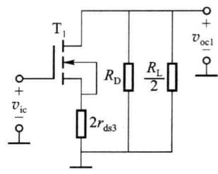  

图 3.4.21 共模交流通路图
</Solution>
</Example>

## 二、MOS 管有源负载差分放大电路

如同单管共源电路,有源负载 MOS 差分电路也有 E/D 型和 E/E 型之分。图 3.4.22、图 3.4.23、图 3.4.24 均为 CMOS E/E 型差分电路,差分放大管为增强型 NMOS 管,负载管为增强型 PMOS 管,不存在衬底调制效应。

### 1. E/E 型有源电阻负载 CMOS 差放

在图 3.4.22(a) 所示的电路中，负载管 $T_{3}$ 、 $T_{4}$ 特性完全相同，差分放大管 $T_{1}$ 、 $T_{2}$ 特性完全相同。根据前面对有源电阻的分析及式(3.4.13)，两个负载管的等效微变电阻近似为 $\frac{1}{g_{m3}}$ 、 $\frac{1}{g_{m4}}$ ，且应 $\frac{1}{g_{m3}} = \frac{1}{g_{m4}}$ 。将有源电阻等效后的交流通路图如图 3.4.22(b) 所示。

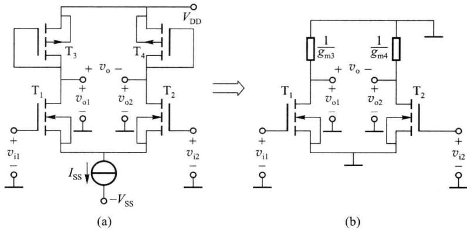  

图 3.4.22 E/E 型有源电阻负载 CMOS 差放

图 3.4.22(b) 所示电路与图 3.4.19 所示电路的交流通路图结构相同, 可以得到图 3.4.22 所示电路的差模电压增益为

$$

\dot {A} _ {v} = \frac {\dot {V} _ {\mathrm{o}}}{\dot {V} _ {\mathrm{i1}} - \dot {V} _ {\mathrm{i2}}} = - g _ {\mathrm{m1}} \left(r _ {\mathrm{ds1}} / / \frac {1}{g _ {\mathrm{m3}}}\right) \approx - \frac {g _ {\mathrm{m1}}}{g _ {\mathrm{m3}}}\tag{3.4.28}

$$

为使 $\dot{A}_{v}$ 足够大,应要求放大管的微变跨导比负载管的微变跨导大得多。

### 2. 电流源有源负载 CMOS 差放

图 3.4.23(a) 为以电流源作为有源负载的 CMOS E/E 型差分放大电路。 $T_{3}$ 、 $T_{4}$ 两管的参数相同， $T_{1}$ 、 $T_{2}$ 两管的参数相同。参考电流 $I_{R}$ 应使 $I_{D3}=I_{D4}\approx I_{SS}/2$ 。根据式(3.4.16)，从 $T_{3}$ 、 $T_{4}$ 两管的漏极看入的等效微变电阻分别为 $r_{ds3}$ 和 $r_{ds4}$ ，且 $r_{ds3}=r_{ds4}$ 。将有源电阻等效后的交流通路图如图 3.4.23(b) 所示。

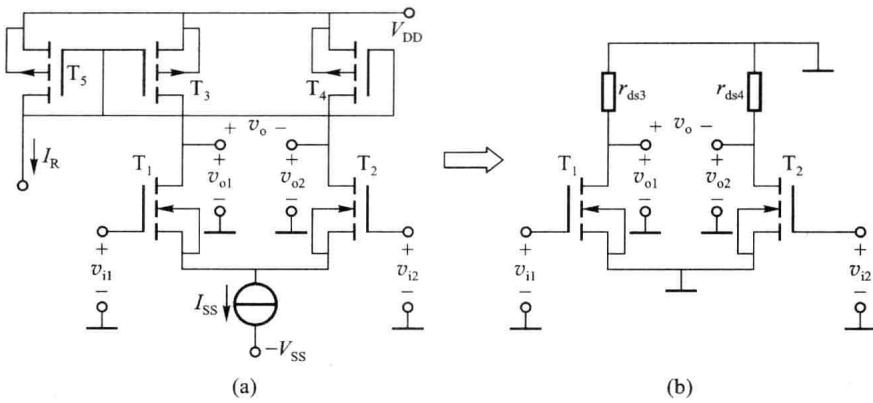  

图 3.4.23 电流源有源负载 CMOS 差放

图 3.4.23 所示电路的差模电压增益为

$$

\dot {A} _ {v} = \frac {\dot {V} _ {\mathrm{o}}}{\dot {V} _ {\mathrm{i1}} - \dot {V} _ {\mathrm{i2}}} \approx - g _ {\mathrm{m1}} (r _ {\mathrm{ds1}} / / r _ {\mathrm{ds3}})\tag{3.4.29}

$$

通常 $r_{\mathrm{ds}}$ 会远远大于 $\frac{1}{g_{\mathrm{m}}}$ ，所以在不考虑负载电阻 $R_{\mathrm{L}}$ 时，图3.4.23所示电路的差模电压增益会比图3.4.22所示电路的差模电压增益大得多。

### 3. 镜像电流源负载 CMOS 差放

图 3.4.23 和图 3.4.22 所示的差分放大电路在单端输出时, 其增益为双端输出的一半。为使单端输出时增益不下降, 可以用镜像电流源作为差分放大管的负载, 电路如图 3.4.24 所示。电路中 MOS 管 $T_{3}$ 、 $T_{4}$ 参数相同, 组成镜像电流源。

图 3.4.24 所示差分放大电路的分析方法与第二章双极型晶体管相关电路的工作原理及分析方法完全相同。若输入差模信号为 $v_{i1} + \Delta v$ 和 $v_{i2} - \Delta v$ 时（设 $v_{i1} = v_{i2}$ ），可以推导出输出电流的变化量为 $i_{o} = 2\Delta i$ （若漏极负载为非镜像电流源时，对应的输出电流的变化量为 $i_{o} = \Delta i$ ）。因此当等效负载电阻与非镜像电流源负载的等效电阻相同时，单端输出的电压增益是其 2 倍。

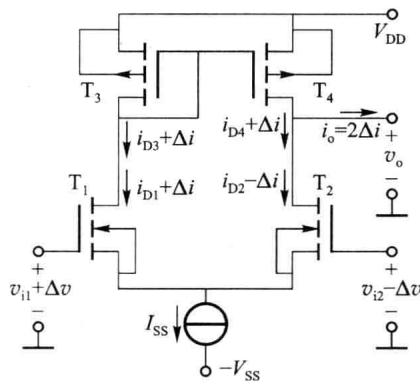

由于从 $T_{3}$ 的漏极端看入的等效负载电阻较小（约为 $\frac{1}{g_{m3}}$ ），而从 $T_{4}$ 的漏极端看入的等效电阻较大（约为 $r_{ds4}$ ），为获得较大差模电压增益，应取 $T_{2}(T_{4})$ 的漏极端作为输出。其差模电压增益为图 3.4.24 镜像电流源负载 CMOS 差放

$$

\dot {A} _ {v} = \frac {\dot {V} _ {\mathrm{o}}}{\dot {V} _ {\mathrm{i1}} - \dot {V} _ {\mathrm{i2}}} = \frac {\dot {V} _ {\mathrm{o}}}{\dot {V} _ {\mathrm{gs1}} - \dot {V} _ {\mathrm{gs2}}} \approx g _ {\mathrm{m1}} (r _ {\mathrm{ds2}} / / r _ {\mathrm{ds4}})\tag{3.4.30}

$$

小结:用场效应管构成放大电路时,通常使用电流源作为偏置电路以及作为有源负载。这样设计可提高电路的稳定性,并解决由于场效应管跨导较低而导致的电压增益较低的问题。

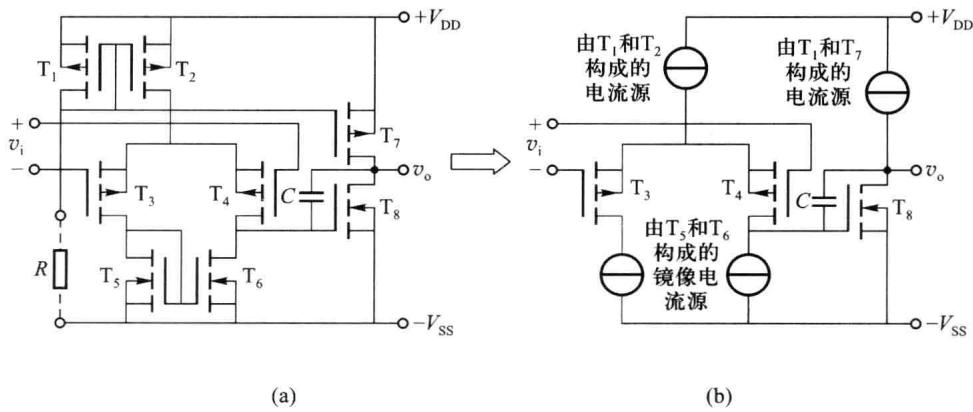  

图 3.4.25 CMOS 集成运算放大器 (MC14573) 内部电路及等效电路

图 3.4.25(a) 是集成运算放大器 (MC14573) 的内部电路, 图 3.4.25(b) 是对应的等效电路。 $T_{3}$ 和 $T_{4}$ 构成差分输入级, $T_{1}$ (提供参考电流) 和 $T_{2}$ 构成基本电流源给 $T_{3}$ 和 $T_{4}$ 提供静态工作电流, $T_{5}$ 和 $T_{6}$ 为镜像电流源作为差放的有源负载, $T_{8}$ 为共源组态的输出级, $T_{1}$ 和 $T_{7}$ 构成基本电流源作为 $T_{8}$ 的有源负载。
