import Guide from '@/components/Guide.astro';
import Knowledge from '@/components/Knowledge.astro';
import Example from '@/components/Example.astro';
import Analysis from '@/components/Analysis.astro';
import Solution from '@/components/Solution.astro';
import Variant from '@/components/Variant.astro';
import Note from '@/components/Note.astro';
import Block from '@/components/Block.astro';
import Method from '@/components/Method.astro';
import Exercise from '@/components/Exercise.astro';

模拟开关是一种利用晶体管或场效应管的开关特性实现控制模拟信号传输与否的器件，其符号如图3.5.1所示。模拟开关有两种工作状态：接通状态和关断状态，由开关的控制端控制工作状态之间的转换。在接通状态，信号入、出端间的接通电阻应尽可能小，使两端如同短路，信号能以最小损耗、最小失真在入/出端间双向传输。在关断状态，信号入、出端间的关断电阻应尽可能大，使两端如同开路。接通、关断状态之间的转换速度应尽可能快。

利用场效应管的可变电阻区和截止区的特性可实现模拟开关。

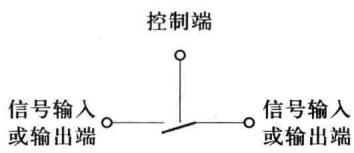  

图 3.5.1 模拟开关符号

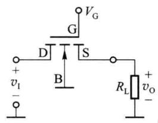  

图 3.5.2 N 沟道增强型 MOS 管模拟开关

## 3.5.1 单 MOS 管模拟开关

图 3.5.2 为 N 沟道增强型 MOS 管(增强型 NMOS 管)作为模拟开关工作时的电路图。栅极作为控制端,漏极、源极分别作为信号输入/输出端。衬底接地或负电位。当衬底接地时,由于 MOS 管的衬底到源极、衬底到漏极的 PN 结不允许正偏,要求输入信号 $v_{1}$ 必须大于 0。

通过对控制端施加高电平 $V_{G}=V_{GH}$ 和低电平 $V_{G}=V_{GL}$ 实现模拟开关的闭合和关断。要求高电平 $V_{\mathrm{GH}}$ (通常使用电源电压 $V_{DD}$ ) 大于 MOS 管开启电压 $V_{th}$ 并保证管导通电阻足够小。要求低电平 $V_{\mathrm{GL}}$ (通常为 0 电平) 小于 MOS 管开启电压 $V_{th}$ 并保证 MOS 管的可靠关断。

当 $v_{G}=V_{GL}=0V$ 时，MOS 管漏、源极间未能建立导电沟道，漏源间电流为 0，开关处于关断状态。两端之间呈现阻值很大的关断电阻（可达 $10^{10}\Omega$ ）。

当 $v_{G}=V_{GH}=V_{DD}>V_{th}$ 时，MOS 管漏源间建立导电沟道，在输入电压 $0<v_{1}<V_{DD}-V_{th}$ 范围， $v_{GS}$

$>V_{th}, v_{GD}>V_{th}$ ，MOS 管处于可变电阻区，漏源间呈现几百欧至几千欧范围的电阻，模拟开关处于闭合状态。在负载电阻 $R_{L}$ >> 漏源电阻的情况下， $v_{I}$ 在漏源电阻上的压降将较小，有 $v_{GD} \approx v_{GS}$ ，同时 $v_{0} \approx v_{I}$ 。由于 MOS 管需要工作在可变电阻区，当 $V_{GH}=V_{DD}$ 时，要求 $v_{GD}=V_{DD}-v_{I}$ ，并要求沟道电阻上的压降近似为 0，即 $v_{GD} \approx v_{GS}$ 。增强型 NMOS 管漏、源极之间的导通电阻 $R_{onN}$ 可由式(3.5.1)给出。沟道电阻与输入电压之间的关系曲线示意图如图 3.5.3 所示。

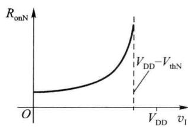  

图 3.5.3 NMOS 管导通电阻

$$

R _ {\mathrm{onN}} \approx \frac {1}{k _ {\mathrm{pN}} \left(\frac {W}{L}\right) _ {\mathrm{N}} (V _ {\mathrm{DD}} - v _ {\mathrm{I}} - V _ {\mathrm{thN}})} 0 \leqslant v _ {\mathrm{I}} <   V _ {\mathrm{DD}} - V _ {\mathrm{thN}}\tag{3.5.1}

$$

在输入信号 $v_{1}$ 较小时，G、S 及 G、D 间电压较大，导电沟道较厚，沟道电阻较小。随着 $v_{1}$ 增加，沟道变薄，沟道电阻变大。当 $v_{1}$ 增大到 $V_{DD}-V_{thN}$ 后，图 3.5.2 所示电路中 MOS 管栅、漏极间电压小于开启电压，漏极端沟道出现预夹断，MOS 管进入饱和区，沟道的等效电阻将变得非常大。因此，在模拟开关等效闭合的状态下，导通电阻随输入信号变化较大，这是单个 MOS 管开关的缺点。

MOS 管在可变电阻区工作时,由于漏源间沟道处于贯通状态,电流可双向流动,漏极、源极可以互换。

图 3.5.4(a) 为 P 沟道增强型 MOS 管(增强型 PMOS 管)模拟开关电路图。P 沟道 MOS 管的衬底接高电位 $+V_{DD}$ ，在负载电阻 $R_{L}$ 阻值足够大的情况下，导通电阻 $R_{onP}$ 如式 (3.5.2) 所示。 $R_{onP}$ 与 $v_{1}$ 之间的曲线如图 3.5.4(b) 所示。

$$

R _ {\mathrm{onP}} \approx \frac {1}{k _ {\mathrm{pP}} \left(\frac {W}{L}\right) _ {\mathrm{P}} \left[ \left(v _ {\mathrm{I}} - V _ {\mathrm{thP}}\right) \right]} \qquad - V _ {\mathrm{thP}} <   v _ {\mathrm{I}} \leqslant V _ {\mathrm{DD}}\tag{3.5.2}

$$

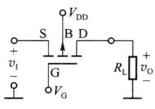

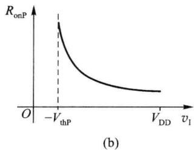  

图 3.5.4 P 沟道增强型 MOS 管模拟开关

## 3.5.2 CMOS 模拟开关

单管 MOS 开关导通时, 其导通电阻随输入信号变化较大, 并且输入电压 $v_{1}$ 工作范围受限,

(b)

例如 P 沟道增强型 MOS 管当控制电压为 0V 时，输入信号 $v_{1}$ 不能低于 $-V_{thP}$ ，否则进入饱和区。

为了避免在输入电压变化时沟道导通电阻变化较大，并增加输入电压的动态范围，可将增强型NMOS管和PMOS管并联使用，构成如图3.5.5(a)所示由两个互补控制端控制的模拟开关，这种模拟开关一般称为CMOS传输门，传输门符号如图3.5.5(b)所示。当 $\mathrm{T}_{1},\mathrm{T}_{2}$ 两个MOS管都处于导通状态时（NMOS管 $\mathrm{T}_{1}$ 栅极电平 $C = V_{\mathrm{DD}}$ ，PMOS管 $\mathrm{T}_{2}$ 栅极电平 $\overline{C} = 0$ )，总导通电阻为两个场效应管导通电阻的并联值， $R_{\mathrm{on}} = R_{\mathrm{onN}} / / R_{\mathrm{onP}}$ ，其关系曲线如图3.5.6所示。由图3.5.6可见， $R_{\mathrm{on}}$ 随 $v_{1}$ 变化而改变的程度大幅度减小，且输入电压 $v_{1}$ 的工作范围扩展为 $0\sim V_{\mathrm{DD}}$ 。

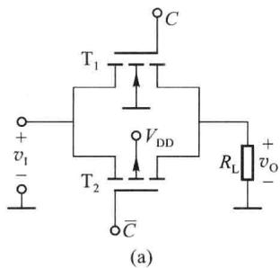

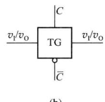  

图 3.5.5 CMOS 传输门

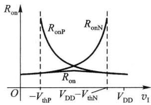  

图 3.5.6 CMOS 传输门的导通电阻

为使 $\mathrm{T}_{1},\mathrm{T}_{2}$ 两管同时导通、同时关断，两MOS管栅极的控制信号应同时提供高、低电平相反的控制信号，例如需要导通时，NMOS管的栅极应加高电平 $C = V_{\mathrm{DD}}$ ，同时PMOS管的栅极应加低电平 $\overline{C} = 0$ 。为获得这个互补的控制信号，在传输门中增加一个逻辑非门G，如图3.5.7(a)所示。一般图3.5.7(a)所示电路称为CMOS模拟开关，等效电路如图3.5.7(b)所示，图3.5.7(c)为CMOS模拟开关的符号。逻辑非门G的作用是：当给非门G输入高电平 $C = V_{\mathrm{DD}}$ 时，其输出端电平 $\overline{C}\approx 0$ ；当给G输入低电平 $C = 0$ 时，其输出端 $\overline{C}\approx V_{\mathrm{DD}}$ 。

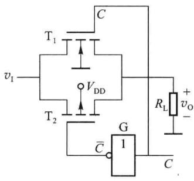  

(a)

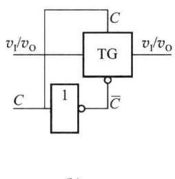  

(b)

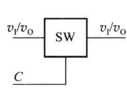  

(c)  

图 3.5.7 CMOS 模拟开关

实际集成电路芯片中，CMOS模拟开关的电路原理图会稍微复杂一些，例如会用两个图3.5.5所示的传输门并联使用，这样，导通时的电阻会更小。图3.5.8(a)是CMOS模拟开关CD4066的内部结构图。CD4066中集成了4个完全一样的CMOS模拟开关。在应用时每个开关可单独使用。图3.5.8(b)是使用两个模拟开关构成一个单刀双掷的开关示例。当 $C$ 端为低电平时， $\mathrm{SW}_1$ 导通， $\mathrm{SW}_2$ 断开，信号 $v_{11}$ 传输到输出端；当 $C$ 端为高电平时， $\mathrm{SW}_2$ 导

通， $\mathrm{SW}_{1}$ 断开，信号 $v_{12}$ 传输到输出端。

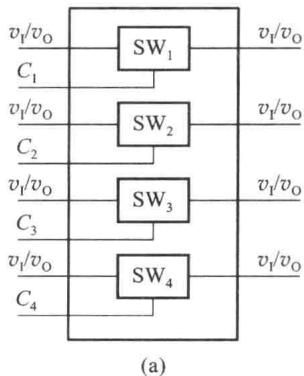

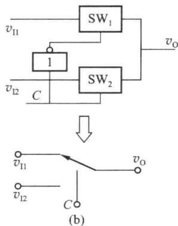  

图 3.5.8 CMOS 模拟开关 CD4066 内部结构及模拟开关应用

当输入电压 $v_{1}$ 变化时，MOS 模拟开关中仍存在着衬底调制现象，即 MOS 管的衬源电压 $v_{BS}$ 随 $v_{1}$ 变化。这会导致模拟开关的导通电阻随 $v_{1}$ 变化而变化，使输出信号产生非线性失真。如何减小衬底调制效应的影响，可参考其他书籍。
