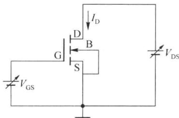
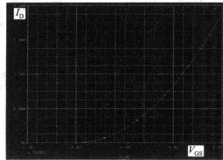
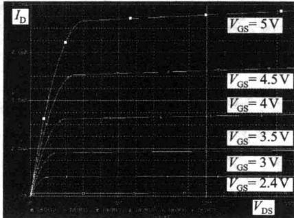
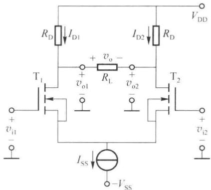
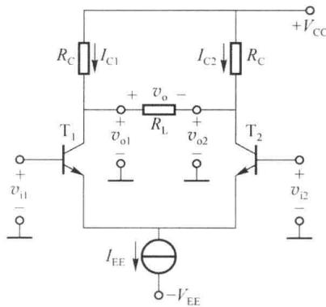
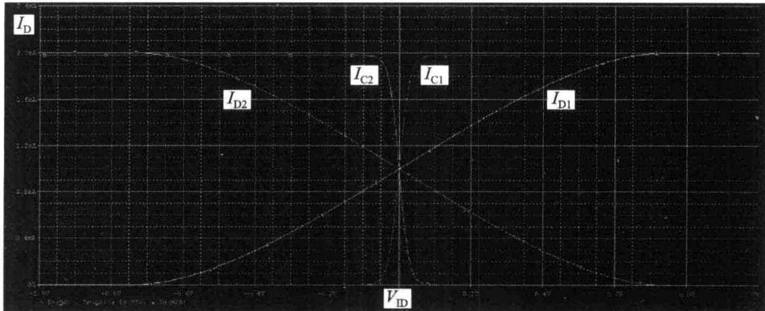

import Guide from '@/components/Guide.astro';
import Knowledge from '@/components/Knowledge.astro';
import Example from '@/components/Example.astro';
import Analysis from '@/components/Analysis.astro';
import Solution from '@/components/Solution.astro';
import Variant from '@/components/Variant.astro';
import Note from '@/components/Note.astro';
import Block from '@/components/Block.astro';
import Method from '@/components/Method.astro';
import Exercise from '@/components/Exercise.astro';

仿真例题一:场效应管转移特性及输出特性仿真。

调用仿真软件中 N 沟道 MOS 管的模型并修改参数, 令: 本征导电因子 $k_{p}=40\mu A/V^{2}$ , 开

启电压 $V_{th}=2V$ ，沟道宽长比 W/L=40，沟道长度调制因子 $\lambda=0.005$ 。仿真电路如图 3.6.1 所示。

1. 场效应管的转移特性曲线定义为 $V_{DS}$ 是某定值时 $I_{D}$ 与 $V_{GS}$ 的关系曲线。令 $V_{DS} = 10V, V_{GS}$ 从 1V 到 5V 变化，可得到图 3.6.2(a) 所示的转移特性曲线。

  

图 3.6.1 转移特性及输出

2. 输出特性曲线是 $V_{GS}$ 固定时 $I_{D}$ 与 $V_{DS}$ 的关系曲线（族）。

特性仿真电路

图 3.6.2(b) 所示的输出特性曲线是分别令 $V_{GS}=2.4V$ 、3V、3.5V、4V、4.5V、5V，并使 $V_{DS}$ 从 0V 到 15V 变化获得。

  

(a) 转移特性曲线

  

图 3.6.2 转移特性曲线及输出特性曲线  

(b) 输出特性曲线

从转移特性仿真图中可知，开启电压近似为 $V_{th}=2V$ 。从输出特性曲线可以看出，当 $V_{GS}=5V$ 时，可变电阻区与饱和区（恒流区）的分界点对应的 $V_{DS}$ 约为 3V；当 $V_{GS}=4V$ 时，可变电阻区与饱和区（恒流区）的分界点对应的 $V_{DS}$ 约为 2V；当 $V_{GS}=3V$ 时，可变电阻区与饱和区（恒流区）的分界点对应的 $V_{DS}$ 约为 1V。由于设定沟道长度调制因子 $\lambda=0.005$ ，曲线略有上翘。分析时若改变 $\lambda$ 大小，曲线的上翘程度将随之改变。

仿真例题二:晶体管与场效应管差分放大电路的传输特性比较。

仿真中调用库中晶体管 Q2N2222 模型，修改参数 $\beta=100$ ，其他参数不变。场效应管模型使用仿真例题一中的参数。仿真参考电路如图 3.6.3 所示。电路中设 $V_{DD}=V_{CC}=V_{SS}=V_{EE}=30V, I_{SS}=I_{EE}=2mA, R_{C}=R_{D}=10k\Omega, R_{L}=100k\Omega$ 。

  

(a) 晶体管差分放大电路

  

(b) 场效应管差分放大电路  

图 3.6.3 晶体管及场效应管差分放大电路

通过仿真得到的两个差分放大电路的传输特性曲线如图6.3.4所示。从传输特性曲线可以看出，晶体管的输入线性区域较小，当 $|V_{ID}|<25\ mV$ 时，可以近似认为处于输入的线性范围。场效应管比晶体管的输入线性范围大，在使用本仿真所设参数的情况下， $|V_{ID}|<400\ mV$ 时，非线性不是很明显。通过图3.6.4也可知，晶体管差分放大电路的增益比场效应管差分放大电路的增益大得多。

  

图 3.6.4 晶体管及场效应管差分放大电路的传输性曲线
