import Guide from '@/components/Guide.astro';
import Knowledge from '@/components/Knowledge.astro';
import Example from '@/components/Example.astro';
import Analysis from '@/components/Analysis.astro';
import Solution from '@/components/Solution.astro';
import Variant from '@/components/Variant.astro';
import Note from '@/components/Note.astro';
import Block from '@/components/Block.astro';
import Method from '@/components/Method.astro';
import Exercise from '@/components/Exercise.astro';

## 习题

<Exercise title="习题 3.1.1">
（1）某 N 沟道增强型 MOS 场效应管的开启电压为 1.5 V，各极间电压见表题 3.1.1(a)，试判断管的工作状态（输出特性曲线中的工作区域）。

表题 3.1.1(a)

<table><tr><td> $v_{GS}/V$ </td><td> $v_{DS}/V$ </td><td> $v_{GD}/V$ </td><td>管工作状态</td></tr><tr><td>1</td><td>5</td><td>-4</td><td></td></tr><tr><td>2</td><td>3</td><td>-1</td><td></td></tr><tr><td>3</td><td>1</td><td>2</td><td></td></tr></table>

（2）某 P 沟道增强型 MOS 场效应管的开启电压为 -1 V，各极间电压见表题 3.1.1(b)，试判断管的工作状态（输出特性曲线中的工作区域）。

表题 3.1.1(b)

<table><tr><td> $v_{GS}/V$ </td><td> $v_{DS}/V$ </td><td> $v_{GD}/V$ </td><td>管工作状态</td></tr><tr><td>-1.5</td><td>-1</td><td>-0.5</td><td></td></tr><tr><td>-3</td><td>-1</td><td>-2</td><td></td></tr><tr><td>-0.5</td><td>-1</td><td>0.5</td><td></td></tr></table>

<Solution>
（1）截止区、饱和区、可变电阻区；（2）饱和区、可变电阻区、截止区
</Solution>
</Exercise>

<Exercise title="习题 3.1.2">
某场效应管的转移特性曲线如图题 3.1.2 所示。

(1) 写出该管的类型名称, 画出管符号;

(2) 写出该管的转移特性方程(不计沟道长度调制效应);

(3) 求出 $v_{GS} = -3 \, V$ 时的微变跨导 $g_{m}$ 。

<Solution>
(1) P 沟道增强型 MOS 管；(2) $0.89(v_{GS}+1.5)^{2}$ mA；(3) 2.67 mS
</Solution>
</Exercise>

<Exercise title="习题 3.1.3">
电路如图题3.1.3所示。管T的有关参数为 $k_{\mathrm{p}} = 30 \mu \mathrm{A} / \mathrm{V}^2, W / L = 15, V_{\mathrm{th}} = 1 \mathrm{~V}, \lambda \approx 0 \mathrm{~V}^{-1}$ 。输入电压 $v_{1}(t) = 1 + 0.2 \sin 2\pi \times 10^{3} t \mathrm{~V}$ 。试求当控制电压 $V_{\mathrm{G}} = 5 \mathrm{~V}, 0.5 \mathrm{~V}$ 时，输出电压 $v_{\mathrm{o}}(t)$ 的表示式。

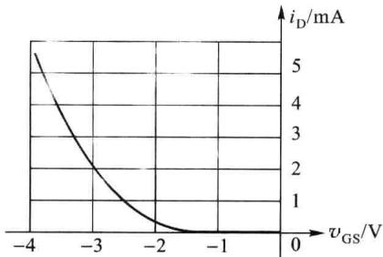  

图题3.1.2

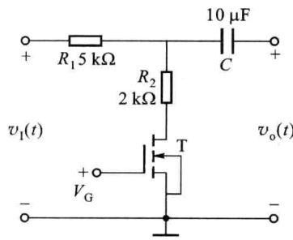  

图题3.1.3

<Solution>
$V_{\mathrm{om}} = 67.6\mathrm{mV},200\mathrm{mV}$
</Solution>
</Exercise>

<Exercise title="习题 3.1.4">
图题 3.1.4(a) 中场效应管 T 的输出特性曲线如图题 3.1.4(b) 所示。当 $v_{1}$ 分别为 1 V、3 V、4 V 时，管处于什么工作状态？

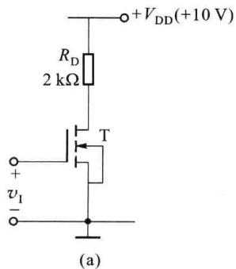

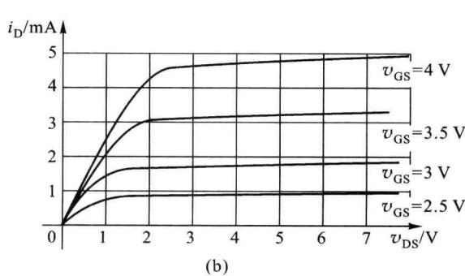  

图题3.1.4

<Solution>
截止区、饱和区、可变电阻区
</Solution>
</Exercise>

<Exercise title="习题 3.1.5">
某MOS场效应管的输出特性曲线如图题3.1.5所示。试说明该管的类型名称，画出其转移特性曲线 $(v_{\mathrm{DS}} = 6\mathrm{V})$ ，写出转移特性方程。

<Solution>
$i_{\mathrm{D}} \approx 3(1 + 0.5v_{\mathrm{GS}})^2\mathrm{mA}$
</Solution>
</Exercise>

<Exercise title="习题 3.2.1">
N 沟道结型场效应管的 $k_{p}=20\ \mu A/V^{2}$ , W/L=15, $V_{off}=-1.5\ V$ , $\lambda\approx0.01\ V^{-1}$ 。工作电压 $v_{GS}$ , $v_{DS}$ 见表题3.2.1。试写出在各工作电压点的管漏、源极间呈现的电阻 $r_{\mathrm{DS}}$ 和 $r_{\mathrm{ds}}$ 。（注： $r_{\mathrm{DS}}$ 为对电压电流瞬时值表现出的电阻， $r_{\mathrm{ds}}$ 为对电压电流的变化量表现出的电阻。）

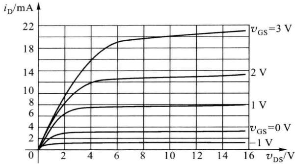  

图题3.1.5

表题3.2.1

<table><tr><td> ${v}_{\mathrm{{GS}}}/\mathrm{V}$ </td><td> ${v}_{\mathrm{{DS}}}/\mathrm{V}$ </td><td> ${r}_{\mathrm{{DS}}}$  .</td><td> ${r}_{\mathrm{{ds}}}$ </td></tr><tr><td rowspan="3">-0.7</td><td>0.1</td><td></td><td></td></tr><tr><td>0.2</td><td></td><td></td></tr><tr><td>-0.2</td><td></td><td></td></tr><tr><td rowspan="2">-1.2</td><td>0.2</td><td></td><td></td></tr><tr><td>0.6</td><td></td><td></td></tr><tr><td rowspan="2">-2</td><td>0.2</td><td></td><td></td></tr><tr><td>0.6</td><td></td><td></td></tr></table>

<Solution>
$r_{\mathrm{DS}} = 4.44\mathrm{k}\Omega ,4.76\mathrm{k}\Omega ,4.76\mathrm{k}\Omega ,16.67\mathrm{k}\Omega ,44.18\mathrm{k}\Omega ,\infty ,\infty$ $r_{\mathrm{DS}} = 4.44\mathrm{k}\Omega ,4.76\mathrm{k}\Omega ,4.76\mathrm{k}\Omega ,16.67\mathrm{k}\Omega ,7.36\mathrm{M}\Omega ,\infty ,\infty$
</Solution>
</Exercise>

<Exercise title="习题 3.2.2">
填写表题 3.2.2 的各项内容以总结场效应管的直流特性。

表题3.2.2

<table><tr><td colspan="2">名称</td><td>N沟道增强型</td><td>N沟道耗尽型</td><td>P沟道增强型</td><td>P沟道耗尽型</td><td>N沟道结型</td><td>P沟道结型</td></tr><tr><td colspan="2">管符号</td><td></td><td></td><td></td><td></td><td></td><td></td></tr><tr><td rowspan="4">可变电阻区</td><td> $v_{GS}$ </td><td></td><td></td><td></td><td></td><td></td><td></td></tr><tr><td> $v_{DS}$ </td><td></td><td></td><td></td><td></td><td></td><td></td></tr><tr><td> $v_{GD}$ </td><td></td><td></td><td></td><td></td><td></td><td></td></tr><tr><td>电流方程</td><td></td><td></td><td></td><td></td><td></td><td></td></tr><tr><td rowspan="4">饱和区</td><td> $v_{GS}$ </td><td></td><td></td><td></td><td></td><td></td><td></td></tr><tr><td> $v_{DS}$ </td><td></td><td></td><td></td><td></td><td></td><td></td></tr><tr><td> $v_{GD}$ </td><td></td><td></td><td></td><td></td><td></td><td></td></tr><tr><td>电流方程</td><td></td><td></td><td></td><td></td><td></td><td></td></tr><tr><td rowspan="4">截止区</td><td> $v_{GS}$ </td><td></td><td></td><td></td><td></td><td></td><td></td></tr><tr><td> $v_{DS}$ </td><td></td><td></td><td></td><td></td><td></td><td></td></tr><tr><td> $v_{GD}$ </td><td></td><td></td><td></td><td></td><td></td><td></td></tr><tr><td>电流方程</td><td></td><td></td><td></td><td></td><td></td><td></td></tr><tr><td colspan="2">输出特性曲线</td><td></td><td></td><td></td><td></td><td></td><td></td></tr><tr><td colspan="2">转移特性曲线</td><td></td><td></td><td></td><td></td><td></td><td></td></tr></table>
</Exercise>

<Exercise title="习题 3.2.3">
画出结型场效应管输出特性曲线的击穿区的特征形状，说明 $V_{(BR)DS}$ 随 $|v_{CS}|$ 增大而增大的原因。
</Exercise>

<Exercise title="习题 3.3.1">
基于 3.3 节中图 3.3.1, 画出两个 VDMOS 元胞并联的剖面图。
</Exercise>

<Exercise title="习题 3.3.2">
试分析双极型管和VDMOS管输出端导通电阻温度系数的正负性及其对管二次击穿的影响。
</Exercise>

<Exercise title="习题 3.3.3">
在 3.3 节的图 3.3.3 中对应画出 IGBT 管等效电路的各极 ( $T_{1}$ 的栅、漏、源和 $T_{2}$ 的基、集、射) 的等效区位。
</Exercise>

<Exercise title="习题 3.4.1">
电路如图题3.4.1所示。T的有关参数为 $k_{\mathrm{p}} = 50~\mu \mathrm{A} / \mathrm{V}^2$ ， $W / L = 10,V_{\mathrm{th}} = 1\mathrm{V},\lambda \approx 0\mathrm{V}^{-1}$ 。当电阻 $R_{\mathrm{ss}}$ 改变时欲在负载 $R_{\mathrm{D}}$ 上得到恒定的 $1\mathrm{mA}$ 电流，电压 $V_{\mathrm{CG}}$ 应为多少？所允许的 $R_{\mathrm{ss}}$ 变化范围是多少？

<Solution>
3 V,0\~2 kΩ
</Solution>
</Exercise>

<Exercise title="习题 3.4.2">
电路如图题 3.4.2 所示。T 的有关参数为 $k_{p}=20\ \mu A/V^{2}$ ， $W/L=20$ ， $V_{th}=2\ V$ ， $\lambda\approx0\ V^{-1}$ 。为保证管处于放大工作状态，输入电压 $v_{1}$ 的范围应是多少？

<Solution>
2\~7.56 V
</Solution>
</Exercise>

<Exercise title="习题 3.4.3">
求图题 3.4.3 所示电路中管源极电压 $V_{s}$ 。T 的参数为 $k_{p}=50\ \mu A/V^{2}, W/L=5, V_{th}=-1\ V, \lambda\approx0\ V^{-1}$ 。

<Solution>
3.93 V
</Solution>
</Exercise>

<Exercise title="习题 3.4.4">
图题 3.4.4 中的各电路欲作为放大电路。各电路中的偏置形式是否存在错误？错误何在？

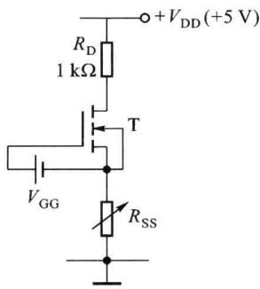  

图题3.4.1

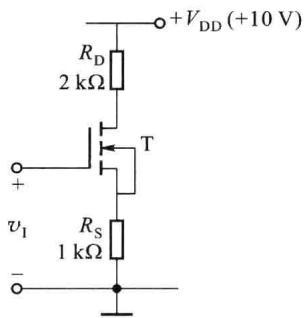  

图题3.4.2

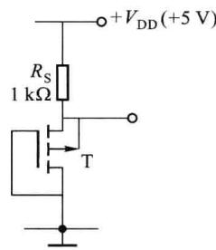  

图题3.4.3

<Solution>
图(e)、(h)中偏置的形式正确,其他图的偏置均有错误
</Solution>
</Exercise>

<Exercise title="习题 3.4.5">
计算图题 3.4.5 所示电路中 MOS 管的直流工作点: $V_{GSQ}$ 、 $I_{DQ}$ 、 $V_{DSQ}$ 。MOS 管 T 的参数为: $k_{p} = 30 \mu A/V^{2}$ , W/L = 20, $V_{th} = 1.5 V$ , $\lambda \approx 0 V^{-1}$ 。

<Solution>
2.38 V,0.234 mA,4.42 V
</Solution>
</Exercise>

<Exercise title="习题 3.4.6">
在图题 3.4.6 所示的放大电路中场效应管 T 的有关参数为 $I_{DSS} = 1.6 \, mA, V_{off} = -2 \, V, \lambda \approx 0 \, V^{-1}$

(1) 计算管的直流工作点 $I_{DQ}, V_{GSQ}, V_{DSQ}$ ;

(2) 求输出电压 $v_{0}$ 的动态范围；

(3) 正弦信号输出时的不失真最大幅度。

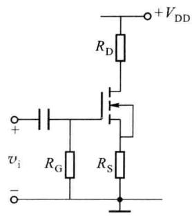  

(a)

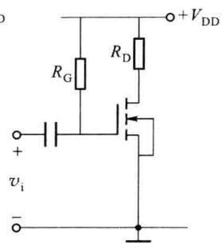  

(b)

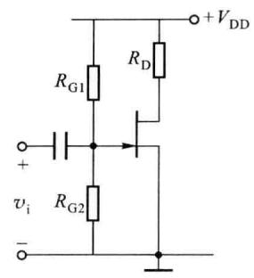  

(c)

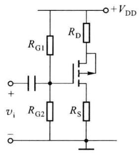

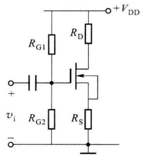  

(e)

(d)  

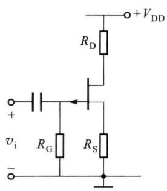  

(f)

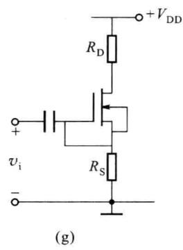

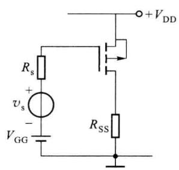  

(h)

图题3.4.4  

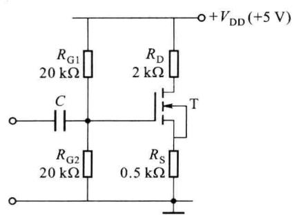  

图题3.4.5

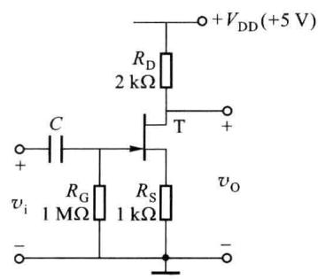  

图题3.4.6

<Solution>
(1) 0.69 mA,-0.69 V,2.93 V;(2) 2.78\~5 V,(3) 0.84 V
</Solution>
</Exercise>

<Exercise title="习题 3.4.7">
放大电路如图题 3.4.7 所示。场效应管 T 的有关参数为 $k_{p} = 40 \mu A/V^{2}$ ，W/L = 20， $V_{th} = 1.75 V$ ， $\lambda \approx 0.01 V^{-1}$ 。

（1）计算管的直流工作点 $I_{DQ}, V_{GSQ}, V_{DSQ}$ ;

(2) 求中频段源电压增益 $\dot{A}_{vs} = \dot{V}_{o} / \dot{V}_{s}$ 、输入电阻 $r_{i}$ 、输出电阻 $r_{o}$ 。

（注：耦合电容 $C_{G}$ 、旁路电容 $C_{S}$ 对中高频信号呈短路，忽略沟道长度调制效应对直流工作状态的影响。）

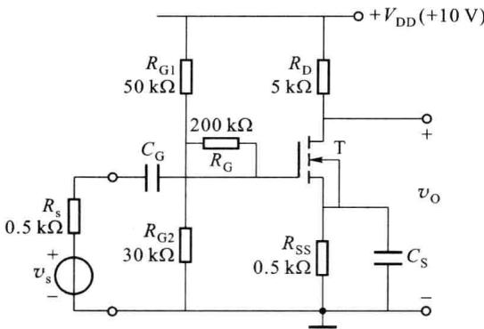  

图题3.4.7

<Solution>
(1) 0.94 mA,3.28 V,4.83 V;(2)-5.9,218.8 kΩ,4.78 kΩ
</Solution>
</Exercise>

<Exercise title="习题 3.4.8">
放大电路如图题 3.4.8 所示。MOS 管 T 的本征导电因子为 $50 \mu A/V^{2}$ ，开启电压为 1 V，沟道长度调制因子约为 $0 V^{-1}$ 。要求：(1) 输出电压 $v_{0}$ 的直流分量为 2 V；(2) 微变信号电压增益 $\left|v_{0}/v_{i}\right|$ 为 6 倍。管栅极输入的直流偏置电压值应为多少？管的沟道宽长比应为多少？

<Solution>
2 V,40
</Solution>
</Exercise>

<Exercise title="习题 3.4.9">
放大电路如图题 3.4.9 所示。场效应管 T 的有关参数为 $k_{p}=40\ \mu A/V^{2}$ ，W/L=20， $V_{th}=1.75\ V$ ， $\lambda\approx0.01\ V^{-1}$ ， $\eta=0.1$ 。试求：

(1) 计算管的直流工作点 $I_{DQ}, V_{GSQ}, V_{DSQ}$ ;

（2）画出中频微变等效电路。求出源电压增益 $\dot{A}_{vs} = \dot{V}_{o} / \dot{V}_{s}$ 、输入电阻 $r_{i}$ 、输出电阻 $r_{o}$ 的数值。

（注：旁路电容 $C_{c}$ 对中高频信号呈短路，忽略衬底调制效应和沟道长度调制效应对直流工作状态的影响。）

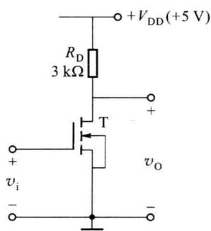  

图题3.4.8

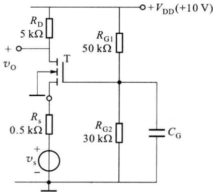  

图题3.4.9

<Solution>
(1) 0.94 mA,3.28 V,4.83 V;(2) 4.1,739 Ω,5 kΩ
</Solution>
</Exercise>

<Exercise title="习题 3.4.10">
共漏放大电路如图题3.4.10所示。T的 $k_{\mathrm{p}} = 20~\mu \mathrm{A} / \mathrm{V}^2$ ， $W / L = 30,V_{\mathrm{th}} = -1\mathrm{V},\lambda \approx 0.01\mathrm{V}^{-1},\eta$ =0.1。试画出中频微变等效电路，计算源电压增益 $\dot{A}_{vs} = \dot{V}_{o} / \dot{V}_{s}$ 、输入电阻 $r_{i}$ 、输出电阻 $r_{o}$ 。（注：忽略衬底调制和沟道长度调制对直流工作状态的影响。）

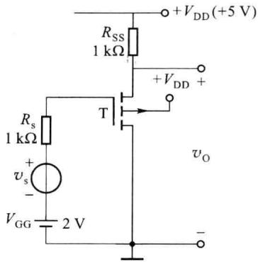  

图题3.4.10

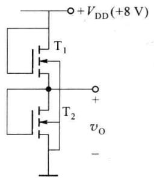  

图题3.4.11

<Solution>
0.44,∞,0.52 kΩ
</Solution>
</Exercise>

<Exercise title="习题 3.4.11">
在图题 3.4.11 中，场效应管 $T_{1}$ 、 $T_{2}$ 组成有源电阻分压器。试计算输出电压 $v_{0}$ 值。 $T_{1}$ 、 $T_{2}$ 的有关参数为： $k_{p1} = k_{p2} = 30 \mu A/V^{2}$ ， $V_{th1} = V_{th2} = 1 V$ ， $\lambda_{1} = \lambda_{2} \approx 0 V^{-1}$ ， $(W/L)_{1} = 40$ ， $(W/L)_{2} = 10$ 。（注：忽略衬底调制效应的影响。）

<Solution>
5 V
</Solution>
</Exercise>

<Exercise title="习题 3.4.12">
在图题 3.4.12 所示的电流源电路中， $T_{1}$ 、 $T_{2}$ 、 $T_{3}$ 的参数为 $k_{p}=20\ \mu A/V^{2}$ ， $V_{th}=1\ V$ ， $\lambda_{1}=\lambda_{3}\approx0\ V^{-1}$ ， $\lambda_{2}=0.02\ V^{-1}$ ， $(W/L)_{1}=(W/L)_{3}=20$ ， $(W/L)_{2}=30$ 。求 $v_{DS2}$ 分别为 2 V、5 V 时的输出电流 $I_{0}$ 值。

<Solution>
0.7 mA,0.74 mA
</Solution>
</Exercise>

<Exercise title="习题 3.4.13">
E/E 型共源极放大电路如图题 3.4.13 所示。 $T_{1}$ 、 $T_{2}$ 的参数为 $k_{p}=40\ \mu A/V^{2}$ ，W/L=30， $V_{th}=1\ V$ ， $\lambda\approx0.01\ V^{-1}$ ， $\eta=0.1$ 。试画出中频微变等效电路，计算源电压增益 $\dot{A}_{vs}=\dot{V}_{o}/\dot{V}_{s}$ 和输出电阻 $r_{o}$ 。

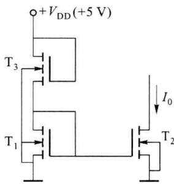  

图题3.4.12

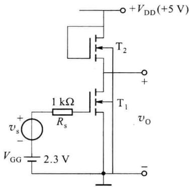  

图题3.4.13

<Solution>
-0.9,576 Ω
</Solution>
</Exercise>

<Exercise title="习题 3.4.14">
E/D 型共源极放大电路如图题 3.4.14 所示。 $T_{1}$ 的参数为 $k_{p1}=40\ \mu A/V^{2}, (W/L)_{1}=20, V_{th1}=1.4\ V, \lambda_{1}=0.02\ V^{-1}$ 。 $T_{2}$ 的参数为 $I_{DSS2}=0.8\ mA, V_{off2}=-1\ V, \lambda_{2}=0.02\ V^{-1}, \eta_{2}=0.1$ 。

(1) 计算 $T_{1}$ 的直流工作点 $I_{DQ1}, V_{DSQ1}$ ;

（2）画出中频微变等效电路，求出源电压增益 $\dot{A}_{vs} = \dot{V}_{o} / \dot{V}_{s}$ 和输出电阻 $r_{o}$ 的数值。

<Solution>
(1) 0.87 mA,3.76 V;(2)-10,8.23 kΩ
</Solution>
</Exercise>

<Exercise title="习题 3.4.15">
放大电路如图题 3.4.15 所示。 $T_{1}$ 、 $T_{2}$ 的参数为 $k_{p}=30\ \mu A/V^{2}$ ，W/L=30， $|V_{th}|=1\ V,\lambda\approx0.01\ V^{-1},\eta=0.1$ 。设工作点电流 $I_{DQ}=1\ mA$ ，试画出中频微变等效电路，计算源电压增益 $\dot{A}_{vs}=\dot{V}_{o}/\dot{V}_{s}$ 和输出电阻 $r_{o}$ 。

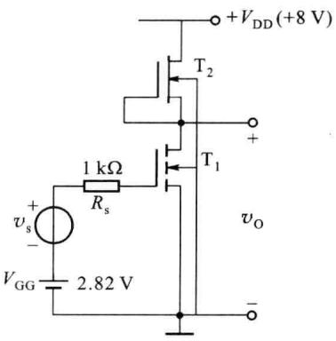  

图题3.4.14

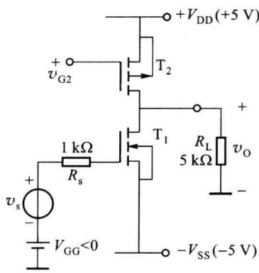  

图题3.4.15

<Solution>
-6.25,50 kΩ
</Solution>
</Exercise>

<Exercise title="习题 3.4.16">
放大电路如图题 3.4.16 所示。

(1) 分析电路的构成和 $T_{1}$ 、 $T_{2}$ 、 $T_{3}$ 的作用；

（2）设 $V_{\mathrm{S3}} / V_{\mathrm{G3}} \approx 1, \mathrm{T}_{1}, \mathrm{T}_{2}$ 的 $g_{\mathrm{m1}} = g_{\mathrm{m2}}, \lambda_{1} = \lambda_{2}$ 。写出源电压增益 $\dot{A}_{vs} = \dot{V}_{o} / \dot{V}_{i}$ 的表示式。

<Solution>
-g $_{ml}$ r $_{dsl}$ 3.4.17 (1) 0.282 5 mA,0.282 5 mA,0.565 mA;(2)-2.8;
(3) 639.2 kΩ,-1.17×10 $^{-3}$ ,1 193.6
</Solution>
</Exercise>

<Exercise title="习题 3.4.17">
差放电路如图题 3.4.17 所示。结型场效应管 $T_{1} \sim T_{3}$ 的转移特性方程为 $i_{\mathrm{D}} = 3(1 + 0.5v_{\mathrm{GS}})^{2} \, \mathrm{mA}$ ， $\lambda_{1} = \lambda_{2} \approx 0 \, V^{-1}$ ， $\lambda_{3} = 0.01 \, V^{-1}$ 。试计算：

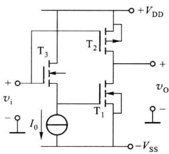  

图题3.4.16

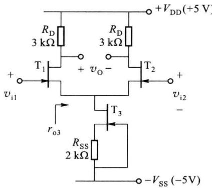  

图题3.4.17

(1) 管工作点电流 $I_{DQ1}$ 、 $I_{DQ2}$ 、 $I_{DQ3}$ ;

(2) 中频段微变差模电压增益(双入双出);

（3）中频段 $T_{3}$ 管的微变输出电阻 $r_{o3}$ 、共模电压增益 $\dot{A}_{vc} = \dot{V}_{o1} / \dot{V}_{ic}$ 和共模抑制比。
</Exercise>

<Exercise title="习题 3.4.18">
CMOS差放电路如图题3.4.18所示。电路中各管的 $|V_{\mathrm{th}}| = 1\mathrm{V},\lambda \approx 0.01\mathrm{V}^{-1},\eta = 0.1$ 。PMOS管的 $k_{\mathrm{p}} = 10~\mu \mathrm{A} / \mathrm{V}^2,W / L = 20$ 。NMOS管的 $k_{\mathrm{p}} = 30~\mu \mathrm{A} / \mathrm{V}^2,W / L = 10$ 。试求出：

(1) $T_{1}$ 、 $T_{2}$ 的工作点电流 $I_{DQ1}$ 、 $I_{DQ2}$ ;

(2) 中频段微变差模电压增益(双入单出)。

(注:忽略沟道长度调制效应和衬底调制效应对直流工作点和镜像关系的影响。)

<Solution>
0.97 mA,39
</Solution>
</Exercise>

<Exercise title="习题 3.5.1">
在图题 3.5.1 给出的单管 NMOS 开关中，负载电阻 $R_{L}$ 为 $1 \, k\Omega, V_{GH} = 5 \, V, V_{GL} = 0$ 。T 的参数为 $k_{p} = 40 \, \mu A/V^{2}, W/L = 30, V_{th} = 1 \, V$ 。在模拟开关的接通状态，当要求 $(v_{0}/v_{1}) > 0.8$ 时，输入电压 $v_{1}$ 应有怎样的变化范围？当 $v_{1}$ 在这一范围内变动时， $v_{0}/v_{1}$ 的改变量是多少？输出电压 $v_{0}$ 相对 $v_{1}$ 是否存在失真？是线

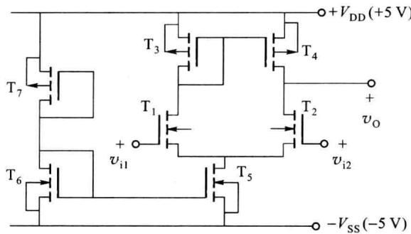  

图题3.4.18

性失真还是非线性失真？

<Solution>
0≤v $_{l}$ &lt;0.667 V,v $_{o}$ /v $_{l}$ =0.8\~0.83
</Solution>
</Exercise>

<Exercise title="习题 3.5.2">
CMOS 传输门如图题 3.5.2 所示。当 $V_{GH} = +V_{DD}, V_{GL} = 0$ 时，试求出传输门的接通电阻 $R_{on}$ 与输入电压 $v_{1}$ 无关的条件。（注：不计衬底调制效应。）

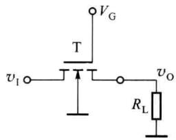  

图题3.5.1

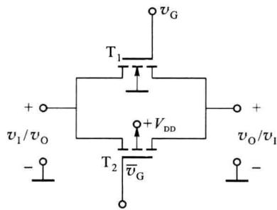  

图题3.5.2

## 第四章 小信号放大电路的频率特性

在第二章、第三章中用简化小信号模型分析放大电路的放大作用时，都假设输入信号耦合是一个单频正弦信号，并且电路中所有耦合电容和旁路电容对交流信号都视为短路，晶体管的极间电容和电路中的分布电容都视为开路，即模型和放大电路都假设与频率无关。而实际上一般的输入信号都是占有一定频率范围的多频信号，由于放大电路中存在着电抗元件（如电容、电感线圈等）以及晶体管的极间电容，它们的电抗随信号频率不同而变化，因此放大电路对不同频率的信号具有不同的放大能力，其增益的大小和相移都会随频率而变化，即增益是信号频率的函数。在小信号运用条件下，放大电路的增益因工作频率不同而改变的特性称为频率响应特性或频率特性，它表示放大电路对于不同频率正弦信号的稳态响应。本章介绍频率特性的基本概念，晶体管参数的频率特性以及放大电路的频率响应特性。如同第二章、第三章一样，本章讨论增加了频率关系后，双极型晶体管和场效应管的放大增益特性。
</Exercise>
