import Guide from '@/components/Guide.astro';
import Knowledge from '@/components/Knowledge.astro';
import Example from '@/components/Example.astro';
import Analysis from '@/components/Analysis.astro';
import Solution from '@/components/Solution.astro';
import Variant from '@/components/Variant.astro';
import Note from '@/components/Note.astro';
import Block from '@/components/Block.astro';
import Method from '@/components/Method.astro';
import Exercise from '@/components/Exercise.astro';

## 4.1.1 频率特性的基本概念

## 一、幅度失真和相位失真

一般放大电路的输入信号,都是包含多个频率成分的信号。例如:一路电话的话音信号要占用300\~3400 Hz的频带宽度,而高品质的音响中音频信号为20 Hz\~20 kHz,视频信号为直流至几十兆赫。这样,含有电抗元件的放大电路,将会对各个频率分量有不同的增益和相移,导致放大前后的信号波形发生差异,从而产生频率失真。频率失真包括幅度失真和相位失真。

一个放大电路如果对输入信号各个频率成分的增益完全相同，并且使各频率成分的相移与频率呈线性关系时，则信号经过放大后就不会产生频率失真。而实际的放大电路不可能做到完全没有频率失真。

如果放大电路的频带不是足够宽,使电路对不同频率分量的增益不同,从而引起输出信号中各频率分量的幅度比例关系发生了改变,导致输出波形的失真,这种失真称为幅度失真。例如图4.1.1(a)中实线所示的输入信号,它包含两个频率分量,如图中虚线所致;假设放大电路对低频分量的放大倍数小、对高频分量的放大倍数大,使输出波形中两种频率分量的幅度关系发生了变化,就会造成输出信号波形与输入信号波形明显不同,如图4.1.1(b)所示。

同样,如果放大电路的相移与频率的关系不是线性的,不同频率分量的信号通过放大电路后产生的时延不同,也会引起输出波形的失真,这种失真称为相位失真。实际的放大电路其相移与频率的关系一般都不满足像输入信号一样对应的相位关系,所以信号经放大后要产生相位失真。在工程应用中，由于人耳对放大电路产生的相位失真不是很敏感，因此即使放大电路产生相位失真，人们在通话中也感觉不到，所以用在电话通信中的放大器，其相位失真可以不予考虑；但是如果放大图像信号时，相位失真将严重影响通信质量。

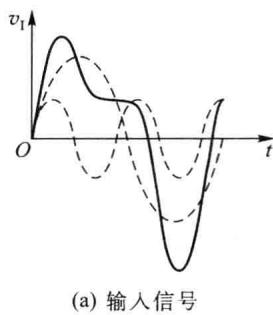

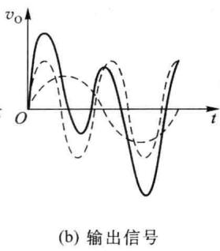  

图 4.1.1 放大电路存在线性失真时的输入信号与输出信号

由于幅度失真和相位失真是由线性电抗元件所引起的,因此又称为线性失真。其特点是输出波形中没有产生新的频率。若在输出波形中产生了输入信号中没有的新频率,对应的失真称为非线性失真。

## 二、幅频特性和相频特性

放大电路的频率特性可以用增益随频率变化的关系曲线来描述,它反映放大电路对不同频率输入信号的稳态响应,包括幅频特性和相频特性。前者指放大电路增益的大小随频率的变化关系,后者则说明不同频率的信号在放大的过程中所产生的相移随频率的变化关系。

通常在小信号运用条件下，把放大电路视为一个有源线性网络，如图4.1.2所示。电路增益用系统传输函数 $H(s)$ 表示。通常在复数频域分析传输函数，设输入、输出的复频域信号分别为 $X(s)$ 、 $Y(s)$ 。 $X(s)$ 、 $Y(s)$ 分别是输入、输出信号的拉普拉斯变换。则系统传输函数为

$$

H (s) = Y (s) / X (s)\tag{4.1.1}

$$

式中，s 为复数频率， $s=\sigma+j\omega$ 。当 $s=j\omega$ （或者 $s=j2\pi f$ ）时， $\dot{H}(j\omega)$ [或者 $\dot{H}(jf)$ ] 就是系统的稳态正弦频率响应函数，简称为频率响应或频率特性（也常用符号 $\dot{H}$ 表示）。

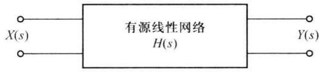  

图 4.1.2 有源线性网络及输入、输出信号

对于放大电路, $\dot{H}_{v}$ 为电压放大倍数,可写为 $\dot{A}_{v}$ ,即

$$

\dot {A} _ {v} = \frac {\dot {V} _ {\mathrm{o}}}{\dot {V} _ {\mathrm{i}}} = | \dot {A} _ {v} (\omega) | \mathrm{e} ^ {\mathrm{j} \varphi (\omega)}\tag{4.1.2}

$$

$\left|\dot{A}_{v}(\omega)\right|$ 表示放大电路电压增益的模值与频率 $\omega(\omega=2\pi f)$ 之间的关系，称其为放大电路的幅频特性。 $\varphi(\omega)$ 表示放大电路输出电压与输入电压之间的相位差 $\varphi$ 与角频率 $\omega$ 之间的关系，称其为相频特性。

## 三、工作频段、截止频率和通频带

在图4.1.3(a)给出的共发射极放大电路中。输入信号为信号源的电压信号 $\dot{V}_{\mathrm{s}}$ ，输出信号为负载上的电压信号 $\dot{V}_{\mathrm{o}}$ 。图4.1.3(b）、(c)分别为这一电路的电压传输函数 $\dot{A}_v = \frac{\dot{V}_o}{\dot{V}_i} = |\dot{A}_v(f)|\mathrm{e}^{\mathrm{j}\varphi (f)}$ 的幅频特性 $|\dot{A}_v(f)|$ 、相频特性 $\varphi (f)$ 的函数曲线图。

由图 4.1.3(b) 可见, 放大电路对各频率成分的放大倍数并不相同。在中间频段 $(f_{\mathrm{L}} \sim f_{\mathrm{H}}$ 之间), 耦合电容和旁路电容对该频段信号的容抗很小, 可视为对交流信号短路; 晶体管的极间电容对该频段信号的容抗很大, 可视为开路。此时的幅频和相频特性曲线平坦, 基本上为常数, 保持一定的电压增益 $\left|\dot{A}_{vm}\right|$ 和 $-180^{\circ}$ 的相移 $(-180^{\circ}$ 相移是由共射组态晶体管本身造成的)。在低频段 $(f < f_{\mathrm{L}})$ , 耦合电容和旁路电容不能再被视为对交流信号短路, 电压增益随信号频率的降低而减小, 相移减小。在高频段 $(f > f_{\mathrm{H}})$ , 晶体管的极间电容不能视为对交流信号开路, 此时的电压增益随信号频率的增加而减小, 相移增大。一般低频段的输出电压有超前于中频时的附加相移, 高频段的输出电压有滞后于中频时的附加相移。

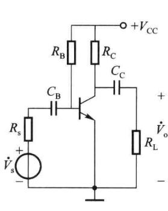  

(a) 共射放大电路

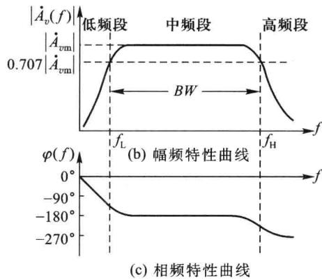  

图 4.1.3 共射放大电路的幅频特性和相频特性

在低频段,使电压增益下降为中频段增益 $A_{vm}$ 的 $1/\sqrt{2}$ (相当于 0.707 倍)时的频率称为下限截止频率 $f_{L}$ (简称为下截频); 在高频段,使电压增益下降为中频段增益 $A_{vm}$ 的 $1/\sqrt{2}$ 时的频率称为上限截止频率 $f_{H}$ (简称为上截频)。从 $f_{L}$ 到 $f_{H}$ 的频段, 称为放大电路的通频带, 用 BW 表示, 即

$$

B W = f _ {\mathrm{H}} - f _ {\mathrm{L}}

$$

通常所说的放大电路增益,一般都是指中频增益。由于截止频率处的放大倍数下降为中频放大倍数的 $1/\sqrt{2}$ ，功率传输函数恰为其中频值的一半，因此截止频率也称为半功率点。当放大电路和元件参数已知时，便可以计算出放大电路的上下截频。若要使放大电路的频率失真限制在允许值之内，放大电路的通频带应该大于输入信号的频谱宽度。

前述章节重点介绍了放大电路的中频特性,本章将对电路的高、低频段特性进行分析。由于大容量电容器难以用集成工艺制造,在集成电路中,RC耦合放大电路已经基本上由直接耦合放大电路所代替,下截频接近于零,因此本章对低频段不作重点研究,主要讨论高频特性。

## 四、传输函数和零点、极点概念

在复数频率 s 域中,电容的容抗为 1/sC,电感的感抗为 sL。因而,含有电抗成分的线性系统的传输函数 $A(s)$ 的一般表示式为

$$

A (s) = \frac {Y (s)}{X (s)} = \frac {b _ {m} s ^ {m} + b _ {m - 1} s ^ {m - 1} + \cdots + b _ {1} s + b _ {0}}{a _ {n} s ^ {n} + a _ {n - 1} s ^ {n - 1} + \cdots + a _ {1} s + a _ {0}}\tag{4.1.3}

$$

将式 $(4.1.3)$ 的分母、分子多项式分别求根,可将其写为

$$

A (s) = K \frac {(s - z _ {1}) (s - z _ {2}) \cdots (s - z _ {m})}{(s - p _ {1}) (s - p _ {2}) \cdots (s - p _ {n})}\tag{4.1.4}

$$

由式(4.1.4)，当 $s=z_{i}$ 时， $A(s)=0$ ；当 $s=p_{i}$ 时， $A(s)\rightarrow\infty$ 。因而称各 $z_{i}$ 为传输函数的零点，各 $p_{i}$ 为传输函数的极点。一个实际的稳定电子电路系统的零、极点应满足两个基本条件：(1)零点的个数小于等于极点的个数；(2)极点应是负实数或是实部为负的共轭复数对。

令 $s = j\omega$ ，得到系统的频率响应函数 $\dot{A}(\omega)$ ，在各 $p_{i}, z_{i}$ 均为实数的情况下，令： $-p_{i} = \omega_{pi}$ ， $-z_{i} = \omega_{zi}, \omega_{pi}, \omega_{zi}$ 被分别称为极点角频率、零点角频率。则 $\dot{A}(\omega)$ 的表达式为

$$

\dot {A} (\omega) = K \frac {\left(\mathrm{j} \omega + \omega_ {\mathrm{z1}}\right) \left(\mathrm{j} \omega + \omega_ {\mathrm{z2}}\right) \cdots \left(\mathrm{j} \omega + \omega_ {\mathrm{zm}}\right)}{\left(\mathrm{j} \omega + \omega_ {\mathrm{p1}}\right) \left(\mathrm{j} \omega + \omega_ {\mathrm{p2}}\right) \cdots \left(\mathrm{j} \omega + \omega_ {\mathrm{pn}}\right)}\tag{4.1.5}

$$

根据 $\dot{A}(\omega)$ 可得到幅频响应函数 $|\dot{A}(\omega)|$ 和相频响应函数 $\varphi(\omega)$ 。

## 4.1.2 频率特性的分析方法

分析放大电路的频率响应特性,一般采用“分频段分析法”,即将频率响应分为低频段、中频段、高频段三个频段对待。在三个频段内放大电路表现出的参量有所不同,对放大电路的分析方法也各有特点。分别利用三个频段的等效电路和工程近似技术就可以比较容易地得到放大电路的频率响应,从而避免了对一个完整电路(包含所有电容)求解复杂的传输函数过程。若要精确求解包含所有电容的放大电路频率响应,可以利用 SPICE 等计算机仿真软件进行分析。

## 一、波特图

在研究多级放大电路的频率特性时,放大电路输入信号的频率范围通常在几赫至上百兆赫,而放大倍数从几倍至上百万倍,此时采用对数表达会更直观和方便。

对于多级放大电路,总电压增益为

$$

\dot {A} _ {v} (\omega) = \dot {A} _ {v 1} (\omega) \dot {A} _ {v 2} (\omega) \dots \dot {A} _ {v n} (\omega) = | \dot {A} _ {v} (\omega) | e ^ {j \varphi (\omega)}\tag{4.1.6}

$$

其中

$$

\left| \dot {A} _ {v} (\omega) \right| = \left| \dot {A} _ {v 1} (\omega) \right| \left| \dot {A} _ {v 2} (\omega) \right| \dots \left| \dot {A} _ {v n} (\omega) \right|\tag{4.1.7}

$$

$$

\varphi (\omega) = \varphi_ {1} (\omega) + \varphi_ {2} (\omega) + \dots + \varphi_ {n} (\omega)\tag{4.1.8}

$$

即:级联放大电路的总增益等于各级增益之积,总相移等于各级相移之和。

如果把式 $(4.1.7)$ 中的电压增益转换成以分贝表示,其结果为

$$

\left| \dot {A} _ {v} (\omega) \right| | _ {\mathrm{dB}} = 2 0 \lg \left| \dot {A} _ {v} (\omega) \right| = 2 0 \lg \left| \dot {A} _ {v 1} (\omega) \right| + 2 0 \lg \left| \dot {A} _ {v 2} (\omega) \right| + \dots + 2 0 \lg \left| \dot {A} _ {v n} (\omega) \right|\tag{4.1.9}

$$

由式(4.1.9)可见,当考虑级联放大电路时,将放大倍数使用以分贝表示的对数运算,可以把乘积运算转化为加法运算。

<Example title="例 4.1.1">
求如图 4.1.4 所示多级放大电路的总电压增益(分贝表示)。

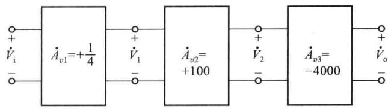  

图4.1.4 例4.1.1的电路

<Solution title="解">
总电压增益为

$$

\dot {A} _ {v} = \frac {\dot {V} _ {\mathrm{o}}}{\dot {V} _ {\mathrm{i}}} = \frac {\dot {V} _ {\mathrm{o}}}{\dot {V} _ {2}} \cdot \frac {\dot {V} _ {2}}{\dot {V} _ {1}} \cdot \frac {\dot {V} _ {1}}{\dot {V} _ {\mathrm{s}}} = (- 4 0 0 0) \times (+ 1 0 0) \times (+ 1 / 4) = - 1 0 ^ {5}

$$

数值很大,写成分贝表示

$$

\left| \dot {A} _ {v} \right| | _ {\mathrm{dB}} = 2 0 \lg \left| \frac {\dot {V} _ {\mathrm{o}}}{\dot {V} _ {2}} \right| + 2 0 \lg \left| \frac {\dot {V} _ {2}}{\dot {V} _ {1}} \right| + 2 0 \lg \left| \frac {\dot {V} _ {1}}{\dot {V} _ {\mathrm{i}}} \right| = (7 2 + 4 0 - 1 2) \mathrm{dB} = 1 0 0 \mathrm{dB}

$$

由于 $\dot{A}_{v} = -10^{5}$ 带负号, 因此总相位是 $-180^{\circ}$ 。

当放大电路中存在电抗元件时,电压增益不再是常数,其幅频特性 $\left|A_{v}(\omega)\right|$ 与相频特性 $\varphi(\omega)$ 均为频率 $\omega$ 的函数,并且通常是复杂的代数函数,难以求解。因此,工程上一般都是利用近似方法分析放大电路的频率响应。

通过分析基本结构电路的频率特性,可以归纳出一种绘制复杂传输函数的渐近频率特性曲线的直接简便方法。这种渐近频率特性曲线称为波特(Bode)图,是以贝尔实验室的H.W.Bode命名的。通常将精确的计算机仿真求解频率特性结果与波特图相结合,以便于理解一个或者多个关键电路元件对电路性能的影响。

波特图由对数幅频特性和对数相频特性两部分组成,为了缩短频率坐标,通常采用半对数直角坐标系。其横轴变量都是角频率 $\omega$ 或频率 f,采用对数标度,使得横坐标标度数值变小,读写方便。幅频特性的纵轴变量是 $20\lg|\dot{A}(\omega)|$ ,单位是分贝(dB),线性标度,例如当放大器级联时,总的放大倍数是各级相乘,而采用分贝做单位时,总增益就是相加;相频特性的纵轴仍用 $\varphi$ 表示,线性标度。

请注意关系式 $\omega = 2\pi f$ ，从数学的角度来看，使用 $\omega$ 进行公式推导更为简捷。本章中使用频率变量 $\omega$ 或 $f$ 时，哪个更方便就使用哪个。
</Solution>
</Example>

## 二、几种典型电路波特图的标准形式

如图 4.1.5 所示系统框图, 其频域传输函数为

$$

\dot {H} (\omega) = \frac {\dot {V} _ {\mathrm{o}}}{\dot {V} _ {\mathrm{i}}} = | \dot {H} (\omega) | \mathrm{e} ^ {\mathrm{j} \varphi (\omega)}

$$

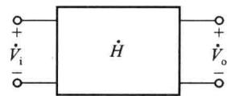

(4.1.10)

图4.1.5 系统框图

工程上采用分析常用的简单 $\dot{H}$ 网络实际响应与渐近响应曲线的办法, 绘制出一组标准形式的波特图。对于复杂电路结构的频率特性, 只需要利用公式化繁为简, 将上述简单网络的波特图进行合并处理就可以得到。下面, 将针对几种常用的 $\dot{H}$ 网络进行分析。

1. 实常数情况 $\dot{H} = \pm C$ ( $C$ 为常数)

（1）对于 $\dot{H}=+C$ ，相当于 $\dot{H}=Ce^{j0}$ ，图 4.1.6 所示为其波特图。

（2）对于 $\dot{H} = -C$ ，同样，相当于 $\dot{H} = C e^{\pm j\pi}$ ，图 4.1.7 所示为其波特图。请注意，在相频特性曲线图中，-C 可以画在 $+180^{\circ}$ 处、也可以画在 $-180^{\circ}$ 处。按照惯例，本书画在 $-180^{\circ}$ 处，即输出响应相位滞后输入 $180^{\circ}$ 。

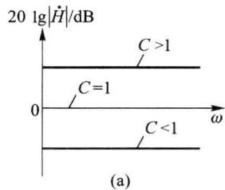

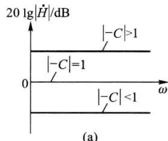

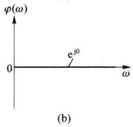  

图4.1.6 $\dot{H} = +C$ 的波特图

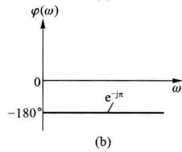  

图4.1.7 $\dot{H} = -C$ 的波特图

2. 虚函数情况 $\dot{H} = \pm \frac{\mathrm{j}\omega}{\omega_0}$ （或者 $\dot{H} = \pm \frac{\mathrm{j}\omega_0}{\omega}$ ）

(1) 对于 $\dot{H} = \pm \frac{j\omega}{\omega_{0}}$

可以写成 $\dot{H} = \frac{\omega}{\omega_{0}} e^{\pm j \frac{\pi}{2}}$ ，图 4.1.8 为其波特图。其中幅频特性曲线的 y 轴为以分贝表示的 $20 \lg | \dot{H}(\omega)|$ 。可见

当 $\omega=\omega_{0}$ 时, $20\lg1=0\ dB$ ;

当 $\omega=10\omega_{0}$ 时, $20\lg 10=20\ dB$ ;

当 $\omega=0.1\omega_{0}$ 时，20lg 10=-20 dB。

因此,这是一条斜率为+20 dB/十倍频的直线。

对于 $\dot{H} = +\frac{j\omega}{\omega_{0}}$ ，相频特性曲线图为 $+90^{\circ}$ ，属于超前相位；对于 $\dot{H} = -\frac{j\omega}{\omega_{0}}$ ，相频特性曲线图为 $-90^{\circ}$ ，属于滞后相位。

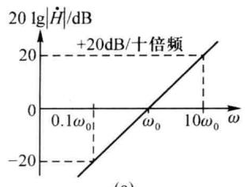

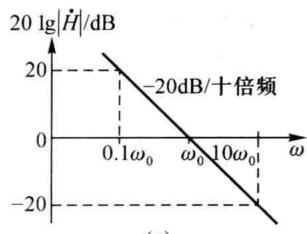

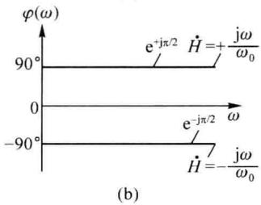  

图4.1.8 $\dot{H} = \pm \frac{\mathrm{j}\omega}{\omega_0}$ 的波特图

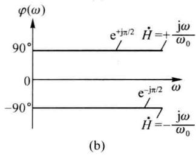  

图4.1.9 $\dot{H} = \pm \frac{\mathrm{j}\omega_0}{\omega}$ 的波特图

(2) 对于 $\dot{H} = \pm \frac{j\omega_{0}}{\omega}$

可以写成 $\dot{H} = \frac{\omega_0}{\omega}\mathrm{e}^{\pm \mathrm{j}\frac{\pi}{2}}$ ，与前一种情况类似，图4.1.9为其波特图。其中幅频特性曲线的 $y$ 轴为以分贝表示的 $20\lg \left|\frac{\omega_0}{\omega}\right|$ 。可见：

当 $\omega=\omega_{0}$ 时, $20\lg1=0\ dB$ ;

当 $\omega=10\omega_{0}$ 时, $20\lg0.1=-20\ dB$ ;

当 $\omega=0.1\omega_{0}$ 时，20lg 10=20 dB。

因此,这是一条斜率为-20 dB/十倍频的直线。

相频特性曲线图与前一种情况类似。

3. 低通滤波电路

对于图 4.1.10 所示的 RC 低通滤波电路, 其电压传输函数为

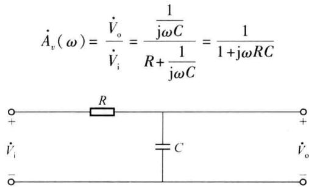  

图 4.1.10 RC 低通滤波电路

(4.1.11)

将式 $(4.1.11)$ 简化为

$$

\dot {A} _ {v} (\omega) = \frac {1}{1 + \mathrm{j} \omega / \omega_ {\mathrm{H}}}\tag{4.1.12}

$$

式中， $\omega_{\mathrm{H}}=1/(RC)$ 称为极点（或拐点）频率，其幅频特性和相频特性分别为

$$

\mid \dot {A} _ {v} (\omega) \mid = \frac {1}{\sqrt {1 + (\omega / \omega_ {\mathrm{H}}) ^ {2}}}\tag{4.1.13}

$$

$$

\varphi (\omega) = - \arctan \frac {\omega}{\omega_ {\mathrm{H}}}\tag{4.1.14}

$$

幅频特性

低通滤波电路的幅频特性波特图可由式(4.1.13)按照下列步骤绘出。

(1) 当 $\omega = \omega_{H}$ 时, 有

$$

\mid \dot {A} _ {v} (\omega) \mid = \frac {1}{\sqrt {1 + (\omega / \omega_ {\mathrm{H}}) ^ {2}}} = \frac {1}{\sqrt {2}}, \text {或者} 2 0 \mathrm{lg} \mid \dot {A} _ {v} (\omega) \mid = 2 0 \mathrm{lg} \frac {1}{\sqrt {2}} = - 3 \mathrm{dB}

$$

(2) 当 $\omega \ll \omega_{H}$ 时，(这里 $\ll$ 指的是 $\ll \frac{1}{10}$ )

$$

| \dot {A} _ {v} (\omega) | = \frac {1}{\sqrt {1 + (\omega / \omega_ {\mathrm{H}}) ^ {2}}} \approx 1, \text {或者} 2 0 \mathrm{lg} | \dot {A} _ {v} (\omega) | \approx 2 0 \mathrm{lg} 1 = 0 \mathrm{dB}

$$

这是一条与横轴平行的 0 dB 线。按照惯例,一般使较低频段的渐近线延伸至 $\omega_{H}$ , 然而实际响应曲线会在该点 ( $\omega = \omega_{H}$ 处) 有最大的误差 3 dB, 如图 4.1.11(a) 所示。

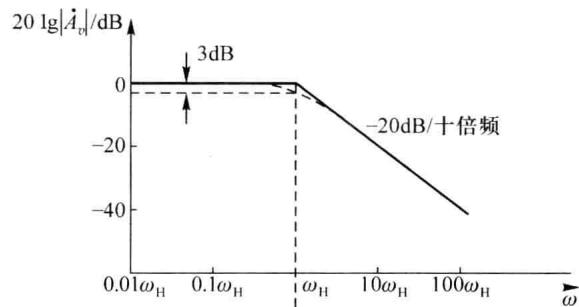

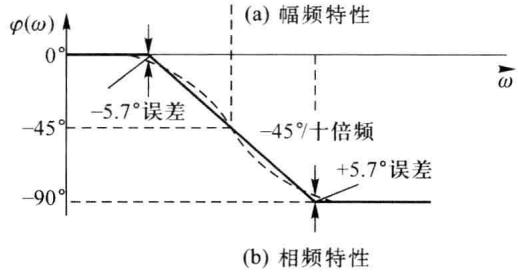  

图 4.1.11 RC 低通滤波电路的波特图

(3) 当 $\omega \gg \omega_{H}$ 时, 有

$$

\mid \dot {A} _ {v} (\omega) \mid = \frac {1}{\sqrt {1 + (\omega / \omega_ {\mathrm{H}}) ^ {2}}} \approx \frac {\omega_ {\mathrm{H}}}{\omega}

$$

根据图 4.1.9(a) 所示的幅频特性曲线图可知, 这是一条直线, 该高频段渐近线的斜率为 -20 dB/十倍频。这条线与低频渐近线在 $\omega_{H}$ 处相交, 所以 $\omega_{H}$ 称为转折频率(或者拐点频率）。由式(4.1.13)可知，当 $\omega = \omega_{\mathrm{H}}$ 时， $|\dot{A}_v| = \frac{1}{\sqrt{2}} = 0.707$ ，用分贝表示时，是-3dB，即在 $\omega_{\mathrm{H}}$ 处，电压传输系数比中频时下降了3dB，此处的实际值[图4.1.11(a)中虚线表示]比渐近线（实线表示）低3dB，因此 $\omega_{\mathrm{H}}$ 又称为上限截止频率。同时， $\omega_{\mathrm{H}}$ 还是电压传输函数 $\dot{A}_v(\omega)$ 的极点频率。

由图 4.1.11(a) 可以看到, 波特图这种用折线表示的幅频特性渐近曲线, 与实际值曲线存在一定误差。作为一种近似方法, 工程上是允许的。

## 相频特性

根据式(4.1.14)可以作出 RC 低通滤波电路的相频特性曲线渐近线,由三条直线构成。

(1) 当 $\omega\ll\omega_{H}$ 时, $\varphi(\omega)=-\arctan\frac{\omega}{\omega_{H}}\rightarrow0^{\circ}$ , 这是一条直线.

（2）当 $\omega \gg \omega_{\mathrm{H}}$ 时， $\varphi (\omega) = -\arctan{\frac{\omega}{\omega_{\mathrm{H}}}}\rightarrow -90^{\circ}$ ，也是一条直线。负号表示输出电压滞后输入电压，具有滞后相移。

(3) 当 $\omega = \omega_{H}$ 时, $\varphi(\omega) = -\arctan \frac{\omega}{\omega_{H}} = -45^{\circ}$

工程上一般使用因数 10 来表示远小于&lt;&lt;和远大于>>，因此在频率  \( 0.1\omega\_\{H\} \)  和  \( 10\omega\_\{H\} \)  之间，可用一条斜率为  \( -45^\{\circ\}/十倍频的直线来表示，于是可以得到相频特性曲线如图 4.1.11(b) 所示。同样，渐近线与实际值之间在  \( 0.1\omega\_\{H\} \)  和  \( 10\omega\_\{H\} \)  处的相位误差为  \( \pm5.7^\{\circ\} \) ，作为一种工程近似方法，在许多情况下都允许这种近似计算。

### 4. 高通滤波电路

RC 高通滤波电路的基本形式如图 4.1.12 所示, 应用分压公式可得其电压传输函数为

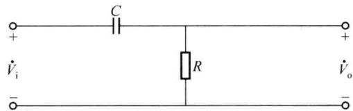  

图 4.1.12 RC 高通滤波电路

$$

\dot {A} _ {v} (\omega) = \frac {\dot {V} _ {\mathrm{o}}}{\dot {V} _ {\mathrm{i}}} = \frac {R}{R + \frac {1}{\mathrm{j} \omega C}} = \frac {1}{1 + \frac {1}{\mathrm{j} \omega R C}} = \frac {1}{1 - \frac {\mathrm{j}}{\omega R C}} = \frac {1}{1 - \mathrm{j} \frac {\omega_ {\mathrm{L}}}{\omega}}\tag{4.1.15}

$$

式中， $\omega_{\mathrm{L}}=1/(RC)$ 称为拐点频率，由式(4.1.15)可得其幅频特性和相频特性的表达式分别为

$$

\left| \dot {A} _ {v} (\omega) \right| = \frac {1}{\sqrt {1 + (\omega_ {\mathrm{L}} / \omega) ^ {2}}}\tag{4.1.16}

$$

$$

\varphi (\omega) = \arctan \frac {\omega_ {\mathrm{L}}}{\omega}\tag{4.1.17}

$$

仿照 RC 低通滤波电路波特图的绘制方法, 可以确定拐点频率和渐近线, 进而得到 RC 高通电路的波特图, 近似的与精确的幅频特性和相频特性曲线如图 4.1.13 所示。图中 $\omega_{L}$

是高通电路的下限截止频率。

(a)  

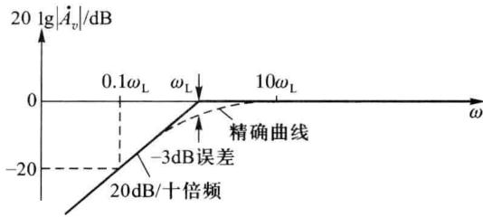

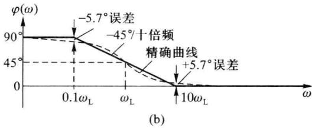  

图 4.1.13 RC 高通电路的波特图

由波特图可知：

当 $\omega \gg \omega_{\mathrm{L}}$ 时， $|\dot{A}_v| = \frac{1}{\sqrt{1 + (\omega_{\mathrm{L}} / \omega)^2}} \approx 1$ ，（或者 $0 \mathrm{~dB}$ ），这是一条与横轴平行的 $0 \mathrm{~dB}$ 线，并且 $|\dot{A}_v|$ 不随信号频率的变化而变化。由公式 $\varphi(\omega) = \arctan \frac{\omega_{\mathrm{L}}}{\omega}$ 可知，此时 $\varphi(\omega) \approx 0$ ，不产生相移。

当 $\omega=\omega_{L}$ 时， $\left|\dot{A}_{v}\right|=\frac{1}{\sqrt{2}}$ ，下降 3 dB。 $\varphi(\omega)=\arctan\frac{\omega_{L}}{\omega}=1$ ，产生 $+45^{\circ}$ 相移。正号表示输出电压超前于输入电压，具有超前相移。

当 $\omega\ll\omega_{L}$ 时，随着 $\omega$ 的减小， $|\dot{A}_{v}|\approx\frac{\omega}{\omega_{L}}$ ，按照 20 dB/十倍频的规律下降。并且 $\varphi(\omega)=\arctan\frac{\omega_{L}}{\omega}\rightarrow\infty$ ，相移增大，最终趋于 $+90^{\circ}$ 。

幅频特性波特图的斜率为+20 dB/十倍频,相频特性波特图的斜率为 $-45^{\circ}/$ 十倍频。

请注意,波特图这种以折线化表示的渐近线与实际响应曲线相比较,在拐点频率 $\omega=\omega_{L}$ 时,波特图幅值误差为 3 dB,误差最大;相移 $\varphi=+45^{\circ}$ ,没有误差。在 $10\omega_{L}$ 和 $0.1\omega_{L}$ 点,幅值误差为 0.043 dB,相位误差为 $\pm5.7^{\circ}$ 。在许多情况下,工程上是可以接受这种近似的。

通过上述对 RC 低通和高通电路频率响应特性的分析, 可以得出如下结论:

（1）电路的截止频率 $\left(\omega_{\mathrm{H}}\right.$ 或者 $\omega_{\mathrm{L}}$ 取决于电容所在回路的时间常数 $\tau(\tau=RC)$ ;

（2）当输入信号频率 $\omega=\omega_{H}$ （或者 $\omega=\omega_{L}$ ）时，放大电路的增益比通频带增益下降 3 dB，且产生 $-45^{\circ}$ （或者 $+45^{\circ}$ ）的相移；

（3）工程分析中，可用折线化的波特图近似表示放大电路实际的频率特性曲线。

<Example title="例 4.1.2">
试绘出下列传输函数的波特图：

$$

\dot {H} (f) = \frac {- 4 0}{\left(1 + \mathrm{j} \frac {f}{1 0 ^ {6}}\right) \left(1 - \mathrm{j} \frac {1 0 ^ {2}}{f}\right)}

$$

<Solution title="解">
分析上式, 可以写成

$$

\dot {H} (f) = \frac {- 4 0}{\left(1 + \mathrm{j} \frac {f}{1 0 ^ {6}}\right) \left(1 - \mathrm{j} \frac {1 0 ^ {2}}{f}\right)} = (- 4 0) \cdot \frac {1}{1 + \mathrm{j} \frac {f}{1 0 ^ {6}}} \cdot \frac {1}{1 - \mathrm{j} \frac {1 0 ^ {2}}{f}}

$$

式中, 因式(-40)具有图 4.1.7 所示的波特图特性, 其中 $20 \lg 40 = 32 \, dB$ ; 因式 $\frac{1}{1 + j \frac{f}{10^{6}}}$ 具有式 (4.1.12) 所示的低通滤波特性, 其高频拐点为 $1 \, MHz$ ; 因式 $\frac{1}{1 - j \frac{10^{2}}{f}}$ 具有式 (4.1.15) 所示的高通滤波特性, 其低频拐点为 $100 \, Hz$ 。

分别把上述三个波特图的幅频和相频特性渐近线加起来, 就可以得到本题目总的波特图, 如图 4.1.14 所示。不难看出, 这是一个放大电路在全频段(包括低频、高频)的波特图, 中频增益为 32 dB, 下限截止频率 $f_{L} = 100 \, Hz$ , 上限截止频率 $f_{H} = 10 \, kHz$ 。

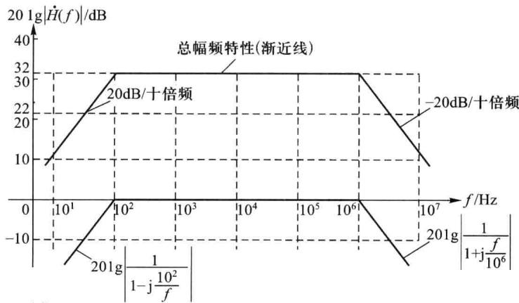

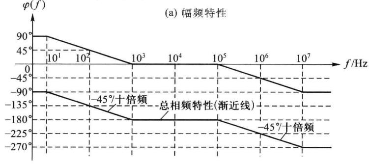  

(b) 相频特性  

图4.1.14 例4.1.2的波特图

通过上述分析,可以看到求解复杂网络传输函数波特图的方法,往往是把传输函数化简为不同标准形式的波特图,然后将多条波特图的渐近线相加,进行处理。这种将直线段叠加的办法大大方便了曲线的绘制,因此在工程中通常用渐近线标定频率特性的变化趋势。对于需要精确绘制放大电路频率特性曲线的情况,可以借助 EDA 分析软件在计算机上完成。
</Solution>
</Example>

## 4.1.3 多级放大电路的频率特性

在多级放大电路中含有多个单级放大电路,它们通过级联后构成如图 4.1.15 所示的系统。

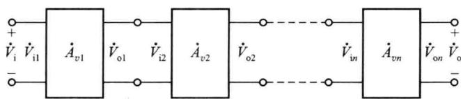  

图 4.1.15 多级放大电路

## 一、多级放大电路频率特性的幅频特性和相频特性

如前所述,在图 4.1.15 中,各级放大电路的电压放大倍数为

$$

\dot {A} _ {v k} = \dot {V} _ {\mathrm{ok}} / \dot {V} _ {\mathrm{ik}} \quad k = 1, \dots , n\tag{4.1.18}

$$

计算各级放大电路的放大倍数 $\dot{A}_{vk}$ 时, 要注意下级电路的输入阻抗就是本级电路的负载阻抗。n 级放大电路的总电压增益为

$$

\dot {A} _ {v} (\omega) = \dot {A} _ {v 1} (\omega) \dot {A} _ {v 2} (\omega) \dots \dot {A} _ {v n} (\omega) = | \dot {A} _ {v} (\omega) | e ^ {j \varphi (\omega)}\tag{4.1.19}

$$

式中

$$

\left| \dot {A} _ {v} (\omega) \right| = \left| \dot {A} _ {v 1} (\omega) \right| \cdot \left| \dot {A} _ {v 2} (\omega) \right| \dots \left| \dot {A} _ {v n} (\omega) \right|\tag{4.1.20}

$$

$$

\varphi (\omega) = \varphi_ {1} (\omega) + \varphi_ {2} (\omega) + \dots + \varphi_ {n} (\omega)\tag{4.1.21}

$$

由以上公式可知,多级放大电路的幅频特性为各单级放大电路的幅频特性之积(分贝数之和);多级放大电路的相频特性为各单级放大电路的相频特性之和。

## 二、多级放大电路的截止频率和通频带

假设两个频率特性完全相同的单管共射放大电路组成一个两级放大电路， $\dot{A}_{v1}(f) = \dot{A}_{v2}(f)$ ，即它们的中频增益为 $A_{vm1} = A_{vm2}$ ，截止频率 $f_{L1} = f_{L2}, f_{H1} = f_{H2}$ ，通频带 $BW_1 = BW_2 = f_{H1} - f_{L1}$ 。

由前面的分析可知,两级放大电路总的中频增益为

$$

2 0 \lg | A _ {v m} | = 2 0 \lg | A _ {v m 1} A _ {v m 2} | = 4 0 \lg | A _ {v m 1} |

$$

当信号频率 $f=f_{L1}=f_{L2}$ 时，有

$$

\dot {A} _ {v 1} \mid_ {f = f _ {\mathrm{L1}}} = \dot {A} _ {v \mathrm{L1}} = \dot {A} _ {v 2} \mid_ {f = f _ {\mathrm{L2}}} = \dot {A} _ {v \mathrm{L2}} = \frac {\mid A _ {v \mathrm{m1}} \mid}{\sqrt {2}}

$$

因此，在频率点 $f=f_{L1}$ 处，级联的两级放大电路的放大倍数为

$$

2 0 \lg | \dot {A} _ {v} | = 2 0 \lg | \dot {A} _ {v L 1} \cdot \dot {A} _ {v L 2} | = 4 0 \lg \frac {\left| A _ {v m 1} \right|}{\sqrt {2}} = 4 0 \lg \left| A _ {v m 1} \right| - 4 0 \lg \sqrt {2} = 4 0 \lg \left| A _ {v m 1} \right| - 6 \mathrm{dB}

$$

可以看到,此时两级放大电路的总增益与中频增益相比下降了6 dB。

另一方面，在 $f=f_{L1}$ 频率点处，由于两级放大电路 $\dot{A}_{v1}$ 和 $\dot{A}_{v2}$ 各自均产生+45°的附加相移，所以总放大倍数 $\dot{A}_{v}$ 累计产生+90°附加相移，如图4.1.16所示。

当信号频率 $f=f_{H1}$ 时,根据同样的分析可知,总增益下降6 dB,且产生 $-90^{\circ}$ 的附加相移,如图4.1.16所示。

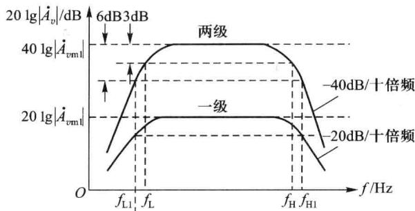

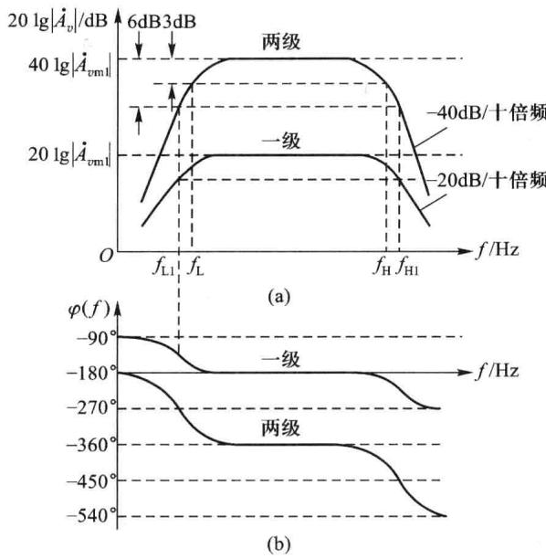  

图 4.1.16 两级共射放大电路的波特图

根据截止频率的定义,使幅频特性中频增益下降3 dB的频率点就是放大电路的下限截止频率 $f_{L}$ 和上限截止频率 $f_{H}$ ，如图4.1.16所示。很显然， $f_{\mathrm{L}} > f_{\mathrm{L1}}(f_{\mathrm{L2}}), f_{\mathrm{H}} < f_{\mathrm{H1}}(f_{\mathrm{H2}})$ ，因此通频带 $BW < BW_{1}(BW_{2})$ 。

根据上述分析可得:多级放大电路的下限截止频率 $f_{L}$ 会高于各单级放大电路的下限截止频率 $f_{Lk}$ ，即 $f_{L}>f_{Lk}$ 。同理，多级放大电路的上限截止频率 $f_{\mathrm{H}}(f_{\mathrm{H}}=\omega_{\mathrm{H}}/2\pi)$ 会低于各单级放大电路的上限截止频率 $f_{\mathrm{Hk}}$ ，即 $f_{\mathrm{H}}<f_{\mathrm{Hk}}$ 。也就是说，多级放大电路的通频带BW会比任何一级放大电路的通频带 $BW_{k}$ 都要窄，并且级数越多，则 $f_{L}$ 越高而 $f_{H}$ 越低，通频带越窄。由此可以看出，多级放大电路大大提高电压增益的同时，是以牺牲整个电路的通频带为代价的，会使通频带变窄，这是多级放大电路一个重要的特性。

严格求解多级放大电路的上、下截止频率通常是一个解高阶代数方程的过程。一般情况下，各单级电路的频率响应函数 $A_{k}(jf)$ 可以分解为多个一阶函数因子的乘积，这样，多级电路的频响函数就可写为多个一阶函数的连乘。例如，当各单级电路的中、高频特性均可分解为一阶低通函数的乘积时，多级电路在中、高频段的频率响应函数 $A(jf)$ 可记为

$$

A (\mathrm{j} f) = \frac {A _ {\mathrm{m} 1}}{1 + \mathrm{j} \frac {f}{f _ {\mathrm{H} 1}}} \cdot \frac {A _ {\mathrm{m} 2}}{1 + \mathrm{j} \frac {f}{f _ {\mathrm{H} 2}}} \cdot \dots \cdot \frac {A _ {\mathrm{mn}}}{1 + \mathrm{j} \frac {f}{f _ {\mathrm{Hn}}}}\tag{4.1.22}

$$

式中的各 $A_{mk}$ 为各等效一阶低通的中频增益, 则多级电路的中频增益为

$$

A _ {\mathrm{m}} = A _ {\mathrm{m} 1} A _ {\mathrm{m} 2} A _ {\mathrm{m} 3} \dots A _ {\mathrm{mn}}\tag{4.1.23}

$$

因此,多级放大电路的幅频特性为

$$

\left| A (\mathrm{j} f) \right| = \frac {\left| A _ {m} \right|}{\sqrt {1 + \left(\frac {f}{f _ {\mathrm{H} 1}}\right) ^ {2}} \sqrt {1 + \left(\frac {f}{f _ {\mathrm{H} 2}}\right) ^ {2}} \cdots \sqrt {1 + \left(\frac {f}{f _ {\mathrm{H} n}}\right) ^ {2}}}\tag{4.1.24}

$$

根据上限截止频率 $f_{H}$ 的定义: 当频率 $f=f_{H}$ 时, 增益比中频增益下降3 dB, 即 $\left|A(jf_{H})\right|=\frac{\left|A_{m}\right|}{\sqrt{2}}$ , 可得

$$

\left[ 1 + \left(\frac {f _ {\mathrm{H}}}{f _ {\mathrm{H} 1}}\right) ^ {2} \right] \left[ 1 + \left(\frac {f _ {\mathrm{H}}}{f _ {\mathrm{H} 2}}\right) ^ {2} \right] \dots \left[ 1 + \left(\frac {f _ {\mathrm{H}}}{f _ {\mathrm{H} n}}\right) ^ {2} \right] = 2\tag{4.1.25}

$$

如前所述,由于 $f_{H}<f_{Hk}$ ,即 $\frac{J_{H}}{f_{Hk}}<1$ ,忽略上式各分式中乘积项的高阶小项,可以计算求得多级放大电路的上限截止频率 $f_{H}$ 满足。

$$

\frac {1}{f _ {\mathrm{H}}} \approx 1. 1 \sqrt {\frac {1}{f _ {\mathrm{H} 1} ^ {2}} + \frac {1}{f _ {\mathrm{H} 2} ^ {2}} + \cdots + \frac {1}{f _ {\mathrm{H} n} ^ {2}}}\tag{4.1.26}

$$

式中,常数 1.1 是为了补偿由于忽略高阶小项造成的误差而引入的修正系数,以提高公式的近似精度。

同理,在计算多级放大电路的下限截止频率 $f_{L}$ 时,如果各单级电路的低、中频特性均可分解为一阶高通函数的乘积,则多级放大电路在低、中频段的频率响应函数 $A(jf)$ 可记为

$$

A (\mathrm{j} f) = \frac {A _ {\mathrm{m} 1}}{1 + \frac {f _ {\mathrm{L} 1}}{\mathrm{j} f}} \cdot \frac {A _ {\mathrm{m} 2}}{1 + \frac {f _ {\mathrm{L} 2}}{\mathrm{j} f}} \cdot \dots \cdot \frac {A _ {\mathrm{mn}}}{1 + \frac {f _ {\mathrm{Ln}}}{\mathrm{j} f}}\tag{4.1.27}

$$

类比推导式(4.1.27)的过程,可得多级电路的下限截止频率 $f_{L}$ 满足

$$

f _ {\mathrm{L}} \approx 1. 1 \sqrt {f _ {\mathrm{L} 1} ^ {2} + f _ {\mathrm{L} 2} ^ {2} + \cdots + f _ {\mathrm{L} n} ^ {2}}\tag{4.1.28}

$$

由此不难推导出多级放大电路的通频带 $BW=f_{H}-f_{L}$ 。

根据以上分析,再看前面两个相同频率特性共射放大电路级联的例子,则其上、下限截止频率分别为

$$

\begin{array}{r l} & \frac {1}{f _ {\mathrm{H}}} \approx 1. 1 \sqrt {\frac {1}{f _ {\mathrm{H1}} ^ {2}} + \frac {1}{f _ {\mathrm{H2}} ^ {2}}} = 1. 1 \sqrt {\frac {2}{f _ {\mathrm{H1}} ^ {2}}} \\ & f _ {\mathrm{H}} \approx \frac {f _ {\mathrm{H1}}}{1 . 1 \sqrt {2}} = 0. 6 4 3 f _ {\mathrm{H1}} \\ & f _ {\mathrm{L}} \approx 1. 1 \sqrt {2} f _ {\mathrm{L1}} = 1. 5 6 f _ {\mathrm{L1}} \end{array}

$$

需要注意的是,计算多级放大电路上、下限截止频率的式(4.1.26)和式(4.1.28),一般适用于各级截止频率相差不多的情况下近似计算。在多级放大电路中,如果某一级的下限截止频率 $f_{Lk}$ 远远高于(至少相差4倍以上)其他各级的下限截止频率,则可以认为整个电路的下限截止频率 $f_{L}\approx f_{Lk}$ ;同理,如果某一级的上限截止频率 $f_{Hk}$ 远远低于(至少相差4倍以上)其他各级的上限截止频率,则可以认为整个电路的上限截止频率 $f_{H}\approx f_{Hk}$ 。

<Example title="例 4.1.3">
已知一个各级均由共射放大电路组成的三级放大电路, 其电压增益的幅频特性如图 4.1.17 所示。试求:

（1）下限截止频率 $f_{L}=$ ？上限截止频率 $f_{H}=$ ？通频带BW=？

(2) 中频电压放大倍数 $A_{vm} = ?$

(3) 全频段电压放大倍数的表达式。

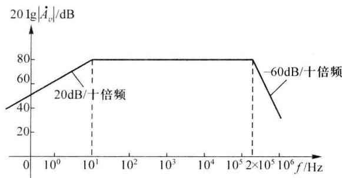  

图4.1.17 例4.1.3图

<Solution title="解">
由图 4.1.17 可知:

（1）在波特图的低频段只有一个拐点 $f=10\ Hz$ ，且直线的斜率为+20 dB/十倍频，因此 $f_{L}=10\ Hz$ 。

在波特图的高频段只有一个拐点 $f=2\times10^{5}\ Hz$ ，且直线的斜率为-60 dB/十倍频，说明此处有三个同样的极点重合。显然，对于这个三级放大电路，每一级放大电路的上限截止频率均为 $f=2\times10^{5}\ Hz$ ，因此，根据式(4.1.26)可以求出

放大电路的通频带

$$

\begin{array}{r} {f _ {\mathrm{H}} \approx 0. 5 2 f _ {\mathrm{HI}} = 1 0 4 \mathrm{kHz}} \\ {B W = f _ {\mathrm{H}} - f _ {\mathrm{L}} \approx f _ {\mathrm{H}} = 1 0 4 \mathrm{kHz}} \end{array}

$$

（2）在波特图的中频段， $A_{vm}=80\ dB$ ，或者 $A_{vm}=10^{4}$ 。

（3）由于各级均由共射放大电路组成，且电路为三级放大电路，因此中频段的输出电压与输入电压反相，所以

或者

$$

\begin{array}{r l} \dot {A} _ {v} (f) & = (- 1 0 ^ {4}) \cdot \frac {1}{(1 - \mathrm{j} \frac {1 0}{f})} \cdot \frac {1}{(1 + \mathrm{j} \frac {f}{2 \times 1 0 ^ {5}}) ^ {3}} \\ \dot {A} _ {v} (f) & = \frac {- 1 0 ^ {3} \mathrm{j} f}{(1 + \mathrm{j} \frac {f}{1 0}) (1 + \mathrm{j} \frac {f}{2 \times 1 0 ^ {5}}) ^ {3}} \end{array}

$$
</Solution>
</Example>
