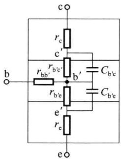
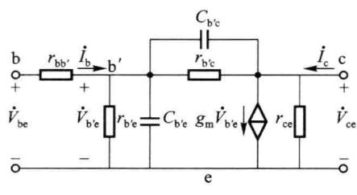
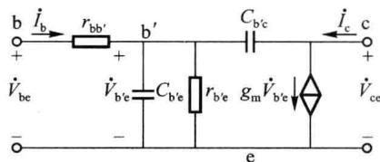
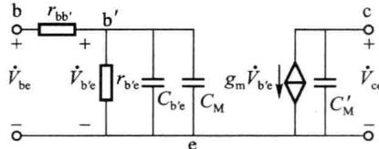
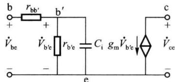
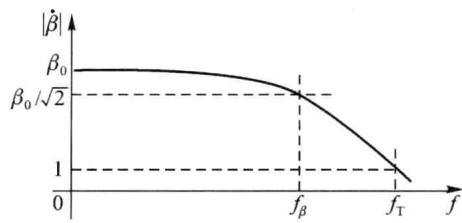
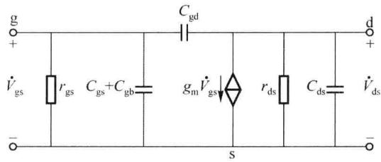
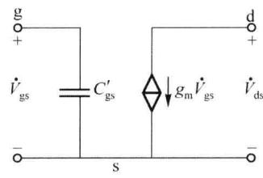

import Guide from '@/components/Guide.astro';
import Knowledge from '@/components/Knowledge.astro';
import Example from '@/components/Example.astro';
import Analysis from '@/components/Analysis.astro';
import Solution from '@/components/Solution.astro';
import Variant from '@/components/Variant.astro';
import Note from '@/components/Note.astro';
import Block from '@/components/Block.astro';
import Method from '@/components/Method.astro';
import Exercise from '@/components/Exercise.astro';

在第二、三章中采用简化小信号模型对双极型晶体管和场效应管构成的放大电路进行分析时，都假设管模型和参数与频率变化无关，即在中、低工作频段，管内电容的容抗相对较大可相当于开路，晶体管的放大能力基本不随频率变化。事实上，由于晶体管内部存在电容效应，使得管内部等效电容的容抗随着工作频率的升高而减小，导致晶体管高频放大能力下降，进而使得放大电路的增益随频率升高而下降。

## 4.2.1 双极型晶体管的高频小信号模型

## 一、高频小信号模型

在晶体管发射结正偏、集电结反偏时，管处于放大状态工作下，考虑了管发射结和集电结电容后的晶体管结构和混合 $\pi$ 模型如图4.2.1所示。其中的 $C_{\mathrm{b'e}}$ 为发射结电容，由于放大状态下发射结呈正向偏置， $C_{\mathrm{b'e}}$ 以扩散电容为主，对于小功率管，在几十至几百皮法范围内。 $C_{\mathrm{b'c}}$ 为集电结电容，由于集电结呈反向偏置， $C_{\mathrm{b'c}}$ 以势垒电容为主，在 $2\sim 10~\mathrm{pF}$ 范围内。

(b)  

  

(a)

  

图 4.2.1 晶体管结构示意图及混合 $\pi$ 模型

图中，由于 $C_{b'e}$ 和 $C_{b'c}$ 的存在，使得电流 $\dot{I}_{c}$ 和 $\dot{I}_{b}$ 的幅度及相位都与频率有关，即共射电流放大系数 $\dot{\beta}$ 是频率的函数。并且，管中的受控电流受发射结电压 $\dot{V}_{b'e}$ 的控制，与信号频率

无关。模型中的跨导 $g_{m}=\frac{\beta_{0}}{r_{b'e}}\approx\frac{I_{EQ}}{V_{T}}$ ，当管子的工作点确定后， $g_{m}$ 在模型中就是一个常数，它表明 $\dot{V}_{b'e}$ 对受控电流源的控制关系。

通常情况下， $r_{ce}$ 远大于与其并联相接的负载电阻，而 $r_{b'c}$ 也远大于 $C_{b'c}$ 的容抗，所以可以把 $r_{ce}$ 、 $r_{b'c}$ 看成开路，因此可以把图 4.2.1 所示的晶体管高频模型简化为图 4.2.2(a)。

(a) 简化的混合 $\pi$ 模型  

在晶体管共射组态应用时，由于 $C_{\mathrm{b}^{\prime}\mathrm{c}}$ 跨接在输入与输出回路之间，非常不利于计算，因此，通常应用密勒定理将 $C_{\mathrm{b}^{\prime}\mathrm{c}}$ 的影响等效变换到输入回路和输出回路端，这种方法称为单向化。假设电容 $C_{\mathrm{b}^{\prime}\mathrm{c}}$ 折合到输入端的电容为 $C_{\mathrm{M}}$ ，折合到输出端的电容为 $C_{\mathrm{M}}^{\prime}$ ，则单向化的混合 $\pi$ 模型如图4.2.2(b)所示。

在图 4.2.2(a) 所示电路中, 从 b' 端看进去 $C_{b'c}$ 中流过的电流为

(b) 单向化密勒等效电路模型 1  

  

(c) 单向化密勒等效电路模型 2  

图 4.2.2 晶体管的高频简化模型

$$

\dot {I} _ {\mathrm{b} ^ {\prime} \mathrm{c}} = \frac {\dot {V} _ {\mathrm{b} ^ {\prime} \mathrm{e}} - \dot {V} _ {\mathrm{ce}}}{X _ {C _ {\mathrm{b} ^ {\prime} \mathrm{c}}}} = \frac {\left(1 - \frac {\dot {V} _ {\mathrm{ce}}}{\dot {V} _ {\mathrm{b} ^ {\prime} \mathrm{e}}}\right) \dot {V} _ {\mathrm{b} ^ {\prime} \mathrm{c}}}{X _ {C _ {\mathrm{b} ^ {\prime} \mathrm{c}}}} = \frac {(1 - \dot {A}) \dot {V} _ {\mathrm{b} ^ {\prime} \mathrm{e}}}{X _ {C _ {\mathrm{b} ^ {\prime} \mathrm{c}}}}

$$

式中， $\dot{A} = \frac{\dot{V}_{\mathrm{ce}}}{\dot{V}_{\mathrm{b'e}}}$ ，为电压放大倍数。

密勒定理等效的条件是:等效前后输入、输出端节点的电流,以及输入、输出端口的电压保持不变。所以,要求流过 $C_{M}$ 的电流仍为 $\dot{I}_{b'c}$ ,而其端电压为 $\dot{V}_{b'e}$ 。因此, $C_{M}$ 的电抗为

$$

X _ {C _ {\mathrm{M}}} = \frac {\dot {V} _ {\mathrm {b^ {\prime} e}}}{\dot {I} _ {\mathrm {b^ {\prime} c}}} = \frac {\dot {V} _ {\mathrm {b^ {\prime} e}}}{(1 - \dot {A}) \frac {\dot {V} _ {\mathrm {b^ {\prime} e}}}{X _ {C _ {\mathrm {b^ {\prime} e}}}}} = \frac {X _ {C _ {\mathrm {b^ {\prime} c}}}}{1 - \dot {A}}

$$

一般在近似计算时， $\dot{A} = \frac{\dot{V}_{\mathrm{ce}}}{\dot{V}_{\mathrm{b'e}}}$ 取中频时的值，并且共射应用时输出与输入反相，所以 $|\dot{A}| = -\dot{A}$ ，由此等效到输入端的密勒电容

$$

C _ {\mathrm{M}} = (1 - \dot {A}) C _ {\mathrm {b^ {\prime} c}} = (1 + | \dot {A} |) C _ {\mathrm {b^ {\prime} c}}\tag{4.2.1}

$$

$b^{\prime}-e$ 间总电容为

$$

C _ {\mathrm{i}} = C _ {\mathrm {b^ {\prime} e}} + C _ {\mathrm{M}} = C _ {\mathrm {b^ {\prime} e}} + (1 + | \dot {A} |) C _ {\mathrm {b^ {\prime} c}}\tag{4.2.2}

$$

用同样的分析方法,可以得到

$$

C _ {\mathrm{M}} ^ {\prime} = \frac {\dot {A} - 1}{\dot {A}} C _ {\mathrm {b^ {\prime} c}} \approx C _ {\mathrm {b^ {\prime} c}}\tag{4.2.3}

$$

一般情况下，由于 $|\dot{A}| \gg 1$ ，因此 $C_{\mathrm{M}} \gg C_{\mathrm{b'c}}$ ，故而 $C_{\mathrm{i}}$ 也较大，即由于反向放大电路的作用使得输入端的等效电容加大，这种电容倍增作用是将在第五章中学习的一般反馈分析中的一种特殊情况；而 $C_{\mathrm{M}}^{\prime} \approx C_{\mathrm{b'c}}$ 值较小，它的容抗通常远大于与它并联的 $R_{\mathrm{L}}^{\prime}$ ，可以看成开路，因此单向化模型还可以进一步简化为如图4.2.2(c)所示，这种处理方法可以将基极节点和集电极节点有效分离，简化电路结构。请注意，晶体管的单向化密勒等效模型，一般只是在共射组态应用时才会被采用。

## 二、晶体管的频率参数

晶体管共发射极电流放大系数 $\dot{\beta}$ 的定义为 $\dot{\beta} = \frac{\dot{I}_{\mathrm{c}}}{\dot{I}_{\mathrm{b}}}\Bigg|_{\substack{V_{\mathrm{ce}} = 0\\ v_{\mathrm{ce}} = V_{\mathrm{CEQ}}}}$

在电容 $C_{\mathrm{b'e}}$ 、 $C_{\mathrm{b'c}}$ 的容抗较大，可被处理为开路的中、低频段，电流 $\dot{I}_{\mathrm{b}}$ 、 $\dot{I}_{\mathrm{c}}$ 与频率基本无关， $\dot{\beta} = g_{\mathrm{m}}r_{\mathrm{b'e}} = \beta_0$ 。在高频段， $C_{\mathrm{b'e}}$ 、 $C_{\mathrm{b'c}}$ 的容抗随频率增高而减小， $\dot{\beta}$ 的幅值和相角均随频率而变。由图4.2.1可以推得

$$

\dot {\beta} = \frac {(g _ {\mathrm{m}} - \mathrm{j} \omega C _ {\mathrm {b^ {\prime} c}}) r _ {\mathrm {b^ {\prime} e}}}{1 + \mathrm{j} \omega r _ {\mathrm {b^ {\prime} e}} (C _ {\mathrm {b^ {\prime} e}} + C _ {\mathrm {b^ {\prime} c}})}

$$

由于 $C_{\mathrm{b^{\prime}c}}$ 数值通常较小，在混合 $\pi$ 模型的适用频率范围内，一般有 $\omega C_{\mathrm{b^{\prime}c}} <   g_{\mathrm{m}}$ ，忽略 $\omega C_{\mathrm{b^{\prime}c}}$ 后

$$

\dot {\beta} \approx \frac {g _ {\mathrm{m}} r _ {\mathrm {b^ {\prime} e}}}{1 + \mathrm{j} \omega r _ {\mathrm {b^ {\prime} e}} (C _ {\mathrm {b^ {\prime} e}} + C _ {\mathrm {b^ {\prime} c}})} = \frac {\beta_ {0}}{1 + \mathrm{j} \frac {\omega}{\omega_ {\beta}}} = \frac {\beta_ {0}}{1 + \mathrm{j} \frac {f}{f _ {\beta}}}\tag{4.2.4}

$$

式中

$$

f _ {\beta} = \frac {1}{2 \pi r _ {\mathrm{b} ^ {\prime} \mathrm{e}} (C _ {\mathrm{b} ^ {\prime} \mathrm{e}} + C _ {\mathrm{b} ^ {\prime} \mathrm{c}})}\tag{4.2.5}

$$

图 4.2.3 所示为 $\dot{\beta}$ 的幅频特性曲线, 可见, 在中、低频段, $|\dot{\beta}|$ 基本为 $\beta_{0}$ 。随着工作频率 f 的增高, $|\dot{\beta}|$ 下降, 在 $f_{\beta}$ 频率点, $|\dot{\beta}| = \beta_{0} / \sqrt{2}$ (即 $|\dot{\beta}|$ 比中频 $\beta_{0}$ 下降 3 dB)。因而称 $f_{\beta}$ 为晶体管的共发射极电流放大系数 $\dot{\beta}$ 的截止频率。由式 (4.2.4) 可知, 在工作频率 $f \gg f_{\beta}$ 后, $|\dot{\beta}| \approx \beta_{0} f_{\beta} / f$ 。当 $f \geqslant \beta_{0} f_{\beta} =$

  

图 4.2.3 $\dot{\beta}$ 的幅频特性曲线

$f_{T}$ 后， $|\dot{\beta}|<1$ ，即 $|\dot{I}_{c}|<|\dot{I}_{b}|$ ，此时晶体管输出电流的变化小于输入电流的变化，表明晶体管不再有放大能力。因此，称 $f_{T}$ 为晶体管的特征频率，通常将 $f_{T}$ 作为表征晶体管高频放大能力的参数。由式(4.2.5)知

$$

f _ {\mathrm{T}} = \beta_ {0} f _ {\beta} = \frac {g _ {\mathrm{m}}}{2 \pi (C _ {\mathrm {b^{\prime} e}} + C _ {\mathrm {b^{\prime} c}})}\tag{4.2.6}

$$

$f_{T}$ 与晶体管的制造工艺有关,一般在 $300 \sim 1000 \, MHz$ ,目前已经可以做到几吉赫。 $f_{T}$ 越高,表明晶体管的高频特性越好,由它构成的放大电路的上限截止频率越高。

用同样的方法可以分析晶体管的共基极电流放大系数 $\dot{\alpha}$ 的频率特性。在忽略基区调宽效应的情况下，根据 $\dot{\alpha} = \dot{\beta} / (1 + \dot{\beta})$ ，可得

式中

$$

\begin{aligned} \dot{\alpha} & = \frac{\dot{I}_{\mathrm{c}}}{\dot{I}_{\mathrm{e}}}\Bigg|_{\substack{\dot{V}_{\mathrm{cb} = 0}\\ v_{\mathrm{cb}} = V_{\mathrm{CBQ}}}} = \frac{\beta_{0} / (1 + \beta_{0})}{1 + \mathrm{j}f / (1 + \beta_{0})f_{\beta}} = \frac{\alpha_{0}}{1 + \mathrm{j}f / f_{\alpha}} \\ f_{\alpha} & = (1 + \beta_{0})f_{\beta} = \frac{1}{2\pi r_{\mathrm{e}}(C_{\mathrm {b^{\prime} e}} + C_{\mathrm {b^{\prime} c}})} \end{aligned}\tag{4.2.7}

$$

$f_{\alpha}$ 是 $|\dot{\alpha}|$ 随工作频率f的增高而减小到中频值 $\alpha_{0}$ 的 $1/\sqrt{2}$ 时所对应的频率点，称 $f_{\alpha}$ 为晶体管的共基极电流放大系数 $\dot{\alpha}$ 的截止频率。由式(4.2.6)、式(4.2.7)可知，一般有， $f_{\alpha}>f_{T}\gg f_{\beta}$ 。可见，共基电路的截止频率远远高于共射电路的截止频率，因此共基放大电路可作为宽频带放大电路使用。

由式(4.2.5)～式(4.2.7)可知， $f_{\beta}\sqrt{f_{T}}f_{\alpha}$ 和管的直流工作点有一定关系。通常，晶体管制造厂家会给出一定测试条件下的 $f_{T}$ 和 $C_{b'c}$ 及 $\beta_{0}$ 的参考数值。

需要注意的是,晶体管的混合 $\pi$ 模型作为一种简化等效电路,其频率适用范围一般在 $f<f_{T}/3$ 以内,如果频率在更高的频段需要改用更为精确的模型。

## 4.2.2 MOS 场效应管的高频小信号模型

由于场效应管各级之间存在极间电容,因而其高频响应特性与双极型晶体管类似。根据场效应管的结构,在衬极、源极短接的情况下,可以得出其高频小信号模型如图 4.2.4(a) 所示。

  

(a) MOS 场效应管的高频小信号模型

  

(b) 单向化密勒等效电路模型  

图 4.2.4 MOS 场效应管的高频小信号模型

一般情况下， $r_{gs}$ 和 $r_{ds}$ 比外接电阻大得多，因此，近似计算时可以将它们开路。

当场效应管工作于电压反相放大的共源组态时,对于跨接在 g-d 之间的电容 $C_{gd}$ , 可将其进行密勒等效变换, 即将其折合到输入回路和输出回路, 使电路单向化。这样, g-d 间的等效电容为

$$

C _ {\mathrm{gs}} ^ {\prime} = C _ {\mathrm{gb}} + C _ {\mathrm{gs}} + (1 - \dot {A}) C _ {\mathrm{gd}}\tag{4.2.8}

$$

式中， $\dot{A} = -g_{m}R_{L}^{\prime}$ ，为共源组态中频电压放大倍数。

d-s 间的等效电容为

$$

C _ {\mathrm{ds}} ^ {\prime} = C _ {\mathrm{ds}} + \frac {\dot {A} - 1}{\dot {A}} C _ {\mathrm{gd}}\tag{4.2.9}

$$

一般输入回路的时间常数比输出回路的时间常数大得多,因此 $C_{ds}^{\prime}$ 所在回路对频率特性的影响经常可以忽略,这样就得到场效应管简化的单向化高频模型,如图 4.2.4(b) 所示。请注意,场效应管的单向化模型,也是在放大电路共源应用时才被采用。

为表征管的高频放大能力,与双极型晶体管类似,定义 MOS 管的特征频率 $f_{T}$ ,有

$$

\left| \frac {\dot {I} _ {\mathrm{d}}}{\dot {I} _ {\mathrm{g}}} (f _ {\mathrm{T}}) \right| _ {\dot {V} _ {\mathrm{ds}} = 0} = 1\tag{4.2.10}

$$

由图 4.2.4, 可计算得

$$

\left| \frac {\dot {I} _ {\mathrm{d}}}{\dot {I} _ {\mathrm{g}}} \right| _ {\dot {V} _ {\mathrm{ds}} = 0} = \frac {g _ {\mathrm{m}} - \mathrm{j} \omega C _ {\mathrm{gd}}}{\mathrm{j} \omega (C _ {\mathrm{gb}} + C _ {\mathrm{gs}} + C _ {\mathrm{gd}})} \approx \frac {g _ {\mathrm{m}}}{\mathrm{j} \omega (C _ {\mathrm{gb}} + C _ {\mathrm{gs}} + C _ {\mathrm{gd}})}

$$

式中的近似是由于通常 $C_{gd}$ 较小，满足 $\omega C_{gd} << g_{m}$ ，因而忽略了 $j\omega C_{gd}$ 项。由此式又根据式 (4.2.10)，可得

$$

f _ {\mathrm{T}} \approx \frac {g _ {\mathrm{m}}}{2 \pi (C _ {\mathrm{gs}} + C _ {\mathrm{gb}} + C _ {\mathrm{gd}})}\tag{4.2.11}

$$

应该注意的是,双极型晶体管的混合 $\pi$ 模型、场效应管的微变模型以及放大电路的微变等效电路都是对“较小的变化量”信号等效的。这里所说的“变化量”是指电压、电流相对直流工作点的变化量,是由输入信号源作用而产生的。当这种变化量“较小”时,管参数近似表现为线性特性,可用线性模型来等效。而“较小”的标准是依输出信号中所允许的非线性失真的程度而定的。“较小的变化量”也常被表述为“小信号”、“微变信号”。

变化量信号可以有各种时间波形,正弦波形是其中之一。由于频率特性是根据电路对正弦输入信号的稳态响应测量出的,因而常用表示正弦信号的相量符号 $\dot{V}$ 或 $\dot{I}$ 代表电路中信号的变化量,分析中也常以正弦波形为例去介绍电路中信号间的时域关系,但不应因此就认为混合 $\pi$ 模型、场效应管的微变模型以及放大电路的微变等效电路仅对正弦信号成立。
