import Guide from '@/components/Guide.astro';
import Knowledge from '@/components/Knowledge.astro';
import Example from '@/components/Example.astro';
import Analysis from '@/components/Analysis.astro';
import Solution from '@/components/Solution.astro';
import Variant from '@/components/Variant.astro';
import Note from '@/components/Note.astro';
import Block from '@/components/Block.astro';
import Method from '@/components/Method.astro';
import Exercise from '@/components/Exercise.astro';

如前所述,受到晶体管高频参数的影响,放大电路的放大能力会随信号工作频率的增高而减弱;此外,除去管参数的影响,晶体管的工作组态、电路中的负载电阻、信号源内阻也会影响电路的高频放大特性。在较低工作频段,如果电路中存在耦合电容或旁路电容,电路的放大能力也会随工作频率的降低而减弱。如同第二章那样,本节还是讨论双极型晶体管放大电路的放大增益,不同的是现在增加了频率关系。

## 4.3.1 单管共射放大电路的高频特性

单管共射放大电路如图4.3.1(a)所示，在第二章中，由于工作频率在中、低频段，管的结电容 $C_{\mathrm{b'e}}$ 、 $C_{\mathrm{b'c}}$ 的容抗相对较大，对放大性能的影响较小，因此可分别将它们进行开路处理，晶体管基本为一单向化器件。在高频段范围内， $C_{\mathrm{b'e}}$ 、 $C_{\mathrm{b'c}}$ 的容抗已相对较小而不能再处理为开路， $C_{\mathrm{b'c}}$ 起到管内部反馈（输出信号作用回输入回路）的作用，这一内反馈使得管不再是一单向器件。随着工作频率的升高， $C_{\mathrm{b'c}}$ 的内反馈连同 $C_{\mathrm{b'c}}$ 的作用使得共射电路的高频增益随频率升高而下降。在高频段，电路中耦合电容、旁路电容的容抗很小，可视为短路。于是可以画出图4.3.1(a)所示电路的高频微变等效电路，如图4.3.1(b)所示。

分析单管共射放大电路的高频特性时，可根据图4.3.1(b)用节点电压法求出传输函数 $\dot{A}_{vs} = \dot{V}_0 / \dot{V}_s$ 。根据 $\dot{A}_{vs}$ 用4.1节介绍的方法可求出电路的幅频、相频响应及上限截止频率，这种方法计算量较大，比较繁琐。在工程分析中，一般采用密勒等效的近似分析方法，可以简化计算。

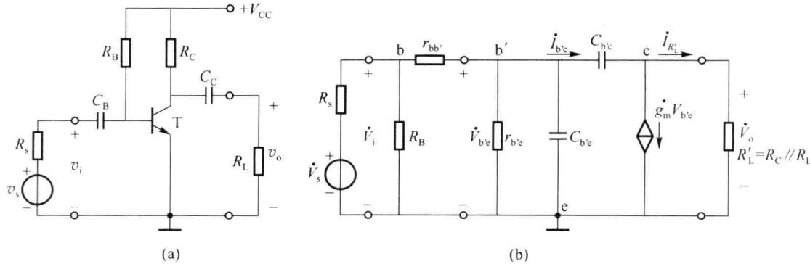  

图 4.3.1 共射放大电路及其高频微变等效电路

## 一、共射放大电路的单向化等效电路

首先应用密勒等效定理，将跨接在输入和输出回路之间的 $C_{\mathrm{b}^{\prime}\mathrm{c}}$ 进行变换。

由图 4.3.1(b) 可知, 输出电压

$$

\begin{array}{r l} \dot {V} _ {\mathrm{o}} & = \dot {I} _ {R _ {\mathrm{L}} ^ {\prime}} \cdot R _ {\mathrm{L}} ^ {\prime} = (\dot {I} _ {\mathrm {b^ {\prime} e}} - g _ {\mathrm{m}} \dot {V} _ {\mathrm {b^ {\prime} e}}) R _ {\mathrm{L}} ^ {\prime} = \left[ \frac {\dot {V} _ {\mathrm {b^ {\prime} e}} - \dot {V} _ {\mathrm{o}}}{\frac {1}{\mathrm{j} \omega C _ {\mathrm {b^ {\prime} e}}}} - g _ {\mathrm{m}} \dot {V} _ {\mathrm {b^ {\prime} e}} \right] R _ {\mathrm{L}} ^ {\prime} \\ & = [ (\dot {V} _ {\mathrm {b^ {\prime} e}} - \dot {V} _ {\mathrm{o}}) \mathrm{j} \omega C _ {\mathrm {b^ {\prime} c}} - g _ {\mathrm{m}} \dot {V} _ {\mathrm {b^ {\prime} e}} ] R _ {\mathrm{L}} ^ {\prime} \end{array}\tag{4.3.1}

$$

由此式可推得端口电压增益为

$$

\dot {A} = \frac {\dot {V} _ {\mathrm{o}}}{\dot {V} _ {\mathrm {b^ {\prime} e}}} = \frac {(\mathrm{j} \omega C _ {\mathrm {b^ {\prime} c}} - g _ {\mathrm{m}}) R _ {\mathrm{L}} ^ {\prime}}{1 + \mathrm{j} \omega C _ {\mathrm {b^ {\prime} c}} R _ {\mathrm{L}} ^ {\prime}}\tag{4.3.2}

$$

由于结电容 $C_{\mathrm{b^{\prime}c}}$ 的数值通常较小，在混合 $\pi$ 模型适用的频段内 $\left(f\leqslant \frac{f_{\mathrm{T}}}{3}\right)$ ，满足 $\omega C_{\mathrm{b^{\prime}c}}\ll g_{\mathrm{m}}$ $\frac{1}{\omega C_{\mathrm{b^{\prime}c}}}\gg R_{\mathrm{L}}^{\prime}$ ，因此， $\dot{A}\approx -g_{\mathrm{m}}R_{\mathrm{L}}^{\prime}$ ，实际上这就是 $\dot{A}$ 的中频增益。

由此,可以得到密勒等效电容

$$

\begin{array}{l} C _ {\mathrm{M}} = (1 - \dot {A}) C _ {\mathrm {b^ {\prime} c}} = (1 + g _ {\mathrm{m}} R _ {\mathrm{L}} ^ {\prime}) C _ {\mathrm {b^ {\prime} c}} \\ C _ {\mathrm{M}} ^ {\prime} \approx C _ {\mathrm {b^ {\prime} c}} \end{array}\tag{4.3.3}

$$

(4.3.4)

可以得到共射放大电路的单向化密勒等效电路如图 4.3.2（a）所示。

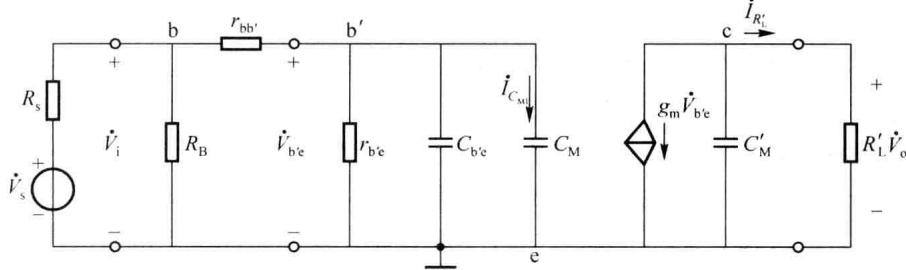  

(a)

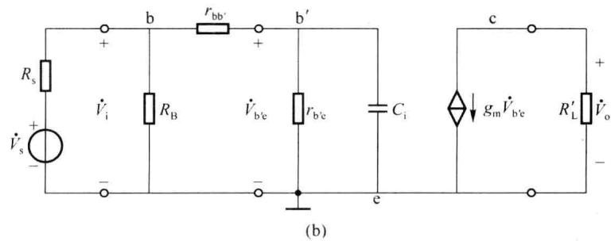  

图 4.3.2 共射放大电路的单向化密勒等效电路

由于共射放大电路放大能力比较强， $|\dot{A}| \gg 1$ ，显然有 $C_{M} \gg C_{b'c}$ ；而 $C_{M}' \approx C_{b'c}$ 比较小，一般情况下 $C_{M}'$ 的容抗远远大于集电极总负载电阻 $R_{L}', C_{M}'$ 中的电流可以忽略不计，所以图

4.3.2(a)可以简化为图4.3.2(b)的形式,其中 $C_{i}=C_{b'e}+C_{M}$ 。

由以上分析过程可见,当电容跨接于一个反相放大电路的输入、输出端之间时,电容的作用相当于在输入回路中并接了一个较大容量的电容,其容量增大了 $1+g_{m}R'_{L}$ 倍。利用密勒效应进行计算的好处是可以将输入回路与输出回路独立进行处理,在集成电路中常利用这一特性实现频率补偿。

## 二、单管共射放大电路的高频特性

利用戴维宁定理将图 4.3.2(b) 所示的电路进一步变换为图 4.3.3 所示的形式。

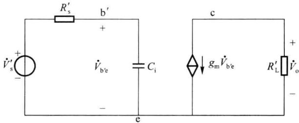  

图4.3.3 图4.3.2的等效电路

由于图中只有输入回路含有电容元件，它与 RC 低通电路相似。其中 $R_{s}^{\prime}$ 为等效内阻， $\dot{V}_{s}^{\prime}$ 为等效信号源。由于偏置电阻 $R_{B}$ 的阻值一般远大于信号源内阻 $R_{s}$ 和管输入电阻 $r_{be}$ ，故在以下的分析计算中将 $R_{B}$ 开路处理。由图 4.3.2(b) 可知

$$

R _ {\mathrm{s}} ^ {\prime} = \left(R _ {\mathrm{s}} / / R _ {\mathrm{B}} + r _ {\mathrm {b b^ {\prime}}}\right) / / r _ {\mathrm {b^ {\prime} e}} \approx \left(R _ {\mathrm{s}} + r _ {\mathrm {b b^ {\prime}}}\right) / / r _ {\mathrm {b^ {\prime} e}}\tag{4.3.5}

$$

$$

\dot {V} _ {\mathrm{s}} ^ {\prime} = \frac {r _ {\mathrm{b} ^ {\prime} \mathrm{e}}}{r _ {\mathrm{bb} ^ {\prime}} + r _ {\mathrm{b} ^ {\prime} \mathrm{e}}} \dot {V} _ {\mathrm{i}} = \frac {r _ {\mathrm{b} ^ {\prime} \mathrm{e}}}{r _ {\mathrm{bb} ^ {\prime}} + r _ {\mathrm{b} ^ {\prime} \mathrm{e}}} \cdot \frac {R _ {\mathrm{B}} / / r _ {\mathrm{be}}}{R _ {\mathrm{s}} + R _ {\mathrm{B}} / / r _ {\mathrm{be}}} \dot {V} _ {\mathrm{s}} \approx \frac {r _ {\mathrm{b} ^ {\prime} \mathrm{e}}}{R _ {\mathrm{s}} + r _ {\mathrm{be}}} \dot {V} _ {\mathrm{s}}\tag{4.3.6}

$$

因为 $b^{\prime}-e$ 间电压 $\dot{V}_{b^{\prime}e}$ 与输出电压 $\dot{V}_{o}$ 的关系没变化, 所以图 4.3.2 所示电路的高频源电压增益的表达式为

$$

\begin{array}{r l} \dot {A} _ {\mathrm{vs}} & = \frac {\dot {V} _ {\mathrm{o}}}{\dot {V} _ {\mathrm{s}}} = \frac {\dot {V} _ {\mathrm{s}} ^ {\prime}}{\dot {V} _ {\mathrm{s}}} \cdot \frac {\dot {V} _ {\mathrm {b^ {\prime} e}}}{\dot {V} _ {\mathrm{s}} ^ {\prime}} \cdot \frac {\dot {V} _ {\mathrm{o}}}{\dot {V} _ {\mathrm {b^ {\prime} e}}} = \frac {r _ {\mathrm {b^ {\prime} e}}}{R _ {\mathrm{s}} + r _ {\mathrm{be}}} \cdot \frac {1 / (\mathrm{j} \omega C _ {\mathrm{i}})}{R _ {\mathrm{s}} ^ {\prime} + 1 / (\mathrm{j} \omega C _ {\mathrm{i}})} \cdot (- g _ {\mathrm{m}} R _ {\mathrm{L}} ^ {\prime}) \\ & = \frac {\dot {A} _ {\mathrm{vsm}}}{1 + \mathrm{j} \omega R _ {\mathrm{s}} ^ {\prime} C _ {\mathrm{i}}} = \frac {\dot {A} _ {\mathrm{vsm}}}{1 + \mathrm{j} \omega \tau} = \frac {\dot {A} _ {\mathrm{vsm}}}{1 + \frac {\mathrm{j} f}{f _ {\mathrm{H}}}} \end{array}\tag{4.3.7}

$$

式中， $\dot{A}_{vsm} = -\frac{r_{b'e}g_mR_L'}{R_s + r_{be}}$ ，为中频源电压放大倍数。

可见，当 $f=\frac{1}{2\pi R_{s}^{\prime}C_{i}}=\frac{1}{2\pi\tau}$ 时， $\left|\dot{A}_{vs}\right|=\frac{1}{\sqrt{2}}\left|\dot{A}_{vsm}\right|$ 。根据上限截止频率的定义，电路的上限截止频率即为

$$

f _ {\mathrm{H}} = \frac {1}{2 \pi R _ {\mathrm{s}} ^ {\prime} C _ {\mathrm{i}}}

$$

由以上分析可见,单管共射放大电路的高频放大特性通常主要取决于其输入回路,拐点频率为时间常数的倒数,该时间常数是由输入电容 $C_{i}$ 与从 $C_{i}$ 端看出去的戴维宁电阻相乘而成；同时也要注意， $C_{M}$ 导致高频电压放大增益大大下降。欲使放大电路上限截止频率 $f_{H}$ 较高，应首先减小输入回路的时间常数。为此可有三个方面的措施：（1）选择 $r_{bb'}$ 小、 $C_{b'c}$ 小、 $f_{T}$ 高的晶体管；（2）减小信号源内阻 $R_{s}$ ，使信号源呈电压源的形式；（3）减小负载电阻及管的直流工作点电流，以使 $C_{b'c}$ 的密勒电容随之减小，但这样做也会导致电路的中频增益减小。

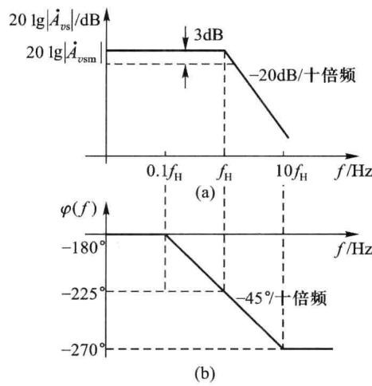

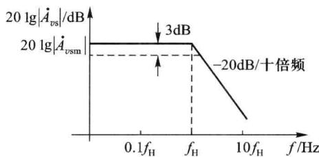  

图 4.3.4 图 4.3.1 所示电路的高频响应波特图

高频源电压增益 $\dot{A}_{vs}$ 的对数幅频特性和相频特性的表达式为

$$

\begin{array}{l} 2 0 \lg | \dot {A} _ {v s} | = 2 0 \lg | \dot {A} _ {v s m} | - 2 0 \lg \sqrt {1 + (f / f _ {\mathrm{H}}) ^ {2}} \\ \varphi (f) = - 1 8 0 ^ {\circ} - \arctan (f / f _ {\mathrm{H}}) \end{array}\tag{4.3.8}

$$

(4.3.9)

式(4.3.9)中的 $-180^{\circ}$ 表示中频范围内共射放大电路的输入与输出电压反相，而 $-\arctan(f/f_{\mathrm{H}})$ 是等效电容 $C_{i}$ 在高频范围内引起的相移，称为附加相移。根据式(4.3.8)、式(4.3.9)可以画出图4.3.1所示电路的高频响应波特图，如图4.3.4所示。

<Example title="例 4.3.1">
单管共射放大电路如图 4.3.1(a) 所示, 其中, $V_{CC} = 5 \, V$ , $R_{B} = 344 \, k\Omega$ , $R_{C} = 2 \, k\Omega$ , $R_{L} = 2.5 \, k\Omega$ , $R_{s} = 1 \, k\Omega$ 。晶体管 T(硅管) 参数为 $r_{bb'} = 100 \, \Omega$ , $\beta_{0} = 80$ , $f_{T} = 300 \, MHz$ , $C_{b'c} = 4 \, pF$ 。 $C_{B}$ 、 $C_{C}$ 为耦合电容。试分析电路的高频段电压增益函数 $\dot{A}_{vs}$ 及其上限截止频率 $f_{H}$ 。

<Solution title="解">
(1) 首先估算直流工作电流。根据图 4.3.1(a) 有

$$

I _ {\mathrm{CQ}} = \beta_ {0} \frac {V _ {\mathrm{CC}} - V _ {\mathrm{BEQ}}}{R _ {\mathrm{B}}} = 8 0 \frac {5 - 0 . 7}{3 4 4} \mathrm{A} \approx 1 \mathrm{mA}

$$

（2）估算管的混合 $\pi$ 参数。图 4.3.2 所示等效电路中的有关参数可通过如下计算得到

$$

r _ {\mathrm {b^ {\prime} e}} = \beta_ {0} \frac {V _ {\mathrm{T}}}{I _ {\mathrm{CQ}}} = 8 0 \frac {2 6}{1} \mathrm{k} \Omega \approx 2. 0 8 \mathrm{k} \Omega , g _ {\mathrm{m}} = \frac {I _ {\mathrm{CQ}}}{V _ {\mathrm{T}}} = \frac {1}{2 6} \mathrm{S} \approx 3 8. 4 6 \mathrm{mS}

$$

$$

R _ {\mathrm{L}} ^ {\prime} = R _ {\mathrm{C}} / / R _ {\mathrm{L}} \approx 1. 1 \mathrm{k} \Omega

$$

$$

C _ {\mathrm {b^ {\prime} e}} = \frac {g _ {\mathrm{m}}}{2 \pi f _ {\mathrm{T}}} - C _ {\mathrm {b^ {\prime} c}} \approx 1 6. 4 \mathrm{pF}

$$

$$

C _ {\mathrm{M}} = (1 + g _ {\mathrm{m}} R _ {\mathrm{L}} ^ {\prime}) C _ {\mathrm {b^ {\prime} c}} = 4 3. 3 \times C _ {\mathrm {b^ {\prime} c}} = 1 7 3. 2 \mathrm{pF}

$$

由上， $C_{b'c}$ 产生的密勒电容 $C_{M}$ 较 $C_{b'c}$ 增大了约 43 倍，可见 $C_{b'c}$ 的内反馈影响之严重。

(3) 估算 $\dot{A}_{vs} = \dot{V}_{o} / \dot{V}_{s}$ 及其上截止频率。

在中频段,管内 PN 结电容的容抗相对较大,可将它们开路处理。根据图 4.3.1(b) 可计算得中频电压增益 $\dot{A}_{vsm}$ 为

$$

\dot {A} _ {\mathrm{vsm}} = \frac {\dot {V} _ {\mathrm{o}}}{\dot {V} _ {\mathrm{s}}} = - \frac {r _ {\mathrm {b^ {\prime} e}} g _ {\mathrm{m}} R _ {\mathrm{L}} ^ {\prime}}{R _ {\mathrm{s}} + r _ {\mathrm {bb^ {\prime}}} + r _ {\mathrm {b^ {\prime} e}}} \approx - 2 7. 6 7

$$

单向化等效电路的输入回路总电容

$$

C _ {\mathrm{i}} = C _ {\mathrm {b^ {\prime} e}} + C _ {\mathrm{M}} = 1 8 9. 6 \mathrm{pF}

$$

$$

R _ {\mathrm{s}} ^ {\prime} = \left(R _ {\mathrm{s}} + r _ {\mathrm {b b^ {\prime}}}\right) / / r _ {\mathrm {b^ {\prime} e}} = 7 1 9. 5 \Omega

$$

$$

\dot {V} _ {\mathrm{s}} ^ {\prime} = \frac {r _ {\mathrm{b} ^ {\prime} \mathrm{e}}}{R _ {\mathrm{s}} + r _ {\mathrm{bb} ^ {\prime}} + r _ {\mathrm{b} ^ {\prime} \mathrm{e}}} \dot {V} _ {\mathrm{s}} = 0. 6 5 4 \dot {V} _ {\mathrm{s}}

$$

$$

\dot {A} _ {\mathrm{vs}} = \frac {\dot {V} _ {\mathrm{o}}}{\dot {V} _ {\mathrm{s}}} = \frac {\dot {A} _ {\mathrm{vsm}}}{1 + \mathrm{j} \omega \tau_ {\mathrm{i}}} = \frac {\dot {A} _ {\mathrm{vsm}}}{1 + \mathrm{j} \frac {f}{f _ {\mathrm{H}}}} \approx \frac {- 2 7 . 6 7}{1 + \mathrm{j} \frac {f}{f _ {\mathrm{H}}}}

$$

上式中，输入回路的时间常数 $\tau_{i}=R_{s}^{\prime}\cdot C_{i}=0.1364\ \mu s,f_{H}=1.167\ MHz$ 。

因此， $\dot{A}_{vs}$ 的上限截止频率 $f_{H}=1.167 MHz$ 。
</Solution>
</Example>

## 三、增益-带宽积

由上述分析可以看出，为提高电路的 $f_{H}$ ，需要选择 $r_{bb'}$ 、 $C_{b'c}$ 小，而 $f_{T}$ 高 $(C_{b'e}$ 小）的高频管；同时还应选用内阻 $R_{s}$ 小的信号源。此外，为了使 $C_{i}$ 减小，应该尽量减小 $g_{m}R'_{L}$ 的值，以减小 $C_{b'c}$ 引起的密勒效应的影响；然而，这会造成中频增益 $\dot{A}_{vsm}$ 的下降。对于大多数放大电路来说，一般都有通频带 $BW=f_{H}-f_{L}\approx f_{H}$ ，由于 $f_{H}$ 的提高与 $\dot{A}_{vsm}$ 的增大是相互矛盾的，因此放大电路的带宽与增益这两个指标是相互制约的。为了综合衡量放大电路这两方面的性能，引出增益-带宽积这一参数，定义为放大电路的中频电压增益与带宽的乘积，记为GBW。对于图4.3.1(a)所示电路，其增益-带宽积为

$$

G B W = \mid \dot {A} _ {\mathrm{vsm}} \mid f _ {\mathrm{H}} \approx \frac {g _ {\mathrm{m}} R _ {\mathrm{L}} ^ {\prime}}{2 \pi (R _ {\mathrm{s}} + r _ {\mathrm {b b ^ {\prime}}}) [ C _ {\mathrm {b^ {\prime} e}} + (1 + g _ {\mathrm{m}} R _ {\mathrm{L}} ^ {\prime}) C _ {\mathrm {b^ {\prime} c}} ]}\tag{4.3.10}

$$

假设 $\left(1+g_{\mathrm{m}}R_{\mathrm{L}}^{\prime}\right)C_{\mathrm{b}^{\prime}\mathrm{c}}\gg C_{\mathrm{b}^{\prime}\mathrm{e}}$ ，且 $g_{m}R_{L}^{\prime}\gg1$ 条件成立时，式(4.3.10)可以写成

$$

G B W = \mid \dot {A} _ {v s m} \mid f _ {\mathrm{H}} \approx \frac {1}{2 \pi (R _ {\mathrm{s}} + r _ {\mathrm {b b^ {\prime}}}) C _ {\mathrm {b^ {\prime} c}}}\tag{4.3.11}

$$

由上式可见，当管参数 $(r_{bb'}、C_{b'c}、f_{T})$ 和信号源内阻 $(R_{s})$ 决定后，放大电路的增益-带宽积就随之确定，它受 $g_{m}$ 、 $R_{L}'$ 改变的影响较小。也就是说当电路的晶体管和电路参数都选定后，增益-带宽积基本上可以看成是一个常数，因而当增益增大时，带宽就会变窄，这个结论具有普遍性。因而在选择电路参数时（例如负载 $R_{L}$ ），必须兼顾增益 $\dot{A}_{vsm}$ 和带宽 $f_{H}$ 各自的要求。

## 4.3.2 单管共基和共集放大电路的高频特性

如前所述,共射放大电路的带宽由于受到密勒效应的影响比较窄,因此,若要提高带宽,就必须设法减小或者消除密勒效应。共基极和共集电极电路在电路结构上满足上述要求,故而具有非常高的带宽,在高频放大电路中经常会使用。

## 一、单管共基放大电路的高频特性

第二章中介绍了共基放大电路的形式和基本特性,它的交流通路可由图 4.3.5(a) 表示。图 4.3.5(b) 为其微变等效电路图。

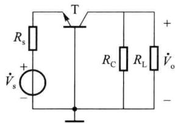  

(a)

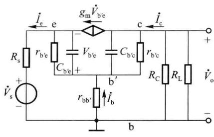  

(b)  

图 4.3.5 单管共基放大电路

由于 $r_{bb'}$ 的数值很小，并且在很宽的频率范围内， $\dot{I}_{b}$ 比 $\dot{I}_{e}$ 和 $\dot{I}_{c}$ 小得多，所以 $r_{bb'}$ 上的交流压降可以忽略，这样就可以把 $r_{bb'}$ 看成短接，进而电流源 $g_{m}\dot{V}_{b'e}$ 可分别等效到输入、输出回路中，如图 4.3.6(a) 所示。在输入回路中的受控电流 $g_{m}\dot{V}_{b'e}$ ，由于控制电压就是其端电压 $\dot{V}_{b'e}$ ，因此该支路自然就是电阻 $1/g_{m}$ ；而

$$

\left(1 / g _ {\mathrm{m}}\right) / / r _ {\mathrm{b} ^ {\prime} \mathrm{e}} = \frac {r _ {\mathrm{b} ^ {\prime} \mathrm{e}}}{1 + g _ {\mathrm{m}} r _ {\mathrm{b} ^ {\prime} \mathrm{e}}} = \frac {r _ {\mathrm{b} ^ {\prime} \mathrm{e}}}{1 + \beta_ {0}} = r _ {\mathrm{e}} \approx \frac {2 6}{I _ {\mathrm{EQ}}}

$$

即电阻 $1/g_{m}$ 与 $r_{b'e}$ 并联的结果为电阻 $r_{e}$ ，如图 4.3.6(b) 所示。

可以看出,图 4.3.6(b) 为两个一阶低通的级联,可将其进一步等效为图 4.3.6(c)。图中

$$

\begin{array}{r l} & R _ {\mathrm{s}} ^ {\prime} = R _ {\mathrm{s}} / / r _ {\mathrm{e}} \\ & \dot {V} _ {\mathrm{s}} ^ {\prime} = \frac {r _ {\mathrm{e}}}{R _ {\mathrm{s}} + r _ {\mathrm{e}}} \dot {V} _ {\mathrm{s}} \\ & R _ {\mathrm{L}} ^ {\prime} = r _ {\mathrm {b^ {\prime} c}} / / R _ {\mathrm{C}} / / R _ {\mathrm{L}} \approx R _ {\mathrm{C}} / / R _ {\mathrm{L}} \end{array}

$$

比较图 4.3.6(c) 和图 4.3.2 可见, 共基和共射两电路的微变等效电路的形式相同。但共基电路输入回路中并不存在 $C_{b'c}$ 的密勒电容，也即，结电容 $C_{b'c}$ 在共基电路中不存在密勒效应，所以共基电路的输入电容 $(C_{b'e})$ 比共发射极的 $(C_{b'e} + C_{M})$ 小。

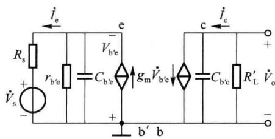

(a)  

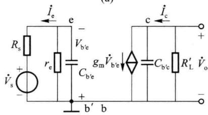

(b)  

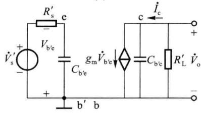  

(c)  

图 4.3.6 单管共基放大电路的等效电路

由图 4.3.6(c) 可得共基放大电路的高频电压增益为

$$

\begin{array}{r l} \dot {A} _ {\mathrm{vs}} & = \frac {\dot {V} _ {\mathrm{o}}}{\dot {V} _ {\mathrm{s}}} = \frac {\dot {V} _ {\mathrm{s}} ^ {\prime}}{\dot {V} _ {\mathrm{s}}} \cdot \frac {\dot {V} _ {\mathrm {b^ {\prime} e}}}{\dot {V} _ {\mathrm{s}} ^ {\prime}} \cdot \frac {\dot {V} _ {\mathrm{o}}}{\dot {V} _ {\mathrm {b^ {\prime} e}}} = \frac {r _ {\mathrm{e}}}{R _ {\mathrm{s}} + r _ {\mathrm{e}}} \cdot \frac {- 1 / (\mathrm{j} \omega C _ {\mathrm {b^ {\prime} e}})}{R _ {\mathrm{s}} ^ {\prime} + 1 / (\mathrm{j} \omega C _ {\mathrm {b^ {\prime} e}})} \cdot \frac {- g _ {\mathrm{m}} \cdot R _ {\mathrm{L}} ^ {\prime} / (\mathrm{j} \omega C _ {\mathrm {b^ {\prime} c}})}{R _ {\mathrm{L}} ^ {\prime} + 1 / (\mathrm{j} \omega C _ {\mathrm {b^ {\prime} c}})} \\ & = \frac {\dot {A} _ {\mathrm{vsm}}}{(1 + \mathrm{j} \omega R _ {\mathrm{s}} ^ {\prime} C _ {\mathrm {b^ {\prime} e}}) (1 + \mathrm{j} \omega R _ {\mathrm{L}} ^ {\prime} C _ {\mathrm {b^ {\prime} c}})} = \frac {\dot {A} _ {\mathrm{vsm}}}{(1 + \mathrm{j} \omega \tau_ {\mathrm{i}}) (1 + \mathrm{j} \omega \tau_ {\mathrm{o}})} \\ & = \frac {\dot {A} _ {\mathrm{vsm}}}{\left(1 + \frac {\mathrm{j} f}{f _ {\mathrm{Hi}}}\right) \left(1 + \frac {\mathrm{j} f}{f _ {\mathrm{Ho}}}\right)} \end{array}\tag{4.3.12}

$$

式中

$$

\dot {A} _ {\mathrm{vsm}} = g _ {\mathrm{m}} \cdot R _ {\mathrm{L}} ^ {\prime} \frac {r _ {\mathrm{e}}}{R _ {\mathrm{s}} + r _ {\mathrm{e}}}\tag{4.3.13}

$$

$$

f _ {\mathrm{Hi}} = \frac {1}{2 \pi \tau_ {\mathrm{i}}} = \frac {1}{2 \pi R _ {\mathrm{s}} ^ {\prime} C _ {\mathrm {b^ {\prime} e}}}\tag{4.3.14}

$$

$$

f _ {\mathrm{Ho}} = \frac {1}{2 \pi \tau_ {\mathrm{o}}} = \frac {1}{2 \pi R _ {\mathrm{L}} ^ {\prime} C _ {\mathrm {b^ {\prime} c}}}\tag{4.3.15}

$$

上述结果表明，由于共基放大电路中不存在密勒效应，而且晶体管的输入电阻 $(r_{\mathrm{e}})$ 的阻值相对较小，使得输入回路等效电阻 $R_{s}^{\prime}$ 也较小，因而 $f_{Hi}$ 会很高。另一方面，由于结电容 $C_{b'c}$ 很小， $f_{Ho}$ 也很高。所以共基放大电路具有比较好的高频响应特性，使得共基电路电压增益系数的上截止频率 $f_{H}$ 通常会大大高于相同工作条件下共射电路的 $f_{H}$ 。不过，当输出端接有大的负载电阻时， $f_{Ho}$ 会下降。

<Example title="例 4.3.2">
单管共基放大电路的交流通路如图 4.3.5(a) 所示 ( $R_{C}=2\ k\Omega, R_{L}=2.5\ k\Omega, R_{s}=1\ k\Omega$ )。设其中的晶体管 T 的参数与例 4.3.1 相同 ( $r_{bb'}=100\ \Omega, \beta_{0}=80, V_{A}=100\ V, f_{T}=300\ MHz, C_{b'c}=4\ pF$ ), T 的直流工作电流也与例 4-3-1 相同 ( $I_{CQ}=1\ mA$ )。试分析电路的电压增益函数 $\dot{A}_{vs}$ 和上截止频率 $f_{H}$ 。

<Solution title="解">
本例中,根据图 4.3.6(c) 求得

$r_{e}=\frac{26}{I_{EQ}}\approx26\Omega,R_{s}^{\prime}=R_{s}//r_{e}=\frac{1000\times26}{1000+26}\quad\Omega\approx26\quad\Omega,C_{b^{\prime}e}=\frac{g_{m}}{2\pi f_{T}}-C_{b^{\prime}c}\approx16.4\ pF$ 。将已知的相关参数代入式(4.3.14)和式(4.3.15)，分别求得 $f_{Hi}=373.25\ MHz,f_{Ho}=36.17\ MHz$ 。可见，由于输入回路的电阻、电容的量值均较小，使得 $f_{Hi}$ 远高于 $f_{Ho},f_{Hi}$ 甚至高于了 $f_{T}$ 。因而共基放大电路的 $\dot{A}_{vs}$ 的上截止频率 $f_{H}$ 主要会受到输出回路的制约，本例中， $f_{Ho}$ 是 $\dot{A}_{vs}$ 的主极点频率，因而 $f_{H}\approx f_{Ho}=36.17\ MHz$ 。
</Solution>
</Example>

## 二、单管共集放大电路的高频特性

第二章介绍了共集放大电路(射极输出器)的中低频特性,其基本特点是:输入阻抗高、输出阻抗低,电压增益接近于1。图4.3.7(a)为共集放大电路的形式之一,图4.3.7(b)为其交流通路,图4.3.7(c)为其微变等效电路。 $C_{B}$ 、 $C_{E}$ 为耦合电容,在中、高频段可以将它们视为短路。 $R_{L}^{\prime}=r_{ce}//R_{E}//R_{L}$ 。考虑到偏置电阻 $R_{B}$ 通常会远大于信号源内阻 $R_{S}$ 的情况,为简化分析,在计算时可将 $R_{B}$ 忽略,视为开路。

(c)  

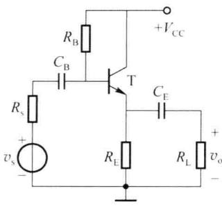  

(a)

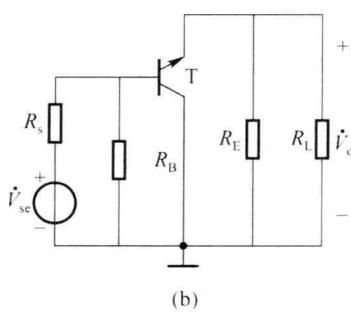

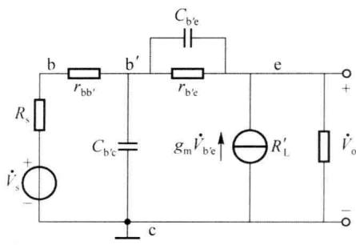  

图 4.3.7 单管共集电极放大电路

由图 4.3.7（c）可见，结电容 $C_{b'e}$ 和电阻 $r_{b'e}$ 跨接于输入、输出端之间，因而电路中会产生密勒效应。参照 4.3.1 节的分析，可以分别将 $C_{b'e}$ 和电阻 $r_{b'e}$ 进行单向化处理。但是，由于共集放大电路的射级跟随作用， $\dot{A} \approx 1$ ，所以密勒效应的影响很小，电路的上截止频率相应会较高，高频响应特性较好。对于这方面的详细讨论请参考有关文献。

在以上对晶体管放大电路频率特性的分析中,基本方法是根据微变等效电路列电压或电流方程求解增益传输函数和电路的上限截止频率。利用密勒等效定理可简化分析过程。参考文献[3]中介绍了另一种工程分析方法——开路时间常数分析法,读者可参阅。

## 4.3.3 放大电路的低频特性

根据前面章节的介绍,耦合电容的作用是隔断直流,使前后放大级的直流工作点不致相互影响,同时耦合交流信号;旁路电容的作用是短路交流,使偏置电阻不致降低电路的中、高频增益。在图4.3.8(a)给出的电路中, $C_{B}$ 、 $C_{C}$ 为耦合电容, $C_{E}$ 为旁路电容;图4.3.8(b)为其低频交流通路图。

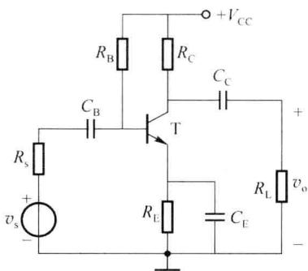  

(a) 单管共射放大电路

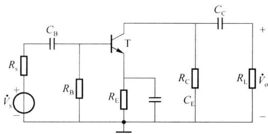  

(b) 低频交流通路图  

图 4.3.8 放大电路的低频特性

当电路工作在中、高频段时，耦合电容、旁路电容的容抗相对较小， $C_{B}$ 、 $C_{C}$ 的容抗远小于与它们相串联的电阻， $C_{E}$ 的容抗远小于与之相并联的电阻，因而 $C_{B}$ 、 $C_{C}$ 、 $C_{E}$ 可视为交流短路。

在低频范围内,晶体管的极间电容 $C_{b'e}$ 和 $C_{b'e}$ 的容抗相对较大,可以看成开路;而电路中的耦合电容、旁路电容的容抗随着工作频率的降低而增加,不能再被作为短路处理。当信号源的频率较低时，耦合电容 $C_{\mathrm{B}}$ 、 $C_{\mathrm{C}}$ 的容抗对传输信号的衰减相对较大，使得电压增益 $\dot{A}_{vs} = \dot{V}_{o} / \dot{V}_{s}$ 随着信号频率的降低而模值减小、相移增大；另一方面，旁路电容 $C_{\mathrm{E}}$ 的容抗较大，使 $C_{\mathrm{E}}$ 不能再被视为交流短路，于是，偏置电阻 $R_{\mathrm{E}}$ 减小电压增益（负反馈）的作用表现出来，也使得 $\dot{A}_{vs}$ 随着信号频率的降低而模值减小、相移增大。

图 4.3.8 所示电路的低频小信号等效电路模型如图 4.3.9(a) 所示。电路中的受控电流源可以进行如下变换

$$

g _ {\mathrm{m}} \dot {V} _ {\mathrm {b^ {\prime} e}} = g _ {\mathrm{m}} r _ {\mathrm {b^ {\prime} e}} \dot {I} _ {\mathrm{b}} = \beta \dot {I} _ {\mathrm{b}}

$$

此外，电路中一般 $R_{\mathrm{B}} \gg (r_{\mathrm{bb}'} + r_{\mathrm{b'e}} + (1 + \beta_{0}) R_{\mathrm{E}})$ ，因此 $R_{B}$ 的影响可以忽略，视为开路；假设在低频范围内，射级支路中旁路电容 $C_{E}$ 的值足够大，使得

$$

\frac {1}{\omega C _ {\mathrm{E}}} \ll R _ {\mathrm{E}}\tag{4.3.16}

$$

则 $R_{E}$ 的影响可以忽略, 视为开路。于是可以得到图 4.3.9(b) 所示的简化等效电路。一般情况下, 对于低频信号而言电路均满足上述假设条件。

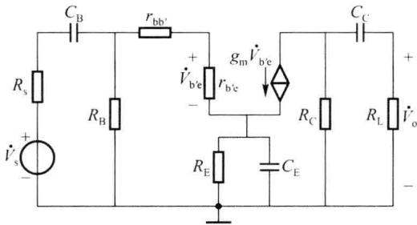  

(a) 低频微变等效电路

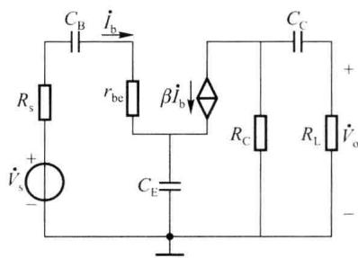  

(b) 简化的等效电路

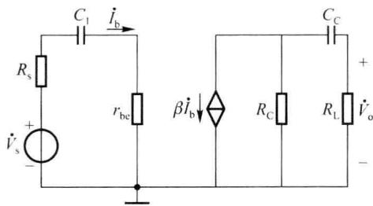  

(c) 更加简化的等效电路1

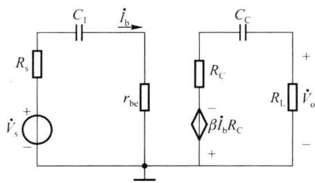  

(d) 更加简化的等效电路2  

图 4.3.9 图 4.3.8 的低频微变等效电路

由于基级回路中 $\dot{I}_{b}=\frac{\dot{I}_{e}}{\beta+1}$ ，因此将射级支路中的旁路电容 $C_{E}$ 折合到基极回路时，用 $C_{E}^{\prime}$ 表示，其容抗将增大 $(1+\beta)$ 倍，为

$$

\frac {1}{\omega C _ {\mathrm{E}} ^ {\prime}} = (1 + \beta) \frac {1}{\omega C _ {\mathrm{E}}}

$$

则折合后在基极回路中的容抗为 $C_{E}^{\prime}=\frac{C_{E}}{1+\beta}$ ，它与回路中的耦合电容 $C_{B}$ 串联后的总电容为

$$

C _ {1} = \frac {C _ {\mathrm{B}} C _ {\mathrm{E}}}{(1 + \beta) C _ {\mathrm{B}} + C _ {\mathrm{E}}}\tag{4.3.17}

$$

另一方面，将射级支路中的 $C_{\mathrm{E}}$ 等效到集电极支路中。由于 $\dot{I}_{\mathrm{e}} \approx \dot{I}_{\mathrm{c}}$ ，并且 $C_{\mathrm{E}}$ 折合后在集电极支路中与电流源串联，因此旁路电容 $C_{\mathrm{E}}$ 对输出回路的影响可以忽略，视为短路，这样就可以得到图4.3.9(c)所示的简化电路。

将受控电流源 $g_{m}\dot{V}_{b'e}$ 与电阻 $R_{c}$ 的并联支路转换为等效的电压源形式, 如图 4.3.9(d) 所示。

显然,图 4.3.9(d) 的电路结构与图 4.3.6(c) 所示的高通电路相似。由图 4.3.9(d) 可得

$$

\begin{array}{r l} & {\dot {V} _ {\mathrm{o}} = - \frac {R _ {\mathrm{L}}}{R _ {\mathrm{C}} + R _ {\mathrm{L}} + \frac {1}{\mathrm{j} \omega C _ {\mathrm{C}}}} \dot {\beta} I _ {\mathrm{b}} R _ {\mathrm{C}} = - \frac {\beta R _ {\mathrm{L}} ^ {\prime} \dot {I} _ {\mathrm{b}}}{1 + 1 / [ \mathrm{j} \omega C _ {\mathrm{C}} (R _ {\mathrm{C}} + R _ {\mathrm{L}}) ]}} \\ & {\dot {V} _ {\mathrm{s}} = (R _ {\mathrm{s}} + r _ {\mathrm{be}} + \frac {1}{\mathrm{j} \omega C _ {\mathrm{l}}}) \dot {I} _ {\mathrm{b}} = (R _ {\mathrm{s}} + r _ {\mathrm{be}}) \left\{1 + 1 / [ \mathrm{j} \omega C _ {\mathrm{l}} (R _ {\mathrm{s}} + r _ {\mathrm{be}}) ] \right\} \dot {I} _ {\mathrm{b}}} \end{array}

$$

则低频源电压增益为

$$

\begin{array}{r l} \dot {A} _ {\mathrm{vs}} & = \frac {\dot {V} _ {\mathrm{o}}}{\dot {V} _ {\mathrm{s}}} = - \frac {\beta R _ {\mathrm{L}} ^ {\prime}}{R _ {\mathrm{s}} + r _ {\mathrm{be}}} \cdot \frac {1}{1 + 1 / [ \mathrm{j} \omega C _ {\mathrm{l}} (R _ {\mathrm{s}} + r _ {\mathrm{be}}) ]} \cdot \frac {1}{1 + 1 / [ \mathrm{j} \omega C _ {\mathrm{C}} (R _ {\mathrm{C}} + R _ {\mathrm{L}}) ]} \\ & = \dot {A} _ {\mathrm{vsm}} \frac {1}{(1 + \frac {f _ {\mathrm{L1}}}{\mathrm{j} f}) (1 + \frac {f _ {\mathrm{L2}}}{\mathrm{j} f})} = \dot {A} _ {\mathrm{vsm}} \frac {1}{(1 - \mathrm{j} \frac {f _ {\mathrm{L1}}}{f}) (1 - \mathrm{j} \frac {f _ {\mathrm{L2}}}{f})} \end{array}\tag{4.3.18}

$$

式中， $\dot{A}_{vsm}=-\frac{\beta R_{L}^{\prime}}{R_{s}+r_{be}}$ 为中频源电压增益。

$$

f _ {\mathrm{L1}} = \frac {1}{2 \pi C _ {1} (R _ {\mathrm{s}} + r _ {\mathrm{be}})}\tag{4.3.19}

$$

$$

f _ {\mathrm{L2}} = \frac {1}{2 \pi C _ {\mathrm{C}} (R _ {\mathrm{C}} + R _ {\mathrm{L}})}\tag{4.3.20}

$$

式中，设 $\tau_{1}=C_{1}(R_{\mathrm{s}}+r_{\mathrm{be}})$ ， $\tau_{2}=C_{\mathrm{C}}(R_{\mathrm{C}}+R_{\mathrm{L}})$ 分别为输入和输出回路的时间常数。则电路的下限截止频率为

$$

f _ {\mathrm{L}} \approx 1. 1 \sqrt {f _ {\mathrm{L} 1} ^ {2} + f _ {\mathrm{L} 2} ^ {2}}\tag{4.3.21}

$$

上述分析说明,图4.3.8所示的RC耦合单级共射电路在满足式(4.3.16)的情况下,其低频响应具有 $f_{L1}$ 、 $f_{L2}$ 两个转折频率。如果两个转折频率间的比值在4倍以上,则取值大的那个作为放大电路的下限截止频率。

需要指出的是,由于旁路电容在射级支路中,流过它的电流 $\dot{I}_{\mathrm{e}}=(\beta+1)\dot{I}_{\mathrm{b}}$ ,一般而言它的大小对电压增益的影响比较大,因此 $C_{E}$ 是影响 RC 耦合共射放大电路低频响应的主要因素。如果电路不满足 $\frac{1}{\omega C_{E}}<<R_{E}$ 这个假设条件的话,则使用上述方法分析的结果将与实际情况存在较大误差。更精确的分析,可以应用仿真软件进行计算,可参见有关参考书。

当 $C_{\mathrm{E}}$ 很大时，可以忽略 $C_{\mathrm{C}}$ ，只考虑 $C_{\mathrm{B}}, C_{\mathrm{E}}$ 对低频特性的影响，此时式(4.3.18)可以简化为

$$

\dot {A} _ {v s} = \dot {A} _ {v s m} \frac {1}{1 - j \frac {f _ {\mathrm{Ll}}}{f}}\tag{4.3.22}

$$

因此，低频源电压增益 $\dot{A}_{vs}$ 的对数幅频特性和相频特性的表达式为

$$

2 0 \lg | \dot {A} _ {v s} | = 2 0 \lg | \dot {A} _ {v s m} | - 2 0 \lg \sqrt {1 + (f _ {\mathrm{L1}} / f) ^ {2}}\tag{4.3.23}

$$

$$

\varphi (f) = - 1 8 0 ^ {\circ} + \arctan \left(f _ {\mathrm{L} 1} / f\right)\tag{4.3.24}

$$

式(4.3.23)中的-180°表示中频范围内共射放大电路的输入与输出电压反相；因电抗元件在低频范围内引起的相移，称为附加相移，式(4.3.24)表明低频段最大附加相移为+90°。根据式(4.3.23)、式(4.3.24)可以画出图4.3.8所示电路的低频响应波特图，如图4.3.10所示。

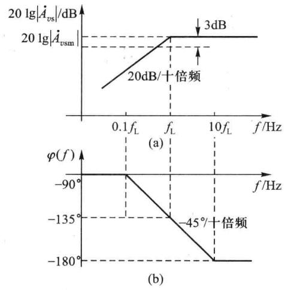  

图 4.3.10 忽略 $C_{c}$ 的影响时, 图 4.3.8 所示电路的低频响应特性

由以上分析可见,欲展宽放大电路的通频带,降低下限截止频率,需要加大耦合电容及其相应回路的等效电阻,以增大回路的时间常数。然而这种改善的效果是有限的,因此在信号频率很低的条件下,可以考虑用直接耦合的方式。在直接耦合电路中,没有耦合、旁路电容,电路增益的中频特性可一直延伸到零频(直流),也就是说,电路可放大直流信号源的信号,电路的交流通路、微变等效电路也均适用于直流信号源信号。

<Example title="例 4.3.3">
共射放大电路如图 4.3.8（a）所示，其中， $V_{CC} = 15 \, V, R_{B} = 34 \, k\Omega, R_{E} = 1.8 \, k\Omega, R_{C} = 4 \, k\Omega, R_{L} = 2.7 \, k\Omega, R_{s} = 50 \, \Omega, C_{B} = 30 \, \mu F, C_{C} = 1 \, \mu F, C_{E} = 50 \, \mu F$ ，晶体管参数为 $r_{be} = 1.5 \, k\Omega, \beta = 80$ 。试估算该电路的下限截止频率 $f_{L}$ 。

<Solution title="解">
根据式 $（4.3.17）$ 可以求得

进而分别可以求出

$$

\begin{array}{r l} & C _ {1} = \frac {C _ {\mathrm{B}} C _ {\mathrm{E}}}{(1 + \beta) C _ {\mathrm{B}} + C _ {\mathrm{E}}} \approx 0. 6 \mu \mathrm{F} \\ & f _ {\mathrm{L1}} = \frac {1}{2 \pi C _ {1} (R _ {\mathrm{s}} + r _ {\mathrm{be}})} \approx 1 7 1. 2 \mathrm{Hz} \\ & f _ {\mathrm{L2}} = \frac {1}{2 \pi C _ {\mathrm{C}} (R _ {\mathrm{C}} + R _ {\mathrm{L}})} \approx 2 3. 8 \mathrm{Hz} \end{array}

$$

由于 $f_{L1}$ 与 $f_{L2}$ 的比值大于4，因此下限截止频率 $f_{L}\approx f_{L1}=171.2Hz$ 。
</Solution>
</Example>
