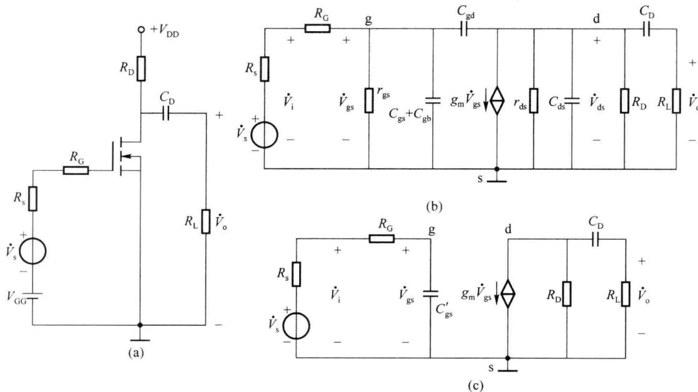
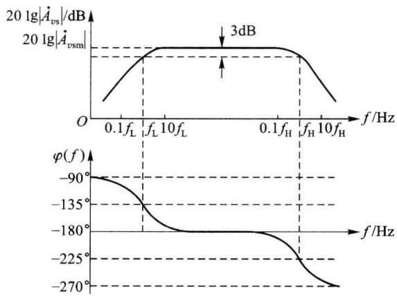

import Guide from '@/components/Guide.astro';
import Knowledge from '@/components/Knowledge.astro';
import Example from '@/components/Example.astro';
import Analysis from '@/components/Analysis.astro';
import Solution from '@/components/Solution.astro';
import Variant from '@/components/Variant.astro';
import Note from '@/components/Note.astro';
import Block from '@/components/Block.astro';
import Method from '@/components/Method.astro';
import Exercise from '@/components/Exercise.astro';

在上节中采用工程分析的方法(以密勒定理为核心),介绍了双极型晶体管放大电路的频率特性分析方法。对于图4.4.1(a)所示的场效应管单管共源放大电路,考虑到极间电容和耦合电容的影响,其交流小信号等效电路模型如图4.4.1(b)所示。由于场效应管各级之间存在极间电容,因此其高频特性与双极型晶体管相似。

  

图 4.4.1 单管共源放大电路及其等效电路

根据 4.4.2 节的分析,一般情况下,工程近似计算时可以忽略 $r_{gs}$ 、 $r_{ds}$ 的影响,将其视为开路。另一方面,将跨接在 g-d 之间的电容 $C_{gd}$ 进行密勒等效变换,折合到输入回路和输出回路,使电路单向化。忽略输出回路中 $C'_{ds}$ 的影响后,得到简化后的等效电路如图 4.4.1(c) 所示。其中

$$

C _ {\mathrm{gs}} ^ {\prime} = C _ {\mathrm{gb}} + C _ {\mathrm{gs}} + (1 - \dot {A}) C _ {\mathrm{gd}}

$$

$\dot{A} = -g_{m}R_{L}^{\prime}$ ，为共源组态中频电压放大倍数。

在高频段, 将 $C_{D}$ 视为短路, 考虑电容 $C_{gs}^{\prime}$ 对放大电路高频特性的影响, 它所在回路的时间常数 $\tau_{i} = (R_{s} + R_{G})C_{ds}^{\prime}$ , 因此可以求出电路的上限截止频率为

$$

f _ {\mathrm{H}} = \frac {1}{2 \pi (R _ {\mathrm{s}} + R _ {\mathrm{G}}) C _ {\mathrm{ds}} ^ {\prime}}\tag{4.4.1}

$$

在低频段, 将 $C_{gs}^{\prime}$ 视为开路, 考虑耦合电容 $C_{D}$ 的影响, 它所在回路的时间常数 $\tau_{\mathrm{o}} = (R_{\mathrm{D}} + R_{\mathrm{L}})C_{\mathrm{D}}$ , 因此可以求出电路的上限截止频率为

$$

f _ {\mathrm{L}} = \frac {1}{2 \pi (R _ {\mathrm{D}} + R _ {\mathrm{L}}) C _ {\mathrm{D}}}\tag{4.4.2}

$$

因此,可以写出图 4.4.1 所示电路的源电压增益表达式为

$$

\dot {A} _ {v \mathrm{s}} = \frac {\dot {V} _ {\mathrm{o}}}{\dot {V} _ {\mathrm{s}}} = \dot {A} _ {v \mathrm{sm}} \frac {1}{\left(1 - \mathrm{j} \frac {f _ {\mathrm{L}}}{f}\right) \left(1 + \mathrm{j} \frac {f}{f _ {\mathrm{H}}}\right)}\tag{4.4.3}

$$

根据上式画出相应的波特图,如图 4.4.2 所示。

  

图 4.4.2 单管共源放大电路的全频段波特图
