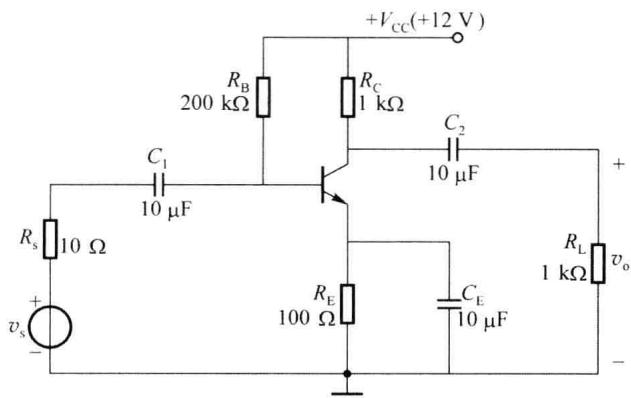
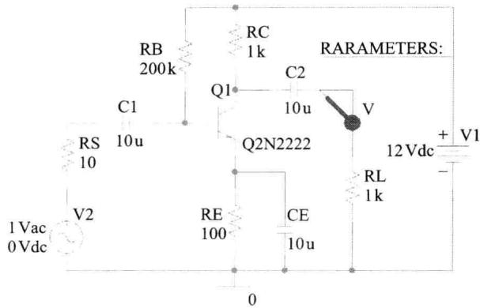
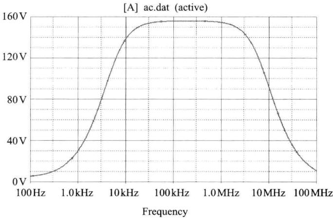
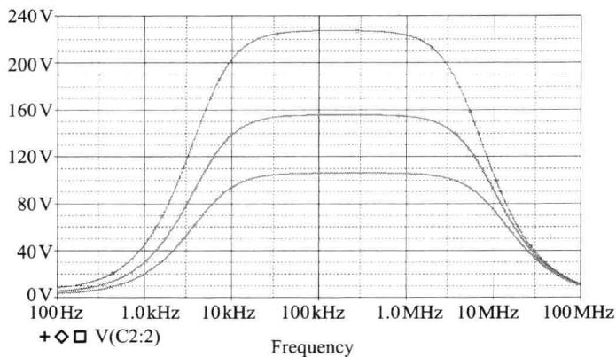
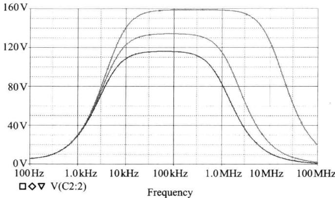

import Guide from '@/components/Guide.astro';
import Knowledge from '@/components/Knowledge.astro';
import Example from '@/components/Example.astro';
import Analysis from '@/components/Analysis.astro';
import Solution from '@/components/Solution.astro';
import Variant from '@/components/Variant.astro';
import Note from '@/components/Note.astro';
import Block from '@/components/Block.astro';
import Method from '@/components/Method.astro';
import Exercise from '@/components/Exercise.astro';

设有晶体管共射放大电路如图 4.5.1 所示,试做如下分析:

  

图 4.5.1 共射放大电路

(1) 求该电路的增益和带宽；

(2) 试分析负载电阻 $R_{\mathrm{L}}$ 变化对于增益和带宽的影响；

（3）试分析信号源内阻 $R_{s}$ 变化对于增益和带宽的影响。

<Solution title="解">
使用仿真的方法来求解该题。在 OrCAD 中将该图绘出, 如图 4.5.2 所示。在绘制该图时, 需要注意如下几点:

  

图4.5.2 OrCAD中的原理图

（1）由于题目中未指明晶体管的具体参数，为进行题目求解，可任取一种 NPN 型晶体管放入，本例中使用的为 Q2N2222。

（2）由于需要分析不同参数变化对频率特性的影响，故在图中放入可变参数器件，并将根据题目需要将不同电阻的取值设置为该可变参数。

（3）为观察电路的频率特性，在负载端处放置一个电压探针。

（4）由于需要观察不同情况下的频率特性，故信号源使用了 VAC（即交流信号源）形式。应注意此时仿真输出电压幅值可能大于电源电压，但该值仅用于计算增益，而非代表输出电压的实时幅值。

完成原理图的绘制后即可进行相应的仿真工作,为能看清频率特性的全貌,本次仿真中,设置起始频率和中止频率分别为100 Hz和100 MHz,且每10倍频程取100个点,仿真结果如图4.5.3所示。

  

图 4.5.3 基准频率特性曲线

使用软件自带的测量工具(在 Trace→Evaluate Measurement 菜单项下)对该曲线进行分析,可得其 3 dB 带宽为 7.25 MHz,中频增益为 155.8。

为分析负载电阻 $R_{L}$ 变化对于增益和带宽的影响, 可将 $R_{L}$ 的值设置为变量并使用参数仿真。仿真时，设置 $R_{\mathrm{L}}$ 的取值为 $0.5\mathrm{k}\Omega, 1\mathrm{k}\Omega, 3\mathrm{k}\Omega$ 三个不同的值，仿真结果如图4.5.4所示。

  

图4.5.4 负载 $R_{\mathrm{L}}$ 变化时的频率特性

图中，自上至下分别对应于 $R_{\mathrm{L}}$ 取值 $3\mathrm{k}\Omega, 1\mathrm{k}\Omega, 0.5\mathrm{k}\Omega$ 的情况。可以看出，随着负载的减小，增益不断降低，但同时带宽不断增加，这与我们此前在4.3.1节中关于增益带宽积所进行的理论分析结论一致。使用软件自带的测量工具（在Trace $\rightarrow$ Evaluate Measurement菜单项下）对该曲线进行分析，可得其3dB带宽及中频增益，见表4.5.1。

表 4.5.1 图 4.5.4 所示曲线数值分析

<table><tr><td> $R_{L}$ 取值</td><td>0.5 kΩ</td><td>1 kΩ</td><td>3 kΩ</td></tr><tr><td>增益</td><td>105.89</td><td>155.80</td><td>227.18</td></tr><tr><td>3 dB带宽/MHz</td><td>9.96</td><td>7.25</td><td>5.22</td></tr><tr><td>增益带宽积</td><td>1054.664</td><td>1129.55</td><td>1185.88</td></tr></table>

为分析信号源内阻 $R_{\mathrm{s}}$ 变化对于增益和带宽的影响，可将 $R_{\mathrm{s}}$ 的值设置为变量并使用参数仿真。仿真时，设置 $R_{\mathrm{s}}$ 的取值为 $0\Omega, 100\Omega, 200\Omega$ 三个不同的值，仿真结果如图4.5.5所示。图中，自上至下分别对应于 $R_{\mathrm{s}}$ 取值 $0, 100\Omega, 200\Omega$ 的情况。可以看出，随着源内阻的减小，增益和带宽均不断增加，这与我们此前在4.3.1节中关于增益带宽积所进行的理论分析结论一致。使用软件自带的测量工具（在Trace $\rightarrow$ Evaluate Measurement菜单项下）对该曲线进行分析，可得其3dB带宽及中频增益，见表4.5.2（为进一步比对，表中还加入了基准仿真中 $R_{\mathrm{s}} = 10\Omega$ 的情况）。

表 4.5.2 图 4.5.5 所示曲线数值分析

<table><tr><td> $R_s$ 取值</td><td>0 Ω</td><td>10 Ω</td><td>100 Ω</td><td>200 Ω</td></tr><tr><td>增益</td><td>158.66</td><td>155.8</td><td>134.05</td><td>116.05</td></tr><tr><td>3 dB带宽/MHz</td><td>13.00</td><td>7.25</td><td>1.66</td><td>1.01</td></tr></table>

  

图 4.5.5 源内阻 $R_{s}$ 变化时的频率特性
</Solution>
