import Guide from '@/components/Guide.astro';
import Knowledge from '@/components/Knowledge.astro';
import Example from '@/components/Example.astro';
import Analysis from '@/components/Analysis.astro';
import Solution from '@/components/Solution.astro';
import Variant from '@/components/Variant.astro';
import Note from '@/components/Note.astro';
import Block from '@/components/Block.astro';
import Method from '@/components/Method.astro';
import Exercise from '@/components/Exercise.astro';

## 习题

<Exercise title="习题 4.1.1">
系统传输函数 $A(jf)=\dot{V}_{o}/\dot{V}_{i}$ 的幅频、相频特性曲线分别如图题 4.1.1(a)、(b) 所示。输入系统的两信号分别为： $V_{i1}=3\sin(2\pi\times10^{3}t)\mathrm{mV}, V_{i2}=2\sin(2\pi\times10^{4}t+\frac{\pi}{6})\mathrm{mV}$ 。试写出两输入信号的幅度比、相位差和两输出信号的幅度比、相位差。

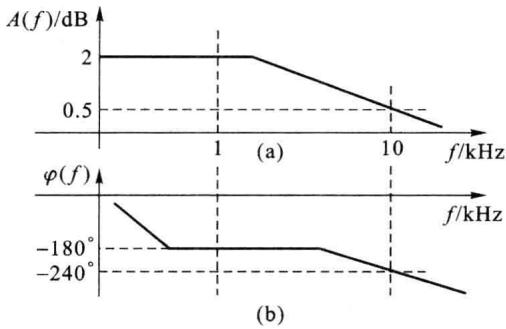  

图题4.1.1

<Solution>
(4/6,π/6),(0.561 0,-π/6)
</Solution>
</Exercise>

<Exercise title="习题 4.1.2">
试分别写出图题4.1.2(a)、(b)电路的电压增益函数 $A(s) = \frac{V_{\mathrm{o}}(s)}{V_{\mathrm{i}}(s)}$ 和频率响应函数 $A(\mathrm{j}\omega)$ 的表示式。

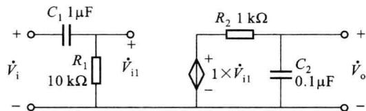

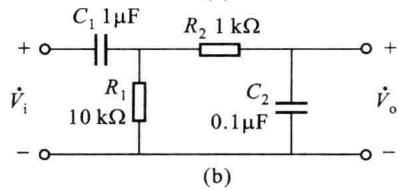  

图题4.1.2
</Exercise>

<Exercise title="习题 4.1.3">
系统的极点 $s_{p1} = -2\pi \times 800, s_{p2} = -2\pi \times 1200$ ，零点 $s_{z1} = 2\pi \times 100$ 。试写出传输函数 $H(s)$ 的表示式和幅频特性 $H(f)$ 、相频特性 $\varphi(f)$ 的表示式。
</Exercise>

<Exercise title="习题 4.1.4">
系统的频率响应函数 $A(\mathrm{j}\omega)=\frac{1.6\times10^{7}\times(\mathrm{j}\omega+5\ 000)}{(\mathrm{j}\omega+500)^{2}(\mathrm{j}\omega+9\ 000)}$ 。试画出其幅频特性 $A(\omega)$ ，相频特性 $\varphi(\omega)$ 的波特图（渐近线），求出上限截止角频率 $\omega_{H}$ 。

<Solution>
$\omega_{\mathrm{H}} = 322$ rad/s
</Solution>
</Exercise>

<Exercise title="习题 4.1.5">
某系统的电压传输函数 $A(jf)$ 的幅频特性 $A(f)=|\dot{V}_{o}/\dot{V}_{i}|$ 的波特图（渐近线）如图题 4.1.5 所示。试写出 $A(jf)$ 的表示式，作出 $A(jf)$ 的等效电路。

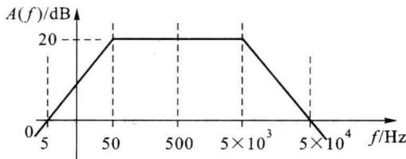  

图题4.1.5
</Exercise>

<Exercise title="习题 4.1.6">
图题 4.1.6 中子系统 A 的电压传输函数 $A(jf) = \frac{\dot{V}_{\mathrm{o}}}{\dot{V}_{\mathrm{i1}}} = \frac{10^{2}}{(1 + jf)^{3}}$ ，式中 f 的单位为 MHz，A 的输入阻抗为纯电阻 50 kΩ。试写出图题 4.1.6 所示电路的源电压传输函数 $A_{vs}(jf) = \dot{V}_{\mathrm{o}} / \dot{V}_{\mathrm{s}}$ 的表达式，画出 $A_{vs}(jf)$ 的幅频、相频特性的波特图（渐近线）。

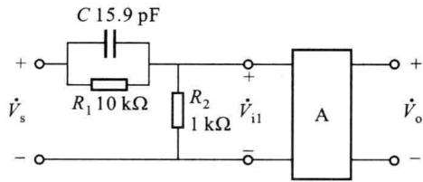  

图题4.1.6
</Exercise>

<Exercise title="习题 4.1.7">
图题 4.1.7(a) 所示电路中的放大电路 A 的模型可由图题 4.1.7(b) 描述。试求图题 4.1.7(a)

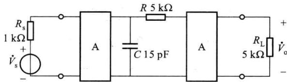  

(a)

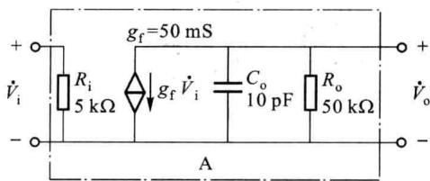  

(b)  

图题4.1.7

所示电路的电压源增益 $\dot{A}_{vs} = \dot{V}_{o} / \dot{V}_{i}$ 的表达式，画出 $\dot{A}_{vs}$ 的波特图（渐近线）。求出 $\dot{A}_{vs}$ 的中频值 $A_{vs0}$ 和上限截止频率 $f_{H}$ 。

<Solution>
92 dB,679 kHz
</Solution>
</Exercise>

<Exercise title="习题 4.1.8">
某低通系统的频率响应函数 $A(jf)$ 有两个极点频率: $f_{1}$ 和 $4f_{1}$ 。 $A(jf)$ 的中频值为 $A_{0}$ 。当认为 $f_{1}$ 为系统的主极点频率并以 $f_{1}$ 近似代表系统的上限截止频率 $f_{H}$ 时，试分析由此产生的上限截止频率的相对误差。如果用主极点因子项乘以 $A_{0}$ 近似代表 $A(jf)$ ，试分析在 $f_{1}$ 频率点的幅频特性、相频特性的相对误差。

<Solution>
$5.75\% ,25\% , - 23.8\%$ 4.2.1 1.669 MHz,168.6 MHz,166.9 MHz
</Solution>
</Exercise>

<Exercise title="习题 4.2.1">
某双极型晶体管的基区体电阻为 $300 \Omega$ ，共射电流放大系数的中、低频值为 100。在 $I_{CQ} = 1.5 \, mA, V_{CEQ} = 5 \, V$ 时测得 $C_{b'e} = 50 \, pF, C_{b'e} = 5 \, pF$ 。在此工作点（室温）的管共射电流放大系数的截止频率和共基电流放大系数的截止频率、特征频率各为多少？
</Exercise>

<Exercise title="习题 4.2.2">
某双极型晶体管 $f_{\beta}$ 为 4 MHz。在 40 MHz 频率时测得 $|\beta|$ 值约为 8。此晶体管的 $\beta_{0}$ 和 $f_{T}$ 为多少？

<Solution>
80,320 MHz
</Solution>
</Exercise>

<Exercise title="习题 4.2.3">
某MOS管的栅源微变电容为 $0.2\mathrm{pF}$ ，栅漏微变电容为 $0.02\mathrm{pF}$ ，栅衬微变电容为 $0.02\mathrm{pF}$ 。 $V_{\mathrm{GS(th)}} = 1\mathrm{V}, k_{\mathrm{p}} = 20\mu \mathrm{A} / \mathrm{V}^2, W / L = 20, \lambda = 0.01\mathrm{V}^{-1}$ 。在直流工作点 $I_{\mathrm{DQ}} = 0.5\mathrm{mA}, V_{\mathrm{DSQ}} = 6\mathrm{V}$ 情况下，衬漏微变电容为 $0.05\mathrm{pF}$ ，衬源微变电容为 $0.1\mathrm{pF}$ 。试求在此工作情况时管的特征频率 $f_{\mathrm{T}}$ 。

<Solution>
432 MHz
</Solution>
</Exercise>

<Exercise title="习题 4.2.4">
试推导结型场效应管的特征频率 $f_{\mathrm{T}}$ 的表达式。
</Exercise>

<Exercise title="习题 4.3.0">
在图题 4.3.0 中的晶体管 T 的有关参数为: $\beta_{0}=100, r_{bb'}\approx0\ \Omega, C_{b'c}=3\ pF, f_{T}=400\ MHz$ ，设偏置电源 $V_{BB}$ 使管基极偏置电流 $I_{BQ}=30\ \mu A$ 。求电路的微变输入电容 $C_{i}$ 。

<Solution>
1556 pF=1.56 μF
</Solution>
</Exercise>

<Exercise title="习题 4.3.1">
放大电路如图题4.3.1所示。电路中硅晶体管T的主要参数为： $\beta_0 = 100, r_{\mathrm{bb}'} = 100\Omega, C_{\mathrm{b'c}} = 3\mathrm{pF}, f_{\mathrm{T}} = 300\mathrm{MHz}, V_{\mathrm{A}} = 100\mathrm{V}$ 。电路中 $C_{\mathrm{B}}, C_{\mathrm{C}}, C_{\mathrm{E}}$ 为耦合电容和旁路电容，在中、高工作频段可处理为短路。试求当电阻负载 $R_{\mathrm{L}}$ 为 $16\mathrm{k}\Omega$ 和 $1.6\mathrm{k}\Omega$ 两种情况下的微变源电压增益 $A_{\mathrm{rs}}(\mathrm{j}f) = \dot{V}_{\mathrm{o}} / \dot{V}_{\mathrm{s}}$ 的中频值 $A_{\mathrm{vs0}}$ 上限截止频率 $f_{\mathrm{H}}$ 、带宽增益乘积 $GBW$ 。

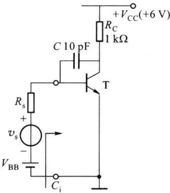  

图题4.3.0

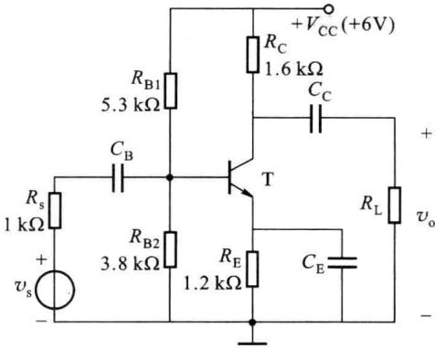  

图题4.3.1

<Solution>
-39.4,1.05 MHz,41.37 MHz $(R_{\mathrm{L}} = 16~\mathrm{k}\Omega)$ -21.7,1.75 MHz,37.98 MHz $(R_{\mathrm{L}} = 1.6~\mathrm{k}\Omega)$ 4.3.2 3.97 MHz,29.4 MHz
</Solution>
</Exercise>

<Exercise title="习题 4.3.2">
单管共射放大电路如图题4.3.2所示。T为硅管，主要参数为： $\beta_{0}=80,r_{bb'}=50\Omega,C_{b'c}=2\text{ pF}$ ， $f_{T}=400\ MHz,V_{A}=100\ V$ 。电路中 $R_{C}=1\ k\Omega,R_{E}=1\ k\Omega,V_{BB}=1.72\ V,V_{CC}=5\ V$ 。旁路电容 $C_{E}$ 的容量值足够大，使之对中、高工作频段信号呈短路。当信号源内阻 $R_{s}=500\ \Omega$ 和 $0\ \Omega$ 时，试计算电路的微变源电压增益 $A_{vs}(jf)=\dot{V}_{o}/\dot{V}_{s}$ 的上限截止频率 $f_{H}$ 。
</Exercise>

<Exercise title="习题 4.3.3">
放大电路如图题4.3.3所示。其中晶体管的参数同题4.3.1中的管 $\mathrm{T}$ 。电路中 $C_{\mathrm{E}}, C_{\mathrm{C}}, C_{\mathrm{B}}$ 为耦合电容和旁路电容，在中、高工作频段可处理为短路。试求当电阻负载 $R_{\mathrm{L}}$ 为 $16 \mathrm{k} \Omega$ 和 $1.6 \mathrm{k} \Omega$ 两种情况下的微变源电压增益 $A_{\mathrm{vs}}(\mathrm{j} f) = \dot{V}_{\mathrm{o}} / \dot{V}_{\mathrm{s}}$ 的中频值 $A_{\mathrm{vs0}}$ 、上限截止频率 $f_{\mathrm{H}}$ 、带宽增益乘积 $GBW$ 。

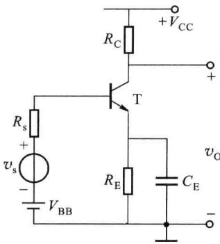  

图题4.3.2

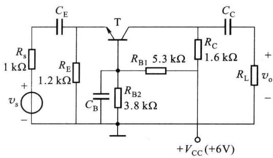  

图题4.3.3

<Solution>
0.42,33 MHz,46.86 MHz $(R_{\mathrm{L}} = 16~\mathrm{k}\Omega)$ 0.78,59.2 MHz,46.18 MHz $(R_{\mathrm{L}} = 1.6~\mathrm{k}\Omega)$ 4.3.4 36.1 MHz,168.8 MHz
</Solution>
</Exercise>

<Exercise title="习题 4.3.4">
电路如图题4.3.4所示。硅管T的主要参数为 $r_{\mathrm{bb}^{\prime}} = 50\Omega ,C_{\mathrm{b^{\prime}c}} = 4\mathrm{pF},f_{\mathrm{T}} = 400\mathrm{MHz},\beta_{0} = 80,$ $V_{\mathrm{A}} = 100\mathrm{V}$ 。试求 $R_{\mathrm{c}}$ 为 $1\mathrm{k}\Omega$ 和 $200\Omega$ 两种情况下的微变电流增益 $\dot{I}_{\mathrm{o}} / \dot{I}_{\mathrm{s}}$ 的上限截止频率 $f_{\mathrm{H}}$ 。
</Exercise>

<Exercise title="习题 4.3.5">
共集放大电路如图题 4.3.5 所示。硅管 T 的主要参数为 $r_{bb'} = 30 \Omega, C_{b'c} = 5 \text{ pF}, f_{T} = 400 \text{ MHz}, \beta_{0} = 100, V_{A} = 100 \text{ V}$ 。试求 $R_{s} = 0$ 情况下的微变源电压增益 $A_{vs}(jf) = \dot{V}_{o}/\dot{V}_{s}$ 的中频值 $A_{vs0}$ 和上限截止频率 $f_{H}$ 。

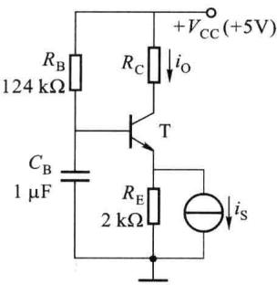  

图题4.3.4

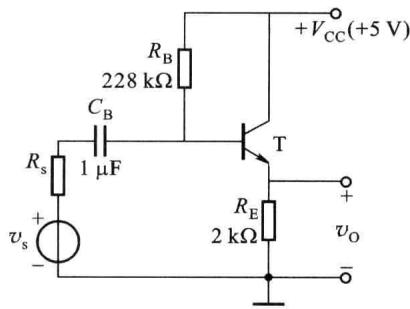  

图题4.3.5

<Solution>
0.987,1096.7 MHz
</Solution>
</Exercise>

<Exercise title="习题 4.3.6">
求图题 4.3.6 所示电路的微变源电压增益 $A_{\mathrm{vs}}(\mathrm{j}f)=\dot{V}_{\mathrm{o}}/\dot{V}_{\mathrm{s}}$ 的中频值 $A_{vs0}$ 和下限截止频率 $f_{L}$ 。电路中晶体管的参数与题 4.3.1 中的晶体管的相同。

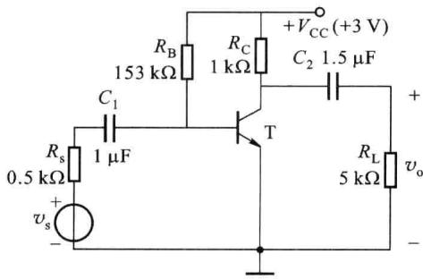  

图题4.3.6

<Solution>
-35.7,77.52 Hz
</Solution>
</Exercise>

<Exercise title="习题 4.3.7">
放大电路如图题4.3.2所示。信号源内阻 $R_{\mathrm{s}}$ 为 $500\Omega$ 。电路中其他元件参数及晶体管参数与题

<Solution>
≥101.12 μF
</Solution>
</Exercise>

<Exercise title="习题 4.3.2">
相同。欲使微变源电压增益 $A_{\mathrm{vs}}(\mathrm{j}f)=\dot{V}_{\mathrm{o}}/\dot{V}_{\mathrm{s}}$ 的下限截止频率 $f_{L}\leqslant50\ Hz$ ，旁路电容 $C_{E}$ 的电容值应为多少？
</Exercise>

<Exercise title="习题 4.3.8">
放大电路如图题 4.3.8 所示。电路中硅晶体管 $T_{1}\sim T_{4}$ 的 $r_{bb'}=100\ \Omega,f_{T}=300\ MHz,\beta_{0}=100$ ， $V_{A}=100\ V,C_{b'c1}=C_{b'c2}=5\ pF,C_{b'c3}=C_{b'c4}=10\ pF$ 。

（1）计算差模电压增益 $\dot{V}_{\mathrm{o}}/(V_{\mathrm{s}1}-\dot{V}_{\mathrm{s}2})$ 的上限截止频率 $f_{H}$ 、下限截止频率 $f_{L}$ 、增益带宽乘积 GBW；

（2）设 $T_{3}$ 的输出电容 $C_{EE}=10\ pF$ 。试写出共模增益 $\dot{A}_{re}=\dot{V}_{oc}/\dot{V}_{s1c}$ 的表示式，计算其截止频率，画出其幅频特性的渐近线波特图。（提示：计算共模增益时不计 $T_{1}$ 、 $T_{2}$ 的电容分量。）

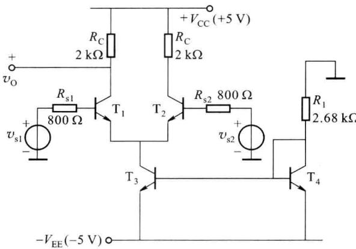  

图题4.3.8

<Solution>
(1) 697 kHz,0 Hz,16.8×10^6 Hz;(2) 255 kHz
</Solution>
</Exercise>

<Exercise title="习题 4.3.9">
放大电路如图题4.3.9所示。晶体管 $\mathrm{T}_{1},\mathrm{T}_{2}$ 与题4.3.1中管的参数相同。电路中 $C_1\sim C_4$ 分别为耦合电容、旁路电容，对中、高工作频段信号可处理为短路。试求微变源电压增益 $A_{\mathrm{vs}}(\mathrm{j}f) = \dot{V}_{\mathrm{o}} / \dot{V}_{\mathrm{s}}$ 的中频值 $A_{\mathrm{vs0}}$ 和上限截止频率 $f_{\mathrm{H}}$ 。（提示：在计算 $\mathrm{T}_{1}$ 的密勒电容时，忽略 $\mathrm{T}_{2}$ 的输入电容。）

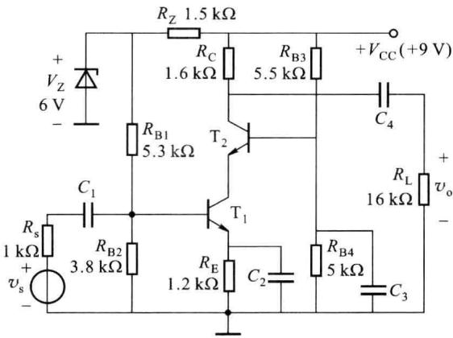  

图题4.3.9

<Solution>
-39,7.75 MHz
</Solution>
</Exercise>

<Exercise title="习题 4.3.10">
放大电路如图题4.3.10所示。晶体管 $\mathrm{T}_{1},\mathrm{T}_{2}$ 与题4.3.1中管的参数相同。电路中 $C_1\sim C_3$ 分别为耦合电容、旁路电容，对中、高工作频段信号可处理为短路。试求微变源电压增益 $A_{vs}(jf) = \dot{V}_o / \dot{V}_s$ 的中频值 $A_{vs0}$ 和上限截止频率 $f_{\mathrm{H}}$ 。（提示：忽略 $\mathrm{T}_{1}$ 的电容分量，认为 $f_{\mathrm{H}}$ 主要由 $\mathbf{T}_2$ 电路部分决定。）

<Solution>
-76,4 MHz
</Solution>
</Exercise>

<Exercise title="习题 4.4.1">
场效应管放大电路如图题 4.4.1 所示。N 沟道结型管 T 的参数为 $k_{p}=40\ \mu A/V^{2}$ ，W/L=10， $V_{off}=$ -3 V, $\lambda = 0.01 V^{-1}$ , $C_{gs} = 3 pF$ , $C_{gd} = 5 pF$ 。试求微变源电压增益 $\dot{A}_{vs}(jf) = \dot{V}_{o}/\dot{V}_{s}$ 的中频值 $A_{vs0}$ 和上限截止频率 $f_{H}$ 。( $C_{G}$ 、 $C_{D}$ 、 $C_{S}$ 为耦合电容或旁路电容，可处理为高频短路。)

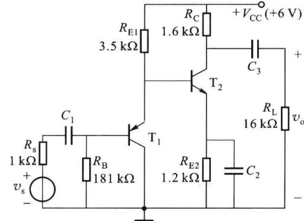  

图题4.3.10

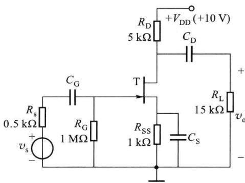  

图题4.4.1

$$

V _ {\mathrm{GS(th)}} = 1. 5 \mathrm{V}, k _ {\mathrm{p}} = 5 0 \mu \mathrm{A} / \mathrm{V} ^ {2}, W / L = 1 2

$$

$\lambda=0.001\ V^{-1},C_{gs}=1.5\ pF,C_{gd}=1\ pF,C_{gb}=0.5\ pF,C_{bd}=3\ pF,C_{bs}=2\ pF$ 。试计算微变源电压增益 $\dot{A}_{vs}=\dot{V}_{o}/\dot{V}_{s}$ 的中频值 $A_{vs0}$ 和上限截止频率 $f_{H}$ 。

<Solution>
-3.17,5.28 MHz
</Solution>
</Exercise>

<Exercise title="习题 4.4.3">
E/D型共源放大电路如图题4.4.3所示。 $\mathrm{T}_{1}$ 的参数为 $V_{\mathrm{th1}} = 1.5\mathrm{V},k_{\mathrm{p1}} = 40~\mu \mathrm{A} / \mathrm{V}^2,(W / L)_1 = 10,\lambda_1 =$ $0.01\mathrm{V}^{-1},\eta_{1} = 0.1$ 。 $\mathrm{T}_{2}$ 的参数为 $V_{\mathrm{off2}} = -1.5\mathrm{V},I_{\mathrm{DSS2}} =$ $0.45\mathrm{mA},\lambda_{2} = 0.01\mathrm{V}^{-1},\eta_{2} = 0.1$ 。 $\mathrm{T}_{1},\mathrm{T}_{2}$ 两管的电容分量均为 $C_{\mathrm{gs}} = 2\mathrm{pF},C_{\mathrm{gd}} = 1\mathrm{pF},C_{\mathrm{gb}} = 1\mathrm{pF},C_{\mathrm{bd}} = 5\mathrm{pF},C_{\mathrm{bs}} = 3\mathrm{pF}$ 。设两管的工作点电流为 $0.46\mathrm{mA},V_{\mathrm{DSQ1}} = V_{\mathrm{DSQ2}} = 2.5\mathrm{V}$ 。试完成：

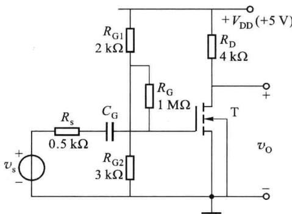  

图题4.4.2

（1）画出电路的高频微变等效电路，标明其中各参数的数值；

（2）计算微变源电压增益 $\dot{A}_{vs}=\dot{V}_{o}/\dot{V}_{s}$ 的中频值 $A_{vs0}$ ，估算 $\dot{A}_{vs}$ 的上限截止频率（计算密勒电容时，按纯电阻负载情况处理）；

（3）根据高频微变等效电路，用列解电压方程的方法求出 $\dot{A}_{vs}=\dot{V}_{o}/\dot{V}_{s}$ 的完整的数值表示式。求出零点频率 $f_{z}$ 和极点频率 $f_{p}$ ，解出上限截止频率 $f_{H}$ ，与(2)的估算值比较。

<Solution>
(2) -8.7,906 kHz; (3) $f_{\mathrm{z}} = 97.085\mathrm{MHz}, f_{\mathrm{p1}} = 0.963\mathrm{MHz}, f_{\mathrm{p2}} = 42.95\mathrm{MHz}, f_{\mathrm{H}} \approx f_{\mathrm{p1}}$ 4.4.4 $A_{vs0} = 0.895$ 4.4.5 6.1,944 kHz
</Solution>
</Exercise>

<Exercise title="习题 4.4.4">
共漏放大电路如图题 4.4.4 所示。 $T_{1}$ 、 $T_{2}$ 的参数为 $V_{th}=2\ V, k_{p}=50\ \mu A/V^{2}, W/L=10, \lambda=0.01\ V^{-1}, \eta=0.1, C_{gs}=2\ pF, C_{gd}=1\ pF, C_{gb}=1\ pF, C_{bd}=5\ pF, C_{bs}=3\ pF$ 。设两管的工作点电流为 0.8 mA，试完成：

(1) 画出电路的高频微变等效电路,标明其中各参数的数值;

(2) 计算微变源电压增益 $\dot{A}_{vs} = \dot{V}_{o} / \dot{V}_{s}$ 的中频值 $A_{vs0}$ ;

（3）画出 20 MHz 工作频率时， $T_{1}$ 栅极端的输入阻抗 $Z_{i}$ 的等效电路，定量标出其中各元件的阻抗数值。

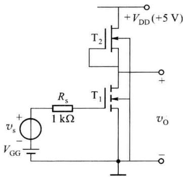  

图题4.4.3

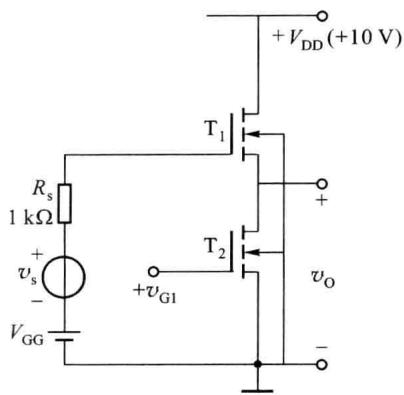  

图题4.4.4
</Exercise>

<Exercise title="习题 4.4.5">
共栅放大电路如图题 4.4.5 所示。 $T_{1}$ 的参数为 $V_{th}=1.5\ V, k_{p}=40\ \mu A/V^{2}, W/L=10, \lambda=0.01\ V^{-1}, \eta=0.1$ 。 $T_{2}$ 的参数为 $V_{off}=-1.5\ V, I_{DSS}=0.45\ mA, \lambda=0.01, \eta=0.1$ 。 $T_{1}$ 、 $T_{2}$ 两管的电容分量均为 $C_{gs}=2\ pF, C_{gd}=1\ pF, C_{gb}=1\ pF, C_{bd}=5\ pF, C_{bs}=3\ pF$ 。设两管的工作点电流为 0.46 mA，试完成：

(1) 画出电路的高频微变等效电路,标明其中各参数的数值;

（2）计算微变源电压增益 $\dot{A}_{vs}=\dot{V}_{o}/\dot{V}_{s}$ 的中频值 $A_{vs0}$ 和上限截止频率 $f_{H}$ 。
</Exercise>

<Exercise title="习题 4.4.6">
图题 4.4.6 所示为折叠式共源-共栅放大电路。其中 $T_{1}$ 的参数为 $V_{th1}=1\ V, k_{p1}=50\ \mu A/V^{2}, (W/L)_{1}=10, \lambda_{1}=0.01\ V^{-1}, \eta_{1}=0.1$ 。 $T_{2}$ 的参数为 $V_{th2}=-1\ V, k_{p2}=30\ \mu A/V^{2}, (W/L)_{2}=15, \lambda_{2}=0.01\ V^{-1}, \eta_{2}=0.1$ 。 $T_{1}, T_{2}$ 两管的电容分量均为 $C_{gs}=2\ pF, C_{gd}=1\ pF, C_{gb}=1\ pF, C_{bd}=5\ pF, C_{bs}=3\ pF$ 。设两管的工作点电流为 $I_{DQ1}=I_{DQ2}=I_{SS}/2=0.7\ mA$ 。

(1) 画出电路的高频微变等效电路,标明其中各参数的数值;

（2）计算微变源电压增益 $A_{vs}=V_{o}/V_{s}$ 的中频值 $A_{vs0}$ 和上限截止频率 $f_{H}$ 。（提示：计算 $T_{1}$ 的密勒效应时将 $T_{1}$ 的负载处理为纯电阻。）

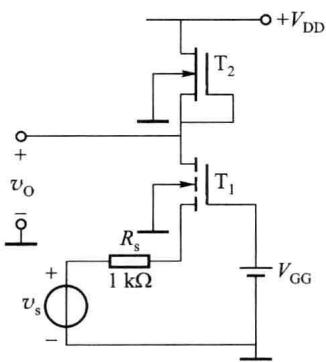  

图题4.4.5

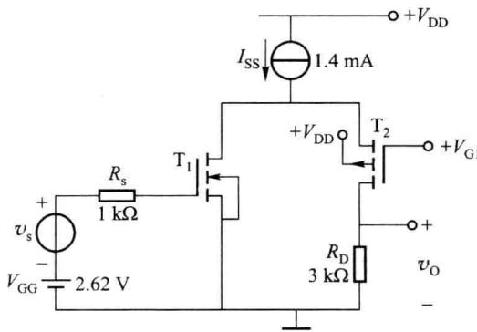  

图题4.4.6

## 第五章 反馈放大电路

自 1928 年 H. Blark 提出反馈放大电路以来, 反馈的理论与实践都取得了重大的进展, 反馈在电子技术领域中的应用越来越广泛。在放大电路中引入反馈可以改善电路多方面的性能, 因此, 几乎所有的实用放大电路都是带有反馈的电路。

按照反馈极性的不同,可以分为正反馈和负反馈,它们在电路中所起的作用是不同的。负反馈可以稳定放大电路的工作点,提高增益的稳定性,减少非线性失真,扩展频带,改进输入和输出阻抗等,这些性能的改善是以牺牲放大电路的增益为代价的。正反馈通常用在某些振荡电路中,通过引入正反馈使电路能够自激振荡。

本章从反馈的概念入手,着重阐述负反馈对放大电路性能的影响、分析方法以及反馈电路的稳定性等问题。反馈放大电路的分析包括定性分析与定量分析两个方面。定性分析,主要是读懂电路图,确定反馈网络,判断反馈的极性与类型等等。定量分析就是计算反馈放大电路的性能指标,重点讨论深度负反馈情况下负反馈放大电路闭环增益的近似计算问题。

<Solution>
-2.5,6.25 MHz
</Solution>
</Exercise>
