import Guide from '@/components/Guide.astro';
import Knowledge from '@/components/Knowledge.astro';
import Example from '@/components/Example.astro';
import Analysis from '@/components/Analysis.astro';
import Solution from '@/components/Solution.astro';
import Variant from '@/components/Variant.astro';
import Note from '@/components/Note.astro';
import Block from '@/components/Block.astro';
import Method from '@/components/Method.astro';
import Exercise from '@/components/Exercise.astro';

反馈广泛应用于各个领域。例如，在控制系统中，通过对执行机构偏差的监测来修正控制系统的输入量；在商业活动中，通过对商品销售情况的调查来调整进货渠道和进货数量，在行政管理中，通过对执行部门工作效果的调研来修正政策等。反馈的目的就是通过输出对输入的影响来改善系统的运行状况和控制效果。

在实用放大电路中,几乎都要引入各种形式的反馈,以改善放大电路的性能。因此,掌握反馈的基本概念和判别方法是研究实用电路的基础。

## 5.1.1 反馈的基本概念和分类

将放大电路输出信号(电压或电流)的一部分或全部,经过一定的电路(反馈网络)送回到输入回路,进而影响输入信号(电压或电流)的过程称为反馈(Feedback)。无反馈的放大电路称为基本放大电路或开环放大电路,引入反馈的放大电路称为反馈放大电路或闭环放大电路。

反馈放大电路由基本放大电路和反馈网络两大部分组成,如图5.1.1所示,基本放大电路的功能是放大输入信号,反馈网络的功能是传输反馈信号,二者构成一个闭合环路。基本放大电路的输入信号称为净输入信号,它是输入信号与反馈信号的和,净输入信号从基本放大电路的输入端传送到输出端,这种传输是单向的,称为正向传输,反馈信号的传输则称为反向传输。

在实际电路中,基本放大电路和反馈网络总是连在一起的,正确地判断一个电路是否存在反馈是研究反馈放大电路的基础。在放大电路中,若存在将输入回路和输出回路连接起来的通路,即存在反馈通路,并由此影响了放大电路的净输入,则电路引入了反馈,否则没有引入反馈。例如,图5.1.2所示是前面介绍过的单管共射放大电路,发射极电阻 $R_{E}$ 将输入回路和输出回路连接起来,构成电路中的反馈网络,因而存在反馈, $R_{E}$ 即为反馈元件。

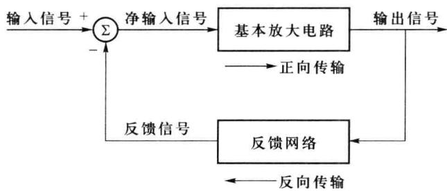  

图 5.1.1 反馈放大电路示意图

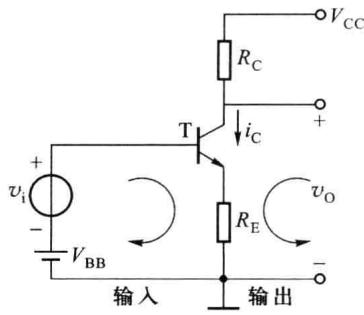  

图 5.1.2 具有反馈网络的  

单管共射放大电路

## 一、直流反馈和交流反馈

在反馈放大电路中,根据反馈信号本身的交流和直流性质,可以分为直流反馈和交流反馈。如果引入的反馈只对直流量起作用,则称为直流反馈;如果引入的反馈只对交流量起作用,则称为交流反馈。换句话说,在直流通路中存在的反馈是直流反馈,在交流通路中存在的反馈是交流反馈。在很多放大电路中,常常是交流和直流反馈共存,其中直流反馈用来稳定放大电路的静态工作点,交流反馈用来改善放大电路的性能指标。交流反馈是本章讨论的重点。

下面先来分析电路中的直流反馈,考察图 5.1.2 所示的单管共射放大电路,图 5.1.3(a) 所示为其直流通路,反馈网络由反馈电阻 $R_{E}$ 组成,集电极电流 $I_{C}$ 流过反馈电阻 $R_{E}$ 产生反馈电压

$$

V _ {\mathrm{F}} = R _ {\mathrm{E}} I _ {\mathrm{E}} \approx R _ {\mathrm{E}} I _ {\mathrm{C}}

$$

在输入回路中,该电压和偏置电压 $V_{BB}$ 共同作用,调节晶体管 T 的发射结电位

$$

V _ {\mathrm{BE}} = V _ {\mathrm{BB}} - V _ {\mathrm{F}} \approx V _ {\mathrm{BB}} - R _ {\mathrm{E}} I _ {\mathrm{C}}

$$

这种直流反馈是如何稳定电路的静态工作点的呢？假设由于温度变化等原因引起晶体管T集电极电流 $I_{C}$ 发生变化，电阻 $R_{E}$ 上的反馈电压 $V_{F}$ 也随之变化，从而改变 $V_{BE}$ ，使 $I_{B}$ 发生变化，进而调整 $I_{C}$ ，使之维持不变。这种自动调节过程如下：

$$

T (\text { 温度 }) \uparrow \rightarrow I _ {\mathrm{C}} \uparrow \rightarrow V _ {\mathrm{F}} \uparrow \rightarrow V _ {\mathrm{BE}} \downarrow \rightarrow I _ {\mathrm{B}} \downarrow \rightarrow I _ {\mathrm{C}} \downarrow

$$

这种反馈只对直流起作用,故称为直流反馈,它的作用是稳定电路的静态工作点。

下面再来分析图 5.1.2 所示电路中存在的交流反馈, 图 5.1.3(b) 所示为其交流通路, 交流电流 $\dot{I}_{c}$ 流过电阻 $R_{E}$ 产生反馈电压 $\dot{V}_{f}$ , 即

$$

\dot {V} _ {\mathrm{f}} \approx R _ {\mathrm{E}} \dot {I} _ {\mathrm{c}}

$$

此时,晶体管发射结的净输入电压 $\dot{V}_{be}$ 为

$$

\dot {V} _ {\mathrm{be}} = \dot {V} _ {\mathrm{i}} - \dot {V} _ {\mathrm{f}} \approx \dot {V} _ {\mathrm{i}} - R _ {\mathrm{E}} \dot {I} _ {\mathrm{c}}

$$

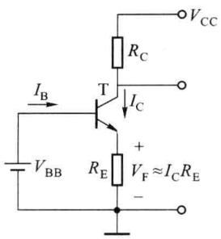  

(a) 直流通路

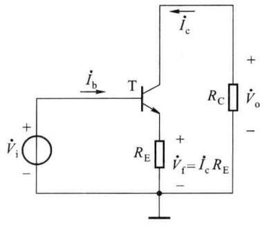  

(b) 交流通路  

图 5.1.3 具有反馈网络的单管共射放大电路

当输入信号 $|\dot{V}_{\mathrm{i}}|$ 一定时，假设由于温度、负载变化等原因使输出信号电流 $|\dot{I}_{\mathrm{c}}|$ 增加，反馈电压 $|\dot{V}_{\mathrm{f}}|$ 随之增加，从而使 $|\dot{V}_{\mathrm{be}}|$ 减小， $|\dot{I}_{\mathrm{b}}|$ 也随之减小，进而调整 $|\dot{I}_{\mathrm{c}}|$ ，使之维持不变。这种自动调节过程如下：

$$

T (\text { 温度 }) 、 \text { 负载变化 } \rightarrow | \dot {I} _ {\mathrm{c}} | \uparrow \rightarrow | \dot {V} _ {\mathrm{f}} | \uparrow \rightarrow | \dot {V} _ {\mathrm{be}} | \downarrow \rightarrow | \dot {I} _ {\mathrm{b}} | \downarrow \rightarrow | \dot {I} _ {\mathrm{c}} | \downarrow

$$

这种反馈仅对交流信号起作用,故称为交流反馈,它的作用是稳定电路的输出电流 $\dot{I}_{c}$ 。当输入信号不变时,由于交流负反馈的作用,反馈放大电路能抵消因环境温度、负载变化等因素引起的输出信号的变化,稳定输出信号,使电路的性能得到改善。

通过上面的分析可知,图 5.1.2 所示的电路既存在直流反馈,也存在交流反馈,若在反馈电阻 $R_{E}$ 两端并联一个电容 $C_{E}$ ,由于 $C_{E}$ 对直流相当于开路,对交流相当于短路,则 $R_{E}$ 在交流通路中被 $C_{E}$ 短路,电路中只存在直流反馈。

## 二、正反馈和负反馈

在反馈放大电路中,按照反馈极性的不同,可以分为正反馈和负反馈两种。如果反馈到输入回路的信号和原来的输入信号作用相同,二者叠加的结果使放大电路的净输入增加,这样的反馈称为正反馈;反之,若反馈信号和原来的输入信号作用相反,使放大电路的净输入减小,这样的反馈称为负反馈。

## 三、电压反馈和电流反馈

在反馈放大电路中,如果反馈信号取自输出电压,则称为电压反馈(电压取样);如果反馈信号取自输出电流,则称为电流反馈(电流取样)。在负反馈条件下,电压取样具有稳定输出电压的作用,其效果相当于降低了电路的输出电阻;电流取样具有稳定输出电流的作用,其效果相当于提高了电路的输出电阻。

## 四、串联反馈和并联反馈

根据反馈信号和输入信号在输入端求和方式的不同,可以分为串联反馈和并联反馈。若反馈信号与输入信号在输入回路中以电压形式串联求和,则称为串联反馈(串联相加);若二者在输入回路中以电流形式并联求和,则称为并联反馈(并联相加)。如果信号源内阻 $R_{s}$ 较大,则适合引入并联反馈;反之,若 $R_{s}$ 较小,则适合引入串联反馈。

## 五、寄生反馈

放大电路中除了为改善电路性能而引入的反馈外,有时因为某种杂散参数(杂散电容和杂散电感)的存在,将输出信号反馈到输入端,这种反馈称为寄生反馈。寄生反馈是有害的,严重时可使放大电路不能正常工作,在实际中应该尽量避免。

在多级放大电路中,还可以分为级内反馈和级间反馈。级内反馈出现在放大电路的某一级电路中,属于局部反馈。级间反馈的取样电路和求和电路不在同一级中,电路的性能主要由级间反馈决定。

## 5.1.2 反馈放大电路的组成

一个实际的反馈放大电路,除包括基本放大电路和反馈网络之外,还应该包括输出端取样电路和输入端求和电路,反馈放大电路的组成框图如图5.1.4所示,它由基本放大电路、反馈网络、输出取样电路、输入求和电路等4部分组成。

在放大电路的输出端, 输出取样电路取出输出信号 $\dot{X}_{o}$ , 送入反馈网络的输入端, 反馈网络输出反馈信号 $\dot{X}_{f}$ , 它与信号源的输出信号 $\dot{X}_{i}$ 在输入求和电路实现求和运算, 产生净输入信号 $\dot{X}_{id}$ 加至基本放大电路的输入端, 经基本放大电路放大产生输出信号 $\dot{X}_{o}$ 送给负载。

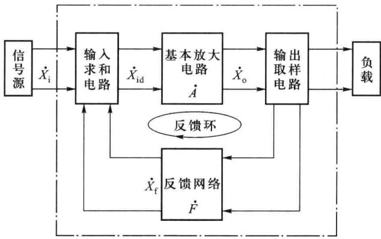  

图 5.1.4 反馈放大电路的组成

如前所述，通常假设反馈放大电路中信号的传输是单向的，如图5.1.4中的箭头所示，信号源的信号只经过基本放大电路传送到输出端，不经过反馈网络；而从输出端取出的反馈信号只经过反馈网络传回输入求和电路，不经过基本放大电路。基本放大电路的增益 $\dot{A}$ 是输出信号 $\dot{X}_{\mathrm{o}}$ 和净输入信号 $\dot{X}_{\mathrm{id}} = \dot{X}_{\mathrm{i}} - \dot{X}_{\mathrm{f}}$ 的比值 $\dot{X}_{\mathrm{o}} / \dot{X}_{\mathrm{id}}$ ，称为开环增益；而由点画线圈起来的反馈放大电路的增益 $\dot{A}_{\mathrm{f}}$ 是输出信号 $\dot{X}_{\mathrm{o}}$ 与信号源的输入 $\dot{X}_{\mathrm{i}}$ 的比值 $\dot{X}_{\mathrm{o}} / \dot{X}_{\mathrm{i}}$ ，称为反馈放大电路的闭环增益。 $\dot{X}_{\mathrm{i}},\dot{X}_{\mathrm{o}},\dot{X}_{\mathrm{f}},\dot{X}_{\mathrm{id}}$ 既可以是电压，也可以是电流。

## 一、基本放大电路

基本放大电路通常由多级放大电路组成,根据前面的定义,基本放大电路的增益表达式为

$$

\dot {A} = \frac {\dot {X} _ {\mathrm{o}}}{\dot {X} _ {\mathrm{id}}}\tag{5.1.1}

$$

由于 $\dot{X}_{o}$ 和 $\dot{X}_{id}$ 既可以是电压,也可以是电流,因此基本放大电路的增益有如下4种形式。

### 1. 电压增益

输入信号 $\dot{X}_{id}$ 和输出信号 $\dot{X}_{o}$ 都是电压信号, 则

$$

\dot {A} _ {v} = \frac {\dot {V} _ {\mathrm{o}}}{\dot {V} _ {\mathrm{id}}}

$$

### 2. 电流增益

输入信号 $\dot{X}_{\mathrm{id}}$ 和输出信号 $\dot{X}_{\mathrm{o}}$ 都是电流信号，则

$$

\dot {A} _ {i} = \frac {\dot {I} _ {\mathrm{o}}}{\dot {I} _ {\mathrm{id}}}

$$

### 3. 互阻增益

输出信号 $\dot{X}_{\mathrm{o}}$ 是电压，输入信号 $\dot{X}_{\mathrm{id}}$ 是电流，则

$$

\dot {A} _ {r} = \frac {\dot {V} _ {\mathrm{o}}}{\dot {I} _ {\mathrm{id}}}

$$

### 4. 互导增益

输出信号 $\dot{X}_{\mathrm{o}}$ 是电流，输入信号 $\dot{X}_{\mathrm{id}}$ 是电压，则

$$

\dot {A} _ {\mathrm{g}} = \frac {\dot {I} _ {\mathrm{o}}}{\dot {V} _ {\mathrm{id}}}

$$

其中， $\dot{A}_{v}$ 和 $\dot{A}_{i}$ 均为量纲一的量； $\dot{A}_{r}$ 的单位为欧[姆]，符号为 $\Omega$ ; $\dot{A}_{g}$ 的单位是西[门子]，符号为 S。

## 二、反馈网络

反馈网络是由反馈元件构成的双端口网络,为避免引入附加相移,反馈元件一般都是纯阻性元件。反馈网络的输出信号 $\dot{X}_{f}$ 与输入信号 $\dot{X}_{o}$ 的比值称为反馈系数,用 $\dot{F}$ 表示

$$

\dot {F} = \frac {\dot {X} _ {\mathrm{f}}}{\dot {X} _ {\mathrm{o}}}\tag{5.1.2}

$$

同基本放大电路类似,反馈系数 $\dot{F}$ 也有 4 种形式。

### 1. 电压反馈系数

反馈信号 $\dot{X}_{f}$ 和输出信号 $\dot{X}_{o}$ 都是电压信号, 则

$$

\dot {F} _ {v} = \frac {\dot {V} _ {\mathrm{f}}}{\dot {V} _ {\mathrm{o}}}

$$

### 2. 电流反馈系数

反馈信号 $\dot{X}_{\mathrm{f}}$ 和输出信号 $\dot{X}_{\mathrm{o}}$ 都是电流信号，则

$$

\dot {F} _ {i} = \frac {\dot {I} _ {\mathrm{f}}}{\dot {I} _ {\mathrm{o}}}

$$

### 3. 互阻反馈系数

反馈信号 $\dot{X}_{f}$ 是电压, 输出信号 $\dot{X}_{o}$ 是电流, 则

$$

\dot {F} _ {r} = \frac {\dot {V} _ {\mathrm{f}}}{\dot {I} _ {\mathrm{o}}}

$$

### 4. 互导反馈系数

反馈信号 $\dot{X}_{f}$ 是电流, 输入信号 $\dot{X}_{o}$ 是电压, 则

$$

\dot {F} _ {\mathrm{g}} = \frac {\dot {I} _ {\mathrm{f}}}{\dot {V} _ {\mathrm{o}}}

$$

## 三、输出取样电路

反馈网络的输入信号来自输出取样电路,根据在放大电路输出端取样方式的不同,取样方式可以分为电压取样和电流取样。

### 1. 电压取样

如果反馈信号 $\dot{X}_{f}$ 与输出电压 $\dot{V}_{o}$ 成正比，则称为输出端电压取样（电压反馈），如图 5.1.5(a) 所示，对于电压取样，反馈网络与基本放大电路的输出端并联， $\dot{X}_{f}$ 与 $\dot{V}_{o}$ 成正比。大多数情况下在电压取样电路中，反馈网络输入端的信号就是输出电压 $\dot{V}_{o}$ 。

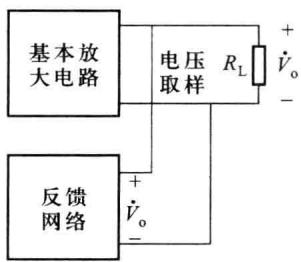  

(a) 电压取样方式

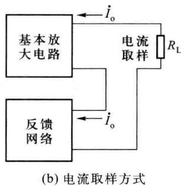  

图 5.1.5 输出端取样电路

### 2. 电流取样

如果反馈信号 $\dot{X}_{f}$ 与输出电流 $\dot{I}_{o}$ 成正比，则称为电流取样（电流反馈），如图 5.1.5(b) 所示，对于电流取样，反馈网络串联在基本放大电路的输出回路中，反馈信号取自负载中的电流 $\dot{I}_{o}, \dot{X}_{f}$ 与 $\dot{I}_{o}$ 成正比。前面讨论过的图 5.1.2 所示的单管共射放大电路，反馈网络由发射极电阻 $R_{E}$ 组成，反馈电压 $\dot{V}_{f} = R_{E} \dot{I}_{o}$ 与输出电流 $\dot{I}_{o}$ 成正比，属于电流取样。

对于共集组态作输出级的反馈放大电路,如图 5.1.6(a) 所示,若取样信号取自晶体管的发射极 E, 则为电压取样, 若取自集电极 C, 则为电流取样。对于共射组态作输出级的反馈放大电路, 如图 5.1.6(b) 所示, 若取样信号取自发射极 E, 则为电流取样; 若取自于集电极 C, 则为电压取样。

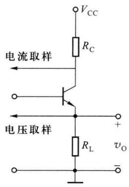  

(a) 共集电路作输出级

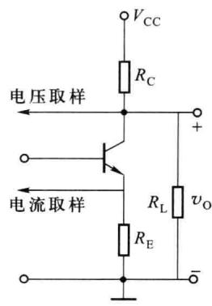  

(b) 共射电路作输出级  

图 5.1.6 共集和共射电路作输出级的取样方式

判断放大电路的取样方式，也常采用“短路法”。该方法将输出端交流短路，即令输出电压 $\dot{V}_{\mathrm{o}}$ 等于零，判断反馈信号 $\dot{X}_{\mathrm{f}}$ 是否存在，如果反馈信号也随之为零，则说明取样方式为电压取样；如果反馈信号依然存在，则为电流取样。例如，对于图5.1.6(a)所示的电路，令输出端负载 $R_{\mathrm{L}}$ 交流短路，若取样信号取自发射极E，则反馈信号 $\dot{X}_{\mathrm{f}}$ 随之消失，取样方式为电压取样；若取样信号取自集电极C，则反馈信号 $\dot{X}_{\mathrm{f}}$ 依然存在，属于电流取样。

## 四、输入求和电路

根据反馈网络与基本放大电路输入端的连接方式不同,可以分为串联求和与并联求和。

### 1. 串联求和

如果反馈网络的输出串联在基本放大电路的输入回路中,则称为串联求和(串联反馈)。如图5.1.7(a)所示,对于串联求和电路,反馈信号 $\dot{X}_{f}$ 与输入信号 $\dot{X}_{i}$ 在输入回路中以电压形式出现,基本放大电路的净输入信号 $\dot{X}_{id}$ 也是电压,即

$$

\dot {V} _ {\mathrm{id}} = \dot {V} _ {\mathrm{i}} - \dot {V} _ {\mathrm{f}}\tag{5.1.3}

$$

### 2. 并联求和

如果反馈网络的输出直接并联在基本放大电路的输入端,称为并联求和(并联反馈)。如图5.1.7(b)所示,对于并联求和,输入信号、反馈网络的输出端与基本放大电路输入端并接于同一节点上,反馈信号 $\dot{X}_{f}$ 与输入信号 $\dot{X}_{i}$ 在输入回路中以电流形式出现,基本放大电路的净输入 $\dot{X}_{id}$ 也是电流信号,即

$$

\dot {I} _ {\mathrm{id}} = \dot {I} _ {\mathrm{i}} - \dot {I} _ {\mathrm{f}}\tag{5.1.4}

$$

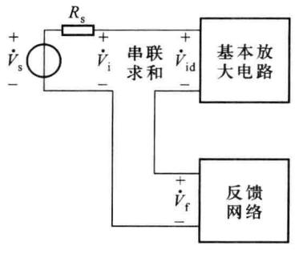  

(a) 串联求和

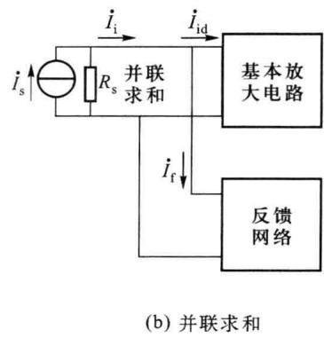  

图 5.1.7 反馈放大电路的输入求和方式

图 5.1.8 所示为反馈放大电路常用的输入级求和方式。图(a)为共射电路作输入级，如果反馈网络接至发射极 E，反馈信号 $\dot{V}_{f}$ 与输入信号 $\dot{V}_{i}$ 在输入回路中以电压形式出现，净输入信号 $\dot{V}_{id} = \dot{V}_{i} - \dot{V}_{f}$ ，所以为串联求和；如果反馈网络接至基极 B，反馈信号 $\dot{I}_{f}$ 与输入信号 $\dot{I}_{i}$ 在输入回路中以电流形式出现，净输入信号 $\dot{I}_{id} = \dot{I}_{i} - \dot{I}_{f}$ ，此时为并联求和。图(b)为共基电路作输入级,如果反馈网络接至基极 B,反馈信号 $\dot{V}_{f}$ 与输入信号 $\dot{V}_{i}$ 在输入回路中以电压形式出现,净输入信号 $\dot{V}_{id} = \dot{V}_{i} - \dot{V}_{f}$ ,为串联求和;如果反馈网络接至发射极 E,反馈信号 $\dot{I}_{f}$ 与输入信号 $\dot{I}_{i}$ 在输入回路中以电流形式出现,净输入信号 $\dot{I}_{id} = \dot{I}_{i} - \dot{I}_{f}$ ,为并联求和。图(c)为差分电路作输入级,如果反馈网络接至 $T_{2}$ 的基极,为串联求和;如果接至 $T_{1}$ 的基极,为并联求和。

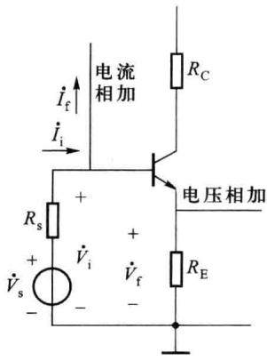

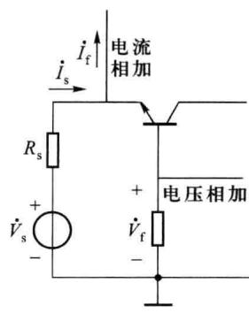  

(b) 共基输入级电路

(a) 共射输入级电路  

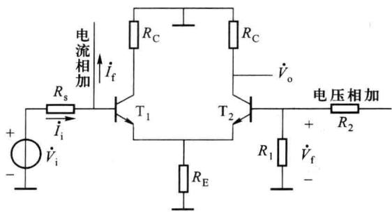  

(c) 差分输入级电路  

图5.1.8 常用电路输入级的求和方式

下面通过几个例子来进一步理解如何定性分析反馈放大电路。

<Example title="例 5.1.1">
分析图 5.1.9 所示电路, 指出反馈网络由哪些元件构成, 是直流反馈还是交流反馈, 若为交流反馈, 试说明反馈电路的取样方式和求和方式。

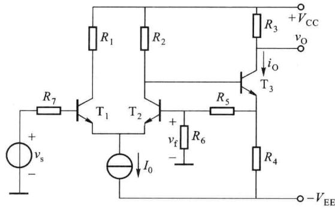  

图 5.1.9 例 5.1.1 电路图

<Solution title="解">
该电路为两级放大电路,第一级由 $T_{1}$ 和 $T_{2}$ 组成差放,信号源由 $T_{1}$ 的基极输入,由 $T_{2}$ 的集电极输出,第二级由 $T_{3}$ 组成单管共射电路。在第二级电路中, $R_{4}$ 为 $T_{3}$ 发射极反馈电阻,该反馈属于局部反馈(级内反馈),对交、直流都起作用,属于交、直流反馈。对交流而言, $R_{4}$ 两端的反馈电压与输出电流 $I_{0}$ 成正比,取样方式为电流取样; $T_{2}$ 集电极输出的电压信号与 $R_{4}$ 两端的反馈电压在 $T_{3}$ 的输入回路中实现求和运算,求和方式为串联求和,本级引入的是电流串联负反馈。

电阻 $R_{5}$ 把第一级电路和第二级电路连接起来, 构成级间反馈, 反馈网络由 $R_{4}$ 、 $R_{5}$ 和 $R_{6}$ 组成。该反馈同样对交、直流都起作用, 属于交、

直流反馈。对交流而言，在放大电路的输出端，负载电流 $i_{0}$ 流过反馈网络中的支路 $R_{4}$ 和 $R_{5} + R_{6}$ ，在 $R_{6}$ 上产生反馈电压 $v_{\mathrm{f}} = \frac{R_4R_6}{R_4 + R_5 + R_6} i_{0}$ ，反馈信号 $v_{\mathrm{f}}$ 与输出电流 $i_{0}$ 成正比，取样方式为电流取样。在放大电路输入端，反馈信号 $v_{\mathrm{f}}$ 与输入信号 $v_{\mathrm{i}}$ 在输入回路中以电压形式出现，电路的净输入 $v_{\mathrm{id}} = v_{\mathrm{i}} - v_{\mathrm{f}}$ ，求和方式为串联求和。
</Solution>
</Example>

<Example title="例 5.1.2">
电路如图 5.1.10 所示, 指出反馈网络由哪些元件构成, 试分析它能稳定静态工作点的原理, 并判断它的交流反馈组态。

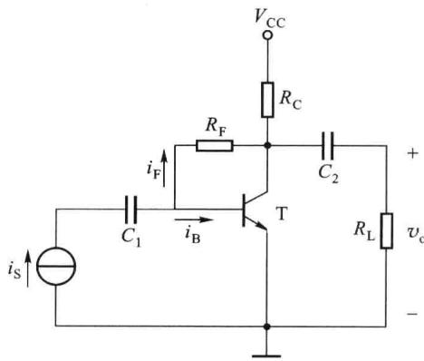  

图 5.1.10 例 5.1.2 电路图

<Solution title="解">
该电路是由 NPN 型晶体管组成的单管共射放大电路,电阻 $R_{F}$ 并联在晶体管 T 的集电极 C 和基极 B 之间,构成反馈网络,该反馈对交流和直流均起作用,属于交、直流反馈。对交流而言,反馈电流 $i_{f}=\frac{v_{be}-v_{o}}{R_{F}}\approx-\frac{v_{o}}{R_{F}}$ ,反馈信号 $i_{f}$ 与输出电压 $v_{o}$ 成正比,取样方式为电压取样。在放大电路输入端,反馈信号 $i_{f}$ 与输入信号 $i_{i}$ 在输入回路中以电流形式出现,电路的净输入 $i_{b}=i_{id}=i_{i}-i_{f}$ ,求和方式为并联求和,反馈组态属于电压并联。下面分析该反馈稳定静态工作点的原理。

在静态情况下,信号源开路 $i_{s}=0$ , 此时

$$

I _ {\mathrm{B}} = - I _ {\mathrm{F}} = \frac {V _ {\mathrm{CE}} - V _ {\mathrm{BE}}}{R _ {\mathrm{F}}} \approx \frac {V _ {\mathrm{CE}}}{R _ {\mathrm{F}}}\tag{5.1.5}

$$

反馈电阻 $R_{F}$ 确定以后， $I_{B}$ 和 $V_{CE}$ 成正比。当环境温度升高时，将引起 $I_{C}$ 增加， $V_{CE}$ 随之减小，根据式(5.1.5)， $I_{B}$ 也减小，从而牵制了 $I_{C}$ 的增加，使电路静态工作点得到稳定。可见，该电路稳定静态工作点的实质是利用反馈电阻 $R_{F}$ 把 $V_{CE}$ 的变化反馈到输入回路，控制 $I_{B}$ 以牵制 $I_{C}$ 的变化。反馈电阻 $R_{F}$ 越小，负载电阻 $R_{C}$ 越大，静态工作点的稳定性越好。
</Solution>
</Example>

## 5.1.3 反馈极性的判别

根据输入信号与反馈信号的叠加结果不同,反馈可以分为正反馈与负反馈两种。假设输入信号 $\dot{X}_{i}$ 不变,引入反馈后,若反馈信号 $\dot{X}_{f}$ 和输入信号 $\dot{X}_{i}$ 作用相同,增强了输入信号的作用,使放大电路的净输入 $\left|\dot{X}_{id}\right|$ 增加,这样的反馈称为正反馈。相反,引入反馈后,若反馈信号 $\dot{X}_{f}$ 削弱了输入信号 $\dot{X}_{i}$ 的作用,使放大电路的净输入 $\left|\dot{X}_{id}\right|$ 减小,则称该反馈为负反馈。

在前面讨论的图 5.1.2 所示的电路中， $R_{E}$ 为反馈电阻，对交流信号而言，反馈电压 $\dot{V}_{f}$ 削弱了原输入电压 $\dot{V}_{i}$ 的作用，使净输入 $\left|\dot{V}_{be}\right|$ 减小，因而是负反馈。

判断电路的反馈极性,通常采用瞬时极性法,该方法假设在放大电路的输入端接入一变化信号,由它引起电路中各节点电位极性的变化,进而分析反馈的极性,步骤如下:

（1）假定输入信号的瞬时极性:对于串联求和电路,假定输入电压的瞬时极性;对于并联求和电路,假定输入电流的瞬时极性。

（2）确定输出信号的瞬时极性：按照输入信号的传输方向，在基本放大电路中，根据放大电路输入与输出的相位关系（如图5.1.11所示），逐级判断电路中相关节点的瞬时极性，进而确定输出信号的瞬时极性。

（3）确定反馈信号的极性:按照反馈信号的传输方向,根据输出信号的瞬时极性,通过反馈网络确定反馈信号的瞬时极性。

（4）判断反馈信号与输入信号对净输入的作用：若反馈信号使基本放大电路的净输入减小，则称电路引入负反馈；若二者作用相同，使净输入增加，则为正反馈。

## 一、基本单元电路中增量电压的瞬时极性

反馈放大电路中,4种基本单元电路的输入和输出瞬时极性关系如图5.1.11所示。图(a)为单管共射放大电路,假设基极B输入电压的瞬时极性为正,即输入电压 $v_{i}$ 增加,则集电极C的瞬时极性为负,输出电压 $v_{o}$ 降低,输入电压和输出电压的瞬时极性相反。图(b)为共集放大电路，假设输入电压 $v_{i}$ 的瞬时极性为正，则从发射极E输出电压 $v_{o}$ 的瞬时极性也为正，输入电压和输出电压的瞬时极性相同。图(c)为共基放大电路，假设输入电压 $v_{i}$ 的瞬时极性为正，则从集电极C输出电压 $v_{o}$ 的瞬时极性也为正，输入电压和输出电压的瞬时极性相同。对于图(d)所示差放，假设输入电压加至 $T_{1}$ 的基极B，瞬时极性为正，如果从 $T_{1}$ 的集电极C输出，则输出电压的瞬时极性为负，若从 $T_{2}$ 的集电极C输出，则瞬时极性为正。

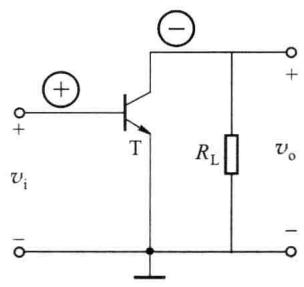  

(a) 共射电路

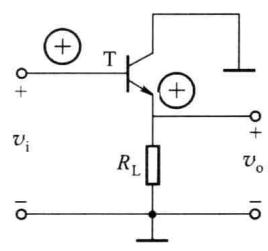  

(b) 共集电路

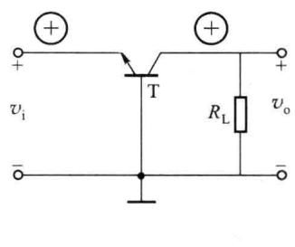  

(c) 共基电路

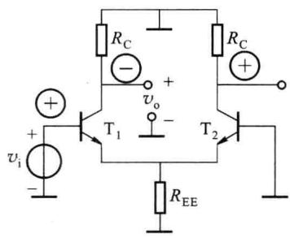  

(d) 差分电路  

图 5.1.11 基本单元电路输入电压和输出电压的瞬时极性关系

## 二、晶体管中增量电流的瞬时极性

由前面章节可知，放大电路中的晶体管必须设置合适的静态工作点，即设置合适的静态工作电流 $I_{\mathrm{BQ}}$ 和 $I_{\mathrm{CQ}}$ ，交流小信号 $(i_{\mathrm{b}}, i_{\mathrm{c}})$ 是叠加在静态工作点之上的，如图5.1.12(a)所示，交流电流极性的正负只会改变全值电流的大小，不会改变其方向，全值电流按照晶体管发射极箭头方向流动。图5.1.11(b)所示为NPN型晶体管基极输入电流 $i_{\mathrm{b}}$ 与集电极电流 $i_{\mathrm{c}}$ 和发射极电流 $i_{\mathrm{e}}$ 的瞬时极性关系。

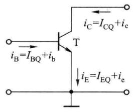  

(a) 晶体管的全值电流

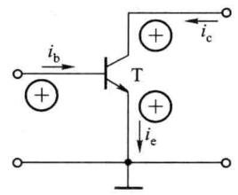

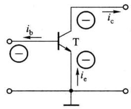  

(b) 晶体管输入电流和输出电流的瞬时极性  

图 5.1.12 晶体管输入电流和输出电流的瞬时极性关系

下面通过几个例题说明瞬时极性法在判别电路反馈极性方面的应用。

<Example title="例 5.1.3">
电路如图 5.1.13 所示,试指出反馈网络由哪些元件构成,判断电路的交流反馈极性、交流反馈组态。

<Solution title="解">
该电路由两级共射放大电路组成,电阻 $R_{5}$ 将第一级和第二级连接起来,构成级间反馈,反馈网络由 $R_{7}$ 、 $R_{5}$ 、 $R_{4}$ 组成,输出端的取样方式为电流取样,输入求和方式为串联求和。对交流而言,设输入电压 $v_{i}$ 的瞬时极性为正(电压增加,用⊕号表示), $T_{1}$ 基极输入电压的瞬时极性也为正,经 $T_{1}$ 倒相放大,其集电极输出电压的瞬时极性为负(用⊖号表示),即 $T_{2}$ 的基极电压的瞬时极性为负,发射极电流 $i_{e2} \approx i_{o}$ 减小, $v_{e2} = i_{e}[R_{7} // (R_{5} + R_{4})]$ 降低, $T_{2}$ 发射极电压的瞬时极性为负,经反馈电阻 $R_{5}$ 反馈回 $T_{1}$ 发射极,电阻 $R_{4}$ 上反馈电压的瞬时极性为负。净输入电压 $v_{be1} = v_{i} - v_{f}$ ,显然,反馈电压 $v_{f}$ 使净输入增加,故反馈类型为正反馈,该电路引入的是电流串联正反馈。

如果改变一下输出端的取样方式,电阻 $R_{5}$ 由 $T_{2}$ 的发射极改接在 $T_{2}$ 的集电极,此时反馈网络由 $R_{5}$ 和 $R_{4}$ 组成,反馈组态是电压串联负反馈,读者可自行分析。

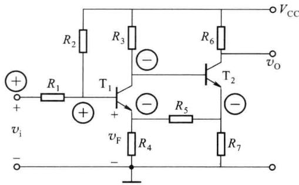  

图 5.1.13 两级反馈放大电路

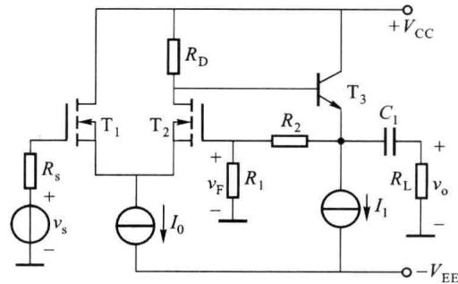  

图 5.1.14 两级反馈放大电路
</Solution>
</Example>

<Example title="例 5.1.4">
电路如图 5.1.14 所示,试指出反馈网络由哪些元件构成,判断电路的交流反馈极性、交流反馈组态。

<Solution title="解">
该电路由两级放大电路组成,第一级采用 N 沟道增强型 MOS 场效应管差放作输入级,第二级为晶体管共集电路,电阻 $R_{2}$ 将第一级和第二级连接起来,构成级间反馈,反馈网络由 $R_{2}$ 和 $R_{1}$ 组成,输出端的取样方式为电压取样,输入端求和方式为串联求和。对交流而言,设输入电压 $v_{i}$ 的瞬时极性为正,则场效应管 $T_{2}$ 漏极输出电压的瞬时极性也为正,经第二

级 $\mathrm{T}_{3}$ 射极跟随输出，输出电压 $v_{\mathrm{o}}$ 的瞬时极性也为正，输出电压 $v_{\mathrm{o}}$ 经反馈电阻 $R_{2}, R_{1}$ 反馈回 $\mathrm{T}_{2}$ 的栅极，反馈电压 $v_{\mathrm{f}}$ 的瞬时极性为正，净输入电压 $v_{\mathrm{id}} = v_{\mathrm{i}} - v_{\mathrm{f}}$ ，显然，反馈电压 $v_{\mathrm{f}}$ 使净输入减少，故为负反馈，该电路引入的是电压串联负反馈。
</Solution>
</Example>

<Example title="例 5.1.5">
电路如图 5.1.15 所示,试指出反馈网络由哪些元件构成,判断电路的交流反馈极性、交流反馈组态。

<Solution title="解">
该电路为前面讨论过的单管共射放大

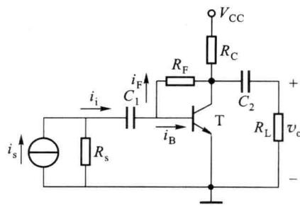  

图 5.1.15 反馈放大电路

电路，电阻 $R_{\mathrm{F}}$ 为反馈元件，输出端的取样方式为电压取样，输入求和方式为并联求和。对交流而言，设输入电流 $i_{\mathrm{i}}$ 的瞬时极性为正（电流增加），晶体管T的基极电流 $i_{\mathrm{b}}$ 将增加，集电极电流 $i_{\mathrm{c}}$ 也随之增加，瞬时极性也为正，输出电压 $v_{\mathrm{o}}$ 降低，瞬时极性为负，反馈电流 $i_{\mathrm{f}} = \frac{v_{\mathrm{be}} - v_{\mathrm{o}}}{R_{\mathrm{F}}}$ 增加，瞬时极性为正，它使净输入电流 $i_{\mathrm{b}} = i_{\mathrm{i}} - i_{\mathrm{f}}$ 减小，反馈信号 $i_{\mathrm{f}}$ 与输入信号 $i_{\mathrm{i}}$ 的作用相反，故为负反馈，该电路引入的是电压并联负反馈。
</Solution>
</Example>

## 5.1.4 反馈放大电路的基本方程式

反馈放大电路主要由基本放大电路和反馈网络两部分组成，基本放大电路的功能是放大输入信号，反馈网络的功能是传输反馈信号。为简化分析，反馈放大电路可表示为图5.1.16所示的简化框图，其中，变换网络是由信号源内阻 $R_{s}$ 和反馈放大电路输入电阻 $R_{if}$ 构成的衰减电路，信号源的信号 $\dot{X}_{s}$ 经过变换网络后变为输入信号 $\dot{X}_{i},\dot{X}_{i}$ 与反馈信号 $\dot{X}_{f}$ 实现求和运算。符号⊕表示求和运算，+、-符号表示 $\dot{X}_{i}$ 与 $\dot{X}_{f}$ 是相减关系，即

$$

\dot {X} _ {\mathrm{i}} = \dot {K} \dot {X} _ {\mathrm{s}}\tag{5.1.6}

$$

$$

\dot {X} _ {\mathrm{id}} = \dot {X} _ {\mathrm{i}} - \dot {X} _ {\mathrm{f}}\tag{5.1.7}

$$

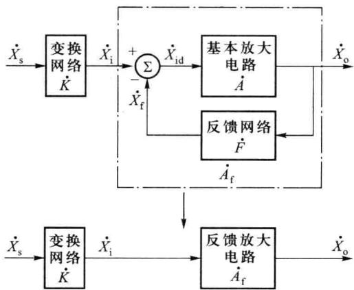  

图 5.1.16 反馈放大电路的简化框图

## 一、反馈放大电路的基本方程式

由图 5.1.16 可知, 反馈放大电路的闭环增益为

$$

\dot {A} _ {\mathrm{f}} = \frac {\dot {X} _ {\mathrm{o}}}{\dot {X} _ {\mathrm{i}}} = \frac {\dot {X} _ {\mathrm{o}}}{\dot {X} _ {\mathrm{id}} + \dot {X} _ {\mathrm{f}}} = \frac {\dot {X} _ {\mathrm{o}}}{\dot {X} _ {\mathrm{id}} + \dot {F} \dot {X} _ {\mathrm{o}}} = \frac {\dot {A} \dot {X} _ {\mathrm{id}}}{\dot {X} _ {\mathrm{id}} + \dot {A} \dot {F} \dot {X} _ {\mathrm{id}}}

$$

即

$$

\dot {A} _ {\mathrm{f}} = \frac {\dot {A}}{1 + \dot {A} \dot {F}}\tag{5.1.8}

$$

式(5.1.8)描述了反馈放大电路的闭环增益 $\dot{A}_{f}$ 与基本放大电路的开环增益 $\dot{A}$ 、反馈系

数 $\dot{F}$ 之间的关系, 称为反馈的基本方程式。

在中频段, $\dot{A}_{f}$ 、 $\dot{A}$ 和 $\dot{F}$ 均为实数,因此式(5.1.8)可以写成

$$

A _ {\mathrm{f}} = \frac {A}{1 + A F}\tag{5.1.9}

$$

考虑信号源内阻的影响,反馈放大电路的源增益为

$$

\dot {A} _ {\mathrm{sf}} = \frac {\dot {X} _ {\mathrm{o}}}{\dot {X} _ {\mathrm{s}}} = \dot {K} \frac {\dot {X} _ {\mathrm{o}}}{\dot {X} _ {\mathrm{i}}} = \dot {K} \frac {\dot {A}}{1 + \dot {A} \dot {F}}\tag{5.1.10}

$$

注意,在计算基本放大电路的增益时,应该考虑反馈网络的负载效应。

## 二、环路增益

观察图 5.1.16, 如果把净输入信号 $\dot{X}_{id}$ 看作输入, $\dot{X}_{f}$ 看作输出, 此时增益表达式为

$$

\frac {\dot {X} _ {\mathrm{f}}}{\dot {X} _ {\mathrm{id}}} = \frac {\dot {X} _ {\mathrm{f}}}{\dot {X} _ {\mathrm{o}}} \frac {\dot {X} _ {\mathrm{o}}}{\dot {X} _ {\mathrm{id}}} = \dot {A} \dot {F}\tag{5.1.11}

$$

即

$$

\dot {X} _ {\mathrm{f}} = \dot {A} \dot {F} \dot {X} _ {\mathrm{id}}\tag{5.1.12}

$$

其中， $\dot{A}\dot{F}$ 称为环路增益，表示输入信号 $\dot{X}_{id}$ 绕反馈环一周的增益。反馈信号 $\dot{X}_{f}$ 可看成净输入信号 $\dot{X}_{id}$ 经过基本放大电路和反馈网络后得到的信号。

## 三、反馈深度

分析式(5.1.8)可知,负反馈放大电路的 $\left|1+\dot{A}\dot{F}\right|$ 越大,闭环增益 $\left|\dot{A}_{f}\right|$ 下降得越多,所以 $1+\dot{A}\dot{F}$ 是衡量电路反馈程度的重要指标,令

$$

\dot {D} = 1 + \dot {A} \dot {F}\tag{5.1.13}

$$

则 $|\dot{D}| = |1 + \dot{A}\dot{F}|$ 称为反馈深度。

由式 $(5.1.7)$ 和式 $(5.1.12)$ ，可得

$$

\dot {X} _ {\mathrm{i}} = \dot {X} _ {\mathrm{id}} + \dot {X} _ {\mathrm{f}} = \dot {X} _ {\mathrm{id}} + \dot {A} \dot {F} \dot {X} _ {\mathrm{id}} = (1 + \dot {A} \dot {F}) \dot {X} _ {\mathrm{id}} = \dot {D} \dot {X} _ {\mathrm{id}}\tag{5.1.14}

$$

式(5.1.14)表明,反馈越深( $|\dot{D}|$ 越大),净输入越小,闭环增益也越低。从下一节的讨论可知,负反馈放大电路性能的改善与反馈深度有关,反馈深度和环路增益都是描述反馈放大电路性能的重要指标。通常将 $|\dot{D}|\gg1$ 的情况称为深度负反馈,此时

$$

\dot {A} _ {\mathrm{f}} = \frac {\dot {A}}{1 + \dot {A} \dot {F}} \approx \frac {\dot {A}}{\dot {A} \dot {F}} = \frac {1}{\dot {F}}\tag{5.1.15}

$$

该式说明,在深度负反馈情况下,闭环增益几乎只取决于反馈系数,与基本放大电路的开环增益无关,如果反馈网络是由电阻组成的纯阻性网络反馈系数, $\dot{F}$ 是一个稳定的常数,电路的闭环增益 $\dot{A}_{f}$ 将十分稳定,几乎不受电源电压波动、环境温度变化等因素的影响。

对于式(5.1.8)反馈基本方程式,不同的反馈类型, $\dot{A}$ 、 $\dot{F}$ 、 $\dot{A}_{f}$ 有不同的意义和量纲,分别描述如下:

电压串联负反馈

$$

\dot {A} _ {v \mathrm{f}} = \frac {\dot {V} _ {\mathrm{o}}}{\dot {V} _ {\mathrm{i}}} = \frac {\dot {A} _ {v}}{1 + \dot {A} _ {v} \dot {F} _ {v}}

$$

电流并联负反馈

$$

\dot {A} _ {\mathrm{if}} = \frac {\dot {I} _ {\mathrm{o}}}{\dot {I} _ {\mathrm{i}}} = \frac {\dot {A} _ {i}}{1 + \dot {A} _ {i} \dot {F} _ {i}}

$$

电压并联负反馈

$$

\dot {A} _ {\mathrm{rf}} = \frac {\dot {V} _ {\mathrm{o}}}{\dot {I} _ {\mathrm{i}}} = \frac {\dot {A} _ {r}}{1 + \dot {A} _ {r} \dot {F} _ {g}}

$$

电流串联负反馈

$$

\dot {A} _ {\mathrm{gf}} = \frac {\dot {I} _ {\mathrm{o}}}{\dot {V} _ {\mathrm{i}}} = \frac {\dot {A} _ {\mathrm{g}}}{1 + \dot {A} _ {\mathrm{g}} \dot {F} _ {r}}

$$

不管何种反馈类型, $\dot{A}\dot{F}$ 总是量纲为1的。

由式（5.1.8）可见，放大电路引入反馈后的闭环增益 $\dot{A}_{\mathrm{f}}$ 与反馈深度 $|\dot{D}| = |1 + \dot{A}\dot{F}|$ 有关。通常， $\dot{A}$ 和 $\dot{F}$ 都是频率的函数，其幅值和相位随信号频率的变化而变化，下面讨论放大电路引入反馈后，反馈深度 $|\dot{D}|$ 对电路性能的影响。

（1）若 $|\dot{D}| = |1 + \dot{A}\dot{F}| > 1$ ，则 $|\dot{A}_{\mathrm{f}}| < |\dot{A}|$ ，说明引入反馈后电路的增益下降了，这种反馈称为负反馈。反馈越深（即 $|\dot{D}|$ 越大），闭环增益下降得越多。

（2）若 $\left|\dot{D}\right|=\left|1+\dot{A}\dot{F}\right|<1$ ，则 $\left|\dot{A}_{f}\right|>\left|\dot{A}\right|$ ，说明引入反馈后电路的增益增大了，这种反馈称为正反馈。正反馈虽然可以提高增益，但会使放大电路的性能不稳定。

（3）若 $|\dot{D}| = |1 + \dot{A}\dot{F}| = 0$ ，则 $|\dot{A}_{\mathrm{f}}| \to \infty$ ，这意味着放大电路没有输入信号时也会产生输出，这种状态称为“自激”，电路产生自激振荡将失去放大功能，关于这个问题将在5.4节专门讨论。

## 5.1.5 负反馈放大电路的四种基本组态

实用放大电路的反馈形式是多种多样的,对于负反馈来说,根据反馈信号在放大电路输出端取样方式和输入端求和方式的不同,共有四种类型或组态:电压串联负反馈、电压并联负反馈、电流串联负反馈、电流并联负反馈。下面结合具体电路来分析这四种组态。

## 一、电压串联负反馈

电压串联负反馈放大电路的组成框图如图 5.1.17(a) 所示, 图 5.1.17(b) 是它的一个实用电路。该电路由三级放大电路组成, 晶体管 $T_{1}$ 、 $T_{2}$ 构成两级共射放大电路, 提供足够高的电压增益, 电路的输出级由晶体管 $T_{3}$ 组成, 采用射极跟随器输出, 提高电路的驱动能力。

在图 5.1.17(b) 中, 电阻 $R_{7}$ 跨接于第一级和第三级之间, 构成级间反馈, 反馈网络由电阻 $R_{7}$ 和 $R_{4}$ 组成。在中频情况下， $R_{4}$ 上的反馈电压 $v_{\mathrm{f}}$ 由输出电压 $v_{\mathrm{o}}$ 通过 $R_{7}$ 和 $R_{4}$ 分压获得， $v_{\mathrm{f}} = \frac{R_4}{R_4 + R_7} v_{\mathrm{o}}, v_{\mathrm{f}}$ 与 $v_{\mathrm{o}}$ 成正比，所以是电压反馈。在输入端，反馈网络的输出串联在 $\mathrm{T}_{1}$ 的输入回路中，反馈信号 $v_{\mathrm{f}}$ 与输入信号 $v_{\mathrm{i}}$ 在输入回路中以电压形式参与运算，晶体管 $\mathrm{T}_{1}$ 的净输入电压 $v_{\mathrm{id}} = v_{\mathrm{bel}} = v_{\mathrm{i}} - v_{\mathrm{f}}$ ，所以是串联求和。根据瞬时极性法不难判断出该电路引入的是负反馈，因此，该电路是电压串联负反馈放大电路，电压反馈系数为

$$

F _ {v} = \frac {v _ {\mathrm{f}}}{v _ {\mathrm{o}}} = \frac {R _ {4}}{R _ {4} + R _ {7}}

$$

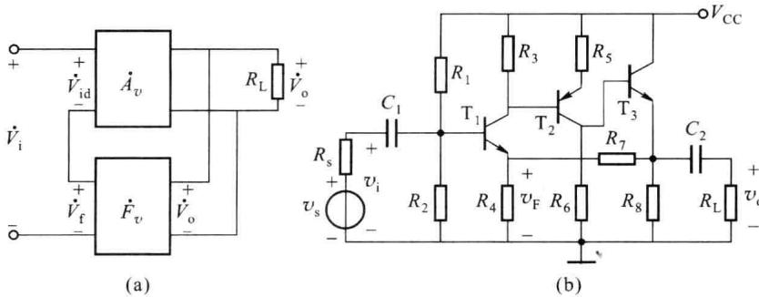  

图 5.1.17 电压串联负反馈放大电路组成框图及电路实例

电压取样负反馈放大电路的重要特点是具有稳定输出电压的作用，因为无论反馈信号以何种形式引回到输入端，实际上都是利用输出电压 $v_{0}$ 的反馈对放大电路进行自动调整。例如，当 $v_{i}$ 一定时，假设由于负载、温度等变化引起输出电压 $v_{0}$ 增加，则反馈信号 $v_{f}=F_{v}v_{0}$ 随之增加，电路输入级 $T_{1}$ 的净输入信号 $v_{id}=v_{i}-v_{f}$ 减小，使 $v_{0}$ 降低。可见，反馈的结果牵制了 $v_{0}$ 的变化，使 $v_{0}$ 基本维持不变。因此，当输入一定时，只要 $v_{0}$ 发生变化，电压负反馈就有抵御这种变化的能力，使 $v_{0}$ 基本不变。电压串联负反馈放大电路是一个良好的压控电压源。

应当指出,对于串联负反馈,信号源内阻 $R_{s}$ 处于输入回路内, $R_{s}$ 愈小,反馈效果愈好,因此对于串联负反馈放大电路,要求信号源内阻尽可能小一些,适宜采用恒压源激励。

## 二、电流并联负反馈

电流并联负反馈放大电路的组成框图如图5.1.18(a)所示，图5.1.18(b)是由单片宽频放大器构成的一个实用电路，为简单起见，仍然假设电路工作在中频情况下。该放大器内部采用两级共射电路，反馈网络由 $R_{5}$ 和 $R_{2}$ 组成。 $R_{5}$ 为电流取样电阻，它把输出电流 $i_{\mathrm{o}} = i_{\mathrm{e2}} \approx i_{\mathrm{e2}}$ 转换成电压 $v_{\mathrm{A}}$ ，再通过 $R_{2}$ 反馈回输入端，反馈电流 $i_{\mathrm{f}}$ 与输出电流 $i_{\mathrm{o}}$ 成正比，属于电流取样。在输入端，输入信号、反馈网络和基本放大电路输入端并接于同一节点上，反馈信号 $i_{\mathrm{f}}$ 与输入信号 $i_{\mathrm{i}}$ 在输入回路中以电流形式出现，属于并联求和，基本放大电路的净输入 $i_{\mathrm{id}}$ 也是电流信号。用瞬时极性法不难判断出该电路引入的是负反馈，因此，图5.1.18(b)是电流并联负反馈放大电路。

由后面的讨论可知,并联反馈进一步降低了反馈放大电路的输入电阻,一般 $v_{A} \gg v_{bel}$ , 晶体管 $T_{1}$ 的基极近似等于零电位, $R_{2}$ 和 $R_{5}$ 近似于并联, 反馈电流

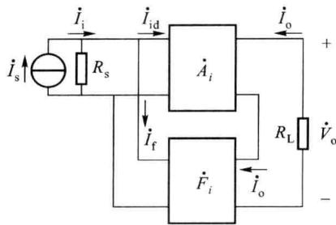  

(a)

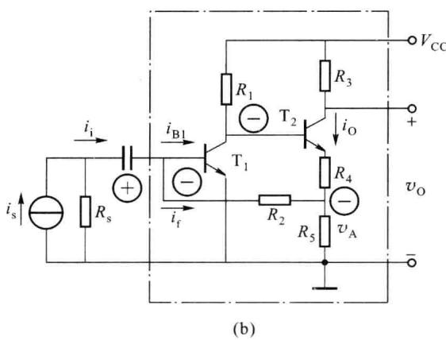  

图 5.1.18 电流并联负反馈放大电路组成框图及电路实例

$$

i _ {\mathrm{f}} = \frac {v _ {\mathrm{bel}} - v _ {\mathrm{A}}}{R _ {2}} \approx - \frac {v _ {\mathrm{A}}}{R _ {2}}

$$

电流反馈系数为

$$

F _ {i} = \frac {i _ {\mathrm{f}}}{i _ {\mathrm{o}}} = - \frac {R _ {5}}{R _ {2} + R _ {5}}

$$

电流取样负反馈放大电路的重要特点是具有稳定输出电流的作用，因为无论反馈信号以何种形式引回到输入端，实际上都是利用输出电流 $i_{0}$ 的反馈对放大电路进行自动调整。例如，当信号源的输入电流 $i_{i}$ 一定时，无论何种原因使 $i_{0}$ 增加，则反馈电流 $i_{f}$ 也随之增加， $T_{1}$ 的净输入电流 $i_{id}=i_{i}-i_{f}$ 减小，使 $i_{0}$ 降低。可见，反馈的结果牵制了 $i_{0}$ 的变化，使输出电流 $i_{0}$ 基本维持不变。电流并联负反馈放大电路是一个良好的流控电流源。

应当注意,对于并联负反馈,信号源内阻 $R_{s}$ 和信号源并联, $R_{s}$ 越大,反馈效果越好,因此对于并联负反馈放大电路,要求信号源内阻尽可能大一些,适宜采用恒流源激励。

## 三、电流串联负反馈

电流串联负反馈放大电路的组成框图如图 5.1.19(a) 所示, 图 5.1.19(b) 是它的一个实例电路, 该电路就是前面多次提到的单管共射放大电路, 反馈网络由电阻 $R_{E}$ 组成。在中频情况下，输出电流 $i_{o}=i_{c}\approx i_{e}$ 流过电阻 $R_{E}$ 产生反馈电压 $v_{f}=i_{E}R_{E}\approx i_{o}R_{E},v_{f}$ 与输入电压 $v_{i}$ 在输入回路中以电压形式求和，该电路属于电流串联负反馈放大电路。

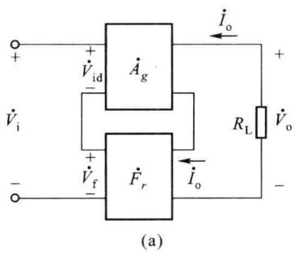

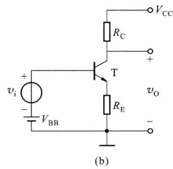  

图 5.1.19 电流串联负反馈放大电路组成框图及电路实例

互阻反馈系数为

$$

F _ {r} = \frac {v _ {\mathrm{f}}}{i _ {\mathrm{o}}} \approx R _ {\mathrm{E}}

$$

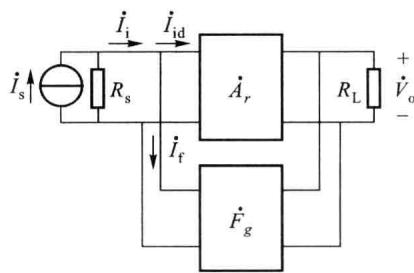  

(a)

## 四、电压并联负反馈

电压并联负反馈放大电路的组成框图如图5.1.20(a)所示，图5.1.20(b)是它的一个实例电路，反馈网络由电阻 $R_{F}$ 组成，构成电压取样、并联求和的负反馈形式，流过 $R_{F}$ 的电流 $i_{F}$ 即为反馈电流。在中频情况下，该电路的互导反馈系数为

$$

F _ {g} = \frac {i _ {\mathrm{f}}}{v _ {\mathrm{o}}} \approx - \frac {1}{R _ {\mathrm{F}}}

$$

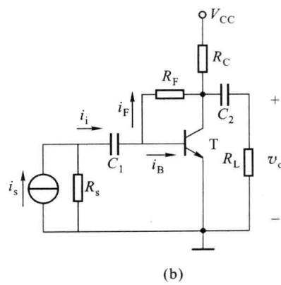

反馈在电子技术中得到了广泛的应用,直流反馈用于稳定电路的静态工作点,交流反馈用于改善电路的性能。要熟练掌握根据输出端取样方式和输入端的求和方式确定反馈的类型,利用瞬时极性法判断反馈的极性,会计算反馈系数。

图 5.1.20 电压并联负反馈放大电路组成框图及电路实例
