import Guide from '@/components/Guide.astro';
import Knowledge from '@/components/Knowledge.astro';
import Example from '@/components/Example.astro';
import Analysis from '@/components/Analysis.astro';
import Solution from '@/components/Solution.astro';
import Variant from '@/components/Variant.astro';
import Note from '@/components/Note.astro';
import Block from '@/components/Block.astro';
import Method from '@/components/Method.astro';
import Exercise from '@/components/Exercise.astro';

在放大电路中引入负反馈后,虽然增益有所下降,但其性能会得到多方面的改善,改善的程度都和反馈深度 $\left|1+\dot{A}\dot{F}\right|$ 有关,下面分别进行讨论。

## 5.2.1 负反馈提高增益的稳定性

由于电源电压、环境温度、负载以及晶体管参数变化等原因会引起放大电路增益的不稳定，引入负反馈可提高增益的稳定性。

由前述可知，在深度负反馈条件下， $\left|1+\dot{A}\dot{F}\right|\gg1$ ，此时

$$

\dot {A} _ {\mathrm{f}} = \frac {\dot {A}}{1 + \dot {A} \dot {F}} \approx \frac {\dot {A}}{\dot {A} \dot {F}} = \frac {1}{\dot {F}}\tag{5.2.1}

$$

该式表明,在深度负反馈情况下,闭环增益几乎只取决于反馈系数,与基本放大电路的开环增益无关,如果反馈网络是由电阻组成的纯阻性网络, $\dot{F}$ 是一个稳定的常数, $\dot{A}_{f}$ 将十分稳定。

为了衡量引入负反馈后对增益稳定性的改善程度,将开环增益相对变化量与闭环增益相对变化量的比值定义为增益稳定性,假设电路工作在中频段,反馈网络是纯阻性的, $\dot{A}_{f}$ 、 $\dot{A}$ 和 $\dot{F}$ 都是实数, $\dot{A}_{f}$ 的表达式可以写成

$$

A _ {\mathrm{f}} = \frac {A}{1 + A F}\tag{5.2.2}

$$

对上式求微分得

$$

\mathrm{d} A _ {\mathrm{f}} \approx \frac {(1 + A F) \mathrm{d} A - A F \mathrm{d} A}{(1 + A F) ^ {2}} = \frac {\mathrm{d} A}{(1 + A F) ^ {2}}\tag{5.2.3}

$$

由式 $(5.2.2)$ 和式 $(5.2.3)$ ，可得

$$

\frac {\mathrm{d} A _ {\mathrm{f}}}{A _ {\mathrm{f}}} = \frac {1}{1 + A F} \cdot \frac {\mathrm{d} A}{A}\tag{5.2.4}

$$

该式表明,闭环增益的相对变化量是开环增益相对变化量的 $1/(1+AF)$ ，也就是说， $A_{f}$ 的稳定性是A的 $1+AF$ 倍，反馈越深，闭环增益稳定性越高。例如，由于某种因素使A变化了20%，若 $1+AF=100$ ，则 $A_{f}$ 仅变化0.2%，引入反馈后闭环增益稳定性大大提高。

反馈放大电路引入交流负反馈后，因电源电压的波动、环境温度或负载的变化、元件的老化、器件的更换等原因引起增益的变化都将减小。在产品制造过程中，因半导体器件参数的分散性所造成的电路增益的差别也将明显减小，从而使产品的放大能力具有很好的一致性，但 $A_{f}$ 稳定性是以损失电路放大倍数为代价的。

应当指出,负反馈环路的自动调节功能是改善性能的根本原因,但每种类型的反馈环只稳定相应的闭环增益。例如,电压串联负反馈能稳定电路的闭环电压增益 $\dot{A}_{vf}$ , 而电流并联负反馈只稳定闭环电流增益 $\dot{A}_{if}$ , 如图 5.1.18(b) 所示, 为使该电路能够稳定闭环源电压增益 $\dot{A}_{vf}$ , 即

$$

\dot {A} _ {\mathrm{vf}} = \frac {\dot {V} _ {\mathrm{o}}}{\dot {V} _ {\mathrm{i}}} = \frac {- \dot {I} _ {\mathrm{o}} R _ {\mathrm{L}} ^ {\prime}}{\dot {I} _ {\mathrm{i}} R _ {\mathrm{s}}} = - \dot {A} _ {\mathrm{if}} \frac {R _ {\mathrm{L}} ^ {\prime}}{R _ {\mathrm{s}}}

$$

则不仅要求 $\dot{A}_{if}$ 稳定, $R_{i}$ 和 $R_{s}$ 也必须稳定。

## 5.2.2 负反馈对输入电阻的影响

在放大电路中引入不同组态的负反馈,对电路的输入阻抗和输出阻抗将产生不同的影响,因此,可以根据工程实际需要,利用各种形式的负反馈来改变放大电路的输入阻抗和输出阻抗之值。在下面对输入阻抗的讨论中,假设电路工作在中频情况下,此时可以用输入电阻 $R_{i}$ 来代替输入阻抗 $Z_{i}$ 。

输入电阻是从放大电路输入端看进去的等效电阻,负反馈对输入电阻的影响,取决于反馈网络和基本放大电路在输入端的连接方式,不受输出端采样方式的影响。串联负反馈将增大输入电阻,并联负反馈将减小输入电阻。

## 一、串联负反馈提高输入电阻

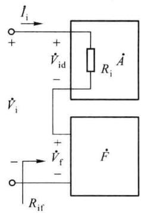

图 5.2.1(a) 所示是求串联负反馈放大电路输入电阻的简化框图, $R_i$ 是基本放大电路的输入电阻 (开环输入电阻), $R_{if}$ 是反馈放大电路的输入电阻 (闭环输入电阻)。反馈网络串联在基本放大电路的输入回路中, 反馈信号与外加输入信号以电压方式求和, 即 $\dot{V}_{id} = \dot{V}_i - \dot{V}_f$ , 反馈电压 $\dot{V}_f$ 削弱了输入电压 $\dot{V}_i$ 的作用, 使电路的净输入 $|\dot{V}_{id}|$ 减小。在输入电压 $\dot{V}_i$ 不变时, 引入反馈后输入电流 $|\dot{I}_i|$ 减小, 故闭环输入电阻 $R_{if}$ 比开环输入电阻 $R_i$ 高。

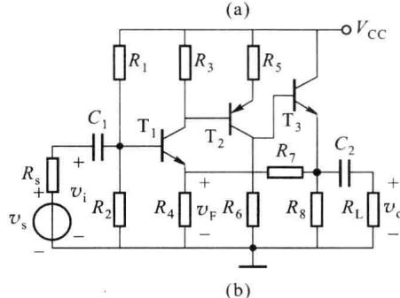

根据输入电阻的定义,基本放大电路的输入电阻

图 5.2.1 串联负反馈对输入电阻的影响

$$

R _ {\mathrm{i}} = \frac {\dot {V} _ {\mathrm{id}}}{\dot {I} _ {\mathrm{i}}}

$$

而整个电路的输入电阻

$$

R _ {\mathrm{if}} = \frac {\dot {V} _ {\mathrm{i}}}{\dot {I} _ {\mathrm{i}}} = \frac {\dot {V} _ {\mathrm{id}} + \dot {V} _ {\mathrm{f}}}{\dot {I} _ {\mathrm{i}}} = \frac {(1 + \dot {A} \dot {F}) \dot {V} _ {\mathrm{id}}}{\dot {I} _ {\mathrm{i}}} = (1 + \dot {A} \dot {F}) R _ {\mathrm{i}}\tag{5.2.5}

$$

由式(5.2.5)可知,串联负反馈放大电路的输入电阻 $R_{if}$ 是开环输入电阻 $R_{i}$ 的 $\left|1+\dot{A}\dot{F}\right|$ 倍。负反馈电路的输入电阻 $R_{if}$ 仅决定于输入端的求和方式,与输出端的取样方式无关,对于电压串联负反馈、电流串联负反馈结论是相同的。

应当指出，在某些负反馈放大电路中，有些电阻并不在反馈环内，例如，对于图5.2.1(b)所示的电路，由于偏置电阻 $R_{1}$ 和 $R_{2}$ 不包括在反馈回路内，因此该电路的输入电阻 $R_{if}^{\prime}=R_{if}//(R_{1}//R_{2})$ ，其中只有 $R_{if}$ 增大到无反馈时的 $|1+\dot{A}\dot{F}|$ 倍。更准确地说，引入串联负反馈，是使反馈回路内的输入电阻增大到基本放大电路输入电阻的 $|1+\dot{A}\dot{F}|$ 倍。若电路满足深度

负反馈的条件, 即 $\left|1+\dot{A}\dot{F}\right|\gg1$ , 则 $R_{if}\rightarrow\infty$ 。

## 二、并联负反馈降低输入电阻

图 5.2.2 所示是求并联负反馈放大电路输入电阻的简化框图， $R_{i}$ 是基本放大电路的输入电阻， $R_{if}$ 表示反馈放大电路的输入电阻。反馈网络直接并联在基本放大电路的输入端，此时反馈信号与外加输入信号以电流方式求和，净输入电流 $\dot{I}_{id} = \dot{I}_{i} - \dot{I}_{f}$ ，即 $\dot{I}_{i} = \dot{I}_{id} + \dot{I}_{f}$ 。在同样输入电压 $\dot{V}_{i}$ 的作用下，引入负反馈使输入电流 $|\dot{I}_{i}|$ 变大，故闭环输入电阻 $R_{if}$ 比开环输入电阻 $R_{i}$ 小。

(a)  

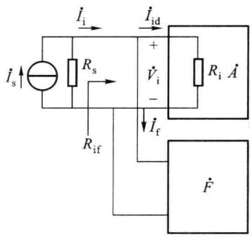

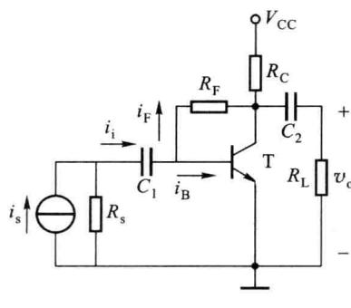  

图 5.2.2 并联负反馈对输入电阻的影响

根据输入电阻的定义,基本放大电路的输入电阻

$$

R _ {\mathrm{i}} = \frac {\dot {V} _ {\mathrm{id}}}{\dot {I} _ {\mathrm{id}}}

$$

而整个电路的输入电阻

$$

R _ {\mathrm{if}} = \frac {\dot {V} _ {\mathrm{i}}}{\dot {I} _ {\mathrm{i}}} = \frac {\dot {V} _ {\mathrm{i}}}{\dot {I} _ {\mathrm{id}} + \dot {I} _ {\mathrm{f}}} = \frac {\dot {V} _ {\mathrm{i}}}{(1 + \dot {A} \dot {F}) I _ {\mathrm{id}}} = \frac {1}{(1 + \dot {A} \dot {F})} R _ {\mathrm{i}}\tag{5.2.6}

$$

由式(5.2.6)可知,并联负反馈放大电路的闭环输入电阻 $R_{if}$ 是开环输入电阻 $R_{i}$ 的 $1/\left|1+\dot{A}\dot{F}\right|$ 。若电路满足深度负反馈,即 $\left|1+\dot{A}\dot{F}\right|\gg1$ ,则闭环输入电阻 $R_{if}\rightarrow0$ 。负反馈电路的输入电阻 $R_{if}$ 仅决定于输入端的求和方式,对于电压并联负反馈、电流并联负反馈结论是相同的。

分析图 5.2.2(a) 可知, 并联负反馈宜采用恒流源激励, 当采用恒压源激励时, 基本放大电路的净输入电流 $\dot{I}_{id}$ 将为常量, 即反馈网络参数的变化仅改变信号源所提供的电流 $\dot{I}_{i}$ , 而不改变基本放大电路的净输入, 此时反馈不再起作用。

## 5.2.3 负反馈对输出电阻的影响

同样，在下面对输出阻抗的讨论中，仍假设电路工作在中频情况下，此时可以用输出电阻 $R_{o}$ 来代替输出阻抗 $Z_{o}$ 。

输出电阻是从放大电路输出端看进去的等效内阻,负反馈对输出电阻的影响,取决于反馈网络和基本放大电路在输出端的连接方式,不受输入端求和方式的影响。电压取样负反馈电路能稳定输出电压,使输出电阻减小;电流取样负反馈电路能稳定输出电流,使输出电阻增大。

## 一、电压负反馈降低输出电阻

电压取样负反馈电路具有稳定输出电压的能力, 故必然使其输出电阻减小。图 5.2.3 所示是求电压负反馈放大电路输出电阻的简化框图, 其中 $R_{o}$ 是基本放大电路的输出电阻（开环输出电阻）, 它已经包含了反馈网络对输出端的负载效应, 所以在下面的分析中可以不必重复考虑反馈网络的影响。根据求输出电阻的定义, 令输入量 $\dot{X}_{i}=0$ , 在输出端加交流电压 $\dot{V}_{o}$ , 产生电流 $\dot{I}_{o}$ , 则电路的输出电阻为

$$

R _ {\mathrm{of}} = \frac {\dot {V} _ {\mathrm{o}}}{\dot {I} _ {\mathrm{o}}}\tag{5.2.7}

$$

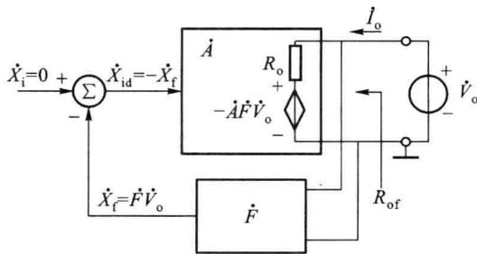  

图 5.2.3 电压负反馈对输出电阻的影响

外加交流电压 $\dot{V}_{\mathrm{o}}$ 同时作用于反馈网络，产生反馈量 $\dot{X}_{\mathrm{f}} = \dot{F}\dot{V}_{\mathrm{o}}$ ，此时净输入信号 $\dot{X}_{\mathrm{id}} = \dot{X}_{\mathrm{i}} - \dot{X}_{\mathrm{f}} = -\dot{F}\dot{V}_{\mathrm{o}}$ 作用于基本放大电路，产生输出电压- $\dot{A}\dot{F}\dot{V}_{\mathrm{o}}$ ，该电压相当于受控电压源。由于反馈网络的负载效应已经计入 $R_{\mathrm{o}}$ 之内，所以图中的反馈网络输入端不取电流，因此， $R_{\mathrm{o}}$ 中的电流 $\dot{I}_{\mathrm{o}}$ 的表达式为

$$

\dot {I} _ {\mathrm{o}} = \frac {\dot {V} _ {\mathrm{o}} - (- \dot {A} \dot {F} \dot {V} _ {\mathrm{o}})}{R _ {\mathrm{o}}} = \frac {(1 + \dot {A} \dot {F}) \dot {V} _ {\mathrm{o}}}{R _ {\mathrm{o}}}\tag{5.2.8}

$$

由式 $(5.2.8)$ 和式 $(5.2.7)$ 整理后可得

$$

R _ {\mathrm{of}} = \frac {R _ {\mathrm{o}}}{1 + \dot {A} \dot {F}}

$$

该式表明,引入电压取样负反馈能降低输出电阻,闭环输出电阻 $R_{of}$ 是开环输出电阻 $R_{o}$ 的 $1/\left|1+\dot{A}\dot{F}\right|$ 。反馈越深, $R_{of}$ 下降得越多。若电路满足深度负反馈的条件,即 $\left|1+\dot{A}\dot{F}\right| \gg 1$ ,则 $R_{of} \rightarrow 0$ ,因此电压负反馈电路可近似认为是恒压源。

## 二、电流负反馈提高输出电阻

电流取样负反馈电路具有稳定输出电流的能力,故必然使其输出电阻增大。图 5.2.4 所示是求电流负反馈放大电路输出电阻的框图,令输入量 $\dot{X}_{i}=0$ , 在输出端加交流电压 $\dot{V}_{o}$ ,

产生电流 $\dot{I}_{o}$ ，则电路的输出电阻为

$$

R _ {\mathrm{of}} = \frac {\dot {V} _ {\mathrm{o}}}{\dot {I} _ {\mathrm{o}}}\tag{5.2.9}

$$

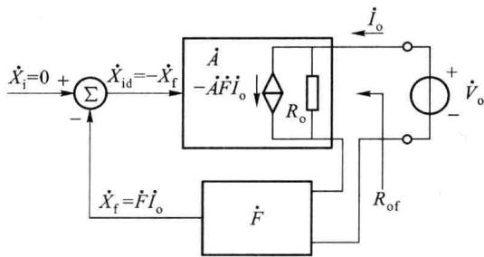  

图 5.2.4 电流负反馈对输出电阻的影响

单位：元

外加交流电流 $\dot{I}_{\mathrm{o}}$ 同时作用于反馈网络，产生反馈量 $\dot{X}_{\mathrm{f}} = \dot{F}\dot{I}_{\mathrm{o}}$ ，此时净输入信号 $\dot{X}_{\mathrm{id}} = \dot{X}_{\mathrm{i}} - \dot{X}_{\mathrm{f}} = -\dot{F}\dot{I}_{\mathrm{o}}$ 作用于基本放大电路，产生输出电流- $\dot{A}\dot{F}\dot{I}_{\mathrm{o}}$ ，该电流相当于受控电流源。由于反馈网络的负载效应已经计入 $R_{\mathrm{o}}$ 之内，所以可以认为此时作用于反馈网络的输入电压为零，即 $R_{\mathrm{o}}$ 上的电压为 $\dot{V}_{\mathrm{o}}$ ，因此，流入基本放大电路的电流 $\dot{I}_{\mathrm{o}}$ 为

$$

\dot {I} _ {\mathrm{o}} = \frac {\dot {V} _ {\mathrm{o}}}{R _ {\mathrm{o}}} + (- \dot {A} \dot {F} \dot {I} _ {\mathrm{o}})

$$

即

$$

\dot {I} _ {\mathrm{o}} = \frac {\dot {V} _ {\mathrm{o}}}{R _ {\mathrm{o}}} \cdot \frac {1}{1 + \dot {A} \dot {F}}\tag{5.2.10}

$$

由式(5.2.9)和式(5.2.10)整理后可得

$$

R _ {\mathrm{of}} = (1 + \dot {A} \dot {F}) R _ {\mathrm{o}}\tag{5.2.11}

$$

该式表明,引入电流负反馈能提高输出电阻,闭环输出电阻 $R_{of}$ 是开环输出电阻 $R_{o}$ 的 $\left|1+\dot{A}\dot{F}\right|$ 倍。反馈越深, $R_{of}$ 提高得越多。若电路满足深度负反馈的条件, 即 $\left|1+\dot{A}\dot{F}\right|>>1$ , 则 $R_{of}\rightarrow\infty$ , 因此电流负反馈电路可近似认为是恒流源。

在讨论输出电阻时,需要注意以下两点:

（1）引入负反馈后，输出电阻的变化只与输出端取样方式有关，与输入端求和方式无关；

(2) 负反馈只影响处于反馈环内的输出电阻, 反馈环之外的电阻不受影响。

在图 5.2.2(b) 所示的电路中, 电流负反馈是对集电极电流取样, 它稳定的是集电极电流。此时, 从集电极看进去的输出电阻 $R_{of}$ 不包括集电极负载电阻 $R_{C}$ 。反馈放大电路的实际输出电阻 $R'_{of} = R_{of} // R_{C}$ , 一般 $R_{of} \gg R_{C}$ 故 $R'_{of} \approx R_{C}$ 因此对这类电路, 电流负反馈仅仅稳定了引入反馈的支路的电流, 并使该支路的等效电阻和基本放大电路的电阻存在 $\left|1 + \dot{A}\dot{F}\right|$ 倍的关系。

## 5.2.4 负反馈减小非线性失真

对于理想的放大电路,其输入和输出信号应该呈线性关系。但由于晶体管和场效应管等有源器件本身的非线性,当输入信号为幅值较大的正弦波时,输出信号的波形可能不再是正弦波,输出信号中除了含有与输入信号频率相同的基波外,还含有其他谐波,即产生了非

线性失真。

如图 5.2.5(a) 所示, 由于晶体管输入伏安特性曲线 $i_{\mathrm{B}} = f(v_{\mathrm{BE}})$ 的非线性, 当输入正弦信号 $v_{be} = a \sin \omega t$ 时, 电流 $i_{b}$ 将出现失真, 其正半周幅值大, 负半周幅值小, 这样必然造成晶体管输出电流和电压的失真, 这种失真属于非线性失真。试想, 如果通过某种方法能使输入电压 $v_{be}$ 的正半周幅值小一些, 负半周幅值大一些, 那么 $i_{b}$ 将近似为正弦波, 如图 5.2.5(b) 所示, 从而使非线性失真减小。

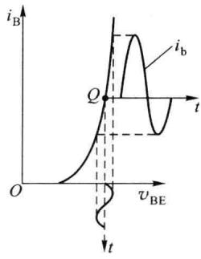  

(a)

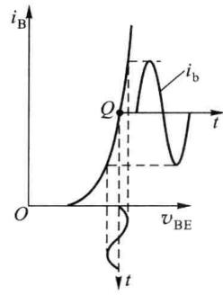  

(b)  

图 5.2.5 晶体管输入特性的非线性

引入负反馈可以减小放大电路的非线性

失真, 图 5.2.6 所示为减小非线性失真的定性分析。假设输入信号 $x_{\mathrm{i}}$ 为正弦波, 经过某开环放大电路后, 输出信号 $x_{\mathrm{o}}$ 的波形出现失真, 如图 5.2.6 (a) 所示, 表现为正半周大, 负半周小。当电路闭环后, 若反馈系数 $F$ 为常数, 反馈信号 $x_{\mathrm{f}}$ 也是正半周大、负半周小, 如图 5.2.6 (b) 所示, 它和原输入信号 $x_{i}$ 相减, 得到的净输入信号 $x_{\mathrm{id}} = x_{\mathrm{i}} - x_{\mathrm{f}}$ 波形却变成正半周小, 负半周大。这样就把输入信号的正半周压缩, 负半轴扩大, 使输出波形的正负半周趋于一致, 从而减小了放大电路的非线性失真, 改善了电路的输出波形。

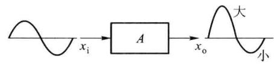  

(a)

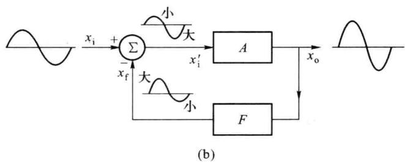  

图 5.2.6 利用负反馈减小非线性失真

设基本放大电路的非线性失真系数为 $|\dot{N}|$ ，反馈放大电路的非线性失真系数为 $|\dot{N}_{f}|$ ，可以证明，在弱非线性失真的条件下，二者之间的关系为

$$

\mid \dot {N} _ {\mathrm{f}} \mid = \frac {\mid \dot {N} \mid}{\mid 1 + \dot {A} \dot {F} \mid}

$$

引入负反馈后,若输入信号保持不变,闭环增益下降至开环增益的 $1/|1+\dot{A}\dot{F}|$ ,基本放大电路的净输入和输出也降至无反馈时的 $1/|1+\dot{A}\dot{F}|$ ,器件的工作范围变小了,失真也相应减小。为使非线性失真在电路闭环前后具有可比性,电路闭环后输入信号的幅度应加至无反馈的 $|1+\dot{A}\dot{F}|$ 倍,以保证输出信号的基波成分与开环时相同。也就是说,在输出基波幅值不变的情况下,引入负反馈后,输出的谐波部分被减小到基本放大电路的 $1/|1+\dot{A}\dot{F}|$ 。

综上所述,可以得到如下结论:

（1）只有信号源保证在电路闭环后基本放大电路的净输入信号与开环时相等，输出信号闭环前后基波成分不变，非线性失真才能减小到基本放大电路的 $1/\left|1+\dot{A}\dot{F}\right|$ 。

（2）负反馈只能减小放大电路内部产生的非线性失真，如果放大电路输入信号波形本身就已经失真，引入负反馈也将无济于事，必须采用信号处理方法（如有源滤波、屏蔽等）才能解决。

## 5.2.5 负反馈展宽频带

频率响应是放大电路的重要特性之一,通频带是它的重要指标。负反馈具有稳定闭环增益的作用,对因信号频率的变化所引起的开环增益的变化同样也具有稳定作用,它能减小频率变化对闭环增益的影响,其效果等效于展宽了闭环增益的通频带。

为使问题简化,假设基本放大电路是在高频段仅有一个极点的直接耦合电路,其下限截止频率 $f_{L}=0\ Hz$ ,增益表达式为

$$

\dot {A} = \frac {\dot {A} _ {\mathrm{m}}}{1 + \mathrm{j} f / f _ {\mathrm{H}}}\tag{5.2.12}

$$

式中， $\dot{A}_{m}$ 为基本放大电路的中频增益， $f_{H}$ 为其上限截止频率，它的幅频特性如图 5.2.7 中①所示。

设反馈网络为纯阻性网络,反馈系数 $\dot{F}$ 与频率无关,引入负反馈后,闭环增益为

$$

\dot {A} _ {\mathrm{f}} = \frac {\dot {A}}{1 + \dot {A} \dot {F}} = \frac {\dot {A} _ {\mathrm{m}} / (1 + \mathrm{j} f / f _ {\mathrm{H}})}{1 + \dot {A} _ {\mathrm{m}} \dot {F} / (1 + \mathrm{j} f / f _ {\mathrm{H}})} = \frac {\dot {A} _ {\mathrm{mf}}}{1 + \mathrm{j} f / f _ {\mathrm{HF}}}\tag{5.2.13}

$$

其中，中频增益

$$

\dot {A} _ {\mathrm{mf}} = \frac {\dot {A} _ {\mathrm{m}}}{1 + \dot {A} _ {\mathrm{m}} \dot {F}}\tag{5.2.14}

$$

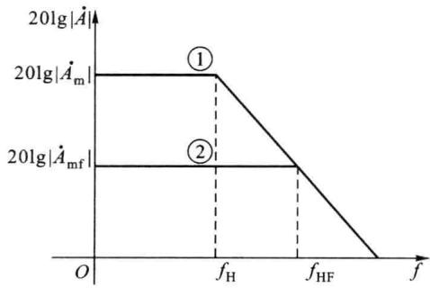  

图 5.2.7 负反馈展宽频带

闭环上限截止频率

$$

f _ {\mathrm{HF}} = (1 + \dot {A} _ {\mathrm{m}} \dot {F}) f _ {\mathrm{H}}\tag{5.2.15}

$$

由此可见，引入负反馈后，其中频增益 $|\dot{A}_{\mathrm{mf}}|$ 下降为原来的 $\frac{1}{|1 + \dot{A}_{\mathrm{m}}\dot{F}|}$ ，上限截止频率 $f_{\mathrm{HF}}$ 扩展为原来的 $|1 + \dot{A}_{\mathrm{m}}\dot{F}|$ 倍，增益带宽乘积没有改变，即

$$

\mid \dot {A} _ {\mathrm{m}} \mid f _ {\mathrm{H}} = \mid \dot {A} _ {\mathrm{mf}} \mid f _ {\mathrm{HF}}

$$

将其幅频特性亦绘于图 5.2.7 中, 曲线如②所示。由图 5.2.7 可以看出, 两条水平线之差即为中频反馈深度。

需注意的是,对于不同组态负反馈放大电路,其增益的物理意义不同,因而式(5.2.15)所具有的含义也不同。对于电压串联负反馈电路,是电压增益的上限截止频率扩展到原来的 $\left|1+\dot{A}_{m}\dot{F}\right|$ 倍;而对于电流并联负反馈电路,是电流增益的上限截止频率扩展到原来的 $\left|1+\dot{A}_{m}\dot{F}\right|$ 倍。可见,对于不同的组态,是将不同的增益的上限截止频率扩展到基本放大电路的 $\left|1+\dot{A}_{m}\dot{F}\right|$ 倍。

用同样的方法可以推导,对于只有单个下限截止频率的基本放大电路,引入负反馈后,放大电路的下限截止频率减小为 $\left|1+\dot{A}_{m}\dot{F}\right|$ 分之一。

<Example title="例 5.2.1">
设某直接耦合放大电路的开环增益为 $\dot{A} = \frac{200}{1 + j\omega/(2\pi \times 10^{3})}$ ，引入电压串联负反馈，反馈系数 F = 0.6。试问，引入负反馈后中频增益是多少？负反馈放大电路的通频带是多少？

<Solution title="解">
由开环增益的表达式可得

$$

A _ {\mathrm{m}} = 2 0 0, f _ {\mathrm{H}} = 1 \mathrm{kHz}, f _ {\mathrm{L}} = 0

$$

负反馈放大电路的闭环中频增益

$$

A _ {\mathrm{mF}} = \frac {A _ {\mathrm{m}}}{1 + A _ {\mathrm{m}} F} = \frac {2 0 0}{1 + 2 0 0 \times 0 . 6} \approx 1. 6 5

$$

由式 $(5.2.15)$ ，可得

$$

f _ {\mathrm{HF}} = (1 + A _ {\mathrm{m}} F) f _ {\mathrm{H}} = (1 + 2 0 0 \times 0. 6) \times 1 0 ^ {3} \mathrm{Hz} = 1 2 1 \mathrm{kHz}

$$

负反馈放大电路的通频带

$$

B W = f _ {\mathrm{H}} - f _ {\mathrm{L}} = (1 2 1 - 0) \mathrm{kHz} = 1 2 1 \mathrm{kHz}

$$

为了方便比较和应用,现将负反馈对放大电路性能的影响总结于表5.2.1中。

表 5.2.1 负反馈对放大电路性能的影响

<table><tr><td>电路组态 电路参数</td><td>电压串联</td><td>电压并联</td><td>电流串联</td><td>电流并联</td></tr><tr><td>输入电阻 $R_{\text{if}}$ </td><td>增加( $\infty$ )</td><td>减小(0)</td><td>增加( $\infty$ )</td><td>减小(0)</td></tr><tr><td>输出电阻 $R_{\text{of}}$ </td><td>减小(0)</td><td>减小(0)</td><td>增加( $\infty$ )</td><td>增加( $\infty$ )</td></tr><tr><td>稳定何种增益 $\dot{A}$ </td><td> $\dot{A}_{\text{vf}}$ </td><td> $\dot{A}_{\text{rf}}$ </td><td> $\dot{A}_{\text{gf}}$ </td><td> $\dot{A}_{\text{if}}$ </td></tr><tr><td>非线性失真</td><td>减小</td><td>减小</td><td>减小</td><td>减小</td></tr><tr><td>通频带</td><td>展宽</td><td>展宽</td><td>展宽</td><td>展宽</td></tr></table>

负反馈能够改善放大电路的性能,反馈越深,改善的效果越显著,以下为正确引入负反馈时应该遵循的原则。

（1）要稳定放大电路的静态工作点，应该引入直流反馈。

(2) 要改善放大电路的交流性能,应该引入交流反馈。

（3）要减少对信号源的影响，提高输入电阻，应引入串联求和负反馈；要减小输入电阻，应引入并联求和负反馈。

（4）要稳定输出电压，减小输出电阻，应引入电压取样负反馈；要稳定输出电流，提高输出电阻，应引入电流取样负反馈。

(5) 对多级放大电路, 级间反馈起主导作用。
</Solution>
</Example>
