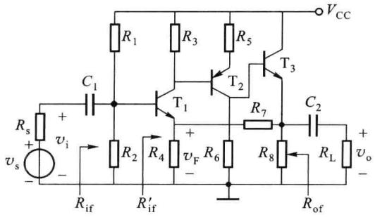
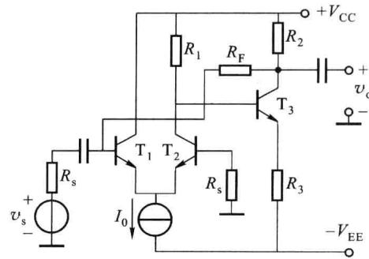
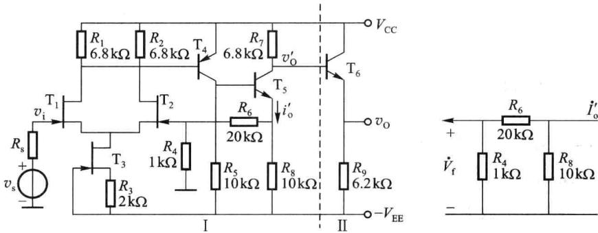
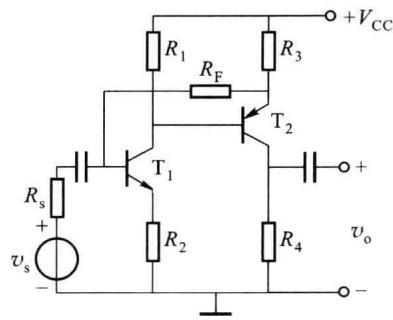
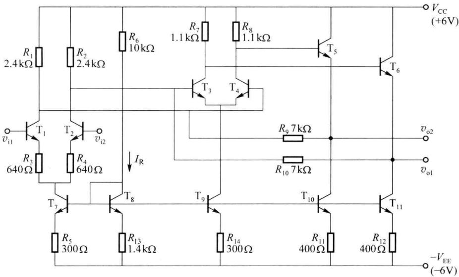

import Guide from '@/components/Guide.astro';
import Knowledge from '@/components/Knowledge.astro';
import Example from '@/components/Example.astro';
import Analysis from '@/components/Analysis.astro';
import Solution from '@/components/Solution.astro';
import Variant from '@/components/Variant.astro';
import Note from '@/components/Note.astro';
import Block from '@/components/Block.astro';
import Method from '@/components/Method.astro';
import Exercise from '@/components/Exercise.astro';

负反馈放大电路的分析包括定性分析和定量分析两个方面。定性分析主要是确定反馈网络、判断反馈的极性和类型等。定量分析就是计算反馈放大电路的性能指标，如闭环增益、输入和输出电阻等。

负反馈放大电路的分析方法很多,各有特点。下面主要从工程实际出发,重点讨论在深度负反馈条件下如何估算电路的闭环增益、输入和输出电阻等性能。

## 5.3.1 等效电路法

在第二章中曾经讨论过发射极接有反馈电阻 $R_{E}$ 的单管共射放大电路，如图 2.4.1 所示，该电路实际上是电压串联负反馈电路。在计算电路参数时，并没有考虑反馈的类型和极性，而是直接画出电路的交流等效电路，列出电压和电流方程，再用常规电路计算方法求解该电路的性能指标。这种方法从原则上讲，可以精确计算任何复杂的反馈放大电路，但是由于反馈支路把放大电路的输入部分和输出部分联系起来，电路复杂时计算工作量很大，手工计算非常困难，需借助计算机辅助分析工具，如 OrCAD、Multisim、MATLAB 等进行分析。

## 5.3.2 方框图法

方框图法的基本思想是:将负反馈放大电路分解成基本放大电路和反馈网络两部分,先计算基本放大电路的动态指标(如开环增益 $\dot{A}$ 、输入电阻 $\dot{R}_{i}$ 、输出电阻 $R_{o}$ )和反馈网络的反馈系数 $\dot{F}$ ,然后再利用前面的有关公式计算反馈放大电路的闭环指标( $\dot{A}_{f}$ 、 $R_{if}$ 、 $R_{of}$ 等)。

在实际反馈放大电路中,基本放大电路和反馈网络是连接在一起的,反馈网络对基本放大电路的输入端和输出端都有影响,这种影响即是反馈网络的负载效应。因此,解题的关键是如何将反馈放大电路正确地分解成基本放大电路和反馈网络两部分。既要从电路中去掉反馈网络,又要考虑反馈网络的负载效应,很多情况下这种分解十分困难。

方框图法忽略了信号在基本放大电路中的反向传输和在反馈网络中的正向传输,是一种工程近似的方法。

## 5.3.3 深度负反馈条件下的近似计算

深度负反馈条件下的近似计算,是一种工程估算的方法。实际的放大电路,只要引入负反馈,通常都是深度负反馈,这种方法既降低了计算复杂度,又符合工程精度要求,是一种常用的电路分析方法。

## 一、闭环增益的近似表达式

前面已经讨论过,在深度负反馈的条件下,即 $\left|1+\dot{A}\dot{F}\right|\gg1$ ,放大电路的增益可近似表示为

$$

\dot {A} _ {\mathrm{f}} = \frac {\dot {X} _ {\mathrm{o}}}{\dot {X} _ {\mathrm{i}}} = \frac {\dot {A}}{1 + \dot {A} \dot {F}} \approx \frac {\dot {A}}{\dot {A} \dot {F}} = \frac {1}{\dot {F}}\tag{5.3.1}

$$

因此, 只要求出 $\dot{F}$ , 就可估算出 $\dot{A}_{f}$ 。

## 二、虚短概念的应用

在深度负反馈的条件下,由式(5.3.1)可得 $\dot{X}_{i} \approx \dot{F} \dot{X}_{o}$ , 根据式(5.1.2)反馈系数的定义得 $\dot{X}_{f} = \dot{F} \dot{X}_{o}$ , 因此

$$

\left\{ \begin{array}{l} \dot {X} _ {\mathrm{i}} \approx \dot {X} _ {\mathrm{f}} \\ \dot {X} _ {\mathrm{id}} = \dot {X} _ {\mathrm{i}} - \dot {X} _ {\mathrm{f}} \approx 0 \end{array} \right.\tag{5.3.2}

$$

上式表明，在深度负反馈条件下，反馈信号 $\dot{X}_{\mathrm{f}}$ 和输入信号 $\dot{X}_{\mathrm{i}}$ 近似相等，基本放大电路的净输入信号几乎为零，即 $\dot{X}_{\mathrm{id}} \approx 0$ 。对于串联求和电路，如图5.1.2所示的单管共射放大电路，反馈信号 $\dot{V}_{\mathrm{f}}$ 和输入信号 $\dot{V}_{\mathrm{i}}$ 都是电压信号，此时 $\dot{V}_{\mathrm{id}} \approx 0$ ，晶体管的基极B和发射极E相当于虚假短路，称为虚短。由于 $\dot{V}_{\mathrm{id}} \approx 0$ ，输入电流 $\dot{I}_{\mathrm{id}}$ 也近似为零，晶体管输入端虚假断路，称为虚断。也就是说，在深度负反馈条件下，基本放大电路的输入端呈现“短路”或“开路”特性。虚短和虚断的概念，在集成运算放大器一节还要进一步讨论。

## 三、深度负反馈条件下的近似计算

在深度负反馈的条件下,放大电路的闭环电压增益 $\dot{A}_{vf}$ 可以采用下面两种方法估算。

### 1. 利用 $\dot{A}_{\mathrm{f}} \approx 1 / \dot{F}$ 估算

由于电路满足深度负反馈， $\left|1+\dot{A}\dot{F}\right|\gg1$ ，闭环增益 $\dot{A}_{f}\approx1/\dot{F}$ 。因此，只要求出反馈系数 $\dot{F}$ ，就可估算出相应的闭环增益 $\dot{A}_{f}$ ，进而求得反馈放大电路的闭环电压增益 $\dot{A}_{vf}$ ，具体步骤如下：

（1）根据反馈类型确定反馈系数 $\dot{F}$ 的含义，计算相应的反馈系数 $\dot{F} = \dot{X}_{f} / \dot{X}_{o}$ ;

(2) 根据反馈类型确定闭环增益 $\dot{A}_{f}$ 的含义, 计算 $\dot{A}_{f} \approx 1/\dot{F}$ ;

（3）分析电路，写出闭环电压增益的表达式 $\dot{A}_{\mathrm{vf}} = \dot{V}_{\mathrm{o}} / \dot{V}_{\mathrm{i}}$ ，经适当变换即可找出 $\dot{A}_{\mathrm{vf}}$ 与 $\dot{A}_{\mathrm{f}}$ 的关系，求得 $\dot{A}_{\mathrm{vf}}$ 。

这种方法从反馈的基本概念出发,先求反馈系数 $\dot{F}$ , 再利用公式 $\dot{A}_{f} \approx 1/\dot{F}$ 求电路的闭环增益, 进而求得电路的闭环电压增益 $\dot{A}_{vf}$ 。

2. 利用 $\dot{X}_{\mathrm{i}} \approx \dot{X}_{\mathrm{f}}$ 估算

在深度负反馈的条件下,根据电路输入端的求和方式,先分别求 $\dot{X}_{i}$ 和 $\dot{X}_{f}$ 的表达式,再利用 $\dot{X}_{i} \approx \dot{X}_{f}$ ,即可估算出电路的闭环电压增益 $\dot{A}_{vf}$ 。

对于串联求和电路，先计算反馈电压 $\dot{V}_{f}$ ，再根据 $\dot{V}_{i} \approx \dot{V}_{f}$ ，即可求得电路的闭环电压增益 $\dot{A}_{vf}$ 。对于并联求和电路，通常都是求电路的闭环源电压增益 $\dot{A}_{vsf}$ ，先计算电流源电流 $\dot{I}_{s}$ 和反馈电流 $\dot{I}_{f}$ ，再根据 $\dot{I}_{s} \approx \dot{I}_{f}$ ，经整理变换，即可求得 $\dot{A}_{vsf}$ 。

两种方法都能正确估算出放大电路的主要性能指标—闭环电压增益,但第一种方法比较适合估算电压串联负反馈电路的 $\dot{A}_{vf}$ , 只要求出 $\dot{F}_{v}$ , 就可估算出 $\dot{A}_{vf} \approx 1/\dot{F}_{v}$ ; 第二种方法比较适合估算电压并联、电流并联和电流串联负反馈电路的 $\dot{A}_{vf}$ 或 $\dot{A}_{vsf}$ , 下面看几个例子。

<Example title="例 5.3.1">
反馈放大电路如图 5.3.1 所示, 设电路满足深度负反馈条件, 试估算该电路的闭环电压增益 $\dot{A}_{ef}$ 、输入电阻 $R_{if}$ 和输出电阻 $R_{of}$ 。

<Solution title="解">
该电路由三级放大电路组成,其中 $T_{1}$ 和 $T_{2}$ 为两级共射放大电路, $T_{3}$ 为共集电路作输出级。输出电压 $\dot{V}_{o}$ 通过反馈电阻 $R_{7}$ 、 $R_{4}$ 反馈回输入回路,反馈网络由电阻 $R_{7}$ 和 $R_{4}$ 组成,输出电压 $\dot{V}_{o}$ 在 $R_{4}$ 上分得的电压即为反馈电压 $\dot{V}_{f}$ ,该反馈对交流和直流都起作用,为交、直流反馈。对于交流反馈,不难判断该电路引入的是电压串联负反馈,能够稳定输出电压和电压增益,增大输入电阻,减小输出电阻等。

电压反馈系数

$$

\dot {F} _ {v} = \frac {\dot {V} _ {\mathrm{f}}}{\dot {V} _ {\mathrm{o}}} = \frac {R _ {4}}{R _ {4} + R _ {7}}

$$

在深度负反馈条件下

$$

\dot {A} _ {v \mathrm{f}} \approx \frac {1}{\dot {F} _ {v}}

$$

即

$$

\dot {A} _ {v \mathrm{f}} = \frac {\dot {V} _ {\mathrm{o}}}{\dot {V} _ {\mathrm{i}}} \approx \frac {1}{\dot {F} _ {v}} = 1 + \frac {R _ {7}}{R _ {4}}

$$

由 5.2 节的讨论可知, 偏置电阻 $R_{1}$ 和 $R_{2}$ 不包括在反馈回路内, 因此该电路的输入电阻 $R_{if} = R_{1} // R_{2} // R'_{if}$ , 由于是串联求和, $R'_{\mathrm{if}} = (1 + \dot{A}_{v} \dot{F}_{v}) R_{i}$ , 即串联负反馈放大电路的输入电阻 $R'_{if}$ 是开环输入电阻 $R_{i}$ 的 $\left|1 + \dot{A}_{v} \dot{F}_{v}\right|$ 倍。在深度负反馈条件下, $\left|1 + \dot{A}_{v} \dot{F}_{v}\right| >> 1$ , $R'_{if} \to \infty$ , 故 $R_{if} \approx R_{1} // R_{2}$ 。该电路输出端的取样方式是电压取样, $R_{\mathrm{of}} = R_{\mathrm{o}} / (1 + \dot{A}_{v} \dot{F}_{v})$ , 所以电路的 $R_{of}$ 很小, 趋

近于零。

  

图5.3.1 例5.3.1的电路

  

图5.3.2 例5.3.2的电路
</Solution>
</Example>

<Example title="例 5.3.2">
反馈放大电路如图 5.3.2 所示, 设电路满足深度负反馈条件, 试估算该反馈电路的闭环源电压增益 $\dot{A}_{vsf}$ 。

<Solution title="解">
该电路由两级放大电路组成, $T_{1}$ 、 $T_{2}$ 为差分输入级, $T_{3}$ 为共射放大级, $T_{3}$ 通过发射极电阻 $R_{3}$ 引入反馈,该反馈属于级内反馈。电路的级间反馈网络由电阻 $R_{F}$ 组成,它将输出电压 $v_{o}$ 引回到输入端,为交、直流反馈。不难判断该电路引入的是电压并联负反馈。下面先利用 $\dot{A}_{f}\approx1/\dot{F}$ 估算该电路的闭环源电压增益 $\dot{A}_{rsf}$ 。

电压并联负反馈,互导反馈系数为

$$

\dot {F} _ {\mathrm{g}} = \frac {\dot {I} _ {\mathrm{f}}}{\dot {V} _ {\mathrm{o}}} = - \frac {1}{R _ {\mathrm{F}}}

$$

在深度负反馈的条件下

$$

\dot {A} _ {\mathrm{rf}} = \frac {\dot {V} _ {\mathrm{o}}}{\dot {I} _ {\mathrm{i}}} \approx \frac {1}{\dot {F} _ {\mathrm{g}}}

$$

闭环源电压增益

$$

\dot {A} _ {\mathrm{vsf}} = \frac {\dot {V} _ {\mathrm{o}}}{\dot {V} _ {\mathrm{i}}} = \frac {\dot {V} _ {\mathrm{o}}}{\dot {I} _ {\mathrm{i}} R _ {\mathrm{s}}} = \dot {A} _ {\mathrm{rf}} \frac {1}{R _ {\mathrm{s}}} \approx - \frac {R _ {\mathrm{F}}}{R _ {\mathrm{s}}}

$$

再利用 $\dot{X}_{i} \approx \dot{X}_{f}$ 估算该电路的闭环源电压增益 $\dot{A}_{vsf}$ ，对于电压并联负反馈，在深度负反馈条件下

$$

\left\{ \begin{array}{l} \dot {I} _ {\mathrm{s}} = \frac {\dot {V} _ {\mathrm{s}}}{R _ {\mathrm{s}}} \\ \dot {I} _ {\mathrm{f}} = - \frac {\dot {V} _ {\mathrm{o}}}{R _ {\mathrm{F}}} \end{array} \right.

$$

因为

$$

\dot {I} _ {\mathrm{s}} \approx \dot {I} _ {\mathrm{f}}

$$

所以,闭环源电压增益

$$

\dot {A} _ {v \mathrm{sf}} = \frac {\dot {V} _ {\mathrm{o}}}{\dot {V} _ {\mathrm{s}}} \approx - \frac {R _ {\mathrm{F}}}{R _ {\mathrm{s}}}

$$

可见,在深度负反馈条件下,无论哪种估算电压增益的方法,计算结果都是一样的。
</Solution>
</Example>

<Example title="例 5.3.3">
反馈放大电路如图 5.3.3 所示, 设电路满足深度负反馈条件, 试估算该电路的闭环电压增益 $\dot{A}_{vf}$ 。

  

图5.3.3 例5.3.3的电路

<Solution title="解">
该电路由四级放大电路组成,场效应管 $T_{1}$ 、 $T_{2}$ 组成差分输入级,晶体管 $T_{4}$ 和 $T_{5}$ 为两级共射放大电路,为电路提供足够高的增益, $T_{6}$ 为射极跟随器作输出级。电阻 $R_{6}$ 将 $T_{5}$ 的集电极电流引回到 $T_{2}$ 的栅极,构成级间反馈,反馈网络由 $R_{8}$ 、 $R_{6}$ 和 $R_{4}$ 组成,为电流串联负反馈。晶体管 $T_{1}$ 组成的输出级并未包含在反馈网络中,计算时需把电路分成两部分,分别估算其增益。第 I 部分电路由 $T_{1} \sim T_{5}$ 组成,引入了深度负反馈,估算其增益 $\dot{A}_{vf}^{\prime}$ 时需考虑第 II 部分电路的负载效应。第 II 部分电路由 $T_{2}$ 组成,是共集电极电路,输入电阻很高,所以在实际计算时可忽略其负载效应。

对于电流串联负反馈,在深度负反馈条件下

$$

\left\{ \begin{array}{l} \dot {V} _ {\mathrm{f}} = \frac {R _ {4} R _ {8} \dot {I} _ {\mathrm{o}} ^ {\prime}}{R _ {4} + R _ {6} + R _ {8}} \\ \dot {V} _ {\mathrm{o}} ^ {\prime} = - \dot {I} _ {\mathrm{o}} ^ {\prime} R _ {7} \end{array} \right.

$$

因为

$$

\dot {V} _ {\mathrm{i}} \approx \dot {V} _ {\mathrm{f}}

$$

所以

$$

\begin{array}{r l} \dot {A} _ {\mathrm{vf}} ^ {\prime} & = \frac {\dot {V} _ {\mathrm{o}} ^ {\prime}}{\dot {V} _ {\mathrm{i}}} \approx \frac {\dot {V} _ {\mathrm{o}} ^ {\prime}}{\dot {V} _ {\mathrm{f}}} \\ & = - \frac {(R _ {4} + R _ {6} + R _ {8}) R _ {7}}{R _ {4} R _ {8}} \\ & = - \frac {(1 + 2 0 + 1 0) 6 . 8}{1 \times 1 0} = - 2 1. 0 8 \end{array}

$$

第Ⅱ部分电路的电压增益可近似为1，故整个电路的电压增益近似等于第Ⅰ部分的增益，即 $\dot{A}_{vf}\approx\dot{A}_{vf}^{\prime}=21.08$ 。
</Solution>
</Example>

<Example title="例 5.3.4">
反馈放大电路如图 5.3.4 所示, 设电路满足深度负反馈条件, 试估算该电路

$$

\dot {A} _ {v s f}

$$

<Solution title="解">
该电路由两级共射放大电路组成,反馈电阻 $R_{F}$ 通过取样电阻 $R_{3}$ 引回到输入端,反馈网络由 $R_{3}$ 和 $R_{F}$ 组成,为电流并联负反馈。

对于电流并联负反馈,在深度负反馈条件下

$$

\left\{ \begin{array}{l} \dot {I} _ {\mathrm{s}} = \frac {\dot {V} _ {\mathrm{s}}}{R _ {\mathrm{s}}} \\ \dot {I} _ {\mathrm{f}} = \dot {I} _ {\mathrm{o}} \frac {R _ {3}}{R _ {3} + R _ {\mathrm{F}}} = \frac {\dot {V} _ {\mathrm{o}}}{R _ {4}} \cdot \frac {R _ {3}}{R _ {3} + R _ {\mathrm{F}}} \end{array} \right.

$$

  

图5.3.4 例5.3.4的电路

因为

$$

\dot {I} _ {\mathrm{s}} \approx \dot {I} _ {\mathrm{f}}

$$

所以

$$

\begin{array}{r l} \dot {A} _ {v s f} & = \frac {\dot {V} _ {o}}{\dot {V} _ {s}} = \frac {R _ {4} \dot {I} _ {o}}{\dot {V} _ {s}} \\ & \approx \frac {R _ {4} (R _ {3} + R _ {F})}{R _ {3} R _ {s}} \end{array}

$$
</Solution>
</Example>

<Example title="例 5.3.5">
单片宽带放大电路 $\mu A733$ 的内部电路如图 5.3.5 所示，设各晶体管参数相同， $\beta=100, V_{BE}\approx0.7\ V$ 。试计算各晶体管的直流工作点 $(I_{\mathrm{CQ}}, V_{\mathrm{CEQ}})$ ，指出电路中引入了哪些反馈，说明它们的反馈类型，假设电路满足深度负反馈条件，计算下列增益

  

图5.3.5 例5.3.5的电路

$$

\dot {A} _ {v \mathrm{f} 1} = \frac {v _ {\mathrm{o} 1}}{v _ {i 1} - v _ {i 2}}, \dot {A} _ {v \mathrm{f} 2} = \frac {v _ {\mathrm{o} 2}}{v _ {i 1} - v _ {i 2}}, \dot {A} _ {v \mathrm{f}} = \frac {v _ {\mathrm{o} 1} - v _ {\mathrm{o} 2}}{v _ {i 1} - v _ {i 2}}

$$

<Solution title="解">
(1) 计算各晶体管的直流工作点

电路中晶体管数量较多,计算直流工作点从电流源入手,晶体管 $T_{7} \sim T_{11}$ 组成多支路比例电流源。

$$

I _ {\mathrm{R}} = I _ {\mathrm{C8}} = \frac {V _ {\mathrm{CC}} - V _ {\mathrm{BE8}} - V _ {\mathrm{EE}}}{R _ {6} + R _ {1 3}} = \frac {6 - 0 . 7 + 6}{1 0 + 1 . 4} \mathrm{mA} \approx 1 \mathrm{mA}

$$

$$

I _ {\mathrm{C7}} = \frac {R _ {1 3}}{R _ {5}} I _ {\mathrm{C8}} = \frac {1 . 4 \times 1}{0 . 3} \mathrm{mA} \approx 4. 6 6 7 \mathrm{mA}

$$

$$

I _ {\mathrm{c1}} = I _ {\mathrm{c2}} = \frac {1}{2} I _ {\mathrm{c7}} \approx 2. 3 3 \mathrm{mA}

$$

$$

I _ {\mathrm{C9}} = \frac {R _ {1 3}}{R _ {1 4}} I _ {\mathrm{C8}} = \frac {1 . 4 \times 1}{0 . 3} \mathrm{mA} \approx 4. 6 7 \mathrm{mA}

$$

$$

I _ {\mathrm{C3}} = I _ {\mathrm{C4}} = \frac {1}{2} I _ {\mathrm{C9}} \approx 2. 3 3 \mathrm{mA}

$$

$$

I _ {\mathrm{C10}} = I _ {\mathrm{C11}} = \frac {R _ {1 3}}{R _ {1 1}} I _ {\mathrm{C8}} = \frac {1 . 4 \times 1}{0 . 4} \mathrm{mA} = 3. 5 \mathrm{mA}

$$

$\mathrm{T}_{1}$ 和 $\mathrm{T}_{2}$ 集电极开路的直流电压为 $V_{\mathrm{C1}} = V_{\mathrm{C2}} = V_{\mathrm{CC}} - I_{\mathrm{C1}}R_{1} = (6 - 2.33\times 2.4)\mathrm{V}\approx 0.4\mathrm{V}$ ，内阻为 $R_{1} = 2.4\mathrm{k}\Omega$ 。而 $\mathrm{T}_{5}$ 和 $\mathrm{T}_{6}$ 的发射极电位 $V_{\mathrm{E5}} = V_{\mathrm{E6}} = V_{\mathrm{CC}} - I_{\mathrm{C7}}R_{7} - V_{\mathrm{BE3}} = (6 - 2.33\times 1.1 - 0.7)\mathrm{V}\approx$ $2.74\mathrm{V}$ 。因此，流过电阻 $R_{9}$ 和 $R_{10}$ 的电流为

$$

I _ {R 9} = I _ {R 1 0} = \frac {V _ {\mathrm{E5}} - V _ {\mathrm{C1}}}{R _ {9} + R _ {1}} = \frac {2 . 7 4 - 0 . 4}{7 + 2 . 4} \mathrm{mA} \approx 0. 2 5 \mathrm{mA}

$$

故

$$

I _ {\mathrm{C5}} = I _ {\mathrm{C6}} = I _ {\mathrm{C10}} + I _ {R 9} = (3. 5 + 0. 2 5) \mathrm{mA} = 3. 7 5 \mathrm{mA}

$$

流过 $R_{1}$ 、 $R_{2}$ 的电流为 $I_{C1}-I_{R9}\approx(2.33-0.25)\mathrm{mA}=2.08\mathrm{mA}$ 。

由 $V_{\mathrm{E1}} = V_{\mathrm{E2}} \approx -0.7 \mathrm{~V}, V_{\mathrm{C1}} = V_{\mathrm{C2}} = (6 - 2.08 \times 2.4) \mathrm{~V} \approx 1 \mathrm{~V}$ , 得

$$

V _ {\mathrm{CE1}} = V _ {\mathrm{CE2}} = V _ {\mathrm{C1}} - V _ {\mathrm{E1}} = (1 + 0. 7) \mathrm{V} = 1. 7 \mathrm{V}

$$

由 $V_{E3}=V_{E4}=V_{C1}-V_{BE3}=(1-0.7)\mathrm{~V}=0.3\mathrm{~V}$ ，得

$$

\begin{array}{r l} & V _ {\mathrm{CE3}} = V _ {\mathrm{CE4}} = V _ {\mathrm{CC}} - I _ {\mathrm{C7}} R _ {7} - V _ {\mathrm{E3}} = (6 - 2. 3 3 \times 1. 1 - 0. 3) \mathrm{V} = 3. 1 4 \mathrm{V} \\ & V _ {\mathrm{CE5}} = V _ {\mathrm{CE6}} = V _ {\mathrm{CC}} - V _ {\mathrm{E5}} = (6 - 2. 7 4) \mathrm{V} = 3. 2 6 \mathrm{V} \\ & V _ {\mathrm{C7}} = 0 - V _ {\mathrm{BE1}} - I _ {\mathrm{C1}} R _ {3} = (- 0. 7 - 2. 3 3 \times 0. 6 4) \mathrm{V} \approx - 2. 1 9 \mathrm{V} \\ & V _ {\mathrm{CE7}} = V _ {\mathrm{C7}} - (- V _ {\mathrm{EE}} + I _ {\mathrm{C7}} R _ {5}) = (- 2. 1 9 + 6 - 4. 6 7 \times 0. 3) \mathrm{V} = 2. 4 1 \mathrm{V} \\ & V _ {\mathrm{CE8}} = V _ {\mathrm{BE8}} \approx 0. 7 \mathrm{V} \\ & V _ {\mathrm{CE9}} = (V _ {\mathrm{C2}} - V _ {\mathrm{BE3}}) + V _ {\mathrm{EE}} - R _ {1 4} I _ {\mathrm{C9}} = (1 - 0. 7 + 6 - 0. 3 \times 4. 6 6) \mathrm{V} = 4. 9 \mathrm{V} \\ & V _ {\mathrm{CE10}} = V _ {\mathrm{CE11}} = V _ {\mathrm{E5}} - (- V _ {\mathrm{EE}} + I _ {\mathrm{C10}} R _ {1 1}) = (2. 7 4 + 6 - 0. 4 \times 3. 5) \mathrm{V} = 7. 3 4 \mathrm{V} \end{array}

$$

(2) 确定反馈网络, 判断反馈类型

电阻 $R_{3}$ 、 $R_{4}$ 分别接于 $T_{1}$ 、 $T_{2}$ 的发射极，构成电流串联负反馈，属于局部反馈。 $T_{10}$ 和 $T_{11}$ 分别接于 $T_{5}$ 和 $T_{6}$ 的发射极，构成电压串联负反馈，属于局部反馈。 $R_{9}$ 、 $R_{10}$ 为第二、三级之间的电压并联负反馈，属于级间反馈。

(3) 估算增益

第一级单端输出开路电压增益约为 $\frac{1}{2}\left(-\frac{R_{1}}{R_{3}}\right)$ ，第二、三级源电压增益约为 $\frac{R_{9}}{R_{1}}$ 。

$$

A _ {v f 1} = \frac {v _ {o 1}}{v _ {i 1} - v _ {i 2}} = \frac {1}{2} \left(- \frac {R _ {1}}{R _ {3}}\right) \times \frac {R _ {9}}{R _ {1}} = - \frac {R _ {9}}{2 R _ {3}} \approx - 5. 4 7

$$

$$

A _ {v \mathrm{f2}} = \frac {v _ {\mathrm{o2}}}{v _ {i 1} - v _ {i 2}} = \frac {R _ {9}}{2 R _ {3}} \approx 5. 4 7

$$

$$

A _ {v \mathrm{f}} = \frac {v _ {\mathrm{o} 1} - v _ {\mathrm{o} 2}}{v _ {i 1} - v _ {i 2}} = \frac {v _ {\mathrm{o} 1}}{v _ {i 1} - v _ {i 2}} - \frac {v _ {\mathrm{o} 2}}{v _ {i 1} - v _ {i 2}} = A _ {v \mathrm{f} 1} - A _ {v \mathrm{f} 2} = - 1 0. 9 4

$$

上面讨论的深度负反馈条件下的近似计算,都是假定在中频条件下。随着信号频率的升高或降低,电路中会出现附加相移,当附加相移过大时,有可能会引起电路工作的不稳定。
</Solution>
</Example>
