import Guide from '@/components/Guide.astro';
import Knowledge from '@/components/Knowledge.astro';
import Example from '@/components/Example.astro';
import Analysis from '@/components/Analysis.astro';
import Solution from '@/components/Solution.astro';
import Variant from '@/components/Variant.astro';
import Note from '@/components/Note.astro';
import Block from '@/components/Block.astro';
import Method from '@/components/Method.astro';
import Exercise from '@/components/Exercise.astro';

分析负反馈放大电路时,都假定放大电路是稳定工作的。从前面的讨论可知,负反馈对放大电路性能的改善取决于反馈深度 $\left|1+\dot{A}\dot{F}\right|$ 或环路增益 $\dot{A}\dot{F}$ ,反馈越深,性能改善越明显。但反馈过深,不但增益下降得过多,而且有可能出现在输入端不加任何信号的情况下,也会输出一定频率和幅值的信号,电路产生了自激。这种现象破坏了放大电路的正常工作,在放大电路中是不允许的,应当设法消除。

下面首先分析反馈放大电路产生自激的原因,研究反馈放大电路的稳定工作条件,最后讨论保证放大电路稳定工作的相位补偿方法。

## 5.4.1 负反馈放大电路的稳定性判别

## 一、自激振荡产生的原因

前面指出,负反馈放大电路的基本方程式为

$$

\dot {A} _ {\mathrm{f}} = \frac {\dot {A}}{1 + \dot {A} \dot {F}}

$$

在中频区,引入负反馈使净输入 $|\dot{X}_{id}|$ 减小,电路闭环增益 $\dot{A}_{f}$ 下降,即 $\dot{X}_{i}$ 和 $\dot{X}_{f}$ 同相, $\dot{A}\dot{F}>0$ ,此时, $\dot{A}$ 和 $\dot{F}$ 的相位满足

$$

\varphi_ {\mathrm{A}} + \varphi_ {\mathrm{F}} = 2 n \times 1 8 0 ^ {\circ} (n = 0, 1, 2, \dots)

$$

电路的输入信号 $\dot{X}_{i}$ 、反馈信号 $\dot{X}_{f}$ 和净输入 $\dot{X}_{id}$ 之间的关系为

$$

\left| \dot {X} _ {\mathrm{id}} \right| = \left| \dot {X} _ {\mathrm{i}} \right| - \left| \dot {X} _ {\mathrm{f}} \right|

$$

由于电抗元件的影响, $\dot{A}\dot{F}$ 是频率的函数。随着信号频率的变化, $\dot{A}\dot{F}$ 将产生附加相移 $\Delta\varphi_{A}+\Delta\varphi_{F}$ ,使 $\dot{X}_{i}$ 和 $\dot{X}_{f}$ 不再同相。在低频区,由于耦合电容、旁路电容的影响, $\dot{A}\dot{F}$ 产生超前相移;在高频区,由于晶体管内部结电容的影响, $\dot{A}\dot{F}$ 产生滞后相移。如果在某一频率下该附加相移达到 $180^{\circ}$ ,即 $\Delta\varphi_{A}+\Delta\varphi_{F}=\pm(2n+1)\times180^{\circ}(n=0,1,2,\cdots)$ ,则 $\dot{X}_{i}$ 和 $\dot{X}_{f}$ 必然会由中频时的同相变为反相,负反馈变成了正反馈。此时 $\dot{X}_{i}$ 、 $\dot{X}_{f}\dot{X}_{id}$ 之间的关系为

$$

\left| \dot {X} _ {\mathrm{id}} \right| = \left| \dot {X} _ {\mathrm{i}} \right| + \left| \dot {X} _ {\mathrm{f}} \right|

$$

$\left|\dot{X}_{id}\right|>\left|\dot{X}_{i}\right|$ ，导致 $\left|\dot{X}_{o}\right|$ 增大，电路出现自激。

下面通过图 5.4.1 来进一步分析这种情况下电路是如何自激振荡的, 假设电路没有输

入信号，即 $\dot{X}_{i}=0$ ，电路在上电时，由于电扰动产生了频率为 $f_{0}$ 的信号，使 $\dot{A}\dot{F}$ 的附加相移 $\Delta\varphi_{A}+\Delta\varphi_{F}=\pm(2n+1)\times180^{\circ}(n=0,1,2,\cdots)$ 。若此时的环路增益 $|\dot{A}\dot{F}|>1$ ，反馈信号 $\dot{X}_{f}$ 的幅值将大于此前净输入 $\dot{X}_{id}$ 的幅值，使电路的净输入 $\dot{X}_{id}=\dot{X}_{f}$ 的幅值进一步增加，输出量 $\dot{X}_{o}$ 的幅值也随之增大，电路出现增幅振荡。受半导体器件非线性的限制，该电路最终将

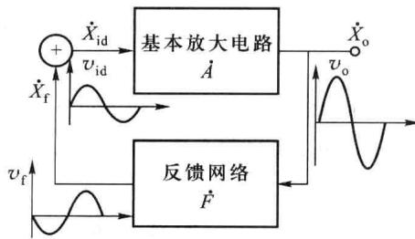  

图 5.4.1 负反馈放大电路的自激振荡

达到动态平衡,即反馈信号 $\dot{X}_{f}$ (此时就是净输入信号) 维持输出信号 $\dot{X}_{o}$ , 输出信号 $\dot{X}_{o}$ 维持反馈信号 $\dot{X}_{f}$ , 它们互相依存, 电路产生了自激振荡。

电路产生自激振荡时,输出信号有其特定的频率 $f_{0}$ 和幅值。电路一旦产生自激振荡将失去放大作用,称电路处于不稳定状态。

由此可知,负反馈放大电路产生自激振荡的根本原因是反馈环产生的附加相移,使中频区的负反馈到低频区或高频区变成正反馈。

## 二、自激振荡的平衡条件

根据反馈的基本方程可知, 当 $1 + \dot{A}\dot{F} = 0$ 时, 闭环增益 $\dot{A}_{f}$ 为无穷大, 此时即使没有输入信号, 放大电路也有输出, 电路产生了自激, 因此产生自激振荡的条件为

$$

\dot {A} \dot {F} = - 1\tag{5.4.1}

$$

它包括幅值和相位两个方面,可写成模和相位的形式

$$

\left| \dot {A} \dot {F} \right| = 1\tag{5.4.2}

$$

$$

\varphi_ {\mathrm{A}} + \varphi_ {\mathrm{F}} = \pm (2 n + 1) \times 1 8 0 ^ {\circ} (n = 0, 1, 2, \dots)\tag{5.4.3}

$$

该式称为自激振荡的平衡条件,式(5.4.2)称为幅度平衡条件,式(5.4.3)称为相位平衡条件,只有同时满足上述两个条件,电路才会自激振荡。

为了突出附加相移的作用,上述自激振荡的平衡条件也常写成

$$

\left\{ \begin{array}{l} | \dot {A} \dot {F} | = 1 \\ \Delta \varphi_ {\mathrm{A}} + \Delta \varphi_ {\mathrm{F}} = \pm 1 8 0 ^ {\circ} \end{array} \right.\tag{5.4.4}

$$

电路从开始振荡到进入稳定状态有一个短暂的建立过程,在此期间,电路是增幅振荡,信号每经过一次反馈、放大循环,幅度就增加一些,直至受器件非线性的限制而稳定在等幅状态,所以电路的起振条件为

$$

\mid \dot {A} \dot {F} \mid > 1\tag{5.4.5}

$$

$$

\Delta \varphi_ {\mathrm{A}} + \Delta \varphi_ {\mathrm{F}} = \pm 1 8 0 ^ {\circ}\tag{5.4.6}

$$

如果 $\Delta\varphi_{A}+\Delta\varphi_{F}=\pm180^{\circ}$ ，但环路增益 $\left|\dot{A}\dot{F}\right|<1$ ，此时虽然构成正反馈，但反馈量不足，也不会产生自激振荡。

在实际电路中,放大电路一般采用直接耦合方式,反馈网络为纯电阻网络,反馈系数 $\dot{F}$ 与频率无关,即 $\Delta\varphi_{F}=0$ ,因此附加相移仅出现在基本放大电路中,由于采用直接耦合,电路只可能产生高频振荡。在单管放大电路中引入负反馈,最大附加相移为 $-90^{\circ}$ ,相位条件无法得到满足,故不可能产生自激振荡;在两级放大电路中引入负反馈,当频率从零变化到无穷大时,附加相移从 $0^{\circ}$ 变化到 $-180^{\circ}$ ,实际上也不可能自激;只有在三级或三级以上的放大电路中引入负反馈,才有可能同时满足自激振荡的相位和幅度条件。放大电路的级数越多,引入反馈以后越容易产生自激振荡。

应当指出,电路的自激振荡是由其电路参数决定的,不会因输入信号的改变而消除。要避免电路产生自激振荡,就必须破坏产生自激的条件,只有消除了自激,放大电路才能可靠地工作。

## 三、稳定性判别

利用反馈放大电路环路增益 $\hat{A}\hat{F}$ 的波特图, 可以判断电路是否产生自激振荡, 即电路是否稳定。如果反馈放大电路在任何频率下都不满足自激条件, 则电路不会产生自激振荡, 即

$$

\left\{ \begin{array}{l} {\mid \dot {A} \dot {F} \mid = 1} \\ {\mid \Delta \varphi_ {\mathrm{A}} + \Delta \varphi_ {\mathrm{F}} \mid <   1 8 0 ^ {\circ}} \end{array} \right.\tag{5.4.7}

$$

或

$$

\left\{ \begin{array}{l} \mid \dot {A} \dot {F} \mid <   1 \\ \mid \Delta \varphi_ {\mathrm{A}} + \Delta \varphi_ {\mathrm{F}} \mid = 1 8 0 ^ {\circ} \end{array} \right.\tag{5.4.8}

$$

以上二式是判断反馈放大电路是否自激的准则。

下面讨论如何利用环路增益 $\dot{A}\dot{F}$ 的波特图进行稳定性判别, 假设两个直接耦合反馈放大电路的 $\dot{A}\dot{F}$ 频率特性如图 5.4.2 所示, 其中, 满足自激振荡相位条件的频率为 $f_{0}$ , 满足幅值条件的频率为 $f_{c}$ 。

在图 5.4.2（a）所示的曲线中，当 $f=f_{0}$ 时， $\Delta\varphi_{A}+\Delta\varphi_{F}=-180^{\circ}$ ，满足式（5.4.6）的相位条件，并且在幅频特性曲线上与之对应的点在横轴上方，即 $\left|\dot{A}\dot{F}\right|>1$ ，满足式（5.4.5）的幅度条件，电路将自激振荡，振荡频率为 $f_{0}$ 。

在图 5.4.2（b）所示的曲线中，当 $f=f_{0}$ 时， $\Delta\varphi_{A}+\Delta\varphi_{F}=-180^{\circ}$ ，幅频特性曲线上与之对应的点在横轴下方，即 $\left|\dot{A}\dot{F}\right|<1$ ，无法满足自激振荡的幅度条件，所以电路不会自激。

综上所述,在已知环路增益波特图的条件下,判断负反馈放大电路是否稳定的方法如下:

(1) 若 $f_{0}$ 不存在, 则电路稳定。

(2) 若 $f_{0}$ 存在，且 $f_{0} > f_{c}$ ，则电路稳定；若 $f_{0} < f_{c}$ ，则电路自激。

## 四、增益裕度、相位裕度

为使电路稳定工作,不仅要避免电路进入自激状态,还要使其远离自激状态,即要有一个稳定的裕量,这样,当环境温度、电源电压、电路参数在一定范围内变化时,电路都能稳定地工作。稳定裕量可以用增益裕度 $G_{m}$ 和相位裕度 $\varphi_{m}$ 来衡量。

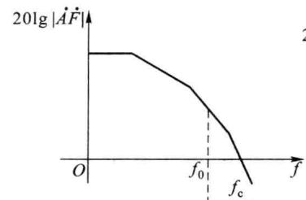

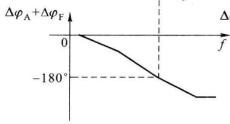  

(a)

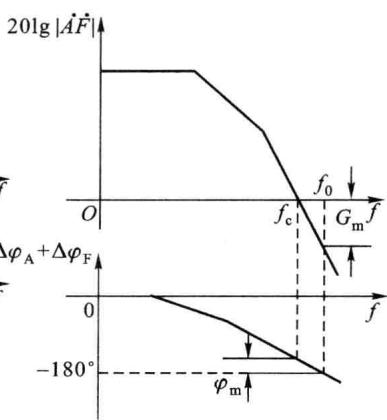  

(b)  

图 5.4.2 反馈放大电路 $\dot{A}\dot{F}$ 波特图

### 1. 增益裕度

如图 5.4.2(b) 所示, 当 $f = f_{0}$ 时, $\dot{A}\dot{F}$ 的附加相移达到 $\pm180^{\circ}$ , 所对应的环路增益称为增益裕度, 记为

$$

G _ {\mathrm{m}} = 2 0 \lg | \dot {A} \dot {F} | \Bigg | _ {f = f _ {0}}\tag{5.4.9}

$$

对于稳定的负反馈放大电路, 其 $G_{m}<0$ , 而且 $\left|G_{m}\right|$ 越大, 电路越稳定, 一般要求 $G_{m}\leqslant-10\ dB$ 。

### 2. 相位裕度

如图 5.4.2(b) 所示, 当 $f = f_{c}$ 时, $20 \lg | \dot{A} \dot{F} | = 0 \, dB$ , 此时 $\left| \varphi_{A} + \varphi_{F} \right|$ 与 $180^{\circ}$ 的差称为相位裕度 $\varphi_{m}$ , 记为

$$

\varphi_ {\mathrm{m}} = 1 8 0 ^ {\circ} - \left| \varphi (f _ {\mathrm{c}}) \right|\tag{5.4.10}

$$

对于稳定的负反馈放大电路，其 $\varphi_{m}>0$ ，而且 $\varphi_{m}$ 越大，电路越稳定，一般要求 $\varphi_{m}\geqslant45^{\circ}$ 。

在工程实践中,通常要求 $G_{m} \leqslant -10$ dB 且 $\varphi_{m} \geqslant 45^{\circ}$ 时才认为负反馈放大电路具有可靠的稳定性,按此要求设计的反馈放大电路,不仅可以在预定的情况下满足稳定条件,而且当环境温度、电源电压等因素在一定范围内发生变化时,也能满足稳定条件。

## 5.4.2 负反馈放大电路稳定性的分析方法

可以利用基本放大电路开环增益的波特图来分析反馈放大电路的稳定性,为简单起见,仍然假设反馈网络是纯阻性的,即 $\varphi_{F}=0$ 。自激振荡的幅值条件为 $\left|\dot{A}\dot{F}\right|=1$ , 即 $\left|\dot{A}\right|=\left|\frac{1}{\dot{F}}\right|$ , 这样, 就可以在 $20\lg\left|\dot{A}\right|$ 的同一坐标平面上绘制出一条 $20\lg\frac{1}{\dot{F}}$ 的水平线, 称为反馈线, 它与$\dot{A}$ 的幅频特性曲线在交点处满足自激振荡的幅值条件 $\left|\dot{A}\dot{F}\right|=1$ 。此时，通过观察该点所对应的附加相移的大小，即可判断电路是否稳定。

假设一个三极点直接耦合基本放大电路的增益为

$$

\dot {A} = \frac {1 0 0 0 0}{(1 + \mathrm{j} f / 1) (1 + \mathrm{j} f / 1 0) (1 + \mathrm{j} f / 1 0 0)}\tag{5.4.11}

$$

其中，频率单位为 MHz，中频增益为 10 000（80 dB），3 个极点对应的频率分别为 $f_{p1} = 1 \, MHz$ ， $f_{p2} = 10 \, MHz$ ， $f_{p3} = 100 \, MHz$ ，其中 $f_{p1}$ 为主极点，该式对应的波特图如图 5.4.3 所示。

在 $\dot{A}$ 的幅频特性坐标中作高度为 $20\lg \left|\frac{1}{\dot{F}}\right|$ 的反馈线，两曲线相交于 $P$ 点。在 $P$ 点处满足自激振荡的幅值条件 $|\dot{A}\dot{F}| = 1$ （即 $20\lg |\dot{A}\dot{F}| = 0$ dB），观察该点所对应的附加相移 $\Delta \varphi_{\mathrm{A}}$ 的大小，此时 $|\Delta \varphi_{\mathrm{A}}| \leqslant 135^{\circ}$ ，则相位裕度 $\varphi_{\mathrm{m}} \geqslant 45^{\circ}$ ，电路是稳定的。

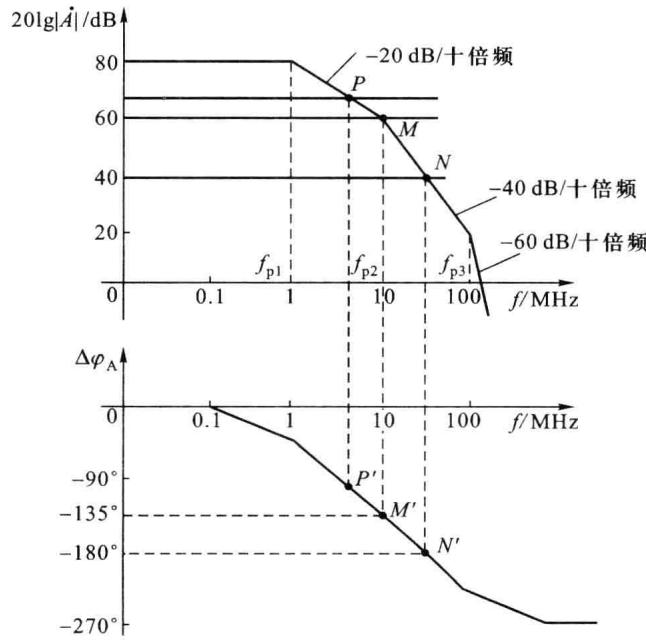  

图 5.4.3 负反馈放大电路稳定性的判别方法

随着反馈加深,反馈系数 $\dot{F}$ 加大,反馈线下移,两曲线的交点 P 下移,相位裕度 $\varphi_{m}$ 减小。当反馈线与 $\dot{A}$ 的幅频特性交于 M 点时,相应的 $\Delta\varphi_{A}=-135^{\circ},\varphi_{m}=45^{\circ}$ ,此时的反馈系数是满足相位裕度要求的最大反馈系数。

若进一步加大反馈系数,当反馈线与 $\dot{A}$ 的幅频特性交于 N 点时,相应的 $\Delta\varphi_{A}=-180^{\circ}$ , $\varphi_{m}=0^{\circ}$ , 同时满足自激振荡的幅度条件和相位条件,电路将产生自激振荡,此时对应的频率 $f_{0}$ 即为振荡频率。

综上分析表明,反馈深度越大,相位裕度越小,电路越容易产生自激。因此,在实际应用中对反馈深度和反馈系数应加以限制,使电路远离自激状态。

## 5.4.3 负反馈放大电路的相位补偿

通过对负反馈放大电路稳定性分析可知,当电路产生自激振荡时,如果在反馈环内增加一些含有电抗元件的电路,改变 $\dot{A}\dot{F}$ 的频率特性,使 $f_{0}$ 不存在,或者即使存在 $f_{0}$ 但 $f_{0}>f_{c}$ ,则自激振荡必然消除,这种补偿方法称为相位补偿或频率补偿,相应的补偿电路称为补偿网络。

相位补偿的目的就是要保证电路稳定,而且要有足够的稳定裕度。相位补偿的指导思想是通过补偿网络将电路各极点的间距拉开,尤其是拉大主极点和其临近极点的间距,从而使电路稳定。下面介绍几种常用的相位补偿方法,为简单起见,仍然假设反馈网络为纯电阻网络。

## 一、滞后补偿

滞后补偿的方法是在基本放大电路中插入一个 RC 电路,使增益 $\dot{A}$ 的相位滞后,改变反馈环 $\dot{A}\dot{F}$ 的相移,从而达到稳定负反馈放大电路的目的。

### 1. 电容滞后补偿

设某直接耦合负反馈放大电路的环路增益幅频特性如图 5.4.4 中虚线所示, 电路中存在 3 个极点: $f_{p1} \sqrt{f_{p2}} \sqrt{f_{p3}}$ , 该电路的上限截止频率由 $f_{p1}$ 确定。

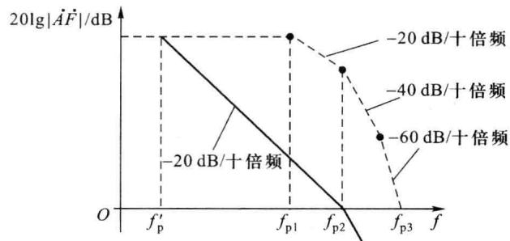  

图 5.4.4 电容滞后补偿前后的幅频特性

电容滞后补偿的方法就是在电路中找出产生 $f_{p1}$ 的那级电路，加入图5.4.5(a)所示的补偿电路，其高频等效电路如图5.4.5(b)所示，其中， $R_{o1}$ 为前级输出电阻， $R_{i2}$ 为后级输入电阻， $C_{i2}$ 为后级输入电容。

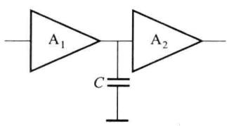  

(a)

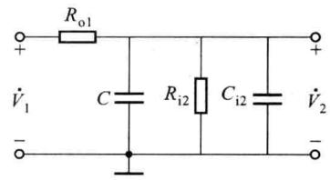  

(b)  

图 5.4.5 电容滞后补偿电路

加入补偿电容前,上限截止频率为

$$

f _ {\mathrm{p1}} = \frac {1}{2 \pi (R _ {\mathrm{o1}} / / R _ {\mathrm{i2}}) C _ {\mathrm{i2}}}

$$

加入补偿电容后,上限截止频率变为

$$

f _ {\mathrm{p}} ^ {\prime} = \frac {1}{2 \pi (R _ {\mathrm{o1}} / / R _ {\mathrm{i2}}) (C _ {\mathrm{i2}} + C)}

$$

显然，补偿前后极点个数没有改变，但 $f_{p}^{\prime}$ 的频率更低，选择合适的电容C，使得补偿后环路增益的幅频特性以-20dB/十倍频斜率下降段加长，如果补偿后使 $f = f_{p2}$ 时， $20\lg |\dot{A}\dot{F}| = 0$ dB，且 $f_{p2} \geqslant 10f_{p}^{\prime}$ ，补偿后的环路增益幅频特性如图5.4.4中实线所示，这样，在幅频特性的横轴上只有一个转折点，表明当 $f = f_{c}$ 时， $\varphi_{A} + \varphi_{F}$ 趋于 $135^{\circ}$ ，即 $f_{0} > f_{c}$ ，并具有 $45^{\circ}$ 的相位裕度，电路消除了自激。

这种补偿方法是以更低的 $f_{p}^{\prime}$ 代替原来的 $f_{p1}$ ，成为电路的主极点，所以也称为主极点补偿。

### 2. RC 滞后补偿

电容滞后补偿虽然可以消除自激,但这种方法是以降低电路的上限截止频率,频带变窄为代价的。采用 RC 滞后补偿不仅可以消除电路的自激振荡,而且可以使带宽损失有所改善,具体方法是在两级放大电路之间接入一个 RC 网络,如图 5.4.6(a) 所示,实现滞后补偿。图 5.4.6(b) 所示是其高频等效电路。

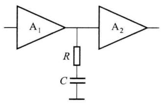  

(a)

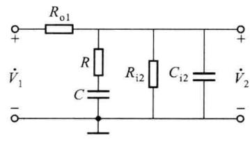  

(b)

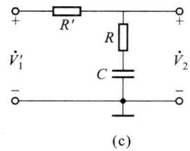  

图 5.4.6 负反馈放大电路中的 RC 滞后补偿

通常,选择 $R \ll (R_{\mathrm{o}1} // R_{\mathrm{i}2})$ , $C \gg C_{i2}$ , 此时可以把图 5.4.6(b) 所示的电路进一步简化成图 5.4.6(c) 所示的形式, 其中

$$

\dot {V} _ {1} ^ {\prime} = \frac {R _ {\mathrm{i2}}}{R _ {\mathrm{o1}} + R _ {\mathrm{i2}}} \dot {V} _ {1}, R ^ {\prime} = R _ {\mathrm{o1}} / / R _ {\mathrm{i2}}

$$

其电压传输函数

$$

\dot {A} ^ {\prime} = \frac {\dot {V} _ {2}}{\dot {V} _ {1} ^ {\prime}} = \frac {R + \frac {1}{\mathrm{j} \omega C}}{R + R ^ {\prime} + \frac {1}{\mathrm{j} \omega C}} = \frac {1 + \mathrm{j} \omega R C}{1 + \mathrm{j} \omega (R + R ^ {\prime}) C} = \frac {1 + \mathrm{j} f / f _ {\mathrm{z}}}{1 + \mathrm{j} f / f _ {\mathrm{p}} ^ {\prime \prime}}

$$

其中

$$

f _ {z} = \frac {1}{2 \pi R C}

$$

$$

f _ {\mathrm{p}} ^ {\prime \prime} = \frac {1}{2 \pi (R + R ^ {\prime}) C}

$$

补偿电路产生一个极点和一个零点，且 $f_{z}>f_{p}^{\prime\prime}$ 。选择合适的RC，可以使 $f_{z}=f_{p2}$ ，即新产生的零点与原来的第二个极点抵消，同时用 $f_{p}^{\prime\prime}$ 代替原来的 $f_{pl}$ 。

若补偿前放大电路的环路增益表达式为

$$

\dot {A} \dot {F} = \frac {\dot {A} _ {\mathrm{m}} \dot {F}}{(1 + \mathrm{j} f / f _ {\mathrm{p1}}) (1 + \mathrm{j} f / f _ {\mathrm{p2}}) (1 + \mathrm{j} f / f _ {\mathrm{p3}})}

$$

并且 RC 的取值使 $f_{z}=f_{p2}$ ，则补偿后放大电路环路增益的表达式为

$$

\dot {A} \dot {F} = \frac {\dot {A} _ {\mathrm{m}} \dot {F}}{(1 + \mathrm{j} f / f _ {\mathrm{p}} ^ {\prime \prime}) (1 + \mathrm{j} f / f _ {\mathrm{p3}})}

$$

RC 滞后补偿的思想是设法在增益 $\dot{A}$ 的表达式中产生一个零点，与分母中的一个极点对消，从而展宽频带。本例中，采用新产生的零点抵消电路的第二个极点，同时降低了第一个极点的频率。图 5.4.7 所示为 RC 滞后补偿前后的放大电路的幅频特性，虚线①为补偿前的幅频特性曲线，实线②为补偿后的幅频特性曲线，可见，曲线在整个横轴之上均以 -20 dB/十倍频的斜率下降，在幅频特性的横轴上只有一个转折点，曲线与横轴交于 $f_{p3}$ 处，在该点的附加相移为 $-135^{\circ}$ ，并具有 $45^{\circ}$ 的相位裕度，电路消除了自激。

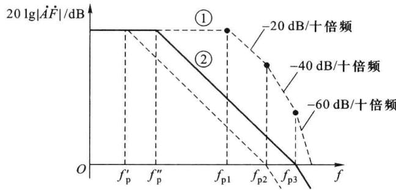  

图5.4.7 RC滞后补偿前后的幅频特性

RC 滞后补偿与电容滞后补偿相比,带宽有所改善,图 5.4.7 中, $f_{p}^{\prime\prime}$ 为 RC 滞后补偿幅频特性主极点的频率, $f_{p}^{\prime}$ 为电容补偿幅频特性主极点的频率,可见,RC 滞后补偿可以获得较宽的频带。

### 3. 密勒效应补偿

上述两种补偿需要的电容、电阻值都比较大,不利于集成,实际工作中常常利用密勒效应,将补偿电路跨接在放大电路的输入端和输出端之间,如图5.4.8所示,这种补偿称为密勒效应补偿。利用密勒效应,小电容(几皮法至几十皮法)即可获得满意的补偿效果,便于

集成电路的制造。

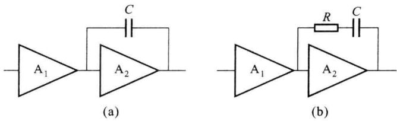  

图 5.4.8 密勒效应补偿电路

在集成运放 F007 中就采用了这种相位补偿方式。假设在图 5.4.8(a) 中，跨接在 $A_{2}$ 之间的电容 C 为 30 pF，若 $A_{2}$ 的增益为 1000，则相当于在中间级的输入端对地之间并联了一个 30000 pF 的电容，补偿效果很好。

## 二、超前补偿

设法改变负反馈放大电路环路增益 $|\dot{A}\dot{F}| = 1$ 点的相位，使之超前，也能破坏其自激振荡条件，这种补偿方法称为超前补偿。同滞后补偿相比，超前补偿不仅可使电路稳定工作，还能扩展频带。在实际应用中，通常将补偿电容加在反馈网络中，如图5.4.9所示。

在图 5.4.9 中, 基本放大电路采用差分输入, 其增益为 $\dot{A}$ , 反馈网络由 $R_{1}$ 、 $R_{2}$ 和 C 构成, 反馈类型是电压串联负反馈。未加补偿电容时, 电路的反馈系数

$$

\dot {F} ^ {\prime} = \frac {R _ {1}}{R _ {1} + R _ {2}}

$$

加入补偿电容 C, 使 C 和 $R_{2}$ 并联, 电路的反馈系数

$$

\dot {F} = \frac {R _ {1}}{R _ {1} + R _ {2} / / \frac {1}{\mathrm{j} \omega C}} = \frac {R _ {1}}{R _ {1} + R _ {2}} \cdot \frac {1 + \mathrm{j} \omega R _ {2} C}{1 + \mathrm{j} \omega (R _ {1} / / R _ {2}) C} = \dot {F} ^ {\prime} \cdot \frac {1 + \mathrm{j} f / f _ {\mathrm{z}}}{1 + \mathrm{j} f / f _ {\mathrm{p}}}

$$

其中

$$

\begin{array}{r l} & f _ {z} = \frac {1}{2 \pi R _ {2} C} \\ & f _ {\mathrm{p}} = \frac {1}{2 \pi (R _ {1} / / R _ {2}) C} \end{array}

$$

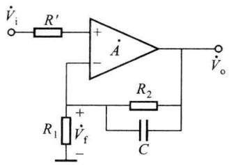  

图 5.4.9 超前补偿电路

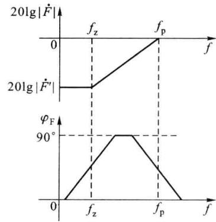  

图 5.4.10 加入补偿电容后反馈系数的频率特性

显然 $f_{z}<f_{p},\dot{F}$ 的波特图如图5.4.10所示，由图可以看出，补偿电路输出电压 $\dot{V}_{f}$ 的相位超前于 $\dot{V}_{o}$ ，即补偿电路在 $f_{z}$ 和 $f_{p}$ 之间提供正的相角，相位超前，最大超前相移为 $90^{\circ}$ 。如果补偿前 $f_{z}<f_{c}<f_{p}$ ，且 $f_{0}<f_{c}$ ，则补偿后 $f_{0}$ 将因 $\varphi_{F}$ 的超前相移而增大，适当调整参数，使 $f_{0}>f_{c}$ ，从而使电路消除自激振荡。

综上所述,无论是滞后补偿,还是超前补偿,都可以用很简单的电路来实现。

下面通过一个实用电路来进一步理解负反馈放大电路的相位补偿方法，图5.4.11所示为集成宽带放大器MC1553的内部电路，该电路的电压增益约为50，上限截止频率可达 $45\mathrm{MHz}$ 。整个电路由8只NPN型管、9个电阻和2个电容 $(C_1,C_2)$ 组成。 $\mathrm{T}_{1}\sim \mathrm{T}_{3}$ 为三级共射放大器级联，以获得足够高的开环增益； $\mathrm{T}_4$ 为射极跟随器作缓冲输出级； $\mathrm{T}_{5}\sim \mathrm{T}_{8}$ 组成多路电流源，为电路提供偏置电流； $C_1,C_2$ 是制作在硅片上的相位补偿电容，容量为几皮法。其中 $C_1$ 是密勒补偿电容，其作用是实现极点分离，由于 $\mathrm{T}_{2}$ 基极输入电阻较小，该补偿电路产生的极点对应频率比较高； $C_2$ 与 $R_{5},R_{2}$ 一起构成超前补偿电路，实现超前补偿。

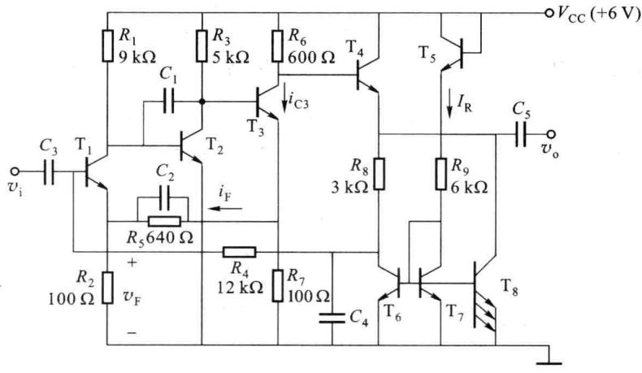  

图 5.4.11 集成宽带放大器 MC1553 的内部电路

在图 5.4.11 所示电路中，电阻 $R_{2}$ 接于 $T_{1}$ 的发射极，对第一级构成电流串联负反馈，属于局部反馈。电阻 $R_{7}$ 接于 $T_{3}$ 的发射极，对第三级构成电流串联负反馈，也属于局部反馈。电流源 $T_{8}$ 、电阻 $R_{8}$ 并联在 $T_{4}$ 的发射极，对第四级构成电压串联负反馈，同样属于局部反馈。

输出 $v_{0}$ 通过 $R_{8}$ 、 $C_{4}$ 、 $R_{4}$ 连接到 $T_{1}$ 的基极，这是包围整个电路的负反馈，由于反馈网络中含有旁路电容 $C_{4}$ ， $T_{6}$ 的集电极交流接地，因而该反馈是直流负反馈，其作用是稳定整个电路的直流工作点，特别是稳定输出端的直流电压，保证输出电压有足够大的动态范围。 $T_{3}$ 的发射极通过 $R_{7}$ 、 $R_{5}$ 、 $C_{2}$ 、 $R_{2}$ 连到 $T_{1}$ 的发射极，构成级间反馈，属于交、直流负反馈，且为电流串联负反馈。放大电路的性能主要由级间反馈决定，在该电路中，起主要作用的是第二个级间反馈环路。
