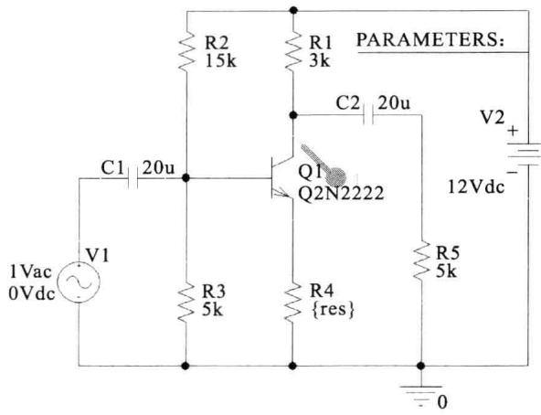
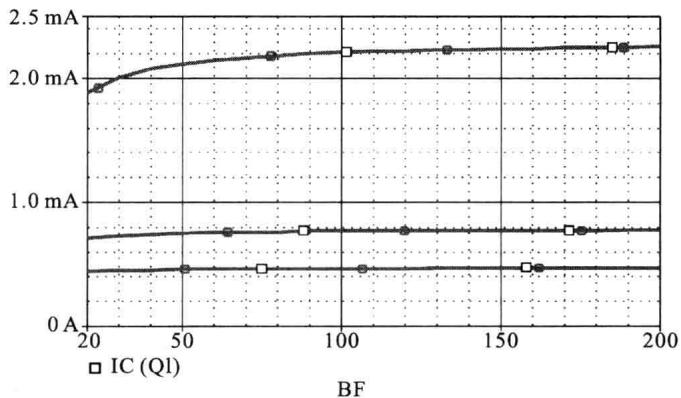

import Guide from '@/components/Guide.astro';
import Knowledge from '@/components/Knowledge.astro';
import Example from '@/components/Example.astro';
import Analysis from '@/components/Analysis.astro';
import Solution from '@/components/Solution.astro';
import Variant from '@/components/Variant.astro';
import Note from '@/components/Note.astro';
import Block from '@/components/Block.astro';
import Method from '@/components/Method.astro';
import Exercise from '@/components/Exercise.astro';

通过前面的分析可知,负反馈能够稳定放大电路的静态工作点,也能够稳定放大电路的增益,下面通过 OrCAD 的仿真来说明这一点。仿真原理图如图 5.5.1 所示,该电路是由晶体管 Q1 组成的分压式单管共射放大电路, 反馈电阻为 $R_{4}$ , 反馈类型为电压串联负反馈, 其中电阻 $R_{4}$ 的阻值已被设置为可变参数值 res。

  

图 5.5.1 分压式工作点稳定电路的原理图

为了观察引入负反馈电阻 $R_{4}$ 后对放大电路工作点的稳定作用, 对仿真参数做出如下设置:

（1）在 DC Sweep 的 Primary Sweep 中选择 Model Parameter，并在右边依次选择 NPN、Q2N2222 以及 BF 参数（即为晶体管的 $\beta$ ），从而可以观察加入负反馈后晶体管的 $\beta$ 发生变化时的工作点电流 $I_{CQ}$ 的变化情况。最后，在扫描类型中选择为线性扫描，起点为 20，终点为 200，步长为 5。

（2）在 Second Sweep 中选择进行全局参数扫描，所选择的参数为 res，即电阻 $R_{4}$ 的阻值。扫描类型设置为列表，范围为 1 kΩ、3 kΩ、5 kΩ。

对应于以上参数设置的仿真结果如图 5.5.2 所示。

  

图 5.5.2 负反馈电阻取不同值时对工作点电流的稳定

从图 5.5.2 中可以看出,加入负反馈电阻后,当晶体管的 $\beta$ 在较大范围内变化时,其集电极电流的变化范围也小了很多,从而保持了工作点的稳定。此外还可以看出,随着负反馈电阻阻值的增大,反馈深度也逐渐加大,对工作点电流的稳定作用也随之增强,这与此前的推理是保持一致的。
