import Guide from '@/components/Guide.astro';
import Knowledge from '@/components/Knowledge.astro';
import Example from '@/components/Example.astro';
import Analysis from '@/components/Analysis.astro';
import Solution from '@/components/Solution.astro';
import Variant from '@/components/Variant.astro';
import Note from '@/components/Note.astro';
import Block from '@/components/Block.astro';
import Method from '@/components/Method.astro';
import Exercise from '@/components/Exercise.astro';

## 习题

<Exercise title="习题 5.1.1">
在图题 5.1.1 所示的各电路中,试指明反馈网络是由哪些元件组成的,并判断所引入的反馈是正反馈还是负反馈,是直流反馈还是交流反馈。

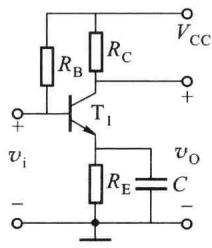  

(a)

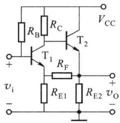  

(b)

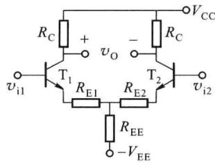  

(c)

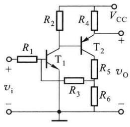  

(d)

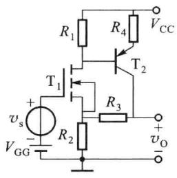  

(e)  

图题5.1.1

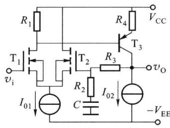  

(f)

<Solution>
(a) $R_{\mathrm{E}}$ 直流负反馈
(b) $R_{\mathrm{F}}$ 和 $R_{\mathrm{E1}}$ 交直流正反馈
(c) $R_{\mathrm{EE}}, R_{\mathrm{E1}}$ 和 $R_{\mathrm{E2}}$ 直流负反馈； $R_{\mathrm{E1}}, R_{\mathrm{E2}}$ 交流负反馈
(d) $R_{3}$ 和 $R_{6}$ 交、直流正反馈
(e) $R_{3}$ 和 $R_{2}$ 交、直流负反馈
(f) $R_{3}, R_{2}$ 和 $C$ 交流负反馈； $R_{3}$ 直流负反馈
</Solution>
</Exercise>

<Exercise title="习题 5.1.2">
在图题 5.1.1 所示的各电路中,哪些能够稳定输出电压?哪些能够稳定输出电流?

<Solution>
(e)、(f)能稳定输出电压；(c)能稳定输出电流
</Solution>
</Exercise>

<Exercise title="习题 5.1.3">
试判断图题 5.1.1 所示各电路的交流负反馈类型，并写出反馈系数的表达式。

<Solution>
(c) 电流串联负反馈, $F_{r}=R_{E1}$ (e) 电压串联负反馈, $F_{v}=\frac{R_{2}}{R_{2}+R_{3}}$ (f) 电压串联负反馈, $F_{v}=\frac{R_{2}}{R_{2}+R_{3}}$
</Solution>
</Exercise>

<Exercise title="习题 5.1.4">
电路如图题 5.1.4 所示,试判断各电路的交流反馈组态,哪些能够稳定输出电压?哪些能够稳定输出电流?并写出反馈系数的表达式。

<Solution>
(a) 电流并联；(b) 电流串联；(c) 电压并联
</Solution>
</Exercise>

<Exercise title="习题 5.1.5">
某半导体收音机的输入级如图题 5.1.5 所示。试判断该电路中有没有反馈,如果有反馈,属于何种反馈组态?

<Solution>
存在反馈
</Solution>
</Exercise>

<Exercise title="习题 5.1.6">
图题 5.1.6 所示电路由两个负反馈放大电路(分别用①、②表示)串联而成。

(1) 若①是电压并联负反馈, 则②应采用什么负反馈为宜?

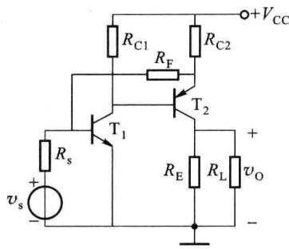  

(a)

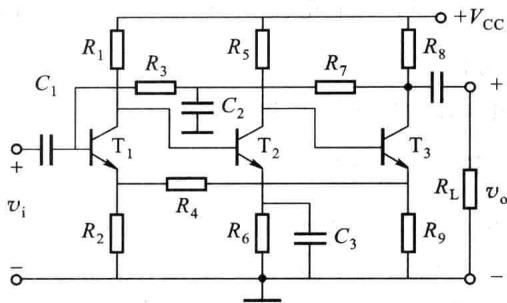  

(b)

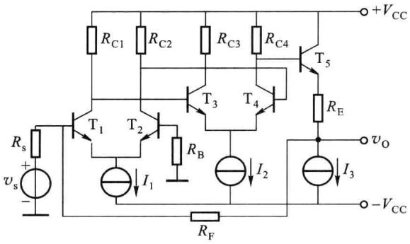  

(c)  

图题5.1.4

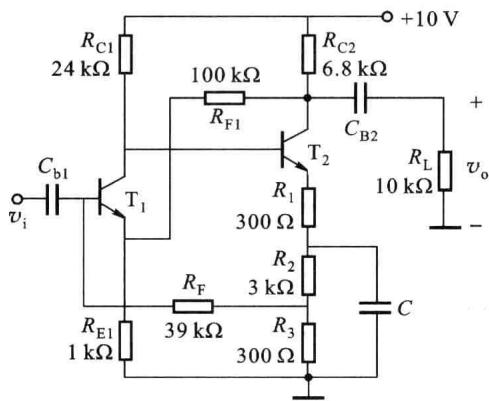  

图题5.1.5

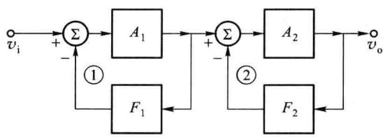  

图题5.1.6

(2) 若②是电压并联负反馈, 则①应采用什么负反馈为宜?

(提示:从信号源内阻对负反馈效果的影响考虑。)

<Solution>
（1）电压串联或电流串联负反馈；（2）电流串联或电流并联负反馈
</Solution>
</Exercise>

<Exercise title="习题 5.1.7">
某负反馈放大电路的框图如图题 5.1.7 所示, 已知其开环电压增益为 $A_{v}=2\ 000$ , 反馈系数 $F_{v}=0.05$ , 若输出电压 $v_{0}=2\ V$ , 求输入电压 $v_{1}$ 、反馈电压 $v_{F}$ 及净输入电压 $v_{ID}$ 的值。

<Solution>
$v_{\mathrm{I}} = 0.101\mathrm{V}, v_{\mathrm{F}} = 0.1\mathrm{V}, v_{\mathrm{ID}} = 0.001\mathrm{V}$
</Solution>
</Exercise>

<Exercise title="习题 5.1.8">
某放大电路由三级负反馈回路组成,如图题 5.1.8 所示,假设级间的相互影响可以忽略不计,试计算该放大电路的增益。

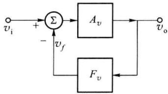

<Solution>
1000
</Solution>
</Exercise>

<Exercise title="习题 5.1.9">
某负反馈放大电路的框图如图题 5.1.9 所示, 试证明:

图题5.1.7

$$

\dot {A} _ {\mathrm{f}} = \frac {\dot {X} _ {\mathrm{o}}}{\dot {X} _ {\mathrm{i}}} = \frac {\dot {A} _ {1} \dot {A} _ {2}}{1 + \dot {A} _ {2} \dot {F} _ {2} + \dot {A} _ {1} \dot {A} _ {2} \dot {F} _ {1}}

$$

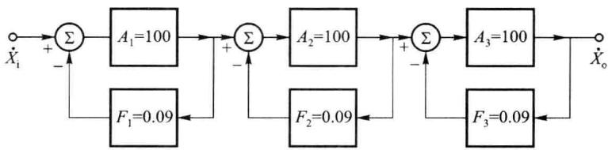  

图题5.1.8

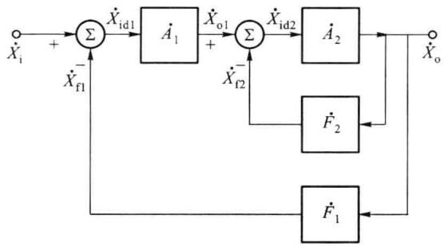  

图题5.1.9

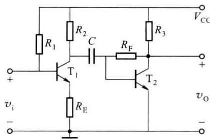  

图题5.1.10
</Exercise>

<Exercise title="习题 5.1.10">
在图题 5.1.10 所示电路中采用了哪些反馈类型？证明该电路的闭环电压增益为 $\dot{A}_{\mathrm{rf}} = \frac{R_{\mathrm{F}}}{R_{\mathrm{E}}}$

<Solution>
第一级电流串联,第二级电压并联
</Solution>
</Exercise>

<Exercise title="习题 5.2.1">
某电压串联负反馈放大电路，开环增益 $A_{v}=10\ 000$ ，反馈系数 $F_{v}=0.002$ 。

(1) 求闭环电压增益 $A_{vf}$ ;

（2）因温度降低，静态工作点 $Q$ 下降，使 $\left|A_{v}\right|$ 下降 $10\%$ ，求此时的闭环增益 $A_{vf}^{\prime}$ 。

<Solution>
476.2,473.7
</Solution>
</Exercise>

<Exercise title="习题 5.2.2">
已知某反馈放大器的闭环增益 $A_{rf}=50\ k\Omega$ ，如果开环增益 $A_{r}$ 增加4倍，则闭环增益变为 $A_{rf}=51\ k\Omega$ ，试计算该电路的开环增益 $A_{r}$ 和反馈系数 $F_{g}$ 的值。

<Solution>
$A_{r} = 2040,F_{g} = 0.0195$
</Solution>
</Exercise>

<Exercise title="习题 5.2.3">
某种型号晶体管由于参数变化使放大电路的电压增益改变了20%，现希望引入负反馈后增益为-100，而其变化只有1%，试计算基本放大电路所需的开环增益和反馈系数。

<Solution>
$A = -2000, F = -0.0095$
</Solution>
</Exercise>

<Exercise title="习题 5.2.4">
一个多级放大电路如图题 5.2.4 所示。试说明为了实现以下要求,应该分别引入什么反馈组态?分别画出加入反馈后的电路图。

(1) 进一步稳定各直流工作点；

(2) 负载电阻 $R_{L}$ 变动时, 输出电压 $v_{0}$ 基本不变, 而且输入级向信号源索取电流较小;

(3) 要求负载电阻 $R_{L}$ 变动时, 输出电流 $i_{0}$ 基本不变。

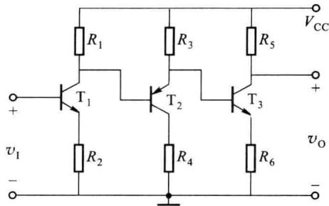  

图题5.2.4
</Exercise>

<Exercise title="习题 5.2.5">
对某开环放大电路引入负反馈,如果希望其非线性失真系数由10%降至0.5%,同时要求该电路从信号源索取的电流尽可能小,负载 $R_{L}$ 变化时输出电压尽可能稳定。

(1) 应当引入什么样的反馈?

(2) 若引入反馈前电路的增益 $A=10^{4}$ ，问反馈系数应为多大？

(3) 为保持输出电压幅度不变, 输入电压幅度应如何调整?

(4) 引入反馈后,电路的闭环增益是多少?
</Exercise>

<Exercise title="习题 5.2.6">
某放大电路的频率特性如图题 5.2.6 所示。

（1）该电路的中频增益是多少？下限截止频率 $f_{L}$ =？上限截止频率 $f_{H}$ =？

(2) 引入电压串联负反馈,使通频带展宽为 $1 \, Hz \sim 5 \, MHz$ , 所需的反馈系数是多少? 闭环增益是多少?

<Solution>
(1) 60 dB, 50 Hz, $10^{5}$ Hz
</Solution>
</Exercise>

<Exercise title="习题 5.2.7">
判断下面的说法是否正确。

（1）任何负反馈放大电路的增益带宽乘积都是一个常数；

(2) 负反馈可以展宽频带, 因此只要反馈深度足够深, 可以用低频管代替高频管;

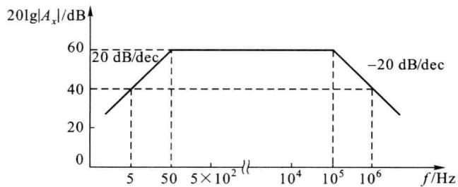

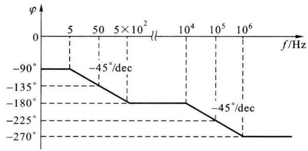  

图题5.2.6

（3）当输入信号是一个失真的正弦波时，引入负反馈后能使失真得到改善；

（4）只要放大电路的负载恒定，不管哪种反馈都能使稳定电压增益；

（5）在深度负反馈条件下，由于闭环增益 $\dot{A}_{f} \approx 1/\dot{F}$ ，与管的参数几乎无关，因此可以任意选择晶体管来组成放大级；

(6) 负反馈只能改善反馈环路内的电路性能, 对反馈环路之外无效。
</Exercise>

<Exercise title="习题 5.2.8">
某放大电路的电压增益为 80 dB, 引入负反馈后增益变为 40 dB, 求反馈系数。若引入反馈前电路的非线性失真系数为 6%, 求引入反馈后的非线性失真系数。

<Solution>
(1) $F = 0.0099$

(2) $N_{\mathrm{f}} = 0.06\%$
</Solution>
</Exercise>

<Exercise title="习题 5.2.9">
负反馈放大电路可以展宽通频带,图题 5.2.9 画出了三种负反馈放大电路的频率特性,你认为哪一种是正确的?

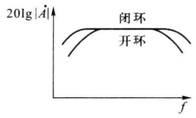

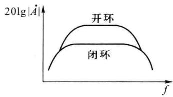

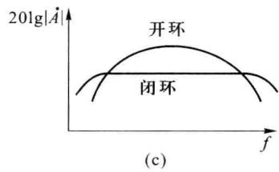  

图题5.2.9

<Solution>
(b)
</Solution>
</Exercise>

<Exercise title="习题 5.2.10">
图题 5.2.10 是某晶体管毫伏表电路中的一部分。

(1) 判断级间交流反馈的组态；

(2) 求反馈系数 $\dot{F}$ ;

（3）已知该毫伏表的频率范围为 $20 \, Hz \sim 1 \, MHz$ ，若在 $R_{3}$ 两端并联一个 $300 \, pF$ 的小电容，对电路频带有何影响？

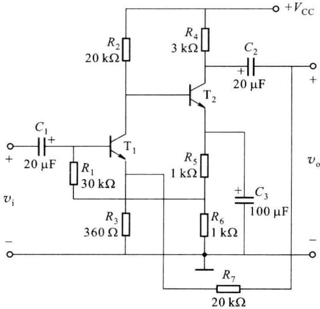  

图题5.2.10
</Exercise>

<Exercise title="习题 5.3.1">
反馈放大电路如图题 5.3.1 所示。

(1) 判断电路级间反馈的类型和极性；

(2) 说明该反馈对电路增益、输入和输出电阻的影响；

（3）设满足深度负反馈条件，且电路的共模抑止比较大，试估算电压增益。

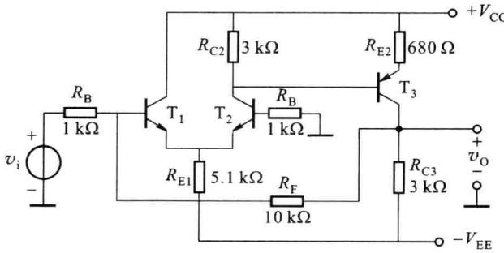  

图题5.3.1

<Solution>
（1）电压并联负反馈

(2) 闭环增益绝对值减小, 输入电阻和输出电阻也减小

(3) $A_{\mathrm{vf}} = -\frac{R_{\mathrm{F}}}{R_{\mathrm{B}}} = -10$
</Solution>
</Exercise>

<Exercise title="习题 5.3.2">
反馈放大电路如图题 5.3.2 所示, 每一级都引入深度负反馈。

(1) 计算图题 5.3.2(a) 所示电路的源电压增益；

(2) 计算图题 5.3.2(b) 所示电路的电压增益。

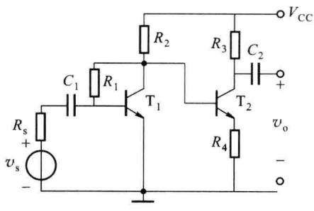  

(a)

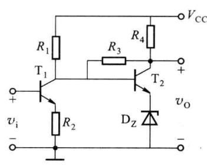  

(b)  

图题5.3.2

<Solution>
(a) $A_{vsf} = \frac{R_1R_3}{R_sR_4}$ ; (b) $A_{vf} = \frac{R_3}{R_2}$
</Solution>
</Exercise>

<Exercise title="习题 5.3.3">
某反馈放大电路如图题 5.3.3 所示。

(1) 判断电路的反馈类型和极性；

(2) 设电路满足深度负反馈, 试估算电路的闭环电压增益 $A_{vf}$ 和输入电阻 $R_{i}$ 。

<Solution>
(1) 电压串联；(2) $\frac{R_2 + R_3}{R_2}; R_{\mathrm{i}} \approx R_{\mathrm{B}}$
</Solution>
</Exercise>

<Exercise title="习题 5.3.4">
反馈放大电路如图题 5.3.4 所示, 设满足深度负反馈条件, 电容 $C_{1}$ 、 $C_{2}$ 对交流短路, 试估算该电路的源电压增益。

<Solution>
-10
</Solution>
</Exercise>

<Exercise title="习题 5.3.5">
反馈放大电路如图题 5.3.5 所示, 设满足深度负反馈条件, 电容 $C_{1}$ 、 $C_{2}$ 对交流短路, 试估算其电流增益和源电压增益。

<Solution>
5,50
</Solution>
</Exercise>

<Exercise title="习题 5.3.6">
反馈放大电路如图题 5.3.6 所示,试判断电路的反馈类型和极性,求反馈系数,假设电路满足深度负反馈条件,估算其电压增益。

<Solution>
电压并联负反馈，反馈系数 $F_{g} = -1 / R_{\mathrm{F}} = -0.5 \mathrm{~mS}, A_{\mathrm{vf}} = -\frac{R_{\mathrm{F}}}{R_{\mathrm{s}}} = -10$
</Solution>
</Exercise>

<Exercise title="习题 5.3.7">
集成宽带放大器 MC1553 的内部电路如图题 5.3.7 所示, 其中 $C_{1}$ 、 $C_{2}$ 是制作在硅片上的相位补偿电容, 容量为几皮法, $T_{8}$ 为多发射极晶体管。试说明该电路都存在哪些反馈。假设电路满足深度负反馈条件, 估算其电压增益 $A_{vf} = \frac{v_{o}}{v_{i}}$ 。

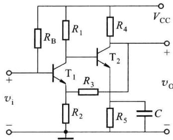  

图题5.3.3

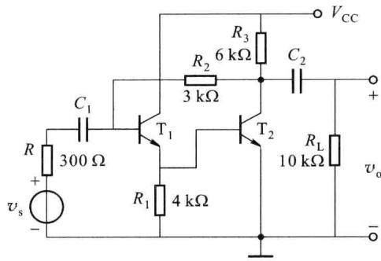  

图题5.3.4

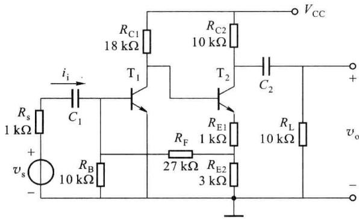  

图题5.3.5

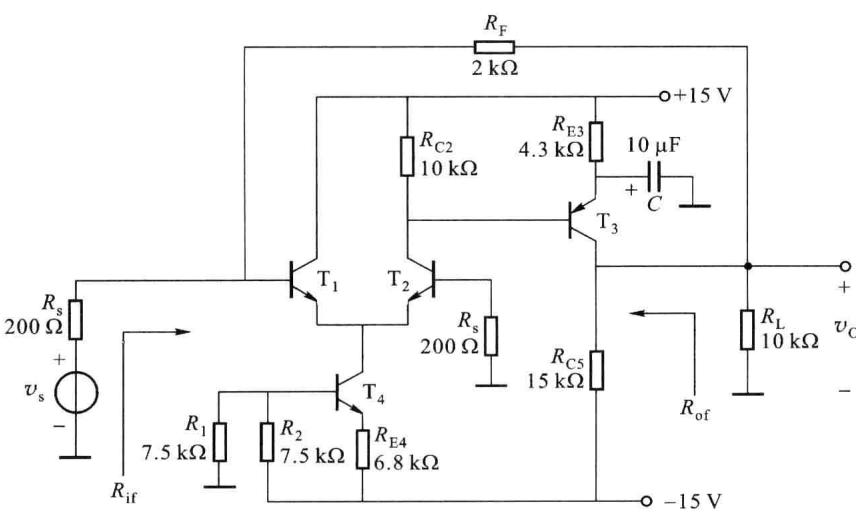  

图题5.3.6

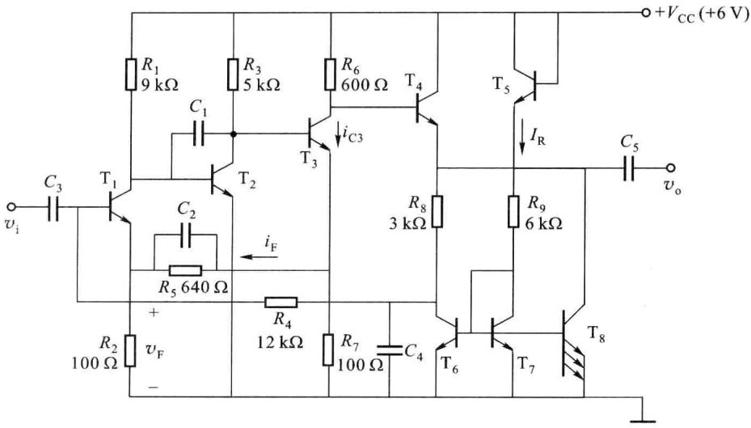  

图题5.3.7

<Solution>
-50.4
</Solution>
</Exercise>

<Exercise title="习题 5.3.8">
某电压串联负反馈放大电路，在中频输入且输出电压波形不失真的情况下测得表题 5.3.8 所示的一组数据。忽略反馈网络的负载效应，试估算该电路的反馈系数、反馈深度及闭环输出电阻。

表题5.3.8

<table><tr><td></td><td> $V_i$ </td><td> $V_o(R_L=\infty)$ </td><td> $V'_o(R_L=4.7\ k\Omega)$ </td></tr><tr><td>无负反馈</td><td>5 mV</td><td>1.35 V</td><td>0.95 V</td></tr><tr><td>加入负反馈</td><td>15 mV</td><td>1.35 V</td><td></td></tr></table>

<Solution>
反馈深度 $|1 + \dot{A}_v\dot{F}_v| = 3$ ，反馈系数 $|\dot{F}_v| \approx 0.0074$

$$
R _ {\mathrm{of}} = \frac {R _ {\mathrm{o}}}{\left| 1 + \dot {A} _ {v} \dot {F} _ {v} \right|} \approx 6 6 0 \Omega
$$
</Solution>
</Exercise>

<Exercise title="习题 5.3.9">
在图题 5.3.9 所示的电路中，假设各晶体管的 $\beta$ 值均为 100，发射结的导通压降为 0.6 V。现通过调整 $R_{C1}$ 保证当 $v_{i}=0$ 时 $v_{0}=0$ 。

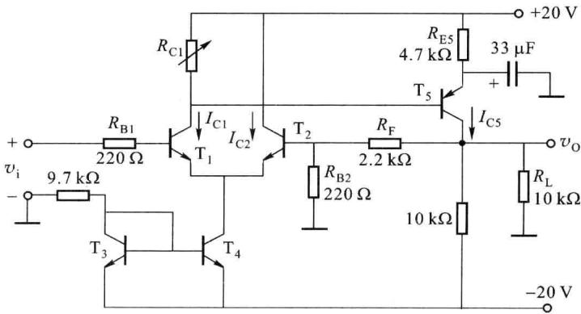  

图题5.3.9

(1) 估算静态电流 $I_{c1}$ 和 $I_{c2}$ ;

(2) 估算静态电流 $I_{C5}$ ，确定电阻 $R_{C1}$ 的数值（设流过 $R_{F}$ 的静态电流可以忽略不计）；

(3) 说明由 $R_{F}$ 引入的反馈类型；

（4）估算电路的电压增益。

<Solution>
(1) $I_{\mathrm{C1}} = I_{\mathrm{C2}} = 1$ mA

(2) 2 mA, 10 kΩ

(3) 电压串联负反馈

(4) 11
</Solution>
</Exercise>

<Exercise title="习题 5.4.1">
某负反馈放大电路高频区波特图如图题 5.4.1 所示。已知 $20 \lg |A| = 100 \, dB, 20 \lg |1/F| = 40 \, dB$ 。试判断该电路是否会产生自激振荡；如果自激，反馈系数 F 应如何改变才会消除自激？

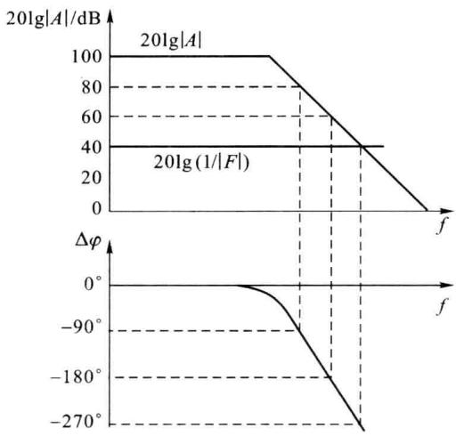  

图题5.4.1

<Solution>
会产生自激振荡,减小反馈系数 F
</Solution>
</Exercise>

<Exercise title="习题 5.4.2">
已知一个负反馈放大电路的基本放大电路的对数幅频特性如图题 5.4.2 所示, 反馈网络由纯电阻组成。试问: 若要求电路稳定工作, 即不产生自激振荡, 则反馈系数的上限值为多少? 简述理由。

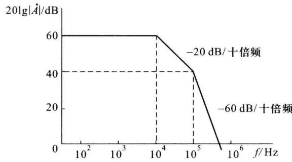  

图题5.4.2

<Solution>
0.01
</Solution>
</Exercise>

<Exercise title="习题 5.4.3">
一负反馈放大电路的反馈系数 F=0.1，开环电压增益为

$$

A _ {v} (\mathrm{j} \omega) = \frac {1 0 ^ {4}}{(1 + \mathrm{j} \frac {6}{1 0 ^ {6}}) (1 + \mathrm{j} \frac {f}{1 0 ^ {7}}) (1 + \mathrm{j} \frac {f}{1 0 ^ {8}})}

$$

试判断该放大电路是否稳定。

<Solution>
不稳定
</Solution>
</Exercise>

<Exercise title="习题 5.4.4">
已知某电压串联负反馈放大电路的开环频率特性如图题 5.4.4 所示。

(1) 写出基本放大电路的电压增益表达式；

（2）若反馈系数 $\dot{F}=0.01$ ，判断引入反馈后电路能否稳定。如能稳定，求出相位裕度；如产生自激，试计算 $45^{\circ}$ 相位裕度下的反馈系数。

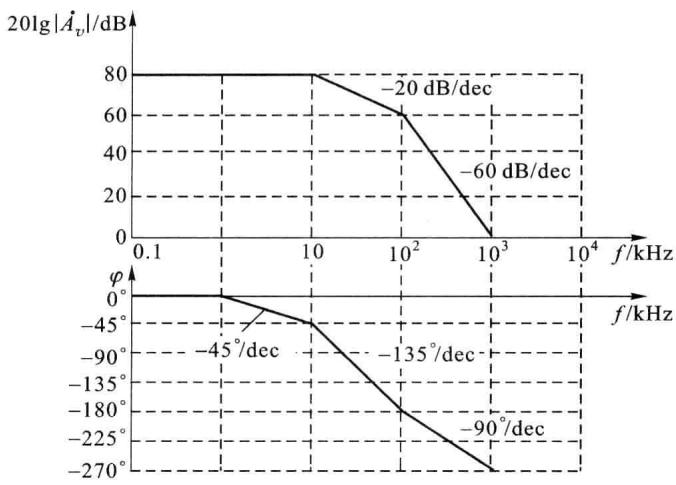  

图题5.4.4

<Solution>
(1) $\dot{A}_v = \frac{10^4}{(1 + \mathrm{j}f / 10)(1 + \mathrm{j}f / 100)^2}$ （频率单位：kHz）

(2) 自激, $F_{v}\approx0.0005$
</Solution>
</Exercise>

<Exercise title="习题 5.4.5">
已知某反馈放大电路的 $\dot{A}\dot{F}$ 波特图如图题 5.4.5 所示, 反馈系数 $\dot{F} = -0.1$ 。

(1) 写出 $\dot{A}$ 的频率特性表示式;

(2) 判断该电路闭环时能否产生自激,并简述其理由;

（3）若要求该电路具有 $\left|G_{m}\right|=10\ dB$ 的幅度裕度，求 $\left|\dot{F}\right|=?$

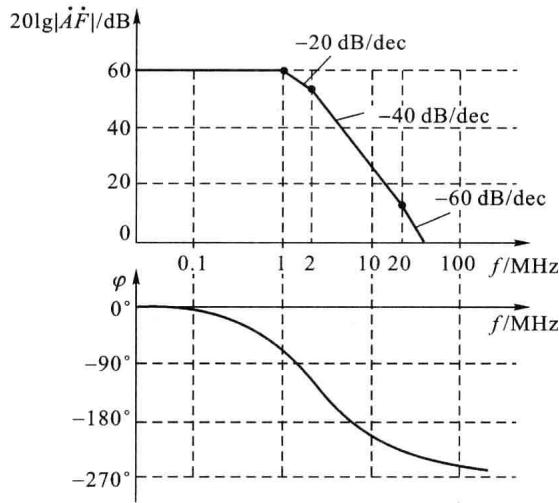  

图题5.4.5

## 第六章 模拟集成电路及其应用

模拟集成电路种类很多,应用非常广泛,常用的主要有集成运算放大器、集成功率放大器、集成模拟乘法器、集成稳压器、集成音响电路、集成滤波器、集成电压比较器以及集成多种功能的可编程模拟器件等。

以集成运算放大器为例，按照集成工艺分类，可以分成双极型、CMOS型和Bi\_FET型。双极型运算放大器一般输入偏置电流及器件功耗稍大，但由于采用多种改进技术，具有良好的性能，所以种类多、功能强。CMOS型运算放大器输入阻抗高、功耗小，可在低电源电压下工作，初期产品精度低、增益小、速度稍慢，但目前已有低失调电压、低噪声、高速度、强驱动能力的产品。Bi\_FET型运算放大器采用双极型晶体管和单极型晶体管混合搭配的生产工艺，可兼顾双极型运算放大器的高增益、高速度以及CMOS型运算放大器的高输入阻抗等特点。例如以场效应管作输入级，使输入电阻高达 $10^{12}\Omega$ 以上。

集成运算放大器按照工作原理分类,可以分成电压放大型、电流放大型、跨导型、互阻型等;按照电源分类,可以分为单电源供电型和双电源供电型;按照在单一芯片上的运算放大器个数分类,有单运放、双运放和四运放。

利用通用的集成运算放大器、模拟乘法器和集成比较器等器件又可以构成各种功能电路，例如：加减乘除运算电路、微分电路、各种滤波电路、调制解调电路、波形发生电路等。

本章主要介绍集成运算放大器、模拟乘法器、电压比较器等模拟集成电路常用芯片的电路组成、工作原理、特性、参数、电路分析方法及其应用。

<Solution>
(1) $\dot{A} = \frac{-10^4}{(1 + \mathrm{j}f / 1)(1 + \mathrm{j}f / 2)(1 + \mathrm{j}f / 20)}$ （频率单位：MHz）

(2) 会自激

(3) $|\dot{F} | \approx 0.0003$
</Solution>
</Exercise>
